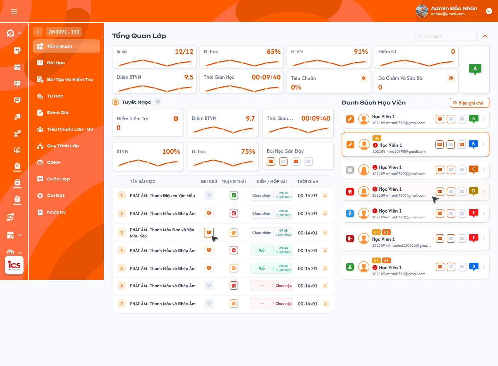
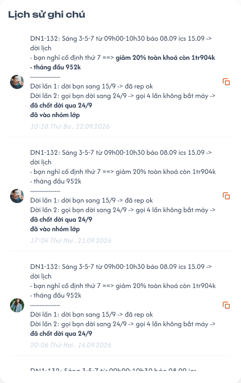

# Chi tiết lớp học — Menu Tổng quan

## 1. UI

### Trang 1: ADM-LOP-020100 — Chi tiết lớp học / Tổng quan



**Mô tả:**
- Đặc tả menu **Tổng quan** của một lớp, không phải các thẻ tổng hợp nhiều lớp ở [Danh sách lớp](./class_management_requirements.md), cũng không phải tab Thông tin trong Cài đặt. Dữ liệu học viên/ghi chú cài đặt dẫn chiếu [Tab Học viên](./class_detail_students_requirements.md); ghi chú lớp dẫn chiếu [Tab Thông tin](./class_detail_information_requirements.md). Số tiền, điểm và nội dung mẫu không phải giá trị cố định.
- Admin, Class Handler, Support, Teacher và Sale xem Tổng quan trong phạm vi lớp được phân quyền. Teacher không có công tắc ON/OFF để xem học phí và ghi chú cài đặt.
- Bố cục: thống kê lớp phía trên; học viên được chọn bên trái; danh sách học viên bên phải.

**Điểm cần lưu ý:**
- Role/phạm vi phải được kiểm tra ở backend; không chỉ ẩn nút trên giao diện.
- Teacher không nhận học phí, ghi chú cài đặt học viên và ghi chú cài đặt lớp qua payload/API Tổng quan chỉ vì các field đang được ẩn. Quyền ghi chú bài học là nghiệp vụ khác (xem mục popup ghi chú giáo viên bên dưới).
- Màn này phục vụ xem dữ liệu; không tự thêm quyền chấm điểm, sửa điểm danh, sửa ghi chú giáo viên hoặc thay trạng thái học viên.
- Badge trạng thái học viên thuộc bộ trạng thái quan hệ lớp đã chốt; không nhầm với trạng thái điểm danh từng bài.
- `A01.01` Tổng Quan Lớp: dữ liệu của đúng class_id đang mở.
- `A01.02` Nút Back / mã lớp: hover hiển thị tooltip Thông tin lớp; click quay về Danh sách lớp (chi tiết ở `A02`).
- `A01.03` Thống kê phía trên: các chỉ số toàn lớp; không đổi thành chỉ số của học viên đang chọn.
- `A01.04` Vùng bên trái: tên, chỉ số và bảng bài học của học viên đang chọn.
- `A01.05` Danh sách bên phải: các học viên của lớp, trạng thái quan hệ lớp, tag, chấm đỏ số lịch hẹn (Admin/Class Handler/Support), tên, mã, email, bài gần đây, đánh giá và dấu >.
- `A01.06` Search: tìm theo tên học viên; không kế thừa rule không-search của tab Học viên trong Cài đặt.
- `A01.07` Công tắc ON/OFF: Admin/Class Handler/Support/Sale sử dụng; Teacher không có control này.
- `A01.08` Dấu ⌃ cạnh search: bấm để thu gọn vùng thống kê Tổng quan toàn lớp phía trên; bấm lại mở rộng. Không thu gọn danh sách hoặc vùng chi tiết học viên.
- `A02.01` Nút Back / mã lớp: hover vùng nút gồm mũi tên và mã lớp để xem tooltip. Click nút quay về Danh sách lớp; hover chỉ hiển thị thông tin, không điều hướng. Mã lớp lấy từ lớp đang mở, ví dụ `IT_TRI2026`. Áp dụng cho Admin, Class Handler, Support, Teacher và Sale có quyền xem Tổng quan lớp.
- `A02.02` Tooltip: khung nền tối, chữ sáng, bo góc, hiển thị ngay dưới nút. Tiêu đề `Thông tin:`; các thông tin theo thứ tự Buổi học, Lịch học, SP, CSKH, Giáo viên, Khai giảng. Chỉ đọc, dùng thông tin lớp từ các chức năng quản lý hiện có. Rời vùng nút/tooltip thì ẩn; click Back điều hướng về Danh sách lớp và đóng tooltip, không giữ lại trên màn đích. Khi đổi lớp, tooltip theo class_id mới, response lớp cũ không ghi đè; không phụ thuộc học viên đang chọn hay công tắc ON/OFF. Hover/ẩn/click Back không thay dữ liệu và không có Toast CRUD.
- `A02.03` Buổi học: số buổi dạng `đã thực hiện/tổng số buổi`, cùng nguồn tiến độ của lớp tại Danh sách lớp, ví dụ `8/12`. Giữ quy tắc xác định buổi đã thực hiện của nguồn; không lấy sĩ số hoặc số học viên nộp BTVN thay số buổi.
- `A02.04` Lịch học: hiển thị đầy đủ lịch học của lớp theo thứ và giờ `HH:mm-HH:mm`. Có thể nhóm các thứ cùng khung giờ như `T3-T5-T7 (09:00-09:10)`; các lịch khác xuống dòng riêng như `T4 (09:00-09:20)` và `T6 (13:00-13:20)`. Không cắt chỉ còn lịch đầu tiên.
- `A02.05` SP: tên Support được gán cho lớp; người phụ trách chính có nhãn `(chính)` như `Long SP (chính)`. Nhiều Support thì hiển thị đầy đủ người được gán và đúng nhãn chính từ nguồn phân công.
- `A02.06` CSKH: nhân sự CSKH của lớp; chưa được gán thì hiển thị `(Chưa có)`. Dữ liệu tải lỗi không được coi là chưa có phân công.
- `A02.07` Giáo viên: tên giáo viên được gán cho lớp từ nguồn phân công, ví dụ `gv01`; nhiều giáo viên thì hiển thị đầy đủ danh sách.
- `A02.08` Khai giảng: ngày khai giảng của lớp theo `DD/MM/YYYY`, ví dụ `27/01/2026`; không dùng ngày tạo lớp thay ngày khai giảng.
- Thống kê học tập trung bình của lớp gồm các thẻ Sĩ số, Đi học, BTVN, Điểm KT, Điểm BTVN, Thời gian học, Tiêu chuẩn và Đã chấm và sửa bài; cạnh khối có badge đánh giá lớp.
- `A03.01` Sĩ số: tử số = số học viên Đang học + Dự thính; mẫu số = tất cả học viên của lớp thuộc đủ 7 trạng thái (Đang học, Dự thính, Hoàn thành, Nghỉ học, Rời lớp, Chỉ xem, Xóa). Dấu / phân cách hai số, không đổi sang %. Mẫu số lấy cả quan hệ trạng thái Xóa, không chỉ đếm danh sách đang hiển thị (ví dụ mỗi trạng thái có một học viên thì là 2/7). Công thức này thay công thức cũ; dùng thống nhất với Danh sách lớp, không đổi công thức Sĩ số KPI có điều kiện học phí.
- `A03.02` Đi học: trung bình cộng tỷ lệ đi học của học viên có dữ liệu trong lớp, dùng cùng công thức mức lớp đã chốt tại Danh sách lớp. Không có dữ liệu thì để trống.
- `A03.03` BTVN: trung bình cộng tỷ lệ làm BTVN của học viên có dữ liệu trong lớp, dùng cùng công thức mức lớp đã chốt tại Danh sách lớp. Không có dữ liệu thì để trống.
- `A03.04` Điểm KT: cộng điểm các bài kiểm tra đã chấm của học viên trong lớp rồi chia số bài đã chấm. Giữ bài của học viên trước đó dù đã Rời lớp/Xóa. Làm tròn kết quả đến 1 chữ số thập phân.
- `A03.05` Điểm BTVN: cộng điểm các bài BTVN đã chấm rồi chia số bài BTVN đã chấm, kể cả bài của học viên đã Rời lớp/Xóa. Tính riêng với KT, làm tròn đến 1 chữ số thập phân.
- `A03.06` Thời gian học: trung bình tổng thời gian từng bài học của từng học viên trên app — cộng các tổng thời gian học viên–bài, chia số bản ghi học viên–bài trong tập tính. Không lấy trung bình các trung bình học viên, không lấy tổng lịch dạy; hiển thị HH:mm:ss. Bản ghi có tổng thời gian thực tế 0 vẫn là dữ liệu 0; bản ghi thiếu dữ liệu không tự biến thành 0 (xem Q02).
- `A03.07` Tiêu chuẩn: % hoàn thành tiêu chuẩn lớp–giáo viên, lấy dữ liệu từ function Tiêu chuẩn; không tự suy ra từ Đi học/BTVN/điểm. Không điều hướng khi click.
- `A03.08` Đã chấm và sửa bài: số bài **BTVN và Kiểm tra** của lớp đã có ít nhất một lần giáo viên bấm `Đã Chấm và Sửa Bài Trên Lớp` (xem [Giảng dạy — role Giáo viên](../../teacher_role/class/class_teaching_requirements.md)). Mỗi bài tính một lần; bấm lại không tăng. Không điều hướng khi click.
- `A03.09` Đánh giá lớp: badge theo giá trị được nguồn dữ liệu cung cấp; chưa có công thức tự tính, không click để điều hướng (xem Q05).
- Tách tập quan hệ học viên hiện tại để hiển thị/sĩ số với dữ liệu kết quả học tập lịch sử. Không INNER JOIN chỉ học viên còn trong lớp rồi làm mất các bài BTVN/KT đã làm. Rời lớp/xóa quan hệ không xóa bài đã làm, điểm đã chấm hoặc liên kết lịch sử học viên–lớp–bài. Quy tắc giữ lịch sử đã chốt cho trung bình Điểm BTVN/KT; không tự suy rộng sang Đi học, tỷ lệ BTVN hoặc Thời gian học khi chưa xác nhận.
- Chưa nộp/Chưa chấm không tham gia tử số hoặc mẫu số trung bình điểm. Bài đã chấm điểm 0 vẫn tính vào cả hai. Không có bài đã chấm thì để trống điểm trung bình, không tạo 0 giả. Lấy trung bình trực tiếp các bài đã chấm, không trung bình hai cấp qua từng học viên; giữ độ chính xác khi tính và chỉ làm tròn kết quả cuối đến 1 chữ số thập phân.
- Chỉ số điểm/thời gian của một học viên áp dụng cùng cách lấy trung bình nhưng tập dữ liệu giới hạn theo học viên đó. Search/chọn học viên/ON/OFF không làm thay đổi thống kê toàn lớp.
- Biểu đồ: các chỉ số học tập có biểu đồ đường màu cam theo số bài học, có thể tô vùng dưới đường. Không dùng cùng một chuỗi dữ liệu cho tất cả thẻ hoặc tất cả học viên; không dùng ngày mở bài làm thứ tự duy nhất nếu thứ tự bài trong lớp khác; thiếu dữ liệu không dựng thành đường 0 như kết quả hợp lệ.
- `A04.01` Trục bài học: theo thứ tự bài học, không theo ngày/tuần lịch.
- `A04.02` Giá trị: mỗi điểm là dữ liệu của bài học tương ứng, không phải trung bình lũy kế qua các bài trước. Đúng phạm vi: biểu đồ lớp ở trên; biểu đồ học viên đang chọn ở bên trái.
- `A04.03` Giới hạn chart học viên: lấy theo bài học của học viên đang chọn; học tới bài nào thì chart hiển thị tới bài đó. Không vẽ các bài phía sau chỉ vì lớp đã mở hoặc học viên khác đã học. Xác định bài đã học từ dữ liệu tiến độ học viên–bài, không dùng bài mới nhất giáo viên mở cho cả lớp.
- `A04.04` Đường/vùng cam: dùng dữ liệu thực tế; không vẽ đường trang trí giống ảnh khi dữ liệu khác.
- `A04.05` Tooltip biểu đồ: nội dung/khả năng hover chưa chốt (xem Q01).
- Mặc định chọn học viên đầu tiên khi mở màn. Click thẻ chọn học viên và cập nhật vùng trái; dấu > vào detail học viên. Search không lọc lại các chỉ số thống kê lớp phía trên.
- `A05.01` Thẻ học viên: tag, icon trạng thái quan hệ lớp, chấm đỏ số lịch hẹn, tên, mã, email, 3 bài gần nhất, badge đánh giá và >.
- `A05.02` Chấm đỏ lịch hẹn: chấm đỏ có số ngay trước tên học viên = số lịch hẹn loại đối tượng Học viên của học viên đó có trạng thái `Mới`, `Chưa xử lý`, `Đang xử lý` mà người xem được thấy theo [requirement Lịch hẹn](../../appointment_requirement/appointment_requirements.md): Admin thấy toàn bộ; Class Handler, Support thấy lịch hẹn mình là Người phụ trách hoặc Theo dõi. Bằng 0 thì ẩn. Chỉ Admin, Class Handler, Support thấy; Teacher và Sale không thấy (API không trả số lịch hẹn cho Teacher và Sale). Chấm đỏ chỉ để xem; sửa, xóa, đổi trạng thái lịch hẹn thực hiện tại menu `Lịch Hẹn` → tab `Học viên`.
- `A05.03` Hover chấm đỏ: mở popup `Danh sách lịch hẹn` chỉ đọc của học viên, cùng cột và quy tắc với popup Danh sách lịch hẹn ở [Danh sách giáo viên](../teacher_management/teacher_management_requirements.md): Thời gian, Nội dung, Ghi chú, Người phụ trách, Người theo dõi, Đối tượng, Trạng thái; sắp theo thời gian tăng dần; số dòng bằng số trên chấm đỏ. Không chọn học viên, không điều hướng.
- `A05.04` Thẻ đang chọn: viền cam theo UI. Chỉ một học viên được chọn.
- `A05.05` Click thẻ: chọn theo student_id và class_id; tải chỉ số/bài của học viên đó.
- `A05.06` Dấu >: điều hướng detail đúng học viên, không kích hoạt click chọn thẻ do bubbling.
- `A05.07` Search tên: tìm theo tên học viên trong phạm vi lớp trên toàn bộ dữ liệu, không chỉ phần đã tải. Khi search không khớp học viên đang chọn, chính sách giữ lựa chọn hay chuyển sang kết quả đầu cần chốt (xem Q04); không trộn tên A với dữ liệu B.
- `A05.08` Toàn bộ danh sách: hiển thị đầy đủ học viên thuộc mọi trạng thái của lớp (Đang học, Dự thính, Hoàn thành, Nghỉ học, Rời lớp, Chỉ xem, Xóa), kể cả Xóa; không filter ngầm; không load-more, không phân trang, không chỉ tải 3 hoặc một trang đầu. Thứ tự học viên cần chốt riêng (xem Q03). Học viên Rời lớp/Xóa vẫn có thẻ; click xem dữ liệu học tập lịch sử theo quyền. Hiển thị Xóa ở Tổng quan không khôi phục quan hệ hoặc đổi rule ẩn Xóa tại tab Học viên trong Cài đặt.
- `A05.09` Vùng trái: Điểm KT, Điểm BTVN, Thời gian học, tỷ lệ BTVN, Đi học, Bài học gần đây (6 bài) và bảng chi tiết.
- `A06.01` ON/OFF: ON hiển thị ghi chú cài đặt lớp, tổng học phí học viên đã đóng cho lớp và ghi chú cài đặt từng học viên; OFF ẩn các vùng này. Admin/Class Handler/Support/Sale; mặc định OFF khi mở màn, không tự khôi phục ON từ lần mở trước. Công tắc chỉ thay cách xem, không tạo/sửa ghi chú hoặc học phí, không cập nhật audit. Teacher không có cách bật; không dùng OFF làm biện pháp phân quyền duy nhất. Các role xem ON không vì thế được quyền xem tab Hóa đơn (vẫn chỉ Admin/Class Handler/Support theo requirement riêng).
- `A06.02` Học phí: tổng học phí học viên đã đóng cho lớp hiện tại, cùng dữ liệu cột Số tiền của tab Học viên; không phải tổng giá trị hóa đơn, không trộn học phí giữa các lớp.
- `A06.03` Ghi chú của lớp: dùng field Ghi chú trong Cài đặt lớp/Tab Thông tin; rỗng hiển thị `Không có ghi chú`.
- `A06.04` Ghi chú dưới từng thẻ: nội dung hiện tại của ghi chú quan hệ học viên–lớp trong Cài đặt → Học viên. Không dùng ghi chú bài học từ giáo viên thay cho ghi chú cài đặt; đó là hai nguồn khác nhau. Không cho sửa ghi chú cài đặt ngay tại Tổng quan với mọi role.
- `A06.05` Icon lịch sử cạnh ghi chú: mở lịch sử của đúng ghi chú cài đặt học viên–lớp (xem Trang 2).
- Mỗi học viên có badge đánh giá tổng và trạng thái 3 bài gần nhất. Vùng trái hiển thị Bài học gần đây gồm 6 bài gần nhất của người được chọn. Bộ icon `Class Session Status` cho Bài học gần đây (Figma component 2425:105717):

  

- `A08.01` Badge đánh giá: F màu đỏ, D màu nâu, E màu cam theo xác nhận; A xanh lá và B xanh dương theo UI tham chiếu. C hoặc màu khác chưa có quy tắc. Có chữ, không chỉ dựa màu. Không có điều hướng.
- `A08.02` Giá trị đánh giá: hiển thị giá trị nguồn cung cấp; chưa có công thức tự tính từ điểm/đi học/BTVN (xem Q05).
- `A08.03` Số bài hiển thị: thẻ học viên ở danh sách bên phải hiện 3 bài gần nhất; khối Bài học gần đây ở vùng trái khi chọn học viên hiện 6 bài gần nhất. Chỉ tính bài **đã được điểm danh** của học viên trong lớp; bài còn Chưa điểm danh không tính. Ít hơn số bài quy định thì chỉ hiện số bài có dữ liệu; sắp từ bài mới nhất.
- `A08.04` Đi học / vắng: Đi học gồm Có mặt, Vào trễ, Ra sớm, Vào trễ & Ra sớm. Vắng gồm Nghỉ CP, Nghỉ KP. Suy ra từ điểm danh; bộ icon bài gần đây khác bộ icon điểm danh ở cột Trạng thái của bảng bài.
- `A08.05` Đã nộp BTVN: học viên đã nộp BTVN của bài; nộp chưa chấm hoặc điểm 0 vẫn là đã nộp.
- `A08.06` Icon bài gần đây: viền cam = đi học, viền xám = vắng; sách cam = đã nộp BTVN, sách xám = chưa nộp.
- `A08.07` Đi học + đã nộp BTVN: viền cam, sách cam.
- `A08.08` Đi học + chưa nộp BTVN: viền cam, sách xám.
- `A08.09` Vắng + đã nộp BTVN: viền xám, sách cam.
- `A08.10` Vắng + chưa nộp BTVN: viền xám, sách xám.
- `A08.11` Hover icon bài gần đây: hiển thị tên tổ hợp của bài tương ứng. Không tự thêm thao tác click cập nhật/điều hướng.
- Bảng bên trái gồm Tên bài học, Ghi chú, Trạng thái, Điểm số và Thời gian của học viên đang chọn. Bảng bài hiển thị toàn bộ, không load-more/phân trang; sắp theo số thứ tự bài học tăng dần; không cắt bảng theo số bài của vùng Bài học gần đây. Chỉ xem: không chỉnh điểm, điểm danh hoặc ghi chú bài học bằng icon ở đây. Quyền chấm BTVN/KT chính thức thuộc giáo viên phụ trách chính ở function khác.
- `A09.01` Tên bài học: thứ tự bài; tag thời điểm giáo viên mở bài cho lớp dạng `HH:mm - dd/MM/yyyy` (ví dụ `19:18 - 13/07/2026`) đặt **phía trên** tên bài. Cùng lớp/cùng bài thì mốc này giống nhau ở mọi học viên, không phải giờ học/nộp của từng người. Bài chưa mở không có tag.
- `A09.02` Ghi chú: ghi chú giáo viên theo học viên–bài; có nội dung dùng icon đỏ và click xem; không có nội dung dùng icon xám, không click được (không mở popup rỗng, không gửi request tải ghi chú). Không chỉnh tại Tổng quan.
- `A09.03` Trạng thái: icon điểm danh của đúng học viên ở bài/buổi theo bảng dưới; không phải trạng thái Đang học/Rời lớp. Hover icon hiển thị tên trạng thái. Bộ icon dùng component `Trạng thái đi học`, cùng bộ ở cột Đi học của menu Bài học.
- `A09.04` Điểm số: điểm BTVN của học viên tại bài đó: điểm cụ thể, `Chưa nộp` hoặc `Chưa chấm`. Không lấy điểm kiểm tra thay cho cột này. Điểm cụ thể 0 là điểm hợp lệ khác với Chưa nộp/Chưa chấm; không dùng falsy để thay 0.
- `A09.05` Thời gian: thời gian học trên app của học viên cho bài; HH:mm:ss; icon i mở chi tiết từng phần (xem `A11`).

  

- `A09.06` Có mặt: tooltip `Có mặt`; ô viền xanh lá, dấu tick trắng nền xanh lá.
- `A09.07` Vào trễ: tooltip `Vào trễ`; ô viền cam, lịch có dấu `!` màu cam.
- `A09.08` Ra sớm: tooltip `Ra sớm`; ô viền cam, đồng hồ màu cam.
- `A09.09` Vào trễ & ra sớm: tooltip `Vào trễ & ra sớm`; ô viền đỏ, đồng hồ có dấu `!` màu đỏ.
- `A09.10` Nghỉ có phép: tooltip `Nghỉ có phép (cp)`; ô viền cam, lịch có bút màu cam.
- `A09.11` Nghỉ không phép: tooltip `Nghỉ không phép (kp)`; ô viền đỏ, biểu tượng cấm màu đỏ.
- `A09.12` Chưa điểm danh: tooltip `Chưa điểm danh`; ô viền đỏ, lịch có dấu `x` màu đỏ.
- Popup ghi chú giáo viên theo bài học (click icon ghi chú đỏ) có hai vùng: Ghi chú từ Giáo viên cho Học viên và Ghi chú từ Giáo viên cho Team Support. Dữ liệu dùng class_id + student_id + lesson/session_id, không chỉ student_id. Không có quyền sửa tại Tổng quan, kể cả Teacher; việc giáo viên tạo/sửa ghi chú nằm trong function bên role Giáo viên. Không tự nối hai vùng thành một ghi chú; xử lý nội dung trống riêng từng vùng.
- `A10.01` Cho Học viên: nội dung giáo viên đã ghi theo bài và học viên; chỉ đọc.
- `A10.02` Cho Team Support: nội dung giáo viên cho team hỗ trợ; chỉ đọc. Admin/Class Handler/Sale/Support và Teacher (mọi giáo viên của lớp) được xem cả hai vùng theo quyền lớp; Teacher xem cả ghi chú do giáo viên khác của lớp viết, theo [Tổng quan — role Giáo viên](../../teacher_role/class/class_overview_requirements.md).
- `A10.03` Hủy: đóng popup, không lưu hay đổi ghi chú.
- Popup Thời gian từng phần trên app: click icon i tại một dòng bài học, hiển thị thời gian học của đúng học viên và bài đó theo từng phần. Không hiển thị thời gian toàn lớp hoặc tổng nhiều bài thay cho bài được bấm. Giá trị dùng tính trung bình là tổng thời gian từng bài của từng học viên trên app, không phải từng ô hoạt động riêng lẻ; cách nguồn thời gian tổng loại trùng giữa chín hoạt động cần xác nhận với function app, không tự cộng trùng (xem Q02).
- `A11.01` Chín phần: BTVN, Từ vựng, Nghe, Học flashcard, Duyệt kiến thức, Ngữ pháp, Đọc, Lật flashcard, Luyện nhớ. Học flashcard và Lật flashcard là hai phần riêng, không gộp vì icon tương tự.
- `A11.02` Mỗi ô: icon đúng loại hoạt động, thời gian HH:mm:ss; có nhãn/tooltip phân biệt hoạt động. Mapping icon/thứ tự ô không đoán từ hình; dùng định danh hoạt động và asset chuẩn.
- `A11.03` 00:00:00: thời gian ghi nhận thực tế bằng 0; không dùng 0 để che lỗi tải hoặc thiếu dữ liệu chưa xác định.
- `A11.04` Hủy: đóng popup, không thay dữ liệu thời gian, giữ lựa chọn học viên.
- `A12.01` Loading: hiển thị tại vùng đang tải; không giữ dữ liệu A dưới tên B.
- `A12.02` Empty: `Chưa có học viên`, `Không tìm thấy học viên`, `Chưa có bài học` hoặc `Chưa có ghi chú` tùy nguồn.
- `A12.03` Error: thông báo phù hợp và `Thử lại`; không biến lỗi thành chỉ số 0.
- `A12.04` Toast: các thao tác xem/search/chọn/ON-OFF/Copy/Hủy popup không có Toast CRUD thành công.
- Render text ghi chú an toàn, không thực thi HTML/script. Request/response phải xác định đúng lớp, học viên, bài và quyền hiện tại. Không cache/chia sẻ payload có học phí/ghi chú cài đặt cho Teacher hoặc role khác phạm vi; ghi chú bài học tuân quyền nguồn riêng.

### Trang 2: ADM-LOP-020110 — Popup lịch sử ghi chú



**Mô tả:**
- Ghi chú học viên dùng cùng nguồn với tab Học viên trong Cài đặt; có thể chứa các ghi chú bất thường như học kém/cảnh báo nghỉ học. Lịch sử và Copy dùng dữ liệu phiên bản đã lưu.

**Điểm cần lưu ý:**
- `A07.01` Icon cạnh tên học viên đang chọn: mở xem ghi chú cài đặt học viên–lớp và lịch sử theo quyền, không có ô chỉnh/nút lưu. Teacher không được mở nguồn ghi chú cài đặt qua Tổng quan.
- `A07.02` Popup Lịch sử ghi chú: nội dung, avatar/tên người tạo/chỉnh, thời điểm máy chủ; mới nhất trước, đúng class_id + student_id. Không sửa/xóa các phiên bản. Không lấy ảnh avatar làm định danh người sửa; backend giữ người và thời điểm audit.
- `A07.03` Copy: copy nội dung của bản được chọn, không kèm metadata; không tạo phiên bản, không có Toast CRUD.
- `A07.04` Ghi chú bất thường: hiển thị đúng text được nhập; chưa có rule tự phân loại/tự tạo cảnh báo. Không tự sinh cảnh báo “học kém” từ điểm hoặc “nghỉ học” từ tỷ lệ nếu chưa có công thức.
- Mọi ghi chú tại Tổng quan đều chỉ xem; không dùng component ghi chú có mode chỉnh sửa chỉ vì role có quyền sửa ở màn nguồn. Ghi chú cài đặt và ghi chú giáo viên theo bài có định danh/phạm vi riêng, không dùng chung nội dung vì cùng học viên.

---

## 2. Yêu cầu

### 2.1. Flow chính

**Flow 1: Mở Tổng quan**

```
Mở Tổng quan → kiểm tra role/phạm vi → tải thống kê lớp và danh sách
  → chọn học viên đầu tiên → tải chỉ số/bảng bài
```

**Flow 2: Tìm kiếm, chọn học viên, điều hướng**

```
Search theo tên hoặc click thẻ → ngữ cảnh học viên mới → cập nhật vùng trái
  → click > → detail học viên theo quyền màn đích
  → Admin/Class Handler/Support hover chấm đỏ lịch hẹn → popup Danh sách lịch hẹn chỉ đọc
```

**Flow 3: Công tắc ON/OFF**

```
Admin/Class Handler/Support/Sale bật ON → hiện học phí / ghi chú cài đặt của lớp và học viên
  → OFF → ẩn
Teacher: không có công tắc, không thay dữ liệu học tập hoặc quyền màn khác
```

**Flow 4: Lịch sử ghi chú cài đặt**

```
Icon lịch sử ghi chú cài đặt → popup theo học viên–lớp (Trang 2)
  → xem các phiên bản → Copy nội dung bản chọn
```

**Flow 5: Ghi chú giáo viên theo bài**

```
Icon ghi chú bài → kiểm tra quyền từng vùng → popup hai nguồn ghi chú giáo viên
  → chỉ xem → Hủy
```

**Flow 6: Thời gian từng phần trên app**

```
Icon i của bài → thời gian học viên–bài → chín phần trên app → Hủy, giữ lựa chọn
```

**Flow 7: Nút Back và tooltip**

```
Hover nút Back / mã lớp → tooltip Thông tin của lớp đang mở → rời hover thì ẩn
Click Back → đóng tooltip → về Danh sách lớp
```

### 2.2. Ngoại lệ

- **EX01:** Sai role/ngoài lớp/sai quyền ghi chú nội bộ → chặn backend và không trả nội dung không được phép.
- **EX02:** Thiếu điểm hoặc enum khác giá trị đã chốt → không tự đổi thành 0/đánh giá/điểm danh khác.
- **EX03:** Response ngữ cảnh cũ → bỏ qua; không ghi đè học viên/search/lớp hiện tại.
- **EX04:** Danh sách/search/bảng bài rỗng → empty state đúng vùng, không dữ liệu giả.
- **EX05:** Lỗi tải → giữ phần hợp lệ, báo lỗi/thử lại; không coi là kết quả 0 hoặc không có ghi chú.
- **EX06:** Học viên rời/xóa → bảo toàn bài đã làm/điểm BTVN và KT trong tập tính thống kê lịch sử; không xóa dữ liệu theo quan hệ hiện tại.

### 2.3. Yêu cầu khác

| Mã | Tên yêu cầu | Mô tả |
|---|---|---|
| REQ01 | Phân quyền xem | Admin/Class Handler/Support/Teacher/Sale được xem theo phạm vi; Teacher không có ON/OFF hoặc payload học phí/ghi chú cài đặt qua Tổng quan. |
| REQ02 | Thống kê lớp | Sĩ số = (Đang học + Dự thính) / tất cả 7 trạng thái kể cả Xóa; Đi học/BTVN dùng công thức đã chốt; thời gian trung bình của tổng thời gian từng học viên–bài; Tiêu chuẩn lớp–giáo viên; Đã chấm và sửa bài = số bài BTVN + Kiểm tra đã bấm nút Đã Chấm và Sửa Bài Trên Lớp, mỗi bài một lần; không điều hướng các thẻ. |
| REQ03 | Trung bình điểm | Trung bình trực tiếp bài đã chấm, tính KT và BTVN riêng, giữ bài người rời/xóa, loại Chưa nộp/Chưa chấm khỏi cả tử/mẫu, giữ điểm 0 đã chấm, làm tròn kết quả cuối 1 chữ số thập phân. |
| REQ04 | Biểu đồ | Mỗi điểm chart theo bài, không lũy kế; chart học viên chỉ tới bài người đó đã học, không hiển thị bài phía sau; đúng phạm vi lớp/học viên. |
| REQ05 | Công tắc ON/OFF | Mặc định OFF; ON hiển thị học phí và ghi chú cài đặt, OFF ẩn; Teacher không có control; không mở rộng tab Hóa đơn/quyền sửa. |
| REQ06 | Danh sách học viên | Toàn bộ danh sách đủ mọi trạng thái kể cả Xóa, không load-more/phân trang; chọn người đầu tiên; click thẻ cập nhật vùng trái; > vào detail; search tên không lọc thống kê lớp. Chấm đỏ số lịch hẹn chưa hoàn tất (Mới, Chưa xử lý, Đang xử lý) của học viên theo phạm vi xem lịch hẹn, chỉ Admin/Class Handler/Support; hover mở popup Danh sách lịch hẹn chỉ đọc; Teacher và Sale không thấy. |
| REQ07 | Ghi chú cài đặt | Ghi chú cài đặt cùng nguồn ở Cài đặt, chỉ xem bất thường/lịch sử/Copy với mọi role ở Tổng quan, không tự sinh cảnh báo. |
| REQ08 | Đánh giá và bài gần đây | Đánh giá nguồn chưa có công thức, không điều hướng; F đỏ/D nâu/E cam; bài gần nhất đã được điểm danh (bỏ bài Chưa điểm danh): thẻ học viên tối đa 3 bài, vùng trái tối đa 6 bài; bốn icon `Class Session Status` theo đi học (Có mặt, Vào trễ, Ra sớm, Vào trễ & Ra sớm) / vắng (Nghỉ CP, Nghỉ KP) và đã nộp / chưa nộp BTVN; hover xem tên tổ hợp. |
| REQ09 | Bảng bài và điểm danh | Toàn bộ bảng bài theo số thứ tự tăng dần, không load-more/phân trang; bảy enum điểm danh hiển thị bằng bộ icon `Trạng thái đi học` kèm tooltip; điểm từng dòng là BTVN; tag thời điểm giáo viên mở bài `HH:mm - dd/MM/yyyy` phía trên tên bài, giống nhau cho mọi học viên, bài chưa mở không có tag; icon ghi chú xám không click; chỉ đọc. |
| REQ10 | Ghi chú giáo viên theo bài | Popup hai vùng ghi chú giáo viên theo bài; Admin/Class Handler/Sale/Support và Teacher của lớp xem cả hai (Teacher gồm ghi chú của giáo viên khác trong lớp); không sửa ở Tổng quan, Teacher nhập ghi chú tại function role Giáo viên. |
| REQ11 | Thời gian từng phần | `i` mở chín phần thời gian trên app, HH:mm:ss, không gộp flashcard, không thay 0 cho lỗi. |
| REQ12 | Tải, rỗng, lỗi | Loading/empty/error rõ ràng, chống stale response, text an toàn, không Toast CRUD cho thao tác đọc; ⌃ chỉ thu gọn/mở vùng thống kê Tổng quan. |
| REQ13 | Tooltip nút Back | Hover mũi tên/mã lớp hiển thị Thông tin gồm Buổi học, toàn bộ Lịch học, SP và nhãn chính, CSKH, Giáo viên, Khai giảng DD/MM/YYYY của đúng lớp. Chưa phân công hiển thị (Chưa có); rời hover thì ẩn; click vẫn quay về Danh sách lớp. Chỉ đọc, không phụ thuộc ON/OFF hoặc học viên được chọn; cùng quyền xem Tổng quan. |

### 2.4. Ràng buộc

#### Quyền

| Role | Xem Tổng quan | Công tắc ON/OFF (học phí, ghi chú cài đặt) | Chấm đỏ lịch hẹn | Xem hai vùng ghi chú giáo viên | Sửa dữ liệu tại Tổng quan |
|---|:---:|:---:|:---:|:---:|:---:|
| Admin | ✅ | ✅ | ✅ | ✅ | ❌ |
| Class Handler | ✅ | ✅ | ✅ | ✅ | ❌ |
| Support | ✅ | ✅ | ✅ | ✅ | ❌ |
| Teacher | ✅ | ❌ | ❌ | ✅ | ❌ |
| Sale | ✅ | ✅ | ❌ | ✅ | ❌ |
| Student / ngoài phạm vi lớp | ❌ | ❌ | ❌ | ❌ | ❌ |

#### Ràng buộc khác

- Dùng class_id + student_id và lesson/session_id phù hợp; không dùng tên/email/vị trí dòng làm khóa.
- Tập dữ liệu tính trung bình không bị giới hạn ở số thẻ/bài đã tải trên client.
- Dữ liệu lịch sử phải còn liên kết nguồn để tính điểm ngay khi học viên không còn trong danh sách hiện tại; không join theo quan hệ hoạt động rồi mất điểm.
- Ghi chú cài đặt lớp, ghi chú cài đặt học viên, ghi chú giáo viên cho học viên và cho Team Support là bốn nguồn khác nhau.
- Tổng quan không cho chấm điểm, sửa điểm danh, tự tính đánh giá hoặc sửa ghi chú giáo viên. Quyền giáo viên phụ trách chính tại function chấm điểm không thay đổi.
- Không suy role Assistant Teacher riêng; Trợ giảng là Support theo thuật ngữ đã chốt.
- Các công thức chưa chốt phải được xác nhận trước triển khai tính toán, không dùng đường biểu đồ/số mẫu trong ảnh làm công thức.

---

## 3. Testcase

### Feature: Chi tiết lớp học — Menu Tổng quan

| Tên testcase | Priority | Scenario | Role | Pre-condition | Given/When/Then | Expected Result |
|---|---|---|---|---|---|---|
| Case 1: Mở Tổng quan đúng lớp, chặn ngoài quyền, thu gọn thống kê | High | Flow 1 / REQ01 / REQ12 / EX01 | Admin / Class Handler / Support / Teacher / Sale; Student hoặc tài khoản ngoài phạm vi lớp | Có quyền với lớp A; biết ID lớp/học viên của lớp không có quyền | **Given:** mở A rồi vào Tổng quan; truy cập URL/API trực tiếp bằng tài khoản ngoài quyền; bấm ⌃<br>**When:** kiểm tra role/phạm vi, thu gọn rồi mở lại<br>**Then:** tải theo class_id; từ chối ngoài phạm vi; ⌃ chỉ thay vùng thống kê lớp | - Đúng ba vùng UI, không trộn lớp B, chỉ đọc dữ liệu<br>- Student không vào được; năm role không vượt phạm vi lớp; không lộ học tập, tài chính hoặc ghi chú<br>- Danh sách/vùng trái vẫn hiện, giữ học viên/search/ON-OFF, không đổi dữ liệu hoặc Toast CRUD |
| Case 2: Teacher không có ON/OFF và thao tác đọc | High | REQ01 / REQ05 / REQ12 | Teacher | Được xem lớp, có dữ liệu học tập | **Given:** mở Tổng quan; sửa request để yêu cầu ON; search tên, chọn học viên, xem chart, hover trạng thái, mở và đóng Thời gian<br>**When:** render và thao tác xong<br>**Then:** giữ đúng quyền Teacher, không thay dữ liệu | - Không có công tắc; không trả học phí/ghi chú cài đặt qua API Tổng quan; vẫn xem chỉ số học tập được phép<br>- Không Toast CRUD, không tự sửa điểm/điểm danh/ghi chú bài |
| Case 3: Tooltip thông tin lớp ở nút Back | High | Flow 7 / REQ13 / EX03 / EX05 | Admin / Class Handler / Support / Teacher / Sale | Lớp A có tiến độ 8/12, lịch T3-T5-T7 và hai lịch T4/T6, nhiều Support/giáo viên, CSKH chưa gán, ngày tạo khác ngày khai giảng 27/01/2026; có lớp B | **Given:** Tổng quan A đang mở<br>**When:** hover mũi tên hoặc mã lớp; rời vùng hover; click Back; sau đó mở lớp B<br>**Then:** tooltip hiện đủ sáu nhóm, ẩn khi rời, click quay về Danh sách lớp, hover ở B chỉ hiển thị B | - Đúng mã/phân công/lịch/ngày của A; 8/12 cùng nguồn tiến độ; các khung giờ khác xuống dòng; Support chính có nhãn (chính); không chỉ hiển thị phần tử đầu<br>- CSKH (Chưa có), Khai giảng 27/01/2026, không lấy ngày tạo; lỗi tải không hiện thành Chưa có giả<br>- Hover không điều hướng; không phụ thuộc học viên chọn hoặc ON/OFF; không lưu dữ liệu/Toast CRUD; response A không ghi đè B |
| Case 4: Sĩ số và Đi học / BTVN trung bình | High | REQ02 | Admin / Class Handler / Support / Teacher / Sale | 3 Đang học, 2 Dự thính, 1 Hoàn thành; mỗi trạng thái trong bộ 7 có một học viên; tỷ lệ hai học viên 80% và 100%, người khác không có dữ liệu | **Given:** tính sĩ số và chỉ số lớp<br>**When:** tổng hợp<br>**Then:** tử số 3 + 2 = 5; khi mỗi trạng thái có một người thì 2/7; Đi học/BTVN (80 + 100) / 2 = 90% | - Không cộng Hoàn thành vào tử số; Xóa và Chỉ xem vẫn vào mẫu số; không phụ thuộc học phí hoặc số thẻ hiển thị; không dùng sĩ số KPI<br>- Bỏ học viên không có dữ liệu; không có dữ liệu toàn lớp thì để trống, không 0% |
| Case 5: Điểm KT / BTVN trung bình | High | REQ03 / EX02 / EX06 | Admin / Class Handler / Support / Teacher / Sale | Điểm đã chấm 8 và 0, một Chưa nộp, một Chưa chấm; A có bài đã chấm 8 và 9, B có bài đã chấm 9; có điểm của học viên đã Rời lớp/Xóa | **Given:** tính riêng KT hoặc BTVN<br>**When:** lọc bài đã chấm, cộng điểm và chia số bài, tải Tổng quan sau khi học viên rời/xóa<br>**Then:** (8 + 0) / 2 = 4.0; 26 / 3 làm tròn 8.7; vẫn tính bài người rời/xóa | - Hai trạng thái chưa có điểm bị loại cả tử/mẫu; điểm 0 đã chấm vẫn tính; toàn bộ chưa chấm thì để trống<br>- Không trung bình các trung bình học viên; chỉ làm tròn kết quả cuối<br>- Không mất đóng góp vì quan hệ bị ẩn/xóa mềm, không xóa dữ liệu lịch sử |
| Case 6: Thời gian học, Tiêu chuẩn, Đã chấm và sửa bài | High | REQ02 / REQ11 | Admin / Class Handler / Support / Teacher / Sale | A có tổng thời gian hai bài 10 và 30 phút, B một bài 50 phút; Tiêu chuẩn 40%; 3 BTVN và 2 bài kiểm tra đã bấm nút, một BTVN bấm 4 lần, một BTVN đã chấm nhưng chưa bấm nút | **Given:** tải chỉ số, Đi học/BTVN có tỷ lệ khác<br>**When:** hiển thị và click các thẻ<br>**Then:** thời gian lớp 00:30:00; Tiêu chuẩn 40%; Đã chấm và sửa bài 5 | - Không hiện tổng 01:30:00 hoặc trung bình hai trung bình 00:35:00; thời gian A là 00:20:00; đúng HH:mm:ss, không dùng giờ lịch dạy<br>- Tiêu chuẩn không tự tính lại, không suy ra đánh giá A–F<br>- Không đếm số lần bấm thành 8, không bỏ bài kiểm tra, bài chưa bấm không tính; các thẻ không điều hướng, không đổi dữ liệu |
| Case 7: Biểu đồ theo bài | High | REQ04 / EX03 | Admin / Class Handler / Support / Teacher / Sale | Lớp có 10 bài, A học tới bài 4, B học tới bài 7; ngày mở bài khác thứ tự | **Given:** tải biểu đồ; chọn A rồi B, response A về muộn<br>**When:** render chart học viên<br>**Then:** A tới bài 4, B tới bài 7 | - Sắp theo thứ tự bài học, không tự chia theo ngày/tuần<br>- Không vẽ cả 10 bài hoặc bổ sung điểm 0; mỗi điểm lấy giá trị của bài đó, không lũy kế; không dùng tiến độ B kéo dài chart A<br>- Chart trái đúng B, biểu đồ toàn lớp không đổi |
| Case 8: Danh sách, search, chọn học viên, chấm đỏ lịch hẹn | High | Flow 1 / Flow 2 / REQ06 / EX01 / EX04 | Admin / Class Handler / Support / Teacher / Sale | Mỗi trạng thái có học viên, gồm Xóa/Rời lớp/Nghỉ học; A đang chọn, có B; A có 2 lịch hẹn `Mới` (Support X phụ trách 1), 1 `Đang xử lý`, 1 `Đã xử lý` | **Given:** mở Tổng quan; click thẻ B; click > của B; search tên (cả người trạng thái Xóa); search rỗng; Admin và Support X xem thẻ A; Teacher/Sale xem<br>**When:** dữ liệu tải xong, hover chấm đỏ<br>**Then:** chọn học viên đầu tiên, đổi vùng trái sang B, > vào detail, search đúng | - Viền cam đúng thẻ; vùng trái cùng student_id; không đổi thống kê lớp; > không chạy thêm click thẻ; không dùng tên/email làm khóa<br>- Tìm toàn bộ dữ liệu theo tên; không loại trạng thái nào, không control phân trang/load-more, bài sắp tăng dần; rỗng hiện empty state, không dựng học viên giả<br>- Chấm đỏ: Admin thấy 3, X thấy 1; không đếm `Đã xử lý`; bằng 0 thì ẩn; hover mở popup đúng số dòng chỉ đọc; Teacher và Sale không thấy chấm đỏ, không mở được popup |
| Case 9: Công tắc ON/OFF học phí và ghi chú cài đặt | High | Flow 3 / REQ01 / REQ05 | Admin / Class Handler / Support / Sale | Có ghi chú lớp, học viên và học phí; cùng học viên ở lớp A/B với học phí khác | **Given:** mở màn mới ở OFF; bật ON; tắt OFF; Sale truy cập tab Hóa đơn<br>**When:** UI cập nhật<br>**Then:** ON hiện học phí/ghi chú, OFF ẩn | - Mặc định OFF, không tự mở ON từ lựa chọn cũ; ghi chú lớp từ Cài đặt lớp, ghi chú học viên từ Cài đặt Học viên<br>- Học phí đúng lớp A, không phải giá trị hóa đơn, không cộng B<br>- OFF vẫn có thẻ/chỉ số học tập; không sửa dữ liệu hoặc tạo lịch sử; ON không mở rộng quyền tab Hóa đơn hay sửa ghi chú |
| Case 10: Lịch sử ghi chú cài đặt, Copy, chỉ xem | High | Flow 4 / REQ07 | Admin / Class Handler / Support / Sale; Teacher | ON và có nhiều phiên bản ghi chú, có text học kém/cảnh báo nghỉ học và HTML/script | **Given:** click lịch sử dưới thẻ A; xem/Copy một bản rồi đóng<br>**When:** popup mở<br>**Then:** dữ liệu A của lớp hiện tại, đúng nội dung bản chọn | - Nội dung/người/thời điểm đầy đủ, mới nhất trước; không sửa/xóa lịch sử<br>- Copy không nối metadata, không đổi Ngày cập nhật/audit, không Toast CRUD<br>- Hiển thị đầy đủ text đã lưu, không tự tạo cảnh báo từ điểm/tỷ lệ, không thực thi HTML/script<br>- Mọi popup ghi chú chỉ xem; Teacher không mở nguồn ghi chú cài đặt |
| Case 11: Đánh giá và bài học gần đây | High | REQ08 | Admin / Class Handler / Support / Teacher / Sale | Học viên F, D, E; A có 8 bài đã điểm danh + bài 9 Chưa điểm danh, B có 2–4 bài; các bài: Vào trễ + đã nộp, Có mặt + chưa nộp, Nghỉ CP + đã nộp, Nghỉ KP + chưa nộp | **Given:** xem thẻ học viên và khối Bài học gần đây vùng trái; hover từng icon; click badge<br>**When:** render<br>**Then:** thẻ hiện tối đa 3 bài, vùng trái tối đa 6 bài; đúng bốn tổ hợp icon | - F đỏ, D nâu, E cam, có chữ; không tự tính lại đánh giá, không điều hướng<br>- Bài Chưa điểm danh không tính; ít bài không dựng placeholder; thẻ A vẫn 3 icon khi vùng trái 6 icon<br>- Vào trễ tính đi học, Nghỉ CP/KP tính vắng; hover hiện đúng tên tổ hợp, không click điều hướng/cập nhật; không nhầm với trạng thái quan hệ lớp |
| Case 12: Bảng bài học và điểm danh | High | REQ09 / EX02 | Admin / Class Handler / Support / Teacher / Sale | A/B có bài khác dữ liệu; BTVN có 9.7, 0, Chưa nộp, Chưa chấm, KT có điểm khác; giáo viên mở bài 3 lúc 21:18 ngày 25/09, bài 4 chưa mở; bài có/không có ghi chú | **Given:** chọn B rồi A; xem bảng bài; click icon ghi chú xám<br>**When:** tải bảng<br>**Then:** bài/ghi chú/điểm danh/điểm/thời gian đúng người được chọn | - Đủ 7 trạng thái điểm danh đúng icon/tooltip, không thay bằng enum học viên–lớp<br>- Cột Điểm số lấy BTVN, không dùng KT; 0 vẫn là điểm; không đổi trạng thái thành 0, không tự chấm<br>- Tag `HH:mm - dd/MM/yyyy` phía trên tên bài, cùng mốc ở mọi học viên, bài chưa mở không có tag<br>- Icon xám không click: không popup rỗng, không request, không Toast |
| Case 13: Popup ghi chú giáo viên theo bài | High | Flow 5 / REQ10 / EX01 | Admin / Class Handler / Sale / Support / Teacher | Được xem lớp, bài có ghi chú hai vùng; ghi chú do giáo viên khác của lớp viết | **Given:** click icon đỏ tại bài của B; mở popup/API ghi chú<br>**When:** popup mở, bấm Hủy<br>**Then:** xem cả Cho Học viên và Cho Team Support | - Đúng lớp/B/bài, hai vùng đúng nguồn, không trộn ghi chú cài đặt<br>- Chỉ đọc, không có lưu/chỉnh; Hủy không đổi dữ liệu<br>- Teacher xem cả ghi chú do giáo viên khác của lớp viết; role ngoài phạm vi bị chặn |
| Case 14: Popup Thời gian từng phần | High | Flow 6 / REQ11 / EX05 | Admin / Class Handler / Support / Teacher / Sale | Có nhiều bài/học viên; một phần có 0, hoặc API lỗi | **Given:** click i tại bài của B<br>**When:** popup mở; tải lỗi; bấm Hủy<br>**Then:** đúng class/student/lesson, đủ chín phần | - Không hiện thời gian A/toàn lớp, chỉ đọc; đủ chín hoạt động, không gộp hai flashcard, đúng HH:mm:ss, có nhãn/tooltip<br>- 0 hợp lệ hiển thị 00:00:00; lỗi có thông báo/thử lại, không dựng chín số 0<br>- Hủy giữ nguyên lựa chọn/dữ liệu, không lưu/audit/Toast CRUD |
| Case 15: Loading, response cũ, lỗi từng vùng, chỉ đọc | High | EX03 / EX05 / REQ12 | Admin / Class Handler / Support / Teacher / Sale | Request cũ trả muộn; API thống kê/bảng bài/popup lỗi; nội dung ghi chú có HTML/script | **Given:** đổi A rồi B hoặc search mới; tải dữ liệu thất bại; search/chọn/ON-OFF/xem lịch sử/Copy/đóng popup<br>**When:** response cũ về; render<br>**Then:** bỏ qua response cũ; lỗi và Thử lại tại vùng đó | - Tên/chỉ số/bài/ghi chú cùng ngữ cảnh mới, không trộn kết quả<br>- Không số 0 giả, không xóa dữ liệu hợp lệ vùng khác, lỗi không lộ ghi chú cho người ngoài lớp<br>- Chỉ text an toàn, không chạy script; không Toast CRUD, không tự lưu điểm/ghi chú/điểm danh |

---

## 4. Câu hỏi cần xác nhận

- **Q01:** Tooltip biểu đồ: nội dung và khả năng hover cụ thể là gì?
- **Q02:** Nguồn tổng thời gian app chống trùng chín hoạt động, xử lý bản ghi thiếu thời gian/làm tròn giây, và có tính thời gian của người rời/xóa không?
- **Q03:** Thứ tự hiển thị học viên trong danh sách bên phải.
- **Q04:** Khi search không còn khớp học viên đang chọn thì giữ lựa chọn hay chuyển sang kết quả đầu?
- **Q05:** Công thức đánh giá lớp/học viên và màu cho giá trị C chưa có; không tự tính.
