# Chi tiết lớp học — Tiêu chuẩn lớp - giáo viên, CSKH và Quy trình lớp

## 1. UI

### Trang 1: ADM-LOP-020600 — Chi tiết lớp học / Tiêu chuẩn lớp - giáo viên

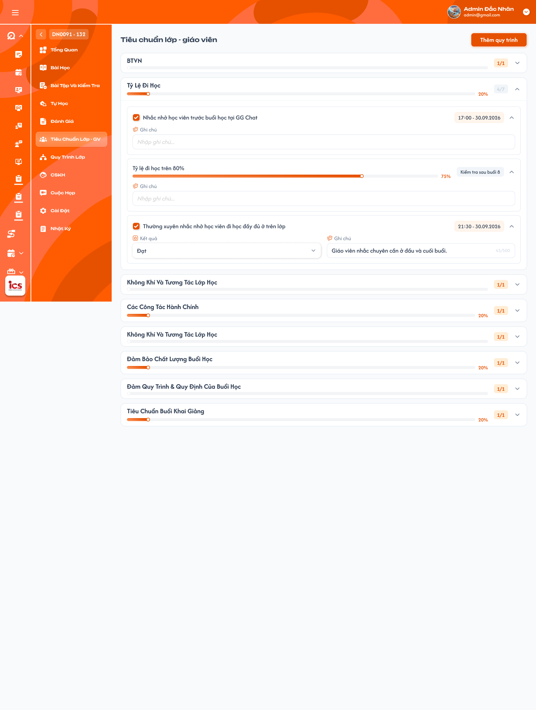

**Mô tả:**
- Ba tab `Tiêu chuẩn lớp - giáo viên`, `CSKH`, `Quy trình lớp` dùng cùng Action Board, chỉ khác tên và loại quy trình. Package, Category, Action Item được định nghĩa tại [menu Define quy trình](../../process_definition_requirement/process_definition_requirements.md), ngoài lớp. Nguồn dùng chung bảng ComGao, quản lý theo center. Trong lớp chỉ chọn nội dung từ quy trình **Công khai** và cập nhật Result theo [Requirement Action Board](../../action_board_requirement/action_board_requirements.md).
- Người đã được add vào lớp mở Chi tiết lớp để xem nội dung và Result ở tab `Tiêu chuẩn lớp - giáo viên`, `CSKH` hoặc `Quy trình lớp` theo quyền của mình. CSKH và Quy trình lớp dùng cùng bố cục với trang này.

**Điểm cần lưu ý:**
- Chỉ **Class Handler hoặc Support đã được add vào chính lớp với role đó** được Thêm nội dung và cập nhật Result khi quy trình nguồn Công khai. Họ được cập nhật item do người khác thêm. Ngoại lệ: **Giáo viên của lớp** được tick checkbox xác thực của Action loại `Xác thực` (`verify`) ở tab Tiêu chuẩn lớp - giáo viên khi mình nằm trong Người gán của Result; tick một lần, không bỏ tick (xem [requirement Giáo viên — Quy trình](../../teacher_role/class/class_process_requirements.md)).
- Người chưa được add vào lớp không vào được Chi tiết lớp hoặc ba tab này, kể cả khi biết URL hay ID lớp.
- Result không lẫn giữa các lớp, ba loại quy trình hoặc với định nghĩa nguồn. Định nghĩa đã Công khai bị khóa thêm/sửa/xóa; khi Công khai, cập nhật Result theo quyền. Quy trình chuyển Vô hiệu vẫn hiện nội dung/Result đã ghi nhưng chỉ xem; không xóa kết quả cũ.
- `A01.01` Tên tab: mỗi tab lấy đúng loại quy trình tương ứng đã định nghĩa ngoài lớp.
- `A01.02` Tiến độ: hiển thị tiến độ tổng, Package, Category và số item hoàn thành như `2/7`.
- `A01.03` Action Item: mở/thu gọn để xem nội dung và control Result theo loại Action.
- `A01.04` Nút Thêm: `Thêm tiêu chuẩn` ở tab Tiêu chuẩn lớp - giáo viên; `Thêm quy trình` ở tab CSKH và Quy trình lớp.
- `A03.01` Toast `Thành Công`: lưu thành công (Thêm nội dung hoặc Result).
- `A03.02` Toast `Thông Báo`: chỉ khi thao tác đã tiếp nhận nhưng còn chờ đồng bộ.
- `A03.03` Toast `Cảnh Báo`: lựa chọn hoặc Result không hợp lệ.
- `A03.04` Toast `Có Lỗi Xảy Ra`: lưu thất bại. Mỗi lần lưu có tối đa một Toast; Hủy, chỉ xem và mở/thu gọn không có Toast CRUD. Toast dùng chung cho cả ba tab.


### Trang 2: ADM-LOP-020604 — Chi tiết lớp học / Tiêu chuẩn lớp - giáo viên / Trống

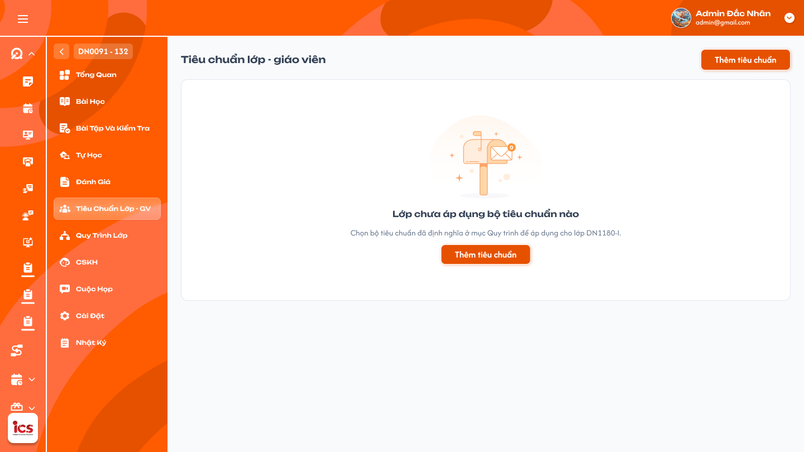

**Mô tả:**
- Trạng thái tab Tiêu chuẩn lớp - giáo viên khi lớp chưa áp dụng bộ tiêu chuẩn nào (`Lớp chưa áp dụng bộ tiêu chuẩn nào`, có nút `Thêm tiêu chuẩn`).

### Trang 3: ADM-LOP-020610 — Chi tiết lớp học / Tiêu chuẩn lớp - giáo viên / Popup thêm tiêu chuẩn

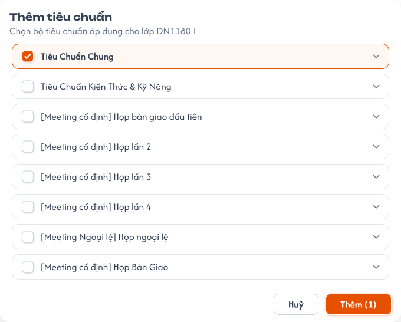

**Mô tả:**
- Class Handler/Support của lớp chọn **Package → Category → Action Item** có sẵn. Popup chỉ tải nguồn **Công khai** của **tab đã bấm Thêm**.

**Điểm cần lưu ý:**
- `A02.01` Tiêu chuẩn lớp - giáo viên → `Thêm tiêu chuẩn`: chỉ hiển thị Package từ loại `Lớp - Giáo viên`.
- `A02.04` Cây lựa chọn: mở/thu gọn, chọn nhiều cấp bằng checkbox; chọn cha chọn các mục con, có thể bỏ chọn mục con.
- `A02.05` Category / Action Item: hiển thị badge tiến độ Category như `10/10` và nhãn loại Action như `Task tiến trình`, `Hướng dẫn`, `Kiểm tra` theo nguồn.
- `A02.06` `Thêm (1)`: xác nhận lựa chọn (số trong ngoặc là số mục đã chọn).
- `A02.07` `Hủy`: đóng popup, không lưu lựa chọn mới.
- Nguồn và lớp phải cùng center; không tải/chọn quy trình center khác. Chỉ quy trình Công khai được chọn và thêm vào lớp; Nháp/Vô hiệu không được thêm mới, kiểm tra lại trạng thái nguồn lúc lưu.
- Không trộn Package giữa ba loại, kể cả khi trùng tên. Không thêm trùng Action Item; Thêm nội dung không tự ghi Result hoặc sửa định nghĩa nguồn.

### Trang 4: ADM-LOP-020611 — Chi tiết lớp học / Tiêu chuẩn lớp - giáo viên / Popup thêm tiêu chuẩn / Xem trước

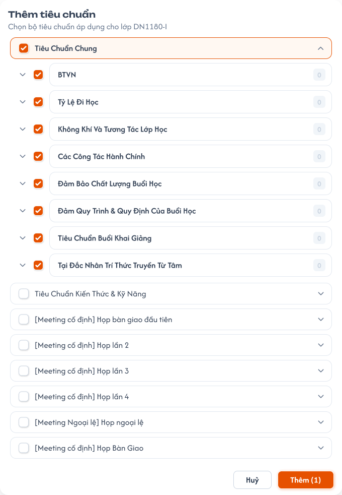

**Mô tả:**
- Popup Thêm tiêu chuẩn khi mở rộng một Package (`Tiêu Chuẩn Chung`) để xem trước các Category bên trong (BTVN, Tỷ Lệ Đi Học, Không Khí Và Tương Tác Lớp Học…).

### Trang 5: ADM-LOP-020612 — Chi tiết lớp học / Tiêu chuẩn lớp - giáo viên / Popup thêm tiêu chuẩn / Xem tiêu chí

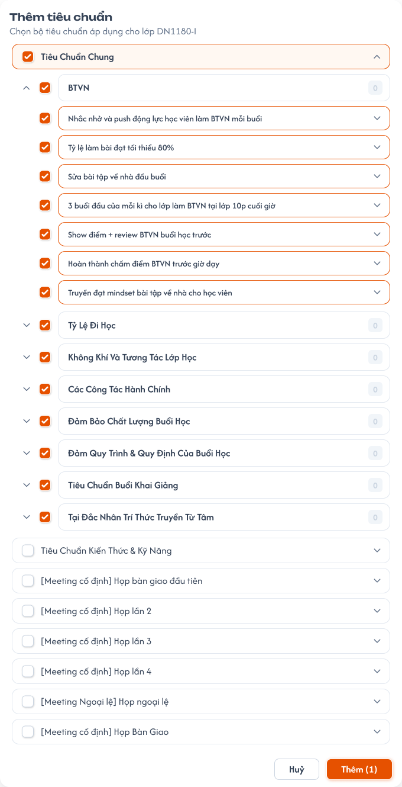

**Mô tả:**
- Popup Thêm tiêu chuẩn khi mở rộng một Category để xem các tiêu chí (Action Item) bên trong (vd các tiêu chí của BTVN).

### Trang 6: ADM-LOP-020700 — Chi tiết lớp học / Quy trình lớp

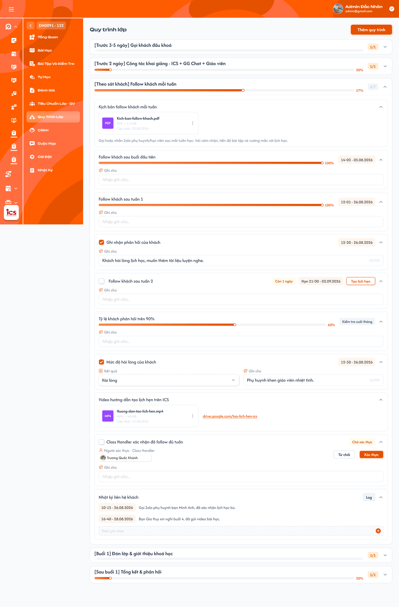

**Mô tả:**
- Tab `Quy trình lớp`: Action Board của các quy trình loại `Lớp học` đã gắn vào lớp, có nút `Thêm quy trình`, tiến độ từng Package/Category và nội dung từng Action Item (tài liệu PDF, mô tả, Result).
- Bố cục, quyền và Toast như Trang 1.

### Trang 7: ADM-LOP-020704 — Chi tiết lớp học / Quy trình lớp / Trống

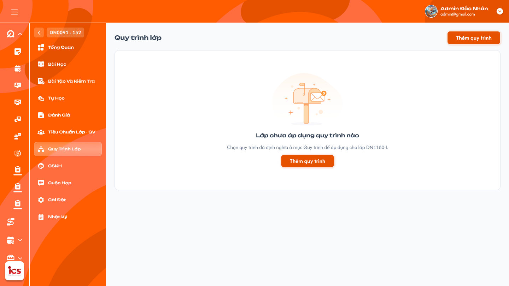

**Mô tả:**
- Trạng thái tab Quy trình lớp khi lớp chưa áp dụng quy trình nào (`Lớp chưa áp dụng quy trình nào`, có nút `Thêm quy trình`).

### Trang 8: ADM-LOP-020710 — Chi tiết lớp học / Quy trình lớp / Popup thêm quy trình

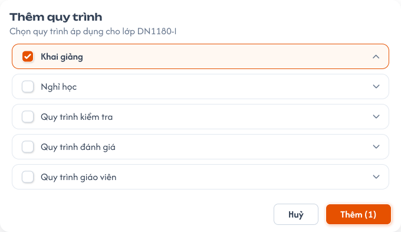

**Mô tả:**
- Popup `Thêm quy trình` của tab Quy trình lớp; cách chọn như Trang 3.

**Điểm cần lưu ý:**
- `A02.03` Quy trình lớp → `Thêm quy trình`: chỉ hiển thị Package từ loại `Lớp học` (ảnh có Package `Khai giảng`).

### Trang 9: ADM-LOP-020711 — Chi tiết lớp học / Quy trình lớp / Popup thêm quy trình / Xem trước

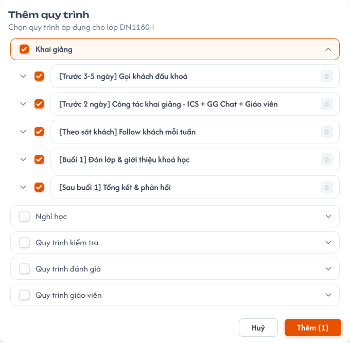

**Mô tả:**
- Popup Thêm quy trình khi mở rộng Package `Khai giảng` để xem trước các Category bên trong.

### Trang 10: ADM-LOP-020712 — Chi tiết lớp học / Quy trình lớp / Popup thêm quy trình / Xem tiêu chí

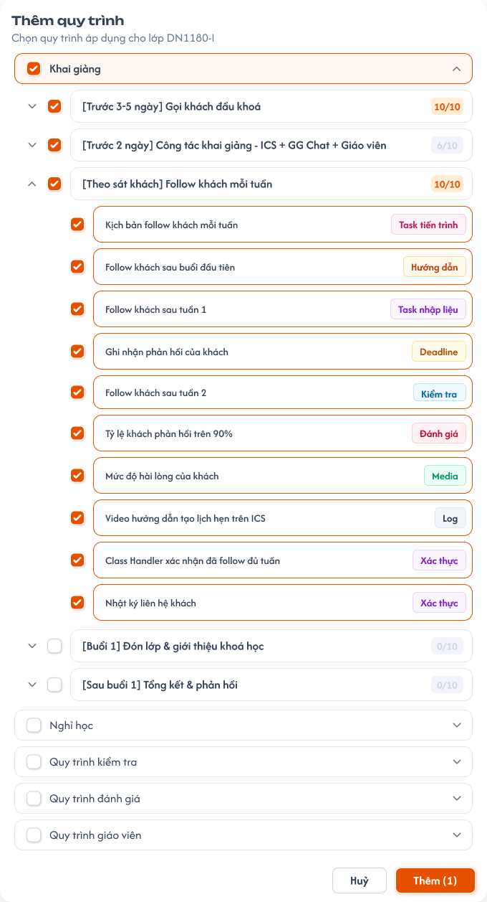

**Mô tả:**
- Popup Thêm quy trình khi mở rộng Category để xem các tiêu chí / Action Item (Task tiến trình, Hướng dẫn, Task nhập liệu, Deadline…).

### Trang 11: ADM-LOP-020800 — Chi tiết lớp học / CSKH

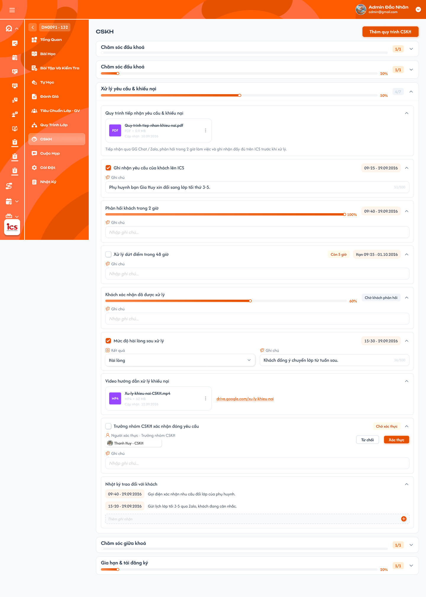

**Mô tả:**
- Tab `CSKH`: Action Board của các quy trình loại `CSKH` (Support) đã gắn vào lớp, có nút `Thêm quy trình CSKH`.
- Bố cục, quyền và Toast như Trang 1.

### Trang 12: ADM-LOP-020804 — Chi tiết lớp học / CSKH / Trống

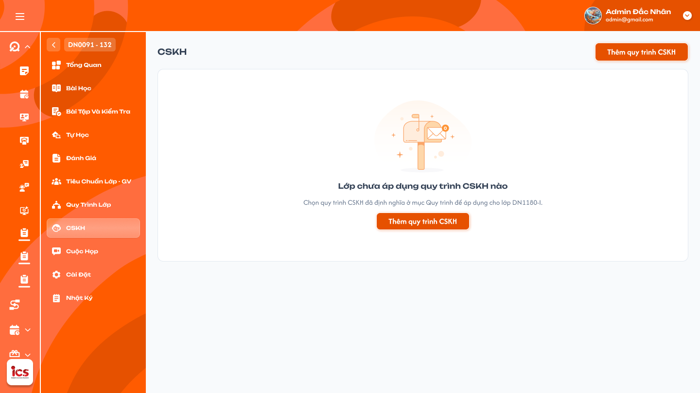

**Mô tả:**
- Trạng thái tab CSKH khi lớp chưa áp dụng quy trình CSKH nào (`Lớp chưa áp dụng quy trình CSKH nào`, có nút `Thêm quy trình CSKH`).

### Trang 13: ADM-LOP-020810 — Chi tiết lớp học / CSKH / Popup thêm quy trình CSKH

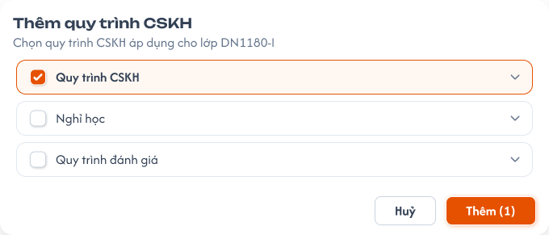

**Mô tả:**
- Popup `Thêm quy trình CSKH` của tab CSKH; cách chọn như Trang 3.

**Điểm cần lưu ý:**
- `A02.02` CSKH → `Thêm quy trình`: chỉ hiển thị Package từ loại `CSKH` (Support).

### Trang 14: ADM-LOP-020811 — Chi tiết lớp học / CSKH / Popup thêm quy trình CSKH / Xem trước

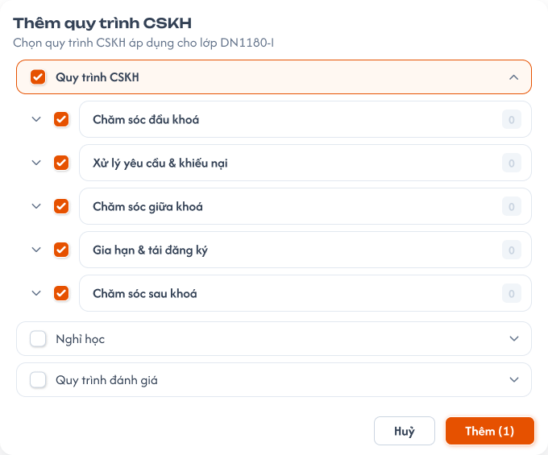

**Mô tả:**
- Popup Thêm quy trình CSKH khi mở rộng Package `Quy trình CSKH` để xem trước các Category (Chăm sóc đầu khoá, Xử lý yêu cầu & khiếu nại, Chăm sóc giữa khoá, Gia hạn & tái đăng ký, Chăm sóc sau khoá).

### Trang 15: ADM-LOP-020812 — Chi tiết lớp học / CSKH / Popup thêm quy trình CSKH / Xem tiêu chí

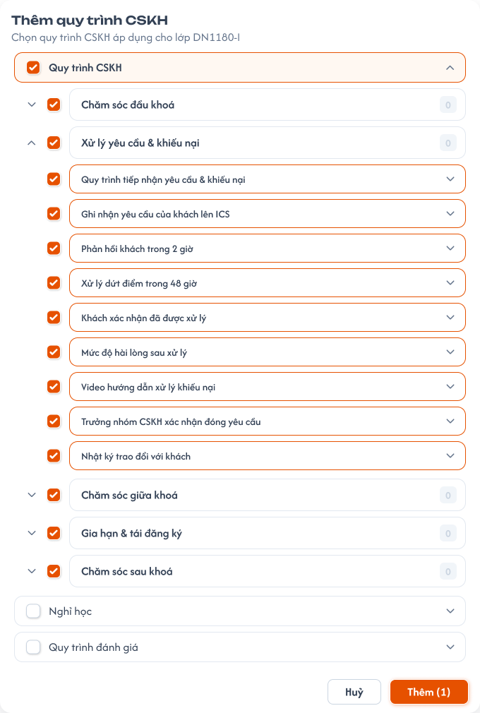

**Mô tả:**
- Popup Thêm quy trình CSKH khi mở rộng Category để xem các tiêu chí / Action Item bên trong.

### Trang 16: ADM-LOP-020904 — Chi tiết lớp học / Cuộc họp / Trống

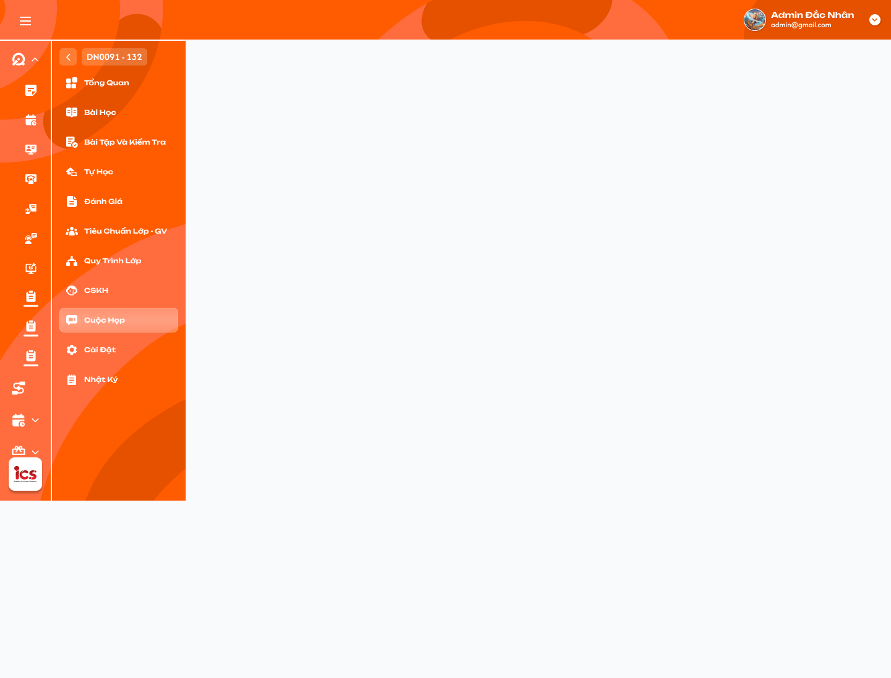

**Mô tả:**
- Trạng thái trống của tab `Cuộc họp` trong Chi tiết lớp; không thuộc phạm vi ba tab quy trình của tài liệu này (xem Q02).

---

## 2. Yêu cầu

### 2.1. Flow chính

**Flow 1: Xem tab quy trình**

```
Người đã được add vào lớp mở một trong ba tab theo quyền
      → Kiểm tra quan hệ user–lớp trước khi tải dữ liệu
      → Tải nội dung đã gắn và Result của đúng lớp, đúng loại quy trình
      → Hiển thị cây Action Board và tiến độ
```

**Flow 2: Thêm nội dung**

```
Class Handler/Support của lớp bấm Thêm
      → Popup chỉ tải quy trình Công khai cùng center: Lớp - Giáo viên/CSKH/Lớp học theo tab đã bấm
      → Chọn Package → Category → Action Item từ nguồn đó
      → Hủy: không lưu; Thêm: kiểm tra quyền, liên kết nguồn và trạng thái vẫn Công khai
      → Thành công: gắn item vào lớp, cập nhật màn hình và một Toast
```

**Flow 3: Cập nhật Result**

```
Class Handler/Support của lớp mở Action Item đã gắn
      → Kiểm tra nguồn còn Công khai; Vô hiệu thì chỉ xem nội dung/Result cũ
      → Nhập/chọn Result theo control của loại Action rồi lưu
      → Thành công: cập nhật Result, tiến độ và một Toast
      → Thất bại: giữ Result cũ, hiển thị phản hồi lỗi
```

### 2.2. Ngoại lệ

- **EX01:** Khi Thêm nội dung, Package/Category/Action Item không thuộc loại quy trình của tab, khác center với lớp, không còn hợp lệ, quy trình nguồn không còn Công khai hoặc đã gắn trùng → từ chối, không lưu một phần.
- **EX02:** Chưa được add vào lớp → không vào Chi tiết lớp/tab hoặc đọc dữ liệu qua request; đã thuộc lớp nhưng không có role Class Handler/Support → từ chối Thêm/cập nhật Result.
- **EX03:** Lưu lỗi → giữ lựa chọn hoặc Result cũ để thử lại; không báo thành công.
- **EX04:** Cập nhật Result khi nguồn Vô hiệu → từ chối qua UI/request; nội dung và Result đã ghi vẫn hiển thị.

### 2.3. Yêu cầu khác

| Mã | Tên yêu cầu | Mô tả |
|---|---|---|
| REQ01 | Nguồn | Ba loại quy trình được định nghĩa riêng ngoài lớp. Nguồn ICS dùng chung bảng ComGao và theo center. Popup chỉ hiển thị Package từ quy trình Công khai cùng center: tab Tiêu chuẩn lớp - giáo viên lấy Lớp - Giáo viên, CSKH lấy CSKH (Support), Quy trình lớp lấy Lớp học. |
| REQ02 | Quyền | Phải được add vào lớp mới được vào Chi tiết lớp và xem tab theo quyền. Chỉ Class Handler/Support của lớp được Thêm và cập nhật Result; không phụ thuộc người đã thêm item. Ngoại lệ: Giáo viên của lớp tick Action `Xác thực` có mình trong Người gán (tab Tiêu chuẩn lớp - giáo viên). |
| REQ03 | Result | Lưu riêng theo lớp, loại quy trình và Action Item; tiến độ theo Action Board. Định nghĩa đã Công khai bị khóa thêm/sửa/xóa nên không có tình huống đổi Loại task hoặc xóa item nguồn sau khi gắn vào lớp. Khi nguồn Công khai, cập nhật Result theo quyền lớp. Khi nguồn Vô hiệu, vẫn hiện nội dung/Result cũ nhưng chỉ xem; Công khai lại thì áp dụng quyền cập nhật theo role lớp. |
| REQ04 | Chọn nội dung | Chọn nhiều cấp; Hủy không lưu; không thêm trùng hoặc tự ghi Result; chỉ lưu nguồn còn Công khai. |
| REQ05 | Phản hồi | Lưu thành công/lỗi có một Toast đúng kết quả; Hủy và chỉ xem không có Toast CRUD. |

### 2.4. Ràng buộc

#### Quyền

| Role | Xem tab | Thêm nội dung | Cập nhật Result | Sửa định nghĩa nguồn trong lớp |
|---|:---:|:---:|:---:|:---:|
| Class Handler đã được add vào lớp | ✅ | ✅ | ✅ | ❌ |
| Support đã được add vào lớp | ✅ | ✅ | ✅ | ❌ |
| Giáo viên của lớp, nằm trong Người gán của Action `Xác thực` (tab Tiêu chuẩn lớp - giáo viên) | ✅ | ❌ | ✅ chỉ tick item `Xác thực` đó | ❌ |
| Thành viên lớp có role khác và có quyền mở tab | ✅ | ❌ | ❌ | ❌ |
| Người chưa được add vào lớp, kể cả có role hệ thống khác | ❌ | ❌ | ❌ | ❌ |

#### Ràng buộc khác

- Quy trình nguồn và lớp thuộc cùng center; kiểm tra center khi tải popup, thêm nội dung và cập nhật Result.
- Kiểm tra quan hệ user–lớp trước khi đọc; khi lưu kiểm tra role **trong lớp hiện tại**, trạng thái nguồn còn Công khai và liên kết Package → Category → Action Item, kể cả request trực tiếp.
- Bảng quyền Thêm/cập nhật Result chỉ áp dụng khi nguồn Công khai. Với nguồn Vô hiệu đã thêm, mọi role chỉ xem nội dung và Result.
- Result của lớp và tab này không thay Result lớp/tab khác hoặc nội dung định nghĩa nguồn.

---

## 3. Testcase

### Feature: Chi tiết lớp học — Tiêu chuẩn lớp - giáo viên, CSKH và Quy trình lớp

| Tên testcase | Priority | Scenario | Role | Pre-condition | Given/When/Then | Expected Result |
|---|---|---|---|---|---|---|
| Case 1: Hiển thị đúng phạm vi lớp và tab | High | Flow 1 / REQ01 / EX02 | Thành viên lớp / người ngoài lớp | Hai lớp có dữ liệu ở ba tab; user được add vào lớp A nhưng không thuộc lớp B | **Given:** user mở các tab lớp A rồi truy cập trực tiếp lớp B<br>**When:** hệ thống kiểm tra quan hệ với lớp<br>**Then:** chỉ hiển thị nội dung, Result và tiến độ lớp A | - Không trộn loại quy trình<br>- Không vào được Chi tiết lớp B hoặc đọc dữ liệu qua URL/request |
| Case 2: Mỗi tab chỉ thấy nguồn của mình | High | Flow 2 / REQ01 / REQ04 | Class Handler / Support của lớp | Ba loại có Package riêng và nguồn ở ba trạng thái | **Given:** mở popup Thêm ở từng tab<br>**When:** chọn Package, Category, Action Item rồi Thêm<br>**Then:** popup và nội dung lưu chỉ thuộc loại của tab đó, từ quy trình Công khai | - CSKH không thấy Package Tiêu chuẩn/Quy trình lớp<br>- Không trùng hoặc tự hoàn thành item<br>- Chọn cha chọn các mục con, bỏ chọn được mục con |
| Case 3: Hủy hoặc lựa chọn không hợp lệ | High | Flow 2 / EX01 / EX02 | Người đang chọn / người ngoài quyền | Popup có lựa chọn nháp | **Given:** Hủy hoặc gửi item sai nguồn/khác center/không có quyền/nguồn Nháp hoặc Vô hiệu<br>**When:** hệ thống xử lý<br>**Then:** không thay dữ liệu | - Không thêm item sai loại, vượt quyền hoặc chưa Công khai<br>- Nguồn vừa chuyển Vô hiệu trước lúc lưu cũng bị từ chối<br>- Item đã gắn trùng bị từ chối, không lưu một phần |
| Case 4: Thêm nội dung thành công | High | Flow 2 / REQ04 / REQ05 | Class Handler / Support của lớp | Lớp chưa áp dụng quy trình nào; nguồn Công khai cùng center | **Given:** mở popup Thêm, chọn một Package<br>**When:** bấm `Thêm (1)`<br>**Then:** item được gắn vào lớp | - Hiển thị cây Action Board và tiến độ, thay trạng thái trống<br>- Một Toast `Thành Công`<br>- Chưa ghi Result |
| Case 5: Result theo quyền và trạng thái nguồn | High | Flow 3 / REQ02 / REQ03 / EX04 | Class Handler / Support / người chỉ xem | Item đã được gắn vào lớp | **Given:** nguồn đang Công khai<br>**When:** Support lưu Result, sau đó nguồn chuyển Vô hiệu rồi Công khai lại<br>**Then:** Công khai cập nhật theo quyền; Vô hiệu chỉ xem | - Vô hiệu vẫn hiện nội dung/Result cũ và chặn cập nhật qua UI/request<br>- Công khai lại khôi phục thao tác theo quyền, không mất kết quả<br>- Người chỉ xem luôn bị chặn; item do người khác thêm vẫn cập nhật được |
| Case 6: Giáo viên tick Action Xác thực | High | REQ02 / Ràng buộc quyền | Giáo viên của lớp | Tab Tiêu chuẩn lớp - giáo viên có Action `Xác thực`; giáo viên nằm trong Người gán; một giáo viên khác không nằm trong Người gán | **Given:** giáo viên mở tab, tick checkbox xác thực; thử bỏ tick; thử thêm nội dung hoặc cập nhật Result khác<br>**When:** hệ thống kiểm tra<br>**Then:** tick một lần được lưu; các thao tác còn lại bị chặn | - Không bỏ tick được<br>- Giáo viên không có nút Thêm, không cập nhật Result khác<br>- Giáo viên ngoài Người gán không tick được |
| Case 7: Lưu lỗi và phản hồi Toast | High | EX03 / REQ05 | Class Handler / Support của lớp | Có thao tác Thêm hoặc lưu Result | **Given:** xác nhận lưu<br>**When:** backend trả thành công, validation hoặc lỗi<br>**Then:** hiển thị một Toast đúng loại | - `Thành Công` / `Thông Báo` / `Cảnh Báo` / `Có Lỗi Xảy Ra` đúng kết quả<br>- Lỗi giữ lựa chọn / Result cũ để thử lại<br>- Không báo thành công trước khi lưu; Hủy, chỉ xem, mở/thu gọn không Toast |
| Case 8: Phạm vi center và request trực tiếp | High | Ràng buộc khác / EX01 / EX02 | Class Handler / Support / thành viên lớp role khác | Nguồn center khác; user là thành viên lớp nhưng không có role Class Handler/Support | **Given:** gửi request tải popup, thêm nội dung hoặc lưu Result với nguồn center khác; thành viên role khác gửi request Thêm/cập nhật Result<br>**When:** backend kiểm tra center, role trong lớp hiện tại, trạng thái nguồn và liên kết Package → Category → Action Item<br>**Then:** từ chối | - Không tải/chọn quy trình center khác<br>- Thành viên role khác chỉ xem, không Thêm/cập nhật<br>- Result lớp/tab này không thay Result lớp/tab khác hoặc định nghĩa nguồn |

---

## 4. Câu hỏi cần xác nhận

- **Q01:** Quyền xem tab của các role đã được add vào lớp ngoài Class Handler/Support chưa được nêu; người ngoài lớp không có quyền xem. Cần chốt danh sách role được xem tab.
- **Q02:** Frame Figma `Chi tiết lớp học / Cuộc họp / Trống` (ADM-LOP-020904) thuộc phạm vi requirement nào? Hiện requirement này chỉ đặc tả ba tab Tiêu chuẩn lớp - giáo viên, CSKH và Quy trình lớp.
