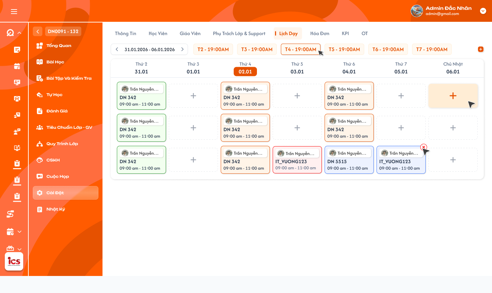
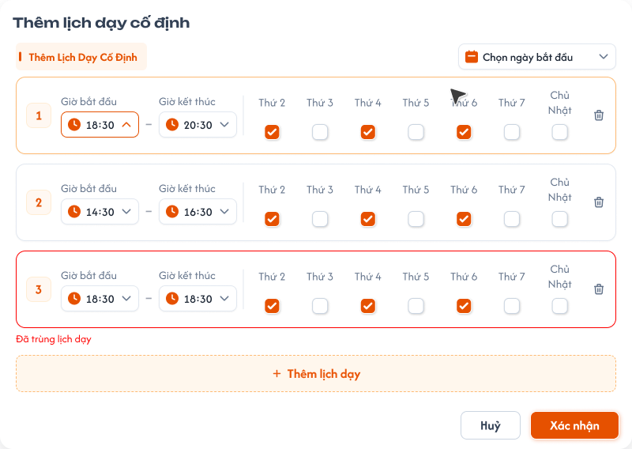
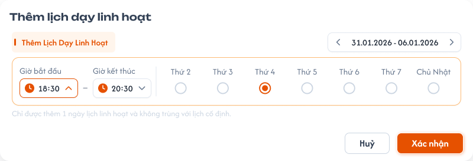
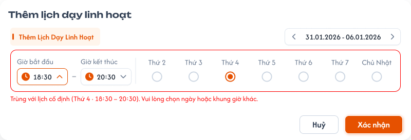

# Chi tiết lớp học — Tab Lịch dạy

## 1. UI

### Trang 1: ADM-LOP-040500 — Lớp học / Cài đặt / Lịch dạy



**Mô tả:**
- Hiển thị các lịch dạy của đúng lớp theo từng tuần từ Thứ 2 đến Chủ Nhật.
- `Admin`, `Class Handler` và `Support` được xem và CRUD lịch trong phạm vi lớp được phân quyền.
- `Teacher` được xem lịch của lớp mà giáo viên được phân công nhưng không được tạo, sửa, hoàn thành, hủy hoặc xóa lịch **tại tab này**. Lịch mà giáo viên đã chọn khi `Bắt đầu buổi học` sẽ tự chuyển `Hoàn thành` khi giáo viên bấm `Hoàn thành buổi học` (xem [requirement Giáo viên — Bài học](../../teacher_role/class/class_teaching_requirements.md)); đây là hoàn thành qua luồng dạy, không phải thao tác tại tab Lịch dạy.
- Quy tắc số buổi, ngày bắt đầu, ngày kết thúc dự kiến và tái sinh lịch khi đổi khóa học dùng chung với [Tạo lớp học](./class_creation_requirements.md) và [Tab Thông tin](./class_detail_information_requirements.md). Nhân sự giáo viên của lớp: [Tab Giáo viên](./class_detail_teachers_requirements.md).

**Điểm cần lưu ý:**
- Dùng `schedule_id` và `class_id` để tải/thao tác; không dùng mã lớp, tên giáo viên hoặc vị trí ô làm khóa.
- Chuyển tuần chỉ thay phạm vi hiển thị, không tạo, sửa hoặc tự đổi trạng thái lịch.
- Lịch được tải theo timezone của cơ sở/lớp; thời điểm lưu ở backend phải có timezone rõ ràng để không lệch ngày.
- Nếu lớp `Mới tạo` có lịch hợp lệ đầu tiên thì tự chuyển sang `Khai giảng` theo requirement trạng thái lớp.
- Teacher chỉ thấy dữ liệu trong phạm vi lớp được phân công; việc ẩn nút CRUD không thay thế kiểm tra quyền backend.
- `A01.01` Khoảng tuần: hiển thị ngày đầu và ngày cuối tuần; nút trái/phải chuyển đúng một tuần.
- `A01.02` Cột ngày: hiển thị thứ, ngày/tháng và làm nổi bật ngày hiện tại nhưng không thay đổi dữ liệu lịch.
- `A01.03` Tag lịch cố định: hiển thị các khung lặp như `T2, 20:00`; `X` dùng để bỏ khung cố định theo quyền và rule tái sinh lịch.
- `A01.04` Nút `Thêm lịch dạy cố định`: mở popup thêm lịch với tab `Thêm Lịch Dạy Cố Định` được chọn sẵn (Trang 2).
- `A01.05` Ô dấu `+` của ngày: mở popup thêm lịch với tab `Thêm Lịch Dạy Linh Hoạt` và tuần/ngày vừa bấm được chọn sẵn (Trang 3).
- `A01.06` Thẻ lịch: hiển thị tối thiểu giáo viên, mã lớp, giờ bắt đầu–kết thúc và màu/icon trạng thái.
- `A01.07` Vùng lịch: số hàng hiển thị phải mở rộng hoặc cuộn theo số lịch thực tế; ba hàng trong ảnh không phải giới hạn nghiệp vụ.
- Mỗi lịch có loại nguồn `Cố định` hoặc `Linh hoạt` và trạng thái xử lý. Khi hoàn thành hoặc hủy, màu hoàn thành/hủy được ưu tiên hiển thị nhưng loại nguồn vẫn được giữ trong dữ liệu/audit. `Hoàn thành` và `Hủy bỏ` là trạng thái, không phải loại lịch. Tên/tooltip trạng thái phải có ngoài màu để hỗ trợ accessibility.

     

- `A02.01` Lịch cố định (cam): buổi chưa hoàn thành/chưa hủy, được sinh từ khung lịch cố định.
- `A02.02` Lịch linh hoạt (xanh dương): buổi chưa hoàn thành/chưa hủy, được thêm linh hoạt vào một ngày/giờ cụ thể.
- `A02.03` Lịch hoàn thành (xanh lá): buổi đã hoàn thành; được tính là một buổi học hợp lệ và phát sinh lương cho giáo viên của lịch.
- `A02.04` Lịch hủy bỏ (xám): buổi đã hủy; bị loại khỏi số buổi hợp lệ của khóa và không phát sinh lương. Hệ thống phải sinh một buổi bù ở cuối.
- Không thể đồng thời hoàn thành và hủy cùng một lịch. Backend phải kiểm tra trạng thái mới nhất và version khi cập nhật. Chỉ lịch `Hoàn thành` mới được ghi nhận lương giáo viên. Trong cùng một lần hoàn thành, request gửi lặp chỉ tạo một khoản lương; nếu lịch được Mở lại rồi hoàn thành lại, lần mới có thể tạo khoản lương mới nhưng tại một thời điểm chỉ một khoản của schedule có hiệu lực.
- Popup xem/chỉnh sửa khi bấm một thẻ lịch mở popup của đúng `schedule_id`. `Admin`, `Class Handler` và `Support` được chỉnh lịch chưa hoàn thành; `Teacher` mở cùng popup ở chế độ chỉ xem (control read-only, không gửi request cập nhật).
- `A05.01` Tiêu đề popup: lịch nguồn cố định hiển thị `Chỉnh sửa lịch cố định`; lịch nguồn linh hoạt hiển thị `Chỉnh sửa lịch linh hoạt`. Teacher hoặc lịch bị khóa hiển thị theo chế độ xem, không tạo cảm giác có thể sửa.
- `A05.02` Thời gian/Ngày: ngày diễn ra của đúng buổi; cho chỉnh khi lịch chưa hoàn thành/hủy.
- `A05.03` Giờ bắt đầu: kết hợp với Thời gian học để tính giờ kết thúc và kiểm tra trùng.
- `A05.04` Giáo viên: chọn trong các giáo viên hợp lệ đã được thêm vào lớp. Khi đổi phải kiểm tra lịch giáo viên trên tất cả lớp.
- `A05.05` Thời gian học: chọn thời lượng từ cấu hình cho phép, ví dụ `90 phút`; `Giờ kết thúc = Giờ bắt đầu + Thời gian học`. Không cho thời lượng bằng 0 hoặc âm.
- `A05.06` Trạng thái: với lịch chưa kết thúc, cho chọn `Đang đợi`, `Hoàn thành`, `Hủy bỏ`. Lịch `Hoàn thành` có flow `Mở lại` để trở về `Đang đợi`, đảo lương rồi mới cho sửa/hủy. `Đang đợi` giữ màu theo loại nguồn; hai trạng thái kết thúc kích hoạt nghiệp vụ tương ứng. Lịch `Hủy bỏ` mở ở chế độ chỉ xem.
- `A05.07` Hủy: nút đóng popup, bỏ thay đổi chưa xác nhận; không phải hành động Hủy bỏ lịch. `Hủy` ở chân popup chỉ đóng form, `Hủy bỏ` trong dropdown Trạng thái mới là nghiệp vụ hủy lịch và sinh bù; hai hành động phải có câu chữ/thiết kế phân biệt rõ.
- `A05.08` Xác nhận: validate phiên bản, quyền, field, trùng lịch và trạng thái; chỉ cập nhật UI sau khi backend commit. Thay đổi ngày, giờ bắt đầu, thời lượng hoặc giáo viên phải kiểm tra cả trùng lịch của lớp hiện tại và trùng lịch giáo viên trên tất cả lớp; có trùng thì cảnh báo và không cho xác nhận.
- Chỉnh một buổi cố định chỉ tạo override cho occurrence đó, không âm thầm sửa toàn bộ khung lặp. Nguồn lịch vẫn là `Cố định` để audit; các lần tái sinh sau không ghi đè occurrence đã override.
- Chuyển `Đang đợi → Hoàn thành` phải tạo lương đúng một lần trong cùng giao dịch. Chuyển `Đang đợi → Hủy bỏ` phải loại buổi khỏi N, sinh bù và cập nhật ngày kết thúc trong cùng giao dịch.
- Không dùng hover làm thao tác xóa trực tiếp. Hover chỉ hiển thị tooltip/trạng thái hoặc affordance mở chi tiết; mọi cập nhật thực hiện trong popup.
- `A06.01` Hoàn thành: kiểm tra lịch/giáo viên → chuyển xanh lá → ghi nhận buổi hợp lệ → tạo lương giáo viên đúng một lần. Không cho hoàn thành lịch đã hủy.
- `A06.02` Hoàn thành qua luồng dạy: khi giáo viên bấm `Hoàn thành buổi học` của bài đã gắn lịch, xử lý như Hoàn thành (xanh lá, buổi hợp lệ, một khoản lương cho **giáo viên của buổi**), ghi audit nguồn là luồng dạy. Lịch đang gắn với buổi `Đang dạy` / `Chờ hoàn thành` vẫn ở `Đang đợi`, không chọn được cho buổi khác.
- `A06.03` Hủy bỏ: chuyển xám → loại khỏi số buổi hợp lệ → không tính lương → sinh một lịch cố định bù sau buổi hợp lệ cuối cùng → tăng Ngày kết thúc dự kiến. Buổi hủy vẫn hiển thị màu xám trong tuần/lịch sử nhưng không nằm trong tập N buổi hợp lệ. Lịch bù tạo tại khung cố định hợp lệ đầu tiên **sau buổi hợp lệ cuối cùng hiện tại**; nếu khung đó trùng thì bỏ qua và tìm khung kế tiếp. Mỗi lịch hủy tạo đúng một lịch bù; request hủy gửi lặp không tạo nhiều lịch bù hoặc kéo dài ngày kết thúc nhiều lần.
- `A06.04` Sửa lịch chưa hoàn thành: role CRUD sửa ngày/giờ/giáo viên theo field popup; phải kiểm tra trùng và cân bằng lịch. Lịch đã hoàn thành không được sửa/hủy trực tiếp; phải đi qua flow `Mở lại`.
- `A06.05` Xóa: không xóa vật lý lịch chương trình. Thao tác loại bỏ lịch phải dùng trạng thái Hủy bỏ để giữ audit và kích hoạt sinh bù.
- Hoàn thành và tạo lương phải nhất quán: không có trạng thái xanh lá mà thiếu khoản lương, hoặc tạo lương khi trạng thái chưa hoàn thành. Lớp không chính thức được nới điều kiện nội dung/bài học để test nhưng vẫn phải chống ghi lương trùng, lưu audit và kiểm tra quyền.
- `A07.01` Nút `Mở lại`: chỉ hiển thị cho role CRUD (`Admin`, `Class Handler`, `Support`) khi lịch đang Hoàn thành; Teacher không thấy hành động này.
- `A07.02` Lý do điều chỉnh: bắt buộc nhập, không chỉ có khoảng trắng; lưu vào audit lịch và bút toán lương.
- `A07.03` Cảnh báo: nêu rõ lịch sẽ trở về Đang đợi và khoản lương đã phát sinh sẽ được đảo/điều chỉnh.
- `A07.04` Hủy: đóng popup, giữ nguyên lịch Hoàn thành và khoản lương hiện tại.
- `A07.05` Xác nhận mở lại: thực hiện đảo lương và đổi trạng thái trong một giao dịch; sau thành công mới mở khóa các field chỉnh sửa. Không xóa vật lý khoản lương cũ; tạo bút toán đảo/điều chỉnh liên kết khoản lương gốc. Sau khi mở lại, lịch trở về `Đang đợi` với màu theo nguồn ban đầu (cam nếu Cố định, xanh dương nếu Linh hoạt). Điểm danh, bài học, BTVN, bài kiểm tra hoặc dữ liệu liên quan đã phát sinh không bị xóa; giữ audit và hiển thị cảnh báo dữ liệu phụ thuộc. Nếu bảng lương đã khóa/chốt, không sửa trực tiếp kỳ cũ: tạo bút toán điều chỉnh ở kỳ cho phép gần nhất, nếu chưa thể thì không mở lại một phần. Request mở lại gửi lặp phải idempotent. Nếu hoàn thành lại, tạo lần ghi nhận lương mới, chỉ một khoản hiệu lực; khoản cũ và bút toán đảo vẫn giữ trong lịch sử.
- `A08.01` Toast `Thành Công`: `Đã thêm lịch linh hoạt.`, `Đã hoàn thành buổi học.`, `Đã hủy lịch và tạo buổi bù.`, `Đã mở lại lịch và điều chỉnh lương.`
- `A08.02` Toast `Thông Báo`: `Lịch đang được tái tạo, danh sách sẽ cập nhật sau ít phút.`
- `A08.03` Toast `Cảnh Báo`: `Giáo viên đã có lịch trong khung giờ này. Vui lòng chọn thời gian khác.`
- `A08.04` Toast `Có Lỗi Xảy Ra`: `Không thể cập nhật lịch. Vui lòng thử lại.`
- Chỉ báo thành công sau khi toàn bộ thay đổi liên quan đã commit (lịch, lịch bù, ngày kết thúc và lương nếu có). Hủy popup, chuyển tuần, mở thẻ hoặc validation field chưa gửi backend không có Toast thành công. Không hiển thị stack trace, ID nội bộ nhạy cảm hoặc chi tiết tính lương trong Toast.

### Trang 2: ADM-LOP-040510 — Popup thêm lịch dạy cố định



**Mô tả:**
- Cho phép role CRUD cấu hình một hoặc nhiều khung giờ lặp theo thứ. Hệ thống dùng các khung này để sinh lịch đến khi đủ đúng số buổi của khóa học.

**Điểm cần lưu ý:**
- `A03.01` Tab Cố định/Linh hoạt: chuyển đúng form; dữ liệu chưa xác nhận của tab kia không được tự lưu.
- `A03.02` Chọn ngày bắt đầu: ngày bắt đầu áp dụng của cấu hình; khi tạo lịch đầu tiên của lớp phải phù hợp để ngày bắt đầu lớp là buổi 1.
- `A03.03` Giờ bắt đầu/kết thúc: giờ kết thúc phải sau giờ bắt đầu (không cho bằng hoặc trước); lưu cùng timezone lớp.
- `A03.04` Thứ 2–Chủ Nhật: mỗi dòng chọn ít nhất một ngày trong tuần.
- `A03.05` `+ Thêm lịch dạy`: thêm một dòng khung giờ; chưa lưu backend.
- `A03.06` Icon thùng rác: xóa dòng cấu hình chưa xác nhận hoặc bỏ một khung hiện có theo rule tái sinh lịch.
- `A03.07` Hủy: đóng mà không lưu thay đổi chưa xác nhận.
- `A03.08` Xác Nhận: validate toàn bộ, lưu cấu hình và sinh/tái sinh lịch tương lai nguyên tử.
- Không cho hai khung của cùng lớp trùng thời gian. Đồng thời phải kiểm tra lịch của giáo viên được phân công trên **tất cả lớp**; nếu giáo viên đã có lịch giao nhau thì hiển thị cảnh báo (`Đã trùng lịch dạy`) và không cho xác nhận.
- Khi thêm/sửa/bỏ khung, chỉ tái sinh phần lịch chưa mở/chưa hoàn thành. Không thay đổi lịch đã hoàn thành hoặc lịch hủy dùng làm lịch sử.
- Tổng lịch hợp lệ của chương trình luôn bằng `N` là số buổi khóa học. Các lịch tương lai được đánh số/tái sinh theo thứ tự thời gian đến đủ N.
- Nếu không còn khung cố định hợp lệ để sinh đủ N buổi thì không lưu một phần; giữ cấu hình/lịch cũ và trả lỗi xử lý được.
- Ngày kết thúc dự kiến là ngày của buổi hợp lệ thứ N sau khi sinh lịch; người dùng không sửa trực tiếp.

### Trang 3: ADM-LOP-040520 — Popup thêm lịch dạy linh hoạt



**Mô tả:**
- Cho phép thêm một hoặc nhiều lịch linh hoạt tại ngày/giờ cụ thể. Bấm dấu `+` ở một ngày trên lịch tuần mở trực tiếp form này và chọn sẵn ngày tương ứng.

**Điểm cần lưu ý:**
- `A04.01` Khoảng tuần: mũi tên chuyển tuần cần chọn; các checkbox thứ ánh xạ đúng ngày thực tế trong tuần đó.
- `A04.02` Giờ bắt đầu/kết thúc: áp dụng cho các ngày được chọn trên cùng dòng; giờ kết thúc phải sau giờ bắt đầu.
- `A04.03` Thứ trong tuần: mỗi checkbox tạo một lịch linh hoạt ở ngày tương ứng trong tuần đang chọn.
- `A04.04` Thêm lịch dạy: thêm dòng giờ khác để tạo nhiều lịch trong một lần.
- `A04.05` Xác Nhận: validate toàn bộ rồi chèn các lịch linh hoạt nguyên tử vào timeline lớp.
- Lịch linh hoạt được tính vào tổng N buổi của khóa học. Khi chèn vào giữa timeline, hệ thống sắp xếp lại và điều chỉnh các lịch cố định phía sau để cuối cùng vẫn có đúng N buổi hợp lệ.
- Không được sửa hoặc đẩy lùi các lịch đã mở/hoàn thành. Chỉ điều chỉnh phần lịch tương lai chưa mở.
- Nhiều lịch linh hoạt trong một lần phải lưu nguyên tử; nếu một lịch trùng lịch lớp hoặc trùng lịch giáo viên ở bất kỳ lớp nào thì cảnh báo, chặn xác nhận và không thêm một phần.
- Lịch linh hoạt hiển thị xanh dương cho đến khi được hoàn thành hoặc hủy. Việc chèn có thể làm thay đổi buổi N và Ngày kết thúc dự kiến; hệ thống cập nhật sau khi commit thành công.

### Trang 4: ADM-LOP-040521 — Popup thêm lịch dạy linh hoạt / Trùng lịch cố định



**Mô tả:**
- Trạng thái popup thêm lịch linh hoạt khi khung giờ chọn trùng với lịch cố định của lớp (hiện cảnh báo dạng `Trùng với lịch cố định (Thứ 4 · 18:30 – 20:30)`).

**Điểm cần lưu ý:**
- Cảnh báo trùng là lỗi chặn: không cho `Xác nhận`, không có lựa chọn bỏ qua để vẫn tạo; nhóm lịch không bị thêm một phần (EX04).

---

## 2. Yêu cầu

### 2.1. Flow chính

**Flow 1: Xem lịch theo tuần**

```
Mở Chi tiết lớp → Tab Lịch dạy (Trang 1)
      → Backend kiểm tra quyền và phạm vi lớp
      → Tải cấu hình cố định + lịch thuộc tuần
      → Render đúng ngày/giờ/trạng thái
      → Teacher chỉ xem; Admin/Class Handler/Support có control CRUD
```

**Flow 2: Thêm hoặc cập nhật lịch cố định**

```
Bấm Thêm lịch dạy cố định (Trang 2)
      → Nhập ngày áp dụng, khung giờ và thứ
      → Validate giờ, trùng lịch và khả năng sinh đủ N buổi
      → Lưu cấu hình + tái sinh lịch tương lai nguyên tử
      → Cập nhật ngày kết thúc dự kiến và Toast
```

**Flow 3: Thêm lịch linh hoạt**

```
Bấm + tại ngày hoặc chọn tab Lịch Linh Hoạt (Trang 3)
      → Chọn tuần, ngày và giờ
      → Validate toàn bộ nhóm lịch (trùng → Trang 4)
      → Chèn vào timeline, tính vào N
      → Điều chỉnh lịch cố định phía sau để tổng vẫn đúng N
      → Cập nhật buổi N/ngày kết thúc và Toast
```

**Flow 4: Mở thẻ, chỉnh sửa hoặc hoàn thành lịch**

```
Bấm thẻ lịch → tải popup theo schedule_id
      → Teacher: chỉ xem
      → Role CRUD: sửa field hoặc chọn trạng thái
      → Backend kiểm tra version, quyền, trùng lịch và giáo viên
      → Nếu Hoàn thành: cập nhật trạng thái + tạo khoản lương duy nhất gắn schedule_id
      → Commit cùng giao dịch → cập nhật thẻ và Toast
```

**Flow 5: Hủy lịch và sinh buổi bù**

```
Role CRUD chọn Hủy bỏ
      → Backend kiểm tra lịch chưa hoàn thành
      → Loại lịch khỏi tập N buổi hợp lệ, không tính lương
      → Tìm khung cố định hợp lệ đầu tiên sau buổi cuối hiện tại
      → Tạo đúng một lịch bù
      → Ngày kết thúc dự kiến = ngày của buổi hợp lệ thứ N mới
      → Commit nguyên tử → lịch cũ màu xám + Toast
```

**Flow 6: Mở lại lịch hoàn thành và đảo lương**

```
Role CRUD mở lịch Hoàn thành → chọn Mở lại
      → Nhập lý do bắt buộc → xác nhận
      → Backend kiểm tra quyền, version và trạng thái bảng lương
      → Tạo bút toán đảo/điều chỉnh liên kết khoản lương gốc
      → Chuyển lịch về Đang đợi, giữ loại nguồn và toàn bộ audit
      → Cho phép sửa hoặc chuyển sang Hủy bỏ
      → Nếu Hoàn thành lại: tạo khoản lương mới, chỉ một khoản hiệu lực
```

### 2.2. Ngoại lệ

- **EX01:** Không có quyền hoặc ngoài phạm vi lớp → không trả control CRUD và backend từ chối request thay đổi.
- **EX02:** Giờ kết thúc không sau giờ bắt đầu, dòng không chọn thứ, trùng lịch của lớp hoặc trùng lịch giáo viên tại bất kỳ lớp nào → cảnh báo, không cho tạo/lưu và đánh dấu đúng dòng/ngày.
- **EX03:** Cấu hình cố định không thể sinh đủ N lịch hợp lệ → rollback toàn bộ cấu hình/lịch mới.
- **EX04:** Một phần tử trong nhóm lịch linh hoạt không hợp lệ hoặc trùng lịch lớp/giáo viên → cảnh báo và không thêm một phần; trả danh sách cần sửa.
- **EX05:** Request của cùng một lần hoàn thành gửi lặp/đồng thời → một trạng thái hoàn thành, một khoản lương hiệu lực cho completion version đó và một kết quả logic.
- **EX06:** Không tìm được khung bù hoặc các khung tiếp theo bị trùng → tiếp tục tìm; nếu không thể xếp thì không commit hủy một phần.
- **EX07:** Request hủy lặp → dùng quan hệ lịch hủy–lịch bù đã lưu, không tạo bù/lịch sử/ngày kết thúc lặp.
- **EX08:** Lịch đã hoàn thành/hủy bị thao tác từ snapshot cũ → từ chối theo version/trạng thái mới nhất và yêu cầu tải lại.
- **EX09:** Tạo/cập nhật lịch thành công nhưng bước liên quan lương, lịch bù hoặc ngày kết thúc lỗi → rollback giao dịch hoặc trả trạng thái phục hồi rõ ràng; không hiển thị thành công giả.
- **EX10:** Khoản lương thuộc bảng lương đã khóa → không sửa/xóa kỳ cũ; tạo bút toán điều chỉnh ở kỳ cho phép hoặc từ chối toàn bộ thao tác Mở lại.
- **EX11:** Request Mở lại gửi lặp/đồng thời → một bút toán đảo, một lần chuyển Đang đợi và một audit logic.

### 2.3. Yêu cầu khác

| Mã | Tên yêu cầu | Mô tả |
|---|---|---|
| REQ01 | Lịch tuần | Hiển thị đúng lịch của lớp theo tuần, ngày/giờ, giáo viên, mã lớp và trạng thái; số thẻ trong một ngày không bị giới hạn ở ba. |
| REQ02 | Phân quyền | Admin/Class Handler/Support được CRUD lịch trong phạm vi; Teacher chỉ xem lịch lớp được phân công tại tab. Lịch giáo viên đã chọn khi bắt đầu buổi học được hoàn thành gián tiếp qua `Hoàn thành buổi học` (requirement Giáo viên — Bài học). |
| REQ03 | Lịch cố định | Hỗ trợ nhiều khung giờ/ngày lặp; chặn trùng lịch lớp và trùng lịch giáo viên trên tất cả lớp; sinh/tái sinh lịch tương lai đến đủ đúng N buổi của khóa học. |
| REQ04 | Lịch linh hoạt | Dấu cộng tạo lịch linh hoạt; hỗ trợ một hoặc nhiều ngày/giờ trong tuần; chặn trùng lịch lớp/giáo viên; lịch chèn tính vào N và làm timeline tương lai tự cân bằng. |
| REQ05 | Trạng thái | Cố định màu cam, Linh hoạt xanh dương, Hoàn thành xanh lá, Hủy bỏ xám. Hoàn thành/Hủy bỏ là trạng thái ghi đè màu nhưng không làm mất loại nguồn. |
| REQ06 | Hoàn thành và lương | Mỗi lần chuyển hợp lệ từ Đang đợi sang Hoàn thành (tại tab hoặc qua luồng dạy) tạo một khoản lương giáo viên, **ngày tính lương là ngày của lịch**, không phải ngày hoàn thành. Chống lặp theo schedule_id và completion version; tại một thời điểm chỉ một khoản lương hiệu lực, không có trạng thái hoàn thành giả hoặc lương trùng. |
| REQ07 | Hủy và bù | Lịch hủy bị trừ khỏi N, không tính lương và tạo đúng một lịch bù ở cuối theo khung cố định; tự tăng ngày kết thúc dự kiến. |
| REQ08 | Audit/an toàn | Lưu người, thời điểm máy chủ, giá trị trước/sau, nguồn lịch, trạng thái và liên kết lịch bù; không tin role, class_id, teacher_id hoặc trạng thái do client tự khai. |
| REQ09 | Toast | Mọi CRUD có phản hồi đúng loại; chỉ thành công sau khi toàn bộ giao dịch liên quan đã hoàn tất. |
| REQ10 | Popup thẻ lịch | Bấm thẻ mở đúng schedule_id với Ngày, Giờ bắt đầu, Giáo viên, Thời gian học và Trạng thái. Role CRUD được sửa lịch Đang đợi; Teacher chỉ xem. Nút Hủy chỉ đóng form; trạng thái Hủy bỏ mới kích hoạt sinh bù. |
| REQ11 | Mở lại lịch hoàn thành | Admin/Class Handler/Support được mở lại lịch Hoàn thành khi nhập lý do. Hệ thống không xóa lương gốc mà tạo bút toán đảo/điều chỉnh, đưa lịch về Đang đợi rồi mới cho sửa/hủy. Hoàn thành lại tạo lần lương mới và chỉ một khoản lương có hiệu lực. |

### 2.4. Ràng buộc

#### Quyền

| Role | Xem lịch | Tạo cố định/linh hoạt | Sửa lịch | Hoàn thành | Hủy bỏ | Mở lại hoàn thành |
|---|:---:|:---:|:---:|:---:|:---:|:---:|
| Admin | ✅ | ✅ | ✅ | ✅ | ✅ | ✅ |
| Class Handler | ✅ | ✅ | ✅ | ✅ | ✅ | ✅ |
| Support | ✅ | ✅ | ✅ | ✅ | ✅ | ✅ |
| Teacher được phân công | ✅ | ❌ | ❌ | ❌ | ❌ | ❌ |
| Role khác | Theo permission/phạm vi | ❌ | ❌ | ❌ | ❌ | ❌ |

#### Ràng buộc khác

- Teacher không hoàn thành lịch tại tab; lịch được hoàn thành gián tiếp khi giáo viên bấm `Hoàn thành buổi học` ở menu Bài học (lịch đã chọn lúc bắt đầu buổi).
- `N` lấy từ khóa học hiện tại của lớp. Tập N buổi hợp lệ gồm lịch Cố định/Linh hoạt chưa hủy và lịch Hoàn thành; không gồm lịch Hủy bỏ.
- Chèn lịch linh hoạt: tính vào N và cân bằng lại phần lịch cố định tương lai. Hủy bất kỳ lịch Cố định/Linh hoạt nào: trừ lịch đó khỏi N, giữ bản ghi xám và sinh một lịch cố định bù ở cuối.
- Ngày kết thúc dự kiến luôn bằng ngày của buổi hợp lệ thứ N; không lấy ngày của lịch hủy và không cho nhập thủ công.
- Không sửa, dời hoặc tái sinh đè lên lịch đã hoàn thành.
- Chỉ lịch `Hoàn thành` mới phát sinh lương. Khoản lương gắn `schedule_id`, `teacher_id`, `class_id`, thời điểm hoàn thành và rule lương áp dụng; cách tính số tiền dẫn chiếu requirement lương giáo viên.
- **Ngày tính lương là ngày của lịch**, không phải ngày bấm Hoàn thành. Ví dụ giáo viên chọn lịch ngày 15 để bắt đầu buổi, ngày 20 mới bấm `Hoàn thành buổi học` thì khoản lương thuộc ngày 15. Hoàn thành qua luồng dạy gắn `teacher_id` là giáo viên của buổi (người bấm Bắt đầu buổi học).
- Unique/idempotency bảo đảm một lịch chỉ có một khoản lương hiệu lực tại một thời điểm. Mở lại giữ khoản gốc, tạo bút toán đảo; hoàn thành lại có thể tạo khoản mới nhưng khoản cũ không còn hiệu lực.
- Lịch hủy không phát sinh lương. Nếu lịch đã có lương thì không được hủy theo flow thông thường; muốn hủy lịch đã Hoàn thành phải Mở lại và đảo lương thành công trước, sau đó mới Hủy bỏ.
- Thêm nhóm lịch, tái sinh, hoàn thành + tính lương, hủy + sinh bù + đổi ngày kết thúc, và mở lại + đảo lương phải nguyên tử theo từng thao tác logic.
- Kiểm tra trùng lịch lớp và lịch của giáo viên trên toàn hệ thống ở backend tại thời điểm commit; validation client chỉ hỗ trợ trải nghiệm. Cảnh báo trùng là lỗi chặn, người dùng không được bỏ qua để tiếp tục tạo.
- Dùng version/updated_at hoặc cơ chế tương đương để ngăn snapshot cũ ghi đè trạng thái mới.
- Audit không bị xóa khi hủy lịch hoặc tái sinh timeline.


---

## 3. Testcase

### Feature: Chi tiết lớp học — Tab Lịch dạy

| Tên testcase | Priority | Scenario | Role | Pre-condition | Given/When/Then | Expected Result |
|---|---|---|---|---|---|---|
| Case 1: Mở đúng lịch tuần, chuyển tuần, hiển thị nhiều lịch | High | Flow 1 / REQ01 | Role có quyền xem | Lớp có lịch ở nhiều tuần; một ngày có trên ba lịch hợp lệ | **Given:** mở tab Lịch dạy<br>**When:** dữ liệu tải thành công, bấm mũi tên trái/phải<br>**Then:** hiển thị đúng tuần và đúng class_id, dịch đúng một tuần | - Không trộn lớp khác, thẻ nằm đúng ngày/giờ, không thay đổi dữ liệu khi tải<br>- Header và dữ liệu cùng khoảng ngày, không nhân đôi thẻ<br>- Không mất lịch thứ tư trở đi, có scroll/mở rộng phù hợp |
| Case 2: Nút thêm cố định và dấu cộng mở đúng tab | High | Flow 2 / Flow 3 / REQ03 / REQ04 | Admin / Class Handler / Support | Tab lịch đang mở | **Given:** bấm `Thêm lịch dạy cố định`; lần khác bấm `+` tại một ngày<br>**When:** popup mở<br>**Then:** chọn sẵn tab Cố định, hoặc tab Linh hoạt với ngày/tuần đó | - Chưa tạo lịch trước khi xác nhận, giữ đúng class_id<br>- Hiển thị cấu hình cố định hiện tại nếu có |
| Case 3: Teacher chỉ xem lịch và popup | High | REQ02 / REQ10 / EX01 / Ràng buộc quyền | Teacher | Giáo viên được phân công lớp | **Given:** Teacher mở tab và bấm một thẻ lịch<br>**When:** xem lịch, popup và thử gọi API CRUD<br>**Then:** chỉ được đọc | - Không có/disable nút thêm, X, Mở lại và hành động trạng thái; không có nút xác nhận cập nhật<br>- Backend từ chối request thay đổi<br>- Không lộ lịch ngoài phạm vi |
| Case 4: Bốn trạng thái, màu và loại nguồn | High | REQ05 | Role có quyền xem | Có lịch đủ bốn trạng thái; một lịch linh hoạt đã hoàn thành, một lịch cố định đã hủy | **Given:** tuần tải thành công<br>**When:** render thẻ, focus/hover thẻ<br>**Then:** màu/icon/tên đúng mapping | - Cố định cam, Linh hoạt xanh dương, Hoàn thành xanh lá, Hủy bỏ xám<br>- Lịch linh hoạt hoàn thành xanh lá nhưng audit vẫn Linh hoạt; lịch cố định hủy xám, audit vẫn Cố định<br>- Tooltip/aria-label có tên trạng thái |
| Case 5: Thêm nhiều khung cố định hợp lệ | High | Flow 2 / REQ03 | Admin / Class Handler / Support | Khóa học có N buổi | **Given:** thêm rồi xóa một dòng chưa Xác Nhận (chỉ đổi draft); nhập nhiều khung hợp lệ<br>**When:** Xác Nhận<br>**Then:** lưu cấu hình và sinh lịch | - Backend chưa đổi trước khi xác nhận, Hủy trả về dữ liệu cũ<br>- Có đúng N lịch hợp lệ, sắp theo thời gian, ngày kết thúc là buổi N, Toast thành công |
| Case 6: Chặn giờ không hợp lệ và trùng lịch | High | EX02 / REQ03 | Admin / Class Handler / Support | Khung mới trùng lịch của lớp hoặc lịch giáo viên ở lớp khác; popup đang mở | **Given:** giờ kết thúc bằng/trước giờ bắt đầu; hoặc chọn khoảng thời gian giao nhau<br>**When:** xác nhận<br>**Then:** cảnh báo và không lưu | - Đánh dấu đúng dòng, giữ dữ liệu để sửa, không sinh lịch một phần<br>- Nêu đúng giáo viên/ngày/khung giờ trùng, không có lựa chọn bỏ qua, không ghi đè lịch cũ<br>- Backend kiểm tra lại trên toàn hệ thống khi commit |
| Case 7: Bỏ khung cố định và không thể sinh đủ lịch | High | Flow 2 / REQ03 / EX03 | Admin / Class Handler / Support | Lớp có lịch hoàn thành và lịch tương lai | **Given:** bỏ một khung cố định; lần khác cấu hình không thể tạo đủ N buổi<br>**When:** xác nhận<br>**Then:** tái sinh phần tương lai; hoặc từ chối toàn bộ | - Không đổi buổi hoàn thành/hủy lịch sử, tổng hợp lệ vẫn N, đánh số liên tục, cập nhật ngày kết thúc<br>- Trường hợp không đủ: giữ cấu hình/lịch cũ, không có lịch nửa chừng, nêu rõ cần bổ sung khung |
| Case 8: Thêm lịch linh hoạt, nhiều lịch và cân bằng về N | High | Flow 3 / REQ04 | Admin / Class Handler / Support | Lớp đã có đủ N lịch, phần sau chưa mở | **Given:** bấm `+` tại ngày D hoặc chọn nhiều ngày/dòng giờ, chèn ở giữa timeline<br>**When:** xác nhận, commit thành công<br>**Then:** thêm tất cả trong một giao dịch và điều chỉnh các lịch cố định sau đó | - Thẻ xanh dương, đúng class_id/ngày/giờ, Toast thành công<br>- Không tạo trùng, timeline sắp theo thời gian<br>- Tổng lịch hợp lệ vẫn N, không đổi lịch đã mở/hoàn thành, đánh số lại liên tục, ngày kết thúc theo buổi N |
| Case 9: Nhóm lịch linh hoạt có phần tử trùng, Hủy popup | High | EX04 / REQ04 | Admin / Class Handler / Support | Chọn nhiều lịch, có một lịch trùng lớp hiện tại hoặc lịch giáo viên ở lớp khác; có draft chưa lưu | **Given:** một phần tử không hợp lệ; sau đó bấm Hủy khi đã nhập lịch<br>**When:** xác nhận; bấm Hủy<br>**Then:** cảnh báo và từ chối toàn bộ nhóm; Hủy đóng popup | - Không thêm một phần, chỉ rõ giáo viên/ngày/giờ trùng, cho sửa và thử lại<br>- Hủy: không tạo lịch, không cân bằng lại timeline, không Toast thành công |
| Case 10: Popup thẻ lịch — mở đúng, chỉnh sửa và nút Hủy | High | Flow 4 / REQ10 / EX02 | Admin / Class Handler / Support | Tuần có nhiều lịch; lịch Đang đợi; giáo viên mới thuộc lớp và rảnh | **Given:** bấm thẻ lịch A; đổi ngày/giờ/thời lượng/giáo viên (hợp lệ, rồi gây trùng); sửa field rồi bấm `Hủy`<br>**When:** Xác nhận<br>**Then:** popup tải theo schedule_id của A; cập nhật đúng occurrence; trùng thì chặn; `Hủy` chỉ đóng form | - Đúng ngày, giờ, giáo viên, thời lượng, trạng thái, tiêu đề đúng loại nguồn; không lấy dữ liệu lịch B<br>- Tính lại giờ kết thúc, không đổi khung lặp chung, kiểm tra lịch toàn hệ thống, Toast thành công<br>- Trùng: cảnh báo, giữ dữ liệu cũ<br>- `Hủy` không chuyển Hủy bỏ, không sinh lịch bù |
| Case 11: Hoàn thành lịch và gửi lặp | High | Flow 4 / REQ06 / EX05 | Admin / Class Handler / Support | Lịch cố định và lịch linh hoạt hợp lệ, có giáo viên | **Given:** lịch cam và lịch xanh dương; chọn Hoàn thành từ popup; gửi lặp request<br>**When:** backend xử lý<br>**Then:** cập nhật trạng thái và lương, kết quả idempotent | - Thẻ xanh lá, vẫn lưu nguồn Cố định/Linh hoạt, lương đúng giáo viên/lịch, một audit và Toast<br>- Một khoản lương, không nhân đôi Toast/audit<br>- Không chỉ đổi màu ở client |
| Case 12: Hủy lịch và sinh buổi bù | High | Flow 5 / REQ07 / EX06 | Admin / Class Handler / Support | Có lịch cố định/linh hoạt tương lai và khung cố định hợp lệ; khung bù đầu tiên có thể bị trùng | **Given:** hủy một lịch màu cam và một lịch xanh dương<br>**When:** backend commit<br>**Then:** chuyển xám và sinh bù ở cuối bằng khung cố định hợp lệ | - Lịch hủy không tính trong N, không tính lương; chỉ một lịch bù màu cam; tổng hợp lệ vẫn N<br>- Khung trùng thì tìm khung kế tiếp, không tạo lịch chồng<br>- Ngày kết thúc theo lịch bù thực tế; audit giữ nguồn ban đầu |
| Case 13: Hủy lặp, snapshot cũ và không thể sinh bù | High | EX06 / EX07 / EX08 / REQ06 / REQ07 | Admin / Class Handler / Support | Lịch đã hủy có compensation_schedule_id; lịch đã ở trạng thái kết thúc; không còn khung cố định hợp lệ | **Given:** gửi lại request hủy; hoàn thành lịch đã hủy hoặc sửa lịch hoàn thành chưa Mở lại; yêu cầu hủy khi không tìm được thời gian bù<br>**When:** backend kiểm tra version/trạng thái<br>**Then:** trả trạng thái hiện tại / từ chối, không commit nửa chừng | - Không tạo lịch bù thứ hai, không tăng ngày kết thúc thêm, không ghi lương<br>- Không đổi trạng thái, yêu cầu tải lại dữ liệu mới nhất<br>- Không sinh được bù: giữ trạng thái lịch cũ, không thay N/ngày kết thúc, báo cần bổ sung lịch cố định |
| Case 14: Mở lại lịch hoàn thành và đảo lương | High | Flow 6 / REQ11 / Ràng buộc quyền | Admin / Class Handler / Support; Teacher | Lịch Hoàn thành có một khoản lương hiệu lực | **Given:** mở popup thẻ lịch; lý do trống rồi lý do hợp lệ; sau đó chọn Hủy bỏ hoặc Hoàn thành lại<br>**When:** xác nhận Mở lại<br>**Then:** đảo lương, đưa lịch về Đang đợi | - Chỉ role CRUD thấy Mở lại, Teacher chỉ xem<br>- Lý do trống: báo lỗi đúng field, lịch vẫn Hoàn thành, lương vẫn hiệu lực<br>- Không xóa lương gốc, có bút toán đảo liên kết, thẻ trở về màu nguồn, có audit/Toast<br>- Hủy bỏ: xám, không lương hiệu lực, một lịch bù, cập nhật ngày kết thúc; Hoàn thành lại: một khoản lương mới hiệu lực |
| Case 15: Mở lại khi bảng lương khóa, gửi lặp và Toast | High | EX09 / EX10 / EX11 / REQ09 | Admin / Class Handler / Support | Khoản lương thuộc kỳ đã chốt; cùng idempotency key gửi lại; lỗi backend/network; lịch trùng | **Given:** yêu cầu Mở lại; gửi lặp; thao tác thất bại; xác nhận lịch trùng<br>**When:** backend xử lý<br>**Then:** tạo điều chỉnh ở kỳ cho phép hoặc từ chối nguyên tử; hiển thị Toast đúng loại | - Không sửa/xóa kỳ đã khóa; không đổi lịch nếu chưa xử lý được điều chỉnh<br>- Một bút toán đảo, một audit logic<br>- Thành công: một Toast đúng thao tác, không báo sớm; trùng: Toast Cảnh Báo, không lưu một phần; lỗi: UI giữ/khôi phục trạng thái cũ, không có lương/lịch bù/bút toán đảo giả, cho thử lại |

---

## 4. Câu hỏi cần xác nhận

- **Q01:** Admin/Class Handler/Support sửa hoặc hủy một lịch đang gắn với buổi học `Đang dạy` / `Chờ hoàn thành` (giáo viên đã chọn lúc bắt đầu) thì xử lý thế nào: chặn, hay cho phép và gỡ liên kết với buổi?
- **Q02:** Khi xóa một tag khung cố định bằng dấu `X`, có cần popup xác nhận không hay áp dụng ngay sau một lần bấm?
