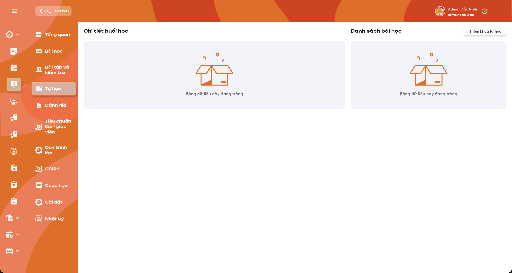
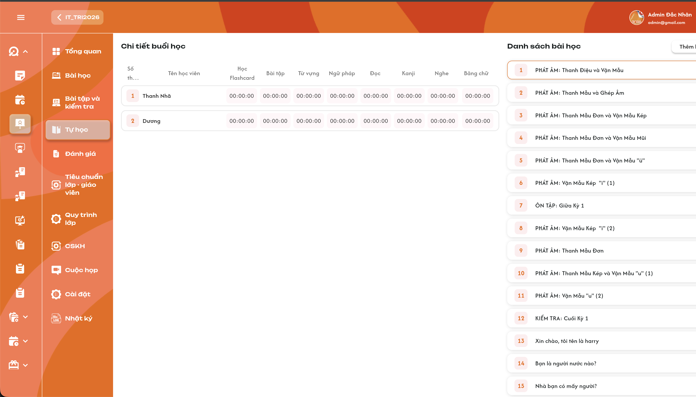
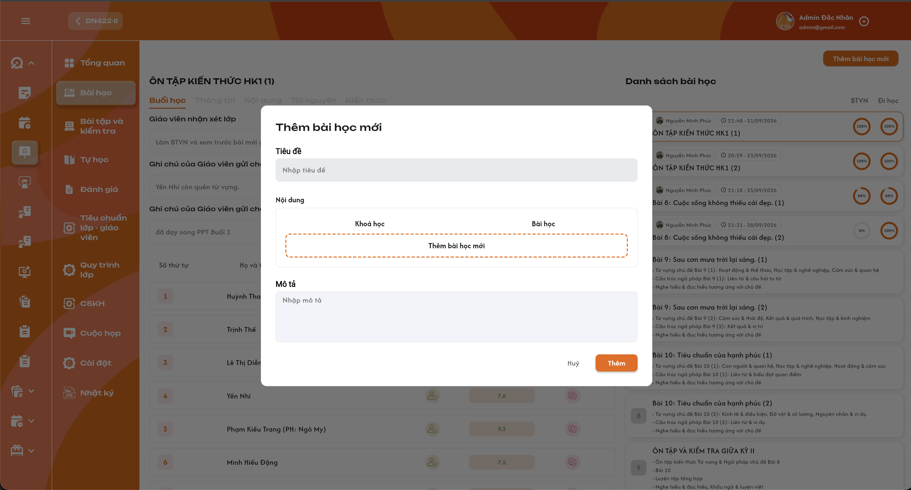
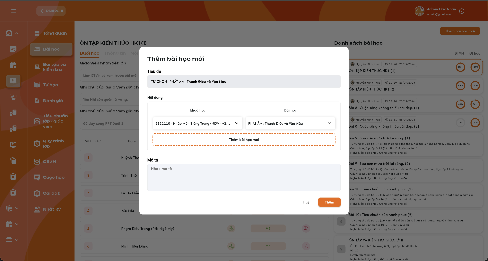

# Chi tiết lớp học — Menu Tự học

Menu Tự học dùng để giao bài ôn tập cho học viên trên app và xem thời gian học theo từng phần. Mỗi lớp chỉ có **một khóa tự học**. Ban đầu chọn **một khóa học thường đã định nghĩa**, hệ thống lấy **toàn bộ bài học của khóa đó** vào Tự học của lớp. Sau đó được thêm một hoặc nhiều bài riêng giống [Menu Bài học](./class_detail_lessons_requirements.md). Nội dung nguồn do **Curriculum Development Handler** quản lý tại [function Bài học](../../course_management/semester/lesson/lesson.md). Đây là ôn tập tự do, không có điều kiện hoàn thành hay thứ tự bắt buộc; thời gian ghi nhận là dữ liệu theo dõi.

## 1. UI

### Trang 1: Khung menu và trạng thái chưa có khóa tự học


*Tự học — Hai vùng chưa có dữ liệu — nhấn để xem ảnh gốc*

**Mô tả:**

Chọn menu Tự học trong Chi tiết lớp. UI có vùng trái **Chi tiết buổi học**, vùng phải **Danh sách bài học** và nút **Thêm khóa tự học**.

**Giải thích field/thành phần:**

- `A01.01` **Hai vùng dữ liệu**: Khi chưa gán khóa/chưa có bài tự học, cả hai vùng hiển thị icon rỗng và `Bảng dữ liệu này đang trống` như ảnh; không dựng bài hoặc học viên mẫu.
- `A01.02` **Thêm khóa tự học**: Mở popup chọn khóa nguồn. Đây là chọn khóa đã có để ôn tập, không tạo định nghĩa khóa học mới.
- `A01.03` **Ngữ cảnh lớp**: Toàn bộ danh sách, bài đang xem và học viên thuộc đúng lớp trên thanh điều hướng.
- `A01.04` **Loading/lỗi**: Phân biệt đang tải, dữ liệu rỗng và tải lỗi. Tải lỗi có Thử lại; không thay lỗi bằng màn rỗng hoặc số 0.

**Điểm cần lưu ý:**

- Không yêu cầu giáo viên mở buổi để học viên vào bài tự học trên app. Tên Chi tiết buổi học theo UI không tạo buổi điểm danh.
- Admin và Class Handler/Support được add vào lớp có quyền xem/thêm khóa/thêm bài, giống menu Bài học; quyền app của học viên được kiểm tra theo phạm vi lớp được cấp.

### Trang 2: Popup Thêm khóa tự học và dropdown khóa học


*Popup Thêm khóa tự học — nhấn để xem ảnh gốc*


*Dropdown chọn khóa học đã định nghĩa — nhấn để xem ảnh gốc*

**Mô tả:**

Bấm Thêm khóa tự học để mở popup **Thêm khóa tự học**, chọn một khóa trong dropdown rồi bấm Thêm. Hệ thống lấy **full bài học trong khóa đã chọn** để học viên lớp ôn tập.

**Giải thích field/thành phần:**

- `A02.01` **Chọn khóa học**: Dropdown một lựa chọn, placeholder `Chọn khóa học`; tên/phiên bản khóa lấy từ nguồn như ảnh, danh sách dài có cuộn. Chọn theo định danh khóa, không ghép theo tên vì có thể có tên giống nhau.
- `A02.02` **Loại khóa nguồn**: Khóa học thường đã define; không bắt buộc phải là loại khóa chuyên biệt Tự học hoặc khóa hiện tại của lớp khi chưa có quy định đó.
- `A02.03` **Thêm**: Bắt buộc chọn khóa nguồn hợp lệ. Kiểm tra quyền và lấy toàn bộ bài thuộc đúng khóa; không yêu cầu chọn từng bài hay chỉ lấy trang đầu. Chống gửi lặp và kiểm tra bài nguồn trùng; báo trùng khi có cùng bài nguồn trong danh sách, không lưu một phần khi lỗi.
- `A02.04` **Hủy**: Đóng popup, không gán khóa/bài, không có Toast CRUD.
- `A02.05` **Sau khi thêm**: Danh sách Tự học có đủ bài của khóa được chọn và được cấp cho học viên lớp trên app. Toast `Thêm khóa tự học thành công.`. Không thay chương trình Bài học chính của lớp.
- `A02.06` **Thêm khóa tiếp theo**: **Chỉ một khóa tự học cho mỗi lớp**. Sau khi đã có khóa, chặn thêm khóa thứ hai ở cả UI và kiểm tra khi lưu; không cộng thêm full khóa khác hay tự thay khóa hiện tại. Vẫn được bổ sung bài riêng giống menu Bài học.

**Điểm cần lưu ý:**

- Danh sách sau khi chọn khóa phải chứa toàn bộ bài của khóa, kể cả bài ôn/kiểm tra nếu đó là bài trong nguồn. Các bài này vẫn là phần ôn tự do trong Tự học.
- Không gọi flow tạo khóa/bài Curriculum; không sao chép khóa sang chương trình lớp chính.
- Khóa không có bài hiển thị danh sách trống đúng dữ liệu; cách cho phép gán khóa rỗng cần chốt, không tạo bài giả.

### Trang 3: Danh sách bài tự học và chọn bài


*Danh sách bài tự học và thời gian từng học viên — nhấn để xem ảnh gốc*

**Mô tả:**

Sau khi có bài, vùng phải hiển thị card số thứ tự và tên bài. Bấm một bài để xem thời gian của từng học viên theo từng phần ở vùng trái.

**Giải thích field/thành phần:**

- `A03.01` **Card bài**: Số thứ tự và tên bài theo danh sách tự học đã gán cho lớp; bài chọn có viền cam như ảnh. Nội dung không fix theo các tên bài mẫu.
- `A03.02` **Chọn bài**: Cập nhật bảng thời gian của đúng bài, giữ phạm vi lớp. Việc quản trị viên bấm card không được tính là thời gian học của học viên.
- `A03.03` **Thứ tự**: Giữ thứ tự bài nguồn được áp dụng khi lấy khóa và thứ tự bài bổ sung đã lưu. Không tự thêm kéo-thả/xóa bài khi UI chưa đặc tả.
- `A03.04` **Tải toàn bộ khóa**: **Tải full danh sách bài và học viên, không phân trang/load-more**. Khi mở menu có dữ liệu, **mặc định chọn bài 1** theo thứ tự danh sách. Không có bài thì giữ trạng thái rỗng.
- `A03.05` **Bài không bị khóa theo tiến độ**: Học viên có quyền app được vào bất kỳ bài tự học đã gán, không cần hoàn thành bài trước hoặc đợi ngày dạy của lớp.

**Điểm cần lưu ý:**

- Danh sách Tự học tách khỏi danh sách Bài học chính dù dùng cùng định nghĩa nguồn. Chọn/thêm bài tự học không sửa điểm danh hoặc % BTVN/Đi học của menu Bài học.
- Không suy ra chỉ số hoàn thành/đạt/chưa đạt từ thời gian đã vào bài.

### Trang 4: Thêm một hoặc nhiều bài tự học riêng


*UI kế thừa Menu Bài học — Popup thêm bài — nhấn để xem ảnh gốc*



*UI kế thừa — Chọn Khóa học/Bài học nguồn — nhấn để xem ảnh gốc*

**Mô tả:**

Sau bước thêm khóa tự học ban đầu, được **Thêm bài học mới giống menu Bài học** để bổ sung một hoặc nhiều bài vào danh sách Tự học. Hai ảnh popup là tham chiếu kế thừa; vị trí nút trên UI Tự học sau gán khóa cần xác nhận vì ảnh hiện bị cắt phần bên phải.

**Giải thích field/thành phần:**

- `A04.01` **Tiêu đề**: Tự lấy từ bài nguồn đã chọn; chỉ đọc, không sửa. Mỗi bài bổ sung dùng tên của đúng bài nguồn.
- `A04.02` **Khóa học/Bài học**: Mỗi dòng chọn một khóa trước, sau đó chọn một bài thuộc khóa đó. Được thêm nhiều dòng; đổi khóa phải bỏ lựa chọn bài không thuộc khóa mới.
- `A04.03` **Mô tả**: Được nhập/sửa giống popup Menu Bài học, lưu phạm vi lớp/Tự học; không thay Mô tả Curriculum. **Một ô Mô tả chung cho lần thêm; tất cả bài được thêm trong cùng lần dùng cùng nội dung Mô tả**. Không áp dụng lại mô tả mới cho bài đã có. Validation bắt buộc/giới hạn ký tự còn theo mục 3.
- `A04.04` **Thêm**: Kiểm tra toàn bộ dòng hợp lệ và không trùng bài đã có/giữa các dòng rồi bổ sung đúng các bài được chọn; không lấy full khóa ở thao tác thêm bài riêng. Một Toast `Thêm bài tự học thành công.`; lỗi giữ input.
- `A04.05` **Hủy**: Đóng, không bổ sung bài hoặc đổi nguồn, không Toast CRUD.

**Điểm cần lưu ý:**

- Thêm khóa: lấy toàn bộ bài của khóa. Thêm bài: chỉ lấy bài được chọn trong từng dòng.
- Bài bổ sung được dùng để ôn tập trên app theo cùng cơ chế tự do và ghi nhận thời gian; không tự tạo buổi lớp hoặc dữ liệu điểm danh.
- **Bài trùng phải báo trùng và chặn lưu**: bài đã có từ khóa tự học, bài đã bổ sung trước đó hoặc chọn lặp trong cùng lần thêm. Kiểm tra theo định danh bài nguồn, không chỉ theo tiêu đề. Không bỏ qua dòng trùng rồi thêm một phần; giữ input để sửa. Vị trí bài bổ sung và thao tác sửa/xóa liên kết tự học còn cần chốt.

### Trang 5: Bảng thời gian học theo học viên và từng phần


*Bảng thời gian Tự học — 8 phần như UI — nhấn để xem ảnh gốc*

**Mô tả:**

Vùng Chi tiết buổi học hiển thị một dòng mỗi học viên và thời gian học trên app của **bài tự học đang chọn**, tách theo tám phần trong UI. Bảng dùng để theo dõi, chỉ đọc.

**Giải thích field/thành phần:**

- `A05.01` **Định danh dòng**: Số thứ tự và Tên học viên thuộc lớp; mỗi ô gắn đúng lớp–học viên–bài tự học–phần học. **Lấy toàn bộ học viên của lớp, không loại trừ trạng thái**: Đang học, Dự thính, Hoàn thành, Nghỉ học, Rời lớp, Chỉ xem, Xóa. Học viên rời lớp vẫn hiển thị và giữ/xem được thời gian học cũ.
- `A05.02` **Học Flashcard**: Thời gian học phần Flashcard của bài tự học đang chọn.
- `A05.03` **Bài tập**: Thời gian vào học phần Bài tập; không phải điểm/đã nộp BTVN bắt buộc của buổi chính.
- `A05.04` **Từ vựng / Ngữ pháp / Đọc**: Mỗi phần một cột và thời gian riêng, không gộp thành tổng chung.
- `A05.05` **Kanji / Nghe / Bảng chữ**: Ba cột riêng theo UI; không gộp Kanji với Bảng chữ hoặc Từ vựng.
- `A05.06` **Giá trị thời gian**: Tổng thời gian được app ghi nhận của đúng học viên/bài/phần, hiển thị **HH:mm:ss** như ảnh. Mỗi lần quay lại học tiếp cộng thời gian hợp lệ; không dùng lịch dạy/thời lượng kế hoạch hoặc thời gian của người quản trị mở bảng.
- `A05.07` **Giới hạn hiển thị**: Khi tổng thời gian một ô **vượt 24 giờ**, hiển thị tối đa **`23:59:59`** theo xác nhận; không hiển thị 24/25 giờ hoặc quay về 00:00:00. Đây là giới hạn hiển thị, vẫn giữ thời gian thực đã ghi nhận trong dữ liệu. Bình thường dùng HH:mm:ss như UI.
- `A05.08` **00:00:00**: Khi xác định chưa có thời gian học của phần đó hoặc tổng ghi nhận bằng 0, hiển thị 00:00:00. Dữ liệu tải lỗi/chưa xác định không tự biến thành 0.
- `A05.09` **Chỉ đọc**: Không sửa thời gian thủ công, không click ô để mở popup/chấm bài khi UI chưa có đặc tả.

**Điểm cần lưu ý:**

- Giữ đúng 8 cột UI; không kế thừa 9 hoạt động của popup Thời gian trong Tổng quan vì hai UI có nhóm khác nhau.
- Không tự tính trung bình toàn lớp hoặc tổng nhiều bài thay ô học viên–bài–phần.
- Bắt đầu tính khi mở phần học đã chốt, không đòi tương tác. Quy tắc ra nền/khóa màn hình, offline, nhiều thiết bị và ánh xạ các phần app cần chốt ở mục 3; không tự cộng cả thời gian đã rời phần học.
- Có dữ liệu mới từ app thì bảng phản ánh sau khi lấy dữ liệu thành công; không yêu cầu realtime/polling khi chưa được chốt.

### Trang 6: Học viên ôn tập tự do trên app và ghi nhận thời gian
**Mô tả:**

Học viên truy cập các bài Tự học đã gán cho lớp trên app, chọn phần muốn ôn và học lại theo nhu cầu. Phần này đặc tả hành vi nghiệp vụ; UI app không có trong ảnh, không tự tạo màn hình app mới.

**Giải thích field/thành phần:**

- `A06.01` **Truy cập bài**: Bài từ khóa tự học và bài được bổ sung xuất hiện trong phạm vi lớp được cấp cho học viên. **Tất cả trạng thái học viên của lớp đều được vào ôn app**, không chặn vì Hoàn thành/Nghỉ học/Rời lớp/Chỉ xem/Xóa. Vẫn kiểm tra đúng học viên và lớp/bài được gán; rời lớp không xóa thời gian cũ.
- `A06.02` **Không có ràng buộc ôn tập**: Không yêu cầu học đúng thứ tự, đủ thời gian, đạt điểm, hoàn thành phần trước, điểm danh buổi hoặc nộp bài bắt buộc mới được mở bài tự học khác.
- `A06.03` **Học lại**: Được quay lại cùng bài/phần để ôn nhiều lần; thời gian hợp lệ cộng vào đúng bài/phần. Không khóa khi đã học.
- `A06.04` **Bắt đầu tính/Nguồn ghi nhận**: **Khi học viên mở phần học trên app thì bắt đầu tính thời gian phần đó**, không yêu cầu click/nhập/làm bài mới bắt đầu đếm. Đổi/đóng phần thì kết thúc khoảng học của phần trước. Dữ liệu do phiên học trên app cung cấp, không do thao tác chọn khóa/chọn card trên trang quản trị tạo ra. Ra nền/khóa màn hình còn cần chốt riêng.
- `A06.05` **Tách dữ liệu chương trình chính**: Việc vào ôn hoặc tăng thời gian Tự học không tự đánh dấu Có mặt, đã nộp BTVN hoặc hoàn thành buổi chính. Không suy ra nghĩa vụ/điểm thưởng/phạt khi chưa có yêu cầu.

**Điểm cần lưu ý:**

- Không có ràng buộc học tập không có nghĩa bỏ kiểm tra học viên–lớp–bài được cấp.
- Chỉ ghi nhận phần thực tế đã học theo quy tắc bộ đếm: **mở phần học trên app là bắt đầu tính, không yêu cầu tương tác mới tính**; không cộng cùng khoảng thời gian sang các phần khác.
- Tránh nhân đôi khi đồng bộ lại cùng bản ghi; quy tắc hợp nhất phiên nhiều thiết bị/offline còn cần xác nhận, không tự chọn giới hạn thời gian.

### Trang 7: Toast phản hồi CRUD
**Mô tả:**

Thêm khóa và thêm bài tự học dùng component Toast chung. Nội dung dưới đây là thông báo đề xuất theo kết quả nghiệp vụ.

**Giải thích field/thành phần:**

- `A07.01` **Thành Công**: `Thêm khóa tự học thành công.` hoặc `Thêm bài tự học thành công.` sau khi backend xác nhận lưu.
- `A07.02` **Cảnh Báo**: `Vui lòng chọn khóa học.` / `Vui lòng chọn đầy đủ khóa học và bài học.` khi thiếu lựa chọn; `Lớp đã có khóa tự học.` khi thử gán khóa thứ hai; `Bài học đã tồn tại trong danh sách Tự học.` khi trùng bài. Vẫn báo lỗi ở field/dòng tương ứng.
- `A07.03` **Có Lỗi Xảy Ra**: `Không thể thêm khóa tự học. Vui lòng thử lại.` / `Không thể thêm bài tự học. Vui lòng thử lại.` khi thao tác lỗi.
- `A07.04` **Thông Báo**: Chỉ dùng khi có trạng thái đồng bộ bất đồng bộ thực tế; không báo thành công trước lưu.
- `A07.05` **UI Toast**: Dùng [Toast chung](../../images/01-toast-crud.png), màu/icon/tiêu đề/nút × theo component chuẩn; vị trí/thời lượng theo component chung.

**Điểm cần lưu ý:**

- Mỗi thao tác logic có một Toast; Hủy/chỉ xem/chọn bài/đọc thời gian không có Toast CRUD.
- Lỗi giữ input để sửa hoặc thử lại; Toast không thay thế validation tại field.

---

## 2. Yêu cầu

### 2.1. Flow chính

**Flow 1 / REQ01 / REQ04: Mở menu và chọn bài**

```text
Admin hoặc Class Handler/Support được add vào lớp mở Tự học
      → Chưa có bài: hai vùng Bảng dữ liệu này đang trống
      → Có bài: tải full danh sách bài/học viên, không phân trang/load-more; mặc định chọn bài 1
      → Bảng gồm toàn bộ học viên, không loại trạng thái; rời lớp vẫn xem thời gian cũ
      → Click bài: viền cam, bảng thời gian đúng lớp–bài–học viên–phần
      → Chỉ đọc, không tạo phiên học từ thao tác quản trị
```

**Flow 2 / REQ02 / REQ08: Chọn khóa tự học ban đầu**

```text
Thêm khóa tự học → Popup dropdown Chọn khóa học
      → Lớp chưa có khóa: chọn một khóa học thường đã define → Thêm
      → Lớp đã có khóa: không được thêm khóa thứ hai, không tự thay khóa hiện tại
      → Kiểm tra quyền/lựa chọn → lấy toàn bộ bài của đúng khóa
      → Lưu vào danh sách Tự học lớp, cấp các bài cho học viên trên app
      → Thành công: Thêm khóa tự học thành công.
      → Lỗi: giữ lựa chọn, không thêm một phần; Toast lỗi
      → Hủy: đóng, không thay dữ liệu
```

**Flow 3 / REQ03 / REQ08: Bổ sung bài tự học riêng**

```text
Đã thêm khóa ban đầu → Thêm bài học mới giống menu Bài học
      → Mỗi dòng: chọn khóa rồi chọn bài thuộc khóa
      → Tiêu đề tự lấy, khóa sửa; chỉ Mô tả được chỉnh
      → Một hoặc nhiều dòng → cùng một Mô tả cho các bài trong lần thêm
      → Validate tất cả dòng và kiểm tra trùng với bài đã có/giữa các dòng
      → Có trùng: báo Bài học đã tồn tại trong danh sách Tự học., giữ input và không lưu
      → Hợp lệ: thêm đúng bài đã chọn vào Tự học
      → Không lấy full khóa trong thao tác thêm bài riêng
      → Thành công: Thêm bài tự học thành công.; lỗi giữ input/Toast lỗi
```

**Flow 4 / REQ05 / REQ06: Học viên ôn tập trên app**

```text
Học viên lớp ở mọi trạng thái mở bài Tự học đã gán; không loại theo trạng thái
      → Chọn bất kỳ bài/phần, không yêu cầu trình tự/điểm/thời gian tối thiểu
      → Ôn bài và có thể quay lại học nhiều lần
      → Mở phần học: bắt đầu đếm, không cần tương tác; đổi/đóng phần: kết thúc khoảng của phần trước
      → App ghi nhận thời gian theo từng học viên–bài–phần
      → Không tự thay điểm danh/BTVN/kết quả buổi chính
```

**Flow 5 / REQ04 / REQ06: Xem thời gian đã ghi nhận**

```text
Admin hoặc Class Handler/Support được add vào lớp chọn bài tự học
      → Lấy toàn bộ học viên mọi trạng thái và thời gian app đúng bài/phần
      → Học viên đã rời lớp vẫn có dòng và giữ thời gian cũ
      → Hiển thị HH:mm:ss ở tám cột UI; tổng một ô vượt 24 giờ thì hiện 23:59:59
      → Giới hạn hiển thị không cắt/xóa dữ liệu thời gian thực
      → Có thời gian mới thì phản ánh khi lấy dữ liệu thành công
      → Tải lỗi khác 00:00:00 thật; không có thao tác sửa thời gian
```

### 2.2. Ngoại lệ

- **EX01:** Tải lỗi/chưa xác định thời gian → báo lỗi/Thử lại, không dựng rỗng hay 00:00:00 giả.
- **EX02:** Response lớp/bài cũ → không ghi đè bài/lớp đang xem.
- **EX03:** Thiếu khóa, thiếu bài ở một dòng hoặc bài không thuộc khóa → chặn lưu, báo đúng field/dòng; không bỏ qua dòng thiếu để thêm một phần.
- **EX04:** Lưu lỗi hoặc gửi lặp → giữ input, không tạo liên kết trùng từ cùng thao tác, một Toast kết quả.
- **EX07:** Lớp đã có khóa tự học, hoặc hai thao tác gán khóa đồng thời → không gán khóa thứ hai/ghi đè khóa đã có; giữ bài và thời gian hiện hữu, Toast Cảnh Báo `Lớp đã có khóa tự học.` khi xác nhận thao tác không hợp lệ.
- **EX05:** Ngoài quyền quản trị/app hoặc sai liên kết lớp–học viên–bài–phần → từ chối đọc/ghi ngoài phạm vi.
- **EX08:** Bài nguồn đã có trong Tự học hoặc chọn trùng giữa các dòng → báo lỗi dòng trùng và Toast Cảnh Báo `Bài học đã tồn tại trong danh sách Tự học.`; chặn toàn bộ lần thêm, giữ input, không tạo bản trùng. Backend kiểm tra lại khi lưu.
- **EX06:** Chưa có thời gian học thật của phần → 00:00:00; phần app không có nội dung và điều kiện được truy cập cần mapping nguồn, không dựng nội dung mẫu.

### 2.3. Yêu cầu khác

| Mã | Tên yêu cầu | Mô tả |
|---|---|---|
| REQ01 | Khung và danh sách | Hai vùng Chi tiết buổi học/Danh sách bài học; rỗng đúng UI; tải full bài và học viên không phân trang/load-more, mặc định bài 1 khi có dữ liệu. Card có số/tên/viền chọn, bấm để xem đúng bảng của bài. |
| REQ02 | Thêm khóa | Mỗi lớp chỉ một khóa tự học; ban đầu chọn một khóa học thường có sẵn, chặn khóa thứ hai; lấy full bài học khóa đó cho Tự học lớp, không chọn từng bài hay đổi chương trình lớp chính. |
| REQ03 | Thêm bài | Bổ sung một hoặc nhiều bài theo popup menu Bài học; mỗi dòng chọn đủ khóa–bài; tiêu đề tự lấy/chỉ đọc; một Mô tả được sửa, dùng chung cho tất cả bài thêm cùng lần. Bài trùng với bài đã có hoặc giữa các dòng phải báo trùng, chặn lưu. Chỉ lấy bài đã chọn, không full khóa ở thao tác này. |
| REQ04 | Bảng thời gian | Lấy full học viên lớp mọi trạng thái, giữ/xem thời gian cũ khi rời lớp. Theo học viên–bài tự học–phần; tám cột Flashcard/Bài tập/Từ vựng/Ngữ pháp/Đọc/Kanji/Nghe/Bảng chữ, HH:mm:ss, tổng một ô vượt 24 giờ hiện max 23:59:59 nhưng giữ dữ liệu thời gian thực; chỉ đọc. Không trộn bảng với thời gian tổng/9 hoạt động của UI khác. |
| REQ05 | Ôn tập tự do | Học viên mọi trạng thái được vào ôn bài đã gán cho lớp. Không thứ tự/điểm/thời gian tối thiểu/điểm danh/nộp bài bắt buộc để truy cập bài ôn được cấp; được học lại. Không có đánh giá hoàn thành bắt buộc từ thời gian. |
| REQ06 | Ghi nhận app | Mở phần học trên app bắt đầu đếm, không đòi tương tác; đổi/đóng phần kết thúc khoảng đó. Cộng thời gian qua các lần học đúng phần; không tính thao tác quản trị, không cộng trùng bản ghi đồng bộ. Quy tắc bộ đếm chi tiết còn cần chốt mục 3. |
| REQ07 | Phạm vi | Đúng lớp–học viên–bài–khóa–phần; nội dung nguồn do Curriculum Development Handler quản lý. Tự học không tự đổi điểm danh/% BTVN/% Đi học/kết quả chương trình chính. |
| REQ08 | Phản hồi | Thêm khóa/thêm bài có Toast kết quả; lỗi giữ input, chống lặp. Hủy và thao tác chỉ xem không có Toast CRUD. |

### 2.4. Ràng buộc

#### Quyền

Quyền giống Menu Bài học: Admin được quản lý theo phạm vi quản trị; Class Handler và Support phải được add vào lớp. Kiểm tra lại quyền khi thêm khóa/thêm bài. Học viên dùng các bài được cấp trên app.

| Role/Phạm vi | Xem bảng Tự học | Thêm khóa/thêm bài | Sửa thời gian thủ công | Sửa định nghĩa Curriculum qua menu này | Học ôn trên app |
|---|:---:|:---:|:---:|:---:|:---:|
| Admin trong phạm vi quản trị | ✅ | ✅ | ❌ | ❌ | ❌ |
| Class Handler được add vào lớp | ✅ | ✅ | ❌ | ❌ | ❌ |
| Support được add vào lớp | ✅ | ✅ | ❌ | ❌ | ❌ |
| Giáo viên của lớp | ✅ | ❌ | ❌ | ❌ | ❌ |
| Học viên lớp ở mọi trạng thái được vào Tự học trên app | ❌ | ❌ | ❌ | ❌ | ✅ |
| User thiếu quyền lớp/bài | ❌ | ❌ | ❌ | ❌ | ❌ |

- Giáo viên của lớp chỉ xem danh sách bài và bảng thời gian, không có nút Thêm khóa tự học/Thêm bài học mới; đặc tả tại [Giảng dạy — role Giáo viên](../../teacher_role/class/class_teaching_requirements.md).
- Quyền ôn app và quyền quản trị là hai phạm vi riêng; một account có cả hai thì kiểm tra theo thao tác cụ thể.
- Không có ràng buộc ôn tập không bỏ qua quyền truy cập lớp/bài. Toàn bộ trạng thái học viên đều được hiển thị và vào ôn; không có filter ngầm theo trạng thái, kể cả Rời lớp/Xóa. Giữ thời gian đã học khi trạng thái thay đổi.

#### Ràng buộc khác

**Phạm vi dữ liệu**

- Mỗi lớp có một khóa tự học; không thêm khóa thứ hai hoặc tự thay khóa. Bổ sung bài riêng vẫn chọn khóa–bài nguồn từng dòng theo menu Bài học, không trở thành gán thêm một khóa tự học. Không tạo/sửa định nghĩa nguồn hoặc thay khóa chương trình chính.
- Thêm khóa lấy toàn bộ bài; thêm bài riêng chỉ bổ sung các bài được chọn. Chưa tự thêm thao tác gỡ khóa/xóa/sắp xếp bài.
- Thời gian phản ánh việc học trên app và giữ lịch sử khi học viên rời lớp/thay trạng thái; bảng quản trị chỉ xem. Giới hạn 23:59:59 khi vượt 24 giờ chỉ áp dụng hiển thị, không xóa thời gian thực hoặc đặt mức hoàn thành bắt buộc.

---

## 3. Testcase

### Feature: Chi tiết lớp học — Menu Tự học

| Tên testcase | Priority | Scenario | Role | Pre-condition | Given/When/Then | Expected Result |
|---|---|---|---|---|---|---|
| Case 1: Rỗng đúng UI | High | Flow 1 / REQ01 | Admin / Class Handler / Support trong phạm vi lớp | Lớp chưa có khóa/bài tự học | **Given** mở Tự học<br>**When** tải thành công<br>**Then** hai vùng hiện đúng trạng thái rỗng | - Nút Thêm khóa tự học mở popup<br>- Không có bài hoặc thời gian giả |
| Case 2: Đúng lớp và phân biệt lỗi | High | EX01 / EX02 / REQ07 | Admin / Class Handler / Support trong phạm vi lớp | Lớp A/B khác dữ liệu; request chậm/lỗi | **Given** đổi lớp trong khi tải<br>**When** response về<br>**Then** chỉ dữ liệu đúng lớp hiển thị | - Có Thử lại khi lỗi<br>- Không dùng rỗng/00:00:00 che lỗi |
| Case 3: Chọn khóa lấy toàn bộ bài | High · Smoke | Flow 2 / REQ02 | Admin / Class Handler / Support trong phạm vi lớp | Khóa A có 35 bài trong dữ liệu nguồn | **Given** chọn A rồi Thêm<br>**When** lưu thành công<br>**Then** đủ 35 bài A trong Tự học lớp | - Không chỉ lấy trang đầu hoặc bài đang học<br>- Không lấy bài khóa B<br>- Một Toast thành công |
| Case 4: Chọn đúng phiên bản/định danh | High | REQ02 / REQ07 | Admin / Class Handler / Support trong phạm vi lớp | Hai khóa có tên gần giống hoặc trùng | **Given** chọn khóa có ID A<br>**When** xác nhận thêm<br>**Then** lấy bài của đúng A | - Không dùng tên hiển thị làm khóa<br>- Không trộn phiên bản |
| Case 5: Thiếu khóa/Hủy | High | EX03 / REQ02 | Admin / Class Handler / Support trong phạm vi lớp | Popup chưa chọn hoặc đã chọn khóa | **Given** Hủy hoặc Thêm khi chưa chọn<br>**When** validate thao tác<br>**Then** Hủy không lưu; thiếu khóa báo field | - Cảnh Báo Vui lòng chọn khóa học. khi xác nhận thiếu<br>- Không tạo bài giả |
| Case 6: Lỗi/chống lặp/thiếu quyền | High | EX04 / EX05 / REQ02 | Admin / Class Handler / Support trong phạm vi lớp | Backend lỗi, request đang lưu hoặc thiếu quyền lớp | **Given** xác nhận thêm khóa<br>**When** kiểm tra dữ liệu/quyền<br>**Then** không lưu lặp hoặc ngoài quyền | - Lỗi giữ lựa chọn để thử lại<br>- Một Toast lỗi<br>- Không thêm một phần |
| Case 7: Chỉ một khóa và gán đồng thời | High | EX07 / REQ02 | Admin / Class Handler / Support trong phạm vi lớp | Lớp đã có khóa A hoặc hai user cùng gán khóa | **Given** thử thêm khóa B<br>**When** backend kiểm tra trước lưu<br>**Then** không tạo khóa thứ hai hoặc thay A | - Bài/thời gian A giữ nguyên<br>- Không cộng full khóa B<br>- Vẫn được thêm bài riêng |
| Case 8: Chọn bài đúng bảng thời gian | High · Smoke | Flow 1 / REQ01 / REQ04 | Admin / Class Handler / Support trong phạm vi lớp | Bài A/B có thời gian khác | **Given** bấm B sau khi xem A<br>**When** tải bảng<br>**Then** viền cam và toàn bộ ô cùng thuộc B | - Không dùng thời gian A<br>- Không ghi nhận việc quản trị bấm là học app |
| Case 9: Tên bài và thứ tự nguồn | Medium | REQ01 / REQ02 | Admin / Class Handler / Support trong phạm vi lớp | Khóa có bài khác ảnh | **Given** mở danh sách<br>**When** hiển thị<br>**Then** tên/thứ tự đúng nguồn được áp dụng | - Không hard-code 15 bài mẫu<br>- Không sửa định nghĩa nguồn |
| Case 10: Không khóa bài ôn theo trình tự | High | Flow 4 / REQ05 | Học viên có quyền app của lớp | Khóa đã gán; chưa học bài đầu | **Given** vào bài cuối trên app<br>**When** kiểm tra quyền<br>**Then** được học bài đã gán | - Không đòi hoàn thành bài trước<br>- Không cần giáo viên mở buổi |
| Case 11: Mặc định bài 1 và tải full | High | Flow 1 / REQ01 | Admin / Class Handler / Support trong phạm vi lớp | Có 35 bài và 25 học viên ở nhiều trạng thái | **Given** mở menu Tự học<br>**When** tải xong<br>**Then** bài 1 được chọn và đầy đủ bài/học viên khi cuộn | - Không chọn bài học gần nhất thay bài 1<br>- Không phân trang/load-more hoặc cắt trang đầu |
| Case 12: Thêm bài chỉ lấy bài đã chọn | High | Flow 3 / REQ03 | Admin / Class Handler / Support trong phạm vi lớp | Đã có khóa tự học; khóa B có 20 bài | **Given** chọn B/bài 4 trong popup thêm bài<br>**When** lưu<br>**Then** chỉ bổ sung bài 4 vào Tự học | - Không thêm cả 20 bài của B<br>- Không bổ sung vào Bài học chính |
| Case 13: Một hoặc nhiều dòng nguồn | High | REQ03 | Admin / Class Handler / Support trong phạm vi lớp | Khóa A/B và các bài hợp lệ | **Given** chọn A/bài 2 rồi thêm dòng B/bài 3<br>**When** xác nhận<br>**Then** bổ sung hai bài với đúng nguồn từng dòng | - Không gộp nội dung thành một bài<br>- Tiêu đề tự lấy và khóa sửa<br>- Mô tả được sửa và áp dụng giống nhau cho cả hai bài |
| Case 14: Dòng thiếu/sai khóa và lỗi lưu | High | EX03 / EX04 / REQ03 | Admin / Class Handler / Support trong phạm vi lớp | Một dòng thiếu bài hoặc bài không thuộc khóa | **Given** bấm Thêm<br>**When** validate toàn bộ/lưu<br>**Then** không lưu một phần hoặc bài sai nguồn | - Báo đúng dòng lỗi<br>- Giữ input khi lỗi<br>- Một Toast kết quả |
| Case 15: Hủy không thay khóa/danh sách | Medium | REQ03 | Admin / Class Handler / Support trong phạm vi lớp | Popup đã có lựa chọn | **Given** bấm Hủy<br>**When** đóng<br>**Then** danh sách Tự học giữ nguyên | - Không sửa nguồn<br>- Không có Toast CRUD |
| Case 16: Trùng bài đã có hoặc trùng giữa các dòng | High | EX08 / REQ03 / REQ08 | Admin / Class Handler / Support trong phạm vi lớp | Bài A đã có từ khóa tự học hoặc hai dòng chọn cùng bài B | **Given** chọn thêm bài trùng kèm một bài mới hợp lệ<br>**When** bấm Thêm<br>**Then** báo đúng dòng trùng, không lưu toàn bộ lần thêm | - Một Toast Bài học đã tồn tại trong danh sách Tự học.<br>- Giữ Mô tả/lựa chọn để sửa<br>- Cùng tên nhưng khác định danh bài không tự coi là trùng |
| Case 17: Đủ tám phần theo UI | High | Flow 5 / REQ04 | Admin / Class Handler / Support trong phạm vi lớp | Bài có dữ liệu thời gian theo phần | **Given** xem Chi tiết buổi học<br>**When** render bảng<br>**Then** đủ Flashcard/Bài tập/Từ vựng/Ngữ pháp/Đọc/Kanji/Nghe/Bảng chữ | - Đúng thứ tự UI<br>- Không dùng 9 phần Tổng quan<br>- Chỉ đọc |
| Case 18: Cộng các lần học cùng phần | High | REQ04 / REQ06 | Admin / Class Handler / Support trong phạm vi lớp | A học Từ vựng cùng bài hai lần hợp lệ 120s và 90s | **Given** xem ô Từ vựng của A<br>**When** tổng hợp bản ghi<br>**Then** 00:03:30 | - Không hiện chỉ lần cuối 00:01:30<br>- Không cộng sang Bài tập hoặc học viên B |
| Case 19: Đúng học viên/bài/phần | High | REQ04 / REQ07 | Admin / Class Handler / Support trong phạm vi lớp | A/B và bài 1/2 có thời gian khác | **Given** chọn bài 2<br>**When** lấy bảng<br>**Then** mỗi ô đúng người/bài 2/phần | - Không tổng tất cả bài<br>- Không trộn giữa lớp dùng cùng source |
| Case 20: Zero thật khác lỗi | High | EX01 / REQ04 | Admin / Class Handler / Support trong phạm vi lớp | Chưa có thời gian học hoặc request lỗi | **Given** mở bảng<br>**When** nhận dữ liệu/lỗi<br>**Then** zero thật hiện 00:00:00; lỗi có Thử lại | - Không dựng số 0 khi lỗi<br>- Không dùng thời lượng kế hoạch |
| Case 21: Xem bảng không tăng thời gian app | High | REQ04 / REQ06 | Admin / Class Handler / Support trong phạm vi lớp | App không phát sinh phiên học mới | **Given** mở bảng/chuyển card nhiều lần<br>**When** tải lại<br>**Then** thời gian học giữ đúng dữ liệu app | - Không tính thời gian Admin xem bảng<br>- Không sửa thủ công |
| Case 22: Full học viên và giữ thời gian khi rời lớp | High | REQ04 / REQ05 / REQ07 | Admin / Class Handler / Support trong phạm vi lớp; Học viên lớp | Lớp có đủ 7 trạng thái; A đã học 00:10:00 rồi Rời lớp | **Given** mở bảng Tự học và A vào lại ôn trên app<br>**When** lấy danh sách/kiểm tra truy cập<br>**Then** đủ học viên mọi trạng thái, A giữ thời gian 00:10:00 và vẫn được vào ôn | - Không lọc Rời lớp/Xóa/Chỉ xem<br>- Không reset thời gian cũ<br>- Dữ liệu vẫn đúng lớp/học viên |
| Case 23: Vượt 24 giờ hiển thị max 23:59:59 | High | REQ04 / REQ06 | Admin / Class Handler / Support trong phạm vi lớp | A có 25:30:00 Nghe và 00:05:00 Đọc của cùng bài | **Given** xem bảng thời gian<br>**When** định dạng từng ô<br>**Then** Nghe hiện 23:59:59, Đọc hiện 00:05:00 | - Giữ dữ liệu gốc 25:30:00<br>- Không reset qua ngày hay cắt số đếm thực<br>- Giới hạn độc lập từng ô |
| Case 24: Ôn tùy phần, không điều kiện hoàn thành | High | Flow 4 / REQ05 | Học viên có quyền app của lớp | Các bài đã gán, chưa ôn/hoàn thành phần nào | **Given** mở Nghe ở bài bất kỳ rồi sang Từ vựng bài khác<br>**When** truy cập<br>**Then** được ôn phần đã gán | - Không khóa theo thứ tự/điểm/thời gian tối thiểu<br>- Không cần điểm danh |
| Case 25: Học lại và ghi đúng phần | High | Flow 4 / REQ06 | Học viên có quyền app của lớp | Có thời gian Flashcard cũ | **Given** vào ôn Flashcard lại<br>**When** ghi nhận thời gian hợp lệ<br>**Then** cộng đúng Flashcard của học viên/bài | - Các phần không học không tăng<br>- Không khóa vì đã học |
| Case 26: Không tự đổi kết quả buổi chính | High | REQ05 / REQ07 | Học viên có quyền app của lớp | Buổi chính chưa điểm danh/chưa nộp BTVN | **Given** học bài Tự học<br>**When** ghi nhận thời gian<br>**Then** chỉ dữ liệu Tự học thay đổi | - Không tự Có mặt/đã nộp BTVN<br>- Không sửa % Đi học/BTVN của chương trình chính |
| Case 27: Chặn bài ngoài phạm vi | High | EX05 / REQ07 | Học viên ngoài lớp hoặc thiếu quyền bài | Biết ID bài tự học lớp khác | **Given** mở trực tiếp bài ngoài quyền<br>**When** kiểm tra phạm vi<br>**Then** không truy cập/ghi thời gian vào lớp khác | - Không ghép theo tên khóa/bài<br>- Không sửa thời gian của học viên khác |
| Case 28: Mở phần là bắt đầu đếm | High | Flow 4 / REQ06 | Học viên có quyền app của lớp | Bài có phần Từ vựng và Nghe | **Given** mở Từ vựng 60 giây không click/nhập rồi chuyển sang Nghe 30 giây<br>**When** app ghi nhận các khoảng học<br>**Then** Từ vựng 00:01:00, Nghe 00:00:30 | - Không yêu cầu tương tác<br>- Không cộng 30 giây Nghe vào Từ vựng<br>- Không tính thao tác quản trị |
| Case 29: Thành công đúng thao tác | High | REQ08 | Admin / Class Handler / Support trong phạm vi lớp | Đã lưu khóa hoặc bài thành công | **Given** xác nhận thao tác<br>**When** backend thành công<br>**Then** một Toast đúng nội dung | - Không báo trước lưu<br>- Không báo đã hoàn thành buổi |
| Case 30: Validation/lỗi giữ input | High | EX03 / EX04 / REQ08 | Admin / Class Handler / Support trong phạm vi lớp | Thiếu lựa chọn hoặc backend lỗi | **Given** bấm Thêm<br>**When** xử lý<br>**Then** Cảnh Báo hoặc Có Lỗi Xảy Ra đúng kết quả | - Giữ lựa chọn hợp lệ<br>- Không lưu một phần<br>- Không lộ lỗi kỹ thuật |
| Case 31: Hủy/chỉ xem và đóng/chống lặp | Medium | REQ08 | Admin / Class Handler / Support trong phạm vi lớp | Popup/Toast đang hiển thị | **Given** Hủy, chọn bài hoặc có callback lặp<br>**When** xử lý<br>**Then** không Toast CRUD cho chỉ xem/Hủy; tối đa một Toast kết quả | - Nút × đóng được<br>- Đóng Toast không hoàn tác dữ liệu |

---

## 4. Câu hỏi cần xác nhận

- **Q01:** Đã chốt mở phần học trên app bắt đầu tính, không đòi tương tác. Khi ra nền/khóa màn hình có dừng không; xử lý offline/nhiều thiết bị và bản ghi trùng thế nào?
- **Q02:** Chỉ một khóa tự học mỗi lớp đã chốt. Có chức năng thay/gỡ khóa không; nếu có, UI và dữ liệu lịch sử khi thay/gỡ thế nào? Phạm vi hiện tại chưa thêm thao tác này.
- **Q03:** Thứ tự học viên và vị trí nút Thêm bài học mới sau gán khóa; vị trí bài bổ sung trong danh sách? Tải full và mặc định bài 1 đã chốt, không có UI nhiều khóa tự học.
- **Q04:** Mapping tám phần UI sang hoạt động app; phần không có nội dung hiện 0/trống thế nào và thời điểm cập nhật bảng? Khi vượt 24 giờ, hiển thị max 23:59:59 đã chốt.
- **Q05:** Khi định nghĩa nguồn được sửa có tự cập nhật vào Tự học không; Mô tả có bắt buộc/giới hạn ký tự/tự điền không? Bài trùng báo trùng và Mô tả dùng chung cho các bài thêm cùng lần đã chốt.
