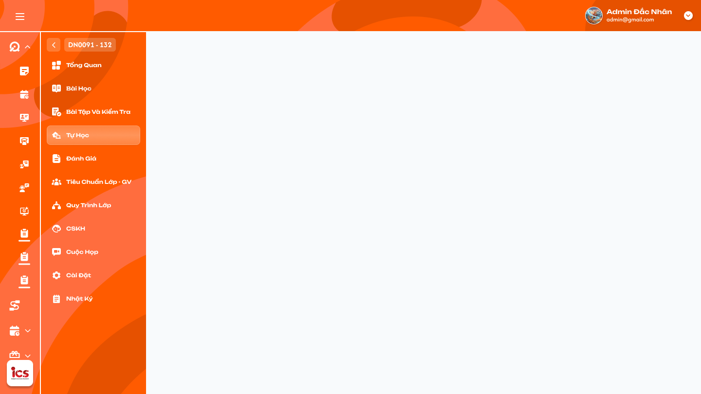
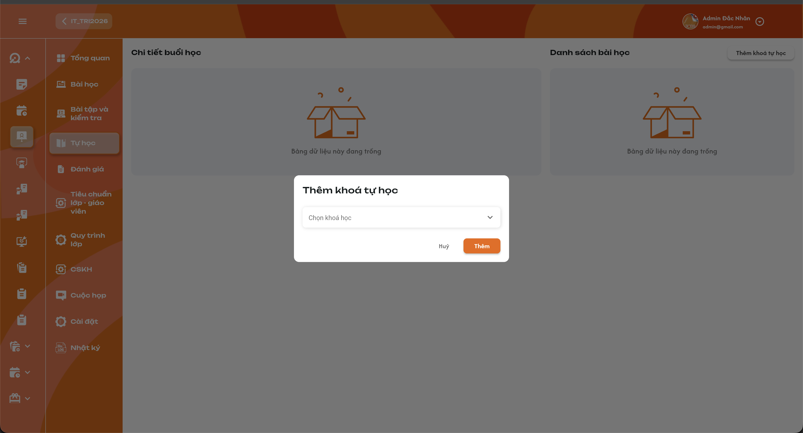
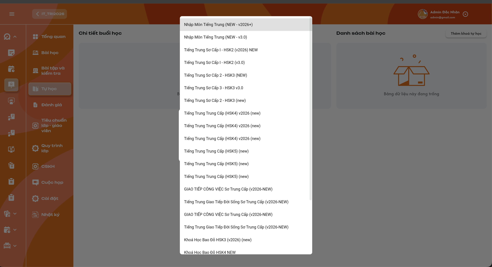

# Chi tiết lớp học — Menu Tự học

## 1. UI

### Trang 1: ADM-LOP-020404 — Chi tiết lớp học / Tự học / Trống



**Mô tả:**
- Menu Tự học dùng để giao bài ôn tập cho học viên trên app và xem thời gian học theo từng phần. Vùng trái **Chi tiết buổi học**, vùng phải **Danh sách bài học**, nút **Thêm khóa tự học**. Trang này là trạng thái lớp chưa có khóa / bài tự học.

**Điểm cần lưu ý:**
- Mỗi lớp chỉ có **một khóa tự học**. Ban đầu chọn **một khóa học thường đã định nghĩa**, hệ thống lấy **toàn bộ bài học của khóa đó** vào Tự học của lớp; sau đó được thêm một hoặc nhiều bài riêng giống Menu Bài học. Nội dung nguồn do **Curriculum Development Handler** quản lý tại function Bài học.
- Đây là ôn tập tự do, không có điều kiện hoàn thành hay thứ tự bắt buộc; thời gian ghi nhận chỉ là dữ liệu theo dõi.
- Khi chưa có khóa / bài, cả hai vùng hiển thị icon rỗng và `Bảng dữ liệu này đang trống`; không dựng bài hay học viên mẫu.
- `Thêm khóa tự học` mở popup chọn khóa nguồn đã có để ôn tập, không tạo định nghĩa khóa học mới.
- Toàn bộ danh sách, bài đang xem và học viên thuộc đúng lớp trên thanh điều hướng.
- Phân biệt đang tải, dữ liệu rỗng và tải lỗi; tải lỗi có `Thử lại`, không thay lỗi bằng màn rỗng hay số 0.
- Không yêu cầu giáo viên mở buổi để học viên vào bài tự học trên app; tên "Chi tiết buổi học" không tạo buổi điểm danh.
- Admin và Class Handler/Support được add vào lớp có quyền xem / thêm khóa / thêm bài, giống menu Bài học.

### Trang 2: Popup Thêm khóa tự học





**Mô tả:**
- Bấm `Thêm khóa tự học` mở popup, chọn một khóa trong dropdown rồi `Thêm`. Hệ thống lấy **toàn bộ bài học** của khóa đã chọn cho học viên lớp ôn tập.

**Điểm cần lưu ý:**
- Dropdown một lựa chọn, placeholder `Chọn khóa học`; danh sách dài có cuộn. Chọn theo định danh khóa, không ghép theo tên vì có thể trùng tên.
- Khóa nguồn là khóa học thường đã define; không bắt buộc là loại khóa chuyên biệt Tự học hay khóa hiện tại của lớp.
- `Thêm` bắt buộc chọn khóa nguồn hợp lệ; lấy toàn bộ bài thuộc đúng khóa, không chọn từng bài, không chỉ trang đầu. Chống gửi lặp, báo trùng khi có cùng bài nguồn trong danh sách, không lưu một phần khi lỗi.
- `Hủy` đóng popup, không gán khóa / bài, không Toast CRUD.
- Sau khi thêm: danh sách Tự học có đủ bài của khóa (kể cả bài ôn / kiểm tra nếu nằm trong nguồn) và được cấp cho học viên lớp trên app; Toast `Thêm khóa tự học thành công.`. Không thay chương trình Bài học chính của lớp, không sao chép khóa sang chương trình lớp chính.
- **Chỉ một khóa tự học cho mỗi lớp**: sau khi đã có khóa, chặn thêm khóa thứ hai ở cả UI và khi lưu; không cộng full khóa khác, không tự thay khóa hiện tại. Vẫn được bổ sung bài riêng (Trang 4).
- Khóa không có bài thì danh sách trống đúng dữ liệu, không tạo bài giả.

### Trang 3: Danh sách bài tự học và chọn bài


**Mô tả:**
- Vùng phải hiển thị card số thứ tự và tên bài; bấm một bài để xem thời gian của từng học viên theo từng phần ở vùng trái.

**Điểm cần lưu ý:**
- Bài chọn có viền cam; tên bài lấy theo dữ liệu, không fix theo tên bài mẫu trong ảnh.
- Bấm card cập nhật bảng thời gian của đúng bài trong phạm vi lớp; việc quản trị viên bấm card không được tính là thời gian học của học viên.
- Giữ thứ tự bài nguồn khi lấy khóa và thứ tự bài bổ sung đã lưu. Không tự thêm kéo-thả / xoá bài.
- **Tải full danh sách bài và học viên, không phân trang / load-more**. Có dữ liệu thì **mặc định chọn bài 1** theo thứ tự danh sách; không có bài thì giữ trạng thái rỗng.
- Bài không bị khoá theo tiến độ: học viên có quyền app vào được bất kỳ bài tự học đã gán, không cần hoàn thành bài trước hay đợi ngày dạy của lớp.
- Danh sách Tự học tách khỏi danh sách Bài học chính dù dùng cùng định nghĩa nguồn; chọn / thêm bài tự học không sửa điểm danh hay % BTVN / Đi học của menu Bài học.
- Không suy ra chỉ số hoàn thành / đạt / chưa đạt từ thời gian đã vào bài.

### Trang 4: Thêm một hoặc nhiều bài tự học riêng


**Mô tả:**
- Sau khi thêm khóa ban đầu, được `Thêm bài học mới` giống menu Bài học để bổ sung một hoặc nhiều bài vào Tự học. Hai ảnh là tham chiếu kế thừa từ menu Bài học.

**Điểm cần lưu ý:**
- `Tiêu đề` tự lấy từ bài nguồn đã chọn, chỉ đọc.
- Mỗi dòng chọn một khóa trước rồi một bài thuộc khóa đó; được thêm nhiều dòng; đổi khóa phải bỏ lựa chọn bài không thuộc khóa mới.
- `Mô tả` nhập / sửa giống popup menu Bài học, lưu trong phạm vi lớp / Tự học, không thay Mô tả Curriculum. **Một ô Mô tả chung cho lần thêm**; mọi bài thêm trong cùng lần dùng cùng nội dung; không áp dụng lại cho bài đã có.
- `Thêm`: kiểm tra mọi dòng hợp lệ và không trùng bài đã có / giữa các dòng, rồi bổ sung đúng các bài được chọn (không lấy full khóa); Toast `Thêm bài tự học thành công.`; lỗi giữ input. `Hủy` đóng, không Toast CRUD.
- **Bài trùng báo trùng và chặn lưu** (bài từ khóa tự học, bài đã bổ sung trước đó, hoặc chọn lặp trong cùng lần thêm); kiểm tra theo định danh bài nguồn, không chỉ theo tiêu đề; không bỏ dòng trùng rồi thêm một phần.
- Bài bổ sung ôn tập trên app cùng cơ chế tự do và ghi nhận thời gian; không tự tạo buổi lớp hay dữ liệu điểm danh.

### Trang 5: Bảng thời gian học theo học viên và từng phần


**Mô tả:**
- Vùng Chi tiết buổi học hiển thị một dòng mỗi học viên và thời gian học trên app của **bài tự học đang chọn**, tách theo tám phần. Bảng chỉ để theo dõi, chỉ đọc.

**Điểm cần lưu ý:**
- Lấy toàn bộ học viên của lớp, **không loại trừ trạng thái** (Đang học, Dự thính, Hoàn thành, Nghỉ học, Rời lớp, Chỉ xem, Xóa). Học viên rời lớp vẫn hiển thị và giữ / xem được thời gian học cũ.
- Mỗi ô gắn đúng lớp–học viên–bài tự học–phần học. Đúng 8 cột: Flashcard, Bài tập, Từ vựng, Ngữ pháp, Đọc, Kanji, Nghe, Bảng chữ; không gộp cột, không kế thừa 9 hoạt động của popup Thời gian trong Tổng quan.
- `Bài tập` là thời gian vào học phần Bài tập, không phải điểm / đã nộp BTVN bắt buộc của buổi chính.
- Giá trị là tổng thời gian app ghi nhận của đúng học viên / bài / phần, hiển thị **HH:mm:ss**; mỗi lần quay lại học cộng thời gian hợp lệ; không dùng lịch dạy / thời lượng kế hoạch hay thời gian của người quản trị mở bảng.
- Khi tổng một ô **vượt 24 giờ**, hiển thị tối đa **`23:59:59`** (chỉ là giới hạn hiển thị, vẫn giữ thời gian thực trong dữ liệu; không hiện 24/25 giờ, không quay về 00:00:00).
- Chưa có thời gian học hoặc tổng bằng 0 hiển thị `00:00:00`; dữ liệu tải lỗi / chưa xác định không tự biến thành 0.
- Không sửa thời gian thủ công, không click ô mở popup / chấm bài. Không tự tính trung bình toàn lớp hay tổng nhiều bài thay ô học viên–bài–phần.
- Có dữ liệu mới từ app thì bảng phản ánh sau khi lấy dữ liệu thành công; không yêu cầu realtime / polling.

### Trang 6: Học viên ôn tập tự do trên app

**Mô tả:**
- Học viên truy cập các bài Tự học đã gán cho lớp trên app, chọn phần muốn ôn và học lại theo nhu cầu. Phần này mô tả hành vi nghiệp vụ trên app, không phải màn hình quản trị.

**Điểm cần lưu ý:**
- Bài từ khóa tự học và bài bổ sung xuất hiện trong phạm vi lớp được cấp. **Tất cả trạng thái học viên của lớp đều được vào ôn app**, không chặn vì Hoàn thành / Nghỉ học / Rời lớp / Chỉ xem / Xóa; vẫn kiểm tra đúng học viên và lớp / bài được gán; rời lớp không xoá thời gian cũ.
- Không yêu cầu học đúng thứ tự, đủ thời gian, đạt điểm, hoàn thành phần trước, điểm danh buổi hay nộp bài bắt buộc mới được mở bài tự học khác; không có đánh giá hoàn thành bắt buộc từ thời gian.
- Được quay lại cùng bài / phần để ôn nhiều lần; thời gian hợp lệ cộng vào đúng bài / phần.
- **Mở phần học trên app là bắt đầu tính thời gian phần đó**, không cần click / nhập / làm bài; đổi / đóng phần thì kết thúc khoảng học của phần trước. Dữ liệu do phiên học trên app cung cấp, không do thao tác chọn khóa / card trên trang quản trị tạo ra.
- Vào ôn hoặc tăng thời gian Tự học không tự đánh dấu Có mặt, đã nộp BTVN hay hoàn thành buổi chính; không suy ra nghĩa vụ / điểm thưởng / phạt.
- Tránh nhân đôi khi đồng bộ lại cùng bản ghi; không cộng cùng khoảng thời gian sang các phần khác.

---

## 2. Yêu cầu

### 2.1. Flow chính

**Flow 1: Mở menu và chọn bài**

```
Admin hoặc Class Handler/Support được add vào lớp mở Tự học
  → Chưa có bài: hai vùng "Bảng dữ liệu này đang trống"
  → Có bài: tải full danh sách bài/học viên (không phân trang/load-more), mặc định chọn bài 1
  → Bảng gồm toàn bộ học viên, không loại trạng thái
  → Click bài: viền cam, bảng thời gian đúng lớp–bài–học viên–phần (chỉ đọc)
```

**Flow 2: Chọn khóa tự học ban đầu**

```
Thêm khóa tự học → Popup dropdown Chọn khóa học
  → Lớp chưa có khóa: chọn một khóa học thường đã define → Thêm
  → Kiểm tra quyền/lựa chọn → lấy toàn bộ bài của đúng khóa
  → Lưu vào Tự học lớp, cấp các bài cho học viên trên app → Toast "Thêm khóa tự học thành công."
        ↓ (lớp đã có khóa)               ↓ (lỗi)                  ↓ (Hủy)
  Không thêm khóa thứ hai      Giữ lựa chọn, Toast lỗi      Đóng, không đổi dữ liệu
```

**Flow 3: Bổ sung bài tự học riêng**

```
Thêm bài học mới (sau khi đã có khóa) → mỗi dòng: chọn khóa → chọn bài thuộc khóa
  → Tiêu đề tự lấy (chỉ đọc); một Mô tả chung cho cả lần thêm
  → Validate mọi dòng + kiểm tra trùng với bài đã có / giữa các dòng
  → Hợp lệ: thêm đúng bài đã chọn (không lấy full khóa) → Toast "Thêm bài tự học thành công."
        ↓ (có trùng)
  Toast "Bài học đã tồn tại trong danh sách Tự học.", giữ input, không lưu
```

**Flow 4: Học viên ôn tập trên app**

```
Học viên lớp (mọi trạng thái) mở bài Tự học đã gán
  → Chọn bất kỳ bài/phần, không yêu cầu trình tự/điểm/thời gian tối thiểu
  → Mở phần học: bắt đầu đếm; đổi/đóng phần: kết thúc khoảng của phần trước
  → App ghi nhận thời gian theo học viên–bài–phần
  → Không đổi điểm danh/BTVN/kết quả buổi chính
```

**Flow 5: Xem thời gian đã ghi nhận**

```
Admin hoặc Class Handler/Support chọn bài tự học
  → Lấy toàn bộ học viên mọi trạng thái và thời gian app đúng bài/phần
  → Hiển thị HH:mm:ss ở 8 cột; ô vượt 24 giờ hiện 23:59:59 (dữ liệu thật không bị cắt)
  → Học viên rời lớp vẫn có dòng và giữ thời gian cũ
                    ↓ (tải lỗi)
              Báo lỗi + Thử lại (khác 00:00:00 thật)
```

### 2.2. Ngoại lệ

- **EX01:** Tải lỗi / chưa xác định thời gian → báo lỗi, `Thử lại`; không dựng rỗng hay `00:00:00` giả.
- **EX02:** Response của lớp / bài cũ → không ghi đè bài / lớp đang xem.
- **EX03:** Thiếu khóa, thiếu bài ở một dòng hoặc bài không thuộc khóa → chặn lưu, báo đúng field / dòng; không bỏ qua dòng thiếu để thêm một phần.
- **EX04:** Lưu lỗi hoặc gửi lặp → giữ input, không tạo liên kết trùng từ cùng thao tác, một Toast kết quả.
- **EX05:** Ngoài quyền quản trị / app hoặc sai liên kết lớp–học viên–bài–phần → từ chối đọc / ghi ngoài phạm vi.
- **EX06:** Chưa có thời gian học thật của phần → `00:00:00`; phần app không có nội dung và điều kiện được truy cập cần mapping nguồn, không dựng nội dung mẫu.
- **EX07:** Lớp đã có khóa tự học, hoặc hai thao tác gán khóa đồng thời → không gán khóa thứ hai / ghi đè khóa đã có; giữ bài và thời gian hiện hữu; Toast `Cảnh Báo` `Lớp đã có khóa tự học.`
- **EX08:** Bài nguồn đã có trong Tự học hoặc chọn trùng giữa các dòng → báo lỗi dòng trùng và Toast `Cảnh Báo` `Bài học đã tồn tại trong danh sách Tự học.`; chặn toàn bộ lần thêm, giữ input, không tạo bản trùng; backend kiểm tra lại khi lưu.

### 2.3. Yêu cầu khác

| Mã | Tên yêu cầu | Mô tả |
|---|---|---|
| REQ01 | Khung và danh sách | Hai vùng Chi tiết buổi học / Danh sách bài học; rỗng đúng UI; tải full bài và học viên không phân trang / load-more, mặc định bài 1 khi có dữ liệu. Card có số / tên / viền chọn, bấm để xem đúng bảng của bài. |
| REQ02 | Thêm khóa | Mỗi lớp chỉ một khóa tự học; ban đầu chọn một khóa học thường có sẵn, chặn khóa thứ hai; lấy full bài học khóa đó cho Tự học lớp, không chọn từng bài hay đổi chương trình lớp chính. |
| REQ03 | Thêm bài | Bổ sung một hoặc nhiều bài theo popup menu Bài học; mỗi dòng chọn đủ khóa–bài; tiêu đề tự lấy / chỉ đọc; một Mô tả sửa được, dùng chung cho tất cả bài thêm cùng lần. Bài trùng với bài đã có hoặc giữa các dòng phải báo trùng, chặn lưu. Chỉ lấy bài đã chọn, không full khóa. |
| REQ04 | Bảng thời gian | Lấy full học viên lớp mọi trạng thái, giữ / xem thời gian cũ khi rời lớp. Theo học viên–bài tự học–phần; 8 cột Flashcard / Bài tập / Từ vựng / Ngữ pháp / Đọc / Kanji / Nghe / Bảng chữ, `HH:mm:ss`, ô vượt 24 giờ hiện max `23:59:59` nhưng giữ dữ liệu thật; chỉ đọc. Không trộn với thời gian tổng / 9 hoạt động của UI khác. |
| REQ05 | Ôn tập tự do | Học viên mọi trạng thái được vào ôn bài đã gán cho lớp. Không thứ tự / điểm / thời gian tối thiểu / điểm danh / nộp bài bắt buộc để truy cập bài ôn được cấp; được học lại. Không có đánh giá hoàn thành bắt buộc từ thời gian. |
| REQ06 | Ghi nhận app | Mở phần học trên app bắt đầu đếm, không đòi tương tác; đổi / đóng phần kết thúc khoảng đó. Cộng thời gian qua các lần học đúng phần; không tính thao tác quản trị, không cộng trùng bản ghi đồng bộ. |
| REQ07 | Phạm vi | Đúng lớp–học viên–bài–khóa–phần; nội dung nguồn do Curriculum Development Handler quản lý. Tự học không tự đổi điểm danh / % BTVN / % Đi học / kết quả chương trình chính. |
| REQ08 | Phản hồi | Thêm khóa / thêm bài có Toast kết quả; lỗi giữ input, chống lặp. `Hủy` và thao tác chỉ xem không có Toast CRUD. |

### 2.4. Ràng buộc

#### Quyền

| Role / Phạm vi | Xem bảng Tự học | Thêm khóa / thêm bài | Sửa thời gian thủ công | Sửa định nghĩa Curriculum qua menu này | Học ôn trên app |
|---|:---:|:---:|:---:|:---:|:---:|
| Admin trong phạm vi quản trị | ✅ | ✅ | ❌ | ❌ | ❌ |
| Class Handler được add vào lớp | ✅ | ✅ | ❌ | ❌ | ❌ |
| Support được add vào lớp | ✅ | ✅ | ❌ | ❌ | ❌ |
| Giáo viên của lớp | ✅ | ❌ | ❌ | ❌ | ❌ |
| Học viên lớp ở mọi trạng thái được vào Tự học trên app | ❌ | ❌ | ❌ | ❌ | ✅ |
| User thiếu quyền lớp / bài | ❌ | ❌ | ❌ | ❌ | ❌ |

#### Ràng buộc khác

- Quyền giống Menu Bài học: Admin theo phạm vi quản trị; Class Handler và Support phải được add vào lớp. Kiểm tra lại quyền khi thêm khóa / thêm bài.
- Giáo viên của lớp chỉ xem danh sách bài và bảng thời gian, không có nút Thêm khóa tự học / Thêm bài học mới.
- Quyền ôn app và quyền quản trị là hai phạm vi riêng; account có cả hai thì kiểm tra theo thao tác cụ thể.
- Không có ràng buộc ôn tập không bỏ qua quyền truy cập lớp / bài. Mọi trạng thái học viên đều được hiển thị và vào ôn, không có filter ngầm theo trạng thái; giữ thời gian đã học khi trạng thái thay đổi.
- Mỗi lớp một khóa tự học; không thêm khóa thứ hai hay tự thay khóa. Bổ sung bài riêng vẫn chọn khóa–bài nguồn từng dòng, không trở thành gán thêm khóa tự học. Không tạo / sửa định nghĩa nguồn hay thay khóa chương trình chính.
- Thêm khóa lấy toàn bộ bài; thêm bài riêng chỉ bổ sung các bài được chọn. Chưa có thao tác gỡ khóa / xoá / sắp xếp bài.
- Giới hạn `23:59:59` khi vượt 24 giờ chỉ áp dụng hiển thị, không xoá thời gian thực hay đặt mức hoàn thành bắt buộc.
- Toast dùng component chung (nội dung dưới là đề xuất): `Thành Công` `Thêm khóa tự học thành công.` / `Thêm bài tự học thành công.`; `Cảnh Báo` `Vui lòng chọn khóa học.` / `Vui lòng chọn đầy đủ khóa học và bài học.` / `Lớp đã có khóa tự học.` / `Bài học đã tồn tại trong danh sách Tự học.` (kèm báo lỗi tại field / dòng); `Có Lỗi Xảy Ra` `Không thể thêm khóa tự học. Vui lòng thử lại.` / `Không thể thêm bài tự học. Vui lòng thử lại.`; `Thông Báo` chỉ khi có đồng bộ bất đồng bộ thực tế, không báo thành công trước lưu. Mỗi thao tác một Toast; lỗi giữ input, Toast không thay validation tại field.


---

## 3. Testcase

### Feature: Chi tiết lớp học — Menu Tự học

| Tên testcase | Priority | Scenario | Role | Pre-condition | Given/When/Then | Expected Result |
|---|---|---|---|---|---|---|
| Case 1: Trạng thái rỗng, đúng lớp, phân biệt lỗi | High | Flow 1 / REQ01 / REQ07 / EX01 / EX02 | Admin / Class Handler / Support trong phạm vi lớp | Lớp chưa có khóa / bài tự học; lớp A, B khác dữ liệu; request chậm hoặc lỗi | **Given:** mở Tự học; đổi lớp trong khi tải; giả lập lỗi tải<br>**When:** response trả về<br>**Then:** hai vùng hiện trạng thái rỗng; chỉ dữ liệu đúng lớp hiển thị | - Nút `Thêm khóa tự học` mở popup<br>- Không có bài hoặc thời gian giả<br>- Lỗi có `Thử lại`, không dùng rỗng / `00:00:00` che lỗi |
| Case 2: Chọn khóa lấy toàn bộ bài, đúng định danh | High | Flow 2 / REQ02 / REQ07 | Admin / Class Handler / Support trong phạm vi lớp | Khóa A có 35 bài; có hai khóa tên gần giống hoặc trùng | **Given:** chọn khóa theo ID A rồi `Thêm`<br>**When:** lưu thành công<br>**Then:** đủ 35 bài của A trong Tự học lớp | - Không chỉ lấy trang đầu, không lấy bài khóa khác<br>- Không dùng tên hiển thị làm khóa<br>- Một Toast thành công |
| Case 3: Thiếu khóa, Hủy, lỗi, chống lặp, thiếu quyền | High | Flow 2 / REQ02 / REQ08 / EX04 / EX05 | Admin / Class Handler / Support trong phạm vi lớp | Popup chưa chọn / đã chọn khóa; backend lỗi hoặc thiếu quyền lớp | **Given:** `Thêm` khi chưa chọn; `Hủy`; bấm lưu liên tiếp khi backend lỗi hoặc thiếu quyền<br>**When:** validate và xử lý<br>**Then:** thiếu khóa báo field; `Hủy` không lưu; lỗi / thiếu quyền không lưu một phần hay lặp | - Toast `Cảnh Báo` `Vui lòng chọn khóa học.` khi thiếu<br>- Lỗi giữ lựa chọn, một Toast lỗi<br>- `Hủy` không Toast CRUD |
| Case 4: Chỉ một khóa tự học mỗi lớp | High | Flow 2 / REQ02 / EX07 | Admin / Class Handler / Support trong phạm vi lớp | Lớp đã có khóa A, hoặc hai user cùng gán khóa | **Given:** thử thêm khóa B<br>**When:** backend kiểm tra trước lưu<br>**Then:** không tạo khóa thứ hai hay thay A | - Toast `Lớp đã có khóa tự học.`<br>- Bài / thời gian của A giữ nguyên<br>- Vẫn thêm được bài riêng |
| Case 5: Mặc định bài 1, tải full, chọn bài đúng bảng | High | Flow 1 / REQ01 / REQ04 | Admin / Class Handler / Support trong phạm vi lớp | 35 bài, 25 học viên nhiều trạng thái; bài A, B có thời gian khác nhau | **Given:** mở Tự học rồi bấm bài B sau khi xem A<br>**When:** tải xong và đổi bài<br>**Then:** bài 1 được chọn mặc định, đủ bài / học viên khi cuộn; viền cam và toàn bộ ô thuộc B | - Không phân trang / load-more, không chọn bài gần nhất thay bài 1<br>- Không dùng thời gian của A<br>- Tên / thứ tự bài đúng nguồn, không hard-code<br>- Việc quản trị bấm card không ghi nhận là học app |
| Case 6: Ôn tập không khoá theo trình tự, không đổi kết quả buổi chính | High | Flow 4 / REQ05 / REQ07 | Học viên có quyền app của lớp | Khóa đã gán; chưa học phần nào; buổi chính chưa điểm danh / chưa nộp BTVN | **Given:** mở bài cuối rồi phần Nghe, sang Từ vựng bài khác<br>**When:** truy cập và ghi nhận thời gian<br>**Then:** được ôn phần đã gán, chỉ dữ liệu Tự học thay đổi | - Không khoá theo thứ tự / điểm / thời gian tối thiểu, không cần giáo viên mở buổi hay điểm danh<br>- Không tự Có mặt / đã nộp BTVN, không sửa % Đi học / BTVN |
| Case 7: Thêm bài riêng một hoặc nhiều dòng | High | Flow 3 / REQ03 | Admin / Class Handler / Support trong phạm vi lớp | Đã có khóa tự học; khóa A, B có bài hợp lệ (B có 20 bài) | **Given:** chọn A / bài 2, thêm dòng B / bài 3, sửa Mô tả rồi `Thêm`<br>**When:** lưu<br>**Then:** chỉ bổ sung đúng hai bài đã chọn | - Không thêm cả 20 bài của B, không vào Bài học chính<br>- Tiêu đề tự lấy và khoá sửa; Mô tả áp dụng giống nhau cho cả hai<br>- Toast `Thêm bài tự học thành công.` |
| Case 8: Dòng thiếu / sai khóa, lỗi lưu, Hủy | High | Flow 3 / REQ03 / EX03 / EX04 | Admin / Class Handler / Support trong phạm vi lớp | Một dòng thiếu bài hoặc bài không thuộc khóa; popup đã có lựa chọn | **Given:** bấm `Thêm` với dòng sai; lỗi backend; bấm `Hủy`<br>**When:** validate toàn bộ / lưu / đóng<br>**Then:** không lưu một phần; `Hủy` giữ nguyên danh sách | - Báo đúng dòng lỗi, giữ input<br>- Một Toast kết quả; `Hủy` không Toast CRUD |
| Case 9: Trùng bài | High | Flow 3 / REQ03 / EX08 | Admin / Class Handler / Support trong phạm vi lớp | Bài A đã có từ khóa tự học; hoặc hai dòng chọn cùng bài B | **Given:** chọn bài trùng kèm một bài mới hợp lệ<br>**When:** bấm `Thêm`<br>**Then:** báo đúng dòng trùng, không lưu toàn bộ lần thêm | - Toast `Bài học đã tồn tại trong danh sách Tự học.`<br>- Giữ Mô tả / lựa chọn để sửa<br>- Cùng tên nhưng khác định danh bài không coi là trùng |
| Case 10: Bảng 8 phần, cộng các lần học, đúng học viên / bài / phần | High | Flow 5 / REQ04 / REQ06 / REQ07 / EX06 | Admin / Class Handler / Support trong phạm vi lớp | A học Từ vựng bài 1 hai lần hợp lệ 120s và 90s; B và bài 2 có thời gian khác; một phần chưa có thời gian | **Given:** xem bảng bài 1 rồi bài 2<br>**When:** render và tổng hợp bản ghi<br>**Then:** đủ 8 cột đúng thứ tự; Từ vựng của A `00:03:30`; phần chưa học `00:00:00` | - Không chỉ hiện lần cuối, không cộng sang Bài tập hay học viên B<br>- Không tổng tất cả bài, không trộn lớp dùng chung source<br>- Chỉ đọc; xem / chuyển card không tăng thời gian |
| Case 11: Full học viên mọi trạng thái, giữ thời gian khi rời lớp | High | Flow 5 / REQ04 / REQ05 / REQ07 | Admin / Class Handler / Support trong phạm vi lớp; Học viên lớp | Lớp có đủ 7 trạng thái; A đã học `00:10:00` rồi Rời lớp | **Given:** mở bảng Tự học; A vào lại ôn trên app<br>**When:** lấy danh sách và kiểm tra truy cập<br>**Then:** đủ học viên mọi trạng thái, A giữ `00:10:00` và vẫn vào ôn được | - Không lọc Rời lớp / Xóa / Chỉ xem<br>- Không reset thời gian cũ<br>- Dữ liệu đúng lớp / học viên |
| Case 12: Vượt 24 giờ hiện tối đa 23:59:59 | High | Flow 5 / REQ04 / REQ06 | Admin / Class Handler / Support trong phạm vi lớp | A có `25:30:00` Nghe và `00:05:00` Đọc cùng bài | **Given:** xem bảng thời gian<br>**When:** định dạng từng ô<br>**Then:** Nghe `23:59:59`, Đọc `00:05:00` | - Giữ dữ liệu gốc `25:30:00`<br>- Không reset qua ngày; giới hạn độc lập từng ô |
| Case 13: Mở phần là bắt đầu đếm, học lại cộng đúng phần | High | Flow 4 / REQ06 | Học viên có quyền app của lớp | Bài có phần Từ vựng và Nghe; đã có thời gian Flashcard cũ | **Given:** mở Từ vựng 60 giây không tương tác rồi chuyển Nghe 30 giây; vào ôn lại Flashcard<br>**When:** app ghi nhận các khoảng học<br>**Then:** Từ vựng `00:01:00`, Nghe `00:00:30`, Flashcard cộng thêm đúng phần | - Không cần tương tác để đếm<br>- Không cộng 30 giây Nghe vào Từ vựng; phần không học không tăng<br>- Không khoá vì đã học, không tính thao tác quản trị |
| Case 14: Chặn truy cập ngoài phạm vi và theo quyền | High | Ràng buộc quyền / REQ07 / EX05 | Học viên ngoài lớp; Giáo viên; user thiếu quyền | Biết ID bài tự học lớp khác | **Given:** mở trực tiếp bài ngoài quyền; Giáo viên mở Tự học; gửi request thêm khóa / bài<br>**When:** kiểm tra phạm vi và quyền<br>**Then:** từ chối truy cập / ghi ngoài lớp; Giáo viên chỉ xem | - Không ghép theo tên khóa / bài<br>- Không sửa thời gian học viên khác<br>- Giáo viên không có nút Thêm khóa / Thêm bài |
| Case 15: Toast đúng kết quả, một lần | Medium | REQ08 / EX03 / EX04 | Admin / Class Handler / Support trong phạm vi lớp | Thêm khóa / bài thành công, thiếu lựa chọn hoặc backend lỗi; popup / Toast đang hiển thị | **Given:** xác nhận thao tác; `Hủy`; chọn bài; callback lặp<br>**When:** xử lý kết quả<br>**Then:** đúng một Toast `Thành Công` / `Cảnh Báo` / `Có Lỗi Xảy Ra`; `Hủy` và chỉ xem không Toast | - Không báo thành công trước lưu, không lộ lỗi kỹ thuật<br>- Giữ lựa chọn hợp lệ khi lỗi<br>- Nút × đóng Toast, không hoàn tác dữ liệu |

---

## 4. Câu hỏi cần xác nhận

- **Q01:** Chỉ có frame Figma ADM-LOP-020404 (trạng thái trống); các Trang 2–6 (popup Thêm khóa tự học, danh sách bài và chọn bài, thêm bài riêng, bảng thời gian, hành vi trên app) chưa có frame Figma có mã. Design cấp mã hoặc cho biết frame nằm ở file Figma nào?
- **Q02:** Khi học viên ra nền / khoá màn hình thì có dừng đếm không; xử lý offline, nhiều thiết bị và bản ghi trùng thế nào?
- **Q03:** Có chức năng thay / gỡ khóa tự học không; nếu có, UI và dữ liệu lịch sử khi thay / gỡ thế nào (hiện chưa có thao tác này)?
- **Q04:** Thứ tự học viên trong bảng, vị trí nút `Thêm bài học mới` sau khi gán khóa và vị trí bài bổ sung trong danh sách?
- **Q05:** Mapping tám phần của bảng sang hoạt động trên app; phần không có nội dung hiển thị `0` hay trống, và thời điểm cập nhật bảng?
- **Q06:** Khi định nghĩa nguồn được sửa có tự cập nhật vào Tự học không; Mô tả có bắt buộc / giới hạn ký tự / tự điền không; cho phép gán khóa không có bài không?
