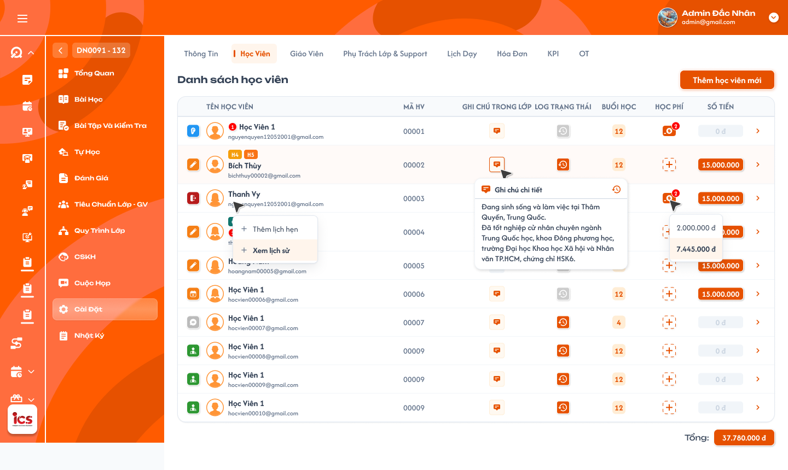
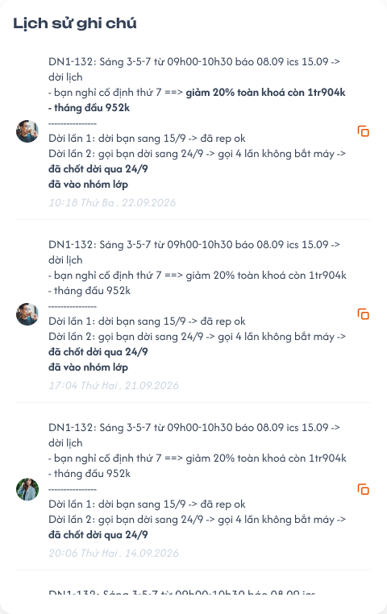
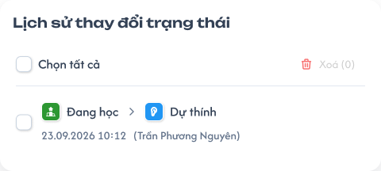
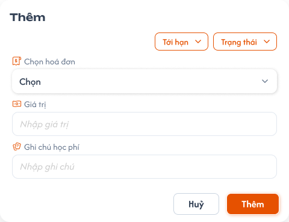

# Chi tiết lớp học — Tab Học viên

## 1. UI

### Trang 1: ADM-LOP-040200 — Lớp học / Cài đặt / Học viên



**Mô tả:**
- Hiển thị danh sách học viên thuộc lớp và dữ liệu theo đúng quan hệ **học viên–lớp**. Thông tin chung, nhân sự và lịch lớp được đặc tả tại [Tab Thông tin](./class_detail_information_requirements.md), [Tab Giáo viên](./class_detail_teachers_requirements.md), [Tab Trợ giảng & Phụ trách lớp](./class_detail_support_handlers_requirements.md) và [Tab Lịch dạy](./class_detail_schedule_requirements.md); nghiệp vụ chi tiết của hồ sơ học viên, lịch hẹn và ba tab lịch sử học viên ở requirement riêng.
- `Admin`, `Class Handler` và `Support` được xem tab trong phạm vi lớp được phân quyền. Cả ba role được thêm học viên, chỉnh ghi chú, đổi trạng thái và thêm học phí theo permission. Số buổi học bắt buộc chọn khi thêm học phí, không chỉnh trực tiếp ở cột Buổi học. Không có role `Assistant Teacher` riêng; Trợ giảng trên UI sử dụng role `Support`.
- Danh sách không có ô tìm kiếm và không phân trang theo số trang. Khi kéo xuống gần cuối danh sách, hệ thống tự tải thêm dữ liệu.

**Điểm cần lưu ý:**
- Dữ liệu trạng thái, ghi chú, Buổi học, số lần đóng học phí và tổng tiền phải lấy theo đúng học viên và lớp hiện tại; không cộng lẫn dữ liệu ở lớp khác.
- Main list không có search. Search chỉ xuất hiện trong popup chọn học viên có sẵn.
- Load-more phải giữ nguyên vị trí cuộn, không lặp dòng, không bỏ sót dòng và không làm mất thay đổi vừa hoàn tất.
- Một học viên chỉ xuất hiện một lần trong cùng lớp. Backend phải chặn request thêm trùng, kể cả khi hai người thao tác đồng thời.
- `Lớp 1-1` được thêm một hoặc nhiều học viên như `Lớp chung`; không ẩn/disable thao tác thêm chỉ vì lớp đã có học viên.
- Các hành động chỉ đọc như mở Chi tiết, xem lịch sử hoặc sao chép ghi chú không hiển thị Toast CRUD.
- `A01.01` Tên: hiển thị tag học viên, họ tên và mã học viên. Bấm vùng trắng của ô Tên mở Chi tiết học viên; bấm trực tiếp vào tên mở menu thao tác nhanh (xem `A09`). Hai vùng bấm phải tách biệt.
- `A01.02` Tag học viên: badge như `BLK`, `6B` là tag đang gắn với học viên; không phải trạng thái lớp hay trạng thái học viên. Có thể có nhiều tag và phải hiển thị theo dữ liệu thực tế.
- `A01.03` Email: hiển thị email của học viên; không dùng email làm định danh để cập nhật quan hệ học viên–lớp.
- `A01.04` Ghi chú trong lớp: ghi chú chỉ thuộc học viên trong lớp hiện tại. Bấm icon mở popup xem/chỉnh ghi chú; có lối mở Lịch sử ghi chú (Trang 2).
- `A01.05` Trạng thái: icon màu thể hiện trạng thái hiện tại theo bộ 7 PNG chuẩn (xem Trang 3). Bấm icon để chọn trạng thái mới; bấm `Lịch sử` để xem lịch sử thay đổi.
- `A01.06` Buổi học: chỉ hiển thị số buổi được phép học đã ghi nhận từ nghiệp vụ học phí; không có dropdown/nút sửa tại cột. Vẫn so sánh số buổi thực tế để cảnh báo vượt buổi khi hover.
- `A01.07` Học phí: badge là số lần học viên đã đóng học phí trong lớp (không phải số hóa đơn). Bấm thao tác thêm tại dòng học viên để mở popup Thêm học phí (Trang 4).
- `A01.08` Số tiền: tổng học phí học viên đã đóng cho lớp hiện tại, hiển thị theo định dạng tiền Việt Nam.
- `A01.09` Tạo học viên mới: mở popup lựa chọn giữa `Chọn học viên` đã có và `Tạo học viên mới`; không tạo tài khoản ngay. Chỉ hiển thị/cho thao tác đối với role có quyền CRUD.
- `A02.01` Cột Buổi học · Giá trị hiện tại: chỉ đọc số buổi được phép học đã ghi nhận. Khi có nhiều lần học phí, rule cộng dồn hay thay thế cần chốt (xem Q01); không tự chọn công thức.
- `A02.02` Cột Buổi học · Chọn số buổi: chuyển sang popup Thêm học phí, bắt buộc chọn trước khi lưu. Không mở picker từ cột Buổi học.
- `A02.03` Cột Buổi học · Số buổi thực tế: đếm số buổi của lớp mà học viên đã được ghi nhận thực tế tham gia theo dữ liệu điểm danh hợp lệ. Không dùng số lịch đã tạo hoặc số bài học đã mở của cả lớp để thay thế.
- `A02.04` Cột Buổi học · Cảnh báo vượt buổi: khi `Số buổi thực tế > Số buổi được phép`, hover vào field/icon Buổi học hiển thị `Quá buổi học`, có thể kèm `Đã học {A}/{N} buổi` (A thực tế, N được phép). Chỉ cảnh báo khi thực tế **lớn hơn**; bằng giới hạn thì chưa quá (ví dụ Buổi học `3`, học viên tham gia 3 buổi thì không cảnh báo, từ buổi thứ 4 hiển thị). Cảnh báo tính lại sau khi điểm danh thay đổi, giới hạn thay đổi hoặc kết quả điểm danh bị hủy/điều chỉnh; chỉ hỗ trợ theo dõi, không tự chặn học viên tham gia buổi tiếp theo, không tự đổi trạng thái học viên. Quyền chọn số buổi khi thêm học phí và xem cảnh báo: `Admin`, `Class Handler`, `Support`; cột Buổi học chỉ đọc với cả ba role.
- `A02.05` Cột Buổi học · Cập nhật hiển thị: chỉ sau khi thêm học phí kèm số buổi thành công; không thay đổi học viên khác và tính lại cảnh báo từ dữ liệu mới. Không có thao tác cập nhật số buổi độc lập tại cột.
- `A03.01` Popup chọn cách thêm · Chọn học viên: mở popup danh sách học viên đã tồn tại; cho chọn một hoặc nhiều học viên.
- `A03.02` Popup chọn cách thêm · Tạo học viên mới: mở form tạo tài khoản học viên. Khi tạo thành công, học viên mới được thêm vào đúng lớp đang thao tác.
- `A03.03` Popup chọn cách thêm · Đóng popup: đóng mà không thêm/tạo học viên và không giữ lựa chọn chưa xác nhận. Chỉ `Admin`, `Class Handler`, `Support` được mở và thực hiện hai flow; cả `Lớp chung` và `Lớp 1-1` đều được mở, không phụ thuộc sĩ số hiện tại.
- `A04.01` Popup Chọn học viên có sẵn · Tìm kiếm: theo tên hoặc mã học viên như placeholder UI; không tìm bằng dữ liệu ngoài phạm vi người dùng. Search/filter chỉ tác động danh sách lựa chọn, không làm mất checkbox đã chọn khi đổi từ khóa; UI phải hiển thị được tổng số đang chọn.
- `A04.02` Popup Chọn học viên có sẵn · Chọn lớp học: lọc học viên theo lớp khi cần; không phải filter trạng thái học viên.
- `A04.03` Popup Chọn học viên có sẵn · Danh sách: mỗi dòng hiển thị tối thiểu tên, mã và email; checkbox hỗ trợ multi-select. Không hiển thị học viên đã có trong lớp như một lựa chọn có thể thêm; nếu vẫn hiển thị thì phải disabled và nêu rõ đã thuộc lớp. `Lớp 1-1` hỗ trợ multi-select giống `Lớp chung`.
- `A04.04` Popup Chọn học viên có sẵn · Hủy: đóng popup, không thêm các lựa chọn chưa xác nhận.
- `A04.05` Popup Chọn học viên có sẵn · Thêm mới: xác nhận thêm toàn bộ học viên đang được chọn vào lớp hiện tại (thêm quan hệ vào lớp, không tạo tài khoản mới). Thao tác nguyên tử theo danh sách đã chọn: có phần tử không hợp lệ tại thời điểm lưu thì không thêm một phần và trả rõ phần tử cần chọn lại.
- `A05.01` Form Tạo học viên mới · Họ và tên, Giới tính, Ngày sinh, Số điện thoại: thông tin cá nhân của học viên; validate theo requirement Tài khoản/Học viên dùng chung.
- `A05.02` Form Tạo học viên mới · Vai trò: cố định là `Student`; người dùng không được tạo role khác từ flow này.
- `A05.03` Form Tạo học viên mới · Gmail, Mật khẩu: dữ liệu đăng nhập; validation, kiểm tra trùng và bảo mật theo requirement Đăng nhập/Tài khoản. Mật khẩu phải được che trên UI và không ghi log; không trả lại sau khi tạo, không xuất hiện trong log, Toast, lịch sử hay response lỗi.
- `A05.04` Form Tạo học viên mới · Ngày chốt đơn, Level, Code: thuộc dữ liệu học viên; danh sách/validation dùng cấu hình hiện hành của hệ thống.
- `A05.05` Form Tạo học viên mới · Thêm tài khoản: tạo tài khoản và gắn vào lớp trong một giao dịch nghiệp vụ. Không tự suy đoán field bắt buộc hoặc giới hạn ký tự ngoài requirement Tài khoản/Học viên. Nếu tạo tài khoản thành công nhưng không thể thêm vào lớp, hệ thống trả kết quả rõ ràng và không tạo quan hệ nửa chừng (rollback hay giữ tài khoản chờ thêm lại theo quy tắc chung của module Tài khoản). Với cả hai Loại lớp, backend chỉ kiểm tra quyền, dữ liệu tài khoản và quan hệ trùng; không chặn dựa trên sĩ số `Lớp 1-1`.
- `A09.01` Menu thao tác từ tên học viên · Thêm Tag: mở flow gắn tag cho đúng học viên. Tag sau khi thêm hiển thị tại cột Tên. Chi tiết quản lý tag dùng requirement riêng.
- `A09.02` Menu thao tác từ tên học viên · Thêm Lịch Hẹn: mở flow tạo lịch hẹn cho đúng học viên. Chi tiết field/validation lịch hẹn dùng requirement riêng.
- `A09.03` Menu thao tác từ tên học viên · Xem lịch sử: mở lịch sử học viên gồm ba tab `Lịch sử hóa đơn`, `Lịch sử lớp`, `Ghi chú`; nội dung chi tiết ba tab ở requirement riêng. Menu bấm trực tiếp vào tên, không điều hướng sang Chi tiết học viên và phải giữ đúng `student_id`. `Support` được xem lịch sử, Thêm Tag và Thêm Lịch Hẹn theo quyền CRUD của tab.
- `A10.01` Toast `Thành Công`: backend xác nhận thao tác thành công.
- `A10.02` Toast `Thông Báo`: thao tác đã tiếp nhận nhưng danh sách/tổng tiền cần thời gian đồng bộ.
- `A10.03` Toast `Cảnh Báo`: dữ liệu hoặc điều kiện cần người dùng kiểm tra.
- `A10.04` Toast `Có Lỗi Xảy Ra`: backend/network không hoàn tất thao tác.
- Toast phản hồi thêm học viên, tạo học viên, chỉnh ghi chú, đổi trạng thái và thêm học phí kèm số buổi. Dòng nội dung nêu đúng đối tượng/thao tác, ví dụ `Đã thêm học viên vào lớp.`, `Đã cập nhật trạng thái học viên.`, `Đã thêm học phí.` Chỉ hiển thị sau khi backend xác nhận; mỗi thao tác logic chỉ có một Toast. Hủy, xem lịch sử, mở Chi tiết hoặc Copy không có Toast CRUD. Nút `×` chỉ đóng Toast, không hoàn tác dữ liệu.

### Trang 2: ADM-LOP-040210 — Popup lịch sử ghi chú



**Mô tả:**
- Bấm icon ghi chú của một dòng để xem/chỉnh ghi chú riêng cho học viên tại lớp này; bấm icon lịch sử để xem các phiên bản đã lưu.

**Điểm cần lưu ý:**
- Ghi chú lưu theo cặp `class_id + student_id`; không thay đổi ghi chú của học viên ở lớp khác.
- `A06.01` Nội dung ghi chú: hiển thị và cho `Admin`, `Class Handler`, `Support` chỉnh nội dung hiện tại theo quyền. Mỗi lần lưu nội dung mới tạo một bản ghi lịch sử bất biến. Hai người cùng sửa: không âm thầm ghi đè phiên bản mới hơn (EX10).
- `A06.02` Icon lịch sử: mở danh sách lịch sử ghi chú của đúng học viên và lớp.
- `A06.03` Mỗi bản ghi lịch sử: hiển thị nội dung, người tạo/người chỉnh sửa và thời điểm máy chủ; mới nhất trước. Không ghi đè bản ghi cũ khi sửa ghi chú mới, không cho sửa trực tiếp bản ghi lịch sử. Nội dung hiển thị dạng text an toàn, không thực thi HTML/script.
- `A06.04` Copy: sao chép nguyên nội dung của đúng bản ghi vào clipboard; không chỉnh sửa dữ liệu, không tạo lịch sử mới. Có phản hồi nhẹ tại UI nhưng không dùng Toast CRUD.

### Trang 3: ADM-LOP-040220 — Popup lịch sử trạng thái



**Mô tả:**
- Icon trạng thái thể hiện trạng thái hiện tại; role CRUD bấm icon để đổi. Link `Lịch sử` mở audit các lần thay đổi của đúng học viên trong lớp.

**Điểm cần lưu ý:**
- `A07.01` Trạng thái hiện tại: `Đang học` dùng icon bút trắng trên nền cam theo mẫu chuẩn. Màu/icon phải nhất quán trên danh sách, menu và lịch sử.
- `A07.02` Trạng thái hợp lệ: `Đang học`, `Hoàn thành`, `Dự thính`, `Rời lớp`, `Nghỉ học`, `Chỉ xem`, `Xóa`. Menu không cần hiển thị lại trạng thái hiện tại như một đích chuyển. Không bổ sung `Đặt cọc`, `Chuyển lớp`, `Bảo lưu`, `Học thử` hoặc trạng thái khác vào menu/API nếu chưa có requirement mới.
- `A07.03` Đổi trạng thái: bấm trạng thái đích để cập nhật quan hệ học viên–lớp. Chuyển sang `Đang học` chỉ hợp lệ khi học viên đã có học phí trong lớp (backend kiểm tra tại thời điểm chuyển, không tin badge/tổng tiền trên client). Với lớp không chính thức, role CRUD được đổi trạng thái không cần điều kiện học phí; vẫn kiểm tra quyền và lưu lịch sử. Điều kiện “đã có học phí” chỉ dẫn chiếu requirement Học phí/Hóa đơn, không tự định nghĩa thế nào là đóng đủ.
- `A07.04` Lịch sử: mỗi bản ghi hiển thị trạng thái cũ → mới, người thay đổi và thời điểm máy chủ; mới nhất trước; không trộn giữa các lớp.
- Bộ 7 PNG chuẩn (mỗi ảnh gốc `60 × 60 px`), giữ nguyên tỷ lệ, nền màu, icon trắng, viền trắng, góc bo và bóng đổ của mẫu; không kéo giãn hoặc dựng icon thay thế. Hiển thị nhất quán trên danh sách, menu đổi trạng thái và lịch sử; menu và lịch sử có tên trạng thái đi kèm, icon trên danh sách có tooltip khi hover/focus và tên truy cập được. Icon, tên tiếng Việt và giá trị nghiệp vụ ánh xạ 1–1; không nhận diện chỉ bằng màu (`Đang học` và `Nghỉ học` cùng nền cam nhưng khác biểu tượng; `Rời lớp` đỏ đậm, `Xóa` đỏ tươi).
- `A07.05` Chỉ xem:  bong bóng hội thoại có mắt trắng trên nền xám.
- `A07.06` Dự thính:  tai trắng trên nền xanh dương.
- `A07.07` Đang học:  bút trắng trên nền cam.
- `A07.08` Hoàn thành:  bục có ngôi sao trắng trên nền xanh lá.
- `A07.09` Nghỉ học:  lịch có dấu X trắng trên nền cam.
- `A07.10` Rời lớp:  cửa và mũi tên trắng trên nền đỏ đậm.
- `A07.11` Xóa:  túi có dấu X trắng trên nền đỏ tươi. Là trạng thái xóa mềm của học viên trong lớp, không xóa tài khoản học viên và không xóa lịch sử/học phí đã có.
- Status học viên thuộc từng quan hệ học viên–lớp và độc lập với status của lớp học: học viên có 3 lớp có 3 status riêng; đổi status ở lớp A không thay đổi status của cùng học viên ở lớp B/C. Danh sách học viên tổng chỉ xem status theo từng lớp; chỉ đổi tại Cài đặt lớp → Học viên → Chọn trạng thái bằng dropdown 7 status này. Trạng thái tài khoản Chính thức là dữ liệu riêng theo requirement Chi tiết học viên. Filter logic học viên [0] chưa vào lớp / [1] đang học / [2] đã ở trong lớp là nhóm do BE xử lý, độc lập với 7 status này; FE không tự ánh xạ từ status trong lớp.
- Checkbox `Chọn tất cả` và nút `Xóa` trên frame: quyền và quy tắc xóa bản ghi lịch sử chưa được xác nhận nên chưa thuộc phạm vi triển khai (xem Q03).

### Trang 4: ADM-LOP-040230 — Popup thêm học phí



**Mô tả:**
- Admin/Class Handler/Support bấm thêm tại cột Học phí của học viên, chọn hóa đơn, nhập giá trị và bắt buộc chọn Số buổi học cho lần thêm này. Số buổi không còn được chỉnh ở cột Buổi học.

**Điểm cần lưu ý:**
- `A08.01` Tới hạn: filter hóa đơn theo quy tắc tới hạn hiện hành. Danh sách lựa chọn cụ thể dùng cấu hình của module Hóa đơn (xem Q04).
- `A08.02` Trạng Thái: **loại bỏ khỏi popup**, không hiển thị và không dùng làm filter.
- `A08.03` Chọn hóa đơn: bắt buộc chọn một hóa đơn hợp lệ của đúng học viên. Không hiển thị/cho chọn hóa đơn của người khác.
- `A08.04` Giá trị: số tiền học phí muốn ghi nhận; phải là số tiền dương hợp lệ, không lớn hơn số dư còn lại của hóa đơn (trừ khi requirement Hóa đơn quy định cơ chế trả thừa). Ví dụ hóa đơn còn `1.000.000đ`, thêm `100.000đ` thì số dư còn `900.000đ`.
- `A08.05` Số buổi học: bắt buộc chọn trong popup; số nguyên thuộc `1..N`, N là tổng số buổi của lớp theo giới hạn đã chốt trước đó. Không nhập tự do; lưu số buổi cùng lần ghi nhận học phí. Không tự suy ra số buổi từ số tiền. Chọn trong draft hoặc Hủy không thay số buổi. Khi đóng thêm lần sau, chưa chốt số buổi cộng dồn hay thay thế (xem Q01).
- `A08.06` Ghi chú học phí: nội dung bổ sung cho lần đóng học phí; hiển thị/lưu an toàn.
- `A08.07` Thêm: validate hóa đơn/tiền/Số buổi học, ghi nhận học phí kèm số buổi và trừ giá trị vào số dư hóa đơn trong cùng giao dịch. Sau khi thêm thành công: badge Học phí tăng một lần và `Số tiền` tăng đúng giá trị vừa thêm; cập nhật học phí, số buổi, số dư hóa đơn, badge và tổng tiền nguyên tử, lỗi ở bất kỳ bước nào rollback toàn bộ. Backend khóa/kiểm tra lại số dư hóa đơn để ngăn hai người cùng phân bổ vượt số dư.

---

## 2. Yêu cầu

### 2.1. Flow chính

**Flow 1: Xem danh sách và tải thêm**

```
Người dùng có quyền mở Chi tiết lớp → tab Học viên (Trang 1)
      → Backend kiểm tra role và phạm vi lớp
      → Tải lượt đầu của danh sách theo ID lớp
      → Với từng học viên, so sánh số buổi thực tế A với số buổi được phép N
      → Nếu A > N và role là Admin/Class Handler/Support: hover Buổi học hiển thị Quá buổi học
      → Nếu A ≤ N: không hiển thị cảnh báo vượt buổi
      → Kéo xuống gần cuối: tải lượt tiếp theo bằng cursor ổn định
      → Hợp nhất theo ID quan hệ học viên–lớp, không lặp/bỏ sót
      → Bấm vùng trắng cột Tên: mở Chi tiết học viên
      → Bấm tên: mở menu thao tác nhanh
```

**Flow 2: Thêm học viên đã có**

```
Role CRUD bấm Tạo học viên mới
      → Chọn Chọn học viên
      → Tìm theo tên/mã hoặc lọc theo lớp
      → Chọn một/nhiều học viên cho cả Lớp chung và Lớp 1-1
      → Bấm Thêm mới
      → Backend kiểm tra quyền, học viên tồn tại và chưa thuộc lớp; không giới hạn sĩ số Lớp 1-1
      → Hợp lệ: thêm nguyên tử, cập nhật danh sách/sĩ số, hiển thị Toast thành công
      → Không hợp lệ: không thêm một phần, trả phần tử cần chọn lại
```

**Flow 3: Tạo học viên mới từ lớp**

```
Role CRUD chọn Tạo học viên mới
      → Nhập dữ liệu tài khoản; Vai trò cố định Student
      → Backend dùng validation chung của Tài khoản/Học viên
      → Kiểm tra lại quyền và sức chứa lớp
      → Tạo tài khoản và gắn vào lớp theo cơ chế nhất quán
      → Thành công: hiển thị dòng mới và Toast
      → Thất bại: không để quan hệ lớp nửa chừng hoặc tài khoản trùng
```

**Flow 4: Sửa và xem lịch sử ghi chú**

```
Bấm icon Ghi chú của một học viên
      → Tải ghi chú theo class_id + student_id
      → Role CRUD sửa và lưu
      → Backend lưu nội dung mới + bản ghi lịch sử người/thời điểm
      → Icon lịch sử mở các phiên bản mới nhất trước (Trang 2)
      → Copy chỉ sao chép nội dung, không thay đổi dữ liệu
```

**Flow 5: Đổi và xem lịch sử trạng thái**

```
Role CRUD bấm icon trạng thái
      → Chọn trạng thái đích hợp lệ
      → Nếu đích là Đang học và lớp chính thức: backend kiểm tra học phí
      → Đủ điều kiện/lớp test: cập nhật trạng thái và tạo audit cũ → mới
      → Thiếu điều kiện: giữ nguyên và cảnh báo
      → Bấm Lịch sử: xem trạng thái cũ/mới, người và thời điểm (Trang 3)
```

**Flow 6: Thêm học phí**

```
Admin/Class Handler/Support bấm thêm học phí tại đúng dòng (Trang 4)
      → Popup tải hóa đơn của đúng học viên, không có filter Trạng Thái
      → Chọn hóa đơn, nhập Giá trị, bắt buộc chọn Số buổi học và nhập Ghi chú nếu có
      → Backend kiểm tra quyền, quan hệ hóa đơn–học viên và số dư mới nhất
      → Validate số buổi nguyên 1..N, không cho thiếu
      → Ghi nhận học phí kèm số buổi + trừ số dư hóa đơn + cập nhật badge/tổng tiền nguyên tử
      → Cột Buổi học chỉ xem cập nhật theo dữ liệu mới, tính lại cảnh báo vượt buổi
      → Thành công: đóng popup, cập nhật dòng, Toast thành công
      → Thất bại: rollback toàn bộ
```

**Flow 7: Menu thao tác theo tên học viên**

```
Bấm trực tiếp vào tên học viên
      → Mở menu gắn đúng student_id
      → Thêm Tag: chuyển flow Tag riêng
      → Thêm Lịch Hẹn: chuyển flow Lịch hẹn riêng
      → Xem lịch sử: mở ba tab Lịch sử hóa đơn / Lịch sử lớp / Ghi chú
```

### 2.2. Ngoại lệ

- **EX01:** Role ngoài `Admin`, `Class Handler`, `Support` hoặc người dùng ngoài phạm vi gửi request CRUD → backend từ chối, không thay đổi dữ liệu.
- **EX02:** Danh sách rỗng hoặc load-more lỗi → giữ dữ liệu đã tải, hiển thị empty/error state và cho thử lại.
- **EX03:** Dữ liệu một dòng thay đổi trong lúc load-more → hợp nhất theo ID/phiên bản mới nhất, không để snapshot cũ ghi đè.
- **EX04:** Thêm học phí thiếu số buổi hoặc số buổi không nguyên/sai kiểu/ngoài 1..N → từ chối toàn giao dịch. Request chỉnh số buổi độc lập như thao tác cột cũ cũng không được phép.
- **EX06:** Học viên đã thuộc lớp, bị vô hiệu hóa, ngoài phạm vi hoặc thay đổi trong lúc popup đang mở → từ chối thêm; không tạo dữ liệu trùng/một phần.
- **EX07:** Client đổi Vai trò khỏi `Student` trong flow tạo từ lớp → backend từ chối.
- **EX08:** Dữ liệu tài khoản thiếu/sai/trùng → áp dụng validation module Tài khoản/Học viên; không tạo tài khoản hoặc quan hệ lớp.
- **EX09:** Gửi lặp hoặc cùng học viên được thêm đồng thời → xử lý idempotent, không tạo tài khoản/quan hệ trùng; không dùng sĩ số lớp 1-1 làm lý do từ chối.
- **EX10:** Hai người cùng chỉnh ghi chú → không âm thầm ghi đè phiên bản mới hơn; giữ audit và yêu cầu xử lý xung đột.
- **EX11:** Lớp chính thức chuyển học viên chưa có học phí sang `Đang học` → từ chối và trả điều kiện còn thiếu (`Học viên cần có học phí trước khi chuyển sang trạng thái Đang học.`).
- **EX12:** Trạng thái đích không thuộc danh sách hợp lệ → backend từ chối và không tạo lịch sử thành công giả.
- **EX13:** Hóa đơn không thuộc học viên, giá trị không phải số dương hoặc vượt số dư → không ghi nhận học phí và không đổi badge/tổng tiền.
- **EX14:** Hai request cùng phân bổ một hóa đơn → kiểm tra/khóa số dư tại commit, không để số dư âm.
- **EX15:** Điểm danh hoặc giới hạn Buổi học đã thay đổi nhưng client còn dữ liệu cũ → backend/tầng đồng bộ phải tính lại từ dữ liệu mới nhất; không giữ cảnh báo sai hoặc bỏ sót cảnh báo vượt buổi.

### 2.3. Yêu cầu khác

| Mã | Tên yêu cầu | Mô tả |
|---|---|---|
| REQ01 | Quyền xem và CRUD | `Admin`, `Class Handler`, `Support` được xem và CRUD tab trong phạm vi. Không có role Assistant Teacher riêng; Trợ giảng dùng role Support. Backend là nguồn quyết định cuối cùng. |
| REQ02 | Điều hướng theo vùng bấm | Vùng trắng cột Tên mở Chi tiết học viên; tên học viên mở menu thao tác nhanh; không nhập nhằng hai hành vi. |
| REQ03 | Danh sách và load-more | Không có search/pagination trên main list; dùng load-more khi cuộn với cursor ổn định, trạng thái loading, chống trùng và giữ vị trí cuộn. |
| REQ04 | Buổi học và cảnh báo vượt buổi | Cột Buổi học chỉ xem, không dropdown/control sửa. Admin/Class Handler/Support chọn số buổi bắt buộc trong popup Thêm học phí, lưu cùng giao dịch. Vẫn đếm buổi thực tế từ điểm danh hợp lệ; hover cảnh báo Quá buổi học khi thực tế lớn hơn số được phép, bằng nhau chưa quá. Không tự chặn học/đổi trạng thái; tính lại sau thay đổi điểm danh hoặc giao dịch học phí/số buổi hiệu lực. |
| REQ05 | Điểm vào thêm học viên | Popup lựa chọn đúng hai flow Chọn học viên hoặc Tạo học viên mới. Cả `Lớp chung` và `Lớp 1-1` đều được thêm nhiều học viên, không phụ thuộc sĩ số hiện tại. |
| REQ06 | Chọn học viên có sẵn | Hỗ trợ tìm tên/mã, lọc theo lớp và multi-select; chặn trùng; Lớp 1-1 áp dụng multi-select giống Lớp chung; thêm nguyên tử. |
| REQ07 | Tạo học viên | Tạo role Student và gắn vào lớp; validation/bảo mật dùng requirement Tài khoản/Học viên/Đăng nhập. |
| REQ08 | Ghi chú | Lưu theo học viên–lớp; có lịch sử bất biến gồm nội dung, người, thời điểm và Copy từng bản ghi. |
| REQ09 | Trạng thái | Bộ 7 trạng thái quan hệ học viên trong lớp gồm `Đang học`, `Dự thính`, `Hoàn thành`, `Nghỉ học`, `Rời lớp`, `Chỉ xem`, `Xóa`, dùng đúng icon chính thức đã gắn. Không có Đặt cọc/Chuyển lớp/Bảo lưu/Học thử trong enum này. Học viên lớp chính thức phải có học phí mới chuyển sang Đang học; lớp test bỏ qua điều kiện này. |
| REQ10 | Lịch sử trạng thái | Lưu cũ → mới, người và thời điểm máy chủ; không trộn giữa các lớp. |
| REQ11 | Thêm học phí | Admin/Class Handler/Support chọn hóa đơn đúng học viên, nhập tiền dương, bắt buộc chọn số buổi nguyên 1..N; bỏ filter Trạng Thái; ghi học phí kèm số buổi, trừ số dư, cập nhật badge/tiền/cột chỉ xem nguyên tử. Thiếu số buổi không được lưu. |
| REQ12 | Badge và tổng tiền | Badge là số lần đóng học phí; Số tiền là tổng học phí đã đóng của học viên trong lớp hiện tại. |
| REQ13 | Menu tên học viên | Có Thêm Tag, Thêm Lịch Hẹn, Xem lịch sử; lịch sử gồm ba tab được đặc tả riêng. |
| REQ14 | Audit và hiển thị an toàn | Thao tác CRUD lưu người/thời điểm; text không thực thi HTML/script; lỗi không lộ stack trace, token hay dữ liệu nhạy cảm. |

### 2.4. Ràng buộc

#### Quyền

| Role | Xem danh sách/Chi tiết/lịch sử | Thêm/chọn/tạo học viên | Sửa ghi chú (không sửa cột Buổi học) | Đổi trạng thái | Thêm học phí kèm số buổi bắt buộc | Thêm Tag/Lịch hẹn |
|---|:---:|:---:|:---:|:---:|:---:|:---:|
| Admin | ✅ | ✅ | ✅ | ✅ | ✅ | ✅ |
| Class Handler | ✅ | ✅ | ✅ | ✅ | ✅ | ✅ |
| Support | ✅ | ✅ | ✅ | ✅ | ✅ | ✅ |
| Role khác | Theo permission hiện hành | ❌ | ❌ | ❌ | ❌ | ❌ |

#### Ràng buộc khác

- Mọi quyền chỉ áp dụng trong phạm vi lớp/học viên người dùng được phân công.
- Backend phải kiểm tra lại quyền cho từng endpoint; việc ẩn/disable control không thay thế phân quyền.
- Dùng ID bất biến của lớp, học viên, quan hệ học viên–lớp, hóa đơn và giao dịch; không dùng tên/email/tag làm khóa cập nhật.
- Một học viên chỉ có một quan hệ hoạt động trong cùng lớp. Cả Lớp chung và Lớp 1-1 đều có thể có nhiều học viên hoạt động.
- Ghi chú, trạng thái, Buổi học, học phí và lịch sử phải gắn với đúng quan hệ học viên–lớp.
- Cập nhật học phí phải nguyên tử giữa giao dịch học phí kèm số buổi, số dư hóa đơn, badge và tổng tiền. Mọi role không được chỉnh riêng ở cột Buổi học.
- Thao tác gửi lặp phải idempotent, không tạo trùng học viên, quan hệ, lịch sử hoặc lần đóng học phí.
- Dữ liệu audit sử dụng thời điểm máy chủ và định danh người thao tác; không nhận người/thời điểm do client tự khai.
- Mật khẩu không được trả lại sau khi tạo, không xuất hiện trong log, Toast, lịch sử hay response lỗi.


---

## 3. Testcase

### Feature: Chi tiết lớp học — Tab Học viên

| Tên testcase | Priority | Scenario | Role | Pre-condition | Given/When/Then | Expected Result |
|---|---|---|---|---|---|---|
| Case 1: Mở tab, hiển thị đúng danh sách và kiểm tra quyền | High | Flow 1 / REQ01 / EX01 / Ràng buộc quyền | Admin / Class Handler / Support / role khác | Lớp có học viên; các tài khoản đang hoạt động | **Given:** người dùng truy cập Chi tiết lớp<br>**When:** mở tab `Học viên` hoặc gọi API danh sách/CRUD<br>**Then:** chỉ role/phạm vi hợp lệ được xem và thao tác | - Hiển thị đúng Tên, Mã, Email, Tag, Ghi chú, Trạng thái, Buổi học, Học phí và Số tiền; không trộn dữ liệu lớp khác<br>- Ba role xem và CRUD được trong phạm vi (Support không chấm BTVN/bài kiểm tra); role ngoài phạm vi bị từ chối, không lộ dữ liệu qua request trực tiếp |
| Case 2: Điều hướng theo vùng bấm và menu thao tác từ tên | High | Flow 1 / Flow 7 / REQ02 / REQ13 | Admin / Class Handler / Support | Học viên tồn tại, có tag hợp lệ | **Given:** bấm vùng trắng ô Tên; bấm trực tiếp vào tên<br>**When:** chọn `Thêm Tag`, `Thêm Lịch Hẹn`, `Xem lịch sử`<br>**Then:** vùng trắng mở Chi tiết học viên; tên mở menu đúng student_id | - Không mở nhầm hai hành vi; dùng ID học viên, không dùng tên/email<br>- Thêm Tag hiển thị tag mới ở cột Tên, không đổi trạng thái; Thêm Lịch Hẹn không tạo lịch trước khi xác nhận<br>- Xem lịch sử có đúng ba tab `Lịch sử hóa đơn`, `Lịch sử lớp`, `Ghi chú` |
| Case 3: Load-more, danh sách rỗng và cập nhật đồng thời | High | Flow 1 / REQ03 / EX02 / EX03 | Admin / Class Handler / Support | Số học viên lớn hơn một lượt tải; một lớp không có học viên | **Given:** lần tải đầu hiển thị; vừa cập nhật một dòng; mô phỏng lỗi mạng<br>**When:** kéo xuống gần cuối danh sách<br>**Then:** tự tải lượt tiếp theo, hợp nhất theo ID quan hệ | - Có loading, không phân trang số, không search trên main list<br>- Không lặp/bỏ sót, giữ vị trí cuộn; không hoàn tác dữ liệu mới bằng snapshot cũ<br>- Rỗng hiện empty state; load-more lỗi không xóa dữ liệu đã tải, cho thử lại |
| Case 4: Cột Buổi học chỉ đọc | High | Flow 1 / REQ04 / EX04 | Admin / Class Handler / Support | Danh sách có số buổi đã ghi nhận; có ID quan hệ học viên–lớp | **Given:** click cột Buổi học; client gửi request cập nhật số buổi riêng như UI cũ<br>**When:** backend xử lý<br>**Then:** không mở dropdown/control sửa, không đổi số buổi qua thao tác cột | - Giá trị chỉ đọc, hover cảnh báo vẫn hoạt động<br>- Dữ liệu cũ giữ nguyên; phải đi qua nghiệp vụ học phí có số buổi<br>- Không cập nhật học viên khác |
| Case 5: Cảnh báo Quá buổi học | High | Flow 1 / REQ04 / EX15 | Admin / Class Handler / Support | Buổi học đặt là 3; học viên tham gia đúng 3 buổi, rồi từ 4 buổi trở lên | **Given:** số thực tế bằng, sau đó lớn hơn số được phép; điểm danh hoặc giới hạn thay đổi<br>**When:** hover vào Buổi học<br>**Then:** chỉ cảnh báo khi lớn hơn; tính lại sau thay đổi | - Bằng giới hạn: không hiển thị `Quá buổi học`; lớn hơn: hiển thị, có thể kèm `Đã học 4/3 buổi`, đúng học viên<br>- Bật khi `A > N`, bỏ khi `A ≤ N`, không cần tải lại toàn trang, không dùng cache cũ<br>- Không tự chặn buổi tiếp theo, không tự đổi trạng thái; Support nhận cảnh báo như Admin/Class Handler |
| Case 6: Popup chọn cách thêm và Lớp 1-1 | High | Flow 2 / REQ05 | Admin / Class Handler / Support | Lớp chung hoặc lớp 1-1 đã có ít nhất 1 học viên | **Given:** tab Học viên đang mở<br>**When:** bấm `Tạo học viên mới`, đóng popup; mở lại và chọn từng phương án<br>**Then:** hiển thị đúng hai lựa chọn, mở đúng popup/form | - Đóng không gửi request thêm, danh sách giữ nguyên; không mở đồng thời hai popup, giữ đúng ID lớp<br>- Lớp 1-1 vẫn thêm được một hoặc nhiều học viên khác, không đổi Loại lớp, không tạo dòng trùng |
| Case 7: Chọn học viên có sẵn và thêm nhiều | High | Flow 2 / REQ06 / EX06 | Admin / Class Handler / Support | Lớp chung hoặc lớp 1-1; nhiều học viên chưa thuộc lớp; một người bị thêm/vô hiệu bởi thao tác khác | **Given:** tìm theo tên hoặc mã, chọn từ hai học viên trở lên<br>**When:** bấm `Thêm mới` (hoặc `Hủy`); popup còn snapshot cũ<br>**Then:** backend tạo các quan hệ học viên–lớp; học viên không hợp lệ thì từ chối nguyên tử | - Mỗi học viên xuất hiện đúng một lần, danh sách và sĩ số cập nhật, Toast `Thành Công`; multi-select lớp 1-1 như lớp chung<br>- Hủy: không tạo quan hệ, không Toast, mở lại không giữ lựa chọn<br>- Không hợp lệ: không thêm một phần, nêu đúng học viên cần chọn lại, không dòng trùng |
| Case 8: Tạo học viên mới từ lớp | High | Flow 3 / REQ07 / EX07 / EX08 / EX09 | Admin / Class Handler / Support | Dữ liệu tài khoản hợp lệ; form Tạo mới đang mở | **Given:** nhập hợp lệ rồi bấm `Thêm tài khoản`; lần khác client đổi role, nhập thiếu/sai/trùng, bấm lặp hoặc có thao tác thêm đồng thời<br>**When:** backend xử lý<br>**Then:** tạo Student và gắn vào lớp, hoặc từ chối | - Role luôn là Student; dòng mới xuất hiện, Toast thành công, không tạo hai tài khoản/quan hệ khi bấm lặp<br>- Role khác Student bị từ chối; dữ liệu sai báo lỗi tại field, không tạo tài khoản/quan hệ, mật khẩu không xuất hiện trong log/thông báo<br>- Sĩ số lớp 1-1 không phải điều kiện từ chối |
| Case 9: Ghi chú, lịch sử và Copy | High | Flow 4 / REQ08 / EX10 | Admin / Class Handler / Support | Có nhiều học viên và nhiều phiên bản ghi chú; hai người mở cùng phiên bản | **Given:** bấm icon ghi chú, sửa và lưu; mở lịch sử; bấm Copy một bản ghi; người A lưu trước người B<br>**When:** xác nhận lưu<br>**Then:** cập nhật ghi chú hiện tại và tạo lịch sử; người B lưu từ dữ liệu cũ thì cảnh báo | - Mở đúng ghi chú học viên/lớp; lịch sử có nội dung, người, thời điểm máy chủ, mới nhất trước, bản ghi cũ còn, Toast thành công<br>- Copy đúng nội dung bản ghi, không metadata, không lịch sử mới, không Toast CRUD<br>- Xung đột: không âm thầm ghi đè, yêu cầu tải lại, mọi phiên bản đã lưu có audit |
| Case 10: Đổi trạng thái, lịch sử và bộ icon chính thức | High | Flow 5 / REQ09 / REQ10 / EX12 | Admin / Class Handler / Support | Học viên thuộc lớp; dữ liệu có đủ 7 trạng thái | **Given:** mở menu trạng thái, chọn trạng thái đích hợp lệ, `Xóa`; gửi trạng thái giả; bấm `Lịch sử`<br>**When:** backend cập nhật<br>**Then:** cập nhật đúng quan hệ và tạo audit cũ → mới | - Menu chỉ có 7 trạng thái; icon/tên đúng mapping, giữ tỷ lệ/viền/góc bo của PNG chuẩn, có text/tooltip, không tráo Dự thính/Chỉ xem<br>- `Xóa` là xóa mềm: không xóa tài khoản, lịch sử, học phí; sĩ số cập nhật<br>- Trạng thái giả bị từ chối, không có audit thành công giả; lịch sử đúng học viên/lớp, mới nhất trước; Toast thành công |
| Case 11: Chuyển sang Đang học theo điều kiện học phí | High | REQ09 / EX11 | Admin / Class Handler / Support | Lớp chính thức có học viên đã/chưa có học phí; một lớp không chính thức | **Given:** học viên ở trạng thái khác<br>**When:** chọn `Đang học`<br>**Then:** backend kiểm tra học phí tại thời điểm chuyển | - Có học phí: thành Đang học, icon bút trắng nền cam, lịch sử ghi người/thời điểm<br>- Chưa có học phí: giữ nguyên, không tạo lịch sử, hiển thị `Học viên cần có học phí trước khi chuyển sang trạng thái Đang học.`<br>- Lớp không chính thức: cho phép, vẫn kiểm tra quyền và lưu lịch sử, không đổi học phí |
| Case 12: Thêm học phí kèm số buổi, hủy và badge theo lớp | High | Flow 6 / REQ11 / REQ12 | Admin / Class Handler / Support | Hóa đơn còn 1.000.000đ, lớp có ít nhất 3 buổi; học viên có học phí ở nhiều lớp | **Given:** bấm thêm học phí; chọn hóa đơn, nhập 100.000đ, chọn 3 buổi; lần khác chọn số buổi rồi `Hủy`<br>**When:** bấm `Thêm`<br>**Then:** ghi nhận một lần học phí kèm 3 buổi; Hủy bỏ draft | - Popup có Chọn hóa đơn, Giá trị, Số buổi học, Ghi chú, Tới hạn; không có filter Trạng Thái; không hiện hóa đơn học viên khác<br>- Số dư còn 900.000đ, badge tăng 1, Số tiền tăng 100.000đ, cột Buổi học và cảnh báo cập nhật theo backend, Toast thành công<br>- Hủy: số buổi, số dư, badge, tiền giữ nguyên, không giao dịch/Toast<br>- Badge và Số tiền chỉ tính các lần đóng thuộc lớp hiện tại, không cộng lớp khác hay giao dịch thất bại |
| Case 13: Thêm học phí không hợp lệ, đồng thời, lỗi và gửi lặp | High | EX04 / EX13 / EX14 / REQ11 | Admin / Class Handler / Support (hai tài khoản đồng thời) | Số tiền ≤ 0 hoặc > số dư; hóa đơn không thuộc học viên; lớp N buổi; cùng hóa đơn còn số dư giới hạn | **Given:** thiếu hoặc sai số buổi (0/âm/phần lẻ/> N/sai kiểu); hóa đơn sai học viên; hai request cùng phân bổ; một bước ghi giao dịch lỗi; request gửi lặp<br>**When:** thêm học phí<br>**Then:** từ chối hoặc rollback toàn bộ | - Bắt buộc số nguyên 1..N; không ghi học phí, số buổi, trừ hóa đơn hay tăng badge/tiền khi lỗi; báo đúng nguyên nhân<br>- Không để số dư âm, chỉ request hợp lệ được ghi, request còn lại nhận dữ liệu mới để thử lại<br>- Lỗi bước ghi: rollback toàn bộ, không cập nhật cột/cảnh báo sớm, giữ draft<br>- Gửi lặp chỉ một lần trừ hóa đơn/tăng badge/tiền |
| Case 14: Toast phản hồi CRUD | High | Ràng buộc Toast CRUD | Admin / Class Handler / Support | Dữ liệu hợp lệ; hoặc vi phạm điều kiện; hoặc backend/network lỗi; đang đồng bộ | **Given:** người dùng xác nhận thao tác<br>**When:** backend thành công, từ chối điều kiện hoặc lỗi; bấm `×`<br>**Then:** hiển thị đúng một Toast `Thành Công`, `Cảnh Báo`, `Có Lỗi Xảy Ra` hoặc `Thông Báo` | - Nội dung đúng nghiệp vụ, chỉ hiện sau backend, không nhân đôi Toast<br>- Cảnh báo/lỗi: không lưu dữ liệu sai, giữ lỗi cụ thể tại popup/field, không cập nhật một phần, cho thử lại, không lộ lỗi kỹ thuật<br>- `Thông Báo` không báo thành công sớm; `×` đóng không hoàn tác dữ liệu |

---

## 4. Câu hỏi cần xác nhận

- **Q01:** Nhiều lần học phí: lần đầu chọn 3 buổi, lần sau chọn 5 buổi thì số buổi được phép/cột Buổi học là 8 (cộng dồn) hay 5 (thay giới hạn)? Số buổi từng lần học phí đã chốt bắt buộc và lưu cùng giao dịch, chưa tự chọn rule tổng hợp.
- **Q02:** Form Tạo học viên: các field bắt buộc, email ngoài Gmail, cấp độ 1..9 và Code 6 chữ số tăng dần theo cấp độ đã chốt tại [Thêm học viên](../student_management/student_management_requirements.md#popup-thêm-học-viên); dùng cùng quy tắc khi tạo học viên từ lớp. Các điểm còn chờ xác nhận dẫn chiếu mục 4 của requirement đó.
- **Q03:** Lịch sử trạng thái: checkbox `Chọn tất cả` và nút `Xóa` trên frame có được triển khai không; nếu có thì role nào được xóa, xóa mềm hay xóa vật lý và có được phép xóa audit không?
- **Q04:** Tới hạn hóa đơn: các lựa chọn cụ thể của filter `Tới hạn` và phạm vi hóa đơn được hiển thị cần dùng rule nào của module Hóa đơn?
- **Q05:** Hoàn/hủy học phí: khi một lần đóng học phí bị hoàn/hủy ở function khác, badge số lần và tổng tiền tại tab này có giảm theo giao dịch hiệu lực hay vẫn giữ số liệu lịch sử?
- **Q06:** Frame `ADM-LOP-040230` chưa có field `Số buổi học` (bắt buộc, REQ11); cần bổ sung thiết kế.
