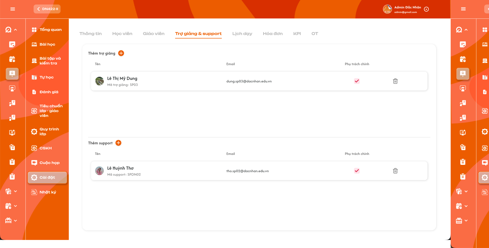

# Chi tiết lớp học — Tab Trợ giảng & Phụ trách lớp

Requirement này đặc tả màn **Chi tiết lớp học → Tab Trợ giảng & Phụ trách lớp**. Tên tab và hai khu vực trong ảnh hiện tại đang dùng sai thuật ngữ; requirement này là nguồn đúng để triển khai. Quyền chấm điểm chính thức của giáo viên được đặc tả tại [Chi tiết lớp học — Tab Giáo viên](./class_detail_teachers_requirements.md); quyền CRUD lịch của các role được đặc tả tại [Tab Lịch dạy](./class_detail_schedule_requirements.md).

## 1. UI

### Trang 1: Tab Trợ giảng & Phụ trách lớp


*Ảnh UI hiện tại dùng sai tên khu vực; cần sửa theo mapping trong requirement — nhấn để xem ảnh gốc*

**Mô tả:**

- Đổi tên tab từ `Trợ giảng & support` thành `Trợ giảng & Phụ trách lớp`.
- Khu vực `Trợ giảng` hiển thị người dùng có role `Support`.
- Khu vực đang ghi `Support` trong ảnh phải đổi thành `Phụ trách lớp` và chỉ hiển thị người dùng có role `Class Handler`.
- `Admin` và `Class Handler` được thêm/xóa người trong hai danh sách. `Support` được xem tab và hỗ trợ vận hành lớp theo quyền được cấp nhưng không được quản lý danh sách phân công tại tab này.

**Giải thích field/thành phần:**

- `A01.01` **Tên tab**: `Trợ giảng & Phụ trách lớp`; không dùng `Trợ giảng & support`.
- `A01.02` **Khu vực Trợ giảng**: Danh sách tài khoản role `Support` đã được thêm vào lớp.
- `A01.03` **Khu vực Phụ trách lớp**: Danh sách tài khoản role `Class Handler` đã được thêm vào lớp.
- `A01.04` **Tên**: Hiển thị họ tên của đúng người dùng. Có thể kèm avatar/mã nội bộ nhưng không bắt buộc theo yêu cầu hiện tại.
- `A01.05` **Email**: Hiển thị email hiện tại của người dùng.
- `A01.06` **Icon `X`**: Xóa người dùng khỏi đúng danh sách của lớp ngay khi bấm; không mở popup xác nhận.
- `A01.07` **Nút thêm `+`**: Mở popup lựa chọn giữa `Chọn người có sẵn` và `Tạo mới`, giống pattern tại tab Giáo viên.

**Điểm cần lưu ý:**

- Không có role `Assistant Teacher` riêng. Thuật ngữ `Trợ giảng` trên UI ánh xạ vào role `Support`.
- `Support` là role hệ thống; `Phụ trách lớp` là tên nghiệp vụ hiển thị của người dùng role `Class Handler` trong khu vực này.
- Hai danh sách chỉ hiển thị các cột `Tên`, `Email`, `Xóa`. Bỏ cột/checkbox `Phụ trách chính` khỏi UI này.
- Một người chỉ xuất hiện một lần trong cùng danh sách của một lớp. Không được đưa user sai role vào danh sách bằng request trực tiếp.
- Phụ trách lớp và Trợ giảng hỗ trợ giáo viên, được xem/hỗ trợ quản lý lớp trong phạm vi quyền; không được nhập hoặc cập nhật điểm BTVN và bài kiểm tra. Chỉ Giáo viên phụ trách chính có quyền này.
- Hai flow tạo mới phải khóa role theo khu vực bắt đầu: tạo từ Trợ giảng luôn là `Support`; tạo từ Phụ trách lớp luôn là `Class Handler`. Client không được đổi role trong request.

### Trang 2: Popup chọn cách thêm nhân sự
**Mô tả:** `Admin` hoặc `Class Handler` bấm `+` tại một khu vực để chọn một trong hai flow: chọn người đã có trong hệ thống hoặc tạo tài khoản mới rồi tự thêm vào lớp. Cách hoạt động giống popup lựa chọn tại tab Giáo viên.

**Giải thích field/thành phần:**

- `A02.01` **Khu vực Phụ trách lớp**: Lựa chọn 1: `Chọn phụ trách lớp`; Lựa chọn 2: `Tạo phụ trách lớp mới`
- `A02.02` **Khu vực Trợ giảng**: Lựa chọn 1: `Chọn trợ giảng`; Lựa chọn 2: `Tạo trợ giảng mới`
- `A02.03` **Đóng/Hủy**: Lựa chọn 1: Đóng popup, không tạo tài khoản và không thêm quan hệ với lớp; Lựa chọn 2: Áp dụng cho cả hai ngữ cảnh

**Điểm cần lưu ý:**

- Popup phải giữ đúng `class_id` và loại nhân sự của nút `+` đã bấm trong toàn bộ flow con.
- Chỉ mở một popup con tại một thời điểm; chưa tạo hoặc thêm dữ liệu trước khi người dùng xác nhận flow con.
- Không hiển thị lựa chọn sai ngữ cảnh, ví dụ bấm `+` Trợ giảng nhưng lại có nút tạo Phụ trách lớp.
- `Support` chỉ xem tab nên không thấy hoặc không thao tác được nút `+` và popup này.

### Trang 3: Popup chọn Phụ trách lớp có sẵn
**Mô tả:** Sau khi chọn `Chọn phụ trách lớp`, `Admin` hoặc `Class Handler` tìm và thêm một hoặc nhiều tài khoản `Class Handler` hiện có vào lớp.

**Giải thích field/thành phần:**

- `A03.01` **Tìm kiếm**: Tìm theo tên hoặc email; không phân biệt hoa/thường. Quy tắc dấu tiếng Việt dùng tìm kiếm chung của hệ thống.
- `A03.02` **Danh sách kết quả**: Chỉ trả tài khoản `Class Handler` đang hoạt động, thuộc phạm vi và chưa được thêm vào lớp.
- `A03.03` **Checkbox**: Cho chọn một hoặc nhiều người trong cùng lần thao tác.
- `A03.04` **Hủy**: Đóng popup, không thêm các lựa chọn chưa xác nhận.
- `A03.05` **Thêm**: Thêm toàn bộ lựa chọn hợp lệ vào danh sách Phụ trách lớp.

**Điểm cần lưu ý:**

- Popup này chỉ chọn dữ liệu có sẵn. Việc tạo tài khoản mới nằm ở lựa chọn `Tạo phụ trách lớp mới` của popup trước.
- Người đã thuộc danh sách không xuất hiện như lựa chọn hợp lệ; nếu hiển thị thì phải disabled và ghi `Đã thuộc lớp`.
- Thêm nhiều người phải nguyên tử. Nếu có lựa chọn không còn hợp lệ tại thời điểm lưu, không thêm một phần.
- Việc thêm Phụ trách lớp không cấp quyền chấm điểm BTVN/bài kiểm tra.

### Trang 4: Popup chọn Trợ giảng có sẵn
**Mô tả:** Sau khi chọn `Chọn trợ giảng`, `Admin` hoặc `Class Handler` tìm và thêm một hoặc nhiều tài khoản `Support` hiện có vào lớp.

**Giải thích field/thành phần:**

- `A04.01` **Tìm kiếm**: Tìm theo tên hoặc email trong tập người dùng role Support.
- `A04.02` **Danh sách kết quả**: Chỉ trả Support đang hoạt động, thuộc phạm vi và chưa thuộc danh sách Trợ giảng của lớp.
- `A04.03` **Checkbox**: Hỗ trợ multi-select.
- `A04.04` **Hủy/Thêm**: Hủy không lưu; Thêm tạo các quan hệ Support–lớp hợp lệ.

**Điểm cần lưu ý:**

- Trợ giảng không phải role riêng; backend phải lưu/kiểm tra role `Support`.
- Không cho chọn Class Handler hoặc Teacher vào khu vực Trợ giảng.
- Support được hỗ trợ xem/quản lý lớp theo permission hiện hành nhưng không được chấm điểm BTVN/bài kiểm tra.

### Trang 5: Popup Tạo Phụ trách lớp/Trợ giảng mới dùng chung
**Mô tả:** Cho phép tạo tài khoản nhân sự mới ngay trong ngữ cảnh lớp bằng popup tạo tài khoản dùng chung, sau đó tự thêm tài khoản vừa tạo vào đúng khu vực của lớp hiện tại.

**Giải thích field/thành phần:**

- `A05.01` **Form tạo tài khoản**: Dùng chung component, validation và quy tắc kiểm tra trùng của module quản lý tài khoản/nhân sự; không tạo một bộ rule riêng trong tab lớp.
- `A05.02` **Role**: Ẩn hoặc chỉ đọc. Mở từ `Tạo phụ trách lớp mới` thì cố định `Class Handler`; mở từ `Tạo trợ giảng mới` thì cố định `Support`.
- `A05.03` **Hủy**: Đóng popup; không tạo tài khoản và không thêm vào lớp.
- `A05.04` **Xác nhận/Tạo**: Validate → tạo tài khoản → tạo quan hệ với đúng lớp và đúng khu vực → tải lại danh sách → Toast.

**Điểm cần lưu ý:**

- `Admin` và `Class Handler` được dùng hai flow tạo mới tại tab này; `Support` chỉ xem.
- Backend phải tự gán/kiểm tra role từ loại flow, không tin role do client gửi và không cho đổi sang Teacher hoặc role khác.
- Tài khoản mới không được cấp quyền chấm BTVN/bài kiểm tra vì role Class Handler và Support đều không có quyền chấm điểm chính thức.
- Nếu tạo tài khoản thành công nhưng bước gắn vào lớp thất bại, không hiển thị dòng quan hệ giả. Khi thử lại phải dùng ID tài khoản đã tạo hoặc cơ chế idempotency, không tạo tài khoản trùng.
- Không đưa mật khẩu hoặc dữ liệu nhạy cảm vào Toast, log nghiệp vụ hay response sau tạo.

### Trang 6: Icon Xóa khỏi lớp không cần xác nhận
**Mô tả:** `Admin` hoặc `Class Handler` bấm icon `X` tại một dòng để xóa ngay Phụ trách lớp hoặc Trợ giảng khỏi lớp; không hiển thị popup xác nhận.

**Giải thích field/thành phần:**

- `A06.01` **Icon `X`**: Gắn với đúng user và đúng loại quan hệ đang hiển thị.
- `A06.02` **Khi bấm**: Gửi một request xóa quan hệ ngay; disable icon trong lúc xử lý để tránh gửi lặp.
- `A06.03` **Thành công**: Xóa dòng khỏi đúng khu vực và hiển thị Toast thành công.
- `A06.04` **Thất bại**: Giữ/khôi phục dòng, hiển thị lỗi và cho phép thử lại.

**Điểm cần lưu ý:**

- Không có popup xác nhận, bước xác nhận lần hai hoặc undo bắt buộc.
- Chỉ xóa quan hệ người dùng–lớp; không xóa tài khoản, hồ sơ, lịch sử hoặc dữ liệu hoạt động đã phát sinh.
- Xóa khỏi một khu vực không được xóa nhầm quan hệ khác của cùng người dùng hoặc người khác.
- Request gửi lặp phải idempotent; dữ liệu cuối cùng nhất quán với trạng thái backend.

### Trang 7: Phân quyền hỗ trợ lớp và giới hạn chấm điểm
**Mô tả:** Phụ trách lớp (`Class Handler`) và Trợ giảng (`Support`) hỗ trợ giáo viên trong vận hành lớp nhưng không được chấm điểm chính thức.

**Giải thích field/thành phần:**

- `A07.01` **Xem lớp**: Class Handler/Phụ trách lớp: Có, trong phạm vi được phân công; Support/Trợ giảng: Có, trong phạm vi được phân công
- `A07.02` **Hỗ trợ quản lý**: Class Handler/Phụ trách lớp: Có, theo permission từng function; Support/Trợ giảng: Có, theo permission từng function
- `A07.03` **Thêm/xóa nhân sự tại tab này**: Class Handler/Phụ trách lớp: Class Handler được thao tác; Support/Trợ giảng: Support chỉ xem
- `A07.04` **Chấm điểm BTVN**: Class Handler/Phụ trách lớp: Không; Support/Trợ giảng: Không
- `A07.05` **Chấm điểm bài kiểm tra**: Class Handler/Phụ trách lớp: Không; Support/Trợ giảng: Không

**Điểm cần lưu ý:**

- Việc có quyền xem/hỗ trợ không đồng nghĩa có quyền chấm điểm.
- Backend của BTVN và bài kiểm tra phải kiểm tra người chấm là Giáo viên phụ trách chính hiện tại; không dựa vào việc user thuộc lớp với role Class Handler/Support.
- Lớp không có Giáo viên phụ trách chính thì không Class Handler hoặc Support nào được thay thế để chấm điểm.

### Trang 8: Toast phản hồi CRUD


*Toast phản hồi thêm và xóa nhân sự khỏi lớp — nhấn để xem ảnh gốc*

**Mô tả:** Phản hồi kết quả chọn có sẵn, tạo mới, tự thêm vào lớp và xóa Trợ giảng/Phụ trách lớp.

**Điểm cần lưu ý:**

- `A08.01` **Thành công**: Tiêu đề: `Thành Công`; Ví dụ nội dung: `Đã tạo và thêm phụ trách lớp.`, `Đã thêm trợ giảng.`, `Đã xóa trợ giảng khỏi lớp.`
- `A08.02` **Thông tin**: Tiêu đề: `Thông Báo`; Ví dụ nội dung: Danh sách đang chờ đồng bộ.
- `A08.03` **Cảnh báo**: Tiêu đề: `Cảnh Báo`; Ví dụ nội dung: User đã thuộc lớp, sai role hoặc không còn hợp lệ.
- `A08.04` **Lỗi**: Tiêu đề: `Có Lỗi Xảy Ra`; Ví dụ nội dung: Không thể hoàn tất request.

- Mỗi thao tác logic chỉ hiển thị một Toast sau phản hồi backend.
- Mở tab, tìm kiếm, chọn checkbox chưa xác nhận hoặc Hủy không có Toast CRUD.
- Nút `×` trên Toast chỉ đóng thông báo, không hoàn tác việc xóa quan hệ.

---

## 2. Yêu cầu

### 2.1. Flow chính

**Flow 1 / REQ01: Xem hai danh sách đúng role**

```text
Người dùng mở Chi tiết lớp → tab Trợ giảng & Phụ trách lớp
      → Backend kiểm tra quyền/phạm vi
      → Trả Support vào khu vực Trợ giảng
      → Trả Class Handler vào khu vực Phụ trách lớp
      → Hiển thị Tên, Email và Xóa theo quyền; không có checkbox Phụ trách chính
```

**Flow 2 / REQ02: Chọn Phụ trách lớp có sẵn**

```text
Admin/Class Handler bấm + Phụ trách lớp
      → Chọn `Chọn phụ trách lớp`
      → Tìm Class Handler theo tên hoặc email
      → Chọn một/nhiều người → Thêm
      → Backend kiểm tra role, trạng thái, phạm vi, quan hệ trùng
      → Hợp lệ: thêm nguyên tử, cập nhật danh sách và Toast
```

**Flow 3 / REQ03: Chọn Trợ giảng có sẵn**

```text
Admin/Class Handler bấm + Trợ giảng
      → Chọn `Chọn trợ giảng`
      → Tìm Support theo tên hoặc email
      → Chọn một/nhiều người → Thêm
      → Backend kiểm tra role Support và quan hệ trùng
      → Hợp lệ: thêm nguyên tử vào khu vực Trợ giảng
```

**Flow 4 / REQ04: Tạo nhân sự mới và tự thêm vào lớp**

```text
Admin/Class Handler bấm + tại đúng khu vực
      → Chọn `Tạo phụ trách lớp mới` hoặc `Tạo trợ giảng mới`
      → Mở form tạo tài khoản dùng chung với role khóa theo flow
      → Validate và tạo tài khoản
      → Tạo quan hệ tài khoản–lớp đúng loại
      → Tải lại danh sách và hiển thị Toast kết quả
```

**Flow 5 / REQ05: Xóa không cần xác nhận**

```text
Admin/Class Handler bấm X tại một dòng
      → Không mở popup xác nhận
      → Gửi request xóa đúng quan hệ người dùng–lớp
      → Thành công: xóa dòng và Toast
      → Thất bại: giữ/khôi phục dòng, Toast lỗi và cho thử lại
```

### 2.2. Ngoại lệ

- **EX01:** Popup Phụ trách lớp nhận user không phải Class Handler, đã thuộc lớp, bị khóa hoặc ngoài phạm vi → từ chối toàn bộ multi-select.
- **EX02:** Popup Trợ giảng nhận user không phải Support, đã thuộc lớp, bị khóa hoặc ngoài phạm vi → từ chối toàn bộ multi-select.
- **EX03:** Flow tạo mới nhận dữ liệu trùng/sai validation, role bị sửa hoặc người dùng mất quyền → không tạo tài khoản và quan hệ một phần; trả lỗi đúng field/nguyên nhân.
- **EX04:** Tạo tài khoản thành công nhưng gắn lớp thất bại → không hiển thị quan hệ giả; retry bằng ID/idempotency key cũ, không tạo tài khoản trùng.
- **EX05:** Xóa thất bại, request lặp hoặc quan hệ đã đổi → xử lý idempotent, không xóa nhầm tài khoản/người khác và đồng bộ lại UI.
- **EX06:** Class Handler hoặc Support gửi request chấm điểm BTVN/bài kiểm tra → backend từ chối, kể cả người đó đang được phân công vào lớp.
- **EX07:** Role không phải Admin/Class Handler gửi request chọn có sẵn, tạo mới hoặc xóa nhân sự tại tab → backend từ chối; Support chỉ xem.

### 2.3. Yêu cầu khác

| Mã | Tên yêu cầu | Mô tả |
|---|---|---|
| REQ01 | Thuật ngữ và hiển thị | Tab là `Trợ giảng & Phụ trách lớp`; Trợ giảng ánh xạ role Support, Phụ trách lớp ánh xạ role Class Handler. Mỗi danh sách chỉ có Tên, Email, Xóa; không có Phụ trách chính. |
| REQ02 | Chọn Phụ trách lớp có sẵn | Bấm `+` mở lựa chọn `Chọn phụ trách lớp` hoặc `Tạo phụ trách lớp mới`. Với flow chọn có sẵn, Admin/Class Handler tìm theo tên/email, multi-select các Class Handler đang hoạt động và chưa thuộc lớp; thêm nguyên tử. |
| REQ03 | Chọn Trợ giảng có sẵn | Bấm `+` mở lựa chọn `Chọn trợ giảng` hoặc `Tạo trợ giảng mới`. Với flow chọn có sẵn, Admin/Class Handler tìm theo tên/email, multi-select các Support đang hoạt động và chưa thuộc lớp; không có role Assistant Teacher riêng. |
| REQ04 | Tạo mới và tự thêm | Dùng form tạo tài khoản dùng chung. Flow Phụ trách lớp khóa role `Class Handler`; flow Trợ giảng khóa role `Support`. Tạo xong tự thêm vào đúng lớp/khu vực; không cấp quyền chấm điểm; chống tạo trùng khi retry lỗi liên kết. |
| REQ05 | Xóa quan hệ | Bấm X gửi request ngay, không popup xác nhận; chỉ xóa quan hệ với lớp, không xóa tài khoản/lịch sử; idempotent. |
| REQ06 | Quyền hỗ trợ, không chấm điểm | Class Handler và Support được xem/hỗ trợ quản lý theo permission từng function nhưng không được nhập/cập nhật điểm BTVN hoặc bài kiểm tra. Chỉ Giáo viên phụ trách chính có quyền chấm. |
| REQ07 | Audit và an toàn | Lưu người/thời điểm cho thao tác chọn có sẵn, tạo mới, tự thêm và xóa; không tin role/phạm vi do client gửi; text hiển thị an toàn và lỗi không lộ thông tin kỹ thuật/dữ liệu nhạy cảm. |

### 2.4. Ràng buộc

#### Ràng buộc khác

**Quyền tại tab**

| Role | Xem tab | Chọn có sẵn | Tạo mới | Xóa khỏi lớp | Chấm BTVN/kiểm tra |
|---|:---:|:---:|:---:|:---:|:---:|
| Admin | ✅ | ✅ | ✅ | ✅ | ❌ |
| Class Handler | ✅ | ✅ | ✅ | ✅ | ❌ |
| Support | ✅ | ❌ | ❌ | ❌ | ❌ |
| Teacher/role khác | Theo permission xem lớp khác, không qua tab này | ❌ | ❌ | ❌ | Chỉ Teacher chính theo Tab Giáo viên |

#### Tính toàn vẹn

- Dùng `class_id`, `user_id` và loại quan hệ bất biến; không dùng tên/email làm khóa cập nhật.
- Unique constraint cho mỗi cặp lớp–người dùng–loại quan hệ hoạt động.
- Backend kiểm tra role hiện tại tại thời điểm thêm, không tin nhóm đang hiển thị ở client.
- Thêm multi-select phải nguyên tử; xóa phải idempotent.
- Flow tạo mới phải có idempotency key hoặc cơ chế tương đương. Kết quả chỉ được coi là hoàn tất khi cả tài khoản và quan hệ lớp đã được xử lý rõ ràng; retry không được tạo tài khoản trùng.
- Role của tài khoản tạo từ tab phải được xác định ở backend theo loại flow: `Class Handler` cho Phụ trách lớp, `Support` cho Trợ giảng.
- Xóa quan hệ không cascade xóa tài khoản, hồ sơ, log, lịch sử hoặc hoạt động đã phát sinh.
- Quyền chấm BTVN/bài kiểm tra lấy từ quan hệ Giáo viên phụ trách chính, không lấy từ quan hệ Class Handler/Support.

---

---

## 3. Testcase

### Feature: Chi tiết lớp học — Tab Trợ giảng & Phụ trách lớp

| Tên testcase | Priority | Scenario | Role | Pre-condition | Given/When/Then | Expected Result |
|---|---|---|---|---|---|---|
| Case 1: Hiển thị đúng tên tab và khu vực | High | Flow 1 / REQ01 | `Admin`, `Class Handler` hoặc `Support` | Người dùng được xem lớp | **Given** mở Chi tiết lớp<br>**When** chọn tab nhân sự hỗ trợ<br>**Then** UI hiển thị đúng thuật ngữ mới | - Tab là `Trợ giảng & Phụ trách lớp`<br>- Có khu vực Trợ giảng và Phụ trách lớp<br>- Không còn nhãn khu vực `Support` độc lập |
| Case 2: Mapping đúng role vào hai danh sách | High · Smoke | Flow 1 / REQ01 | Role có quyền xem | Lớp có Support và Class Handler | **Given** dữ liệu quan hệ đã tồn tại<br>**When** tab tải thành công<br>**Then** phân nhóm theo role | - Support nằm ở Trợ giảng<br>- Class Handler nằm ở Phụ trách lớp<br>- Không đảo hai nhóm hoặc trộn role |
| Case 3: Hiển thị đúng ba cột | High | REQ01 | Role có quyền xem | Mỗi khu vực có dữ liệu | **Given** danh sách đang hiển thị<br>**When** kiểm tra header và từng dòng<br>**Then** có Tên, Email, Xóa | - Không có checkbox Phụ trách chính<br>- Dữ liệu cùng dòng thuộc cùng người<br>- Support chỉ xem nên không thao tác được icon X |
| Case 4: Danh sách rỗng độc lập | Medium | REQ01 | Role có quyền xem | Một hoặc cả hai danh sách rỗng | **Given** tab được mở<br>**When** backend trả dữ liệu<br>**Then** mỗi khu vực có empty state riêng | - Không dùng dữ liệu nhóm kia thay thế<br>- Admin/Class Handler vẫn thấy nút thêm<br>- Support không thấy control CRUD |
| Case 5: Mở lựa chọn thêm Phụ trách lớp | High | Flow 2 / REQ02 | `Admin` hoặc `Class Handler` | Tab đang mở | **Given** người dùng bấm `+` tại Phụ trách lớp<br>**When** popup xuất hiện<br>**Then** có hai lựa chọn đúng ngữ cảnh | - Có `Chọn phụ trách lớp` và `Tạo phụ trách lớp mới`<br>- Giữ đúng class_id<br>- Chưa thay đổi dữ liệu |
| Case 6: Mở lựa chọn thêm Trợ giảng | High | Flow 3 / REQ03 | `Admin` hoặc `Class Handler` | Tab đang mở | **Given** người dùng bấm `+` tại Trợ giảng<br>**When** popup xuất hiện<br>**Then** có hai lựa chọn đúng ngữ cảnh | - Có `Chọn trợ giảng` và `Tạo trợ giảng mới`<br>- Không hiển thị flow Class Handler<br>- Chưa thay đổi dữ liệu |
| Case 7: Điều hướng đúng flow con | High | Flow 2–4 / REQ02–REQ04 | `Admin` hoặc `Class Handler` | Popup lựa chọn đang mở | **Given** người dùng chọn một phương án<br>**When** bấm nút tương ứng<br>**Then** mở đúng popup chọn có sẵn hoặc tạo mới | - Không mở hai popup cùng lúc<br>- Khóa đúng role theo khu vực<br>- Không thêm trước khi xác nhận |
| Case 8: Đóng popup lựa chọn | Medium | REQ02 | `Admin` hoặc `Class Handler` | Popup lựa chọn đang mở | **Given** chưa chọn flow con<br>**When** đóng/Hủy<br>**Then** quay lại danh sách | - Không tạo tài khoản<br>- Không tạo quan hệ với lớp<br>- Không có Toast thành công |
| Case 9: Mở popup và tìm theo tên | High | Flow 2 / REQ02 | `Admin` hoặc `Class Handler` | Có Class Handler hợp lệ | **Given** đã chọn `Chọn phụ trách lớp`<br>**When** nhập tên<br>**Then** hiển thị kết quả khớp | - Chỉ có role Class Handler<br>- Không tự thêm khi tìm<br>- Không lộ user ngoài phạm vi |
| Case 10: Tìm Phụ trách lớp theo email | High | Flow 2 / REQ02 | `Admin` hoặc `Class Handler` | Có Class Handler có email cần tìm | **Given** popup đang mở<br>**When** nhập toàn bộ hoặc một phần email<br>**Then** lọc đúng kết quả | - Không phân biệt hoa/thường<br>- Tên/email hiển thị đúng người<br>- Không trả role Support/Teacher |
| Case 11: Thêm nhiều Phụ trách lớp | High · Smoke | Flow 2 / REQ02 | `Admin` hoặc `Class Handler` | Các user chưa thuộc lớp | **Given** chọn từ hai Class Handler trở lên<br>**When** bấm `Thêm`<br>**Then** backend tạo các quan hệ với lớp | - Mỗi người xuất hiện một lần<br>- Hiển thị Tên, Email, X<br>- Không có quyền chấm điểm<br>- Có Toast thành công |
| Case 12: Hủy popup chọn Phụ trách lớp | Medium | Flow 2 / REQ02 | `Admin` hoặc `Class Handler` | Đã tick một số người | **Given** lựa chọn chưa xác nhận<br>**When** bấm `Hủy`<br>**Then** đóng popup | - Không tạo quan hệ<br>- Không có Toast thành công<br>- Danh sách giữ nguyên |
| Case 13: Từ chối user sai role, trùng hoặc không còn hợp lệ | High | EX01 / REQ02 | `Admin` hoặc `Class Handler` | Client gửi ID không hợp lệ hoặc popup giữ snapshot cũ | **Given** request có Support/Teacher/user đã thuộc lớp/user bị khóa<br>**When** xác nhận thêm<br>**Then** backend từ chối nguyên tử | - Không thêm một phần<br>- Không tạo quan hệ trùng<br>- Trả đúng người cần chọn lại |
| Case 14: Tìm Trợ giảng theo tên hoặc email | High | Flow 3 / REQ03 | `Admin` hoặc `Class Handler` | Có Support hợp lệ | **Given** đã chọn `Chọn trợ giảng`<br>**When** nhập tên hoặc email<br>**Then** trả đúng Support phù hợp | - Không trả Class Handler/Teacher<br>- Không lộ user ngoài phạm vi<br>- Không tự thêm |
| Case 15: Thêm nhiều Trợ giảng | High · Smoke | Flow 3 / REQ03 | `Admin` hoặc `Class Handler` | Các Support chưa thuộc lớp | **Given** chọn nhiều Support<br>**When** bấm `Thêm`<br>**Then** thêm vào khu vực Trợ giảng | - Mỗi Support một dòng<br>- Có Tên, Email, X<br>- Không có quyền chấm điểm<br>- Có Toast thành công |
| Case 16: Chặn role sai hoặc Support trùng | High | EX02 / REQ03 | `Admin` hoặc `Class Handler` | Request chứa user sai role/trùng | **Given** client sửa request trực tiếp<br>**When** backend xử lý<br>**Then** từ chối nguyên tử | - Không trộn danh sách<br>- Không tạo quan hệ trùng<br>- Không thêm một phần |
| Case 17: Mở form tạo Phụ trách lớp đúng role | High | Flow 4 / REQ04 | `Admin` hoặc `Class Handler` | Popup lựa chọn đang mở từ khu vực Phụ trách lớp | **Given** chọn `Tạo phụ trách lớp mới`<br>**When** form tạo mở<br>**Then** role được cố định Class Handler | - Dùng form/validation chung<br>- Không đổi được role<br>- Giữ đúng class_id |
| Case 18: Tạo Phụ trách lớp và tự thêm vào lớp | High | Flow 4 / REQ04 | `Admin` hoặc `Class Handler` | Dữ liệu tài khoản hợp lệ | **Given** form role Class Handler hợp lệ<br>**When** xác nhận tạo<br>**Then** tạo tài khoản rồi liên kết lớp | - Xuất hiện tại Phụ trách lớp<br>- Không xuất hiện tại Trợ giảng<br>- Không có quyền chấm điểm<br>- Có Toast thành công |
| Case 19: Mở form tạo Trợ giảng đúng role | High | Flow 4 / REQ04 | `Admin` hoặc `Class Handler` | Popup lựa chọn đang mở từ khu vực Trợ giảng | **Given** chọn `Tạo trợ giảng mới`<br>**When** form tạo mở<br>**Then** role được cố định Support | - Dùng form/validation chung<br>- Không đổi được role<br>- Giữ đúng class_id |
| Case 20: Tạo Trợ giảng và tự thêm vào lớp | High | Flow 4 / REQ04 | `Admin` hoặc `Class Handler` | Dữ liệu tài khoản hợp lệ | **Given** form role Support hợp lệ<br>**When** xác nhận tạo<br>**Then** tạo tài khoản rồi liên kết lớp | - Xuất hiện tại Trợ giảng<br>- Không xuất hiện tại Phụ trách lớp<br>- Không có quyền chấm điểm<br>- Có Toast thành công |
| Case 21: Chặn dữ liệu trùng, sai validation hoặc sửa role | High | EX03 / REQ04 | `Admin` hoặc `Class Handler` | Client gửi dữ liệu sai/trùng hoặc role khác flow | **Given** request không hợp lệ<br>**When** backend xử lý<br>**Then** từ chối tạo và liên kết | - Hiển thị lỗi đúng field/nguyên nhân<br>- Không tạo tài khoản/quan hệ một phần<br>- Không lộ thông tin kỹ thuật |
| Case 22: Tạo tài khoản thành công nhưng gắn lớp thất bại | High | EX04 / REQ04 | `Admin` hoặc `Class Handler` | Mô phỏng lỗi bước tạo quan hệ | **Given** tài khoản đã được tạo<br>**When** bước liên kết lớp thất bại<br>**Then** trả trạng thái rõ ràng và không hiển thị dòng giả | - Không tạo lại tài khoản khi retry<br>- Có thể gắn lại bằng ID đã tạo<br>- Toast không báo thành công toàn flow |
| Case 23: Xóa Phụ trách lớp ngay khi bấm X | High · Smoke | Flow 5 / REQ05 | `Admin` hoặc `Class Handler` | Class Handler thuộc lớp | **Given** dòng đang hiển thị<br>**When** bấm `X`<br>**Then** gửi request xóa mà không mở popup | - Thành công xóa đúng dòng<br>- Không xóa tài khoản/lịch sử<br>- Có Toast thành công |
| Case 24: Xóa Trợ giảng ngay khi bấm X | High | Flow 5 / REQ05 | `Admin` hoặc `Class Handler` | Support thuộc lớp | **Given** dòng đang hiển thị<br>**When** bấm `X`<br>**Then** xóa quan hệ Support–lớp | - Không mở xác nhận<br>- Không tác động danh sách Phụ trách lớp<br>- Không xóa tài khoản<br>- Có Toast thành công |
| Case 25: Xóa thất bại | High | EX05 / REQ05 | `Admin` hoặc `Class Handler` | Mô phỏng backend/network lỗi | **Given** người dùng bấm X<br>**When** request thất bại<br>**Then** giữ/khôi phục dòng | - Không hiển thị thành công<br>- Có Toast lỗi<br>- Cho phép thử lại<br>- Không để UI/backend lệch nhau |
| Case 26: Bấm X lặp hoặc quan hệ đã bị xóa | Medium | EX05 / REQ05 | `Admin` hoặc `Class Handler` | Request đầu đang xử lý hoặc quan hệ không còn | **Given** người dùng bấm nhiều lần/dữ liệu cũ<br>**When** backend xử lý<br>**Then** kết quả idempotent | - Chỉ xóa một quan hệ<br>- Không xóa nhầm user khác<br>- Tải lại trạng thái mới nhất khi cần |
| Case 27: Class Handler xem và hỗ trợ quản lý lớp | High | REQ06 / Ràng buộc quyền | `Class Handler` | Được phân công lớp | **Given** Class Handler mở lớp<br>**When** thực hiện function được permission cho phép<br>**Then** hệ thống cho xem/hỗ trợ quản lý | - Dữ liệu đúng phạm vi<br>- Có thể CRUD tab này<br>- Không được chấm BTVN/bài kiểm tra |
| Case 28: Support xem và hỗ trợ quản lý lớp | High | REQ06 / Ràng buộc quyền | `Support` | Được phân công lớp | **Given** Support mở lớp<br>**When** thực hiện function hỗ trợ được cấp<br>**Then** hệ thống cho phép theo permission | - Xem đúng phạm vi<br>- Tab này ở chế độ chỉ đọc<br>- Không được chấm BTVN/bài kiểm tra |
| Case 29: Backend từ chối Phụ trách lớp chấm điểm | High | EX06 / REQ06 | `Class Handler` | Thuộc lớp nhưng không phải Teacher chính | **Given** gửi request nhập/cập nhật điểm<br>**When** backend kiểm tra người chấm<br>**Then** từ chối | - Không ghi điểm BTVN<br>- Không ghi điểm bài kiểm tra<br>- Không tạo audit điểm thành công giả |
| Case 30: Backend từ chối Trợ giảng chấm điểm | High | EX06 / REQ06 | `Support` | Thuộc lớp dưới vai trò Trợ giảng | **Given** gửi request nhập/cập nhật điểm<br>**When** backend kiểm tra người chấm<br>**Then** từ chối | - Không ghi điểm BTVN/bài kiểm tra<br>- Quyền hỗ trợ khác không bị mở rộng<br>- Không lộ dữ liệu trái quyền |
| Toast Case 1: Thành công | High | Ràng buộc Toast CRUD | Role có quyền CRUD | Thao tác hợp lệ | **Given** người dùng thêm/xóa<br>**When** backend thành công<br>**Then** hiển thị `Thành Công` | - Nội dung đúng đối tượng<br>- Đúng một Toast<br>- Dữ liệu đã lưu |
| Toast Case 2: Cảnh báo | High | Ràng buộc Toast CRUD | Role có quyền CRUD | Sai role/trùng/không hợp lệ | **Given** thao tác không thỏa validation<br>**When** xác nhận<br>**Then** hiển thị `Cảnh Báo` khi flow dùng Toast | - Không lưu sai<br>- Nêu nguyên nhân xử lý được<br>- Không hiện thành công |
| Toast Case 3: Lỗi | High | Ràng buộc Toast CRUD | Role có quyền CRUD | Backend/network lỗi | **Given** request đã gửi<br>**When** xử lý thất bại<br>**Then** hiển thị `Có Lỗi Xảy Ra` | - Không cập nhật một phần<br>- Cho thử lại<br>- Không lộ lỗi kỹ thuật |
| Toast Case 4: Thông tin và chống lặp | Medium | Ràng buộc Toast CRUD | Role có quyền CRUD | Đang đồng bộ/callback lặp | **Given** dữ liệu chưa đồng bộ hoặc request lặp<br>**When** UI nhận trạng thái<br>**Then** tối đa một Toast `Thông Báo` | - Không báo thành công sớm<br>- Không nhân đôi Toast<br>- Có thể đóng thủ công |

---

## 4. Câu hỏi cần xác nhận

- **Q01:** Khi xóa một `Class Handler` đang đồng thời được lưu tại field `Phụ trách chính` của lớp từ lúc tạo, hệ thống có cho xóa ngay và để field trống, hay phải giữ người đó cho đến khi đổi Phụ trách chính ở function khác?
- **Q02:** Click vào Tên của Trợ giảng/Phụ trách lớp có mở Chi tiết tài khoản hay chỉ hiển thị text không tương tác?
- **Q03:** Form tạo tài khoản dùng chung cho `Support` và `Class Handler` lấy chính xác danh sách field bắt buộc/validation từ requirement quản lý tài khoản nào? Requirement này chỉ khóa role và mô tả việc tự thêm vào lớp, không tự định nghĩa lại field tài khoản.
