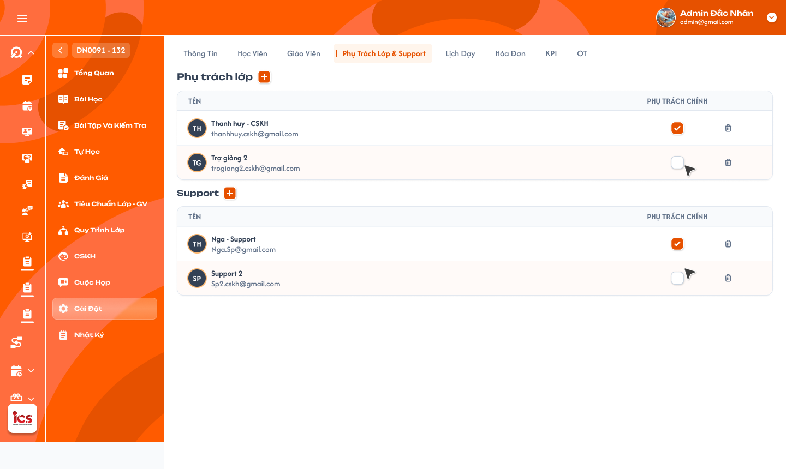

# Chi tiết lớp học — Tab Trợ giảng & Phụ trách lớp

## 1. UI

### Trang 1: ADM-LOP-040400 — Lớp học / Cài đặt / Trợ giảng & support



**Mô tả:**
- Màn Chi tiết lớp học → tab `Trợ giảng & Phụ trách lớp`: hai danh sách nhân sự hỗ trợ của lớp; `Admin` và `Class Handler` thêm / xóa người trong hai danh sách. Từ đây mở popup chọn cách thêm, popup chọn người có sẵn và popup tạo mới. Quyền chấm điểm chính thức của giáo viên xem [Tab Giáo viên](./class_detail_teachers_requirements.md); quyền CRUD lịch của các role xem [Tab Lịch dạy](./class_detail_schedule_requirements.md).

**Điểm cần lưu ý:**
- `A01.01` Tên tab: `Trợ giảng & Phụ trách lớp`; không dùng `Trợ giảng & support`. Không có role `Assistant Teacher` riêng: `Trợ giảng` trên UI ánh xạ role `Support`; `Phụ trách lớp` là tên nghiệp vụ của role `Class Handler`.
- `A01.02` Khu vực Trợ giảng: danh sách tài khoản role `Support` đã thêm vào lớp.
- `A01.03` Khu vực Phụ trách lớp: danh sách tài khoản role `Class Handler` đã thêm vào lớp (nhãn khu vực là `Phụ trách lớp`, không phải `Support`). Mỗi khu vực có empty state riêng, không dùng dữ liệu nhóm kia thay thế.
- `A01.04` Tên: họ tên của đúng người dùng; có thể kèm avatar / mã nội bộ nhưng không bắt buộc.
- `A01.05` Email: email hiện tại của người dùng. Mỗi danh sách chỉ có cột `Tên`, `Email`, `Xóa`; không có cột / checkbox `Phụ trách chính`.
- `A01.06` Icon `X`: xóa người dùng khỏi đúng danh sách của lớp ngay khi bấm, không popup xác nhận. `Support` chỉ xem nên không thao tác được icon này.
- `A01.07` Nút thêm `+`: mở popup lựa chọn `Chọn người có sẵn` / `Tạo mới`, giống pattern tab Giáo viên; `Support` không thấy hoặc không thao tác được nút này.
- Một người chỉ xuất hiện một lần trong cùng danh sách của một lớp; không đưa user sai role vào danh sách bằng request trực tiếp.
- `A02.01` Popup chọn cách thêm nhân sự, ngữ cảnh khu vực Phụ trách lớp: hai lựa chọn `Chọn phụ trách lớp` và `Tạo phụ trách lớp mới`.
- `A02.02` Ngữ cảnh khu vực Trợ giảng: hai lựa chọn `Chọn trợ giảng` và `Tạo trợ giảng mới`. Popup giữ đúng `class_id` và loại nhân sự của nút `+` đã bấm trong toàn bộ flow con; không hiện lựa chọn sai ngữ cảnh; chỉ mở một popup con tại một thời điểm; chưa tạo / thêm dữ liệu trước khi xác nhận flow con.
- `A02.03` Đóng / Hủy: đóng popup, không tạo tài khoản và không thêm quan hệ với lớp (cả hai ngữ cảnh).
- `A03.01` Popup chọn Phụ trách lớp có sẵn, ô Tìm kiếm: theo tên hoặc email, không phân biệt hoa / thường; quy tắc dấu tiếng Việt dùng tìm kiếm chung của hệ thống.
- `A03.02` Danh sách kết quả: chỉ tài khoản `Class Handler` đang hoạt động, thuộc phạm vi và chưa thêm vào lớp. Người đã thuộc danh sách không xuất hiện như lựa chọn hợp lệ; nếu hiển thị thì disabled và ghi `Đã thuộc lớp`.
- `A03.03` Checkbox: chọn một hoặc nhiều người trong cùng lần thao tác. Thêm nhiều phải nguyên tử: có lựa chọn không còn hợp lệ lúc lưu thì không thêm một phần.
- `A03.04` Hủy: đóng popup, không thêm các lựa chọn chưa xác nhận.
- `A03.05` Thêm: thêm toàn bộ lựa chọn hợp lệ vào danh sách Phụ trách lớp; không cấp quyền chấm điểm BTVN / bài kiểm tra.
- `A04.01` Popup chọn Trợ giảng có sẵn, ô Tìm kiếm: theo tên hoặc email trong tập người dùng role `Support`.
- `A04.02` Danh sách kết quả: chỉ `Support` đang hoạt động, thuộc phạm vi và chưa thuộc danh sách Trợ giảng của lớp; không cho chọn Class Handler hoặc Teacher vào khu vực Trợ giảng. Backend lưu / kiểm tra role `Support`.
- `A04.03` Checkbox: hỗ trợ multi-select.
- `A04.04` Hủy / Thêm: Hủy không lưu; Thêm tạo các quan hệ Support–lớp hợp lệ. Support được hỗ trợ xem / quản lý lớp theo permission hiện hành nhưng không được chấm điểm BTVN / bài kiểm tra.
- `A05.01` Popup Tạo Phụ trách lớp / Trợ giảng mới dùng chung, form tạo tài khoản: dùng chung component, validation và quy tắc kiểm tra trùng của module quản lý tài khoản / nhân sự, không tạo bộ rule riêng trong tab lớp. Tạo xong tự thêm tài khoản vào đúng khu vực của lớp hiện tại; không đưa mật khẩu hay dữ liệu nhạy cảm vào Toast, log nghiệp vụ, response sau tạo.
- `A05.02` Role: ẩn hoặc chỉ đọc; mở từ `Tạo phụ trách lớp mới` thì cố định `Class Handler`, mở từ `Tạo trợ giảng mới` thì cố định `Support`. Backend tự gán / kiểm tra role theo loại flow, không tin role client gửi, không cho đổi sang Teacher hay role khác.
- `A05.03` Hủy: đóng popup, không tạo tài khoản, không thêm vào lớp.
- `A05.04` Xác nhận / Tạo: validate → tạo tài khoản → tạo quan hệ với đúng lớp và đúng khu vực → tải lại danh sách → Toast. Tạo tài khoản thành công nhưng gắn lớp thất bại thì không hiện dòng quan hệ giả; retry dùng ID tài khoản đã tạo hoặc idempotency key, không tạo tài khoản trùng. Tài khoản mới không được cấp quyền chấm BTVN / bài kiểm tra.
- `A06.01` Icon `X` xóa khỏi lớp không cần xác nhận: gắn với đúng user và đúng loại quan hệ đang hiển thị.
- `A06.02` Khi bấm: gửi một request xóa quan hệ ngay, disable icon trong lúc xử lý để tránh gửi lặp; không có popup xác nhận, bước xác nhận lần hai hay undo bắt buộc. Chỉ xóa quan hệ người dùng–lớp, không xóa tài khoản, hồ sơ, lịch sử hay hoạt động đã phát sinh; không xóa nhầm quan hệ khác của cùng hoặc người khác; request lặp phải idempotent.
- `A06.03` Thành công: xóa dòng khỏi đúng khu vực và hiển thị Toast thành công.
- `A06.04` Thất bại: giữ / khôi phục dòng, hiển thị lỗi, cho phép thử lại.
- `A07.01` Xem lớp: `Class Handler` và `Support` đều có, trong phạm vi được phân công.
- `A07.02` Hỗ trợ quản lý: cả hai có, theo permission từng function.
- `A07.03` Thêm / xóa nhân sự tại tab này: `Class Handler` được thao tác, `Support` chỉ xem.
- `A07.04` Chấm điểm BTVN: cả hai không có.
- `A07.05` Chấm điểm bài kiểm tra: cả hai không có. Có quyền xem / hỗ trợ không đồng nghĩa có quyền chấm; backend BTVN và bài kiểm tra kiểm tra người chấm là Giáo viên phụ trách chính hiện tại, không dựa vào việc user thuộc lớp với role Class Handler / Support; lớp không có Giáo viên phụ trách chính thì không Class Handler hay Support nào được thay thế để chấm.
- `A08.01` Toast `Thành Công`: ví dụ `Đã tạo và thêm phụ trách lớp.`, `Đã thêm trợ giảng.`, `Đã xóa trợ giảng khỏi lớp.`
- `A08.02` Toast `Thông Báo`: danh sách đang chờ đồng bộ; tối đa một Toast, không báo thành công sớm.
- `A08.03` Toast `Cảnh Báo`: user đã thuộc lớp, sai role hoặc không còn hợp lệ.
- `A08.04` Toast `Có Lỗi Xảy Ra`: không thể hoàn tất request. Mỗi thao tác logic một Toast sau phản hồi backend; mở tab, tìm kiếm, chọn checkbox chưa xác nhận, Hủy không có Toast CRUD; nút `×` chỉ đóng thông báo, không hoàn tác việc xóa quan hệ.

---

## 2. Yêu cầu

### 2.1. Flow chính

**Flow 1: Xem hai danh sách đúng role**

```
Mở Chi tiết lớp → tab Trợ giảng & Phụ trách lớp → BE kiểm tra quyền/phạm vi
  → Support → khu vực Trợ giảng; Class Handler → khu vực Phụ trách lớp
  → hiển thị Tên, Email, Xóa theo quyền (không có checkbox Phụ trách chính)
```

**Flow 2: Chọn Phụ trách lớp có sẵn**

```
Admin/Class Handler bấm + Phụ trách lớp → "Chọn phụ trách lớp"
  → tìm Class Handler theo tên/email → chọn một/nhiều → Thêm
  → BE kiểm tra role, trạng thái, phạm vi, quan hệ trùng → hợp lệ: thêm nguyên tử, cập nhật danh sách, Toast
```

**Flow 3: Chọn Trợ giảng có sẵn**

```
Admin/Class Handler bấm + Trợ giảng → "Chọn trợ giảng"
  → tìm Support theo tên/email → chọn một/nhiều → Thêm
  → BE kiểm tra role Support và quan hệ trùng → hợp lệ: thêm nguyên tử vào khu vực Trợ giảng
```

**Flow 4: Tạo nhân sự mới và tự thêm vào lớp**

```
Admin/Class Handler bấm + tại đúng khu vực → "Tạo phụ trách lớp mới" / "Tạo trợ giảng mới"
  → form tạo tài khoản dùng chung, role khóa theo flow → validate, tạo tài khoản
  → tạo quan hệ tài khoản–lớp đúng loại → tải lại danh sách, Toast kết quả
```

**Flow 5: Xóa không cần xác nhận**

```
Admin/Class Handler bấm X tại một dòng → không popup xác nhận
  → gửi request xóa đúng quan hệ người dùng–lớp
  → thành công: xóa dòng + Toast
  → thất bại: giữ/khôi phục dòng, Toast lỗi, cho thử lại
```

### 2.2. Ngoại lệ

- **EX01:** Popup Phụ trách lớp nhận user không phải Class Handler, đã thuộc lớp, bị khóa hoặc ngoài phạm vi → từ chối toàn bộ multi-select.
- **EX02:** Popup Trợ giảng nhận user không phải Support, đã thuộc lớp, bị khóa hoặc ngoài phạm vi → từ chối toàn bộ multi-select.
- **EX03:** Flow tạo mới nhận dữ liệu trùng / sai validation, role bị sửa hoặc người dùng mất quyền → không tạo tài khoản và quan hệ một phần; trả lỗi đúng field / nguyên nhân.
- **EX04:** Tạo tài khoản thành công nhưng gắn lớp thất bại → không hiển thị quan hệ giả; retry bằng ID / idempotency key cũ, không tạo tài khoản trùng.
- **EX05:** Xóa thất bại, request lặp hoặc quan hệ đã đổi → xử lý idempotent, không xóa nhầm tài khoản / người khác, đồng bộ lại UI.
- **EX06:** Class Handler hoặc Support gửi request chấm điểm BTVN / bài kiểm tra → backend từ chối, kể cả khi đang được phân công vào lớp.
- **EX07:** Role không phải Admin / Class Handler gửi request chọn có sẵn, tạo mới hoặc xóa nhân sự tại tab → backend từ chối; Support chỉ xem.

### 2.3. Yêu cầu khác

| Mã | Tên yêu cầu | Mô tả |
|---|---|---|
| REQ01 | Thuật ngữ và hiển thị | Tab là `Trợ giảng & Phụ trách lớp`; Trợ giảng ánh xạ role Support, Phụ trách lớp ánh xạ role Class Handler. Mỗi danh sách chỉ có Tên, Email, Xóa; không có Phụ trách chính. |
| REQ02 | Chọn Phụ trách lớp có sẵn | Bấm `+` mở lựa chọn `Chọn phụ trách lớp` / `Tạo phụ trách lớp mới`. Flow chọn có sẵn: Admin / Class Handler tìm theo tên / email, multi-select các Class Handler đang hoạt động và chưa thuộc lớp; thêm nguyên tử. |
| REQ03 | Chọn Trợ giảng có sẵn | Bấm `+` mở lựa chọn `Chọn trợ giảng` / `Tạo trợ giảng mới`. Flow chọn có sẵn: Admin / Class Handler tìm theo tên / email, multi-select các Support đang hoạt động và chưa thuộc lớp; không có role Assistant Teacher riêng. |
| REQ04 | Tạo mới và tự thêm | Dùng form tạo tài khoản dùng chung. Flow Phụ trách lớp khóa role `Class Handler`; flow Trợ giảng khóa role `Support`. Tạo xong tự thêm vào đúng lớp / khu vực; không cấp quyền chấm điểm; chống tạo trùng khi retry lỗi liên kết. |
| REQ05 | Xóa quan hệ | Bấm X gửi request ngay, không popup xác nhận; chỉ xóa quan hệ với lớp, không xóa tài khoản / lịch sử; idempotent. |
| REQ06 | Quyền hỗ trợ, không chấm điểm | Class Handler và Support được xem / hỗ trợ quản lý theo permission từng function nhưng không được nhập / cập nhật điểm BTVN hoặc bài kiểm tra. Chỉ Giáo viên phụ trách chính có quyền chấm. |
| REQ07 | Audit và an toàn | Lưu người / thời điểm cho thao tác chọn có sẵn, tạo mới, tự thêm và xóa; không tin role / phạm vi do client gửi; text hiển thị an toàn, lỗi không lộ thông tin kỹ thuật / dữ liệu nhạy cảm. |

### 2.4. Ràng buộc

#### Quyền

| Role | Xem tab | Chọn có sẵn | Tạo mới | Xóa khỏi lớp | Chấm BTVN/kiểm tra |
|---|:---:|:---:|:---:|:---:|:---:|
| Admin | ✅ | ✅ | ✅ | ✅ | ❌ |
| Class Handler | ✅ | ✅ | ✅ | ✅ | ❌ |
| Support | ✅ | ❌ | ❌ | ❌ | ❌ |
| Teacher / role khác | Theo permission xem lớp khác, không qua tab này | ❌ | ❌ | ❌ | Chỉ Teacher chính theo Tab Giáo viên |

#### Ràng buộc khác

- Dùng `class_id`, `user_id` và loại quan hệ bất biến; không dùng tên / email làm khóa cập nhật.
- Unique constraint cho mỗi cặp lớp–người dùng–loại quan hệ hoạt động.
- Backend kiểm tra role hiện tại tại thời điểm thêm, không tin nhóm đang hiển thị ở client; thêm multi-select nguyên tử; xóa idempotent.
- Flow tạo mới có idempotency key hoặc cơ chế tương đương; chỉ coi là hoàn tất khi cả tài khoản và quan hệ lớp đã xử lý rõ ràng, retry không tạo tài khoản trùng.
- Role của tài khoản tạo từ tab xác định ở backend theo loại flow: `Class Handler` cho Phụ trách lớp, `Support` cho Trợ giảng.
- Xóa quan hệ không cascade xóa tài khoản, hồ sơ, log, lịch sử hay hoạt động đã phát sinh.
- Quyền chấm BTVN / bài kiểm tra lấy từ quan hệ Giáo viên phụ trách chính, không lấy từ quan hệ Class Handler / Support.


---

## 3. Testcase

### Feature: Chi tiết lớp học — Tab Trợ giảng & Phụ trách lớp

| Tên testcase | Priority | Scenario | Role | Pre-condition | Given/When/Then | Expected Result |
|---|---|---|---|---|---|---|
| Case 1: Hiển thị tab, hai khu vực và ba cột | High | Flow 1 / REQ01 | Admin, Class Handler, Support | Lớp có Support và Class Handler; một hoặc cả hai danh sách có thể rỗng | **Given:** mở Chi tiết lớp<br>**When:** chọn tab `Trợ giảng & Phụ trách lớp`<br>**Then:** UI hiển thị theo role | - Tên tab và hai khu vực đúng thuật ngữ, không còn nhãn khu vực `Support` độc lập<br>- Support nằm ở Trợ giảng, Class Handler ở Phụ trách lớp, không trộn<br>- Mỗi dòng có Tên, Email, Xóa; không checkbox Phụ trách chính<br>- Danh sách rỗng có empty state riêng, Admin / Class Handler vẫn thấy `+`; Support không thấy control CRUD |
| Case 2: Popup chọn cách thêm nhân sự | High | Flow 2 / Flow 3 / Flow 4 / REQ02 / REQ03 / REQ04 | Admin, Class Handler | Tab đang mở | **Given:** bấm `+` ở Phụ trách lớp, đóng, rồi bấm `+` ở Trợ giảng<br>**When:** popup hiện, chọn một phương án, bấm đóng / Hủy ở lần khác<br>**Then:** mở đúng popup con hoặc đóng | - Phụ trách lớp: `Chọn phụ trách lớp` / `Tạo phụ trách lớp mới`; Trợ giảng: `Chọn trợ giảng` / `Tạo trợ giảng mới`; không lẫn ngữ cảnh<br>- Giữ đúng class_id, chỉ một popup con tại một thời điểm<br>- Đóng / Hủy không tạo tài khoản, không tạo quan hệ, không Toast thành công |
| Case 3: Thêm Phụ trách lớp có sẵn | High | Flow 2 / REQ02 | Admin, Class Handler | Có ≥ 2 Class Handler hợp lệ chưa thuộc lớp | **Given:** đã chọn `Chọn phụ trách lớp`<br>**When:** tìm theo tên, theo email (hoa / thường), tick ≥ 2 người, bấm `Thêm`; lần khác bấm `Hủy`<br>**Then:** backend tạo quan hệ | - Chỉ role Class Handler, không lộ user ngoài phạm vi; tìm không tự thêm<br>- Thêm: mỗi người một dòng Tên / Email / X, không có quyền chấm điểm, có Toast thành công<br>- Hủy: không tạo quan hệ, danh sách giữ nguyên |
| Case 4: Thêm Trợ giảng có sẵn | High | Flow 3 / REQ03 | Admin, Class Handler | Có ≥ 2 Support hợp lệ chưa thuộc lớp | **Given:** đã chọn `Chọn trợ giảng`<br>**When:** tìm theo tên hoặc email, tick nhiều Support, bấm `Thêm`<br>**Then:** thêm vào khu vực Trợ giảng | - Không trả Class Handler / Teacher, không lộ user ngoài phạm vi<br>- Mỗi Support một dòng Tên / Email / X, không có quyền chấm điểm, có Toast thành công |
| Case 5: Chặn user sai role, trùng hoặc không còn hợp lệ | High | EX01 / EX02 / REQ02 / REQ03 | Admin, Class Handler | Client sửa request hoặc popup giữ snapshot cũ | **Given:** request có Support / Teacher vào Phụ trách lớp (hoặc Class Handler / Teacher vào Trợ giảng), user đã thuộc lớp, user bị khóa<br>**When:** xác nhận thêm<br>**Then:** backend từ chối nguyên tử | - Không thêm một phần, không tạo quan hệ trùng<br>- Trả đúng người cần chọn lại; Toast `Cảnh Báo`<br>- Người đã thuộc lớp không là lựa chọn hợp lệ (ẩn hoặc disabled `Đã thuộc lớp`) |
| Case 6: Tạo mới Phụ trách lớp / Trợ giảng và tự thêm vào lớp | High | Flow 4 / REQ04 | Admin, Class Handler | Dữ liệu tài khoản hợp lệ | **Given:** chọn `Tạo phụ trách lớp mới` rồi lần khác `Tạo trợ giảng mới`<br>**When:** form mở, nhập hợp lệ, xác nhận tạo<br>**Then:** tạo tài khoản rồi liên kết lớp | - Dùng form / validation chung; role cố định (`Class Handler` / `Support`), không đổi được; giữ đúng class_id<br>- Phụ trách lớp mới chỉ ở Phụ trách lớp, Trợ giảng mới chỉ ở Trợ giảng<br>- Không có quyền chấm điểm; Toast thành công; không lộ mật khẩu |
| Case 7: Tạo mới sai dữ liệu, sửa role hoặc gắn lớp thất bại | High | EX03 / EX04 / REQ04 | Admin, Class Handler | Client gửi dữ liệu trùng / sai, đổi role; mô phỏng lỗi bước tạo quan hệ | **Given:** request không hợp lệ; hoặc tài khoản đã tạo nhưng liên kết lớp lỗi<br>**When:** backend xử lý<br>**Then:** từ chối hoặc trả trạng thái rõ ràng | - Lỗi đúng field / nguyên nhân, không tạo tài khoản / quan hệ một phần, không lộ thông tin kỹ thuật<br>- Gắn lớp lỗi: không dòng giả, retry bằng ID đã tạo, không tạo trùng, Toast không báo thành công toàn flow |
| Case 8: Xóa khỏi lớp bằng X | High | Flow 5 / REQ05 | Admin, Class Handler | Class Handler và Support thuộc lớp | **Given:** dòng đang hiển thị<br>**When:** bấm `X` ở Phụ trách lớp, rồi ở Trợ giảng<br>**Then:** gửi request xóa không popup | - Không mở xác nhận; xóa đúng dòng, đúng quan hệ, không đụng danh sách kia<br>- Không xóa tài khoản / lịch sử; Toast thành công |
| Case 9: Xóa thất bại, bấm lặp, dữ liệu cũ | High | EX05 / REQ05 | Admin, Class Handler | Mô phỏng backend / network lỗi; request đầu đang xử lý hoặc quan hệ đã bị xóa | **Given:** bấm X, hoặc bấm nhiều lần<br>**When:** request thất bại hoặc lặp<br>**Then:** kết quả idempotent | - Thất bại: giữ / khôi phục dòng, Toast `Có Lỗi Xảy Ra`, cho thử lại, UI không lệch backend<br>- Lặp: chỉ xóa một quan hệ, không xóa nhầm user khác, tải lại trạng thái mới nhất |
| Case 10: Class Handler và Support không được chấm điểm | High | EX06 / REQ06 | Class Handler, Support | Thuộc lớp nhưng không phải Teacher chính | **Given:** gửi request nhập / cập nhật điểm BTVN và bài kiểm tra<br>**When:** backend kiểm tra người chấm<br>**Then:** từ chối | - Không ghi điểm BTVN, không ghi điểm bài kiểm tra, không audit điểm giả<br>- Lớp không có Teacher chính cũng không thay thế chấm<br>- Quyền hỗ trợ khác không bị mở rộng |
| Case 11: Phân quyền tại tab | High | EX07 / REQ06 / Ràng buộc quyền | Class Handler, Support, role khác | Được phân công lớp | **Given:** mỗi role mở tab và gửi request chọn có sẵn, tạo mới, xóa<br>**When:** hệ thống kiểm tra quyền<br>**Then:** áp quyền theo bảng | - Class Handler xem, hỗ trợ quản lý theo permission, CRUD tab này, không chấm điểm<br>- Support xem và hỗ trợ theo permission, tab chỉ đọc (không thấy `+` / `X`); request CRUD bị backend từ chối<br>- Role khác bị từ chối, không lộ dữ liệu trái quyền |
| Case 12: Toast phản hồi CRUD và audit | Medium | REQ07 / Ràng buộc Toast CRUD | Admin, Class Handler | Thao tác hợp lệ / không hợp lệ / lỗi / đang đồng bộ | **Given:** thêm, tạo mới, xóa nhân sự<br>**When:** backend thành công, cảnh báo, lỗi hoặc đang đồng bộ<br>**Then:** hiển thị Toast tương ứng | - `Thành Công`, `Cảnh Báo`, `Có Lỗi Xảy Ra`, `Thông Báo`; mỗi thao tác đúng một Toast, không nhân đôi, đóng thủ công bằng `×` (không hoàn tác xóa)<br>- Mở tab, tìm kiếm, tick chưa xác nhận, Hủy không có Toast CRUD<br>- Lưu người / thời điểm cho thao tác; không lộ lỗi kỹ thuật |

---

## 4. Câu hỏi cần xác nhận

- **Q01:** Khi xóa một `Class Handler` đang đồng thời được lưu tại field `Phụ trách chính` của lớp từ lúc tạo, hệ thống có cho xóa ngay và để field trống, hay phải giữ người đó cho đến khi đổi Phụ trách chính ở function khác?
- **Q02:** Click vào Tên của Trợ giảng / Phụ trách lớp có mở Chi tiết tài khoản hay chỉ hiển thị text không tương tác?
- **Q03:** Form tạo tài khoản dùng chung cho `Support` và `Class Handler` lấy chính xác danh sách field bắt buộc / validation từ requirement quản lý tài khoản nào? Requirement này chỉ khóa role và mô tả việc tự thêm vào lớp, không tự định nghĩa lại field tài khoản.
