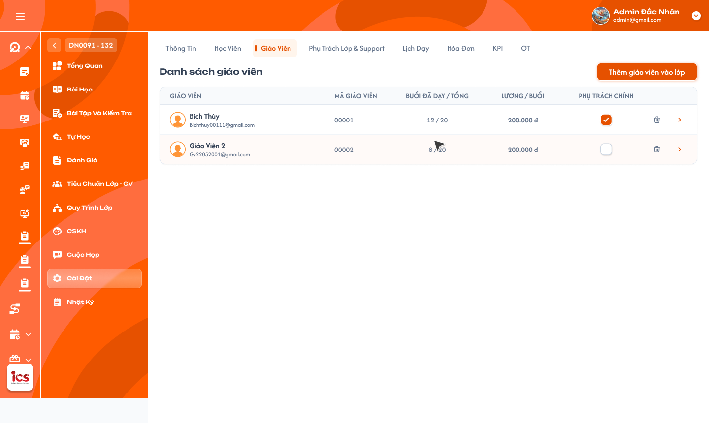

# Chi tiết lớp học — Tab Giáo viên

Requirement này đặc tả màn **Chi tiết lớp học → Tab Giáo viên**. Hồ sơ, popup tạo mới và các tab Chi tiết giáo viên dùng lại nghiệp vụ tại [Quản lý danh sách giáo viên](../teacher_management/teacher_management_requirements.md) và [Chi tiết giáo viên](../teacher_management/teacher_detail_requirements.md). Trợ giảng / Phụ trách lớp được đặc tả tại [Tab Trợ giảng & Phụ trách lớp](./class_detail_support_handlers_requirements.md); lịch và thời điểm phát sinh lương được đặc tả tại [Tab Lịch dạy](./class_detail_schedule_requirements.md). `Giáo viên phụ trách chính` trong tài liệu này là giáo viên được quyền chấm điểm BTVN và bài kiểm tra, khác với `Phụ trách chính` có role `Class Handler` của lớp.

## 1. UI

### Trang 1: ADM-LOP-040300 — Lớp học / Cài đặt / Giáo viên



**Mô tả:**
- Hiển thị danh sách giáo viên đang gắn với lớp hiện tại. `Admin`, `Class Handler` và `Support` được xem, thêm giáo viên có sẵn, tạo giáo viên mới, đổi Giáo viên phụ trách chính và xoá giáo viên khỏi lớp trong phạm vi được phân quyền.
- Mỗi lớp có nhiều giáo viên nhưng tại một thời điểm chỉ có tối đa một `Giáo viên phụ trách chính`; chỉ giáo viên này được nhập / cập nhật điểm BTVN và bài kiểm tra của lớp.
- Các popup của tab (chọn cách thêm, chọn giáo viên hiện có, tạo giáo viên mới, xác nhận xoá) mở từ màn này và mô tả ngay bên dưới.

**Điểm cần lưu ý:**
- `A01.01` Tên: hiển thị avatar, họ tên và mã giáo viên; bấm vào mở đúng Chi tiết giáo viên theo `teacher_id` và quyền người dùng (không dùng tên / email / code làm định danh điều hướng; bấm checkbox hoặc thùng rác không được điều hướng ngoài ý muốn; giáo viên không còn tồn tại / ngoài phạm vi thì không mở hồ sơ khác thay thế). Danh sách có 0, 1 hoặc nhiều giáo viên, không nhân đôi cùng một giáo viên trong lớp; quan hệ giáo viên–lớp là nguồn chung cho `Số lớp`, `Đang dạy`, `Lịch dạy` ở module Giáo viên.
- `A01.02` Email: hiển thị email hiện tại của giáo viên, không dùng email làm khoá quan hệ giáo viên–lớp.
- `A01.03` Phụ trách chính: checkbox thể hiện giáo viên có quyền chấm điểm BTVN và bài kiểm tra của lớp, mỗi lớp tối đa một checkbox được chọn. Khác với `Phụ trách chính` role `Class Handler` của lớp.
- `A01.04` Xoá: icon thùng rác mở popup xác nhận xoá giáo viên khỏi lớp (xem nhóm `A06`); không xoá tài khoản giáo viên.
- `A01.05` Thêm giáo viên vào lớp: mở popup lựa chọn giữa `Chọn giáo viên` hiện có và `Tạo giáo viên mới`. Thao tác thêm / xoá / đổi phụ trách chỉ cập nhật danh sách sau khi backend xác nhận, không cập nhật thành công giả ở client. Giáo viên thường và Giáo viên phụ trách chính đều không được xem tab quản lý này, quyền chấm điểm thực hiện tại màn BTVN / Bài kiểm tra.
- `A02.01` Chọn giáo viên: mở popup tìm và chọn một hoặc nhiều giáo viên hiện có. Chỉ `Admin`, `Class Handler`, `Support` được mở và thực hiện hai flow; mở popup không tự chọn hay tự thêm giáo viên; ID lớp được giữ xuyên suốt hai flow.
- `A02.02` Tạo giáo viên mới: mở popup tạo giáo viên dùng chung của module Giáo viên.
- `A02.03` Đóng popup: đóng mà không tạo hoặc thêm quan hệ giáo viên–lớp; không mở hai popup đồng thời.
- `A03.01` Tìm kiếm: tìm theo tên hoặc mã giáo viên, trong phạm vi dữ liệu người dùng.
- `A03.02` Danh sách: mỗi dòng tối thiểu tên, mã, email, checkbox multi-select. Chỉ hiển thị giáo viên có hồ sơ / tài khoản còn hiệu lực thuộc `Training`, `Chính thức`, `Thử việc` (hệ thống có bốn trạng thái `Training`, `Chính thức`, `Thử việc`, `Nghỉ việc`, không có `Testing`). Giáo viên `Nghỉ việc` không hiển thị kể cả khi tìm đúng tên / mã; backend vẫn từ chối nếu client gửi trực tiếp ID giáo viên đã nghỉ việc. Giáo viên đã thuộc lớp không được chọn (nếu vẫn hiển thị thì disabled, nêu rõ `Đã thuộc lớp`).
- `A03.03` Hủy: đóng popup và bỏ các lựa chọn chưa xác nhận; mở lại không giữ lựa chọn cũ.
- `A03.04` Thêm mới: thêm toàn bộ giáo viên đang chọn vào lớp (không có nghĩa tạo tài khoản mới); thêm nhiều giáo viên phải nguyên tử, nếu có phần tử không còn hợp lệ lúc xác nhận thì không thêm một phần và trả rõ phần tử cần chọn lại. Thêm giáo viên, kể cả người đầu tiên, không tự đánh dấu Phụ trách chính.
- `A04.01` Họ và tên: validation theo requirement Quản lý giáo viên.
- `A04.02` Mã giáo viên / Code: backend tự sinh duy nhất theo quy tắc module Giáo viên; người dùng không nhập / ghi đè.
- `A04.03` Email, Số điện thoại: dùng validation và kiểm tra trùng của module Giáo viên.
- `A04.04` Trạng thái: trong flow tạo từ lớp chỉ cho chọn `Training`, `Chính thức`, `Thử việc`; không cho chọn `Nghỉ việc`, không có `Testing`.
- `A04.05` Ghi chú: cho nhập ghi chú ban đầu, lưu an toàn và dùng chung với hồ sơ giáo viên.
- `A04.06` Các field khác: Giới tính, Ngày sinh, Vai trò `Teacher`, Mật khẩu và các field hiện có tiếp tục theo popup tạo giáo viên dùng chung; không lưu hay hiển thị mật khẩu trong Toast, log, lịch sử hay response sau tạo. Quyền tạo từ màn Danh sách giáo viên độc lập vẫn theo requirement module Giáo viên.
- `A04.07` Xác Nhận: tạo giáo viên và thêm vào lớp trong một flow nhất quán; không tự đánh dấu Phụ trách chính. Tạo tài khoản thành công nhưng thêm vào lớp thất bại thì trả kết quả rõ ràng và không hiển thị quan hệ chưa tạo; cách rollback tài khoản theo quy tắc chung module Giáo viên.
- `A05.01` Checkbox chưa chọn: bấm để gán giáo viên của dòng thành Phụ trách chính. Ràng buộc duy nhất nằm ở backend / database, không chỉ ở checkbox UI.
- `A05.02` Checkbox đã chọn: thể hiện giáo viên hiện tại có quyền chấm BTVN và bài kiểm tra; cho bỏ chọn để lớp tạm thời không có Phụ trách chính (khi đó không giáo viên nào nhập / cập nhật điểm). Quyền áp dụng cả lớp chính thức và không chính thức.
- `A05.03` Chuyển từ A sang B: tick B đồng thời bỏ tick A trong cùng giao dịch, không tồn tại trạng thái hai giáo viên chính; hai request đồng thời chọn hai giáo viên khác nhau phải kết thúc với đúng một người chính, request còn lại nhận dữ liệu mới nhất / cảnh báo xung đột. A mất quyền nhập / cập nhật điểm ngay sau khi giao dịch thành công; điểm đã chấm vẫn giữ người chấm và lịch sử cũ.
- `A05.04` Kiểm tra quyền chấm điểm: mọi API nhập / cập nhật điểm BTVN và bài kiểm tra kiểm tra giáo viên đăng nhập là Phụ trách chính hiện tại của đúng lớp. `Admin`, `Class Handler`, `Support` quản lý checkbox nhưng không được chấm thay; chỉ tài khoản Teacher đang là Phụ trách chính có quyền.
- `A06.01` Tiêu đề: `Xóa giáo viên khỏi lớp?`
- `A06.02` Nội dung thường: `Bạn có chắc chắn muốn xóa giáo viên {Tên giáo viên} khỏi lớp {Mã lớp}?`
- `A06.03` Cảnh báo giáo viên chính: nếu đang là Phụ trách chính, bổ sung `Sau khi xóa, lớp sẽ không có giáo viên được quyền chấm điểm BTVN và bài kiểm tra cho đến khi gán phụ trách chính mới.` Cho phép xoá giáo viên chính mà không cần chọn người thay thế.
- `A06.04` Hủy: đóng popup, không đổi quan hệ.
- `A06.05` Xóa: xoá mềm quan hệ giáo viên–lớp sau khi backend kiểm tra lại quyền và trạng thái hiện tại; không xoá tài khoản giáo viên, điểm đã chấm, lương đã phát sinh, lịch sử hoặc dữ liệu buổi đã hoàn thành. Sau khi xoá, giáo viên không còn được phân vào lịch / buổi mới của lớp, dữ liệu lịch sử vẫn giữ định danh giáo viên. Request xoá lặp chỉ tạo một kết quả, không lỗi vì quan hệ đã xoá.
- `A07.01` Vùng bấm: tên / avatar / mã giáo viên, không gồm checkbox Phụ trách chính hoặc icon Xóa.
- `A07.02` Đích đến: màn Chi tiết giáo viên của đúng `teacher_id`; tab được xem / chỉnh theo quyền tại requirement Chi tiết giáo viên.
- `A08.01` Toast `Thành Công`: ví dụ `Đã thêm giáo viên vào lớp.`, `Đã cập nhật giáo viên phụ trách chính.`, `Đã xóa giáo viên khỏi lớp.`
- `A08.02` Toast `Thông Báo`: dữ liệu quan hệ / lịch cần thời gian đồng bộ.
- `A08.03` Toast `Cảnh Báo`: giáo viên đã thuộc lớp, không còn hợp lệ hoặc có xung đột.
- `A08.04` Toast `Có Lỗi Xảy Ra`: backend / network không hoàn tất thao tác. Toast chỉ hiển thị sau khi backend xác nhận, mỗi thao tác logic tối đa một Toast; `Hủy`, xem danh sách, điều hướng Chi tiết không có Toast CRUD; không hiển thị mật khẩu, token, stack trace.

---

## 2. Yêu cầu

### 2.1. Flow chính

**Flow 1: Xem danh sách và mở Chi tiết**

```
Admin / Class Handler / Support mở Chi tiết lớp → tab Giáo viên (Trang 1)
  → BE kiểm tra quyền / phạm vi, tải quan hệ giáo viên–lớp
  → hiển thị Tên, Mã, Email, Phụ trách chính, Xóa
  → bấm giáo viên: mở đúng Chi tiết giáo viên theo teacher_id
```

**Flow 2: Thêm giáo viên hiện có**

```
Thêm giáo viên vào lớp → Chọn giáo viên → tìm theo tên / mã → chọn một / nhiều giáo viên hợp lệ → Thêm mới
  → BE kiểm tra quyền, trạng thái, phạm vi, quan hệ trùng
  → Hợp lệ: thêm nguyên tử, cập nhật danh sách, Toast
  → Không hợp lệ: không thêm một phần, trả phần tử cần chọn lại
```

**Flow 3: Tạo giáo viên mới và thêm vào lớp**

```
Thêm giáo viên vào lớp → Tạo giáo viên mới → popup dùng chung module Giáo viên
  → nhập thông tin, chọn Training / Chính thức / Thử việc, nhập Ghi chú → Xác Nhận
  → BE sinh Code, tạo role Teacher và audit → gắn teacher_id mới vào lớp
  → chỉ khi quan hệ lớp thành công mới hiển thị dòng trong tab
```

**Flow 4: Đổi Giáo viên phụ trách chính**

```
Role CRUD tick giáo viên B → BE kiểm tra B thuộc lớp và còn hiệu lực
  → một giao dịch: bỏ cờ chính ở A (nếu có) và gán B
  → sau commit: chỉ B được chấm BTVN / bài kiểm tra, A mất quyền
  → điểm / lịch sử cũ giữ nguyên người chấm
```

**Flow 5: Xoá giáo viên khỏi lớp**

```
Bấm icon Xóa → popup đúng giáo viên / lớp
  → nếu là người chính: cảnh báo mất quyền chấm điểm, không bắt chọn người thay thế
  → Hủy: không thay đổi
  → Xóa: BE xoá mềm quan hệ, giữ tài khoản và lịch sử
  → xoá người chính: lớp không có quyền chấm cho đến khi gán người mới
```

### 2.2. Ngoại lệ

- **EX01:** Role ngoài `Admin`, `Class Handler`, `Support` hoặc người dùng ngoài phạm vi gửi request CRUD → backend từ chối, không đổi dữ liệu.
- **EX02:** Cùng giáo viên được thêm lặp / đồng thời → chỉ tồn tại một quan hệ hoạt động trong lớp.
- **EX03:** Giáo viên đã thuộc lớp, `Nghỉ việc`, tài khoản / hồ sơ không còn hiệu lực hoặc ngoài phạm vi → không hiển thị như lựa chọn hợp lệ và không được thêm. Nếu trạng thái đổi sau khi popup tải, backend từ chối toàn bộ multi-select để không tạo dữ liệu một phần.
- **EX04:** Dữ liệu tạo giáo viên sai / trùng, trạng thái không thuộc `Training` / `Chính thức` / `Thử việc` hoặc client gửi `Nghỉ việc` / `Testing` → từ chối tạo.
- **EX05:** Tạo hồ sơ thành công nhưng liên kết lớp thất bại → không hiển thị quan hệ giả, không tạo lại tài khoản trùng, trả hướng xử lý rõ ràng.
- **EX06:** Hai request cùng gán Phụ trách chính → backend / database bảo đảm tối đa một người chính và trả dữ liệu mới nhất cho request xung đột.
- **EX07:** Giáo viên bị xoá / chuyển quan hệ trong lúc popup đang mở → không xoá nhầm tài khoản / giáo viên khác hoặc làm mất người chính mới.
- **EX08:** Giáo viên không phải Phụ trách chính hoặc role quản lý gửi request nhập / cập nhật điểm BTVN hay bài kiểm tra → backend từ chối, không ghi điểm.

### 2.3. Yêu cầu khác

| Mã | Tên yêu cầu | Mô tả |
|---|---|---|
| REQ01 | Danh sách giáo viên lớp | Hiển thị Tên, Mã, Email, Phụ trách chính và Xóa từ quan hệ giáo viên–lớp; cho phép 0, 1 hoặc nhiều giáo viên nhưng không trùng. |
| REQ02 | Điểm vào thêm | `Thêm giáo viên vào lớp` mở đúng hai flow `Chọn giáo viên` và `Tạo giáo viên mới`; chỉ Admin / Class Handler / Support được thao tác. |
| REQ03 | Chọn giáo viên hiện có | Tìm theo tên / mã, multi-select. Chỉ trả giáo viên `Training`, `Chính thức`, `Thử việc` còn hiệu lực và chưa thuộc lớp. Không có `Testing`. `Nghỉ việc` không xuất hiện ngay cả khi tìm đúng tên / mã; backend từ chối teacher_id `Nghỉ việc` gửi trực tiếp. |
| REQ04 | Tạo giáo viên | Dùng chung popup / rule module Giáo viên, bổ sung Trạng thái và Ghi chú; Code do backend sinh; role cố định Teacher; tạo xong tự gắn lớp, không tự làm Phụ trách chính. |
| REQ05 | Duy nhất Phụ trách chính | Mỗi lớp tối đa một Giáo viên phụ trách chính. Giáo viên đầu tiên không tự thành người chính, phải tick thủ công. Chuyển người chính bỏ người cũ và gán người mới trong một giao dịch. Cho phép lớp tạm thời không có người chính. |
| REQ06 | Quyền chấm điểm | Chỉ tài khoản Teacher đang là Phụ trách chính hiện tại của lớp được nhập / cập nhật điểm BTVN và bài kiểm tra. Role quản lý không chấm thay. Giáo viên không xem tab quản lý này. Điểm và audit cũ không đổi khi chuyển người chính. |
| REQ07 | Xoá khỏi lớp | Xoá mềm quan hệ, không xoá tài khoản, điểm, lương, lịch sử hoặc dữ liệu buổi đã hoàn thành. Cho phép xoá người chính không cần người thay thế; lớp không có quyền chấm BTVN / bài kiểm tra cho đến khi gán mới. |
| REQ08 | Điều hướng | Bấm giáo viên mở đúng Chi tiết theo teacher_id và quyền module Giáo viên; checkbox / Xóa không kích hoạt điều hướng. |
| REQ09 | Audit và an toàn | Lưu người / thời điểm cho thêm, tạo, đổi phụ trách, xoá; không tin role / trạng thái / ID do client tự khai; không lộ mật khẩu hoặc lỗi kỹ thuật. |

### 2.4. Ràng buộc

#### Quyền

| Role | Xem tab | Chọn / thêm giáo viên | Tạo giáo viên từ lớp | Đổi Phụ trách chính | Xóa khỏi lớp | Chấm điểm BTVN / kiểm tra |
|---|:---:|:---:|:---:|:---:|:---:|:---:|
| Admin | ✅ | ✅ | ✅ | ✅ | ✅ | ❌ |
| Class Handler | ✅ | ✅ | ✅ | ✅ | ✅ | ❌ |
| Support | ✅ | ✅ | ✅ | ✅ | ✅ | ❌ |
| Teacher đang là Phụ trách chính | ❌ | ❌ | ❌ | ❌ | ❌ | ✅ (chỉ BTVN / kiểm tra) |
| Teacher khác / role khác | ❌ | ❌ | ❌ | ❌ | ❌ | ❌ |

#### Ràng buộc khác

- Dùng `class_id`, `teacher_id` và ID quan hệ bất biến; không dùng tên / email / code làm khoá cập nhật.
- Unique constraint cho một quan hệ giáo viên–lớp hoạt động và ràng buộc tối đa một giáo viên chính trên mỗi lớp.
- Thêm nhiều giáo viên và chuyển người chính phải nguyên tử; thao tác gửi lặp phải idempotent.
- Xoá quan hệ không cascade xoá tài khoản, điểm, lịch sử, lương hoặc lịch dạy đã hoàn thành.
- Mọi endpoint nhập / cập nhật điểm BTVN và bài kiểm tra kiểm tra quyền từ dữ liệu quan hệ mới nhất tại backend, không tin cờ `is_primary` do client gửi.


---

## 3. Testcase

### Feature: Chi tiết lớp học — Tab Giáo viên

| Tên testcase | Priority | Scenario | Role | Pre-condition | Given/When/Then | Expected Result |
|---|---|---|---|---|---|---|
| Case 1: Mở tab, danh sách rỗng, không trùng | High | Flow 1 / REQ01 / EX02 | `Admin`, `Class Handler` hoặc `Support` | Lớp có giáo viên; lớp khác chưa có giáo viên; cùng giáo viên bị gửi thêm lặp | **Given:** người dùng được xem lớp<br>**When:** mở tab `Giáo viên`; tải lại sau khi thêm lặp<br>**Then:** hệ thống tải quan hệ giáo viên–lớp mới nhất | - Đúng Tên, Mã, Email, checkbox Phụ trách chính, icon Xóa, không trộn giáo viên lớp khác<br>- Danh sách rỗng: empty state và nút thêm, không dòng giả, không tự gán giáo viên chính<br>- Mỗi giáo viên chỉ một dòng, không làm sai số lớp |
| Case 2: Chỉ ba role quản lý được CRUD | High | Ràng buộc quyền / EX01 | Role khác ba role trên | Có ID lớp hợp lệ | **Given:** role không phải Admin / Class Handler / Support<br>**When:** xem control hoặc gửi request CRUD trực tiếp<br>**Then:** hệ thống từ chối | - Không hiển thị / disable control thay đổi<br>- Backend không thêm, đổi phụ trách hoặc xoá<br>- Không lộ dữ liệu ngoài phạm vi |
| Case 3: Popup chọn cách thêm | Medium | Flow 2 / REQ02 | Role có quyền CRUD | Tab Giáo viên đang mở | **Given:** bấm `Thêm giáo viên vào lớp`<br>**When:** đóng popup; mở lại và chọn từng phương án<br>**Then:** mở đúng popup Chọn giáo viên hoặc Tạo giáo viên mới | - Đúng hai lựa chọn, không mở hai popup đồng thời<br>- Đóng thì không tạo giáo viên / quan hệ, danh sách giữ nguyên<br>- Giữ đúng ID lớp |
| Case 4: Tìm, chọn nhiều, thêm và huỷ | High | Flow 2 / REQ03 | Role có quyền CRUD | Nhiều giáo viên hợp lệ chưa thuộc lớp | **Given:** popup Chọn giáo viên đang mở<br>**When:** nhập tên hoặc mã; tick từ hai giáo viên trở lên rồi `Thêm mới`; lần khác tick rồi `Hủy`<br>**Then:** backend tạo quan hệ hoặc đóng popup | - Tên / mã khớp hiển thị, không tự thêm khi tìm, không lộ ngoài phạm vi<br>- Mỗi giáo viên xuất hiện một lần, chưa ai tự thành Phụ trách chính, cập nhật số lớp / lịch, Toast thành công<br>- `Hủy` không tạo quan hệ, không Toast, mở lại không giữ lựa chọn cũ |
| Case 5: Chặn giáo viên Nghỉ việc và trạng thái không hợp lệ | High | EX03 / REQ03 | Role có quyền CRUD | Giáo viên đủ các trạng thái; một giáo viên đang được tick thì bị chuyển `Nghỉ việc` bởi thao tác khác; giáo viên đã thuộc lớp | **Given:** popup Chọn giáo viên đang mở<br>**When:** xem / tìm chính xác theo tên hoặc mã giáo viên `Nghỉ việc`; gửi trực tiếp teacher_id `Nghỉ việc`; xác nhận khi dữ liệu popup đã cũ<br>**Then:** hệ thống từ chối | - Chỉ `Training`, `Chính thức`, `Thử việc` còn hiệu lực và chưa thuộc lớp; không có `Testing`, `Nghỉ việc`<br>- Backend từ chối teacher_id `Nghỉ việc`, không thêm một phần danh sách multi-select, yêu cầu tải lại / chọn lại<br>- Không tạo quan hệ, không lộ dữ liệu ngoài phạm vi |
| Case 6: Tạo giáo viên mới và tự thêm vào lớp | High | Flow 3 / REQ04 | Role có quyền CRUD | Popup lựa chọn đang mở, dữ liệu hợp lệ | **Given:** chọn `Tạo giáo viên mới`<br>**When:** nhập hợp lệ, lần lượt chọn `Training`, `Chính thức`, `Thử việc`, `Xác Nhận` (bấm lặp)<br>**Then:** tạo giáo viên rồi gắn vào lớp | - Popup dùng đúng component / rule module Giáo viên, có Trạng thái, Ghi chú; Code chỉ đọc / tự sinh; Vai trò cố định Teacher<br>- Giáo viên xuất hiện trong danh sách, không tự tick Phụ trách chính, không tạo trùng khi bấm lặp<br>- Toast thành công; không bỏ qua validation email / quyền / audit |
| Case 7: Tạo giáo viên sai dữ liệu hoặc lỗi bước liên kết lớp | High | EX04 / EX05 / REQ04 | Role có quyền CRUD | Form chứa dữ liệu sai / trùng hoặc trạng thái `Nghỉ việc`; trường hợp tạo tài khoản thành công nhưng gắn lớp lỗi | **Given:** gửi dữ liệu không hợp lệ; hoặc bước liên kết lớp thất bại<br>**When:** xác nhận<br>**Then:** backend từ chối hoặc trả trạng thái rõ | - Không tạo giáo viên / quan hệ lớp, báo đúng field, không lộ mật khẩu / thông tin kỹ thuật<br>- Lỗi liên kết: không có dòng giả trong lớp, không tạo trùng tài khoản khi gửi lại, xử lý lại được theo ID giáo viên đã tạo nếu module giữ tài khoản |
| Case 8: Giáo viên đầu tiên và chuyển Phụ trách chính A → B | High | Flow 4 / REQ05 | Role có quyền CRUD | Lớp chưa có giáo viên; sau đó A đang chính, B thuộc lớp | **Given:** thêm giáo viên đầu tiên; sau đó A được tick<br>**When:** tick B<br>**Then:** backend đổi nguyên tử A → B | - Giáo viên đầu tiên chưa được tick, lớp tạm thời không có người chính, chưa chấm điểm được<br>- A tự bỏ tick, B được tick, không có thời điểm hai người chính, quyền chấm chuyển sang B<br>- Bỏ tick người chính cho phép lớp không có người chính |
| Case 9: Request đồng thời gán Phụ trách chính | High | EX06 / REQ05 | Hai role có quyền CRUD | A và B cùng thuộc lớp | **Given:** hai request gán A / B đồng thời<br>**When:** backend commit<br>**Then:** chỉ một quan hệ được đánh dấu chính | - Tối đa một giáo viên chính<br>- UI tải lại người thắng cuối cùng theo cơ chế version<br>- Không cấp quyền chấm cho cả hai |
| Case 10: Chỉ Phụ trách chính được chấm điểm, điểm cũ giữ nguyên | High | Flow 4 / REQ06 / EX08 | Teacher chính, Teacher thường, role quản lý | Lớp có một giáo viên chính; A đã chấm BTVN / bài kiểm tra rồi đổi chính sang B | **Given:** các tài khoản lần lượt gửi yêu cầu nhập / cập nhật điểm BTVN và bài kiểm tra<br>**When:** backend kiểm tra quan hệ hiện tại; chuyển người chính sang B<br>**Then:** chỉ Teacher chính được phép | - Teacher thường bị từ chối; Admin / Class Handler / Support không chấm thay; không ghi điểm trái quyền<br>- A không nhập / cập nhật điểm mới sau khi mất quyền, B chấm được<br>- Điểm và audit cũ giữ nguyên người chấm |
| Case 11: Xoá giáo viên thường khỏi lớp (kể cả huỷ) | High | Flow 5 / REQ07 | Role có quyền CRUD | Giáo viên thuộc lớp và không phải chính | **Given:** bấm Xóa, popup hiển thị đúng giáo viên / lớp<br>**When:** bấm `Hủy`; rồi mở lại và xác nhận `Xóa`<br>**Then:** gỡ quan hệ khỏi lớp | - `Hủy`: không xoá, giữ nguyên, không Toast<br>- Xoá: dòng biến mất, tài khoản và lịch sử còn, không ảnh hưởng giáo viên chính, Toast thành công |
| Case 12: Xoá giáo viên chính và quan hệ đã đổi | High | Flow 5 / REQ07 / EX07 | Role có quyền CRUD | Giáo viên đang là chính; một giáo viên khác đã bị xoá / chuyển bởi thao tác khác trong lúc popup mở | **Given:** popup hiển thị cảnh báo mất quyền chấm điểm; một popup khác giữ dữ liệu cũ<br>**When:** xác nhận xoá không chọn người thay thế; xác nhận popup dữ liệu cũ<br>**Then:** backend xử lý | - Gỡ quan hệ và quyền chính, lớp không giáo viên nào chấm BTVN / bài kiểm tra được, điểm / lịch sử cũ không bị xoá<br>- Popup dữ liệu cũ: xử lý idempotent hoặc yêu cầu tải lại, không xoá nhầm giáo viên / tài khoản khác, không làm mất người chính mới |
| Case 13: Điều hướng đến Chi tiết giáo viên | High | Flow 1 / REQ08 | Role có quyền xem | Danh sách có nhiều giáo viên | **Given:** bấm giáo viên A; bấm checkbox hoặc thùng rác của một dòng<br>**When:** control nhận sự kiện<br>**Then:** mở Chi tiết của A hoặc chỉ mở flow tương ứng | - Dùng teacher_id của A, không mở B, tab / quyền theo requirement Chi tiết giáo viên<br>- Checkbox / thùng rác không mở Chi tiết và không thực hiện hai hành động đồng thời |
| Case 14: Toast phản hồi | Medium | REQ09 / Ràng buộc Toast CRUD | Role có quyền CRUD | Thao tác hợp lệ; trường hợp giáo viên trùng / xung đột; backend / network lỗi; đang đồng bộ | **Given:** người dùng xác nhận thay đổi<br>**When:** backend thành công, từ chối hoặc lỗi; callback lặp; bấm `×`<br>**Then:** hiển thị Toast tương ứng | - `Thành Công` đúng nội dung sau khi lưu; `Cảnh Báo` nêu nguyên nhân, không hiện thành công; `Có Lỗi Xảy Ra` không cập nhật một phần, cho thử lại, không lộ lỗi kỹ thuật<br>- Tối đa một Toast `Thông Báo` khi đang đồng bộ, không nhân đôi, đóng không hoàn tác dữ liệu |
