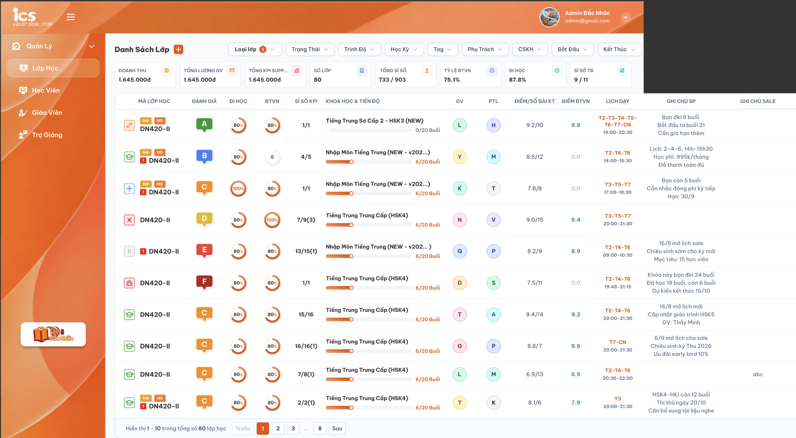
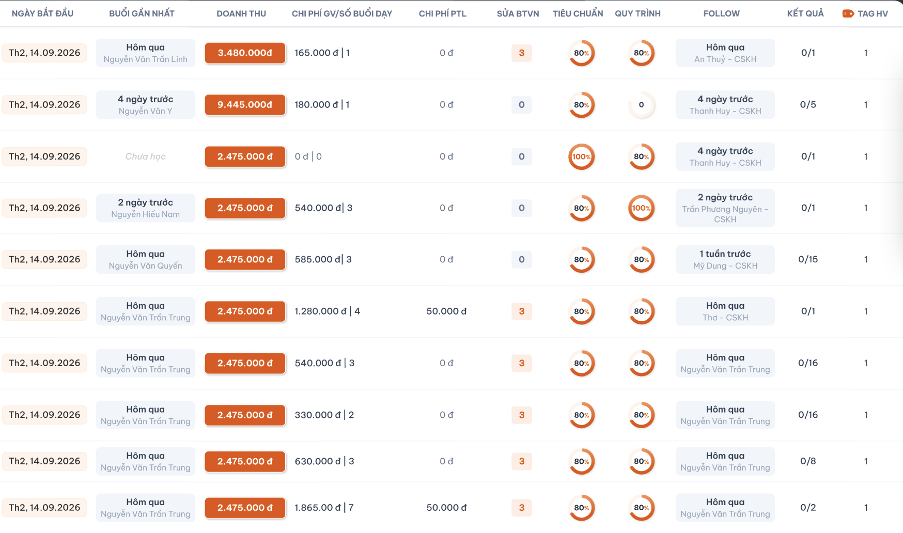
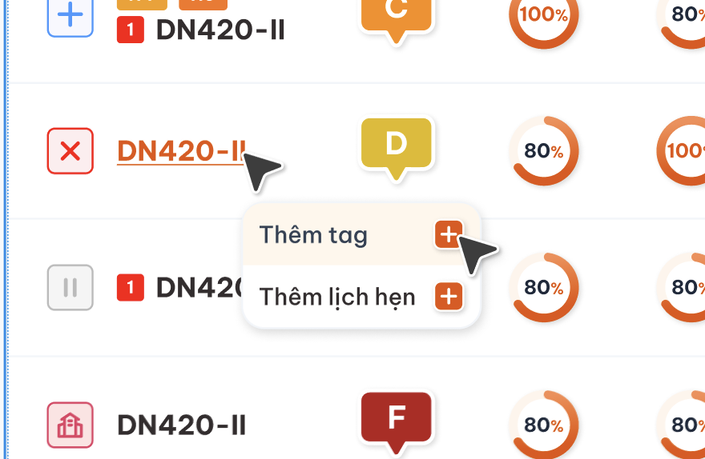
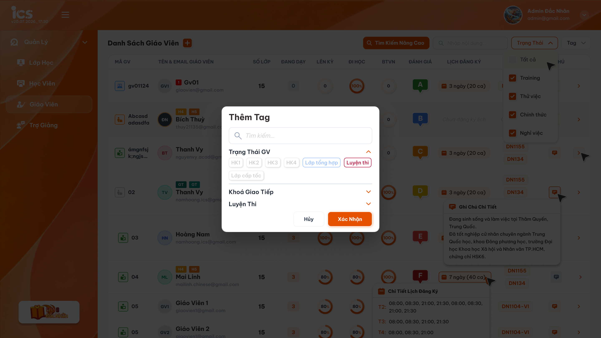
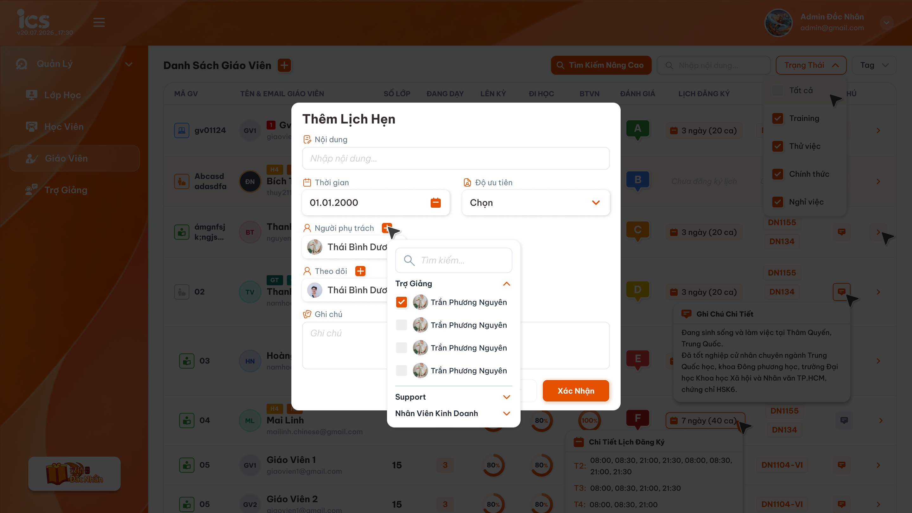

# Quản lý danh sách lớp học

Requirement này chỉ đặc tả màn danh sách. Các chức năng liên quan được tách riêng tại [Tạo lớp học](./class_creation_requirements.md), [Chi tiết lớp học — Menu Tổng quan](./class_detail_overview_requirements.md), [Tab Thông tin](./class_detail_information_requirements.md), [Tab Học viên](./class_detail_students_requirements.md), [Tab Giáo viên](./class_detail_teachers_requirements.md), [Tab Trợ giảng & Phụ trách lớp](./class_detail_support_handlers_requirements.md), [Tab Lịch dạy](./class_detail_schedule_requirements.md), [Tab Hóa đơn](./class_detail_invoices_requirements.md), [Tab KPI của Phụ trách lớp](./class_detail_kpi_requirements.md) và [Tab OT](./class_detail_ot_requirements.md).

## 1. UI

### Trang 1: Màn hình Danh sách lớp


*Danh sách lớp và nhóm cột bên trái — nhấn để xem ảnh gốc*



*Các cột tiếp theo của cùng bảng khi cuộn ngang — nhấn để xem ảnh gốc*

**Mô tả:**

- `Admin`, `Class Handler`, `Support`, `Sale` được xem màn hình Danh sách lớp, sử dụng bộ lọc, cuộn ngang và phân trang.
- Màn hình tổng hợp dữ liệu vận hành, học tập, tài chính, nhân sự phụ trách, lịch học, ghi chú và hoạt động chăm sóc của từng lớp.
- Bảng có nhiều cột nên sử dụng cuộn ngang. Hai ảnh trên là hai vùng cột của cùng một bảng, không phải hai bảng hoặc hai màn hình khác nhau.
- Nút dấu `+` cạnh tiêu đề mở chức năng tạo lớp. Nội dung, quyền và quy tắc nghiệp vụ được đặc tả riêng tại [Tạo lớp học](./class_creation_requirements.md), không thuộc requirement Danh sách lớp.

**Giải thích field/thành phần:**

- Khu vực đầu trang gồm tiêu đề, nút tạo lớp và tám thẻ thống kê tổng quan.
- Khu vực điều kiện gồm các bộ lọc lớp, thời gian, người phụ trách, trạng thái và Tag học viên.
- Bảng hiển thị dữ liệu từng lớp trên một hàng, hỗ trợ cuộn ngang; cuối danh sách có phân trang tối đa 50 lớp mỗi trang.

**Điểm cần lưu ý:**

- Khi cuộn ngang, mỗi hàng vẫn phải giữ đúng dữ liệu của cùng một lớp; không lệch hàng, nhân đôi hàng hoặc tải lại danh sách chỉ vì thay đổi vị trí cuộn.
- Header cột và nội dung phải thẳng hàng trong mọi vị trí cuộn.
- Chỉ `Mã lớp` là vùng tương tác mở menu `Thêm tag` và `Thêm lịch hẹn`. Click các ô còn lại, gồm Doanh thu, trạng thái, đánh giá, tỷ lệ, avatar, lịch và ghi chú, không mở menu này hoặc điều hướng ngoài ý muốn.
- Mặc định danh sách sắp xếp theo lớp mới tạo trước, tương ứng `created_at` giảm dần.
- Mỗi trang hiển thị tối đa 50 lớp.
- Danh sách có bộ lọc `Trung tâm` nằm cùng hàng với các bộ lọc khác, cho chọn một hoặc nhiều trung tâm; khi chọn thì danh sách, tổng số và phân trang chỉ tính dữ liệu của các trung tâm đã chọn, kết hợp `AND` với các bộ lọc khác. Không chọn thì hiển thị dữ liệu của mọi trung tâm. Role Admin không dùng ô chọn trung tâm trên header.

### Trang 2: Thẻ thống kê tổng quan
**Mô tả:**

- Tám thẻ tổng quan phản ánh toàn bộ tập lớp thuộc phạm vi người dùng và đang thỏa các bộ lọc hiện tại.

**Giải thích field/thành phần:**

- `A02.01` **Doanh thu**: Nội dung hiển thị: Tổng học phí học viên đã đóng trong từng lớp, sau đó cộng toàn bộ các lớp đang thỏa bộ lọc. Không tính học phí chưa thu.
- `A02.02` **Tổng lương GV**: Nội dung hiển thị: Tổng lương giáo viên phát sinh từ các bài học/buổi học đã hoàn thành theo lịch dạy của từng lớp, sau đó cộng toàn bộ các lớp đang thỏa bộ lọc.
- `A02.03` **Tổng chi PTL**: Nội dung hiển thị: Tổng tiền thực tế của các khoản KPI Handler trạng thái `Đã xác nhận`, cộng toàn bộ các lớp đang thỏa bộ lọc. Khoản Mới/Đã hủy/Đã xóa không tính.
- `A02.04` **Số lớp**: Nội dung hiển thị: Tổng số lớp thỏa toàn bộ điều kiện hiện tại, không chỉ số lớp ở trang đang xem.
- `A02.05` **Tổng sĩ số**: Nội dung hiển thị: Hiển thị dạng `Tổng số thứ nhất / Tổng số thứ hai`. Cách xác định hai số của một lớp được mô tả tại bảng trạng thái học viên bên dưới. Khi tổng hợp nhiều lớp, cộng riêng số thứ nhất và số thứ hai.
- `A02.06` **Tỷ lệ BTVN**: Nội dung hiển thị: Với từng lớp, lấy trung bình tỷ lệ làm BTVN của các học viên có dữ liệu trong lớp. Lớp không có học viên hoặc không có dữ liệu BTVN thì để trống. Thẻ tổng quan là trung bình cộng của các lớp có giá trị.
- `A02.07` **Đi học**: Nội dung hiển thị: Với từng lớp, lấy trung bình tỷ lệ đi học của các học viên có dữ liệu trong lớp. Lớp không có học viên hoặc không có dữ liệu đi học thì để trống. Thẻ tổng quan là trung bình cộng của các lớp có giá trị.
- `A02.08` **Sĩ số TB**: Nội dung hiển thị: Hiển thị dạng `Trung bình số thứ nhất / Trung bình số thứ hai`. Lấy Tổng sĩ số chia riêng từng số cho Số lớp. Dấu `/` chỉ dùng để ngăn cách hai giá trị hiển thị, không phải phép chia hai giá trị cho nhau.

**Điểm cần lưu ý:**

- Thẻ thống kê được tính lại trên toàn bộ tập kết quả sau khi áp dụng các bộ lọc, kể cả khi kết quả có nhiều trang.
- Thẻ không được chỉ tính từ 50 lớp của trang hiện tại.
- Cách tính từng thẻ:

- `A02.09` **Doanh thu**: Cách tính dễ hiểu: Cộng học phí **đã đóng** của tất cả lớp thỏa bộ lọc.
- `A02.10` **Tổng lương GV**: Cách tính dễ hiểu: Cộng lương giáo viên của các bài học/buổi học **đã hoàn thành** thuộc tất cả lớp thỏa bộ lọc.
- `A02.11` **Tổng chi PTL**: Cách tính dễ hiểu: Cộng Chi phí PTL của tất cả lớp thỏa bộ lọc; mỗi khoản KPI `Đã xác nhận` tính một lần theo tiền thực tế lưu, không theo giá trị gốc mẫu. Không cộng OT ở bất kỳ trạng thái nào.
- `A02.12` **Số lớp**: Cách tính dễ hiểu: Đếm tất cả lớp thỏa bộ lọc.
- `A02.13` **Tổng sĩ số**: Cách tính dễ hiểu: Tính hai số sĩ số của từng lớp theo bảng trạng thái bên dưới, sau đó cộng riêng từng số. Ví dụ: lớp A là `4/8`, lớp B là `6/10` thì Tổng sĩ số là `10/18`.
- `A02.14` **Tỷ lệ BTVN**: Cách tính dễ hiểu: Bước 1: tính tỷ lệ BTVN trung bình của từng lớp từ các học viên có dữ liệu. Bước 2: cộng tỷ lệ của các lớp có giá trị và chia cho số lớp có giá trị. Mỗi lớp có giá trị được tính với trọng số như nhau.
- `A02.15` **Đi học**: Cách tính dễ hiểu: Bước 1: tính tỷ lệ đi học trung bình của từng lớp từ các học viên có dữ liệu. Bước 2: cộng tỷ lệ của các lớp có giá trị và chia cho số lớp có giá trị. Mỗi lớp có giá trị được tính với trọng số như nhau.
- `A02.16` **Sĩ số TB**: Cách tính dễ hiểu: Lấy từng số của Tổng sĩ số chia cho Số lớp. Ví dụ: Tổng sĩ số `10/18` của 2 lớp thì Sĩ số TB là `5/9`.

- Không gộp toàn bộ học viên của tất cả lớp để tính trực tiếp Tỷ lệ BTVN hoặc Đi học. Phải tính tỷ lệ từng lớp trước, rồi mới lấy trung bình các lớp.
- Nếu lớp không có học viên hoặc không có học viên nào có dữ liệu của chỉ số đang tính, ô BTVN/Đi học của lớp phải để trống; không hiển thị `0`, `0%`, `-` hoặc giá trị thay thế.
- Lớp có ô trống không tham gia tử số và mẫu số khi tính thẻ Tỷ lệ BTVN/Đi học tổng quan.
- Nếu toàn bộ lớp thỏa bộ lọc đều không có giá trị của chỉ số đang tính, thẻ tổng quan tương ứng cũng để trống.
- Toàn bộ tên trạng thái trong tài liệu và UI phải hiển thị bằng tiếng Việt. Trạng thái `Xóa` của học viên trong công thức sĩ số là dữ liệu khác với trạng thái `Xóa` của lớp.
- Khi đổi filter liên tục, thống kê và bảng phải cùng thuộc một tổ hợp điều kiện mới nhất; không hiển thị thống kê của điều kiện cũ cùng danh sách của điều kiện mới.
- Trạng thái loading, rỗng và lỗi của thống kê phải được phân biệt; lỗi không được hiển thị thành số `0` như dữ liệu hợp lệ.

**Cách xác định hai số sĩ số của một lớp:**

- Số thứ nhất: đếm học viên `Đang học` + `Dự thính`.
- Số thứ hai: đếm tất cả học viên thuộc lớp trong đủ 7 trạng thái, bao gồm `Xóa`; không chỉ đếm quan hệ đang hoạt động hoặc thẻ đang hiển thị. Công thức đồng bộ với [Tổng quan lớp](./class_detail_overview_requirements.md).

- `A02.17` **Đang học**: Số thứ nhất: ✅; Số thứ hai: ✅
- `A02.18` **Hoàn thành**: Số thứ nhất: ❌; Số thứ hai: ✅
- `A02.19` **Dự thính**: Số thứ nhất: ✅; Số thứ hai: ✅
- `A02.20` **Rời lớp**: Số thứ nhất: ❌; Số thứ hai: ✅
- `A02.21` **Nghỉ học**: Số thứ nhất: ❌; Số thứ hai: ✅
- `A02.22` **Chỉ xem**: Số thứ nhất: ❌; Số thứ hai: ✅
- `A02.23` **Xóa**: Số thứ nhất: ❌; Số thứ hai: ✅

- Danh sách trên gồm đủ 7 trạng thái chính thức của học viên trong lớp: `Đang học`, `Dự thính`, `Hoàn thành`, `Nghỉ học`, `Rời lớp`, `Chỉ xem`, `Xóa`.
- Không tính hoặc chấp nhận các giá trị cũ `Đặt cọc`, `Chuyển lớp`, `Bảo lưu`, `Học thử` trong enum trạng thái quan hệ học viên–lớp.
- Ví dụ: nếu mỗi trạng thái chính thức có đúng một học viên thì sĩ số lớp là `2/7`. Số thứ nhất gồm `Đang học`, `Dự thính`; số thứ hai gồm đủ 7 trạng thái, kể cả `Chỉ xem` và `Xóa`. Đây là sĩ số thường, không thay công thức `Sĩ số KPI` có điều kiện học phí.

**Dữ liệu mẫu dùng chung cho các testcase tính toán:**

- `A02.24` **Học phí đã đóng**: Lớp A: 10.000.000đ; Lớp B: 15.000.000đ
- `A02.25` **Lương GV của buổi đã hoàn thành**: Lớp A: 300.000đ; Lớp B: 500.000đ
- `A02.26` **KPI Handler Đã xác nhận**: Lớp A: 100.000đ; Lớp B: 200.000đ
- `A02.27` **Sĩ số**: Lớp A: `4/8`; Lớp B: `6/10`
- `A02.28` **Tỷ lệ BTVN của lớp**: Lớp A: 90%; Lớp B: 60%
- `A02.29` **Tỷ lệ đi học của lớp**: Lớp A: 80%; Lớp B: 50%

Trong các testcase bên dưới, bộ lọc trả về đúng 2 lớp A và B, trừ khi testcase nêu thêm lớp khác. Dữ liệu của lớp ngoài bộ lọc và các khoản chưa đủ điều kiện tính phải bị bỏ qua.

### Trang 3: Trạng thái lớp
**Mô tả:**

- Trạng thái lớp cho biết giai đoạn vận hành hiện tại của từng lớp trên danh sách.

**Giải thích field/thành phần:**

- `A03.01` **Đang học**: Icon: ; Hiển thị icon bút màu cam.
- `A03.02` **Hoàn thành**: Icon: ; Hiển thị icon mũ tốt nghiệp màu xanh.
- `A03.03` **Hủy**: Icon: ; Hiển thị icon dấu X đỏ dạng lớn.
- `A03.04` **Khai giảng**: Icon: ; Hiển thị icon tòa nhà màu hồng.
- `A03.05` **Mới tạo**: Icon: ; Hiển thị icon dấu cộng màu xanh.
- `A03.06` **Tạm dừng**: Icon: ; Hiển thị icon tạm dừng màu xám.
- `A03.07` **Xóa**: Icon: ; Hiển thị icon dấu X đỏ dạng nhỏ.
- `A03.08` **Trải nghiệm**: Icon: ; Hiển thị icon người dùng màu xanh.

**Điểm cần lưu ý:**

- Trạng thái phải có nội dung nhận biết được ngoài màu sắc để hỗ trợ tooltip/accessibility.
- `Hủy` và `Xóa` là hai trạng thái khác nhau, không được dùng chung giá trị nghiệp vụ chỉ vì đều có icon dấu X.

### Trang 4: Thông tin hiển thị trên mỗi lớp
**Mô tả:**

- Mỗi hàng tổng hợp thông tin nhận diện, vận hành, kết quả học tập, tài chính, lịch và người phụ trách của đúng một lớp.

**Giải thích field/thành phần:**

- `A04.01` **Mã lớp học**: Hiển thị icon trạng thái, các tag lớp như `H4`, `H5`, badge số lịch hẹn và Mã lớp. Click Mã lớp mở menu thao tác; icon/badge/tag không tự mở menu nếu không click đúng Mã lớp.
- `A04.02` **Đánh giá**: Hiển thị đánh giá hiện hành dạng `A–F`; chưa có công thức nên không tự tính từ các tỷ lệ khác.
- `A04.03` **Đi học**: Trung bình cộng tỷ lệ đi học của các học viên có dữ liệu trong lớp. Không có học viên hoặc không có dữ liệu thì để trống.
- `A04.04` **BTVN**: Trung bình cộng tỷ lệ làm BTVN của các học viên có dữ liệu trong lớp. Không có học viên hoặc không có dữ liệu thì để trống.
- `A04.05` **Sĩ số KPI**: Hiển thị dạng `A/B (C)`: `A` là số học viên trạng thái `Đang học` đã đóng học phí; `B` là tổng học viên đã đóng học phí thuộc `Đang học`, `Dự thính`, `Chỉ xem`; `C` là tổng học viên trạng thái `Dự thính`, không phụ thuộc đã đóng học phí. Ba giá trị được tính độc lập; `C` không phải số cộng thêm vào `A` hoặc `B`.
- `A04.06` **Khóa học & tiến độ**: Hiển thị tên khóa học, thanh tiến độ và số buổi dạng `đã thực hiện/tổng số buổi`. Trạng thái buổi được tính vào tiến độ cần xác nhận tại mục 3.
- `A04.07` **GV**: Hiển thị avatar/chữ viết tắt của giáo viên được phân công.
- `A04.08` **PTL**: Hiển thị avatar/chữ viết tắt của PTL được phân công.
- `A04.09` **Điểm/Số bài KT**: Hiển thị `Điểm trung bình bài kiểm tra / Tổng số bài kiểm tra`. Điểm trung bình = tổng điểm bài KT đã chấm / số bài KT đã chấm; làm tròn kết quả cuối 1 chữ số thập phân, loại Chưa nộp/Chưa chấm và giữ điểm 0 đã chấm. Vẫn tính bài đã làm và chấm của người Rời lớp/Xóa. Không đổi ý nghĩa tổng số bài KT sang số bài đã chấm chỉ vì mẫu số trung bình là số bài đã chấm. Chi tiết tại [Tổng quan](./class_detail_overview_requirements.md).
- `A04.10` **Điểm BTVN**: Trung bình trực tiếp các bài BTVN đã chấm, làm tròn kết quả cuối 1 chữ số thập phân; loại Chưa nộp/Chưa chấm, giữ điểm 0 đã chấm và đóng góp của học viên Rời lớp/Xóa. Không trung bình hai cấp theo từng học viên.
- `A04.11` **Lịch dạy**: Hiển thị các thứ học và khung giờ của lớp.
- `A04.12` **Ghi chú SP**: Hiển thị rút gọn ghi chú Support; hover hiển thị toàn bộ ghi chú của lớp. Chỉ đọc tại danh sách.
- `A04.13` **Ghi chú Sale**: Hiển thị rút gọn ghi chú Sale; hover hiển thị toàn bộ ghi chú của lớp. Chỉ đọc tại danh sách.
- `A04.14` **Ngày bắt đầu**: Hiển thị ngày bắt đầu dự kiến của lớp. Ngày bắt đầu thực tế là ngày mở bài đầu tiên và không thay thế ngày dự kiến trong filter `Bắt đầu`.
- `A04.15` **Buổi gần nhất**: Hiển thị thời gian tương đối/ngày của buổi học gần nhất và tên giáo viên của buổi đó; chưa có buổi hiển thị `Chưa học`.
- `A04.16` **Doanh thu**: Tổng số tiền học viên của lớp đã đóng học phí. Chỉ hiển thị, không click để mở chi tiết.
- `A04.17` **Chi phí GV/Số buổi dạy**: Hiển thị `Tổng lương giáo viên của các bài học/buổi học đã hoàn thành theo lịch dạy / Số bài học/buổi học đã hoàn thành`; ví dụ hoàn thành 3 buổi, mỗi buổi 100.000đ thì hiển thị `300.000đ / 3`.
- `A04.18` **Chi phí PTL**: Cộng số tiền thực tế lưu của mỗi khoản KPI Handler `Đã xác nhận` thuộc lớp một lần. Không tính Mới/Đã hủy/Đã xóa hoặc dùng giá trị gốc mẫu. Không cộng OT và không thêm cột/thẻ chi OT tại danh sách lớp. Chi tiết tại [Tab KPI](./class_detail_kpi_requirements.md) và [Tab OT](./class_detail_ot_requirements.md).
- `A04.19` **Sửa BTVN**: Số BTVN giáo viên đã chấm điểm.
- `A04.20` **Tiêu chuẩn**: Hiển thị tỷ lệ hoàn thành tiêu chuẩn theo dữ liệu có sẵn; không tự tính trung bình từ chỉ số khác.
- `A04.21` **Quy trình**: Tỷ lệ phần trăm các mục quy trình của lớp đã được tick hoàn thành; không liên quan tới phép trung bình của học viên hoặc chỉ số khác.
- `A04.22` **Follow**: Hiển thị thời gian và tên `Class Handler` hoặc `Support` của nhật ký viết tay có thời điểm log gần nhất (tạo mới hoặc sửa thành công). Chỉ lấy nhật ký viết tay, không lấy log Hệ thống. Chi tiết tại [Menu Nhật ký](./class_detail_journal_requirements.md).
- `A04.23` **Kết quả**: `Số học viên trạng thái Hoàn thành / Tổng học viên đã đóng học phí thuộc Đang học, Dự thính, Chỉ xem`.
- `A04.24` **Tag HV**: Chỉ hiển thị số học viên khớp khi đang áp dụng filter Tag học viên; không có filter thì không hiển thị số kết quả giả.

**Điểm cần lưu ý:**

**Quy tắc ngày:**

- `Ngày bắt đầu dự kiến` là ngày bắt đầu của lịch; `Ngày kết thúc dự kiến` tự lấy ngày của buổi cuối cùng được sinh. Hai giá trị được dùng bởi filter `Bắt đầu` và `Kết thúc`.
- `Ngày bắt đầu thực tế` là ngày mở bài đầu tiên của lớp.
- `Ngày kết thúc thực tế` là ngày hoàn thành bài cuối cùng của lớp.
- Ngày thực tế không tự ghi đè ngày dự kiến và không được dùng thay cho filter dự kiến.

**Quy tắc ghi chú:**

- Nội dung trong ô có thể rút gọn để giữ chiều cao hàng.
- Hover đúng ô `Ghi chú SP` hoặc `Ghi chú Sale` hiển thị popover toàn bộ nội dung của chính lớp và đúng loại ghi chú.
- Rời chuột/focus đóng popover; danh sách không cho nhập hoặc sửa ghi chú trực tiếp.

### Trang 5: Bộ lọc và Tag học viên
**Mô tả:**

- Khu vực bộ lọc dùng để thu hẹp đồng thời danh sách lớp và toàn bộ thẻ thống kê tổng quan.

**Giải thích field/thành phần:**

- `A05.01` **Trung tâm**: Giá trị/Quy tắc: Cho chọn một hoặc nhiều trung tâm từ danh sách trung tâm; không chọn thì hiển thị lớp của mọi trung tâm.
- `A05.02` **Loại lớp**: Giá trị/Quy tắc: Cho chọn một hoặc nhiều giá trị, gồm `Lớp 1-1`, `Lớp chung`, `Lớp demo` (lớp không chính thức). Loại lớp được xác định theo giá trị đã lưu, không suy ra từ số lượng học viên. `Lớp 1-1` vẫn có thể có nhiều học viên.
- `A05.03` **Trạng thái**: Giá trị/Quy tắc: Cho chọn một hoặc nhiều trong tám trạng thái lớp đã định nghĩa.
- `A05.04` **Trình độ**: Giá trị/Quy tắc: Cho chọn một hoặc nhiều trình độ từ dữ liệu được define.
- `A05.05` **Học kỳ**: Giá trị/Quy tắc: Cho chọn một hoặc nhiều học kỳ từ dữ liệu được define.
- `A05.06` **Tag**: Giá trị/Quy tắc: Tag của lớp; lấy động theo nhóm/tag đã define và cho chọn nhiều.
- `A05.07` **Phụ trách**: Giá trị/Quy tắc: Cho chọn một hoặc nhiều người phụ trách từ dữ liệu người dùng hợp lệ.
- `A05.08` **CSKH**: Giá trị/Quy tắc: Cho chọn một hoặc nhiều nhân sự CSKH từ dữ liệu người dùng hợp lệ.
- `A05.09` **Bắt đầu**: Giá trị/Quy tắc: Lọc theo `Ngày bắt đầu dự kiến`; dùng các khoảng thời gian như tab Ghi chú.
- `A05.10` **Kết thúc**: Giá trị/Quy tắc: Lọc theo `Ngày kết thúc dự kiến`; dùng các khoảng thời gian như tab Ghi chú.
- `A05.11` **Tag HV**: Giá trị/Quy tắc: Chọn nhiều tag học viên và chọn toán tử `AND` hoặc `OR`; chỉ lớp có ít nhất một học viên khớp mới xuất hiện.

**Điểm cần lưu ý:**

**Khoảng thời gian của Bắt đầu/Kết thúc:**

- `A05.12` **Tới hạn**: Phạm vi: Từ thời điểm bắt đầu có dữ liệu đến hết hôm nay.
- `A05.13` **Hôm nay**: Phạm vi: Toàn bộ ngày hôm nay.
- `A05.14` **Hôm qua**: Phạm vi: Toàn bộ ngày hôm qua.
- `A05.15` **Hôm nay và hôm qua**: Phạm vi: Hợp của hai ngày.
- `A05.16` **Tuần này**: Phạm vi: Từ đầu Thứ 2 đến hết Chủ Nhật của tuần hiện tại.
- `A05.17` **Tuần trước**: Phạm vi: Toàn bộ tuần liền trước.
- `A05.18` **Tháng này**: Phạm vi: Từ ngày đầu đến ngày cuối tháng hiện tại.
- `A05.19` **Tháng trước**: Phạm vi: Toàn bộ tháng liền trước.
- `A05.20` **3 tháng trước**: Phạm vi: Từ đầu ngày cách hiện tại ba tháng đến thời điểm hiện tại.
- `A05.21` **Năm nay**: Phạm vi: Từ 01/01 đến 31/12 năm hiện tại.
- `A05.22` **Năm trước**: Phạm vi: Từ 01/01 đến 31/12 năm liền trước.
- `A05.23` **Tùy chọn**: Phạm vi: Chọn ngày bắt đầu và kết thúc, bao gồm toàn bộ hai ngày biên.

**Quy tắc kết hợp:**

- Trong cùng một filter thông thường, nhiều giá trị được kết hợp theo `OR`.
- Giữa các filter khác nhau áp dụng `AND`.
- Khi chọn `Loại lớp = Lớp 1-1`, trả về mọi lớp có field Loại lớp là `Lớp 1-1`, không phụ thuộc lớp đang có 0, 1 hay nhiều học viên.
- Filter ngày chọn một khoảng cho mỗi field tại một thời điểm; mặc định không giới hạn ngày nếu chưa chọn.
- `Tag HV – OR`: một học viên khớp nếu có ít nhất một tag đã chọn; lớp xuất hiện nếu có ít nhất một học viên khớp.
- `Tag HV – AND`: một học viên khớp khi có đầy đủ tất cả tag đã chọn; lớp xuất hiện nếu có ít nhất một học viên khớp.
- Cột `Tag HV` hiển thị số học viên khớp điều kiện Tag HV của từng lớp. Ví dụ lớp có 5 học viên, 3 học viên có Tag A và 2 học viên có Tag B: lọc Tag A hiển thị `3` tại lớp đó.
- Khi không áp dụng Tag HV, cột không hiển thị một số count được hiểu nhầm là kết quả filter.
- Thay đổi bất kỳ filter hoặc toán tử AND/OR đưa danh sách về trang đầu và tính lại toàn bộ thẻ thống kê.
- Chuyển trang giữ nguyên filter, toán tử Tag HV và vị trí lựa chọn.

### Trang 6: Menu thao tác tại Mã lớp


*Click Mã lớp để mở menu Thêm tag và Thêm lịch hẹn — nhấn để xem ảnh gốc*

**Mô tả:**

- Menu cung cấp hai thao tác nhanh gắn với đúng lớp được chọn từ cột `Mã lớp`.

**Giải thích field/thành phần:**

- Click trực tiếp vào `Mã lớp` mở menu gồm đúng hai lựa chọn `Thêm tag` và `Thêm lịch hẹn`.
- Badge đỏ cạnh Mã lớp là tổng số lịch hẹn gắn với lớp.
- Click ra ngoài hoặc chọn một hành động đóng menu.

**Điểm cần lưu ý:**

- Menu phải giữ đúng định danh lớp đã click; không dùng mã hiển thị làm khóa cập nhật.

### Trang 7: Popup Thêm tag cho lớp


*Cấu trúc popup Thêm Tag tham khảo; trong màn này đối tượng nhận tag là lớp được chọn — nhấn để xem ảnh gốc*

**Mô tả:**

- `Admin`, `Class Handler`, `Support` được thêm nhiều tag cho lớp; `Sale` chỉ xem danh sách và tag hiện có, không được thêm tag.
- Popup có ô tìm kiếm, các nhóm tag đóng/mở, danh sách tag cho phép chọn nhiều, nút `Hủy` và `Xác Nhận`.
- Tag và nhóm tag lấy động từ dữ liệu đã define; không hard-code các giá trị minh họa trong ảnh.
- Thao tác chỉ thêm tag cho lớp đang chọn, không thêm tag cho giáo viên hoặc học viên.
- Tag đã có không được tạo quan hệ trùng. Việc gỡ tag hiện có không thuộc phạm vi popup `Thêm tag` cho đến khi được xác nhận thêm.
- `Hủy` đóng popup, không gửi request và không hiển thị notification CUD.
- `Xác Nhận` gửi đúng một request; thành công cập nhật tag tại hàng lớp và hiển thị notification thành công, thất bại giữ lựa chọn để thử lại và hiển thị notification thất bại.

**Giải thích field/thành phần:**

- Ô tìm kiếm lọc danh sách tag; nhóm tag có thể đóng/mở; mỗi tag là một lựa chọn nhiều giá trị.
- `Hủy` đóng popup không lưu, còn `Xác Nhận` thêm các tag hợp lệ vào lớp đang chọn.

**Điểm cần lưu ý:**

- Chỉ hiển thị tag và nhóm tag từ dữ liệu define trong phạm vi hiện tại.
- Không tạo quan hệ tag trùng và không cho role `Sale` vượt quyền bằng request trực tiếp.

### Trang 8: Popup Thêm lịch hẹn cho lớp


*Cấu trúc popup Thêm Lịch Hẹn tham khảo; lịch hẹn được gắn với lớp đang chọn — nhấn để xem ảnh gốc*

**Mô tả:**

- Popup tạo lịch hẹn chăm sóc hoặc xử lý công việc gắn với đúng lớp được chọn.

**Giải thích field/thành phần:**

- `A08.01` **Nội dung**: Bắt buộc; nhập tự do.
- `A08.02` **Thời gian**: Bắt buộc; chọn ngày/giờ hẹn, không giới hạn mốc thời gian.
- `A08.03` **Độ ưu tiên**: Bắt buộc; chọn một trong `Ưu tiên thấp`, `Bình thường`, `Quan trọng`, `Ưu tiên cao` theo [Requirement Lịch Hẹn](../../appointment_requirement/appointment_requirements.md). Giá trị mặc định cần xác nhận.
- `A08.04` **Người phụ trách**: Bắt buộc; mặc định chọn người tạo nếu người đó có role `Admin`, `Class Handler` hoặc `Support`; có thể gỡ/thêm người khác và khi lưu phải có ít nhất một người. Sale tạo từ màn này phải tự chọn người phụ trách hợp lệ.
- `A08.05` **Theo dõi**: Không bắt buộc; có thể chọn nhiều user thuộc `Admin`, `Class Handler`, `Support`. Người chỉ Theo dõi được xem lịch hẹn và không sửa/xóa.
- `A08.06` **Ghi chú**: Bắt buộc; nhập tự do, không giới hạn độ dài.
- `A08.07` **Hủy**: Đóng popup, không tạo lịch hẹn và không hiển thị notification CUD.
- `A08.08` **Xác Nhận**: Validation và tạo lịch hẹn gắn với đúng lớp.

**Điểm cần lưu ý:**

- `Admin`, `Class Handler`, `Support`, `Sale` được thêm và cập nhật lịch hẹn của lớp trong phạm vi chức năng có UI tương ứng.
- [Tab Lịch Hẹn trong Chi tiết lớp](./class_detail_appointments_requirements.md) và [menu Lịch Hẹn](../../appointment_requirement/appointment_requirements.md) dùng cùng bản ghi. Tab Chi tiết lớp chỉ Admin/Class Handler/Support có quyền lớp được xem; người trong Người phụ trách là owner, người chỉ Theo dõi chỉ xem. Không có trạng thái `Đã xoá`; xóa bằng biểu tượng thùng rác cố định ở cuối hàng, không cần hover, kèm xác nhận tại menu Lịch Hẹn.
- Lịch hẹn gắn với đúng `class_id`, lưu người tạo thực tế, Người phụ trách và Người theo dõi.
- Danh sách chọn Người phụ trách/Theo dõi chỉ trả user thuộc `Admin`, `Class Handler`, `Support`; role khác không được hiển thị hoặc gán bằng request trực tiếp.
- Các role `Admin`, `Class Handler`, `Support`, `Sale` được xem lịch hẹn của lớp. Người phụ trách và Người theo dõi được hiển thị đúng trên lịch hẹn.
- Mỗi field Người phụ trách/Theo dõi cho phép chọn nhiều user. Một user có thể đồng thời được chọn trong cả Người phụ trách và Theo dõi; quyền sửa đến từ Người phụ trách.
- Tạo lịch hẹn thành công làm badge lịch hẹn cạnh Mã lớp tăng theo dữ liệu mới.
- `Xác Nhận` phải chống gửi lặp. Mọi thao tác tạo/cập nhật lịch hẹn thành công hoặc thất bại có đúng một notification kết quả.
- Xóa lịch hẹn được đặc tả ở [menu Lịch Hẹn](../../appointment_requirement/appointment_requirements.md#nut-xoa-va-popup-xac-nhan-lich-hen); không dùng trạng thái `Đã xoá`.

### Trang 9: Toast phản hồi CRUD


*Toast phản hồi Create, Update, Delete và đổi trạng thái — nhấn để xem ảnh gốc*

**Mô tả:** Toast phản hồi kết quả các thao tác thay đổi dữ liệu trong requirement này.

**Điểm cần lưu ý:**

- `A09.01` **Thành công**: Tiêu đề: `Thành Công`; Khi sử dụng: Backend xác nhận thao tác thành công.
- `A09.02` **Thông tin**: Tiêu đề: `Thông Báo`; Khi sử dụng: Thao tác đã tiếp nhận nhưng dữ liệu cần thời gian đồng bộ.
- `A09.03` **Cảnh báo**: Tiêu đề: `Cảnh Báo`; Khi sử dụng: Dữ liệu/điều kiện cần người dùng kiểm tra.
- `A09.04` **Lỗi**: Tiêu đề: `Có Lỗi Xảy Ra`; Khi sử dụng: Backend/network không hoàn tất thao tác.

**Điểm cần lưu ý:** Nội dung dòng hai lấy từ flow CRUD tương ứng; mỗi thao tác chỉ có một Toast; Hủy/chỉ đọc không có Toast CRUD; nút `×` đóng thủ công; không hiển thị dữ liệu nhạy cảm.

---

## 2. Yêu cầu

### 2.1. Flow chính

**Flow 1 / REQ01–REQ05: Xem Danh sách lớp**

```text
Admin, Class Handler, Support hoặc Sale mở Quản lý → Lớp học
      → Hệ thống kiểm tra role và phạm vi dữ liệu
      → Tải thống kê, filter và trang đầu gồm tối đa 50 lớp
      → Sắp xếp lớp mới tạo trước
      → Mỗi hàng hiển thị toàn bộ dữ liệu qua bảng cuộn ngang
      → Thành công: bảng và thống kê cùng thuộc điều kiện hiện tại
      → Thất bại: hiển thị lỗi, không coi lỗi là dữ liệu rỗng và cho phép thử lại
```

**Flow 2 / REQ02–REQ04: Lọc danh sách và thống kê**

```text
Người dùng chọn một hoặc nhiều giá trị trong các filter
      → Trong cùng filter: OR; giữa các filter: AND
      → Bắt đầu/Kết thúc dùng ngày dự kiến và khoảng thời gian giống filter Ghi chú
      → Danh sách trở về trang đầu
      → Hệ thống tải lại toàn bộ tập kết quả và thẻ thống kê
      → Chỉ response của tổ hợp mới nhất được hiển thị
```

**Flow 3 / REQ04: Lọc Tag học viên**

```text
Người dùng chọn một hoặc nhiều Tag HV
      → Chọn toán tử OR hoặc AND
      → Hệ thống xác định học viên khớp trong từng lớp
      → Loại lớp không có học viên khớp
      → Hiển thị count học viên khớp tại cột Tag HV
      → Tính lại thẻ thống kê và trở về trang đầu
```

**Flow 4 / REQ06: Cuộn ngang và phân trang**

```text
Người dùng cuộn ngang để xem các cột của cùng bảng
      → Không tải lại dữ liệu và không làm lệch hàng
      → Người dùng chọn số trang, Trước hoặc Sau
      → Hệ thống giữ nguyên filter và tải tối đa 50 lớp đúng trang
      → Chỉ response của trang mới nhất được hiển thị
```

**Flow 5 / REQ07–REQ08: Thêm tag cho lớp**

```text
Admin, Class Handler hoặc Support click Mã lớp
      → Chọn Thêm tag
      → Popup tải tag theo nhóm từ dữ liệu define
      → Người dùng tìm kiếm và chọn nhiều tag
      → Hủy: đóng popup, không thay đổi dữ liệu
      → Xác Nhận: backend kiểm tra role, lớp và tag; chống gửi lặp
      → Thành công: cập nhật tag lớp và hiển thị notification thành công
      → Thất bại: không cập nhật một phần, giữ lựa chọn và hiển thị notification thất bại
```

**Flow 6 / REQ07–REQ10: Thêm lịch hẹn cho lớp**

```text
Admin, Class Handler, Support hoặc Sale click Mã lớp
      → Chọn Thêm lịch hẹn
      → Nhập/chọn Nội dung, Thời gian, Độ ưu tiên, Người phụ trách, Theo dõi, Ghi chú
      → Người phụ trách/Theo dõi chỉ gồm Admin, Class Handler, Support và cho chọn nhiều
      → Hủy: đóng popup, không thay đổi dữ liệu
      → Xác Nhận: backend kiểm tra role, lớp, field và user được chọn; chống gửi lặp
      → Thành công: tạo lịch hẹn, cập nhật badge và hiển thị notification thành công
      → Thất bại: không tạo một phần, giữ dữ liệu phù hợp và hiển thị notification thất bại
```

### 2.2. Ngoại lệ

- **EX01:** Role không được cấp quyền mở danh sách, xem hoặc thay đổi lịch hẹn → backend từ chối, không trả dữ liệu và không thay đổi trạng thái.
- **EX02:** Tải danh sách/thống kê thất bại hoặc hết thời gian chờ → hiển thị lỗi và cho phép thử lại; không coi lỗi là dữ liệu rỗng hoặc giá trị `0` hợp lệ.
- **EX03:** Người dùng đổi filter/trang khi request cũ chưa hoàn tất → chỉ response của điều kiện và trang mới nhất được phép cập nhật bảng/thống kê.
- **EX04:** `Sale` hoặc role khác gửi request thêm tag lớp → backend từ chối, không thay đổi tag.
- **EX05:** Thêm tag thất bại, tag không còn tồn tại hoặc quan hệ đã có → không tạo dữ liệu trùng/không cập nhật một phần; hiển thị notification thất bại phù hợp.
- **EX06:** Lịch hẹn thiếu field bắt buộc theo cấu hình, thời gian không hợp lệ hoặc gán user ngoài ba role cho phép → từ chối tạo/cập nhật và hiển thị lỗi.
- **EX07:** Tạo/cập nhật lịch hẹn thất bại hoặc request lặp → chỉ xử lý một thao tác logic, không tăng badge sai và hiển thị đúng một notification thất bại.
- **EX08:** Tùy chọn ngày có Từ ngày sau Đến ngày → từ chối áp dụng, giữ điều kiện cũ và hiển thị lỗi tại filter.
- **EX09:** Dữ liệu lớp thay đổi làm trang hiện tại không còn hợp lệ → chuyển đến trang hợp lệ gần nhất, giữ filter và không hiển thị trang rỗng giả.
- **EX10:** Ghi chú dài hoặc chứa xuống dòng → popover hover hiển thị đầy đủ an toàn, không phá vỡ layout hoặc thực thi nội dung như mã.

### 2.3. Yêu cầu khác

| Mã | Tên yêu cầu | Mô tả |
|---|---|---|
| REQ01 | Truy cập Danh sách lớp | `Admin`, `Class Handler`, `Support`, `Sale` được xem danh sách, thống kê, filter và phân trang. Mặc định lớp mới tạo hiển thị trước; mỗi trang tối đa 50 lớp. |
| REQ02 | Thống kê theo filter | Tám thẻ thống kê phải tính theo toàn bộ tập lớp thỏa filter hiện tại, không chỉ trang đang xem. Doanh thu và lương GV là tổng theo từng lớp; Tổng chi PTL chỉ cộng tiền thực tế của KPI Handler Đã xác nhận, loại Mới/Đã hủy/Đã xóa; Tổng sĩ số cộng riêng hai vế của từng lớp với tử số Đang học + Dự thính và mẫu số đủ 7 trạng thái kể cả Xóa; BTVN và Đi học là trung bình hai cấp học viên → lớp → tập lớp, bỏ qua lớp không có giá trị; Sĩ số TB lấy trung bình riêng hai vế sĩ số của các lớp. |
| REQ03 | Trạng thái lớp | Hỗ trợ đủ `Đang học`, `Hoàn thành`, `Hủy`, `Khai giảng`, `Mới tạo`, `Tạm dừng`, `Xóa`, `Trải nghiệm` với icon tương ứng. `Hủy` và `Xóa` là hai trạng thái riêng. |
| REQ04 | Filter | Các filter giá trị cho chọn nhiều; trong cùng filter dùng OR, giữa các filter dùng AND. Bắt đầu/Kết thúc lọc theo ngày dự kiến bằng các khoảng thời gian giống tab Ghi chú. Tag HV hỗ trợ AND/OR và cột Tag HV chỉ hiển thị count học viên khớp khi filter có hiệu lực. |
| REQ05 | Dữ liệu lớp | Các cột phải thuộc đúng lớp và tuân thủ công thức/ý nghĩa đã mô tả, gồm tỷ lệ Đi học/BTVN trung bình từ học viên có dữ liệu, để trống khi không có dữ liệu, Sĩ số KPI, Kết quả, Doanh thu, lương GV của bài học/buổi học đã hoàn thành, điểm, quy trình, Follow và các mốc ngày. |
| REQ06 | Bảng cuộn ngang và phân trang | Cuộn ngang chỉ thay đổi vùng cột, không thay đổi tập hàng. Phân trang tối đa 50 lớp, giữ filter và chống response cũ ghi đè. |
| REQ07 | Menu Mã lớp | Chỉ click Mã lớp mở menu `Thêm tag`, `Thêm lịch hẹn`; badge cạnh mã là số lịch hẹn của lớp. Các ô khác không mở menu. |
| REQ08 | Tag lớp | `Admin`, `Class Handler`, `Support` được tìm kiếm và chọn nhiều tag đã define để thêm cho lớp; không tạo trùng và mọi cập nhật có notification kết quả. `Sale` không được thêm tag. |
| REQ09 | Lịch hẹn lớp | `Admin`, `Class Handler`, `Support`, `Sale` được tạo/cập nhật và xem lịch hẹn lớp. Người phụ trách/Theo dõi chỉ chọn từ `Admin`, `Class Handler`, `Support`, hỗ trợ nhiều user; tạo thành công cập nhật badge. |
| REQ10 | Notification | Mọi thao tác CUD trong phạm vi feature phải hiển thị đúng một notification thành công hoặc thất bại sau kết quả validation/backend. Hủy popup và thao tác chỉ đọc không hiển thị notification CUD. |
| REQ11 | Trung tâm | Danh sách có bộ lọc `Trung tâm` nằm cùng hàng với các bộ lọc khác, cho chọn một hoặc nhiều trung tâm; khi chọn thì danh sách, tổng số và phân trang chỉ tính dữ liệu của các trung tâm đã chọn, kết hợp `AND` với các bộ lọc khác. Không chọn thì hiển thị dữ liệu của mọi trung tâm. Role Admin không dùng ô chọn trung tâm trên header. Thẻ thống kê cũng tính theo bộ lọc Trung tâm. |

### 2.4. Ràng buộc

#### Quyền

| Role | Xem danh sách/thống kê | Filter/Tag HV/Phân trang | Hover ghi chú | Mở menu Mã lớp | Thêm tag lớp | Thêm/Cập nhật lịch hẹn | Xem lịch hẹn |
|---|:---:|:---:|:---:|:---:|:---:|:---:|:---:|
| Admin | ✅ | ✅ | ✅ | ✅ | ✅ | ✅ | ✅ |
| Class Handler | ✅ | ✅ | ✅ | ✅ | ✅ | ✅ | ✅ |
| Support | ✅ | ✅ | ✅ | ✅ | ✅ | ✅ | ✅ |
| Sale | ✅ | ✅ | ✅ | ✅ | ❌ | ✅ | ✅ |
| Các role khác | ❌ | ❌ | ❌ | ❌ | ❌ | ❌ | ❌ |

#### Ràng buộc khác

**Phạm vi và bảo mật dữ liệu**

- Lớp, tag, lịch hẹn, học viên, giáo viên, PTL và người dùng phải liên kết bằng định danh nội bộ; không dùng mã/tên hiển thị làm khóa phân quyền hoặc cập nhật.
- Mọi truy vấn bảng, thống kê, filter và phân trang phải áp dụng cùng phạm vi dữ liệu của người dùng hiện tại.
- Tổng thống kê, tổng kết quả phân trang và count Tag HV không được làm lộ dữ liệu ngoài phạm vi.
- Backend phải kiểm tra lại role và phạm vi cho mọi request thêm tag hoặc tạo/cập nhật lịch hẹn; không tin cậy `class_id`, người tạo, Người phụ trách hoặc Người theo dõi do client tự gán ngoài phạm vi.
- Nội dung ghi chú/popover phải được hiển thị an toàn, không thực thi HTML/script do dữ liệu người dùng cung cấp.
- Request bất đồng bộ phải gắn với filter, trang và phạm vi hiện tại để response cũ không ghi đè UI mới.

#### Notification

- Áp dụng cho thêm tag lớp và tạo/cập nhật lịch hẹn lớp; các CUD khác khi được bổ sung vào feature cũng phải áp dụng cùng nguyên tắc.
- Thành công chỉ hiển thị sau khi backend xác nhận dữ liệu đã được ghi nhận.
- Validation phía client hoặc backend từ chối hiển thị đúng một notification thất bại; không hiển thị thành công giả.
- Mỗi request thay đổi chỉ tạo một notification kết quả, kể cả khi người dùng click lặp hoặc nhiều tầng xử lý cùng nhận lỗi.
- Không đưa stack trace, token, ID nội bộ hoặc thông tin kỹ thuật nhạy cảm vào notification.

---

---

## 3. Testcase

### Feature: Quản lý danh sách lớp học

| Tên testcase | Priority | Scenario | Role | Pre-condition | Given/When/Then | Expected Result |
|---|---|---|---|---|---|---|
| Case 1: Mở Danh sách lớp bằng role hợp lệ | High · Smoke | Flow 1 / REQ01 | Admin / Class Handler / Support / Sale | Người dùng đã đăng nhập | **Given** người dùng có một trong bốn role được cấp quyền<br>**When** mở `Quản lý` → `Lớp học`<br>**Then** hệ thống tải Danh sách lớp | - Hiển thị các thẻ thống kê, bộ lọc, bảng và phân trang<br>- Mỗi trang tối đa 50 lớp<br>- Không thay đổi dữ liệu |
| Case 2: Từ chối role không có quyền | High | EX01 / Ràng buộc quyền | Các role khác | Người dùng đã đăng nhập | **Given** người dùng không thuộc role được cấp<br>**When** mở URL hoặc gửi request danh sách trực tiếp<br>**Then** hệ thống từ chối | - Không trả dữ liệu lớp hoặc thống kê<br>- Không thực hiện được thao tác thay đổi<br>- Dữ liệu không thay đổi |
| Case 3: Cuộn ngang bảng lớp | High | Flow 4 / REQ06 | Admin / Class Handler / Support / Sale | Bảng có nhiều cột hơn chiều rộng hiển thị | **Given** danh sách đã tải<br>**When** người dùng cuộn ngang từ nhóm cột đầu sang nhóm cột cuối và quay lại<br>**Then** hệ thống chỉ thay đổi vùng cột đang nhìn thấy | - Cùng một hàng luôn thuộc cùng lớp<br>- Header và dữ liệu thẳng hàng<br>- Không mất filter, trang hiện tại hoặc vị trí hàng<br>- Không gửi request danh sách chỉ vì cuộn |
| Case 4: Sắp xếp mặc định lớp mới tạo trước | High | Flow 1 / REQ01 | Admin / Class Handler / Support / Sale | Có lớp được tạo tại nhiều thời điểm | **Given** người dùng mở màn hình lần đầu<br>**When** trang đầu tải thành công<br>**Then** lớp có `created_at` mới hơn đứng trước | - Thứ tự giảm dần theo thời gian tạo<br>- Thứ tự ổn định khi chuyển trang<br>- Không dùng ngày khai giảng để thay thế tiêu chí mặc định |
| Case 5: Chỉ Mã lớp mở menu thao tác | High | REQ07 | Admin / Class Handler / Support / Sale | Danh sách có ít nhất một lớp | **Given** người dùng đang xem một hàng lớp<br>**When** lần lượt click Mã lớp và các ô còn lại<br>**Then** chỉ click Mã lớp mở menu thao tác | - Menu có `Thêm tag` và `Thêm lịch hẹn`<br>- Doanh thu không click được để xem chi tiết<br>- Các ô khác không mở menu hoặc điều hướng |
| Case 59: Backend kiểm tra phạm vi dữ liệu | High | Ràng buộc phạm vi | Admin / Class Handler / Support / Sale | Người dùng cố truy cập lớp ngoài phạm vi hiện tại | **Given** client gửi `class_id` ngoài phạm vi<br>**When** gọi API đọc hoặc thay đổi<br>**Then** backend từ chối | - Không trả dữ liệu lớp, tag hoặc lịch hẹn<br>- Không thay đổi dữ liệu<br>- Không làm lộ thống kê/count ngoài phạm vi |
| Case 60: Notification CUD thành công | High | REQ10 | Admin / Class Handler / Support / Sale | Có thao tác CUD hợp lệ theo quyền | **Given** người dùng xác nhận thay đổi<br>**When** backend hoàn tất thành công<br>**Then** hiển thị đúng một notification thành công | - Nội dung đúng loại thao tác và đối tượng<br>- Chỉ hiển thị sau khi backend xác nhận<br>- Không hiển thị dữ liệu kỹ thuật nhạy cảm |
| Case 61: Notification CUD thất bại | High | REQ10 | Admin / Class Handler / Support / Sale | Validation hoặc backend từ chối | **Given** người dùng xác nhận thay đổi<br>**When** thao tác thất bại<br>**Then** hiển thị đúng một notification thất bại | - Không hiển thị notification thành công<br>- Dữ liệu chính thức không thay đổi<br>- Có thể sửa/thử lại khi phù hợp |
| Case 62: Thao tác chỉ đọc không tạo notification CUD | Medium | REQ10 | Admin / Class Handler / Support / Sale | Danh sách đã tải | **Given** người dùng cuộn ngang, hover ghi chú, lọc hoặc chuyển trang<br>**When** thao tác hoàn tất<br>**Then** không hiển thị notification CUD | - UI cập nhật đúng hành vi đọc<br>- Không tạo thông báo thành công giả |
| Case 63: Lọc danh sách theo trung tâm | High | REQ11 | Admin / Class Handler / Support / Sale | Có lớp ở trung tâm A và trung tâm B | **Given** bộ lọc `Trung tâm` chưa chọn giá trị nào<br>**When** chọn trung tâm B ở bộ lọc `Trung tâm`, sau đó bỏ chọn<br>**Then** danh sách chỉ hiển thị lớp của trung tâm B | - Không lẫn dữ liệu của trung tâm A<br>- Tổng số và phân trang cập nhật theo trung tâm B<br>- Bỏ chọn thì hiển thị lại dữ liệu của mọi trung tâm |
| Case 6: Hiển thị đủ thẻ thống kê | High · Smoke | Flow 1 / REQ02 | Admin / Class Handler / Support / Sale | Backend trả đủ dữ liệu thống kê | **Given** người dùng mở Danh sách lớp<br>**When** dữ liệu tải thành công<br>**Then** hệ thống hiển thị đủ tám thẻ | - Đúng nhãn và đúng kết quả theo quy tắc đã mô tả<br>- Không tự tính khác với dữ liệu thống kê backend trả về<br>- Không trộn dữ liệu ngoài phạm vi |
| Case 7: Thống kê thay đổi theo filter | High | Flow 2 / REQ02 / REQ04 | Admin / Class Handler / Support / Sale | Có các lớp thuộc nhiều điều kiện | **Given** thống kê ban đầu đã hiển thị<br>**When** người dùng thay đổi một hoặc nhiều filter<br>**Then** hệ thống tải lại bảng và thống kê theo cùng điều kiện | - Số liệu tính trên toàn bộ kết quả đã lọc<br>- Không chỉ tính trang hiện tại<br>- Bảng và thẻ thống kê nhất quán |
| Case 8: Tải thống kê thất bại | High | EX02 / REQ02 | Admin / Class Handler / Support / Sale | API thống kê lỗi hoặc hết thời gian chờ | **Given** người dùng mở màn hình hoặc đổi filter<br>**When** thống kê tải thất bại<br>**Then** hệ thống hiển thị trạng thái lỗi | - Không hiển thị `0` giả<br>- Không dùng số liệu của điều kiện cũ như dữ liệu mới<br>- Cho phép thử lại |
| Case 9: Chỉ nhận thống kê của điều kiện mới nhất | High | EX03 / REQ02 | Admin / Class Handler / Support / Sale | Hai request filter phản hồi không đúng thứ tự | **Given** request cũ đang xử lý<br>**When** filter mới hoàn tất trước<br>**Then** hệ thống giữ thống kê của filter mới | - Response cũ không ghi đè<br>- Thống kê và danh sách dùng cùng điều kiện |
| Case 10: Cộng Doanh thu của các lớp đã lọc | High | REQ02 / REQ05 | Admin / Class Handler / Support / Sale | Dùng dữ liệu mẫu A và B; có thêm học phí chưa thu và một lớp ngoài bộ lọc | **Given** lớp A đã đóng 10.000.000đ và lớp B đã đóng 15.000.000đ<br>**When** hệ thống tính Doanh thu<br>**Then** cộng `10.000.000 + 15.000.000` | - Hiển thị `25.000.000đ`<br>- Bỏ qua học phí chưa thu<br>- Bỏ qua lớp ngoài bộ lọc |
| Case 11: Cộng lương GV của các buổi đã hoàn thành | High | REQ02 / REQ05 | Admin / Class Handler / Support / Sale | Dùng dữ liệu mẫu A và B; có thêm buổi chưa hoàn thành | **Given** lương hợp lệ của lớp A là 300.000đ và lớp B là 500.000đ<br>**When** hệ thống tính Tổng lương GV<br>**Then** cộng `300.000 + 500.000` | - Hiển thị `800.000đ`<br>- Bỏ qua lương của buổi chưa hoàn thành<br>- Bỏ qua lớp ngoài bộ lọc |
| Case 12: Cộng Tổng chi PTL của các lớp đã lọc | High | REQ02 | Admin / Class Handler / Support / Sale | Dùng dữ liệu mẫu A và B; có thêm KPI Mới/Đã hủy/Đã xóa và KPI của một lớp ngoài bộ lọc | **Given** KPI Đã xác nhận của lớp A là 100.000đ và lớp B là 200.000đ<br>**When** hệ thống tính Tổng chi PTL<br>**Then** cộng `100.000 + 200.000` | - Hiển thị `300.000đ` theo tiền thực tế lưu<br>- Không tính khoản Mới/Đã hủy/Đã xóa<br>- Không nhân KPI theo số học viên hoặc số buổi<br>- Bỏ qua lớp ngoài bộ lọc và không giới hạn trang đang xem |
| Case 13: Cộng riêng hai số của Tổng sĩ số | High | REQ02 | Admin / Class Handler / Support / Sale | Theo dữ liệu mẫu, A có sĩ số `4/8`; B có `6/10`; tử số chỉ Đang học/Dự thính, mẫu số đủ 7 trạng thái kể cả Xóa | **Given** sĩ số từng lớp đã được tính theo bảng trạng thái<br>**When** tính Tổng sĩ số<br>**Then** cộng riêng `4 + 6` và `8 + 10` | - Hiển thị `10/18`<br>- Nếu một lớp có mỗi trạng thái một học viên thì lớp đó là `2/7`<br>- Không cộng Hoàn thành vào tử số hoặc loại Xóa/Chỉ xem khỏi mẫu số<br>- Dấu `/` không phải phép chia `10 ÷ 18` |
| Case 14: Lấy trung bình Tỷ lệ BTVN của các lớp | High | REQ02 / REQ05 | Admin / Class Handler / Support / Sale | Lớp A là 90%, lớp B là 60%; lớp C không có học viên hoặc không có dữ liệu BTVN | **Given** bộ lọc trả về A, B và C<br>**When** hệ thống tính Tỷ lệ BTVN<br>**Then** để trống BTVN của C và tính `(90% + 60%) ÷ 2` | - Hiển thị tổng quan `75%`<br>- Không tính C là `0%` và không đưa C vào mẫu số<br>- Nếu A, B và C đều không có dữ liệu thì thẻ tổng quan để trống |
| Case 15: Lấy trung bình Tỷ lệ đi học của các lớp | High | REQ02 / REQ05 | Admin / Class Handler / Support / Sale | Lớp A là 80%, lớp B là 50%; lớp C không có học viên hoặc không có dữ liệu đi học | **Given** bộ lọc trả về A, B và C<br>**When** hệ thống tính Đi học<br>**Then** để trống Đi học của C và tính `(80% + 50%) ÷ 2` | - Hiển thị tổng quan `65%`<br>- Không tính C là `0%` và không đưa C vào mẫu số<br>- Nếu A, B và C đều không có dữ liệu thì thẻ tổng quan để trống |
| Case 16: Chia riêng hai số để tính Sĩ số TB | High | REQ02 | Admin / Class Handler / Support / Sale | Tổng sĩ số là `10/18` và Số lớp là 2 | **Given** Tổng sĩ số và Số lớp đã được tính đúng<br>**When** hệ thống tính Sĩ số TB<br>**Then** tính số thứ nhất là `10 ÷ 2`, số thứ hai là `18 ÷ 2` | - Hiển thị `5/9`<br>- Không tính `10 ÷ 18`<br>- Dấu `/` chỉ ngăn cách hai giá trị hiển thị |
| Case 17: Hiển thị đúng tám trạng thái | High | REQ03 | Admin / Class Handler / Support / Sale | Có lớp thuộc đủ tám trạng thái | **Given** danh sách tải thành công<br>**When** người dùng xem cột trạng thái<br>**Then** mỗi lớp hiển thị đúng icon theo trạng thái | - Đủ Đang học, Hoàn thành, Hủy, Khai giảng, Mới tạo, Tạm dừng, Xóa, Trải nghiệm<br>- Không tráo icon giữa các trạng thái |
| Case 18: Phân biệt Hủy và Xóa | High | REQ03 | Admin / Class Handler / Support / Sale | Có một lớp Hủy và một lớp Xóa | **Given** hai lớp cùng xuất hiện<br>**When** hệ thống render trạng thái<br>**Then** hiển thị đúng hai giá trị nghiệp vụ và hai icon tương ứng | - Không gộp hai trạng thái<br>- Filter từng trạng thái trả đúng dữ liệu |
| Case 19: Nhận biết trạng thái không phụ thuộc màu | Medium | REQ03 | Admin / Class Handler / Support / Sale | Danh sách có nhiều trạng thái | **Given** icon trạng thái đang hiển thị<br>**When** người dùng focus hoặc hover icon<br>**Then** có nội dung tên trạng thái | - Tên trạng thái đúng bản ghi<br>- Không chỉ dựa vào màu sắc |
| Case 20: Hiển thị đúng dữ liệu cùng một lớp | High | Flow 1 / REQ05 / REQ06 | Admin / Class Handler / Support / Sale | Lớp có đủ dữ liệu ở các cột | **Given** danh sách đã tải<br>**When** người dùng xem và cuộn ngang một hàng<br>**Then** toàn bộ giá trị thuộc đúng lớp đó | - Không trộn dữ liệu giữa hai lớp<br>- Không lệch hàng khi cuộn<br>- Mã lớp và định danh nội bộ nhất quán |
| Case 21: Hiển thị Mã lớp, tag lớp và badge lịch hẹn | High | REQ05 / REQ07 | Admin / Class Handler / Support / Sale | Lớp có nhiều tag và có một hoặc nhiều lịch hẹn | **Given** hàng lớp hiển thị<br>**When** người dùng xem cột Mã lớp học<br>**Then** hệ thống hiển thị đúng tag và tổng số lịch hẹn | - Tag `H4`, `H5` là tag của lớp<br>- Badge bằng số lịch hẹn gắn với lớp<br>- Không dùng số tag làm badge lịch hẹn |
| Case 22: Hiển thị Sĩ số KPI | High | REQ05 | Admin / Class Handler / Support / Sale | Có học viên thuộc các trạng thái và tình trạng học phí khác nhau | **Given** hệ thống có dữ liệu sĩ số<br>**When** tính `A/B (C)`<br>**Then** hệ thống áp dụng đúng ba nhóm đã định nghĩa | - A chỉ gồm Đang học đã đóng phí<br>- B gồm học viên đã đóng phí thuộc Đang học/Dự thính/Chỉ xem<br>- C gồm toàn bộ Dự thính, không phụ thuộc học phí<br>- C không được cộng cơ học vào A hoặc B |
| Case 23: Hiển thị Kết quả lớp | High | REQ05 | Admin / Class Handler / Support / Sale | Lớp có học viên Hoàn thành và học viên trong mẫu số | **Given** dữ liệu học viên đã tải<br>**When** hệ thống tính Kết quả<br>**Then** hiển thị đúng tử số/mẫu số | - Tử số là học viên Hoàn thành<br>- Mẫu số là học viên đã đóng phí thuộc Đang học/Dự thính/Chỉ xem<br>- Không hiển thị số âm hoặc sai lớp |
| Case 24: Hiển thị điểm kiểm tra và BTVN | High | REQ05 | Admin / Class Handler / Support / Sale | Lớp có bài đã chấm, chưa chấm/chưa nộp và bài lịch sử của người rời/xóa | **Given** hàng lớp hiển thị<br>**When** xem các cột điểm<br>**Then** trung bình riêng KT/BTVN theo bài đã chấm | - Làm tròn kết quả cuối 1 chữ số thập phân<br>- Loại Chưa nộp/Chưa chấm, giữ điểm 0 đã chấm<br>- Vẫn tính bài đã chấm của người rời/xóa<br>- Điểm/Số bài KT giữ tổng số bài ở vế thứ hai<br>- Sửa BTVN là số BTVN giáo viên đã chấm điểm |
| Case 25: Hiển thị Quy trình theo mục đã tick | High | REQ05 | Admin / Class Handler / Support / Sale | Quy trình lớp có mục đã tick và chưa tick | **Given** dữ liệu quy trình đã có<br>**When** hệ thống hiển thị tỷ lệ<br>**Then** tỷ lệ dựa trên số mục quy trình đã tick | - Không lấy trung bình chỉ số học viên<br>- Cập nhật khi trạng thái tick quy trình thay đổi<br>- Thuộc đúng lớp |
| Case 26: Hiển thị Doanh thu chỉ đọc | High | REQ05 | Admin / Class Handler / Support / Sale | Lớp có học viên đã đóng học phí | **Given** Doanh thu đang hiển thị<br>**When** người dùng click giá trị doanh thu<br>**Then** không mở popup hoặc điều hướng | - Giá trị bằng số tiền học viên đã đóng<br>- Không có hành động xem chi tiết từ ô này<br>- Không thay đổi dữ liệu |
| Case 27: Hiển thị Chi phí GV/Số buổi dạy | High | REQ05 | Admin / Class Handler / Support / Sale | Giáo viên có 3 bài học/buổi học đã hoàn thành theo lịch dạy với lương 100.000đ mỗi buổi và có thêm buổi chưa hoàn thành | **Given** dữ liệu lịch dạy, trạng thái hoàn thành và lương hợp lệ<br>**When** hệ thống tổng hợp<br>**Then** hiển thị `300.000đ / 3` | - Chỉ cộng lương của bài học/buổi học đã hoàn thành<br>- Số buổi bằng số bài học/buổi học đã hoàn thành<br>- Không dùng số buổi dự kiến hoặc chưa hoàn thành thay thế |
| Case 28: Hiển thị Follow gần nhất | High | REQ05 | Admin / Class Handler / Support / Sale | Lớp có nhiều nhật ký do nhiều role tạo | **Given** có nhật ký của Class Handler, Support và role khác<br>**When** hệ thống xác định Follow<br>**Then** lấy nhật ký gần nhất do Class Handler hoặc Support viết | - Hiển thị thời gian và đúng người viết<br>- Không chọn nhật ký của role khác<br>- Không trộn nhật ký lớp khác |
| Case 29: Hover ghi chú đúng lớp và đúng loại | High | Flow 1 / REQ05 | Admin / Class Handler / Support / Sale | Lớp có Ghi chú SP và Ghi chú Sale khác nhau | **Given** nội dung trên bảng đang rút gọn<br>**When** hover từng ô ghi chú<br>**Then** hiển thị toàn bộ nội dung tương ứng | - Ghi chú SP không hiển thị thành Sale và ngược lại<br>- Không lấy ghi chú lớp khác<br>- Không cho chỉnh sửa tại danh sách |
| Case 30: Phân biệt ngày dự kiến và thực tế | High | REQ05 | Admin / Class Handler / Support / Sale | Lớp có đủ bốn mốc ngày | **Given** ngày dự kiến khác ngày thực tế<br>**When** hiển thị hoặc lọc<br>**Then** hệ thống dùng đúng loại ngày | - Filter dùng ngày dự kiến<br>- Ngày bắt đầu thực tế lấy ngày mở bài đầu<br>- Ngày kết thúc thực tế lấy ngày hoàn thành bài cuối<br>- Không tự ghi đè giữa hai loại |
| Case 31: Lớp chưa có buổi học | Medium | REQ05 | Admin / Class Handler / Support / Sale | Lớp chưa mở hoặc hoàn thành buổi nào | **Given** không có buổi gần nhất<br>**When** danh sách hiển thị<br>**Then** cột Buổi gần nhất hiển thị `Chưa học` | - Không lấy buổi của lớp khác<br>- Không coi trạng thái này là lỗi |
| Case 32: Chọn một hoặc nhiều giá trị trong filter | High · Smoke | Flow 2 / REQ04 | Admin / Class Handler / Support / Sale | Có các lớp 1-1 với 0, 1 và nhiều học viên; có nhiều điều kiện filter khác | **Given** người dùng chọn `Loại lớp = Lớp 1-1` hoặc chọn một/nhiều giá trị ở filter khác<br>**When** hệ thống tải lại kết quả<br>**Then** lưu và áp dụng toàn bộ lựa chọn | - Trả về mọi lớp có Loại lớp là `Lớp 1-1`, không lọc theo sĩ số<br>- Trong cùng filter áp dụng OR<br>- Giá trị được chọn hiển thị đúng<br>- Danh sách về trang đầu |
| Case 33: Kết hợp nhiều filter | High | Flow 2 / REQ04 | Admin / Class Handler / Support / Sale | Có lớp chỉ thỏa một phần và lớp thỏa tất cả điều kiện | **Given** người dùng chọn điều kiện ở nhiều filter<br>**When** áp dụng<br>**Then** hệ thống lấy giao các điều kiện | - Giữa filter áp dụng AND<br>- Không hiển thị lớp chỉ thỏa một phần<br>- Thống kê tính lại theo cùng kết quả |
| Case 34: Lọc đủ tám trạng thái | High | Flow 2 / REQ03 / REQ04 | Admin / Class Handler / Support / Sale | Có dữ liệu đủ trạng thái | **Given** filter Trạng thái đang mở<br>**When** chọn lần lượt hoặc chọn nhiều trạng thái<br>**Then** hệ thống trả đúng lớp | - Hỗ trợ đủ tám giá trị<br>- Hủy và Xóa không bị gộp<br>- Nhiều trạng thái áp dụng OR |
| Case 35: Lọc ngày bắt đầu/kết thúc dự kiến | High | Flow 2 / REQ04 | Admin / Class Handler / Support / Sale | Ngày dự kiến và thực tế khác nhau | **Given** người dùng chọn khoảng ở Bắt đầu hoặc Kết thúc<br>**When** áp dụng filter<br>**Then** hệ thống dùng đúng trường ngày dự kiến | - Không dùng ngày thực tế<br>- Bao gồm đúng hai mốc biên<br>- Dùng múi giờ nghiệp vụ |
| Case 36: Lọc khoảng thời gian định sẵn và Tùy chọn | High | Flow 2 / REQ04 | Admin / Class Handler / Support / Sale | Có lớp tại các mốc biên | **Given** người dùng lần lượt chọn các khoảng thời gian<br>**When** tải kết quả<br>**Then** hệ thống áp dụng đúng phạm vi | - Có đủ các lựa chọn giống filter Ghi chú<br>- `Tới hạn` lấy từ đầu hệ thống đến hết hôm nay<br>- Từ chối Tùy chọn có ngày bắt đầu sau ngày kết thúc |
| Case 37: Filter Tag HV theo OR | High | Flow 3 / REQ04 | Admin / Class Handler / Support / Sale | Có học viên mang Tag A, Tag B hoặc cả hai | **Given** người dùng chọn A, B và toán tử OR<br>**When** áp dụng filter<br>**Then** lớp có học viên mang ít nhất một tag xuất hiện | - Count Tag HV bằng số học viên khớp OR<br>- Một học viên chỉ đếm một lần<br>- Lớp count bằng 0 không xuất hiện |
| Case 38: Filter Tag HV theo AND | High | Flow 3 / REQ04 | Admin / Class Handler / Support / Sale | Có học viên chỉ mang một tag và học viên mang đủ tag | **Given** người dùng chọn A, B và toán tử AND<br>**When** áp dụng filter<br>**Then** chỉ học viên mang đủ A và B được tính | - Count Tag HV đúng số học viên khớp AND<br>- Lớp không có học viên khớp bị loại<br>- Không dùng OR thay thế |
| Case 39: Chỉ hiển thị count Tag HV khi đang lọc | High | REQ04 | Admin / Class Handler / Support / Sale | Có và không có filter Tag HV | **Given** người dùng bật rồi bỏ filter Tag HV<br>**When** bảng cập nhật<br>**Then** count chỉ hiển thị khi filter có hiệu lực | - Bật filter hiển thị đúng count từng lớp<br>- Bỏ filter không giữ count cũ<br>- Không làm lộ dữ liệu ngoài điều kiện |
| Case 40: Phân trang 50 lớp | High · Smoke | Flow 4 / REQ06 | Admin / Class Handler / Support / Sale | Có hơn 50 lớp thỏa điều kiện | **Given** danh sách có nhiều trang<br>**When** chọn số trang, `Trước` hoặc `Sau`<br>**Then** tải đúng tối đa 50 lớp của trang được chọn | - Hiển thị khoảng dữ liệu, tổng số kết quả và trang hiện tại<br>- `Trước` khóa ở trang đầu, `Sau` khóa ở trang cuối<br>- Giữ nguyên filter và Tag HV AND/OR<br>- Không lặp hoặc bỏ sót lớp |
| Case 41: Chỉ nhận response filter/trang mới nhất | High | EX03 / REQ04 / REQ06 | Admin / Class Handler / Support / Sale | Nhiều request phản hồi sai thứ tự | **Given** request cũ đang xử lý<br>**When** người dùng đổi filter hoặc trang và request mới hoàn tất trước<br>**Then** chỉ response mới nhất cập nhật UI | - Bảng và thống kê nhất quán<br>- Không ghi đè filter hiện tại<br>- Không trộn dữ liệu hai trang |
| Case 42: Trạng thái không có dữ liệu và lỗi | High | EX02 / REQ01 | Admin / Class Handler / Support / Sale | Filter không có kết quả hoặc API lỗi | **Given** người dùng áp dụng filter<br>**When** hệ thống trả rỗng hoặc lỗi<br>**Then** hiển thị đúng trạng thái tương ứng | - Rỗng không bị coi là lỗi<br>- Lỗi không bị coi là rỗng<br>- Giữ filter và cho phép thử lại khi lỗi |
| Case 43: Mở menu đúng lớp | High | Flow 5 / REQ07 | Admin / Class Handler / Support / Sale | Danh sách có nhiều lớp | **Given** người dùng click Mã lớp A<br>**When** menu mở<br>**Then** menu được gắn với lớp A | - Có đúng Thêm tag và Thêm lịch hẹn<br>- Không gắn sang lớp B<br>- Badge vẫn phản ánh lịch hẹn của A |
| Case 44: Đóng menu thao tác | Medium | REQ07 | Admin / Class Handler / Support / Sale | Menu đang mở | **Given** chưa chọn hành động<br>**When** click ra ngoài<br>**Then** menu đóng | - Không mở popup<br>- Không gửi request thay đổi<br>- Không thay đổi dữ liệu |
| Case 45: Mở popup Thêm tag đúng lớp | High | Flow 5 / REQ08 | Admin / Class Handler / Support | Menu Mã lớp đang mở | **Given** người dùng chọn `Thêm tag`<br>**When** popup hiển thị<br>**Then** hệ thống giữ đúng lớp mục tiêu | - Có tìm kiếm, nhóm tag và chọn nhiều<br>- Không gắn tag vào lớp khác<br>- Dữ liệu tag lấy từ cấu hình |
| Case 46: Tìm kiếm và chọn nhiều tag | High | Flow 5 / REQ08 | Admin / Class Handler / Support | Có nhiều nhóm và tag | **Given** popup đang mở<br>**When** tìm kiếm, mở nhóm và chọn nhiều tag<br>**Then** hệ thống giữ toàn bộ lựa chọn hợp lệ | - Tìm khớp tag theo dữ liệu define<br>- Có thể chọn tag thuộc nhiều nhóm<br>- Không tạo lựa chọn trùng |
| Case 47: Xác nhận thêm tag thành công | High · Smoke | Flow 5 / REQ08 / REQ10 | Admin / Class Handler / Support | Đã chọn ít nhất một tag chưa gắn | **Given** lựa chọn hợp lệ<br>**When** chọn `Xác Nhận`<br>**Then** hệ thống thêm tag vào đúng lớp | - Chỉ gửi một request khi đang xử lý<br>- Tag hiển thị tại hàng lớp<br>- Tag cũ được giữ nguyên<br>- Hiển thị đúng một notification thành công |
| Case 48: Hủy thêm tag | Medium | REQ08 | Admin / Class Handler / Support | Popup có thay đổi chưa xác nhận | **Given** người dùng đã chọn tag<br>**When** chọn `Hủy`<br>**Then** popup đóng mà không lưu | - Không gửi request<br>- Tag lớp không thay đổi<br>- Không hiển thị notification CUD |
| Case 49: Sale không được thêm tag | High | EX04 / Ràng buộc quyền | Sale | Sale đang xem Danh sách lớp | **Given** Sale mở menu Mã lớp hoặc gọi request trực tiếp<br>**When** cố thêm tag<br>**Then** hệ thống từ chối | - UI không hiển thị/không cho dùng Thêm tag<br>- Backend từ chối request<br>- Tag lớp không thay đổi |
| Case 50: Thêm tag thất bại | High | EX05 / REQ08 / REQ10 | Admin / Class Handler / Support | Request lỗi hoặc hết thời gian chờ | **Given** lựa chọn tag hợp lệ<br>**When** cập nhật thất bại<br>**Then** hệ thống không hiển thị thành công giả | - Giữ lựa chọn để thử lại<br>- Không cập nhật tag một phần<br>- Hiển thị đúng một notification thất bại |
| Case 51: Mở popup Thêm lịch hẹn đúng lớp | High | Flow 6 / REQ09 | Admin / Class Handler / Support / Sale | Menu Mã lớp đang mở | **Given** người dùng chọn `Thêm lịch hẹn`<br>**When** popup hiển thị<br>**Then** lịch hẹn được chuẩn bị cho đúng lớp | - Có đủ Nội dung, Thời gian, Độ ưu tiên, Người phụ trách, Theo dõi, Ghi chú<br>- Người tạo có role hợp lệ được chọn sẵn ở Người phụ trách; Đối tượng là lớp đang chọn |
| Case 52: Danh sách Người phụ trách và Theo dõi | High | Flow 6 / REQ09 | Admin / Class Handler / Support / Sale | Có user thuộc nhiều role | **Given** popup lịch hẹn đang mở<br>**When** mở danh sách chọn user<br>**Then** chỉ hiển thị user role hợp lệ | - Chỉ gồm Admin, Class Handler, Support<br>- Cho chọn nhiều user mỗi field<br>- Có tìm kiếm và nhóm theo role<br>- Role khác không thể được gán trực tiếp |
| Case 53: Tạo lịch hẹn thành công | High · Smoke | Flow 6 / REQ09 / REQ10 | Admin / Class Handler / Support / Sale | Các field bắt buộc theo cấu hình đã hợp lệ | **Given** người dùng nhập/chọn dữ liệu hợp lệ<br>**When** chọn `Xác Nhận`<br>**Then** hệ thống tạo lịch hẹn cho đúng lớp | - Ghi nhận đúng người tạo, phụ trách, theo dõi<br>- Badge lịch hẹn cập nhật<br>- Chỉ gửi một request<br>- Hiển thị đúng một notification thành công |
| Case 54: Người có role hợp lệ xem lịch hẹn lớp | High | REQ09 / Ràng buộc quyền | Admin / Class Handler / Support / Sale | Lớp có lịch hẹn | **Given** người dùng có role hợp lệ mở dữ liệu lịch hẹn của lớp<br>**When** hệ thống kiểm tra quyền<br>**Then** cho phép xem | - Hiển thị đúng lớp, nội dung, thời gian, ưu tiên, phụ trách, theo dõi và ghi chú<br>- Không hiển thị lịch hẹn lớp khác thay thế |
| Case 55: Validation lịch hẹn | High | EX06 / REQ09 / REQ10 | Admin / Class Handler / Support / Sale | Popup đang mở | **Given** thiếu field bắt buộc trừ Theo dõi, Người phụ trách rỗng hoặc user được chọn sai role<br>**When** chọn `Xác Nhận`<br>**Then** hệ thống từ chối tạo | - Hiển thị lỗi tại field liên quan<br>- Không tạo lịch hẹn<br>- Theo dõi trống không gây lỗi |
| Case 56: Hủy thêm lịch hẹn | Medium | REQ09 | Admin / Class Handler / Support / Sale | Popup có dữ liệu chưa lưu | **Given** người dùng đã nhập dữ liệu<br>**When** chọn `Hủy`<br>**Then** popup đóng | - Không gửi request<br>- Badge không thay đổi<br>- Không hiển thị notification CUD |
| Case 57: Tạo/cập nhật lịch hẹn thất bại | High | EX07 / REQ09 / REQ10 | Admin / Class Handler / Support / Sale | Request lỗi, hết thời gian chờ hoặc bị gửi lặp | **Given** dữ liệu hợp lệ<br>**When** backend không hoàn tất thao tác<br>**Then** hệ thống giữ dữ liệu nhất quán | - Không tạo/cập nhật một phần<br>- Giữ dữ liệu nhập phù hợp để thử lại<br>- Không tăng badge sai<br>- Hiển thị đúng một notification thất bại |
| Case 58: Từ chối role khác thao tác lịch hẹn | High | EX01 / Ràng buộc quyền | Các role khác | Người dùng đã đăng nhập | **Given** người dùng gọi URL/request lịch hẹn trực tiếp<br>**When** hệ thống kiểm tra quyền<br>**Then** từ chối xem hoặc thay đổi | - Không trả dữ liệu ngoài quyền<br>- Không tạo/cập nhật lịch hẹn<br>- Dữ liệu không thay đổi |
| Toast Case 1: Thành công | High | Ràng buộc Toast CRUD | Role có quyền CRUD | Dữ liệu hợp lệ | **Given** người dùng xác nhận thay đổi<br>**When** backend thành công<br>**Then** hiển thị Toast `Thành Công` | - Đúng nội dung nghiệp vụ<br>- Đúng một Toast<br>- Chỉ hiện sau khi backend xác nhận |
| Toast Case 2: Cảnh báo | High | Ràng buộc Toast CRUD | Role có quyền CRUD | Dữ liệu/điều kiện chưa hợp lệ | **Given** thao tác chưa đủ điều kiện<br>**When** người dùng xác nhận<br>**Then** hiển thị Toast `Cảnh Báo` nếu flow có Toast validation | - Không lưu dữ liệu sai<br>- Vẫn đánh dấu field lỗi<br>- Không hiện thành công |
| Toast Case 3: Lỗi | High | Ràng buộc Toast CRUD | Role có quyền CRUD | Backend/network lỗi | **Given** request hợp lệ đã gửi<br>**When** xử lý thất bại<br>**Then** hiển thị Toast `Có Lỗi Xảy Ra` | - Không cập nhật một phần<br>- Cho phép thử lại<br>- Không lộ lỗi kỹ thuật |
| Toast Case 4: Thông tin, đóng và chống lặp | Medium | Ràng buộc Toast CRUD | Role có quyền CRUD | Đang đồng bộ hoặc Toast đang hiển thị | **Given** thao tác xử lý bất đồng bộ hoặc callback lặp<br>**When** UI nhận trạng thái hoặc người dùng bấm `×`<br>**Then** hiển thị tối đa một Toast `Thông Báo` và cho đóng thủ công | - Không báo thành công sớm<br>- Không nhân đôi Toast<br>- Đóng không hoàn tác dữ liệu |

#### Testcase — Quyền, phạm vi và notification tại Danh sách lớp

---

---

## 4. Câu hỏi cần xác nhận

- **Q01:** Cách định dạng và làm tròn hai vế của Sĩ số TB khi kết quả trung bình không phải số nguyên.
- **Q02:** Công thức chính xác của Đánh giá lớp; hiện chưa tự tính từ các tỷ lệ khác.
- **Q03:** Những trạng thái buổi học được tính vào tử số `đã thực hiện` của Khóa học & tiến độ.
- **Q04:** Công thức Tiêu chuẩn; hiện chỉ hiển thị dữ liệu có sẵn. Công thức Chi phí PTL đã chốt tại Tab KPI.
- **Q05:** Định dạng hiển thị ngày/giờ, múi giờ nghiệp vụ và quy tắc làm tròn điểm/tỷ lệ/tiền.
- **Q06:** Nguồn và phạm vi user của filter `Phụ trách`, `CSKH`.
- **Q07:** Số lịch hẹn trên badge gồm toàn bộ lịch hẹn hay chỉ lịch hẹn đang mở/chưa hoàn thành.
- **Q08:** Popup `Thêm tag` có cho phép bỏ tag hiện có hay chỉ thêm; requirement hiện giới hạn ở thao tác thêm và chống trùng.
- **Q09:** Giá trị mặc định Độ ưu tiên/Trạng thái của lịch hẹn; cờ SOS dùng cho lịch hẹn được đánh dấu Rất quan trọng.
- **Q10:** UI sửa Nội dung/Thời gian/Phân công ngoài tab chưa được chốt; thao tác xóa tại menu Lịch Hẹn có biểu tượng thùng rác cố định ở cuối hàng và popup xác nhận, badge phải theo dữ liệu sau xóa.
- **Q11:** Nội dung chữ chính xác, vị trí và thời gian tự đóng của notification thành công/thất bại.
