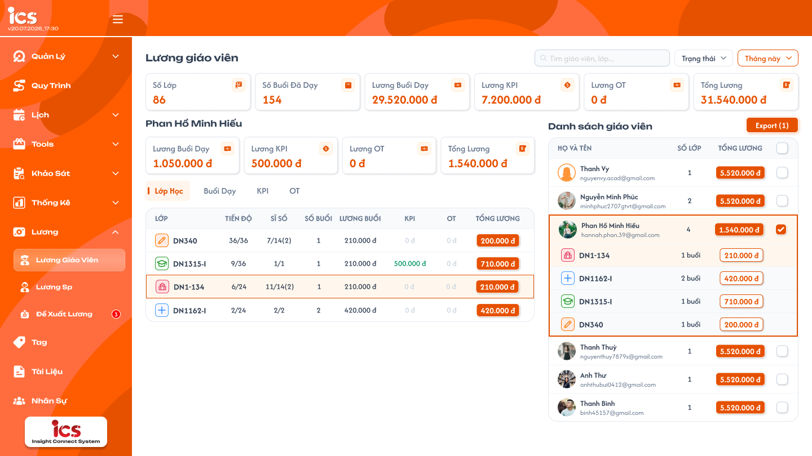
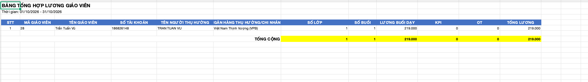

# Lương giáo viên — Admin

## 1. UI

### Trang 1: ADM-LGV-010000 — Lương / Lương giáo viên



**Mô tả:**
- Admin xem thống kê lương giáo viên theo kỳ và Export bảng tổng hợp. Menu: Lương → Lương Giáo Viên, thuộc Admin; không phải menu Lịch sử & lương của Giáo viên.
- Bố cục: bộ lọc toàn trang; sáu thẻ tổng hợp; chi tiết giáo viên bên trái; Danh sách giáo viên và Export bên phải.
- Đợt này chỉ xem thống kê và Export; không có luồng chốt lương hoặc đánh dấu thanh toán tại màn này.

**Điểm cần lưu ý:**
- `A01.01` Tìm kiếm: placeholder `Tìm giáo viên...`; chỉ tìm theo tên, email hoặc mã giáo viên, không tìm mã lớp. Kết hợp với kỳ thống kê để xác định danh sách giáo viên hợp lệ; các phát sinh trong kỳ của giáo viên khớp được giữ đầy đủ. Không đổi nội dung file xuất thành tìm theo lớp.
- `A01.02` Phạm vi thống kê: bỏ bộ lọc trạng thái chốt/thanh toán đang vẽ trong Figma. Trạng thái KPI/OT vẫn dùng để xác định khoản hợp lệ.
- `A01.03` Thời gian: mặc định Tháng này. Dropdown gồm Tới hạn, Hôm nay, Hôm qua, Tuần này, Tuần trước, Tuần sau, Tháng này, Tháng trước, 3 tháng trước, Tháng sau, Năm nay, Năm trước, Hôm nay & Hôm qua, Tùy chọn. Cách tính theo bộ lọc chung; không tự đổi nhãn 3 tháng trước thành 3 tháng gần đây.
- `A01.04` Sáu thẻ toàn trang: Số lớp, Số buổi đã dạy, Lương buổi dạy, Lương KPI, Lương OT, Tổng lương. Chỉ tính giáo viên/lớp có buổi Hoàn thành hoặc KPI/OT Đã xác nhận trong kỳ. Số lớp toàn trang đếm class_id không trùng trong tập phát sinh hợp lệ: G/H cùng có phát sinh tại A thì toàn trang là 1 lớp, số lớp cá nhân của G và H đều có A. Tổng tiền vẫn cộng khoản riêng của cả hai, không loại theo class_id.
- `A01.05` Bốn thẻ giáo viên đang chọn: Lương buổi dạy, Lương KPI, Lương OT, Tổng lương, kèm tên giáo viên; luôn là tổng cá nhân trên toàn bộ lớp phát sinh trong kỳ. Chọn lớp con chỉ lọc bảng chi tiết, không thay bốn thẻ này. Không trộn số của giáo viên khác.
- `A01.06` Danh sách giáo viên: chỉ liệt kê giáo viên có buổi Hoàn thành hoặc KPI/OT Đã xác nhận trong kỳ; kể cả giáo viên/lớp chỉ có KPI/OT được xác nhận, hoặc buổi Hoàn thành không lịch tiền 0, vẫn thuộc danh sách. Mỗi dòng gồm avatar, họ tên, email, số lớp, tổng lương và checkbox. Bấm giáo viên chọn xem chi tiết bên trái và mở danh sách lớp con, không điều hướng sang trang khác; giáo viên đang xem có nền/viền nhấn. Mở màn mặc định chọn giáo viên đầu tiên của danh sách hợp lệ; đổi giáo viên bỏ lựa chọn lớp cũ. Danh sách rỗng thì không chọn ngầm người ngoài kết quả và hiển thị trạng thái rỗng.
- `A01.07` Lớp con của giáo viên: icon trạng thái, mã lớp, số buổi và tiền của lớp. Bấm lớp con chọn class_id để lọc vùng chi tiết/các tab của giáo viên đang xem ngay tại trang; không mở Chi tiết lớp. Chọn xem không thay tập checkbox Export.
- `A01.08` Checkbox và Export: checkbox chỉ dùng chọn giáo viên cho Export, độc lập với giáo viên/lớp đang xem (tick không đổi vùng chi tiết, bấm chọn xem không tự tick). Checkbox đầu danh sách chọn/bỏ chọn tất cả giáo viên trên trang hiện tại, giữ lựa chọn các trang khác; khi chỉ một phần giáo viên trên trang được tick thì hiển thị trạng thái chọn một phần. Chuyển trang giữ tập chọn theo teacher_id; đổi kỳ hoặc điều kiện tìm kiếm xóa toàn bộ tập chọn. Chưa chọn ai thì Export bị vô hiệu hóa; `Export (n)` là số giáo viên được chọn trên mọi trang. Export chỉ đọc, không tạo/chuyển trạng thái chốt/thanh toán.
- `A01.09` Tooltip tổng lương giáo viên: thể hiện KPI, OT và số buổi; giá trị theo đúng giáo viên/kỳ đang xem.
- `A01.10` Tooltip tổng lương lớp: thể hiện KPI và OT của lớp; không lấy dữ liệu lớp khác.
- Tab `Lớp học` (giáo viên đang chọn). Chỉ liệt kê lớp có buổi Hoàn thành hoặc KPI/OT Đã xác nhận trong kỳ; lớp không có phát sinh hợp lệ bị loại:
  - `A02.01` Lớp: icon trạng thái và mã lớp.
  - `A02.02` Tiến độ: buổi hoàn thành / tổng buổi, dùng công thức tiến độ lớp chung.
  - `A02.03` Sĩ số: theo thành phần sĩ số lớp dùng chung; mẫu `7/14(2)` không phải sĩ số điểm danh một buổi.
  - `A02.04` Số buổi: buổi đã dạy của giáo viên đang chọn tại lớp trong kỳ, theo quy tắc buổi Hoàn thành.
  - `A02.05` Lương buổi: tổng tiền buổi dạy đã ghi nhận tại lớp trong kỳ; phân biệt với đơn giá theo giờ của quan hệ giáo viên–lớp.
  - `A02.06` KPI / OT: tổng khoản thực tế Đã xác nhận của đúng giáo viên/lớp/loại trong kỳ Ngày ghi nhận.
  - `A02.07` Tổng lương: lương buổi + KPI + OT của lớp (khác bảng lớp bên phải màn Giáo viên chỉ có tiền buổi).
- Ba tab `Buổi dạy` / `KPI` / `OT` dùng cùng cấu trúc cột, định dạng và cách hiển thị với [Lịch sử & lương — Giáo viên](../../teacher_role/history_and_salary/history_and_salary_requirements.md). Các tab chỉ đọc; Admin không có thêm/sửa/xóa/xác nhận khoản hoặc thanh toán từ bảng. Scope là teacher_id Admin đang xem, kỳ đang lọc và class_id khi đã chọn lớp con; không dùng teacher_id của tài khoản Admin làm người nhận lương. Chuyển tab giữ giáo viên/kỳ/lớp đang chọn; bấm lại giáo viên để xem toàn bộ lớp của người đó.
  - `A03.01` Buổi dạy: cột LỚP, TÊN BUỔI HỌC, SĨ SỐ, THỜI GIAN, LƯƠNG BUỔI DẠY. Icon trạng thái/mã lớp, tên bài/mô tả, sĩ số điểm danh của buổi theo quy tắc dùng chung. Thời gian `dd.MM.yyyy` và `HH:mm`, theo ngày tính lương; tiền buổi không lịch là 0 kèm cảnh báo. Thời gian giảm dần. Rỗng hiện `Không có buổi dạy nào`.
  - `A03.02` KPI: cột LỚP, LOẠI KPI, NGÀY GHI NHẬN, TRẠNG THÁI, TIỀN THƯỞNG. Tên từ title cấu hình tham chiếu; Ngày ghi nhận `dd.MM.yyyy`; tiền value thực tế. Giữ Mới/Đã xác nhận/Đã hủy trong bảng, ẩn Đã xóa; chỉ confirmed tham gia tổng. Ngày ghi nhận giảm dần.
  - `A03.03` OT: cột LỚP, LOẠI OT, NGÀY GHI NHẬN, TRẠNG THÁI, TIỀN THƯỞNG. Tên/mô tả từ cấu hình OT; khoản thực tế theo type=ot; giữ Mới/Đã xác nhận/Đã hủy, ẩn Đã xóa, chỉ confirmed tham gia tổng. Không nhân số phút trong tên. Ngày ghi nhận giảm dần.
- Phân trang ba tab Buổi dạy/KPI/OT: tối đa 50 dòng/trang, theo thành phần phân trang chung. Đổi kỳ/giáo viên/lớp đưa bảng về trang đầu; chuyển trang giữ phạm vi. Thẻ cá nhân tính tất cả phát sinh của giáo viên trong kỳ, không chỉ các dòng đang hiển thị hoặc lớp đang chọn. Không có dữ liệu thì KPI/OT dùng trạng thái rỗng cùng màn Giáo viên; lỗi có Thử lại, không giả thành bảng rỗng hoặc tổng 0.
- Có khoản Mới/Đã hủy trong bảng không tự làm giáo viên/lớp chưa có phát sinh hợp lệ xuất hiện trong danh sách.
- Chọn giáo viên để Export: tập chọn lưu bằng teacher_id, độc lập với giáo viên/lớp đang xem và thứ tự dòng. Response cũ không khôi phục tập chọn. Không tự xuất giáo viên đang xem. File xuất đầy đủ lớp/khoản hợp lệ trong kỳ của những giáo viên đã chọn, không giới hạn bởi lớp đang lọc xem tại chỗ. Backend kiểm tra quyền và phạm vi dữ liệu trước khi xuất.
- File Excel `.xlsx` tổng hợp lương giáo viên: bảng tổng hợp mỗi giáo viên một dòng, không chia theo lớp; chưa yêu cầu thêm sheet Buổi dạy/KPI/OT. Tiêu đề **BẢNG TỔNG HỢP LƯƠNG GIÁO VIÊN** in đậm phía trên bảng; dòng dưới `Thời gian: dd/MM/yyyy - dd/MM/yyyy` lấy đúng khoảng thống kê đang xuất (khoảng 01/10/2026 - 31/10/2026 trong ảnh chỉ là minh họa). Đúng thứ tự 12 cột bên dưới; header nền xanh, chữ trắng đậm; dòng Tổng cộng có nhãn đậm, các ô tổng từ Số lớp đến Tổng lương nền vàng. Độ rộng cột đủ đọc, không cắt số tài khoản hoặc tên ngân hàng. Tên, tài khoản và số tiền trong ảnh chỉ là dữ liệu tham chiếu bố cục, không dùng làm mặc định hay dữ liệu testcase.

  

  - `A05.01` Cột 1 `STT`: đánh số dòng giáo viên từ 1 trong file.
  - `A05.02` Cột 2 `MÃ GIÁO VIÊN`: `UserModel.code`; dùng mã hồ sơ, không tự thay bằng số thứ tự hoặc userId.
  - `A05.03` Cột 3 `TÊN GIÁO VIÊN`: tên giáo viên trong hồ sơ đúng người được xuất.
  - `A05.04` Cột 4 `SỐ TÀI KHOẢN`: `bankAccountNumber`; ghi kiểu text để giữ số 0 đầu và tránh ký hiệu khoa học.
  - `A05.05` Cột 5 `TÊN NGƯỜI THỤ HƯỞNG`: `bankAccountName`; không tự lấy tên giáo viên thay khi trống.
  - `A05.06` Cột 6 `NGÂN HÀNG THỤ HƯỞNG/CHI NHÁNH`: `bankName` theo dữ liệu hồ sơ. Model cũ chưa có field chi nhánh riêng; không tự tạo tên chi nhánh hoặc mặc định ngân hàng trong ảnh.
  - `A05.07` Cột 7 `SỐ LỚP`: số class_id không trùng có phát sinh hợp lệ của giáo viên trong kỳ.
  - `A05.08` Cột 8 `SỐ BUỔI`: số buổi Hoàn thành của giáo viên trong kỳ theo quy tắc ngày tính lương; kể cả buổi không lịch có tiền 0.
  - `A05.09` Cột 9 `LƯƠNG BUỔI DẠY`: tổng tiền buổi đã ghi nhận của giáo viên trong kỳ; giữ lương lịch sử.
  - `A05.10` Cột 10 `KPI`: tổng value KPI Đã xác nhận của giáo viên, theo Ngày ghi nhận trong kỳ.
  - `A05.11` Cột 11 `OT`: tổng value OT Đã xác nhận của giáo viên, theo Ngày ghi nhận trong kỳ.
  - `A05.12` Cột 12 `TỔNG LƯƠNG`: lương buổi dạy + KPI + OT của chính dòng giáo viên.
  - Các cột số lớp/số buổi/tiền là dữ liệu số, không chèn `đ` vào chuỗi giá trị; tiền phân cách hàng nghìn, không chữ số thập phân; không dùng đơn giá hiện tại để tính lại tiền buổi cũ.
  - Dòng **TỔNG CỘNG** cộng các cột số 7–12 của các dòng thực sự được xuất. Tổng Số lớp trong file là tổng số lớp cá nhân theo các dòng (lớp cùng có phát sinh ở hai giáo viên xuất hiện trong số lớp của cả hai), khác thẻ Số lớp toàn trang khử trùng.
  - Thiếu thông tin tài khoản/người thụ hưởng/ngân hàng thì để ô trống, không loại dòng lương hoặc tự bịa thông tin. Xuất file không chuyển trạng thái lương hay phát sinh thanh toán.

---

## 2. Yêu cầu

### 2.1. Flow chính

**Flow 1: Xem dữ liệu lương**

```
Admin → Lương → Lương Giáo Viên → BE kiểm tra quyền
  → Tải tổng toàn trang và Danh sách giáo viên theo phạm vi được chốt
  → Có kết quả: mặc định chọn giáo viên đầu tiên
  → Không có: trạng thái rỗng
```

**Flow 2: Chọn giáo viên và lớp con**

```
Chọn giáo viên → xóa lựa chọn lớp cũ → tải bốn thẻ cá nhân và các tab đúng giáo viên
  → Chọn lớp con → chỉ lọc bảng chi tiết tại chỗ (teacher_id + class_id); giữ bốn thẻ tổng cá nhân
  → Đổi tab Buổi dạy / KPI / OT → giữ giáo viên / kỳ / lớp đang chọn
```

**Flow 3: Đổi kỳ hoặc tìm kiếm**

```
Đổi kỳ / nhập tên-email-mã giáo viên → đồng bộ tổng / danh sách / chi tiết theo cùng kỳ
  → xóa tập chọn Export → Export (0) bị vô hiệu hóa
```

**Flow 4: Chọn và Export**

```
Tick checkbox giáo viên → cập nhật tập chọn Export (giữ nguyên chi tiết đang xem)
  → Export (n) → BE kiểm tra quyền + phạm vi → xuất .xlsx bảng tổng hợp
  → không chốt / không thanh toán lương
```

### 2.2. Ngoại lệ

- **EX01:** Tải tổng / danh sách / tab thất bại → hiện lỗi và `Thử lại`; không giả thành tổng 0, bảng rỗng hoặc dùng số mẫu.
- **EX02:** Đổi giáo viên / kỳ liên tiếp, response cũ về sau → bỏ response cũ, chỉ hiển thị lựa chọn mới nhất.
- **EX03:** Danh sách giáo viên rỗng → hiển thị trạng thái rỗng, không chọn ngầm người ngoài kết quả.
- **EX04:** Chưa tick giáo viên nào → Export bị vô hiệu hóa; không tự xuất giáo viên đang xem.
- **EX05:** Hồ sơ thiếu số tài khoản / người thụ hưởng / ngân hàng → để ô trống trong file, không loại dòng lương, không tự điền.
- **EX06:** Buổi Hoàn thành không có lịch → vẫn đếm buổi, tiền 0 kèm cảnh báo; không lấy đơn giá hiện tại bù vào.

### 2.3. Yêu cầu khác

| Mã | Tên yêu cầu | Mô tả |
|---|---|---|
| REQ01 | Phạm vi | Backend kiểm tra quyền Admin, xác định đúng teacher_id/class_id; giáo viên được chọn chỉ quyết định vùng chi tiết. Danh sách giáo viên/lớp chỉ gồm nơi có buổi Hoàn thành hoặc KPI/OT Đã xác nhận trong kỳ, không phụ thuộc có tiền buổi lớn hơn 0 hay không. Số lớp toàn trang đếm class_id không trùng; mỗi giáo viên đếm lớp riêng. Việc khử trùng lớp không loại buổi/khoản của giáo viên khác cùng lớp. |
| REQ02 | Ngày thống kê | Buổi có lịch theo ngày tính lương của lịch, không theo ngày bấm Hoàn thành. Buổi không lịch dùng thời điểm hoàn thành. KPI/OT theo Ngày ghi nhận, không dùng ngày cập nhật hoặc ngày xác nhận. |
| REQ03 | Buổi dạy | Chỉ buổi Hoàn thành của đúng giáo viên. Buổi không lịch vẫn đếm, tiền 0 và có cảnh báo; tiền buổi đã hoàn thành giữ nguyên sau khi đổi đơn giá. Chưa tự suy ra phép nhân thời lượng–đơn giá theo giờ khi cách quy đổi chưa chốt. |
| REQ04 | KPI/OT | Tổng value thực tế của khoản Đã xác nhận. Khoản Mới/Đã hủy không cộng, Đã xóa loại khỏi bảng. Tách đúng type KPI và OT, đúng owner; tên khoản từ cấu hình được tham chiếu. |
| REQ05 | Tổng tiền | Tổng lương = lương buổi + KPI + OT. Các cấp toàn trang/giáo viên/lớp phải đối chiếu được trong cùng phạm vi; không cộng lại bảng chi tiết như nguồn tiền thứ hai. Export hoặc chọn checkbox không được mặc định là đã chi trả. |
| REQ06 | Lương theo lớp | Đơn giá theo giờ lưu riêng từng quan hệ giáo viên–lớp; lớp 1–1 có thể khác lớp chung. Chỉnh lương ở chức năng quản lý riêng; duyệt đề xuất tăng lương không tự cập nhật đơn giá hoặc lương lịch sử. |
| REQ07 | Đồng bộ | Đổi kỳ/giáo viên phải bỏ response cũ, tách loading/rỗng/lỗi; lỗi không giả thành tổng 0. Không dùng số tiền mẫu Figma làm dữ liệu hoặc công thức. |
| REQ08 | Thống kê và Export | Chỉ thống kê/xuất dữ liệu, bỏ bộ lọc trạng thái chốt/thanh toán và không bổ sung luồng chuyển trạng thái. Checkbox chọn Export độc lập với chọn xem; không tự chọn giáo viên đang xem để xuất. File .xlsx dạng bảng tổng hợp theo đúng mẫu đã cung cấp, mỗi giáo viên một dòng và có Tổng cộng; không mặc định thêm các sheet chi tiết. Checkbox đầu danh sách chỉ chọn/bỏ chọn trang hiện tại; chuyển trang giữ các teacher_id đã chọn, đổi kỳ/tìm kiếm xóa tập chọn; chưa chọn thì khóa Export. Export (n) đếm toàn bộ giáo viên được chọn qua các trang. |
| REQ09 | Chọn chi tiết | Mặc định giáo viên đầu tiên khi có kết quả; bấm giáo viên chọn xem bên trái và xóa class_id cũ. Bấm lớp con chỉ lọc bảng theo teacher_id + class_id tại chỗ; bốn thẻ cá nhân giữ tổng giáo viên trong kỳ. Không điều hướng sang Chi tiết lớp. Checkbox không thay đổi teacher_id/class_id đang xem. |
| REQ10 | Tìm kiếm và tab | Chỉ tên/email/mã giáo viên với placeholder Tìm giáo viên...; không tìm mã lớp. Ba tab Buổi dạy/KPI/OT dùng cấu trúc cột/định dạng của menu Giáo viên, dữ liệu theo lựa chọn Admin, chỉ đọc và tối đa 50 dòng/trang; chuyển tab giữ scope, đổi scope về trang đầu. |

### 2.4. Ràng buộc

#### Quyền

| Role | Xem Lương giáo viên | Export | Sửa / xóa / xác nhận khoản | Chốt / thanh toán lương |
|---|:---:|:---:|:---:|:---:|
| Admin | ✅ | ✅ | ❌ | ❌ |
| Giáo viên / role khác | ❌ | ❌ | ❌ | ❌ |

#### Ràng buộc khác

- Chỉ thống kê và Export, bỏ bộ lọc trạng thái; không thực hiện chốt lương hoặc đánh dấu thanh toán.
- Chỉ giáo viên/lớp có buổi Hoàn thành hoặc KPI/OT Đã xác nhận trong kỳ; có KPI/OT nhưng không có buổi vẫn hiển thị.
- Checkbox chỉ chọn Export, độc lập với chọn xem; Export không cập nhật dữ liệu lương.
- Số lớp toàn trang đếm class_id không trùng; số lớp cá nhân đếm riêng từng giáo viên; không khử khoản tiền của các giáo viên cùng lớp.
- Bốn thẻ là tổng cá nhân, chọn lớp chỉ lọc bảng; đổi giáo viên bỏ lớp cũ.
- Ba tab chi tiết chỉ đọc, 50 dòng/trang.
- Không dùng `UserModel.salary` hay đơn giá hiện tại làm đơn giá mọi lớp / tính lại buổi cũ.

---

## 3. Testcase

### Feature: Lương giáo viên — Admin

| Tên testcase | Priority | Scenario | Role | Pre-condition | Given/When/Then | Expected Result |
|---|---|---|---|---|---|---|
| Case 1: Đúng giáo viên và tập phát sinh trong kỳ | High | Flow 1 / REQ01 | Admin | G/H cùng dạy A; G có buổi Hoàn thành không lịch tiền 0; H chỉ có OT confirmed; I chỉ có KPI Mới; J không phát sinh | **Given:** mở Lương giáo viên<br>**When:** tải danh sách rồi chọn G<br>**Then:** bốn thẻ và tab chỉ chứa dữ liệu của G; danh sách hiển thị G/H, loại I/J | - Không cộng buổi/khoản H vào G<br>- Không yêu cầu tiền buổi lớn hơn 0; KPI/OT Mới không đủ điều kiện liệt kê |
| Case 2: Ngày thống kê, buổi không lịch, không hồi tố | High | REQ02 / REQ03 / REQ06 / EX06 | Admin | Buổi lịch 30/9 hoàn thành 2/10; buổi Hoàn thành không lịch; buổi cũ đã chốt tiền, đơn giá lớp sau đó thay đổi | **Given:** chọn tháng 9, rồi kỳ chứa thời điểm hoàn thành buổi không lịch<br>**When:** xem số buổi và tiền<br>**Then:** buổi có lịch thuộc tháng 9; buổi không lịch tăng số buổi, tiền 0; buổi cũ giữ tiền | - Không tính hai lần hoặc chuyển sang tháng 10<br>- Có cảnh báo, không lấy đơn giá hiện tại bù vào<br>- Không tính lại bằng rate hiện tại |
| Case 3: KPI/OT xác nhận và khoản không có buổi | High | REQ04 | Admin | Khoản đủ Mới/Đã xác nhận/Đã hủy/Đã xóa, nhiều owner/type; G có KPI/OT xác nhận nhưng không có buổi | **Given:** tổng hợp G trong kỳ<br>**When:** xem thẻ và tab KPI/OT<br>**Then:** chỉ confirmed của G đúng loại được cộng | - Không cộng nhầm KPI thành OT hoặc khoản người khác<br>- G và lớp vẫn được liệt kê dù không có buổi, không suy ra tổng 0 từ bảng buổi trống |
| Case 4: Tổng theo công thức, tổng cá nhân khi lọc lớp | High | REQ05 / REQ09 | Admin | Tiền buổi 1050000, KPI 500000, OT 0; G có lớp A=200000, B=300000, không KPI/OT | **Given:** xem tổng; chọn lớp A rồi đổi tab<br>**When:** tải bảng và thẻ<br>**Then:** Tổng lương 1550000; bảng chỉ G/A, bốn thẻ vẫn tổng G 500000 | - Không sao chép 1540000 của Figma hoặc cộng lại các dòng chi tiết<br>- Không thay tổng cá nhân bằng 200000 hoặc chỉ tính trang hiện tại |
| Case 5: Số lớp toàn trang không trùng | High | REQ01 / REQ05 | Admin | G và H cùng có phát sinh tại A, không có lớp khác; G 200000, H 300000 | **Given:** tính tổng<br>**When:** xem sáu thẻ và danh sách<br>**Then:** Số lớp toàn trang 1, cá nhân G/H mỗi người 1 lớp; Tổng lương 500000 | - Tiền không bị loại theo class_id<br>- Tổng cộng Số lớp trong file Excel bằng 2 theo tổng các dòng |
| Case 6: Lỗi dữ liệu và response cũ | High | EX01 / EX02 / REQ07 | Admin | Đổi giáo viên/kỳ liên tiếp; tải tổng thất bại | **Given:** đổi giáo viên/kỳ liên tiếp, response cũ về sau; lần khác tải tổng lỗi<br>**When:** render<br>**Then:** chỉ lựa chọn mới nhất hiển thị; lỗi hiện `Thử lại` | - Không trộn tên G với bảng H hoặc tổng kỳ cũ<br>- Không giả tổng 0 hoặc dùng số mẫu |
| Case 7: Chỉ thống kê, duyệt đề xuất không áp dụng lương | High | REQ06 / REQ08 | Admin | Đề xuất tăng lương đã được duyệt, chưa chỉnh lương thủ công | **Given:** mở Lương GV, xem bộ lọc và thực hiện Export<br>**When:** xem tiền sau khi duyệt đề xuất<br>**Then:** không có bộ lọc chốt/thanh toán hoặc thao tác chuyển trạng thái | - Không tự thay đơn giá thực tế, giữ tiền lịch sử<br>- Export không tạo kỳ lương đã chốt hoặc bản ghi đã thanh toán |
| Case 8: Tìm đúng trường | High | REQ10 | Admin | Có tên/email/mã giáo viên và mã lớp khác nhau | **Given:** nhập từng giá trị vào `Tìm giáo viên...`<br>**When:** tìm theo từng trường<br>**Then:** tên/email/mã giáo viên cho kết quả khớp; không khớp chỉ vì mã lớp | - Giữ đầy đủ phát sinh trong kỳ của người khớp<br>- Đổi tìm kiếm xóa tập Export |
| Case 9: Mặc định, đổi giáo viên và lọc lớp con | High | Flow 2 / REQ09 | Admin | Danh sách có G/H; G dạy A/B; H cũng dạy A | **Given:** mở màn<br>**When:** chọn G rồi lớp A, đổi tab, rồi chuyển sang H<br>**Then:** ban đầu chọn giáo viên đầu tiên; bảng G/A đúng; sang H không giữ lớp A của G | - Không lấy H/A hoặc G/B; tab giữ đúng phạm vi<br>- Danh sách rỗng không chọn ngầm; tên và bảng đúng người mới<br>- Không điều hướng Chi tiết lớp |
| Case 10: Chọn xem độc lập Export | High | Flow 4 / REQ08 / REQ09 | Admin | Đang xem G/lớp A, đã tick H | **Given:** chọn G/lớp B rồi tick thêm I<br>**When:** quan sát chi tiết và Export (n)<br>**Then:** chi tiết vẫn G/B, tập Export là H/I | - Chọn xem không tự tick G; tick I không đổi chi tiết sang I |
| Case 11: Checkbox qua nhiều trang và đổi lọc | High | REQ08 / EX04 | Admin | Đã chọn G ở trang 1 và H ở trang 2 | **Given:** chọn tất cả rồi bỏ chọn tất cả ở trang 2<br>**When:** chuyển trang, rồi đổi kỳ hoặc điều kiện tìm kiếm<br>**Then:** chỉ thay tập chọn trang 2, G vẫn giữ; đổi lọc xóa toàn bộ tập chọn | - Export (n) đếm toàn bộ tập chọn; một phần tick hiện trạng thái chọn một phần<br>- Sau đổi lọc Export (0) bị vô hiệu hóa, response cũ không khôi phục lựa chọn, không tự xuất người đang xem |
| Case 12: Export đúng mẫu Excel, tài khoản và tổng | High | Flow 4 / REQ05 / REQ08 / EX05 | Admin | Tick G/H, không tick I; đang xem riêng lớp A của G; một hồ sơ thiếu ngân hàng; số tài khoản có số 0 đầu | **Given:** Export<br>**When:** mở file .xlsx<br>**Then:** đúng tiêu đề, khoảng thời gian, 12 cột đúng thứ tự, dòng Tổng cộng; chỉ dòng G/H đầy đủ phát sinh trong kỳ | - Header xanh/chữ trắng, ô tổng vàng; mỗi giáo viên một dòng; không thêm sheet chi tiết<br>- Không xuất I, không chỉ lấy lớp A; ô số/tiền là số; tổng lương = tiền buổi + KPI + OT<br>- Tài khoản giữ text, ô thiếu để trống, không tự điền từ ảnh mẫu |
| Case 13: Tab dùng cấu trúc chung và phân trang | High | REQ10 | Admin | G/A có hơn 50 dòng trong một tab | **Given:** xem từng tab Buổi dạy/KPI/OT<br>**When:** chuyển trang, đổi tab và đổi scope<br>**Then:** đúng cột/định dạng, tối đa 50 dòng/trang, giữ scope G/A/kỳ | - Chỉ đọc, không nút sửa/xóa/xác nhận<br>- Đổi scope về trang đầu; không lấy khoản của Admin đang đăng nhập |
| Case 14: Role không phải Admin bị chặn | High | Ràng buộc quyền / REQ01 | Giáo viên / role khác | - | **Given:** mở URL menu Lương giáo viên hoặc gọi API thống kê / Export<br>**When:** hệ thống kiểm tra quyền<br>**Then:** từ chối | - Không trả dữ liệu lương<br>- Không sinh file |

---

## 4. Câu hỏi cần xác nhận

- **Q01:** Công thức quy đổi lương theo giờ sang tiền buổi và nguồn tiền lịch sử là phụ thuộc nghiệp vụ còn chờ làm rõ chung; không tự nhân một đơn giá chung cho mọi lớp.
- **Q02:** Thứ tự danh sách giáo viên/Lớp học, phân trang riêng của hai danh sách này và chi tiết tìm kiếm chưa có quy ước rõ; dùng thành phần dùng chung khi triển khai.
- **Q03:** Quyền của role quản lý khác (ngoài Admin) với màn này cần chốt riêng.
- **Q04:** Figma Admin chưa có frame riêng cho ba tab Buổi dạy / KPI / OT; hiện dùng lại cấu trúc của Lịch sử & lương Giáo viên. Có cần thiết kế riêng không?
