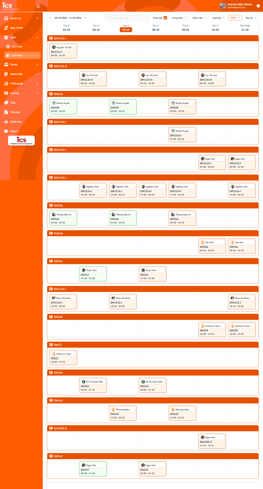

# Lịch dạy tổng

## 1. UI

### Trang 1: ADM-LD-010000 — Lịch / Lịch dạy tổng


**Mô tả:**
- Menu **Lịch → Lịch dạy** của `Admin`, `Class Handler`, `Support`: xem toàn bộ buổi dạy của các lớp trong tuần đang chọn, lọc theo trung tâm, giáo viên, loại lớp, trình độ, học kỳ; có thể nhóm theo lớp. Frame này là chế độ `Theo lớp` tắt (gom theo ngày).
- Màn chỉ xem, không tạo/sửa/hoàn thành/hủy lịch; mọi CRUD lịch thực hiện tại Tab Lịch dạy của lớp (`class_detail_schedule_requirements.md`), dữ liệu lịch, trạng thái và màu thẻ dùng chung với tab đó.

**Điểm cần lưu ý:**
- `A01.01` Khoảng tuần: `dd.MM.yyyy - dd.MM.yyyy` từ Thứ 2 đến Chủ Nhật, mặc định tuần chứa ngày hiện tại; `<` / `>` lùi/tiến đúng một tuần; bấm khoảng tuần mở dropdown chọn nhanh tuần.
- `A01.02` Cột ngày: `Thứ 2 … Thứ 7`, `Chủ Nhật` kèm `dd.MM`; ngày hiện tại tô nổi (nền cam), không ảnh hưởng dữ liệu.
- `A01.03` Ô `Tìm lớp, giáo viên...`: tìm theo mã lớp hoặc tên giáo viên của thẻ lịch, không phân biệt hoa thường; lọc trên toàn bộ lịch của tuần.
- `A01.04` Theo lớp: checkbox, mặc định tắt. Tắt: gom theo ngày, mỗi cột xếp dọc thẻ theo giờ bắt đầu tăng dần. Bật: xem Trang 2. Hai chế độ cùng tập lịch.
- `A01.05` Trung tâm: chọn một hoặc nhiều; không chọn thì lịch mọi trung tâm; đứng ngay sau `Theo lớp`, trước `Giáo viên`.
- `A01.06` Giáo viên: dropdown có ô tìm kiếm và checkbox, chọn nhiều; danh sách là giáo viên đang hoạt động của các trung tâm đang lọc, sắp theo tên; không chọn thì mọi giáo viên.
- `A01.07` Loại lớp: chọn nhiều `Lớp 1-1`, `Lớp chung`, `Lớp demo`.
- `A01.08` Trình độ: chọn nhiều từ dữ liệu định nghĩa (vd `HSK1`), hiển thị giá trị đang chọn trên nút.
- `A01.09` Học kỳ: chọn nhiều từ dữ liệu định nghĩa học kỳ của khóa học.
- `A01.10` Áp dụng bộ lọc: trong cùng bộ lọc là OR, giữa các bộ lọc là AND; đổi bộ lọc hoặc tìm kiếm thì lọc lại ngay trên tuần đang xem, giữ tuần và chế độ `Theo lớp`. Nút Trung tâm/Giáo viên khi chọn nhiều hiển thị thế nào chưa chốt (xem Q01).
- `A01.11` Thẻ lịch: avatar + tên giáo viên (dòng 1), mã lớp (dòng 2, đậm), `HH:mm - HH:mm` (dòng 3); hover hiện tên trạng thái và tên đầy đủ giáo viên. Bấm thẻ không có hành động; không hiển thị số thứ tự buổi. Giáo viên trên thẻ là giáo viên gán cho lịch, chưa gán thì dùng Giáo viên phụ trách chính của lớp, không có thì hiển thị `Chưa có giáo viên`. Mỗi lịch một thẻ; lịch cố định đã có bản ghi dời/thay giáo viên hiển thị bản ghi thay thế, không hiển thị hai lần.
- `A01.12` Nhiều lịch trong ngày: xếp dọc đủ số thẻ, cuộn khi vượt khung; số hàng trong ảnh không phải giới hạn.
- `A01.13` Ngày không có lịch: ô trống viền nét đứt `Không có lịch` ở hàng đầu; không có nút `+`.
- `A01.14` Loading / rỗng / lỗi: loading riêng vùng lưới; tuần không có lịch thỏa bộ lọc thì 7 ô trống; lỗi tải có `Thử lại`, không dựng lưới trống giả.
- `A01.15` Lịch cố định: viền cam; buổi chưa hoàn thành, sinh từ khung cố định.
- `A01.16` Lịch linh hoạt: viền xanh dương; buổi chưa hoàn thành, thêm linh hoạt.
- `A01.17` Lịch hoàn thành: viền xanh lá; buổi đã hoàn thành (tại tab lớp hoặc qua luồng dạy của giáo viên).
- `A01.18` Lịch hủy bỏ: viền xám; buổi đã hủy, vẫn hiển thị trong tuần; lịch đã xóa không hiển thị.
- Nguồn lịch là các bản ghi lịch đã sinh của lớp (cố định đã sinh theo N buổi, linh hoạt, hoàn thành, hủy), không tự sinh lịch tương lai ở client. Lớp `Mới tạo` chưa có lịch hợp lệ không xuất hiện; lớp ở trạng thái khác hiển thị theo lịch thực có, kể cả `Hoàn thành`, `Tạm ngưng`, `Huỷ bỏ` nếu còn lịch trong tuần.
- `A03.01` Dropdown Tuần, Mở: bấm vào khoảng tuần giữa hai mũi tên.
- `A03.02` Dropdown Tuần, Danh sách: các tuần liên tiếp `dd.MM.yyyy - dd.MM.yyyy`, cuộn được; mở ở vị trí tuần đang chọn, tuần đang chọn tô nền cam nhạt chữ cam đậm; phạm vi tối thiểu 1 năm trước và 1 năm sau tuần hiện tại.
- `A03.03` Dropdown Tuần, Chọn: bấm một tuần thì tải tuần đó, đóng dropdown, giữ bộ lọc và chế độ `Theo lớp`.
- `A03.04` Dropdown Tuần, Đóng: bấm ngoài dropdown, không đổi tuần.
- `A04.01` Nút Giáo viên: bấm mở/đóng panel; đang chọn thì viền cam và hiển thị số người đã chọn.
- `A04.02` Ô `Tìm kiếm...`: lọc danh sách theo tên, không phân biệt hoa thường, không dấu vẫn khớp.
- `A04.03` Danh sách giáo viên: giáo viên đang hoạt động thuộc các trung tâm đang lọc, sắp theo tên A–Z, mỗi dòng checkbox + tên, cuộn khi dài.
- `A04.04` Chọn giáo viên: tick/bỏ tick áp dụng ngay cho lưới; bỏ hết tick thì mọi giáo viên.
- `A04.05` Đóng panel: bấm ngoài panel hoặc nút, giữ lựa chọn.

### Trang 2: ADM-LD-010010 — Lịch / Lịch dạy tổng / Theo lớp



**Mô tả:**
- Bật `Theo lớp`: lưới chia thành từng nhóm theo lớp, cùng tập lịch và bộ lọc với chế độ gom theo ngày.

**Điểm cần lưu ý:**
- `A02.01` Nhóm lớp: thanh tiêu đề màu cam ghi mã lớp; nhóm sắp theo mã lớp A–Z; chỉ hiện lớp có ít nhất một lịch thỏa bộ lọc trong tuần.
- `A02.02` Lưới trong nhóm: 7 cột ngày như chế độ thường; ngày không có lịch của lớp đó là ô trống viền nét đứt `Không có lịch`.
- `A02.03` Cuộn: các nhóm xếp dọc, cuộn toàn trang; header ngày của mỗi nhóm hiển thị lại.

---

## 2. Yêu cầu

### 2.1. Flow chính

**Flow 1 / REQ01 / REQ02: Xem lịch tuần**

```
Admin / Class Handler / Support vào Lịch → Lịch dạy
  → Tải lịch mọi lớp trong tuần chứa ngày hiện tại (mọi trung tâm, bộ lọc Tất cả, Theo lớp tắt)
  → Hiển thị lưới 7 ngày, thẻ sắp theo giờ bắt đầu
  → Bấm < / > hoặc chọn nhanh tuần → Tải tuần mới, giữ bộ lọc và chế độ
```

**Flow 2 / REQ03: Tìm kiếm và lọc**

```
Nhập tìm kiếm hoặc chọn Trung tâm / Giáo viên / Loại lớp / Trình độ / Học kỳ
  → Lọc lại tập lịch của tuần (OR trong bộ lọc, AND giữa bộ lọc)
  → Dropdown Giáo viên liệt kê theo trung tâm đang lọc
```

**Flow 3 / REQ04: Nhóm theo lớp**

```
Bật "Theo lớp" → Lưới chia nhóm theo mã lớp (A–Z), mỗi nhóm 7 cột ngày
  → Tắt → Gom lại theo ngày (tập lịch không đổi)
```

### 2.2. Ngoại lệ

- **EX01:** Tuần hoặc bộ lọc không có lịch → 7 ô `Không có lịch`; không lỗi.
- **EX02:** Role ngoài Admin, Class Handler, Support mở menu hoặc gọi API → từ chối; Giáo viên dùng menu Lịch dạy của riêng mình.
- **EX03:** Tải dữ liệu thất bại → vùng lỗi có `Thử lại`; đổi tuần nhanh chỉ hiển thị response mới nhất.
- **EX04:** Request ghi (tạo/sửa/hoàn thành/hủy lịch) gửi từ màn này → backend từ chối; CRUD chỉ tại Tab Lịch dạy của lớp.

### 2.3. Yêu cầu khác

| Mã | Tên yêu cầu | Mô tả |
|---|---|---|
| REQ01 | Nguồn lịch | Bản ghi lịch đã sinh của mọi lớp (cố định, linh hoạt, hoàn thành, hủy; loại đã xóa) trong tuần; mỗi lịch một thẻ, bản ghi dời/thay thế hiển thị thay bản gốc. Giáo viên trên thẻ = giáo viên gán cho lịch, rồi phụ trách chính, rồi `Chưa có giáo viên`. |
| REQ02 | Tuần | Thứ 2–Chủ Nhật, mặc định tuần hiện tại; `<` `>` dịch 1 tuần; dropdown chọn nhanh tuần (bấm khoảng tuần, tối thiểu ±1 năm, tuần đang chọn tô cam); ngày hiện tại tô nổi; theo timezone nghiệp vụ. |
| REQ03 | Tìm kiếm và bộ lọc | Tìm theo mã lớp/tên giáo viên; Trung tâm, Giáo viên (có tìm kiếm), Loại lớp, Trình độ, Học kỳ đều chọn nhiều, mặc định Tất cả; OR trong bộ lọc, AND giữa bộ lọc; áp dụng ngay, giữ tuần/chế độ. |
| REQ04 | Theo lớp | Mặc định tắt; bật nhóm theo mã lớp A–Z, mỗi nhóm lưới 7 ngày; tắt gom theo ngày; cùng tập lịch. |
| REQ05 | Thẻ lịch | Avatar + tên giáo viên, mã lớp, `HH:mm - HH:mm`; không có số thứ tự buổi; màu viền theo 4 trạng thái của Tab Lịch dạy (cam cố định, xanh dương linh hoạt, xanh lá hoàn thành, xám hủy); hover hiện trạng thái. |
| REQ06 | Chỉ xem | Không có hành động trên thẻ; không nút thêm/sửa/hoàn thành/hủy/mở lại; backend từ chối request ghi từ màn này. |

### 2.4. Ràng buộc

#### Quyền

| Role | Xem Lịch dạy tổng | Tạo / sửa / hoàn thành / hủy lịch tại màn này |
|---|:---:|:---:|
| Admin | ✅ | ❌ |
| Class Handler | ✅ | ❌ |
| Support | ✅ | ❌ |
| Giáo viên | ❌ | ❌ |
| Role khác | ❌ | ❌ |

#### Ràng buộc khác

- Admin, Class Handler, Support xem mọi lớp; Giáo viên dùng menu Lịch dạy riêng của mình.
- Dùng `schedule_id`, `class_id`, `teacher_id`, `center_id` để tải/lọc; mã lớp, tên giáo viên chỉ để hiển thị và tìm kiếm.
- Không cho truy cập hoặc thực hiện hành động bị đánh dấu ❌, kể cả khi gọi trực tiếp bằng URL hoặc request.

---

## 3. Testcase

### Feature: Lịch dạy tổng

| Tên testcase | Priority | Scenario | Role | Pre-condition | Given/When/Then | Expected Result |
|---|---|---|---|---|---|---|
| Case 1: Mở lịch tuần hiện tại | High | Flow 1 / REQ01 / REQ02 | Admin / Class Handler / Support | Tuần hiện tại có lịch ở nhiều lớp, nhiều trung tâm | **Given:** mở Lịch → Lịch dạy<br>**When:** tải xong<br>**Then:** hiển thị tuần chứa ngày hiện tại, 7 cột, đủ thẻ của mọi lớp | - Ngày hiện tại tô nổi; Theo lớp tắt, bộ lọc Tất cả<br>- Thẻ sắp theo giờ bắt đầu trong ngày |
| Case 2: Chuyển tuần và chọn nhanh tuần | High | Flow 1 / REQ02 / EX03 | Admin / Class Handler / Support | Có lịch ở tuần trước/sau; mạng có thể chậm | **Given:** bấm `>` rồi bấm khoảng tuần, chọn tuần `19.10.2026 - 25.10.2026`; đổi tuần liên tục<br>**When:** tải xong<br>**Then:** khoảng tuần, cột ngày và thẻ khớp tuần mới, dropdown đóng | - Giữ bộ lọc và chế độ Theo lớp<br>- Dropdown mở ở tuần đang chọn và tô cam; bấm ngoài thì không đổi tuần<br>- Chỉ hiển thị response mới nhất |
| Case 3: Tìm theo mã lớp / tên giáo viên | High | Flow 2 / REQ03 | Admin / Class Handler / Support | Tuần có lịch của DN1311-I (Ngọc Mai) và DN350 (Khánh Huyền) | **Given:** nhập `ngọc mai`, sau đó `dn350`<br>**When:** lọc<br>**Then:** chỉ còn thẻ tương ứng | - Không phân biệt hoa thường<br>- Xóa ô tìm thì hiện lại đủ |
| Case 4: Lọc nhiều giá trị | High | Flow 2 / REQ03 | Admin / Class Handler / Support | Có lớp 1-1 và lớp chung, trình độ HSK1 và HSK2, hai trung tâm | **Given:** chọn Trung tâm A, Loại lớp = Lớp chung + Lớp 1-1, Trình độ = HSK1<br>**When:** lọc<br>**Then:** chỉ thẻ của lớp trung tâm A, thuộc hai loại, trình độ HSK1 | - Trong cùng bộ lọc là OR, giữa bộ lọc là AND<br>- Dropdown Giáo viên chỉ liệt kê giáo viên trung tâm A, bỏ lọc trung tâm thì giáo viên trung tâm B xuất hiện lại |
| Case 5: Dropdown Giáo viên: tìm và chọn nhiều | Medium | REQ03 | Admin / Class Handler / Support | Tuần có lịch của nhiều giáo viên | **Given:** mở dropdown, nhập `tram` hoặc `ngh` (không dấu), tick Nghiêm Ánh và Ngọc Mai, đóng panel<br>**When:** lọc<br>**Then:** lưới chỉ còn thẻ của người đã tick | - Tìm không phân biệt hoa thường, không dấu vẫn khớp<br>- Nút hiển thị trạng thái đã chọn, viền cam; lựa chọn giữ khi đóng panel<br>- Bỏ hết tick thì hiển thị mọi giáo viên |
| Case 6: Bật và tắt Theo lớp | High | Flow 3 / REQ04 | Admin / Class Handler / Support | Tuần có 3 lớp có lịch | **Given:** bật `Theo lớp`<br>**When:** render lại<br>**Then:** 3 nhóm có thanh mã lớp, mỗi nhóm lưới 7 ngày | - Tập lịch không đổi; nhóm sắp theo mã lớp A–Z; ngày không có lịch là ô nét đứt `Không có lịch`<br>- Tắt lại thì gom theo ngày |
| Case 7: Màu thẻ theo trạng thái và dữ liệu thẻ | High | REQ05 / REQ01 | Admin / Class Handler / Support | Tuần có lịch cố định, linh hoạt, hoàn thành, hủy, đã xóa; một lịch cố định Thứ 4 đã dời sang Thứ 5; một lịch chưa gán giáo viên | **Given:** xem thẻ<br>**When:** render<br>**Then:** màu và nội dung đúng từng lịch | - Cam / xanh dương / xanh lá / xám đúng; hover hiện tên trạng thái; lịch hủy vẫn hiển thị, lịch xóa không<br>- Lịch dời chỉ một thẻ ở Thứ 5, không hiện thẻ gốc<br>- Giáo viên chưa gán hiện phụ trách chính, không có thì `Chưa có giáo viên`, không hiện `Unknown Teacher`; không có số thứ tự buổi |
| Case 8: Bấm thẻ không hành động | High | REQ06 / EX04 | Admin / Class Handler / Support | Có thẻ lịch | **Given:** bấm thẻ, mã lớp hoặc tên giáo viên; gửi request ghi trực tiếp<br>**When:** tương tác<br>**Then:** không mở popup, không điều hướng | - Không có nút `+`, X, Hoàn thành, Hủy<br>- Backend từ chối request tạo/sửa/hoàn thành/hủy |
| Case 9: Tuần không có lịch và lỗi tải | Medium | EX01 / EX03 | Admin / Class Handler / Support | Tuần tương lai xa không có lịch; mất kết nối | **Given:** chuyển tới tuần trống; chuyển tuần khi mất kết nối<br>**When:** tải xong hoặc tải lỗi<br>**Then:** hiển thị trạng thái đúng | - 7 ô `Không có lịch`, không giữ thẻ tuần trước<br>- Lỗi: vùng lỗi có `Thử lại`, không dựng lưới trống giả |
| Case 10: Role khác không vào được | High | EX02 / Ràng buộc quyền | Giáo viên / Sale / role khác | Có URL menu | **Given:** mở URL hoặc gọi API lịch tổng<br>**When:** backend kiểm tra<br>**Then:** từ chối | - Giáo viên dùng menu Lịch dạy riêng của mình<br>- Admin, Class Handler, Support xem được mọi lớp |

---

## 4. Câu hỏi cần xác nhận

- **Q01:** Trạng thái nút `Giáo viên` / `Trung tâm` khi đã chọn nhiều (hiện số hay tên) chưa có trong Figma; đề xuất hiện số đã chọn. Có chốt theo đề xuất không?
