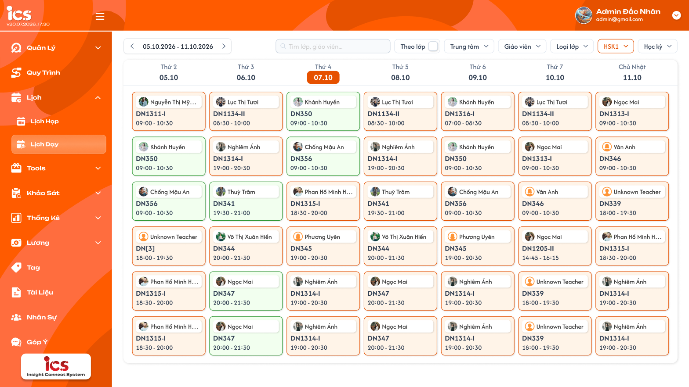
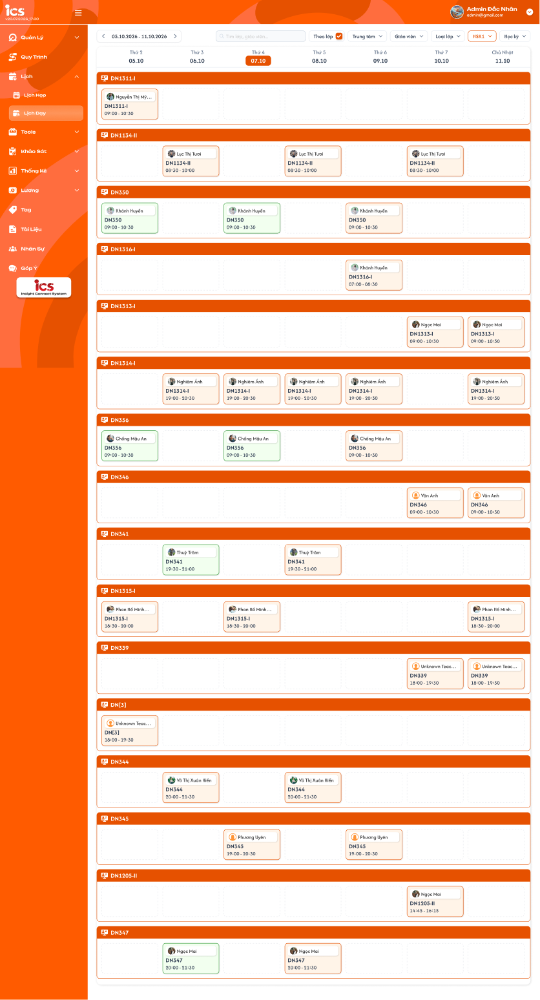
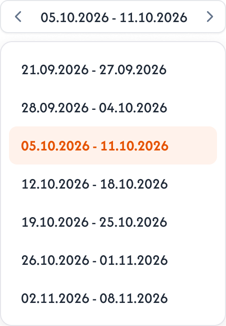
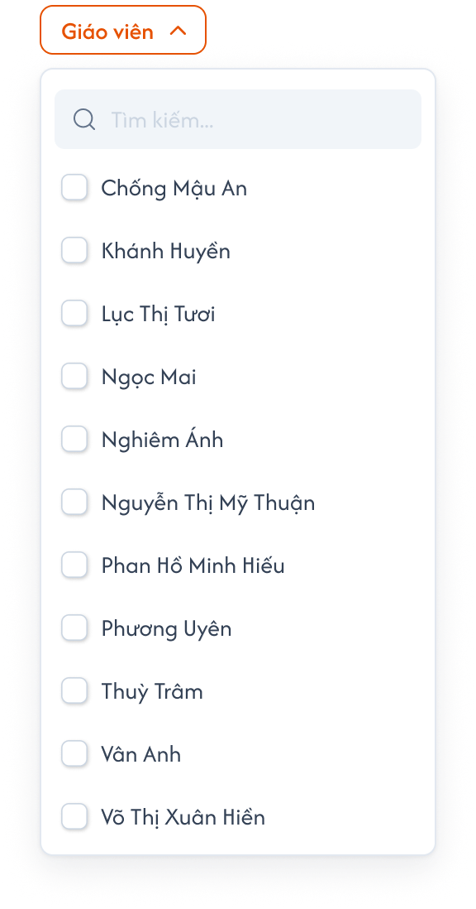

# Lịch dạy tổng

Đặc tả menu **Lịch → Lịch dạy** của role Admin, Class Handler và Support: xem lịch dạy của mọi lớp theo tuần. UI tham chiếu: Figma `ADM-LD-010000 — Lịch / Lịch dạy tổng`, `ADM-LD-010010 — … / Theo lớp`, `Dropdown · Giáo viên`, `Dropdown · Tuần` (đã bổ sung bộ lọc Trung tâm và dropdown chọn nhanh tuần ngày 2026-10-20); hành vi đối chiếu ICS cũ `roles/admin/schedule_general`. Tên người, mã lớp, ngày giờ trong ảnh là dữ liệu mẫu. Dữ liệu lịch, trạng thái và màu thẻ dùng chung với [Chi tiết lớp học — Tab Lịch dạy](../class_management/class_detail_schedule_requirements.md); màn này **chỉ xem**, mọi thao tác CRUD lịch thực hiện tại tab của lớp.

## 1. UI

### Trang 1: ADM-LD-010000 — Trang 1: Lịch dạy tổng theo tuần


*Lịch dạy tổng: thanh tuần, tìm kiếm, bộ lọc và lưới 7 ngày (Figma ADM-LD-010000) — nhấn để xem ảnh gốc*

**Mô tả:**

- Người quản lý xem toàn bộ buổi dạy của các lớp trong tuần đang chọn, lọc theo trung tâm, giáo viên, loại lớp, trình độ, học kỳ; có thể nhóm theo lớp. Màn chỉ hiển thị, không tạo/sửa/hoàn thành/hủy lịch.

**Điểm cần lưu ý:**

- `A01.01` **Khoảng tuần**: `dd.MM.yyyy - dd.MM.yyyy` từ Thứ 2 đến Chủ Nhật; mặc định tuần chứa ngày hiện tại. Nút `<` / `>` lùi / tiến đúng một tuần; bấm vào khoảng tuần mở dropdown chọn nhanh tuần (xem khu vực Dropdown Tuần).
- `A01.02` **Cột ngày**: `Thứ 2 … Thứ 7`, `Chủ Nhật` kèm `dd.MM`; ngày hiện tại được tô nổi (nền cam), không ảnh hưởng dữ liệu.
- `A01.03` **`Tìm lớp, giáo viên...`**: Tìm theo mã lớp hoặc tên giáo viên của thẻ lịch, không phân biệt hoa thường; lọc trên toàn bộ lịch của tuần.
- `A01.04` **`Theo lớp`**: Checkbox, mặc định tắt. Bật: nhóm lịch theo lớp, mỗi nhóm có thanh tiêu đề mã lớp và lưới 7 ngày riêng, nhóm sắp theo mã lớp tăng dần. Tắt: gom theo ngày, mỗi cột xếp dọc các thẻ theo giờ bắt đầu tăng dần. Hai chế độ cùng tập lịch.
- `A01.05` **`Trung tâm`**: Chọn một hoặc nhiều trung tâm; không chọn thì hiển thị lịch của mọi trung tâm. Đứng ngay sau `Theo lớp`, trước `Giáo viên`.
- `A01.06` **`Giáo viên`**: Dropdown có ô tìm kiếm và checkbox, chọn nhiều giáo viên; danh sách là giáo viên đang hoạt động của các trung tâm được lọc, sắp theo tên. Không chọn thì mọi giáo viên.
- `A01.07` **`Loại lớp`**: Chọn nhiều: `Lớp 1-1`, `Lớp chung`, `Lớp demo`.
- `A01.08` **`Trình độ`**: Chọn nhiều từ dữ liệu định nghĩa (vd `HSK1`); hiển thị giá trị đang chọn trên nút.
- `A01.09` **`Học kỳ`**: Chọn nhiều từ dữ liệu định nghĩa học kỳ của khoá học.
- `A01.10` **Áp dụng bộ lọc**: Trong cùng bộ lọc là OR, giữa các bộ lọc là AND; đổi bộ lọc hoặc tìm kiếm thì lọc lại ngay trên tuần đang xem, giữ tuần và chế độ `Theo lớp`.
- `A01.11` **Thẻ lịch**: Avatar + tên giáo viên của lịch (dòng 1), mã lớp (dòng 2, đậm), `HH:mm - HH:mm` (dòng 3). Viền/màu theo trạng thái lịch (bảng dưới). Hover hiện tên trạng thái và tên đầy đủ giáo viên. **Bấm thẻ không có hành động.** Không hiển thị số thứ tự buổi (ICS cũ có `lessonIndex`, bỏ).
- `A01.12` **Nhiều lịch trong ngày**: Xếp dọc đủ số thẻ, cuộn khi vượt khung; số hàng trong ảnh không phải giới hạn.
- `A01.13` **Ngày không có lịch**: Ô trống viền nét đứt `Không có lịch` ở hàng đầu; không có nút `+`.
- `A01.14` **Loading / rỗng / lỗi**: Loading riêng vùng lưới; tuần không có lịch thỏa bộ lọc thì 7 ô trống; lỗi tải có `Thử lại`, không dựng lưới trống giả.

**Màu thẻ theo trạng thái lịch** (cùng bộ với Tab Lịch dạy trong lớp):

- `A01.15` **Lịch cố định**: Màu viền: Cam; Ý nghĩa: Buổi chưa hoàn thành, sinh từ khung cố định.
- `A01.16` **Lịch linh hoạt**: Màu viền: Xanh dương; Ý nghĩa: Buổi chưa hoàn thành, thêm linh hoạt.
- `A01.17` **Lịch hoàn thành**: Màu viền: Xanh lá; Ý nghĩa: Buổi đã hoàn thành (tại tab lớp hoặc qua luồng dạy của giáo viên).
- `A01.18` **Lịch hủy bỏ**: Màu viền: Xám; Ý nghĩa: Buổi đã hủy; vẫn hiển thị trong tuần.

- Nguồn lịch là các bản ghi lịch đã sinh của lớp (cố định đã sinh theo N buổi, linh hoạt, hoàn thành, hủy) theo Tab Lịch dạy; không tự sinh lịch tương lai ở client như ICS cũ. Lịch đã xóa không hiển thị.
- Giáo viên trên thẻ là giáo viên được gán cho lịch; lịch chưa gán thì dùng Giáo viên phụ trách chính của lớp, không có thì hiển thị `Chưa có giáo viên` (ICS cũ hiển thị `Unknown Teacher`).
- Lớp `Mới tạo` chưa có lịch hợp lệ không xuất hiện; lớp ở trạng thái khác hiển thị theo lịch thực có, kể cả `Hoàn thành`, `Tạm ngưng`, `Huỷ bỏ` nếu còn lịch trong tuần.
- Mỗi lịch chỉ hiển thị một thẻ; lịch cố định đã có bản ghi dời/thay giáo viên hiển thị bản ghi thay thế, không hiển thị hai lần.
- Khác ICS cũ: ICS cũ không có ô tìm kiếm, không lọc Giáo viên, ba bộ lọc còn lại chọn một; requirement mới theo Figma và quyết định người dùng (chọn nhiều, có tìm kiếm, có Trung tâm).

### Trang 2: ADM-LD-010010 — Chế độ Theo lớp


*Bật Theo lớp: mỗi lớp một nhóm có thanh mã lớp và lưới 7 ngày (Figma ADM-LD-010010) — nhấn để xem ảnh gốc*

**Mô tả:**

- Bật checkbox `Theo lớp` thì lưới chia thành từng nhóm theo lớp; cùng tập lịch và bộ lọc với chế độ gom theo ngày.

**Điểm cần lưu ý:**

- `A02.01` **Nhóm lớp**: Thanh tiêu đề màu cam ghi mã lớp; nhóm sắp theo mã lớp A–Z; chỉ hiện lớp có ít nhất một lịch thỏa bộ lọc trong tuần.
- `A02.02` **Lưới trong nhóm**: 7 cột ngày như chế độ thường; ngày không có lịch của lớp đó là ô trống viền nét đứt `Không có lịch`.
- `A02.03` **Cuộn**: Các nhóm xếp dọc, cuộn toàn trang; header ngày của mỗi nhóm hiển thị lại.

### Trang 3: Dropdown Tuần


*Bấm vào khoảng tuần mở danh sách chọn nhanh tuần, tuần đang chọn tô cam (Figma Dropdown · Tuần) — nhấn để xem ảnh gốc*

**Mô tả:**

- Cho phép nhảy nhanh tới tuần khác mà không bấm `<` `>` nhiều lần (theo ICS cũ `ChooseWeekWidget`).

**Điểm cần lưu ý:**

- `A03.01` **Mở**: Bấm vào khoảng tuần giữa hai mũi tên.
- `A03.02` **Danh sách**: Các tuần liên tiếp dạng `dd.MM.yyyy - dd.MM.yyyy`, cuộn được; mở ra ở vị trí tuần đang chọn, tuần đang chọn tô nền cam nhạt chữ cam đậm. Phạm vi tối thiểu 1 năm trước và 1 năm sau tuần hiện tại.
- `A03.03` **Chọn**: Bấm một tuần → tải tuần đó, đóng dropdown, giữ bộ lọc và chế độ `Theo lớp`.
- `A03.04` **Đóng**: Bấm ngoài dropdown; không đổi tuần.

### Trang 4: Dropdown Giáo viên


*Dropdown Giáo viên: ô tìm kiếm và danh sách checkbox (Figma Dropdown · Giáo viên) — nhấn để xem ảnh gốc*

**Mô tả:**

- Bộ lọc chọn nhiều giáo viên để chỉ xem lịch của những người đó.

**Điểm cần lưu ý:**

- `A04.01` **Nút `Giáo viên`**: Bấm mở/đóng panel; đang chọn thì viền cam và hiển thị số người đã chọn.
- `A04.02` **`Tìm kiếm...`**: Lọc danh sách theo tên, không phân biệt hoa thường, không dấu vẫn khớp.
- `A04.03` **Danh sách**: Giáo viên đang hoạt động thuộc các trung tâm đang lọc, sắp theo tên A–Z; mỗi dòng checkbox + tên. Cuộn khi dài.
- `A04.04` **Chọn**: Tick/bỏ tick áp dụng ngay cho lưới; bỏ hết tick = mọi giáo viên.
- `A04.05` **Đóng panel**: Bấm ngoài panel hoặc nút; giữ lựa chọn.

---

## 2. Yêu cầu

### 2.1. Flow chính

**Flow 1 / REQ01 / REQ02: Xem lịch tuần**

```text
Admin / Class Handler / Support vào Lịch → Lịch dạy
      → Hệ thống tải lịch của mọi lớp trong tuần chứa ngày hiện tại (mọi trung tâm, bộ lọc Tất cả, Theo lớp tắt)
      → Hiển thị lưới 7 ngày, thẻ sắp theo giờ bắt đầu
      → Bấm < / > hoặc chọn nhanh tuần → tải tuần mới, giữ bộ lọc và chế độ
```

**Flow 2 / REQ03: Tìm kiếm và lọc**

```text
Người dùng nhập tìm kiếm hoặc chọn Trung tâm / Giáo viên / Loại lớp / Trình độ / Học kỳ
      → Hệ thống lọc lại tập lịch của tuần (OR trong bộ lọc, AND giữa bộ lọc)
      → Dropdown Giáo viên liệt kê theo trung tâm đang lọc
```

**Flow 3 / REQ04: Nhóm theo lớp**

```text
Người dùng bật "Theo lớp"
      → Lưới chia thành các nhóm theo mã lớp (A–Z), mỗi nhóm 7 cột ngày
      → Tắt → gom lại theo ngày; tập lịch không đổi
```

### 2.2. Ngoại lệ

- **EX01:** Tuần hoặc bộ lọc không có lịch → 7 ô `Không có lịch`; không lỗi.
- **EX02:** Role ngoài Admin, Class Handler, Support mở menu hoặc gọi API → từ chối; Giáo viên dùng menu Lịch dạy của riêng mình.
- **EX03:** Tải dữ liệu thất bại → vùng lỗi có `Thử lại`; đổi tuần nhanh chỉ hiển thị response mới nhất.
- **EX04:** Request ghi (tạo/sửa/hoàn thành/hủy lịch) gửi từ màn này → backend từ chối; CRUD chỉ tại Tab Lịch dạy của lớp.

### 2.3. Yêu cầu khác

| Mã | Tên yêu cầu | Mô tả |
|---|---|---|
| REQ01 | Nguồn lịch | Bản ghi lịch đã sinh của mọi lớp (cố định, linh hoạt, hoàn thành, hủy; loại đã xóa) trong tuần; mỗi lịch một thẻ, bản ghi dời/thay thế hiển thị thay bản gốc. Giáo viên trên thẻ = giáo viên gán cho lịch → phụ trách chính → `Chưa có giáo viên`. |
| REQ02 | Tuần | Thứ 2–Chủ Nhật, mặc định tuần hiện tại; `<` `>` dịch 1 tuần; dropdown chọn nhanh tuần (bấm khoảng tuần, tối thiểu ±1 năm, tuần đang chọn tô cam); ngày hiện tại tô nổi; timezone nghiệp vụ. |
| REQ03 | Tìm kiếm và bộ lọc | Tìm theo mã lớp/tên giáo viên; Trung tâm, Giáo viên (có tìm kiếm), Loại lớp, Trình độ, Học kỳ đều chọn nhiều, mặc định Tất cả; OR trong bộ lọc, AND giữa bộ lọc; áp dụng ngay, giữ tuần/chế độ. |
| REQ04 | Theo lớp | Mặc định tắt; bật nhóm theo mã lớp A–Z, mỗi nhóm lưới 7 ngày; tắt gom theo ngày; cùng tập lịch. |
| REQ05 | Thẻ lịch | Avatar + tên giáo viên, mã lớp, `HH:mm - HH:mm`; không có số thứ tự buổi; màu viền theo 4 trạng thái của Tab Lịch dạy; hover hiện trạng thái. |
| REQ06 | Chỉ xem | Không có hành động trên thẻ; không nút thêm/sửa/hoàn thành/hủy/mở lại; backend từ chối request ghi từ màn này. |

### 2.4. Ràng buộc

#### Quyền

| Role | Xem Lịch dạy tổng | Tạo / sửa / hoàn thành / hủy lịch tại màn này |
|---|:---:|:---:|
| Admin | ✅ (mọi lớp) | ❌ |
| Class Handler | ✅ (mọi lớp) | ❌ |
| Support | ✅ (mọi lớp) | ❌ |
| Giáo viên | ❌ (dùng menu Lịch dạy riêng) | ❌ |
| Role khác | ❌ | ❌ |

#### Ràng buộc khác

**Phạm vi dữ liệu**

- Dùng `schedule_id`, `class_id`, `teacher_id`, `center_id` để tải/lọc; mã lớp, tên giáo viên chỉ để hiển thị và tìm kiếm.
- Không cho phép truy cập hoặc thực hiện hành động bị đánh dấu `❌`, kể cả khi gọi trực tiếp bằng URL hoặc request.

---

---

## 3. Testcase

### Feature: Lịch dạy tổng

| Tên testcase | Priority | Scenario | Role | Pre-condition | Given/When/Then | Expected Result |
|---|---|---|---|---|---|---|
| Case 1: Mở lịch tuần hiện tại | High · Smoke | Flow 1 / REQ01 / REQ02 | Admin / Class Handler / Support | Tuần hiện tại có lịch ở nhiều lớp, nhiều trung tâm | **Given** mở Lịch → Lịch dạy<br>**When** tải xong<br>**Then** hiển thị tuần chứa ngày hiện tại, 7 cột, đủ thẻ lịch của mọi lớp | - Ngày hiện tại tô nổi<br>- Theo lớp tắt, bộ lọc Tất cả<br>- Thẻ sắp theo giờ bắt đầu trong ngày |
| Case 2: Chuyển tuần và chọn nhanh tuần | High | Flow 1 / REQ02 | Admin / Class Handler / Support | Có lịch ở tuần trước/sau | **Given** bấm `>` rồi bấm khoảng tuần, chọn tuần `19.10.2026 - 25.10.2026`<br>**When** tải xong<br>**Then** khoảng tuần, cột ngày và thẻ khớp tuần mới; dropdown đóng | - Giữ bộ lọc và chế độ Theo lớp<br>- Dropdown mở ở tuần đang chọn, tuần đó tô cam<br>- Chỉ hiển thị response mới nhất |
| Case 3: Tìm theo mã lớp / tên giáo viên | High | Flow 2 / REQ03 | Admin / Class Handler / Support | Tuần có lịch của DN1311-I (Ngọc Mai) và DN350 (Khánh Huyền) | **Given** nhập `ngọc mai`<br>**When** lọc<br>**Then** chỉ còn thẻ của Ngọc Mai; nhập `dn350` chỉ còn thẻ DN350 | - Không phân biệt hoa thường<br>- Xoá ô tìm thì hiện lại đủ |
| Case 4: Lọc nhiều giá trị | High | Flow 2 / REQ03 | Admin / Class Handler / Support | Có lớp 1-1 và lớp chung, trình độ HSK1 và HSK2, hai trung tâm | **Given** chọn Trung tâm A, Loại lớp = Lớp chung + Lớp 1-1, Trình độ = HSK1<br>**When** lọc<br>**Then** chỉ thẻ của lớp trung tâm A, loại thuộc hai giá trị, trình độ HSK1 | - Trong cùng bộ lọc là OR, giữa bộ lọc là AND<br>- Dropdown Giáo viên chỉ liệt kê giáo viên trung tâm A |
| Case 5: Lọc Giáo viên nhiều người | Medium | REQ03 | Admin / Class Handler / Support | Tuần có lịch của 5 giáo viên | **Given** tìm `ngh` trong dropdown Giáo viên, tick Nghiêm Ánh và Ngọc Mai<br>**When** lọc<br>**Then** chỉ thẻ của hai người | - Nút hiển thị số đã chọn hoặc tên |
| Case 6: Bật Theo lớp | High | Flow 3 / REQ04 | Admin / Class Handler / Support | Tuần có 3 lớp có lịch | **Given** bật `Theo lớp`<br>**When** render lại<br>**Then** 3 nhóm có thanh mã lớp, mỗi nhóm lưới 7 ngày | - Tập lịch không đổi<br>- Nhóm sắp theo mã lớp<br>- Tắt lại gom theo ngày |
| Case 7: Màu thẻ theo trạng thái | High | REQ05 | Admin / Class Handler / Support | Tuần có lịch cố định, linh hoạt, hoàn thành, hủy | **Given** xem thẻ<br>**When** render<br>**Then** cam / xanh dương / xanh lá / xám đúng từng lịch | - Hover hiện tên trạng thái<br>- Lịch hủy vẫn hiển thị, lịch xóa không |
| Case 8: Bấm thẻ không hành động | High | REQ06 | Admin / Class Handler / Support | Có thẻ lịch | **Given** bấm thẻ, mã lớp hoặc tên giáo viên<br>**When** tương tác<br>**Then** không mở popup, không điều hướng, không request ghi | - Không có nút `+`, X, Hoàn thành, Hủy |
| Case 9: Tuần không có lịch | Medium | EX01 | Admin / Class Handler / Support | Tuần tương lai xa | **Given** chuyển tới tuần đó<br>**When** tải xong<br>**Then** 7 ô `Không có lịch` | - Không giữ thẻ tuần trước |
| Case 10: Lịch dời không trùng thẻ | Medium | REQ01 | Admin / Class Handler / Support | Lịch cố định Thứ 4 được dời sang Thứ 5 cùng tuần | **Given** xem tuần<br>**When** render<br>**Then** chỉ một thẻ ở Thứ 5 | - Không hiện thẻ gốc Thứ 4 |
| Case 11: Giáo viên chưa gán | Low | REQ05 | Admin / Class Handler / Support | Lịch chưa gán giáo viên, lớp có phụ trách chính | **Given** xem thẻ<br>**When** render<br>**Then** hiện tên phụ trách chính; lớp không có thì `Chưa có giáo viên` | - Không hiển thị `Unknown Teacher` |
| Case 12: Role khác không vào được | High | EX02 / Ràng buộc quyền | Giáo viên / Sale / role khác | Có URL menu | **Given** mở URL hoặc gọi API lịch tổng<br>**When** backend kiểm tra<br>**Then** từ chối | - Giáo viên dùng menu Lịch dạy riêng của mình |
| Case 13: Lỗi tải | Medium | EX03 | Admin / Class Handler / Support | Mất kết nối | **Given** chuyển tuần<br>**When** tải lỗi<br>**Then** vùng lỗi có `Thử lại` | - Không dựng lưới trống giả |
| Case 14: Tìm và chọn trong dropdown | Medium | REQ03 | Admin / Class Handler / Support | Có 11 giáo viên | **Given** mở dropdown, nhập `tram`<br>**When** lọc danh sách<br>**Then** còn `Thuỳ Trâm`; tick rồi đóng panel | - Lưới chỉ còn lịch của Thuỳ Trâm<br>- Nút hiển thị trạng thái đã chọn |
| Case 15: Danh sách theo trung tâm | Medium | REQ03 | Admin / Class Handler / Support | Giáo viên X chỉ thuộc trung tâm B | **Given** đang lọc Trung tâm A<br>**When** mở dropdown Giáo viên<br>**Then** không có X | - Bỏ lọc trung tâm thì X xuất hiện |

---

---

## 4. Câu hỏi cần xác nhận

- **Q01:** Trạng thái nút `Giáo viên` / `Trung tâm` khi đã chọn nhiều (hiện số hay tên) chưa có trong Figma; đề xuất hiện số đã chọn.

---

## 5. Quyết định đã chốt (2026-10-20)

- Thêm bộ lọc Trung tâm (đã vẽ vào Figma ADM-LD-010000 và ADM-LD-010010).
- Giữ dropdown chọn nhanh tuần theo ICS cũ (đã vẽ `Dropdown · Tuần` trong Figma).
- Không hiển thị số thứ tự buổi trên thẻ.
- Admin, Class Handler, Support xem mọi lớp; bấm thẻ không hành động; bộ lọc chọn nhiều, có ô tìm mã lớp / tên giáo viên.
