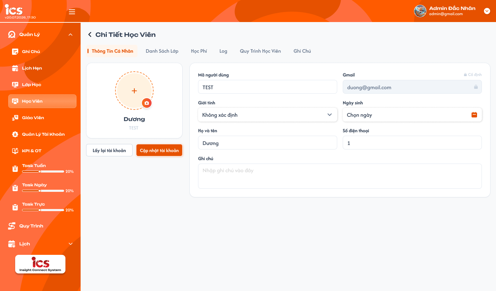
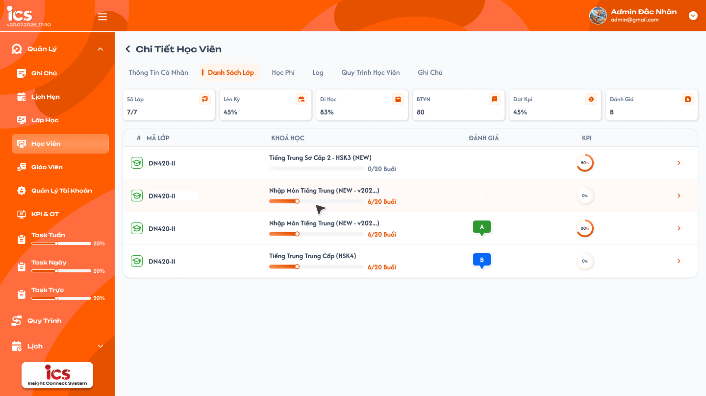
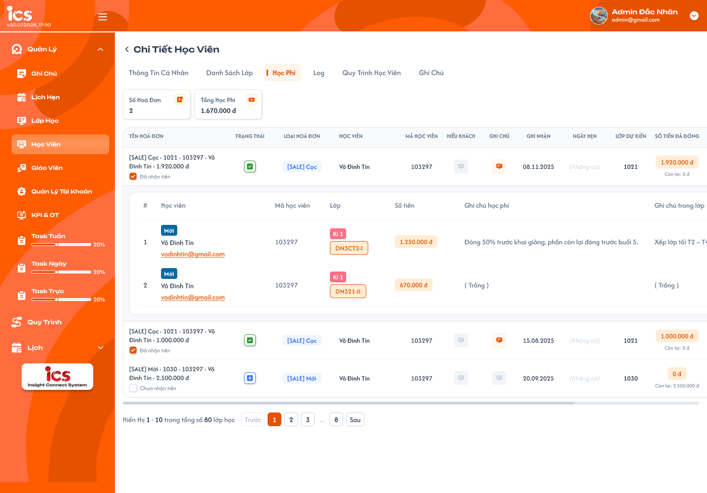
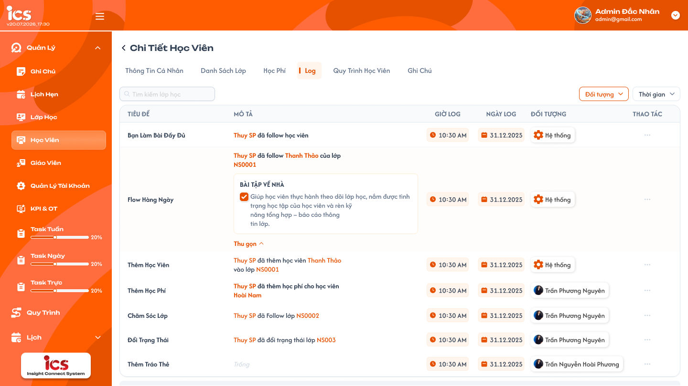
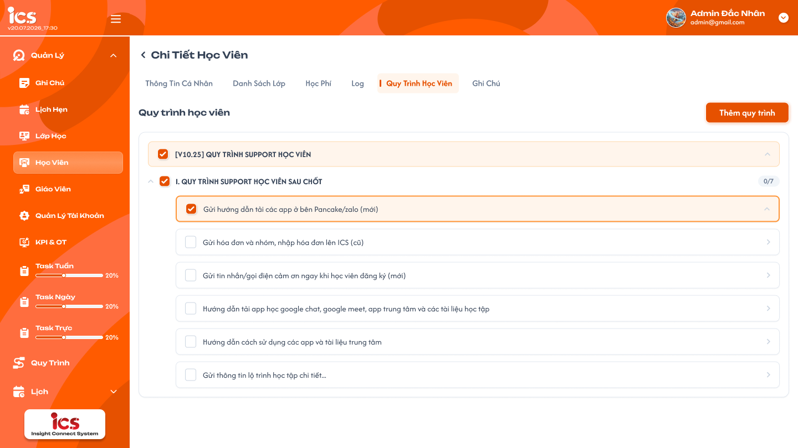
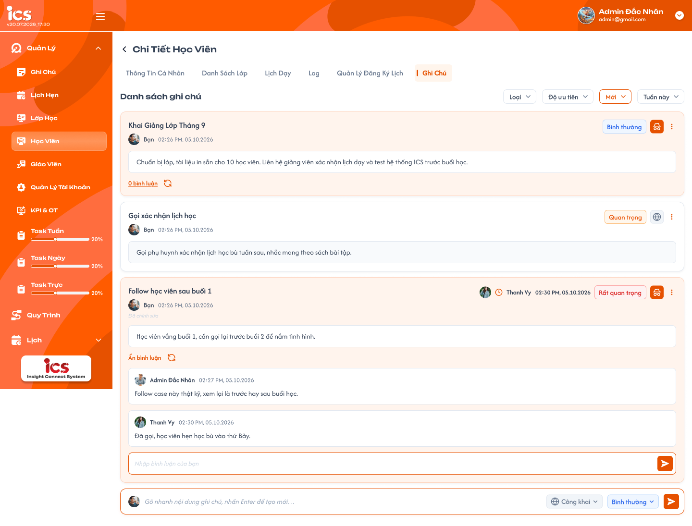

# Chi tiết học viên

## 1. UI

### Trang 1: ADM-HV-020100 — Chi tiết học viên / Thông tin cá nhân



**Mô tả:**
- Màn Chi tiết học viên mở từ mũi tên cuối dòng Danh sách học viên; tiêu đề `Chi Tiết Học Viên` có nút quay lại danh sách. Tab `Thông tin cá nhân` hiển thị và cho cập nhật thông tin của đúng học viên đang chọn, trong phạm vi dữ liệu role hiện tại được phép.
- Bố cục: card ảnh / họ tên / mã bên trái, form hai cột bên phải (Mã người dùng/Gmail, Giới tính/Ngày sinh, Họ và tên/Số điện thoại; Ghi chú chiếm cả hàng cuối). Nút `Lấy lại tài khoản` và `Cập nhật tài khoản` ở dưới card trái.

**Điểm cần lưu ý:**
- Khung chung: sáu tab đúng thứ tự **Thông tin cá nhân → Danh sách lớp → Học phí → Log → Quy trình học viên → Ghi chú**, mặc định mở Thông tin cá nhân. Tab active chữ cam, nền cam nhạt, vạch cam bên trái.
- Tất cả tab dùng cùng student_id đang chọn; chuyển tab không tạo tài khoản hoặc bản sao dữ liệu. Dữ liệu các tab dùng chung phải đồng nhất với popup Lịch sử học viên và module nguồn. Quay lại danh sách giữ điều kiện trước đó.
- Danh sách lớp / Học phí **phân trang từng trang**; Ghi chú / Quy trình học viên / Log **load more**. Số dòng theo cấu hình chung, không lấy số mẫu trên ảnh làm quy định. Thống kê / tổng tiến độ tính toàn bộ dữ liệu của học viên, không chỉ phần đã tải.
- Chỉ tải tab trong phạm vi quyền; loading, rỗng và lỗi phân biệt rõ. Khi đổi học viên hoặc đổi điều kiện, response cũ không được ghi đè dữ liệu mới.
- `A02.01` Ảnh đại diện: không bắt buộc, được cập nhật; tối đa `25 MB` (đúng 25 MB được nhận, lớn hơn bị từ chối). Chưa có ảnh thì hiện avatar mặc định. Chọn ảnh mới chỉ tạo bản xem trước; ảnh được lưu khi bấm `Cập nhật tài khoản`, không chọn ảnh mới thì giữ ảnh hiện tại.
- `A02.02` Họ và tên: bắt buộc, được cập nhật; không để trống hoặc chỉ khoảng trắng.
- `A02.03` Ngày sinh: bắt buộc, được cập nhật.
- `A02.04` Giới tính: bắt buộc, được cập nhật; chọn `Nam`, `Nữ` hoặc `Không xác định`.
- `A02.05` Mã người dùng: bắt buộc, **chỉ đọc**; chính là `Code` 6 chữ số hệ thống sinh tăng dần theo cấp độ 1..9 tại [Thêm học viên](./student_management_requirements.md#dropdown-chọn-cấp-độ-và-code-học-viên) (Cấp độ 1 bắt đầu từ 100000). Không sinh lại hoặc thay đổi khi cập nhật.
- `A02.06` Số điện thoại: bắt buộc, được cập nhật; đúng định dạng theo case tạo học viên và được phép trùng với học viên khác.
- `A02.07` Email: bắt buộc, **chỉ đọc**; là email đã dùng khi tạo học viên.
- `A02.08` Ghi chú: không bắt buộc, được nhập / sửa / xoá toàn bộ nội dung; không giới hạn nội dung hoặc độ dài ở tầng nghiệp vụ. Đây là dữ liệu riêng, khác tab Ghi chú.
- Trạng thái tài khoản `Chính thức` vẫn được bảo vệ trong dữ liệu nhưng UI mới không có control Trạng thái, không thêm field này vào form. `TEST`, `Dương`, SĐT `1` trong ảnh là dữ liệu mẫu, không thay quy tắc Code / validation.
- `Cập nhật tài khoản` chỉ cập nhật `Ảnh đại diện`, `Họ và tên`, `Ngày sinh`, `Giới tính`, `Số điện thoại`, `Ghi chú`. Backend kiểm soát field chỉ đọc: request đổi `Mã người dùng`, `Email` hoặc `Trạng thái` bị từ chối và không đổi dữ liệu nào. Cập nhật có tính nguyên tử: lưu toàn bộ hoặc giữ nguyên toàn bộ.
- Thành công: `Cập nhật thông tin học viên thành công.` và tải lại dữ liệu vừa lưu. Thất bại: `Không thể cập nhật thông tin học viên. Vui lòng thử lại.`, giữ dữ liệu đã nhập trên form, không lưu dở dang.
- `Lấy lại tài khoản` là thao tác độc lập với `Cập nhật tài khoản`, phải mở popup xác nhận trước khi thực hiện. Thành công thì mật khẩu đăng nhập của học viên được đặt lại chính xác thành `abc12345`, không cập nhật field thông tin cá nhân; hiện `Đặt lại mật khẩu học viên thành công.` Thất bại giữ nguyên mật khẩu và hiện `Không thể đặt lại mật khẩu học viên. Vui lòng thử lại.`
- Popup xác nhận lấy lại mật khẩu (chưa có frame Figma): tiêu đề `Xác nhận lấy lại mật khẩu`; nội dung `Bạn có chắc chắn muốn đặt lại mật khẩu học viên về abc12345 không?`; `Hủy` đóng popup, không gửi yêu cầu, không đổi mật khẩu; `Xác nhận` gửi yêu cầu đặt lại cho đúng học viên đang xem; trong lúc xử lý vô hiệu hoá nút `Xác nhận` để tránh gửi lặp.
- `A09.01`–`A09.04` Toast phản hồi CRUD (mỗi thao tác chỉ một Toast, nút `×` đóng thủ công, không hiển thị dữ liệu nhạy cảm; nội dung dòng hai lấy từ flow CRUD tương ứng; `Hủy` / chỉ đọc không có Toast CRUD):
- `A09.01` `Thành Công`: backend xác nhận thao tác thành công.
- `A09.02` `Thông Báo`: thao tác đã tiếp nhận nhưng dữ liệu cần thời gian đồng bộ.
- `A09.03` `Cảnh Báo`: dữ liệu / điều kiện cần người dùng kiểm tra.
- `A09.04` `Có Lỗi Xảy Ra`: backend / network không hoàn tất thao tác.

### Trang 2: ADM-HV-020200 — Chi tiết học viên / Danh sách lớp



**Mô tả:**
- Nội dung và nghiệp vụ giống [Lịch sử lớp trong Lịch sử học viên](./student_management_requirements.md#lịch-sử-lớp), trình bày thành tab; sáu thẻ thống kê và bảng lớp của học viên.

**Điểm cần lưu ý:**
- Sáu thẻ theo thứ tự **Số Lớp, Lên Kỳ, Đi Học, BTVN, Đạt Kpi, Đánh Giá**, dùng đúng công thức, tập lớp và cách làm tròn đã chốt ở Lịch sử lớp; thống kê trên toàn bộ lịch sử của học viên, không chỉ trang đang xem. BTVN vẫn hiển thị tỷ lệ theo requirement lịch sử.
- Bảng gồm icon trạng thái lớp / mã lớp, khoá học, tiến độ cả lớp `x/N Buổi`, Đánh giá và vòng KPI. Icon lấy **trạng thái lớp** theo [Trạng thái lớp](../class_management/class_management_requirements.md#trạng-thái-lớp), không dùng trạng thái học viên trong lớp.
- Mũi tên cuối dòng mở Chi tiết lớp tương ứng, điều hướng trực tiếp (không có bước đóng popup lịch sử); không mở rộng quyền xem lớp từ quyền xem học viên.
- Phân trang từng trang: footer có phạm vi đang hiển thị / tổng số **lớp**, Trước, số trang, Sau; đổi trang thay tập dòng, giữ đúng student_id, không nối thêm như load more; trang đầu / cuối vô hiệu hoá Trước / Sau tương ứng. Ảnh chưa có footer nhưng phân trang vẫn phải có; số dòng / trang theo cấu hình chung.
- Tên khoá rút gọn theo UI; `7/7`, `45%`, `80`, `B`, mã lớp lặp trong ảnh là mẫu, không hard-code.

### Trang 3: ADM-HV-020300 — Chi tiết học viên / Học phí



**Mô tả:**
- Giống [tab Học phí trong Lịch sử học viên](./student_management_requirements.md#học-phí--danh-sách-hóa-đơn): cùng dữ liệu hoá đơn / học phí, công thức và toàn bộ thao tác đã chốt; có hai thẻ thống kê, bảng hoá đơn và chi tiết phân bổ mở rộng.

**Điểm cần lưu ý:**
- Hai thẻ **Số Hoá Đơn** (số hoá đơn tạo cho học viên, mỗi hoá đơn một lần) và **Tổng Học Phí** (tổng Giá trị học phí đã dùng của học viên); tổng hợp toàn bộ dữ liệu của học viên, không chỉ hoá đơn trên trang.
- Bảng 16 cột và menu theo lịch sử; bấm hoá đơn mở các phân bổ học phí của invoice_id đó. Bảng con có Học viên, Mã, Lớp / kỳ, Số tiền, Ghi chú học phí, Ghi chú trong lớp. Nhãn `Mới` cạnh tên là tag của item học phí.
- Cho phép thao tác học phí / hoá đơn hiện có như lịch sử: Thêm học phí hai bước, chỉnh sửa, Copy tên, Xoá có xác nhận (các mục đang disable giữ nguyên theo requirement Hoá đơn). **Không tạo hoá đơn mới** tại tab này. Xoá hoá đơn đồng bộ học phí / số dư mọi học viên liên kết theo requirement Hoá đơn; Huỷ / lỗi không lưu dở dang.
- Phân trang từng trang **theo hoá đơn**, không phân trang từng phân bổ; footer dùng số / tổng **hoá đơn** (sửa nhãn mẫu `lớp học` trong ảnh thành `hoá đơn`). Cuộn ngang để xem đủ cột; đổi trang thay các dòng hoá đơn, không nối thêm; thẻ thống kê vẫn lấy toàn bộ dữ liệu.

### Trang 4: ADM-HV-020400 — Chi tiết học viên / Log



**Mô tả:**
- Áp dụng cùng chức năng [Chi tiết lớp → Menu Nhật ký → Tab Nhật ký](../class_management/class_detail_journal_requirements.md), đổi đối tượng dữ liệu từ **lớp** sang **học viên đang mở**. Không đưa các tab Ghi Chú / Lịch Hẹn / Tin Nhắn của menu Nhật ký lớp vào Log học viên.

**Điểm cần lưu ý:**
- Search bên trái, filter **Đối tượng / Thời gian** bên phải; bảng **Tiêu đề, Mô tả, Giờ log, Ngày log, Đối tượng, Thao tác**. Placeholder search là `Tìm kiếm nhật ký` (`Tìm kiếm lớp học` trên ảnh là nhãn mẫu).
- Search chỉ theo Tiêu đề, Enter ngay hoặc debounce 2 giây từ ký tự cuối. Đối tượng lấy user đã viết nhật ký của học viên và Hệ thống, lọc theo ID người tạo / nguồn; không lấy người chỉ được nhắc trong mô tả làm chủ log. Search / filter kết hợp AND.
- Thời gian mặc định **Hôm nay**; đủ 12 lựa chọn và quy tắc khoảng ngày theo Nhật ký lớp. Giờ / Ngày log lấy thời điểm tạo nếu chưa sửa, thời điểm sửa thành công gần nhất nếu đã sửa; filter dùng cùng thời điểm và múi giờ.
- Log viết tay hiển thị avatar / tên người tạo; log tự động hiển thị Hệ thống. Mô tả rỗng là `Trống`, không giới hạn độ dài; mở rộng / thu gọn chỉ thay trình bày. Checklist trong mô tả mẫu không tự tạo thao tác cập nhật Result của quy trình.
- Quyền giống Nhật ký lớp, xét **phạm vi học viên**: Admin / Class Handler / Support được xem trong phạm vi được cấp; chỉ Class Handler / Support tạo log viết tay và sửa / xoá log mình tạo. Sale không được xem / thao tác Log nếu không đồng thời có role phù hợp. Admin không sửa / xoá log người khác; log Hệ thống chỉ đọc.
- Tạo trực tiếp cuối bảng: nhập Tiêu đề rồi Nội dung, `+` xác nhận; Tiêu đề bắt buộc, Nội dung được trống, không giới hạn ký tự. Sửa trực tiếp dòng của mình, Enter hoặc đưa chuột ra ngoài vùng sửa để lưu một lần. Xoá mở popup xác nhận, Huỷ giữ nguyên. Toast dùng đúng thông báo Nhật ký lớp.
- Với sự kiện thêm học viên vào lớp / đóng tiền đã chốt ở Nhật ký lớp, Log hiển thị sự kiện liên quan **đúng student_id**; tên người thực hiện / lớp / hoá đơn / số tiền theo action nguồn. Cùng sự kiện không tạo trùng log khi retry; không đưa log của học viên khác trong cùng lớp vào. Không tự mở rộng action tự ghi từ các dòng mẫu trong ảnh.
- **Load more** theo log: nối dòng mới, không lặp log_id; giữ dòng / mô tả đã mở; lỗi giữ dữ liệu cũ và cho thử lại; hết dữ liệu dừng tải. Đổi search / filter hoặc học viên thì bắt đầu lại từ lượt đầu.

### Trang 5: ADM-HV-020500 — Chi tiết học viên / Quy trình học viên



**Mô tả:**
- Áp dụng cây và hành vi [Thêm quy trình trong lớp](../class_management/class_detail_processes_requirements.md), cùng [Action Board](../../action_board_requirement/action_board_requirements.md). Quy trình nguồn được định nghĩa ở [Define quy trình](../../process_definition_requirement/process_definition_requirements.md).

**Điểm cần lưu ý:**
- Tab chỉ lấy loại quy trình **Học viên**, cùng center với học viên. Không lấy loại Lớp học / Lớp - Giáo viên / CSKH chỉ vì tên Package có chữ Support. Tên `[V10.25] QUY TRÌNH SUPPORT HỌC VIÊN` và nội dung task trong ảnh là mẫu.
- Header `Quy trình học viên`, nút **Thêm quy trình**; cây Package → Category → Action Item có checkbox, mở / thu gọn, tiến độ Category như `0/7` và control Result theo loại Action. Số hoàn thành tính từ Result đã lưu, không hard-code hoặc tăng chỉ vì thêm item; tổng tiến độ phản ánh toàn bộ dữ liệu đã lưu, không chỉ phần đã load.
- **Load more** danh sách quy trình đã gắn: tải tiếp nối thêm vào danh sách, giữ cây và Result đã tải, không reset trạng thái mở / thu gọn, không nhân đôi bản ghi.
- Result và lựa chọn lưu riêng theo **student_id + loại Học viên + Action Item**; cập nhật của A không thay học viên B, Result lớp hoặc định nghĩa nguồn.
- Chỉ nội dung nguồn Công khai được thêm; Nháp / Vô hiệu không xuất hiện trong nguồn chọn mới. Quy trình đã gắn chuyển Vô hiệu vẫn hiện nội dung / Result cũ nhưng chỉ xem; Công khai lại thì áp dụng quyền cập nhật tương ứng.
- **Admin và các user được gán cho học viên** (Người phụ trách hoặc Người theo dõi theo quyền học viên đã chốt) được Thêm quy trình và cập nhật Result trong phạm vi học viên đó, không phụ thuộc người đã thêm item. Backend kiểm tra quyền và trạng thái nguồn lúc lưu; không dùng quan hệ thành viên lớp thay cho quan hệ với học viên.
- Popup Thêm quy trình học viên (chưa có frame Figma): dùng bố cục / bộ chọn Package → Category → Action Item của [Popup Thêm nội dung trong lớp](../class_management/class_detail_processes_requirements.md#popup-thêm-nội-dung), giới hạn loại **Học viên** và center hiện tại. Checkbox nhiều cấp (chọn cha chọn con, bỏ chọn từng con); `Thêm (n)` xác nhận, `Hủy` đóng không lưu. Kiểm tra lại quyền, center, loại nguồn và nguồn còn Công khai lúc lưu; không gắn trùng Action Item; thêm không tự ghi Result / hoàn thành item hoặc sửa nguồn; lưu lỗi giữ lựa chọn để thử lại, không thêm dở dang.

### Trang 6: ADM-HV-020600 — Chi tiết học viên / Ghi chú



**Mô tả:**
- Nghiệp vụ giống [Ghi chú trong Lịch sử học viên](./student_management_requirements.md#ghi-chú--danh-sách-bình-luận-và-popup-thêm), cùng các bản ghi note_id / student_id và quyền owner đã chốt; danh sách card, bộ lọc và bình luận.

**Điểm cần lưu ý:**
- Nhãn `Lịch Dạy` / `Quản Lý Đăng Ký Lịch` trong ảnh là nhãn mẫu cũ; bộ sáu tab chính theo thứ tự nêu ở Trang 1.
- Mở tab mặc định **Mới + Tuần này**, Loại / Độ ưu tiên chưa chọn. Filter kết hợp AND với quyền xem; đổi filter tải lại từ lượt đầu, không nối kết quả cũ vào tập mới.
- Card theo UI Ghi chú mới ở lịch sử: dưới tiêu đề có avatar / tên / ngày tạo note (`Bạn` nếu là tài khoản hiện tại), nhãn `Đã chỉnh sửa` khi có sửa. Góc phải có avatar / tên / thời gian bình luận gần nhất kèm icon đồng hồ cam, badge ưu tiên / icon loại / menu; chưa có bình luận thì ẩn cụm bên phải, metadata người tạo bên trái vẫn hiện. Làm mới bình luận theo đúng note, giữ bản nháp. Bố cục card / ô bình luận lấy theo ảnh chuẩn mới 
- Chỉ owner ghi chú đổi Loại / Độ ưu tiên, đóng / mở lại / sửa / xoá ghi chú. Ghi chú Riêng tư hoặc đã Đóng chỉ owner thấy cả nội dung và bình luận. Chỉ người tạo bình luận sửa / xoá bình luận đó; Trả lời ghi chú là bình luận trong cùng danh sách.
- Ô bình luận văn bản thuần, không toolbar theo UI mới; bình luận không giới hạn độ dài, không gửi rỗng.
- **Load more theo ghi chú**: nối các card, giữ bình luận / card đã mở và dữ liệu đang nhập, không nhân đôi note_id; đang tải chặn yêu cầu lặp; lỗi giữ card cũ và cho thử lại; hết dữ liệu ẩn / vô hiệu hoá tải thêm. Danh sách luôn tuân filter và quyền owner, kể cả kết quả tải tiếp.

### Trang 7: ADM-HV-020610 — Chi tiết học viên / Ghi chú / Popup thêm ghi chú


**Mô tả:**
- Nút `+` ở tab Ghi chú mở popup `Thêm ghi chú` (Tiêu đề, Nội dung, Loại ghi chú, Độ ưu tiên), dùng chung với popup ở Lịch sử học viên.

**Điểm cần lưu ý:**
- Tiêu đề / Nội dung bắt buộc, văn bản thuần, không giới hạn độ dài. `Huỷ` không tạo note và không có Toast CRUD.

---

## 2. Yêu cầu

### 2.1. Flow chính

**Flow 1: Xem và cập nhật chi tiết học viên**

```
User có quyền mở Chi tiết học viên
      → Hệ thống tải đúng thông tin của học viên được chọn
      → Hiển thị Mã người dùng/Email chỉ đọc; không render control Trạng thái
      → Dữ liệu tài khoản vẫn Chính thức, không cho sửa qua request
      → User chọn ảnh đại diện mới và chỉnh sửa Họ và tên, Ngày sinh, Giới tính, Số điện thoại, Ghi chú
      → User bấm "Cập nhật tài khoản"
      → Hệ thống kiểm tra field bắt buộc và kiểm tra request không đổi field chỉ đọc
      → Thành công: lưu toàn bộ dữ liệu hợp lệ, tải lại chi tiết, "Cập nhật thông tin học viên thành công."
      → Thất bại: không lưu dở dang, giữ dữ liệu trên form, "Không thể cập nhật thông tin học viên. Vui lòng thử lại."
```

**Flow 2: Lấy lại mật khẩu học viên**

```
User có quyền mở Chi tiết học viên → bấm "Lấy lại tài khoản"
      → Hệ thống mở popup "Xác nhận lấy lại mật khẩu"
      → "Hủy": đóng popup, không gửi yêu cầu, giữ nguyên mật khẩu
      → "Xác nhận": gửi yêu cầu → đặt lại mật khẩu của đúng học viên đang xem thành "abc12345"
            → Thành công: không đổi thông tin cá nhân, "Đặt lại mật khẩu học viên thành công."
            → Thất bại: giữ nguyên mật khẩu, "Không thể đặt lại mật khẩu học viên. Vui lòng thử lại."
```

**Flow 3: Xem các tab dùng chung với lịch sử**

```
Mở học viên → Danh sách lớp / Học phí / Ghi chú
      → Kiểm tra student_id và quyền, tải dữ liệu nguồn dùng chung
      → Lớp/Học phí: chuyển từng trang; thẻ tổng lấy toàn bộ học viên
      → Ghi chú: tải thêm card, đổi filter thì tải lại từ lượt đầu
      → Thao tác lưu dùng đúng quy tắc lịch sử, tải lại hai vị trí cùng dữ liệu
```

**Flow 4: Log học viên**

```
Admin/Class Handler/Support có quyền trên học viên mở Log
      → Search Tiêu đề, Đối tượng, Thời gian mặc định Hôm nay như Nhật ký lớp
      → Load more log của đúng học viên; đổi điều kiện bắt đầu lại
      → Class Handler/Support tạo trực tiếp cuối bảng hoặc sửa/xóa log mình tạo
      → Log Hệ thống chỉ đọc; phản hồi CRUD như Nhật ký lớp
```

**Flow 5: Thêm quy trình và cập nhật Result học viên**

```
Admin/user được gán mở Quy trình học viên → Thêm quy trình
      → Chọn Package/Category/Action Item Công khai, loại Học viên, cùng center
      → Hủy không lưu; Thêm kiểm tra lại quyền/trạng thái/loại/center/trùng item
      → Gắn nội dung cho student_id; không tự ghi Result
      → Cập nhật Result theo Action Board khi nguồn Công khai; Vô hiệu chỉ xem
      → Load more giữ cây/Result, không sửa định nghĩa nguồn hoặc Result lớp/học viên khác
```

### 2.2. Ngoại lệ

- **EX01:** Không tìm thấy học viên hoặc user không có quyền trên học viên được yêu cầu → không hiển thị dữ liệu chi tiết và không cho phép cập nhật hoặc lấy lại mật khẩu.
- **EX02:** Họ và tên, Ngày sinh, Giới tính hoặc Số điện thoại bị để trống; Họ và tên chỉ chứa khoảng trắng → chặn cập nhật, giữ dữ liệu trên form và hiển thị lỗi tại field tương ứng.
- **EX03:** Request cập nhật có thay đổi `Mã người dùng`, `Email` hoặc `Trạng thái` → backend từ chối toàn bộ request; giữ nguyên mọi dữ liệu của học viên.
- **EX04:** Ảnh đại diện vượt quá `25 MB` hoặc không đáp ứng định dạng upload của hệ thống → chặn toàn bộ thao tác cập nhật, không tải ảnh lên, giữ ảnh hiện tại và hiển thị lỗi upload. Riêng vượt dung lượng hiển thị `Ảnh đại diện không được vượt quá 25 MB.`
- **EX05:** Cập nhật chi tiết thất bại → không lưu bất kỳ field nào, giữ dữ liệu user đã nhập trên form và hiển thị `Không thể cập nhật thông tin học viên. Vui lòng thử lại.`
- **EX06:** Lấy lại mật khẩu thất bại → không thay đổi mật khẩu hiện tại và hiển thị `Không thể đặt lại mật khẩu học viên. Vui lòng thử lại.`
- **EX07:** User bấm `Hủy` hoặc đóng popup xác nhận lấy lại mật khẩu → không gửi yêu cầu đặt lại và giữ nguyên mật khẩu hiện tại.
- **EX08:** Tải trang / lượt tiếp lỗi hoặc response cũ về muộn → không mất dữ liệu đang có hoặc trộn học viên / điều kiện; cho thử lại.
- **EX09:** Quy trình sai loại / center, nguồn không Công khai, item trùng hoặc user không được phép → chặn thêm / cập nhật, không lưu một phần.
- **EX10:** Học phí / ghi chú / Log kế thừa ngoại lệ và bảo vệ quyền của requirement nguồn; truy cập tab không mở rộng quyền CRUD.

### 2.3. Yêu cầu khác

| Mã | Tên yêu cầu | Mô tả |
|---|---|---|
| REQ01 | Hiển thị chi tiết | Tải và hiển thị đúng học viên được chọn, gồm `Ảnh đại diện`, `Họ và tên`, `Ngày sinh`, `Giới tính`, `Mã người dùng`, `Số điện thoại`, `Email`, `Ghi chú`; trạng thái Chính thức được giữ trong dữ liệu, không có control ở UI mới. |
| REQ02 | Field được cập nhật | Chỉ `Ảnh đại diện`, `Họ và tên`, `Ngày sinh`, `Giới tính`, `Số điện thoại`, `Ghi chú` được cập nhật. Họ và tên, Ngày sinh, Giới tính và Số điện thoại là field bắt buộc. |
| REQ03 | Field chỉ đọc | `Mã người dùng` chính là Code sinh theo Level tại case tạo học viên. `Mã người dùng`, `Email` và `Trạng thái` chỉ đọc trên UI và được bảo vệ ở backend, không đổi được bằng request trực tiếp. |
| REQ04 | Trạng thái tài khoản | Chỉ có giá trị `Chính thức`, không có thao tác thay đổi; UI mới không render control Trạng thái. |
| REQ05 | Ghi chú cá nhân | Field không bắt buộc; cho thêm, sửa, xoá trắng; không giới hạn nội dung hoặc độ dài ở tầng nghiệp vụ. |
| REQ06 | Ảnh đại diện | Tối đa `25 MB` (đúng 25 MB được chấp nhận, lớn hơn bị từ chối). Chọn ảnh hợp lệ thì hiện bản xem trước; ảnh mới chỉ lưu cùng `Cập nhật tài khoản`; không chọn ảnh mới thì giữ ảnh hiện tại, chưa có ảnh thì avatar mặc định. |
| REQ07 | Cập nhật nguyên tử | Thành công lưu toàn bộ field hợp lệ và hiển thị notification thành công; thất bại không lưu dở dang, giữ dữ liệu trên form và hiển thị notification lỗi (Flow 1). |
| REQ08 | Lấy lại mật khẩu | `Lấy lại tài khoản` bắt buộc mở popup xác nhận trước khi gửi yêu cầu. Chỉ khi bấm `Xác nhận` mới đặt mật khẩu của đúng học viên thành chính xác `abc12345`; không đổi field thông tin cá nhân; trả notification thành công / thất bại theo Flow 2. |
| REQ09 | Quyền và phạm vi | Quyền xem, cập nhật chi tiết và lấy lại mật khẩu theo cùng phạm vi dữ liệu học viên của role hiện tại; không truy cập hoặc thao tác trực tiếp với học viên ngoài phạm vi. |
| REQ10 | Khung sáu tab | Sáu tab đúng thứ tự UI, mặc định Thông tin cá nhân; tab dùng chung student_id, dữ liệu tải / rỗng / lỗi tách biệt. Quay lại danh sách giữ điều kiện trước đó. |
| REQ11 | Danh sách lớp | Giống Lịch sử lớp: cùng sáu thẻ / công thức, trạng thái lớp, tiến độ cả lớp và vòng getUpTerm. Thống kê toàn học viên; bảng phân trang từng trang; mũi tên mở Chi tiết lớp theo quyền. |
| REQ12 | Học phí | Giống tab Học phí của lịch sử, cùng hai thẻ và toàn bộ nghiệp vụ Hoá đơn hiện có, không tạo hoá đơn mới. Phân trang theo hoá đơn, không theo phân bổ; footer đơn vị hoá đơn. Thẻ lấy toàn dữ liệu, xoá đồng bộ mọi học viên liên kết. |
| REQ13 | Log học viên | Giống Menu Nhật ký → Tab Nhật ký lớp, đổi phạm vi sang học viên. Search Tiêu đề Enter / 2 giây; Đối tượng theo tác giả / nguồn; Thời gian mặc định Hôm nay. Admin / Class Handler / Support xem trong phạm vi; chỉ Class Handler / Support tạo và sửa / xoá log mình tạo; Hệ thống chỉ đọc. Load more. |
| REQ14 | Quy trình học viên | Dùng Action Board và popup chọn như lớp, chỉ loại Học viên, nguồn Công khai cùng center. Admin / user được gán được Thêm / cập nhật Result; Vô hiệu chỉ xem Result cũ. Không gắn trùng, không tự hoàn thành hoặc sửa nguồn. Result theo student_id, không lẫn lớp / học viên khác. Danh sách dùng load more. |
| REQ15 | Ghi chú | Giống lịch sử, cùng note_id / student_id, mặc định Mới + Tuần này; Loại / Độ ưu tiên chưa chọn, metadata từ bình luận gần nhất. Quyền owner, văn bản thuần ở form thêm và bình luận theo lịch sử. Load more card, đổi filter tải lại từ đầu. |
| REQ16 | Phân trang và load more | Phân trang lớp / hoá đơn thay tập dòng; load more note / quy trình / log nối dữ liệu không trùng ID, giữ dữ liệu cũ khi lỗi và dừng khi hết. Đổi học viên / điều kiện reset page / cursor, bỏ response cũ. Thống kê / tổng tiến độ không chỉ tính phần đã tải. |

### 2.4. Ràng buộc

#### Quyền

| Role | Xem chi tiết | Cập nhật chi tiết | Lấy lại mật khẩu |
|---|:---:|:---:|:---:|
| Administrator | ✅ | ✅ | ✅ |
| Sale | ✅ | ✅ | ✅ |
| Support | ✅ | ✅ | ✅ |
| Class Handler | ✅ | ✅ | ✅ |
| Các role khác | ❌ | ❌ | ❌ |

#### Ràng buộc khác

- Administrator xem và thao tác trên toàn bộ học viên.
- Sale, Support và Class Handler chỉ xem, cập nhật và lấy lại mật khẩu của học viên mà chính user đó được gán làm Người phụ trách hoặc Người theo dõi.
- Bảng quyền thông tin cá nhân không tự cấp quyền cho mọi thao tác tab khác: Học phí / Ghi chú theo lịch sử; Log theo role / quyền owner của Nhật ký lớp; Quy trình cho Admin và user được gán như REQ14.
- Không cho phép truy cập hoặc thực hiện hành động bị đánh dấu `❌`, kể cả khi gọi trực tiếp bằng URL hoặc request.


---

## 3. Testcase

### Feature: Chi tiết học viên

| Tên testcase | Priority | Scenario | Role | Pre-condition | Given/When/Then | Expected Result |
|---|---|---|---|---|---|---|
| Case 1: Khung sáu tab và hiển thị đúng học viên | High | Flow 1 / Flow 3 / REQ01 / REQ10 / REQ16 | Administrator | Danh sách có học viên A và B với thông tin, lớp, hoá đơn, note, quy trình, log khác nhau | **Given:** bấm mũi tên cuối dòng A<br>**When:** mở Chi tiết học viên, chuyển các tab; chuyển sang B khi response A về muộn<br>**Then:** đúng sáu tab, mặc định Thông tin cá nhân, chỉ dữ liệu B được hiển thị | - Active theo màu / vạch cam; quay lại đúng Danh sách học viên giữ điều kiện<br>- Hiển thị đúng ảnh, họ tên, ngày sinh, giới tính, mã, SĐT, email, ghi chú; không render control Trạng thái<br>- Không nối dữ liệu A vào B, không thao tác bằng ID dữ liệu của A trên B |
| Case 2: Cập nhật các field được phép sửa | High | Flow 1 / REQ02 / REQ05 / REQ07 | Administrator | Màn Chi tiết học viên đang mở | **Given:** field hiện tại đã tải<br>**When:** sửa Họ và tên, Ngày sinh, Giới tính, SĐT, Ghi chú (có nội dung rồi xoá trắng) và bấm `Cập nhật tài khoản`<br>**Then:** hệ thống lưu cập nhật | - Hiển thị `Cập nhật thông tin học viên thành công.` và tải lại đúng giá trị mới<br>- Cho lưu ghi chú rỗng, không giới hạn độ dài<br>- Mã người dùng, Email, Trạng thái không đổi |
| Case 3: Khoá Mã người dùng, Email và Trạng thái | High | EX03 / REQ03 / REQ04 | Administrator | Mã người dùng, Email, Trạng thái đã có giá trị | **Given:** màn Chi tiết đang mở<br>**When:** kiểm tra UI và gửi request trực tiếp cố đổi từng field<br>**Then:** hệ thống không cho phép thay đổi | - Mã / Email chỉ đọc trên UI, không có control Trạng thái<br>- Backend từ chối toàn bộ request, không dữ liệu nào đổi<br>- Trạng thái vẫn `Chính thức` |
| Case 4: Ảnh đại diện | High | REQ06 / EX04 | Administrator | Học viên dùng avatar mặc định hoặc ảnh đã có | **Given:** chọn ảnh mới hợp lệ; sau đó ảnh đúng 25 MB và ảnh lớn hơn 25 MB<br>**When:** bấm `Cập nhật tài khoản`<br>**Then:** ảnh hợp lệ được lưu, ảnh quá lớn bị từ chối | - Có bản xem trước trước khi lưu; không chọn ảnh mới thì giữ ảnh hiện tại<br>- Đúng 25 MB được chấp nhận<br>- Lớn hơn 25 MB: `Ảnh đại diện không được vượt quá 25 MB.`, giữ ảnh hiện tại, không lưu dở dang |
| Case 5: Thiếu field bắt buộc hoặc lỗi hệ thống | High | EX02 / EX05 / REQ07 | Administrator | User đã đổi nhiều field trên form | **Given:** dữ liệu cũ đã lưu<br>**When:** submit thiếu Họ và tên / Ngày sinh / Giới tính / SĐT (hoặc Họ và tên chỉ khoảng trắng), hoặc hệ thống lỗi<br>**Then:** hệ thống từ chối cập nhật | - Không field nào được lưu riêng lẻ, dữ liệu persisted vẫn là cũ<br>- Form giữ nội dung đã nhập; lỗi hiện tại field tương ứng<br>- Lỗi hệ thống: `Không thể cập nhật thông tin học viên. Vui lòng thử lại.` |
| Case 6: Lấy lại mật khẩu | High | Flow 2 / REQ08 / EX06 / EX07 | Administrator | Học viên có mật khẩu khác `abc12345` | **Given:** bấm `Lấy lại tài khoản`, popup hiển thị<br>**When:** bấm `Xác nhận`; làm lại và bấm `Hủy` / đóng popup; làm lại khi xử lý lỗi<br>**Then:** `Xác nhận` đặt lại mật khẩu, `Hủy` dừng thao tác | - Popup đúng tiêu đề, nội dung, nút Hủy, Xác nhận; nút Xác nhận vô hiệu khi đang xử lý<br>- Thành công: mật khẩu là `abc12345`, `Đặt lại mật khẩu học viên thành công.`, không đổi thông tin cá nhân<br>- Hủy: không gửi yêu cầu, giữ mật khẩu<br>- Lỗi: giữ mật khẩu, `Không thể đặt lại mật khẩu học viên. Vui lòng thử lại.` |
| Case 7: Danh sách lớp | High | Flow 3 / REQ11 / REQ16 | Administrator | Học viên A có lớp chính thức / không chính thức, nhiều trạng thái lớp, nhiều hơn một trang; B có lớp khác | **Given:** mở Danh sách lớp A và Lịch sử lớp cùng học viên<br>**When:** đối chiếu, chọn trang 2, Trước / Sau, chuyển sang B, bấm mũi tên cuối dòng lớp C<br>**Then:** mỗi trang chỉ có lớp của đúng học viên, mở đúng Chi tiết lớp C | - Cùng sáu thẻ, công thức, thông tin từng lớp; thống kê không đổi theo trang<br>- Đổi trang thay dòng, footer đơn vị lớp, Trước / Sau đúng biên<br>- Icon theo trạng thái lớp, tiến độ theo cả lớp<br>- Không mở lớp trùng tên khác ID, không mở rộng quyền xem lớp, không cần đóng popup |
| Case 8: Học phí | High | Flow 3 / REQ12 | User có quyền học phí / xoá hoá đơn | Nhiều hoá đơn (nhiều trang), một hoá đơn nhiều phân bổ, còn số dư; hoá đơn liên kết nhiều học viên | **Given:** mở Học phí ở tab chi tiết và popup lịch sử; trang 1 rồi trang 2<br>**When:** mở / thu gọn bảng con, cuộn ngang, Thêm học phí, chỉnh sửa, Copy tên, Xoá (Hủy, lỗi, xác nhận)<br>**Then:** áp dụng form / quy tắc Hoá đơn như lịch sử | - Đủ 16 cột, cùng dữ liệu hai nơi, thẻ tổng toàn học viên không đổi khi đổi trang<br>- Footer đếm hoá đơn; bảng con đúng invoice_id; nhãn Mới là tag item<br>- Thêm học phí hai bước, không vượt Còn lại; không có tạo hoá đơn mới<br>- Xoá thành công đồng bộ mọi học viên liên kết, không tự hoàn tiền; Hủy / lỗi giữ nguyên |
| Case 9: Log xem, search, filter, load more | High | Flow 4 / REQ13 / REQ16 | Admin / Class Handler / Support có quyền | A và B cùng lớp, có log riêng và log Hệ thống; nhiều lượt log; có user trùng tên | **Given:** mở Log A rồi B, mặc định Hôm nay<br>**When:** search Tiêu đề (Enter / dừng 2 giây), chọn Đối tượng / Thời gian, mở mô tả, tải thêm, retry lỗi, đổi điều kiện<br>**Then:** chỉ log của student_id hiện tại khớp đồng thời điều kiện | - Đủ cột theo UI; viết tay là người tạo, tự động là Hệ thống; không đưa toàn bộ nhật ký lớp vào<br>- Chỉ search Tiêu đề; Đối tượng theo ID / nguồn; khoảng thời gian gồm hai ngày biên<br>- Load more không trùng log_id, giữ dòng cũ khi lỗi, hết dữ liệu dừng; đổi điều kiện tải từ đầu; response cũ không ghi đè |
| Case 10: Log tạo / sửa / xoá và log Hệ thống | High | Flow 4 / REQ13 | Class Handler / Support (owner); user khác; Admin; Sale | A có log viết tay; sự kiện thêm vào lớp / đóng học phí đã thành công | **Given:** owner tạo cuối bảng (thiếu tiêu đề thử cả trường hợp lỗi), sửa tại dòng<br>**When:** Enter / ra ngoài vùng sửa; user khác hoặc Admin thử sửa / xoá; Sale mở Log; xử lý lại cùng sự kiện hệ thống và thử sửa / xoá log Hệ thống<br>**Then:** chỉ owner với role phù hợp lưu được | - Giờ / ngày cập nhật theo lần sửa thành công; xoá cần xác nhận, Hủy / lỗi giữ dữ liệu; không giả mạo tác giả qua request<br>- Role không hợp lệ bị chặn; log Hệ thống chỉ đọc, một log đúng sự kiện, hai action độc lập có hai log<br>- Mô tả rỗng là `Trống`; một Toast đúng kết quả |
| Case 11: Quy trình học viên | High | Flow 5 / REQ14 / EX09 | Admin hoặc user được gán cho học viên; user không được gán | A/B có quy trình cùng item nguồn; có nguồn nhiều loại / center / trạng thái, nhiều lượt quy trình | **Given:** bấm Thêm quy trình của A, chọn cha / con rồi `Thêm` (cũng thử `Hủy`, nguồn đổi Vô hiệu, request sai loại / center / quyền)<br>**When:** cập nhật Result, bấm tải thêm, retry khi lỗi<br>**Then:** chỉ thêm item Công khai loại Học viên cùng center, Result tách theo student_id | - Không chọn nguồn CSKH chỉ vì tên Support; không thêm trùng, không tự hoàn thành, không đổi nguồn<br>- Nguồn Vô hiệu: giữ nội dung / Result cũ, chặn lưu; Công khai lại thì áp dụng quyền<br>- Không lẫn Result học viên / lớp; tiến độ dùng Result đã lưu, tổng không đổi khi tải thêm<br>- Hủy không Toast CRUD; user không được gán bị chặn kể cả gọi trực tiếp |
| Case 12: Ghi chú | High | Flow 3 / REQ15 / REQ16 | Owner và user khác cùng quyền học viên | A có note Công khai Mới, Riêng tư và Đóng ở nhiều lượt, có bình luận | **Given:** mở tab Ghi chú ở lịch sử và chi tiết A<br>**When:** mở card / bình luận, tải tiếp, retry lỗi, đổi filter; bấm `+` thêm note dài rồi gửi bình luận; non-owner thử đọc / đổi note hạn chế<br>**Then:** hai vị trí cùng dữ liệu; chỉ owner xem Riêng tư / Đóng và quản lý note | - Mặc định Mới + Tuần này; metadata cam theo bình luận gần nhất, chưa có thì ẩn<br>- Load more không trùng note_id, giữ card cũ khi lỗi; đổi filter thay tập từ đầu<br>- Không lộ nội dung / bình luận qua tải thêm hay request; không sửa / xoá bình luận người khác<br>- Form và bình luận văn bản thuần, không giới hạn độ dài, không gửi bình luận rỗng; Hủy không tạo note hay Toast CRUD |
| Case 13: Quyền và phạm vi dữ liệu | High | EX01 / EX10 / REQ09 | Sale, Support, Class Handler (không được gán); Các role khác | User không được gán Người phụ trách / Người theo dõi học viên A | **Given:** user đã đăng nhập<br>**When:** truy cập trực tiếp URL hoặc gửi request xem, cập nhật, lấy lại mật khẩu của A<br>**Then:** hệ thống từ chối thao tác | - Không trả dữ liệu chi tiết của A, không đổi thông tin hoặc mật khẩu<br>- Sale / Support / Class Handler chỉ thao tác học viên mình được gán; Administrator toàn bộ<br>- Quyền tab khác không được mở rộng từ quyền thông tin cá nhân |
| Case 14: Toast phản hồi CRUD | Medium | Ràng buộc khác / EX05 | Role có quyền CRUD | Dữ liệu hợp lệ; một lần giả lập backend / network lỗi hoặc đang đồng bộ | **Given:** người dùng xác nhận thay đổi<br>**When:** backend thành công, thất bại, hoặc xử lý bất đồng bộ; bấm `×`<br>**Then:** hiển thị đúng một Toast theo kết quả | - `Thành Công` chỉ sau khi backend xác nhận; `Cảnh Báo` khi flow có validation (không lưu, vẫn đánh dấu field lỗi)<br>- `Có Lỗi Xảy Ra` không cập nhật một phần, cho thử lại, không lộ lỗi kỹ thuật<br>- `Thông Báo` tối đa một Toast, không báo thành công sớm; đóng không hoàn tác dữ liệu |

---

## 4. Câu hỏi cần xác nhận

- **Q01:** Ảnh đại diện nhận định dạng nào? Có giới hạn chiều rộng / cao hoặc cần cắt ảnh trước khi lưu không?
- **Q02:** Sau khi đặt lại mật khẩu về `abc12345`, học viên có phải đổi mật khẩu ở lần đăng nhập tiếp theo không?
- **Q03:** Tab Log kế thừa những phần Nhật ký lớp chưa chốt: thứ tự, chọn một / nhiều Đối tượng và định dạng editor. Cần chốt ở requirement Nhật ký lớp.
- **Q04:** Chưa có frame Figma cho popup `Xác nhận lấy lại mật khẩu` và popup `Thêm quy trình học viên`; cần bổ sung thiết kế theo mô tả ở Trang 1 và Trang 5.
