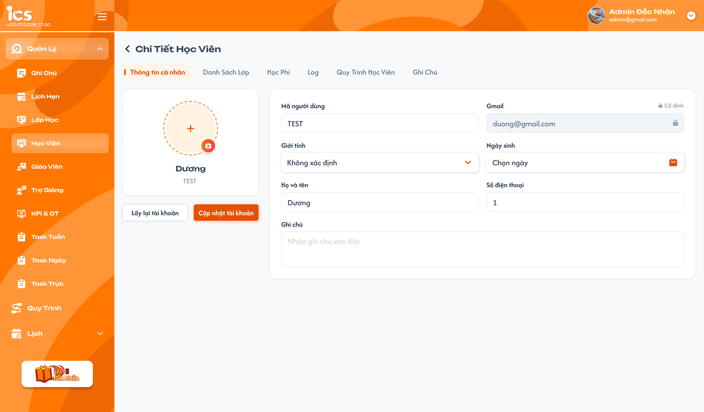
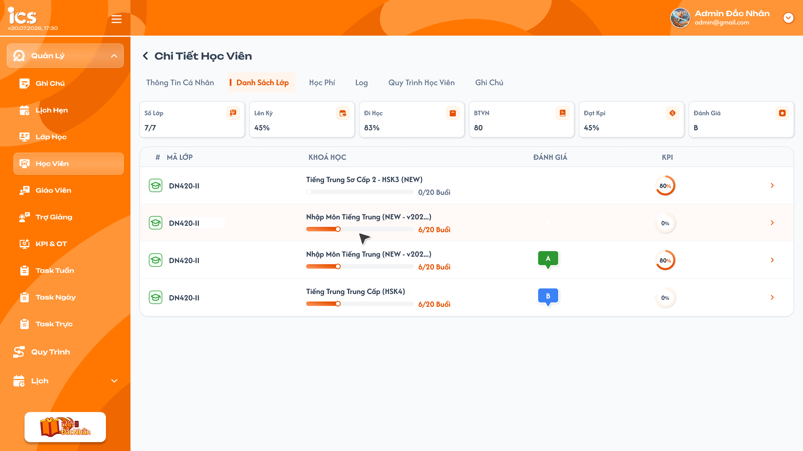
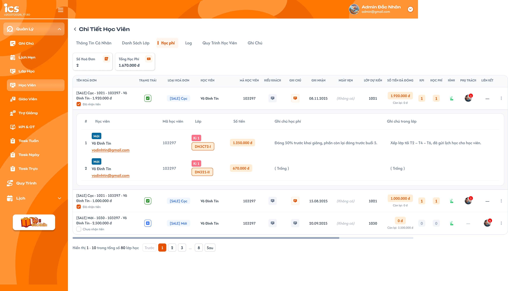
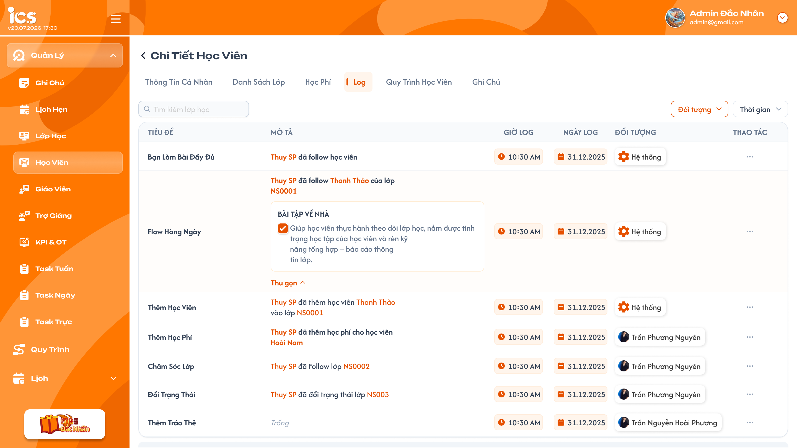
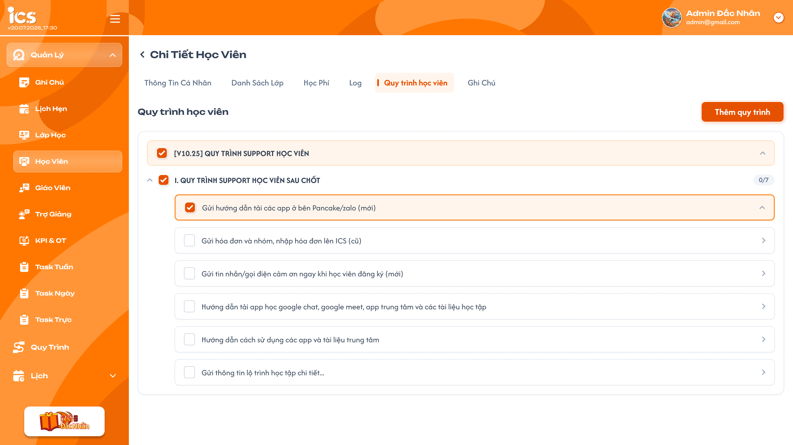
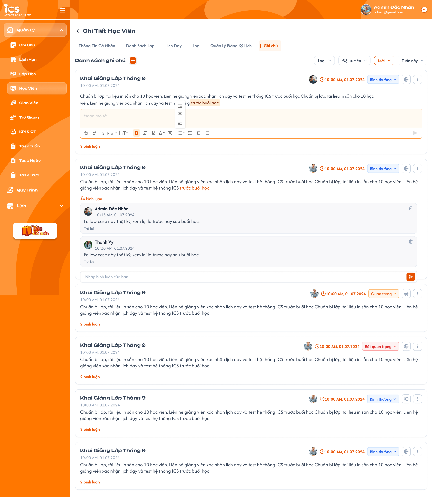
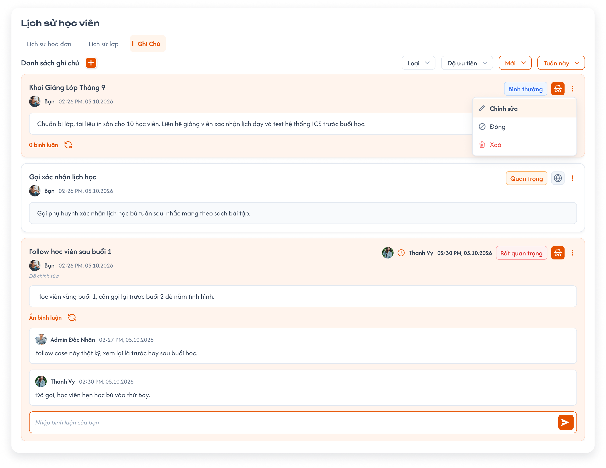

# Chi tiết học viên

## 1. UI

### Trang 1: Khung Chi tiết học viên và điều hướng
- Mở từ mũi tên cuối dòng Danh sách học viên; tiêu đề `Chi Tiết Học Viên` có nút quay lại danh sách.
- Sáu tab đúng thứ tự: **Thông tin cá nhân → Danh sách lớp → Học phí → Log → Quy trình học viên → Ghi chú**. Mặc định mở Thông tin cá nhân. Tab active dùng chữ cam, nền cam nhạt và vạch cam bên trái theo ảnh.
- Tất cả tab dùng cùng student_id đang chọn; chuyển tab không tạo tài khoản hoặc bản sao dữ liệu. Dữ liệu của các tab dùng chung phải đồng nhất với popup Lịch sử học viên và module nguồn.
- Danh sách lớp/Học phí **phân trang từng trang**; Ghi chú/Quy trình học viên/Log **load more**. Số dòng/lượt theo cấu hình chung; không lấy số mẫu trên ảnh làm quy định riêng. Thống kê/tổng tiến độ tính toàn bộ dữ liệu của học viên, không giới hạn trong trang/lượt đã tải.
- Chỉ tải tab trong phạm vi quyền; loading, rỗng và lỗi phân biệt rõ. Khi đổi học viên hoặc đổi điều kiện, response cũ không được ghi đè dữ liệu mới.

### Trang 2: ADM-HV-020100 — Chi tiết học viên — Thông tin cá nhân




*Chi tiết học viên — tab Thông tin cá nhân — nhấn để xem ảnh gốc*

**Mô tả:**

- Màn hình hiển thị thông tin cá nhân của đúng học viên đang được chọn.
- User chỉ được xem và cập nhật học viên thuộc phạm vi dữ liệu mà role hiện tại được phép thao tác.
- Tab `Thông tin cá nhân` cho phép cập nhật ảnh đại diện, họ và tên, ngày sinh, giới tính, số điện thoại và ghi chú.
- UI mới có card ảnh/họ tên/mã bên trái và form hai cột bên phải: Mã người dùng/Gmail, Giới tính/Ngày sinh, Họ và tên/Số điện thoại; Ghi chú chiếm cả hàng cuối. Nút `Lấy lại tài khoản` và `Cập nhật tài khoản` ở dưới card trái.
- `Mã người dùng` và `Email` chỉ đọc theo quy tắc đã chốt. Trạng thái tài khoản `Chính thức` vẫn được bảo vệ trong dữ liệu; ảnh mới không có control Trạng thái nên không thêm field này vào form. `TEST`, `Dương`, SĐT `1` trong ảnh là dữ liệu mẫu, không thay quy tắc Code/validation.

**Field:**

- `A02.01` **Ảnh đại diện**: Bắt buộc: Không; Cho phép cập nhật: Có; Cho phép tải ảnh mới có dung lượng tối đa `25 MB`. Khi chưa có ảnh cá nhân, hệ thống hiển thị avatar mặc định. Chọn ảnh mới chỉ tạo bản xem trước; ảnh được lưu khi user bấm `Cập nhật tài khoản`. Nếu không chọn ảnh mới thì giữ nguyên ảnh hiện tại.
- `A02.02` **Họ và tên**: Bắt buộc: Có; Cho phép cập nhật: Có; Hiển thị họ tên hiện tại; không được để trống hoặc chỉ chứa khoảng trắng.
- `A02.03` **Ngày sinh**: Bắt buộc: Có; Cho phép cập nhật: Có; Hiển thị ngày sinh hiện tại và cho phép chọn lại ngày.
- `A02.04` **Giới tính**: Bắt buộc: Có; Cho phép cập nhật: Có; Hiển thị giá trị hiện tại và cho phép chọn `Nam`, `Nữ` hoặc `Không xác định`.
- `A02.05` **Mã người dùng**: Bắt buộc: Có; Cho phép cập nhật: Không; Chính là `Code` 6 chữ số được hệ thống sinh tăng dần theo cấp độ 1..9 tại [Thêm học viên](./student_management_requirements.md#dropdown-chọn-cấp-độ-và-code-học-viên), ví dụ Cấp độ 1 bắt đầu từ 100000. Field luôn ở trạng thái chỉ đọc; không được sinh lại hoặc thay đổi khi cập nhật chi tiết.
- `A02.06` **Số điện thoại**: Bắt buộc: Có; Cho phép cập nhật: Có; Cho phép thay đổi; số điện thoại phải đúng định dạng theo case tạo học viên và được phép trùng với học viên khác.
- `A02.07` **Email**: Bắt buộc: Có; Cho phép cập nhật: Không; Hiển thị email đã dùng khi tạo học viên. Field luôn ở trạng thái chỉ đọc và không được cập nhật tại màn hình chi tiết.
- `A02.08` **Ghi chú**: Bắt buộc: Không; Cho phép cập nhật: Có; Cho phép nhập, sửa hoặc xóa toàn bộ nội dung. Không áp dụng giới hạn nội dung hoặc độ dài ở tầng nghiệp vụ.

**Điểm cần lưu ý:**

- Nút `Cập nhật tài khoản` chỉ cập nhật các field được phép sửa: `Ảnh đại diện`, `Họ và tên`, `Ngày sinh`, `Giới tính`, `Số điện thoại`, `Ghi chú`.
- Backend phải kiểm soát field chỉ đọc; request cố thay đổi `Mã người dùng`, `Email` hoặc `Trạng thái` phải bị từ chối và không được làm thay đổi bất kỳ dữ liệu nào.
- Việc cập nhật phải có tính nguyên tử: hoặc toàn bộ dữ liệu hợp lệ được lưu, hoặc giữ nguyên toàn bộ dữ liệu trước đó nếu có lỗi.
- Khi cập nhật thành công, hệ thống hiển thị `Cập nhật thông tin học viên thành công.` và tải lại đúng dữ liệu vừa lưu.
- Khi cập nhật thất bại, hệ thống hiển thị `Không thể cập nhật thông tin học viên. Vui lòng thử lại.`, giữ dữ liệu đã nhập trên form để user sửa hoặc thử lại và không lưu thay đổi dở dang.
- Nút `Lấy lại tài khoản` là thao tác độc lập với `Cập nhật tài khoản`. Khi bấm nút, hệ thống phải mở popup xác nhận trước khi thực hiện. Khi xử lý thành công, mật khẩu đăng nhập của học viên được đặt lại chính xác thành `abc12345`; thao tác này không cập nhật các field thông tin cá nhân.
- Sau khi lấy lại mật khẩu thành công, hệ thống hiển thị `Đặt lại mật khẩu học viên thành công.`. Nếu thất bại, mật khẩu hiện tại phải được giữ nguyên và hiển thị `Không thể đặt lại mật khẩu học viên. Vui lòng thử lại.`

### Trang 3: Popup xác nhận lấy lại mật khẩu — UI cần bổ sung
- UI hiện tại mới có nút `Lấy lại tài khoản` và chưa có popup xác nhận; sản phẩm hoàn chỉnh phải bổ sung popup này.
- Tiêu đề popup: `Xác nhận lấy lại mật khẩu`.
- Nội dung: `Bạn có chắc chắn muốn đặt lại mật khẩu học viên về abc12345 không?`
- Nút `Hủy`: đóng popup, không gửi yêu cầu và không thay đổi mật khẩu.
- Nút `Xác nhận`: gửi yêu cầu đặt lại mật khẩu của đúng học viên đang xem.
- Trong thời gian xử lý, vô hiệu hóa nút `Xác nhận` để tránh gửi yêu cầu lặp.

### Trang 4: Chi tiết học viên — Danh sách lớp


*Danh sách lớp — sáu thẻ thống kê và bảng lớp của học viên*

- Nội dung và nghiệp vụ giống [Lịch sử lớp trong Lịch sử học viên](./student_management_requirements.md#lịch-sử-lớp), trình bày thành tab tại trang Chi tiết học viên.
- Sáu thẻ theo thứ tự: **Số Lớp, Lên Kỳ, Đi Học, BTVN, Đạt Kpi, Đánh Giá**. Dùng đúng công thức, tập lớp và cách làm tròn đã chốt ở Lịch sử lớp; thống kê trên toàn bộ lịch sử của học viên, không chỉ trang đang xem.
- Bảng gồm icon trạng thái lớp/mã lớp, khóa học, tiến độ cả lớp `x/N Buổi`, Đánh giá và vòng KPI. Icon lấy **trạng thái lớp** theo [Trạng thái lớp](../class_management/class_management_requirements.md#trạng-thái-lớp); không dùng trạng thái học viên trong lớp.
- Mũi tên cuối dòng mở Chi tiết lớp tương ứng. Vì đang ở trang chi tiết, điều hướng trực tiếp; không có bước đóng popup lịch sử.
- **Phân trang từng trang:** footer có phạm vi đang hiển thị/tổng số **lớp**, Trước, số trang và Sau. Đổi trang thay tập dòng đang hiển thị, giữ đúng student_id; không nối thêm như load more. Trang đầu/cuối vô hiệu hóa Trước/Sau tương ứng. Ảnh chưa có footer nhưng phân trang vẫn phải có theo yêu cầu đã chốt; số dòng/trang theo cấu hình phân trang chung.
- Tên khóa rút gọn theo UI; số `7/7`, `45%`, `80`, `B`, mã lớp lặp trong ảnh là mẫu, không hard-code. BTVN vẫn hiển thị tỷ lệ theo requirement lịch sử.

### Trang 5: Chi tiết học viên — Học phí


*Học phí — thẻ thống kê, hóa đơn và chi tiết phân bổ mở rộng*

- Giống [tab Học phí trong Lịch sử học viên](./student_management_requirements.md#học-phí--danh-sách-hóa-đơn), dùng cùng dữ liệu hóa đơn/học phí, công thức và toàn bộ thao tác đã chốt.
- Hai thẻ **Số Hoá Đơn** (số hóa đơn tạo cho học viên, mỗi hóa đơn một lần) và **Tổng Học Phí** (tổng Giá trị học phí đã dùng của học viên). Thẻ tổng hợp toàn bộ dữ liệu của học viên, không chỉ hóa đơn trên trang.
- Bảng 16 cột và menu theo lịch sử; bấm hóa đơn mở các phân bổ học phí của invoice_id đó; bảng con có Học viên, Mã, Lớp/kỳ, Số tiền, Ghi chú học phí và Ghi chú trong lớp. Nhãn Mới cạnh tên là tag của item học phí.
- Cho phép thao tác học phí/hóa đơn hiện có như lịch sử: Thêm học phí hai bước, chỉnh sửa, Copy tên, Xóa có xác nhận; các mục đang disable giữ nguyên theo requirement Hóa đơn. **Không tạo hóa đơn mới** tại tab này. Xóa hóa đơn đồng bộ học phí/số dư mọi học viên liên kết theo requirement Hóa đơn; Hủy/lỗi không lưu dở dang.
- **Phân trang từng trang theo hóa đơn**, không phân trang từng phân bổ học phí. Footer dùng số/tổng **hóa đơn**, sửa nhãn mẫu `lớp học` trong ảnh thành `hóa đơn`. Cuộn ngang để xem đủ cột; đổi trang thay các dòng hóa đơn, không nối thêm. Thẻ thống kê vẫn lấy toàn bộ dữ liệu.

### Trang 6: Chi tiết học viên — Log


*Log — tìm kiếm, bộ lọc và nhật ký của học viên*

- Áp dụng cùng chức năng [Chi tiết lớp → Menu Nhật ký → Tab Nhật ký](../class_management/class_detail_journal_requirements.md), đổi đối tượng dữ liệu từ **lớp** sang **học viên đang mở**. Không đưa các tab Ghi Chú/Lịch Hẹn/Tin Nhắn của menu Nhật ký lớp vào Log học viên.
- UI có search bên trái, filter **Đối tượng/Thời gian** bên phải; bảng **Tiêu đề, Mô tả, Giờ log, Ngày log, Đối tượng, Thao tác** theo ảnh. Placeholder search là `Tìm kiếm nhật ký` cho đúng ngữ cảnh; `Tìm kiếm lớp học` trên ảnh là nhãn mẫu.
- Search chỉ theo Tiêu đề, Enter ngay hoặc debounce 2 giây từ ký tự cuối; Đối tượng lấy user đã viết nhật ký của học viên và Hệ thống, lọc theo ID người tạo/nguồn. Không lấy người chỉ được nhắc trong mô tả làm chủ log. Search/filter kết hợp AND.
- Thời gian mặc định **Hôm nay**; đủ 12 lựa chọn và quy tắc khoảng ngày theo Nhật ký lớp. Giờ/Ngày log lấy thời điểm tạo nếu chưa sửa, thời điểm sửa thành công gần nhất nếu đã sửa; filter dùng cùng thời điểm và múi giờ.
- Log viết tay hiển thị avatar/tên người tạo; log tự động hiển thị Hệ thống. Mô tả rỗng là `Trống`, không giới hạn độ dài; mở rộng/thu gọn chỉ thay trình bày. Checklist trong mô tả mẫu không tự tạo thao tác cập nhật Result của quy trình.
- Quyền giống Nhật ký lớp, xét **phạm vi học viên**: Admin/Class Handler/Support được xem trong phạm vi được cấp; chỉ Class Handler/Support được tạo viết tay và sửa/xóa log mình tạo. Sale không được xem/thao tác Log nếu không đồng thời có role phù hợp. Admin không có quyền sửa/xóa log người khác; log Hệ thống chỉ đọc.
- Tạo trực tiếp cuối bảng: nhập Tiêu đề rồi Nội dung, `+` xác nhận; Tiêu đề bắt buộc, Nội dung được trống, không giới hạn ký tự. Sửa trực tiếp dòng của mình, Enter hoặc đưa chuột ra ngoài vùng sửa để lưu một lần. Xóa mở popup xác nhận; Hủy giữ nguyên. Toast dùng đúng thông báo Nhật ký lớp.
- Với sự kiện thêm học viên vào lớp/đóng tiền đã chốt ở Nhật ký lớp, Log học viên hiển thị sự kiện liên quan **đúng student_id**; tên người thực hiện/lớp/hóa đơn/số tiền theo action nguồn. Cùng sự kiện không tạo trùng log khi retry; không đưa log của học viên khác trong cùng lớp vào. Không tự mở rộng action tự ghi từ các dòng mẫu trong ảnh.
- **Load more** theo log: tải tiếp nối dòng mới, không lặp log_id; giữ dòng/mô tả đã mở, lỗi giữ dữ liệu cũ và cho thử lại, hết dữ liệu dừng tải. Đổi search/filter hoặc học viên bắt đầu lại từ lượt đầu. Những phần chưa chốt ở Nhật ký lớp (thứ tự, chọn một/nhiều Đối tượng, editor) vẫn kế thừa trạng thái cần xác nhận của nguồn.

### Trang 7: Chi tiết học viên — Quy trình học viên


*Quy trình học viên — Package, Category và Action Item*

- Áp dụng cây và hành vi [Thêm quy trình trong lớp](../class_management/class_detail_processes_requirements.md), cùng [Action Board](../../action_board_requirement/action_board_requirements.md). Quy trình nguồn được định nghĩa ở [Define quy trình](../../process_definition_requirement/process_definition_requirements.md).
- Tab chỉ lấy loại quy trình **Học viên**, cùng center với học viên. Không lấy loại Lớp học/Lớp - Giáo viên/CSKH chỉ vì tên Package có chữ Support. Tên `[V10.25] QUY TRÌNH SUPPORT HỌC VIÊN` và nội dung các task trong ảnh là mẫu.
- Header `Quy trình học viên`, nút **Thêm quy trình**; cây Package → Category → Action Item có checkbox, mở/thu gọn, tiến độ Category như `0/7` và control Result theo loại Action. Số hoàn thành tính từ Result đã lưu, không hard-code hoặc tăng chỉ vì thêm item.
- **Load more** cho danh sách quy trình đã gắn vào học viên; tải lần tiếp nối thêm vào danh sách, giữ cây và Result đã tải, không thay toàn bộ như phân trang. Không chia/nhân đôi cùng một bản ghi hoặc làm reset trạng thái mở/thu gọn khi tải tiếp.
- Result và lựa chọn đã gắn lưu riêng theo **student_id + loại Học viên + Action Item**. Cập nhật của A không thay học viên B, Result lớp hoặc định nghĩa nguồn. Số tiến độ phản ánh toàn bộ dữ liệu đã lưu, không lấy riêng phần đã load làm tổng tiến độ.
- Chỉ nội dung nguồn Công khai được thêm; Nháp/Vô hiệu không xuất hiện trong nguồn chọn mới. Quy trình đã gắn chuyển Vô hiệu vẫn hiện nội dung/Result cũ nhưng chỉ xem; khi Công khai lại áp dụng quyền cập nhật tương ứng.
- **Admin và các user được gán cho học viên** được Thêm quy trình và cập nhật Result trong phạm vi học viên đó. User được gán là Người phụ trách hoặc Người theo dõi theo quyền học viên đã chốt; không phụ thuộc người đã thêm item. Backend kiểm tra quyền này cùng trạng thái nguồn lúc lưu; không dùng quan hệ thành viên lớp thay cho quan hệ với học viên.

### Trang 8: ADM-HV-020610 — Chi tiết học viên — Ghi chú




*Ghi chú — danh sách card, bộ lọc và bình luận*

- Nghiệp vụ giống [Ghi chú trong Lịch sử học viên](./student_management_requirements.md#ghi-chú--danh-sách-bình-luận-và-popup-thêm), cùng các bản ghi note_id/student_id và quyền owner đã chốt. Phần nhãn `Lịch Dạy/Quản Lý Đăng Ký Lịch` trong ảnh Ghi chú là nhãn mẫu cũ; bộ sáu tab chính dùng thứ tự nêu đầu tài liệu.
- Mở tab mặc định **Mới + Tuần này**, Loại/Độ ưu tiên chưa chọn. Filter kết hợp AND với quyền xem; đổi filter tải lại từ lượt đầu, không nối kết quả cũ vào tập mới.
- Card dùng UI Ghi chú mới ở lịch sử: dưới tiêu đề có avatar/tên/ngày tạo note (Bạn nếu là tài khoản hiện tại), nhãn Đã chỉnh sửa khi có sửa. Góc phải có avatar/tên/thời gian bình luận gần nhất kèm icon đồng hồ cam, badge ưu tiên/icon loại/menu; chưa có bình luận thì ẩn cụm bên phải, metadata người tạo bên trái vẫn hiện. Làm mới bình luận theo đúng note, giữ bản nháp.
- Ảnh toàn trang phía trên chỉ tham chiếu vị trí tab; bố cục card/ô bình luận lấy theo ảnh chuẩn mới dưới đây.


- Chỉ owner ghi chú đổi Loại/Độ ưu tiên, đóng/mở lại/sửa/xóa ghi chú. Ghi chú Riêng tư hoặc đã Đóng chỉ owner thấy cả nội dung và bình luận. Chỉ người tạo bình luận sửa/xóa bình luận đó; Trả lời ghi chú là bình luận trong cùng danh sách.
- Nút `+` mở cùng popup Thêm ghi chú; Tiêu đề/Nội dung bắt buộc, văn bản thuần, không giới hạn độ dài. Ô bình luận văn bản thuần, không có toolbar theo UI mới; bình luận không giới hạn độ dài, không gửi rỗng. Field ghi chú trong Thông tin cá nhân là dữ liệu riêng.
- **Load more theo ghi chú**: tải thêm nối các card, giữ bình luận/card đã mở và dữ liệu đang nhập, không nhân đôi note_id. Đang tải chặn yêu cầu tải thêm lặp; lỗi giữ card cũ và cho thử lại; hết dữ liệu ẩn/vô hiệu hóa tải thêm. Danh sách luôn tuân filter và quyền owner, kể cả kết quả tải tiếp.

### Trang 9: Toast phản hồi CRUD


*Toast phản hồi Create, Update, Delete và đổi trạng thái — nhấn để xem ảnh gốc*

**Mô tả:** Toast phản hồi kết quả các thao tác thay đổi dữ liệu trong requirement này.

**Điểm cần lưu ý:**

- `A09.01` **Thành công**: Tiêu đề: `Thành Công`; Khi sử dụng: Backend xác nhận thao tác thành công.
- `A09.02` **Thông tin**: Tiêu đề: `Thông Báo`; Khi sử dụng: Thao tác đã tiếp nhận nhưng dữ liệu cần thời gian đồng bộ.
- `A09.03` **Cảnh báo**: Tiêu đề: `Cảnh Báo`; Khi sử dụng: Dữ liệu/điều kiện cần người dùng kiểm tra.
- `A09.04` **Lỗi**: Tiêu đề: `Có Lỗi Xảy Ra`; Khi sử dụng: Backend/network không hoàn tất thao tác.

**Điểm cần lưu ý:** Nội dung dòng hai lấy từ flow CRUD tương ứng; mỗi thao tác chỉ có một Toast; Hủy/chỉ đọc không có Toast CRUD; nút `×` đóng thủ công; không hiển thị dữ liệu nhạy cảm.

---

## 2. Yêu cầu

### 2.1. Flow chính

**Flow 1: Xem và cập nhật chi tiết học viên**

```text
User có quyền mở Chi tiết học viên
      → Hệ thống tải đúng thông tin của học viên được chọn
      → Hiển thị Mã người dùng/Email chỉ đọc; không render control Trạng thái
      → Dữ liệu tài khoản vẫn Chính thức, không cho sửa qua request
      → User có thể chọn ảnh đại diện mới và chỉnh sửa Họ và tên, Ngày sinh, Giới tính, Số điện thoại, Ghi chú
      → User bấm "Cập nhật tài khoản"
      → Hệ thống kiểm tra các field bắt buộc và kiểm tra request không thay đổi field chỉ đọc
      → Thành công: lưu toàn bộ dữ liệu hợp lệ, tải lại chi tiết và hiển thị "Cập nhật thông tin học viên thành công."
      → Thất bại: không lưu thay đổi dở dang, giữ dữ liệu trên form và hiển thị "Không thể cập nhật thông tin học viên. Vui lòng thử lại."
```

**Flow 2: Lấy lại mật khẩu học viên**

```text
User có quyền mở Chi tiết học viên
      → User bấm "Lấy lại tài khoản"
      → Hệ thống mở popup "Xác nhận lấy lại mật khẩu"
      → Nếu user bấm "Hủy": đóng popup, không gửi yêu cầu và giữ nguyên mật khẩu
      → Nếu user bấm "Xác nhận": hệ thống gửi yêu cầu đặt lại mật khẩu
      → Hệ thống đặt lại mật khẩu của đúng học viên đang xem thành "abc12345"
      → Thành công: không thay đổi thông tin cá nhân và hiển thị "Đặt lại mật khẩu học viên thành công."
      → Thất bại: giữ nguyên mật khẩu hiện tại và hiển thị "Không thể đặt lại mật khẩu học viên. Vui lòng thử lại."
```

**Flow 3: Xem các tab dùng chung với lịch sử**

```text
Mở học viên → Danh sách lớp / Học phí / Ghi chú
      → Kiểm tra student_id và quyền, tải dữ liệu nguồn dùng chung
      → Lớp/Học phí: chuyển từng trang; thẻ tổng lấy toàn bộ học viên
      → Ghi chú: tải thêm card, đổi filter thì tải lại từ lượt đầu
      → Thao tác lưu dùng đúng quy tắc lịch sử, tải lại hai vị trí cùng dữ liệu
```

**Flow 4: Log học viên**

```text
Admin/Class Handler/Support có quyền trên học viên mở Log
      → Search Tiêu đề, Đối tượng, Thời gian mặc định Hôm nay như Nhật ký lớp
      → Load more log của đúng học viên; đổi điều kiện bắt đầu lại
      → Class Handler/Support tạo trực tiếp cuối bảng hoặc sửa/xóa log mình tạo
      → Log Hệ thống chỉ đọc; phản hồi CRUD như Nhật ký lớp
```

**Flow 5: Thêm quy trình và cập nhật Result học viên**

```text
Admin/user được gán mở Quy trình học viên → Thêm quy trình
      → Chọn Package/Category/Action Item Công khai, loại Học viên, cùng center
      → Hủy không lưu; Thêm kiểm tra lại quyền/trạng thái/loại/center/trùng item
      → Gắn nội dung cho student_id; không tự ghi Result
      → Cập nhật Result theo Action Board khi nguồn Công khai; Vô hiệu chỉ xem
      → Load more giữ cây/Result, không sửa định nghĩa nguồn hoặc Result lớp/học viên khác
```

### 2.2. Ngoại lệ

- **EX01:** Không tìm thấy học viên hoặc user không có quyền trên học viên được yêu cầu → không hiển thị dữ liệu chi tiết và không cho phép cập nhật hoặc lấy lại mật khẩu.
- **EX02:** Họ và tên, Ngày sinh, Giới tính hoặc Số điện thoại bị để trống; Họ và tên chỉ chứa khoảng trắng → chặn cập nhật, giữ dữ liệu trên form và hiển thị lỗi tại field tương ứng.
- **EX03:** Request cập nhật có thay đổi `Mã người dùng`, `Email` hoặc `Trạng thái` → backend từ chối toàn bộ request; giữ nguyên mọi dữ liệu của học viên.
- **EX04:** Ảnh đại diện vượt quá `25 MB` hoặc không đáp ứng định dạng upload của hệ thống → chặn toàn bộ thao tác cập nhật, không tải ảnh lên, giữ ảnh hiện tại và hiển thị lỗi upload. Riêng trường hợp vượt dung lượng, hiển thị `Ảnh đại diện không được vượt quá 25 MB.`
- **EX05:** Cập nhật chi tiết thất bại → không lưu bất kỳ field nào, giữ dữ liệu user đã nhập trên form và hiển thị `Không thể cập nhật thông tin học viên. Vui lòng thử lại.`
- **EX06:** Lấy lại mật khẩu thất bại → không thay đổi mật khẩu hiện tại và hiển thị `Không thể đặt lại mật khẩu học viên. Vui lòng thử lại.`
- **EX07:** User bấm `Hủy` hoặc đóng popup xác nhận lấy lại mật khẩu → không gửi yêu cầu đặt lại và giữ nguyên mật khẩu hiện tại.

- **EX08:** Tải trang/lượt tiếp lỗi hoặc response cũ về muộn → không mất dữ liệu đang có hoặc trộn học viên/điều kiện; cho thử lại.
- **EX09:** Quy trình sai loại/center, nguồn không Công khai, item trùng hoặc user không được phép → chặn thêm/cập nhật, không lưu một phần.
- **EX10:** Học phí/ghi chú/Log kế thừa ngoại lệ và bảo vệ quyền của requirement nguồn; truy cập tab không mở rộng quyền CRUD.

### 2.3. Yêu cầu khác

| Mã | Tên yêu cầu | Mô tả |
|---|---|---|
| REQ01 |  | Chi tiết học viên phải tải và hiển thị đúng học viên được chọn, gồm `Ảnh đại diện`, `Họ và tên`, `Ngày sinh`, `Giới tính`, `Mã người dùng`, `Số điện thoại`, `Email`, `Ghi chú`; trạng thái Chính thức được giữ trong dữ liệu, không có control ở UI mới. |
| REQ02 |  | Chỉ `Ảnh đại diện`, `Họ và tên`, `Ngày sinh`, `Giới tính`, `Số điện thoại`, `Ghi chú` được phép cập nhật. Họ và tên, Ngày sinh, Giới tính và Số điện thoại là các field bắt buộc. |
| REQ03 |  | `Mã người dùng` chính là Code được sinh theo Level tại case tạo học viên. `Mã người dùng`, `Email` và `Trạng thái` phải chỉ đọc trên UI và được bảo vệ ở backend; không được thay đổi bằng request trực tiếp. |
| REQ04 |  | Trạng thái tài khoản chỉ có giá trị `Chính thức` và không có thao tác thay đổi; UI mới không render control Trạng thái. |
| REQ05 |  | Ghi chú là field không bắt buộc; cho phép thêm, sửa, xóa trắng và không áp dụng giới hạn nội dung hoặc độ dài ở tầng nghiệp vụ. |
| REQ06 |  | Ảnh đại diện có dung lượng tối đa `25 MB`; ảnh đúng `25 MB` được chấp nhận, ảnh lớn hơn `25 MB` bị từ chối. Khi chọn ảnh hợp lệ, hệ thống hiển thị bản xem trước. Ảnh mới chỉ được lưu cùng thao tác `Cập nhật tài khoản`; không chọn ảnh mới thì giữ ảnh hiện tại, chưa có ảnh thì hiển thị avatar mặc định. |
| REQ07 |  | Cập nhật chi tiết phải có tính nguyên tử. Thành công lưu toàn bộ field hợp lệ và hiển thị notification thành công; thất bại không lưu thay đổi dở dang, giữ dữ liệu trên form và hiển thị notification lỗi trong Flow 1. |
| REQ08 |  | `Lấy lại tài khoản` bắt buộc mở popup xác nhận trước khi gửi yêu cầu. Chỉ khi user bấm `Xác nhận`, hệ thống mới đặt mật khẩu của đúng học viên thành chính xác `abc12345`; thao tác không làm thay đổi field thông tin cá nhân và phải trả về notification thành công hoặc thất bại theo Flow 2. |
| REQ09 |  | Quyền xem, cập nhật chi tiết và lấy lại mật khẩu phải tuân theo cùng phạm vi dữ liệu học viên của role hiện tại; không được truy cập hoặc thao tác trực tiếp với học viên ngoài phạm vi. |

| Mã | Tên yêu cầu | Mô tả |
|---|---|---|
| REQ10 |  | Khung gồm sáu tab đúng thứ tự UI, mặc định Thông tin cá nhân; tab dùng chung student_id, dữ liệu tải/rỗng/lỗi tách biệt. Quay lại danh sách giữ điều kiện trước đó. |
| REQ11 |  | Danh sách lớp giống Lịch sử lớp: cùng sáu thẻ/công thức, trạng thái lớp, tiến độ cả lớp và vòng getUpTerm. Thống kê toàn học viên; bảng phân trang từng trang; mũi tên mở Chi tiết lớp theo quyền. |
| REQ12 |  | Học phí giống tab Học phí của lịch sử, cùng hai thẻ/toàn bộ nghiệp vụ Hóa đơn hiện có, không tạo hóa đơn mới. Phân trang theo hóa đơn, không theo phân bổ; footer đơn vị hóa đơn. Thẻ lấy toàn dữ liệu, xóa đồng bộ mọi học viên liên kết. |
| REQ13 |  | Log giống Menu Nhật ký → Tab Nhật ký lớp, đổi phạm vi sang học viên. Search Tiêu đề Enter/2 giây; Đối tượng theo tác giả/nguồn, Thời gian mặc định Hôm nay. Admin/Class Handler/Support xem trong phạm vi; chỉ Class Handler/Support tạo và sửa/xóa log mình tạo; Hệ thống chỉ đọc. Load more; các phần chưa chốt tại nguồn vẫn cần xác nhận. |
| REQ14 |  | Quy trình học viên dùng Action Board và popup chọn như lớp, chỉ loại Học viên, nguồn Công khai cùng center. Admin/user được gán được Thêm/cập nhật Result; Vô hiệu chỉ xem Result cũ. Không gắn trùng, không tự hoàn thành hoặc sửa nguồn. Result theo student_id, không lẫn lớp/học viên khác. Danh sách dùng load more. |
| REQ15 |  | Ghi chú giống lịch sử, cùng note_id/student_id, mặc định Mới + Tuần này; Loại/Độ ưu tiên chưa chọn, metadata từ bình luận gần nhất. Quyền owner, văn bản thuần form thêm và bình luận văn bản thuần theo lịch sử. Load more card, đổi filter tải lại từ đầu. |
| REQ16 |  | Phân trang lớp/hóa đơn thay tập dòng; load more note/quy trình/log nối dữ liệu không trùng ID, giữ dữ liệu cũ khi lỗi và dừng khi hết. Đổi học viên/điều kiện reset page/cursor, bỏ response cũ. Thống kê/tổng tiến độ không chỉ tính phần đã tải. |

### 2.4. Ràng buộc

#### Quyền

| Role | Xem chi tiết | Cập nhật chi tiết | Lấy lại mật khẩu |
|---|:---:|:---:|:---:|
| Administrator | ✅ | ✅ | ✅ |
| Sale | ✅ | ✅ | ✅ |
| Support | ✅ | ✅ | ✅ |
| Class Handler | ✅ | ✅ | ✅ |
| Các role khác | ❌ | ❌ | ❌ |

#### Ràng buộc khác

**Phạm vi dữ liệu**

- Administrator xem và thao tác trên toàn bộ học viên.
- Sale, Support và Class Handler chỉ xem, cập nhật và lấy lại mật khẩu của học viên mà chính user đó được gán làm Người phụ trách hoặc Người theo dõi.
- Bảng quyền thông tin cá nhân không tự cấp quyền cho mọi thao tác tab khác. Học phí/ghi chú theo lịch sử; Log theo role/quyền owner Nhật ký lớp; Quy trình cho Admin và user được gán như REQ14.
- Không cho phép truy cập hoặc thực hiện hành động bị đánh dấu `❌`, kể cả khi gọi trực tiếp bằng URL hoặc request.

---

---

## 3. Testcase

### Feature: Chi tiết học viên

| Tên testcase | Priority | Scenario | Role | Pre-condition | Given/When/Then | Expected Result |
|---|---|---|---|---|---|---|
| Case 12: Bộ sáu tab và tab mặc định | High | REQ10 | User được xem học viên | Danh sách có học viên A | **Given** User bấm mũi tên cuối dòng A<br>**When** Mở Chi tiết học viên và chuyển các tab<br>**Then** Đúng sáu tab, mặc định Thông tin cá nhân | - Active theo màu/vạch cam<br>- Các tab tải theo A và quyền tương ứng<br>- Quay lại đúng Danh sách học viên, giữ điều kiện danh sách |
| Case 13: Chuyển học viên không lẫn dữ liệu | High | REQ10 / REQ16 | User được xem A và B | A/B có thông tin, lớp, hóa đơn, note, quy trình và log khác nhau | **Given** A đang tải một tab<br>**When** Chuyển sang B rồi response A về muộn<br>**Then** Chỉ dữ liệu B được hiển thị | - Cursor/page theo đúng student_id<br>- Không nối card/dòng A vào B<br>- Không cho thao tác bằng ID dữ liệu của A trên B |
| Case 1: Hiển thị đúng chi tiết học viên | High · Smoke | Flow 1 / REQ01 | Administrator | Có học viên với đầy đủ thông tin cá nhân | **Given** User có quyền trên học viên A<br>**When** Mở Chi tiết học viên A<br>**Then** Hệ thống tải tab Thông tin cá nhân | - Hiển thị đúng ảnh đại diện, họ tên, ngày sinh, giới tính, mã người dùng, số điện thoại, email và ghi chú của A<br>- Không lẫn dữ liệu học viên khác<br>- Không render control Trạng thái; dữ liệu tài khoản vẫn Chính thức |
| Case 2: Cập nhật các field được phép sửa | High · Smoke | Flow 1 / REQ02 / REQ07 | Administrator | Màn Chi tiết học viên đang mở | **Given** Các field hiện tại đã được tải<br>**When** User sửa Họ và tên, Ngày sinh, Giới tính, Số điện thoại, Ghi chú rồi bấm `Cập nhật tài khoản`<br>**Then** Hệ thống lưu cập nhật | - Hiển thị `Cập nhật thông tin học viên thành công.`<br>- Tải lại đúng toàn bộ giá trị mới<br>- Mã người dùng, Email và Trạng thái không thay đổi |
| Case 3: Khóa Mã người dùng, Email và Trạng thái | High | EX03 / REQ03 / REQ04 | Administrator | Màn Chi tiết học viên đang mở | **Given** Mã người dùng, Email và Trạng thái đã có giá trị<br>**When** User kiểm tra UI và gửi request trực tiếp cố thay đổi từng field<br>**Then** Hệ thống không cho phép thay đổi | - Mã/Email chỉ đọc trên UI; không có control Trạng thái<br>- Backend từ chối toàn bộ request sửa field chỉ đọc<br>- Không có dữ liệu nào của học viên bị thay đổi<br>- Trạng thái vẫn là `Chính thức` |
| Case 4: Cập nhật và xóa trắng Ghi chú | High | Flow 1 / REQ05 | Administrator | Học viên lần lượt có và chưa có ghi chú | **Given** Màn Chi tiết học viên đang mở<br>**When** User nhập nội dung bất kỳ, cập nhật, sau đó xóa toàn bộ nội dung và cập nhật lần nữa<br>**Then** Hệ thống chấp nhận cả hai thao tác | - Lưu đúng nội dung khi có giá trị<br>- Cho phép lưu ghi chú rỗng<br>- Không áp dụng giới hạn nội dung hoặc độ dài nghiệp vụ |
| Case 5: Upload ảnh đại diện | High | Flow 1 / REQ06 | Administrator | Màn Chi tiết học viên đang mở | **Given** Học viên đang dùng avatar mặc định hoặc ảnh đã có<br>**When** User chọn ảnh mới và bấm `Cập nhật tài khoản`<br>**Then** Hệ thống cập nhật ảnh đại diện | - Hiển thị bản xem trước trước khi lưu<br>- Thành công hiển thị lại ảnh mới<br>- Nếu không chọn ảnh mới thì giữ ảnh hiện tại |
| Case 6: Cập nhật chi tiết thất bại không lưu dở dang | High | EX02 / EX05 / REQ07 | Administrator | User đã thay đổi nhiều field trên form | **Given** Dữ liệu cũ đã được lưu<br>**When** Submit dữ liệu thiếu field bắt buộc hoặc hệ thống xử lý gặp lỗi<br>**Then** Hệ thống từ chối cập nhật | - Không field nào bị lưu riêng lẻ<br>- Dữ liệu persisted vẫn là dữ liệu cũ<br>- Form giữ nội dung user đã nhập để chỉnh sửa hoặc thử lại<br>- Lỗi hệ thống hiển thị `Không thể cập nhật thông tin học viên. Vui lòng thử lại.` |
| Case 9: Chặn truy cập chi tiết học viên ngoài phạm vi | High | EX01 / REQ09 | Sale, Support, Class Handler | User không được gán phụ trách hoặc theo dõi học viên A | **Given** User đã đăng nhập<br>**When** Truy cập trực tiếp URL hoặc gửi request xem, cập nhật, lấy lại mật khẩu của A<br>**Then** Hệ thống từ chối thao tác | - Không trả về dữ liệu chi tiết của A<br>- Không cập nhật thông tin hoặc mật khẩu của A |
| Case 10: Kiểm tra dung lượng ảnh đại diện tối đa | High | EX04 / REQ06 | Administrator | Màn Chi tiết học viên đang mở | **Given** User lần lượt chọn ảnh có dung lượng đúng 25 MB và lớn hơn 25 MB<br>**When** Bấm `Cập nhật tài khoản`<br>**Then** Hệ thống kiểm tra giới hạn dung lượng | - Ảnh đúng 25 MB được chấp nhận nếu thỏa các điều kiện upload còn lại<br>- Ảnh lớn hơn 25 MB bị từ chối<br>- Hiển thị `Ảnh đại diện không được vượt quá 25 MB.`<br>- Không lưu thay đổi dở dang và giữ ảnh hiện tại khi bị từ chối |
| Case 7: Lấy lại mật khẩu thành công | High · Smoke | Flow 2 / REQ08 | Administrator | User có quyền trên học viên và học viên có mật khẩu hiện tại khác `abc12345` | **Given** Màn Chi tiết học viên đang mở<br>**When** User bấm `Lấy lại tài khoản`, popup hiển thị và user bấm `Xác nhận`<br>**Then** Hệ thống đặt lại mật khẩu học viên | - Popup có đúng tiêu đề, nội dung, nút Hủy và Xác nhận<br>- Mật khẩu mới chính xác là `abc12345`<br>- Hiển thị `Đặt lại mật khẩu học viên thành công.`<br>- Không thay đổi bất kỳ field thông tin cá nhân nào |
| Case 8: Lấy lại mật khẩu thất bại | High | Flow 2 / EX06 / REQ08 | Administrator | Xử lý đặt lại mật khẩu gặp lỗi | **Given** Học viên có mật khẩu hiện tại<br>**When** User bấm `Lấy lại tài khoản`, popup hiển thị và user bấm `Xác nhận`<br>**Then** Hệ thống không hoàn thành thao tác | - Giữ nguyên mật khẩu hiện tại<br>- Hiển thị `Không thể đặt lại mật khẩu học viên. Vui lòng thử lại.`<br>- Không thay đổi thông tin cá nhân |
| Case 11: Hủy popup lấy lại mật khẩu | High | Flow 2 / EX07 / REQ08 | Administrator | Popup xác nhận lấy lại mật khẩu đang mở | **Given** Học viên có mật khẩu hiện tại<br>**When** User bấm `Hủy` hoặc đóng popup<br>**Then** Hệ thống dừng thao tác | - Đóng popup<br>- Không gửi yêu cầu đặt lại mật khẩu<br>- Giữ nguyên mật khẩu hiện tại |
| Case 14: Đồng nhất Danh sách lớp và Lịch sử lớp | High | REQ11 | User được xem học viên | Học viên có lớp chính thức/không chính thức và nhiều trạng thái lớp | **Given** Mở Lịch sử lớp và tab Danh sách lớp của cùng học viên<br>**When** Đối chiếu dữ liệu<br>**Then** Cùng sáu thẻ, công thức và thông tin từng lớp | - Thống kê không thay theo trang<br>- Status/icon theo lớp, tiến độ theo cả lớp<br>- Lên kỳ/KPI/Đánh giá và Đi học/BTVN theo requirement lịch sử |
| Case 15: Phân trang lớp theo student_id | High | REQ11 / REQ16 | User được xem học viên | A có nhiều hơn một trang lớp; B có lớp khác | **Given** Mở Danh sách lớp A<br>**When** Chọn trang 2, Trước/Sau rồi chuyển sang học viên B<br>**Then** Mỗi trang chỉ chứa lớp của đúng học viên | - Đổi trang thay dòng cũ, không nối danh sách<br>- Footer dùng đơn vị lớp; Trước/Sau đúng biên<br>- Response A về muộn không ghi đè B |
| Case 16: Mở Chi tiết lớp từ học viên | High | REQ11 | User có quyền xem học viên và lớp đích | Tab có dòng lớp C | **Given** User xem dòng C<br>**When** Bấm mũi tên cuối dòng<br>**Then** Mở đúng Chi tiết lớp C theo quyền lớp | - Không mở lớp trùng tên nhưng khác ID<br>- Không yêu cầu đóng popup<br>- Không mở rộng quyền xem lớp từ quyền xem học viên |
| Case 17: Đồng nhất Học phí với popup lịch sử | High | REQ12 | User được xem học viên | Có nhiều hóa đơn/phân bổ cho học viên A | **Given** Mở Học phí A ở hai vị trí<br>**When** Đối chiếu thẻ và bảng<br>**Then** Cùng công thức và dữ liệu đã lưu | - Đủ 16 cột, cuộn ngang<br>- Nhãn Mới là tag item<br>- Mỗi phân bổ giữ ID, không gộp vì cùng tên/mã |
| Case 18: Phân trang hóa đơn không làm đổi thẻ tổng | High | REQ12 / REQ16 | User được xem học viên | Có đủ hóa đơn cho nhiều trang, một hóa đơn có nhiều phân bổ | **Given** Mở trang 1 rồi trang 2<br>**When** Mở/thu gọn bảng con và cuộn ngang<br>**Then** Đổi tập hóa đơn nhưng tổng toàn học viên không đổi | - Footer đếm hóa đơn, không đếm phân bổ/lớp<br>- Bảng con đúng invoice_id<br>- Trước/Sau đúng biên, không nối dòng cũ |
| Case 19: Thao tác học phí của hóa đơn hiện có | High | REQ12 | User có quyền học phí | Hóa đơn còn số dư | **Given** Mở menu hóa đơn từ tab Học phí<br>**When** Thêm học phí, chỉnh sửa hoặc Copy tên<br>**Then** Áp dụng form/quy tắc Hóa đơn như lịch sử | - Thêm học phí hai bước, giá trị không vượt Còn lại<br>- Không có tạo hóa đơn mới<br>- Copy tên không tạo bản sao hóa đơn<br>- Tải lại cùng dữ liệu ở lịch sử và chi tiết |
| Case 20: Xóa hóa đơn đồng bộ học phí | High | REQ12 | User có quyền xóa hóa đơn | Hóa đơn đã dùng liên kết nhiều học viên | **Given** Mở popup xác nhận xóa<br>**When** Lần lượt Hủy, gặp lỗi và xác nhận thành công<br>**Then** Hủy/lỗi giữ nguyên; thành công cập nhật hóa đơn/học phí/số dư | - Tính lại thẻ theo dữ liệu còn hiệu lực<br>- Đồng bộ mọi học viên liên kết<br>- Không còn học phí hiệu lực từ hóa đơn đã xóa<br>- Không tự hoàn tiền hoặc xóa quan hệ học viên–lớp |
| Case 21: Log giới hạn đúng học viên | High | REQ13 | Admin/Class Handler/Support có quyền | Hai học viên A/B cùng lớp, có log riêng và log Hệ thống | **Given** Mở Log A rồi B<br>**When** Tải danh sách<br>**Then** Chỉ log liên quan student_id hiện tại | - Đủ cột theo UI<br>- Viết tay là người tạo, tự động là Hệ thống<br>- Không đưa toàn bộ nhật ký lớp vào Log học viên<br>- Response cũ về muộn không ghi đè học viên mới |
| Case 22: Search/filter Log kế thừa Nhật ký lớp | High | REQ13 | User được xem Log | Tiêu đề và mô tả có từ khóa khác nhau; có user trùng tên | **Given** Mở Log, mặc định Hôm nay<br>**When** Search rồi Enter hoặc dừng 2 giây, chọn Đối tượng/Thời gian<br>**Then** Chỉ trả kết quả đồng thời khớp điều kiện | - Chỉ search Tiêu đề; Enter không gửi lặp sau 2 giây<br>- User theo ID, nguồn Hệ thống không thuộc user nhắc trong mô tả<br>- Tùy chọn bao gồm hai ngày biên, chặn khoảng sai |
| Case 23: Quyền CRUD nhật ký viết tay | High | REQ13 | Owner Class Handler/Support; user khác; Admin/Sale | A có log viết tay | **Given** A tạo trực tiếp cuối bảng rồi sửa tại dòng<br>**When** Enter/ra ngoài vùng sửa; B hoặc Admin thử sửa/xóa A; Sale thử mở Log<br>**Then** Chỉ A với role/phạm vi phù hợp lưu được | - Giờ/ngày cập nhật theo lần sửa thành công<br>- Xóa cần xác nhận, Hủy/lỗi giữ dữ liệu<br>- Không giả mạo tác giả qua request<br>- Role không hợp lệ bị chặn |
| Case 24: Log Hệ thống chỉ đọc và không trùng sự kiện | High | REQ13 | User được xem Log | A có sự kiện thêm vào lớp/đóng học phí đã thành công | **Given** Cùng sự kiện được xử lý lại<br>**When** Xem Log và thử sửa/xóa log Hệ thống<br>**Then** Một log đúng sự kiện, request sửa/xóa bị chặn | - Mô tả đúng người thực hiện/học viên/lớp/hóa đơn/tiền của lần đóng<br>- Hủy/thất bại không có log thành công<br>- Hai action độc lập vẫn có hai log |
| Case 25: Nội dung Log và phản hồi lỗi | Medium | REQ13 | User được xem/ghi Log | Có log rỗng và mô tả dài; API có thể lỗi | **Given** User mở rộng/thu gọn, tạo thiếu tiêu đề hoặc lưu lỗi<br>**When** UI xử lý<br>**Then** Trống/chi tiết/validation hiển thị như Nhật ký lớp | - Chỉ mở rộng không đổi dữ liệu/Result<br>- Tạo/sửa lỗi giữ nội dung và dữ liệu cũ<br>- Một Toast đúng kết quả, không báo thành công sớm |
| Case 35: Load more Log và đổi điều kiện | High | REQ13 / REQ16 | User được xem Log | Có nhiều lượt log thuộc các điều kiện khác nhau | **Given** Đã tải lượt đầu và mở mô tả<br>**When** Tải thêm, retry lỗi rồi đổi search/filter<br>**Then** Nối log mới không trùng; đổi điều kiện tải từ đầu | - Giữ dòng cũ khi lỗi, hết dữ liệu dừng tải<br>- Không lẫn response điều kiện cũ<br>- Dòng Log luôn tuân quyền và đúng student_id |
| Case 26: Quy trình và Result riêng cho học viên | High | REQ14 | User được xem học viên | A/B có quy trình cùng item nguồn; lớp có Result khác | **Given** Mở Quy trình A và B<br>**When** Đối chiếu nội dung và Result<br>**Then** Dữ liệu tách theo student_id | - Không lẫn Result học viên/lớp/nguồn<br>- Cây và control theo Action Board<br>- Tiến độ dùng Result, không dùng checkbox lựa chọn của popup |
| Case 27: Load more quy trình | High | REQ14 / REQ16 | User được xem học viên | Có nhiều lượt quy trình đã gắn | **Given** Đã tải lượt đầu và mở một Category<br>**When** Bấm tải thêm, retry khi lỗi và tải đến hết<br>**Then** Nối lượt mới, không trùng bản ghi | - Giữ nội dung/Result/trạng thái cây đã tải<br>- Lỗi giữ danh sách cũ, cho thử lại<br>- Hết dữ liệu không tiếp tục tải hoặc hiển thị nút tải thêm<br>- Tổng tiến độ không đổi do chỉ tải thêm |
| Case 28: Nguồn Vô hiệu chỉ xem | High | REQ14 | Admin hoặc user được gán cho học viên | Quy trình Công khai đã gắn, có Result | **Given** Nguồn chuyển Vô hiệu<br>**When** Xem và thử lưu Result qua UI/request<br>**Then** Giữ nội dung/kết quả cũ, chặn lưu | - Không mất Result<br>- Công khai lại áp dụng quyền cập nhật<br>- Quyền phải kiểm tra lại lúc lưu |
| Case 29: Chọn quy trình đúng loại và center | High | REQ14 | Admin hoặc user được gán cho học viên | Có nguồn 5 loại và nhiều center/trạng thái | **Given** Bấm Thêm quy trình của A<br>**When** Chọn cha/con rồi xác nhận<br>**Then** Chỉ thêm item Công khai thuộc loại Học viên trong center A | - Không chọn nguồn CSKH chỉ vì tên Support<br>- Chọn/bỏ chọn cha/con theo popup lớp<br>- Không thêm trùng, không tự hoàn thành hoặc đổi nguồn |
| Case 30: Hủy, đổi trạng thái nguồn và request sai quyền | High | REQ14 | User có/không có quyền thêm | Popup có lựa chọn nháp | **Given** User Hủy hoặc nguồn đổi Vô hiệu trước lúc lưu, hoặc request khác center/sai loại/vượt quyền<br>**When** Xử lý lưu<br>**Then** Không gắn nội dung sai hoặc lưu một phần | - Hủy không Toast CRUD<br>- Lỗi giữ lựa chọn và phản hồi đúng<br>- Backend kiểm tra lại quyền và trạng thái nguồn<br>- Admin/user được gán được lưu; user không được gán bị chặn, kể cả gọi trực tiếp |
| Case 31: Ghi chú đồng nhất hai vị trí | High | REQ15 | User được xem học viên | A có ghi chú và bình luận | **Given** Mở tab Ghi chú ở lịch sử và chi tiết A<br>**When** Thêm note/bình luận hoặc owner đổi Loại/Độ ưu tiên<br>**Then** Hai vị trí tải lại cùng dữ liệu | - Mặc định Mới + Tuần này, hai filter khác chưa chọn<br>- Metadata cam theo bình luận gần nhất, chưa có thì ẩn<br>- Ghi chú cá nhân không bị thay thế |
| Case 32: Load more và đổi filter Ghi chú | High | REQ15 / REQ16 | User được xem học viên | Có nhiều lượt ghi chú thuộc các filter | **Given** Mở card/bình luận ở lượt đầu<br>**When** Tải tiếp, retry lỗi rồi đổi filter<br>**Then** Nối đúng tập ban đầu; đổi filter thay tập và cursor từ đầu | - Không trùng note_id<br>- Giữ card cũ khi lỗi<br>- Không trộn response filter/học viên cũ về muộn<br>- Hết dữ liệu không tải thêm |
| Case 33: Quyền owner trên mọi lượt ghi chú | High | REQ15 | Owner và user khác cùng quyền học viên | Có note Công khai Mới, Riêng tư và Đóng ở nhiều lượt | **Given** Hai user xem/tải thêm<br>**When** Non-owner thử đọc hoặc đổi note hạn chế<br>**Then** Chỉ owner xem Riêng tư/Đóng và thao tác quản lý note | - Không lộ nội dung/bình luận qua tải thêm hay request<br>- Không sửa/xóa bình luận người khác<br>- Mở lại áp dụng lại quyền Loại |
| Case 34: Thêm ghi chú và bình luận từ chi tiết | High | REQ15 | User được phép thao tác | Tab Ghi chú A đang mở | **Given** Mở +, nhập note dài rồi gửi bình luận ở cuối danh sách<br>**When** Lưu và tải lại<br>**Then** Dữ liệu gắn đúng A và note | - Form Nội dung văn bản thuần, bình luận văn bản thuần theo ảnh mới<br>- Không giới hạn độ dài, không gửi bình luận rỗng<br>- Bình luận vào cùng danh sách, không tạo thread riêng; icon làm mới giữ bản nháp và chỉ tải đúng note<br>- Hủy không tạo note hoặc Toast CRUD |
| Toast Case 1: Thành công | High | Ràng buộc Toast CRUD | Role có quyền CRUD | Dữ liệu hợp lệ | **Given** người dùng xác nhận thay đổi<br>**When** backend thành công<br>**Then** hiển thị Toast `Thành Công` | - Đúng nội dung nghiệp vụ<br>- Đúng một Toast<br>- Chỉ hiện sau khi backend xác nhận |
| Toast Case 2: Cảnh báo | High | Ràng buộc Toast CRUD | Role có quyền CRUD | Dữ liệu/điều kiện chưa hợp lệ | **Given** thao tác chưa đủ điều kiện<br>**When** người dùng xác nhận<br>**Then** hiển thị Toast `Cảnh Báo` nếu flow có Toast validation | - Không lưu dữ liệu sai<br>- Vẫn đánh dấu field lỗi<br>- Không hiện thành công |
| Toast Case 3: Lỗi | High | Ràng buộc Toast CRUD | Role có quyền CRUD | Backend/network lỗi | **Given** request hợp lệ đã gửi<br>**When** xử lý thất bại<br>**Then** hiển thị Toast `Có Lỗi Xảy Ra` | - Không cập nhật một phần<br>- Cho phép thử lại<br>- Không lộ lỗi kỹ thuật |
| Toast Case 4: Thông tin, đóng và chống lặp | Medium | Ràng buộc Toast CRUD | Role có quyền CRUD | Đang đồng bộ hoặc Toast đang hiển thị | **Given** thao tác xử lý bất đồng bộ hoặc callback lặp<br>**When** UI nhận trạng thái hoặc người dùng bấm `×`<br>**Then** hiển thị tối đa một Toast `Thông Báo` và cho đóng thủ công | - Không báo thành công sớm<br>- Không nhân đôi Toast<br>- Đóng không hoàn tác dữ liệu |

#### Popup Thêm quy trình học viên

- Dùng bố cục/bộ chọn Package → Category → Action Item của [Popup Thêm nội dung trong lớp](../class_management/class_detail_processes_requirements.md#popup-thêm-nội-dung), giới hạn loại **Học viên** và center hiện tại.
- Checkbox chọn nhiều cấp: chọn cha chọn con, được bỏ chọn từng con; mở/thu gọn cây và nhãn loại Action theo nguồn. **Thêm (n)** xác nhận lựa chọn; Hủy đóng không lưu.
- Kiểm tra lại quyền, center, loại nguồn và nguồn vẫn Công khai lúc lưu. Không gắn trùng Action Item; thêm không tự ghi Result/hoàn thành item hoặc sửa định nghĩa nguồn. Lưu lỗi giữ lựa chọn để thử lại và không thêm dở dang.

##### Testcase — Popup Thêm quy trình học viên

---

---

## 4. Câu hỏi cần xác nhận

- **Q01:** Ảnh đại diện nhận định dạng nào? Có giới hạn chiều rộng/cao hoặc cần cắt ảnh trước khi lưu không?
- **Q02:** Sau khi đặt lại mật khẩu về `abc12345`, học viên có phải đổi mật khẩu ở lần đăng nhập tiếp theo không?

- **Q03:** Tab Log kế thừa những phần Nhật ký lớp chưa chốt: thứ tự, chọn một/nhiều Đối tượng và định dạng editor. Log học viên đã chốt load more.
