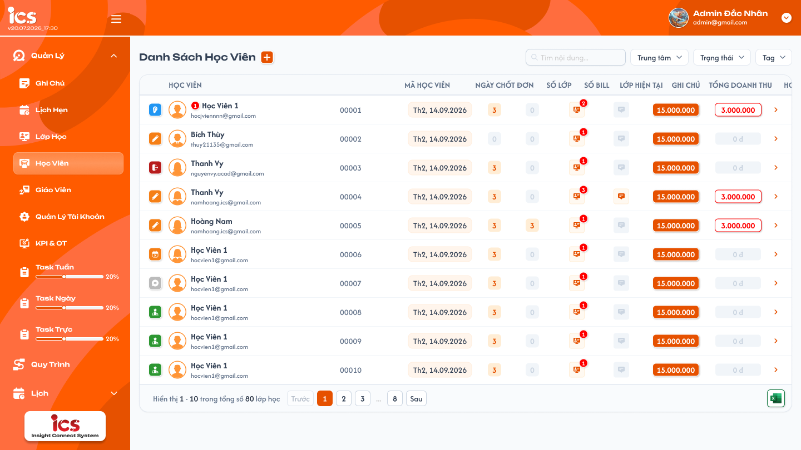
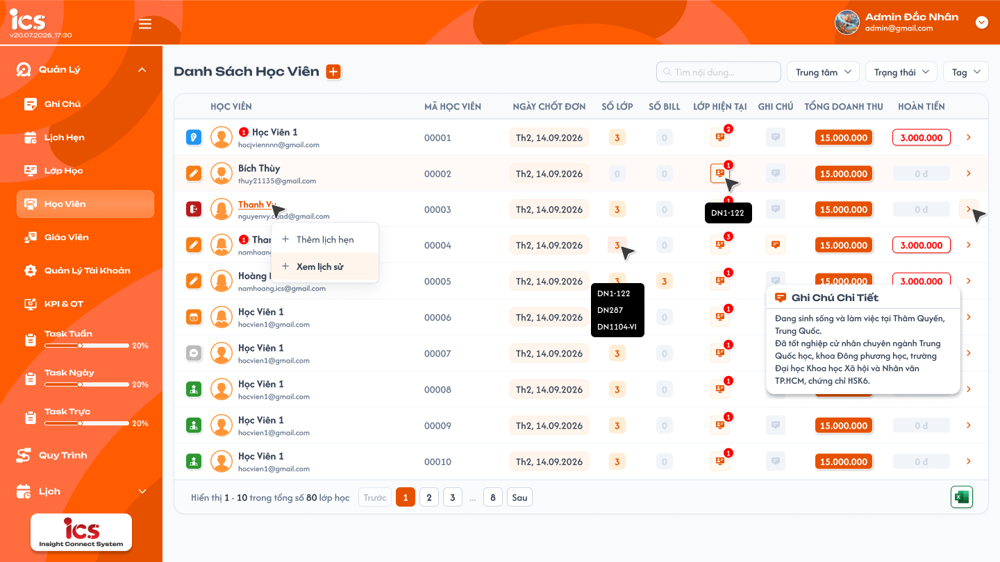
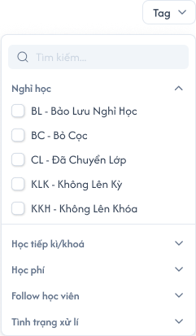
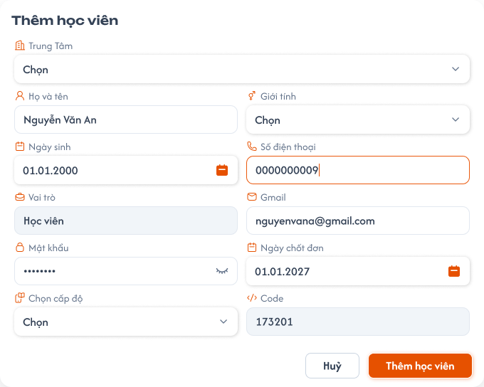
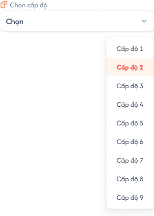
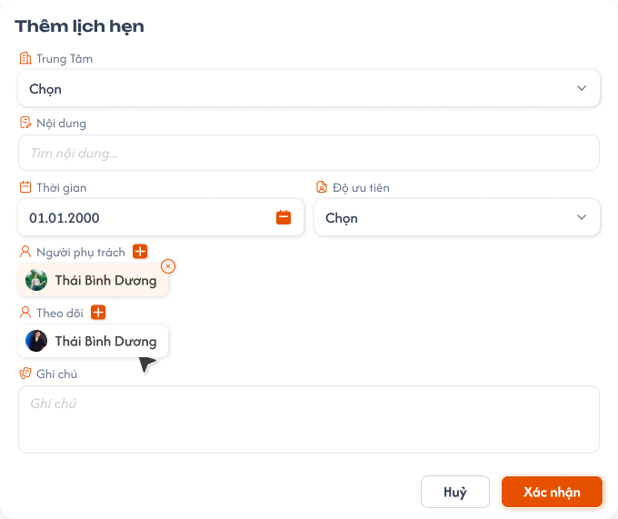
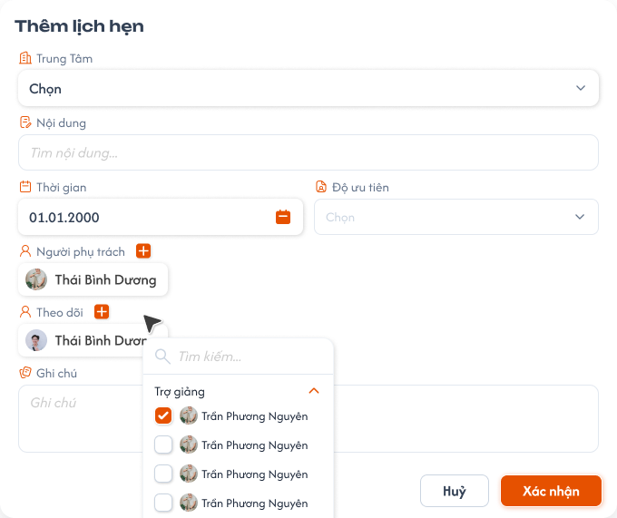
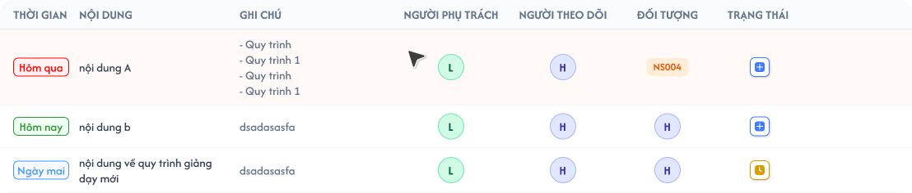

# Quản lý học viên

## 1. UI

### Trang 1: ADM-HV-010000 — Danh sách học viên



**Mô tả:**
- Administrator, Sale, Support và Class Handler xem và thao tác trên danh sách học viên theo phạm vi dữ liệu được cấp: tạo học viên, thêm lịch hẹn, xem lịch sử, mở Chi tiết học viên (requirement riêng tại [Chi tiết học viên](./student_detail_requirements.md)).

**Điểm cần lưu ý:**
- Ảnh chuẩn là `01-student-list.png`; bố cục hàng/cột lấy theo ảnh này. Tên, số tiền, tag, mã trong ảnh là dữ liệu minh họa (`Mã HV: 00001`, Code `173201` không thay quy tắc Code 6 chữ số theo cấp độ).
- Có ô tìm kiếm, bộ lọc `Trung tâm`, `Trạng thái`, `Tag` và nút `+` tạo học viên cạnh tiêu đề. Nút Excel nằm góc dưới bên phải bảng, cùng hàng phân trang. Chi tiết từng cột xem Trang 3.
- Search chỉ trên `Tên học viên`, khớp chứa từ khóa; sau 2 giây kể từ lần nhập cuối tự tìm, Enter tìm ngay.
- Sắp xếp theo **ngày tạo học viên giảm dần (mới nhất trước)**, áp dụng cả khi tìm kiếm, lọc, phân trang. Ngày chốt đơn không dùng để sắp xếp.
- Phân trang: tối đa 50 học viên/trang (Trang trước, số trang, `...`, các trang cuối, Trang sau); footer `Hiển thị a - b trong tổng số N học viên` (ảnh đang ghi `lớp học`, cần sửa thành `học viên`).
- Trạng thái học viên thuộc từng quan hệ học viên–lớp, khác trạng thái lớp: học viên có 3 lớp có 3 status riêng, không tổng hợp thành một status chung. Danh sách tổng chỉ hiển thị; chỉ đổi tại `Cài đặt lớp → Học viên → Chọn trạng thái` (dropdown 7 trạng thái); bấm icon status trên danh sách không đổi trạng thái.
- Popup `Lịch sử học viên` (mở từ menu tên → `Xem Lịch sử`): 3 tab theo thứ tự `Học phí`, `Lịch sử lớp`, `Ghi chú`; mặc định `Học phí`; tab active chữ cam, nền cam nhạt, thanh chỉ báo cam bên trái; đổi tab giữ ngữ cảnh học viên. Dữ liệu trong ảnh chỉ là minh họa.
- `A07.01` Thẻ `Số Hoá Đơn` (tab Học phí): đếm số hóa đơn tạo cho học viên đang xem, mỗi hóa đơn một lần dù có nhiều dòng sử dụng / phân bổ.
- `A07.02` Thẻ `Tổng Học Phí`: tổng số tiền **đã dùng** trong các hóa đơn của học viên đang xem (không lấy toàn bộ giá trị hóa đơn hay Số tiền đã đóng); là chỉ số riêng, khác `Tổng doanh thu` ở danh sách.
- `A07.03` Bảng hóa đơn 16 cột: `Tên hoá đơn`, `Trạng thái`, `Loại hoá đơn`, `Học viên`, `Mã học viên`, `Hiếu khách`, `Ghi chú`, `Ghi nhận`, `Ngày hẹn`, `Lớp dự kiến`, `Số tiền đã đóng`, `KPI`, `Học phí`, `Hình`, `Phụ trách`, `Liên kết`; cuối dòng menu `⋮`. Bấm dòng mở / thu gọn chi tiết học phí, không mở Chỉnh sửa (Chỉnh sửa chỉ mở từ `⋮`). Dùng chung dữ liệu và hành vi với màn Hóa đơn ([Hóa đơn](../../receipt_management/receipt/receipt.md), [Chi tiết học phí](../../receipt_management/tuition_detail/tuition_detail.md)); không có nút `+` / form / request tạo hóa đơn mới.
- `A07.04` Tên hóa đơn: tự sinh theo Hóa đơn REQ01, chỉ đọc; dưới tên có checkbox `Đã nhận tiền` / `Chưa nhận tiền` dùng chung dữ liệu với form chỉnh sửa.
- `A07.05` Trạng thái dùng icon trong ô riêng; Loại dùng badge text, ví dụ `[SALE] Cọc`; giá trị lấy từ đúng hóa đơn.
- `A07.06` `Hiếu khách` / `Ghi chú`: hai icon nội dung riêng của hóa đơn (nguồn gọi Hiểu khách); hover xem nội dung, cam khi có nội dung, xám khi trống.
- `A07.07` `Ghi nhận` / `Ngày hẹn`: hiển thị ngày; không có Ngày hẹn hiển thị `(Không có)`; không lấy ngày mẫu làm mặc định.
- `A07.08` `Lớp dự kiến`: mã lớp dự kiến của hóa đơn.
- `A07.09` `Số tiền đã đóng`: số tiền làm hóa đơn bên CG; dòng dưới `Còn lại` = Số tiền đã đóng − tổng Giá trị học phí đã thêm của **toàn hóa đơn**, không âm.
- `A07.10` `KPI` = tổng KPI các người phụ trách hóa đơn; `Học phí` = số lượng khoản học phí, phải khớp số dòng trong chi tiết xổ xuống (khác tiền ở thẻ Tổng Học Phí).
- `A07.11` `Hình`: tệp đính kèm hóa đơn, xem / tải như màn Hóa đơn; PDF/DOC/DOCX/PPT/PPTX, tối đa 20MB mỗi file.
- `A07.12` `Phụ trách`: avatar / số lượng người, hover xem tên. `Liên kết`: học viên đã liên kết hóa đơn kèm số lượng, hover Tên / Email / SĐT có icon copy; thiếu dữ liệu hiển thị như ảnh chuẩn.
- `A07.13` Bảng rộng cuộn ngang trong vùng nội dung popup, không tràn ra ngoài cửa sổ.
- Chi tiết xổ xuống dưới hóa đơn: bảng con gồm `#`, `Học viên`, `Mã học viên`, `Lớp`, `Số tiền`, `Ghi chú học phí`, `Ghi chú trong lớp`. Ô Học viên có tag của item học phí (nhãn `Mới` là **tag**, không phải status), tên / email dạng link; ô Lớp có badge kỳ (`Kì 1`) và badge mã lớp (`DN3CT2-I`); Số tiền badge cam nhạt; ghi chú rỗng hiển thị `(Trống)`. Nhiều dòng phân bổ của cùng học viên cho nhiều lớp phân biệt theo bản ghi phân bổ, không gộp theo tên / email / mã.
- Menu `⋮` gồm `Thêm học phí`, `Chỉnh sửa`, `Copy`, `Lịch sử hành động`, `Xuất hóa đơn`, `Xóa hóa đơn`; giai đoạn hiện tại 4 mục Thêm học phí / Chỉnh sửa / Copy / Xóa hóa đơn hoạt động, `Lịch sử hành động` và `Xuất hóa đơn` hiển thị nhưng disable (Hóa đơn REQ05). `Copy` chỉ sao chép tên hóa đơn vào clipboard và báo kết quả.
- Hover học viên trong item học phí có Tên / SĐT / Email và icon copy; hover Lớp có tooltip Thông tin lớp (Sĩ số, Buổi học, Khai giảng, Lịch học, SP, CSKH, Giáo viên). Menu tên học viên trong **item học phí** có `Thêm tag` / `Thêm lịch hẹn` / `Xem lịch sử`, tag thuộc riêng item học phí, không thay tag hồ sơ học viên; menu tên ở danh sách tổng vẫn chỉ 2 mục.
- Popup `Thêm học phí` 2 bước theo Hóa đơn: bước 1 chọn học viên đã liên kết hóa đơn (danh sách rỗng vẫn có nút `Thêm học viên`); bước 2 form: tick `Chọn học viên có sẵn` thì Tên / Mã học viên là dropdown tìm kiếm đồng bộ hai chiều, Email tự điền chỉ đọc; bỏ tick hoặc `Thêm học viên` thì nhập Tên / Email, chọn Level 1..9, ẩn Mã (hệ thống sinh Code 6 số theo Level, kiểm tra trùng, tăng tới mã hợp lệ) và liên kết học viên mới vào hóa đơn hiện có. `Lớp học` bắt buộc; `Giá trị` bắt buộc, mặc định 0 đ, không lớn hơn `Còn lại`; `Ghi chú học phí` / `Ghi chú trong lớp` không bắt buộc. `Hủy` không lưu; thêm thành công cập nhật chi tiết, số lượng Học phí, Còn lại và thẻ tổng hợp. Đây không phải popup `Thêm học viên` của danh sách tổng.
- Popup `Chỉnh sửa hóa đơn`: điền sẵn, tiêu đề `Chỉnh sửa hóa đơn`, nút `Cập nhật`, field / validation theo Hóa đơn Trang 2; **Tên hóa đơn chỉ đọc**, tự tạo lại theo REQ01. Bắt buộc Trạng thái, Ngày ghi nhận, Tên học viên, Mã học viên, Loại hóa đơn, Số tiền, Tài khoản nhận; ngoại tệ bắt buộc nhập tay Quy đổi VND. Tick `Chọn học viên có sẵn` thì Tên / Mã đồng bộ hai chiều. Loại hóa đơn đúng 22 lựa chọn của Hóa đơn (không dùng danh sách loại cũ trong ảnh học viên); Trạng thái: Mới / Xác nhận / Đợi lớp / Học trước / Dời lịch / Hoàn tiền / Hủy đơn / Hỗ trợ sau chốt; Tài khoản nhận: Tài khoản cá nhân / Tài khoản công ty / Tiền mặt / Khác; Tiền tệ: VND / USD / EUR / JPY / CNY / KRW / GBP (VND tự điền Quy đổi bằng Số tiền và vẫn sửa được, ngoại tệ không tự quy đổi). KPI cạnh từng người phụ trách sửa từ −5 đến 5, bước 0.05. Tệp PDF/DOC/DOCX/PPT/PPTX tối đa 20MB mỗi file. Ghi chú / Email / SĐT / Lớp dự kiến / Thông tin / Hiểu khách / Ngày hẹn / Giờ ghi nhận không bắt buộc.
- Đồng bộ ICS/CG: bên lưu trước được ưu tiên, bên lưu sau không ghi đè và nhận `đã có dữ liệu mới, vui lòng reload trang`. Quyền thao tác từ màn học viên theo bảng quyền của tài liệu này, không lấy quyền Admin-only của menu Hóa đơn.
- Popup xác nhận `Xóa hóa đơn`: bắt buộc xác nhận, **xóa mềm**; đồng bộ khoản học phí và số dư của **tất cả học viên liên kết hóa đơn** (kể cả khi xóa từ lịch sử một học viên), backend tính lại từ hóa đơn / học phí còn hiệu lực, không chỉ ẩn dòng ở giao diện. Sau xóa tải lại bảng, `Số Hoá Đơn` / `Tổng Học Phí`, số dư và Số bill / Hoàn tiền / Tổng doanh thu; học phí từ hóa đơn khác giữ nguyên đóng góp. Hủy hoặc lỗi giữ nguyên cả hóa đơn, học phí, số dư; xóa mềm giữ lịch sử, không tự tạo giao dịch hoàn tiền.
- Tab `Ghi chú`: đầu tab `Danh sách ghi chú` và nút `+`; bên phải 4 dropdown `Loại`, `Độ ưu tiên`, `Trạng thái`, `Thời gian`. Mở tab mặc định Trạng thái = `Mới`, Thời gian = `Tuần này`; Loại và Độ ưu tiên không chọn, không giới hạn kết quả. Bộ lọc kết hợp đồng thời 4 điều kiện. Thời gian gồm `Tới hạn`, `Hôm nay`, `Hôm qua`, `Tuần này`, `Tuần trước`, `Tháng này`, `Tháng trước`, `3 tháng trước`, `Năm nay`, `Năm trước`, `Tùy chọn`, `Hôm nay và hôm qua`; `Tùy chọn` hiện `Từ ngày` / `Đến ngày`.
- Card ghi chú: tiêu đề; dưới tiêu đề là avatar, tên, ngày giờ tạo của người tạo (tài khoản đang đăng nhập hiển thị `Bạn`); đã sửa thì thêm nhãn `Đã chỉnh sửa` (không dùng thời gian sửa thay thời gian tạo); nội dung trong khung riêng. Góc phải: avatar, tên, ngày giờ **bình luận gần nhất** kèm icon đồng hồ cam (chưa có bình luận thì ẩn cả cụm), badge Độ ưu tiên (Bình thường xanh dương, Quan trọng cam, Rất quan trọng đỏ), icon Loại (Riêng tư icon ẩn danh nền cam, card nền / viền cam nhạt; Công khai icon địa cầu, card nền trắng) và menu `⋮`. Menu `⋮` của owner: `Chỉnh sửa` (mở lại form, sửa Loại / Độ ưu tiên) / `Đóng` / `Xóa`; badge ưu tiên không phải dropdown chọn trực tiếp; ghi chú đã Đóng chỉ owner thấy và có thể Mở lại.
- `A09.01` Editor bình luận: ô văn bản thuần dưới danh sách bình luận khi mở, placeholder `Nhập bình luận của bạn`; không có toolbar rich text.
- `A09.02` Gửi: nút cam / mũi tên trắng bên phải ô nhập; user được xem ghi chú gửi bình luận không rỗng vào đúng note, không giới hạn độ dài.
- `A09.03` Số bình luận: link `n bình luận` (gồm `0 bình luận`) mở danh sách bình luận của đúng ghi chú; khi mở hiển thị `Ẩn bình luận` để thu gọn; ô nhập ở cuối danh sách.
- `A09.04` Card bình luận: avatar, tên người viết, ngày giờ, nội dung; UI mới không có nút Trả lời hoặc icon xóa riêng trên card; quyền sửa / xóa bình luận thuộc người tạo bình luận, không cấp theo bố cục ảnh.
- `A09.05` Bình luận ghi chú: trả lời là nhập / gửi tại ô bình luận của cùng ghi chú, không tạo thread dưới bình luận gốc hay nút Trả lời riêng.
- `A09.06` Làm mới bình luận: icon mũi tên vòng cạnh link bình luận chỉ tải lại danh sách / số bình luận / metadata gần nhất của đúng note; không tạo / sửa note hay gửi nội dung đang nhập; giữ bản nháp, lỗi không xóa dữ liệu đang có.
- Popup `Thêm ghi chú` (nút `+` mở, ảnh `12-add-note.png`): `Tiêu đề` và `Nội dung` mỗi field một hàng toàn chiều rộng, dưới là `Loại ghi chú` (trái) và `Độ ưu tiên` (phải), dropdown placeholder `Chọn`; nút `Hủy` / `Thêm ghi chú`. Tiêu đề / Nội dung bắt buộc, không giới hạn độ dài, Nội dung là văn bản thuần (không toolbar). `Nguyễn Văn An` là dữ liệu mẫu, không tự điền; không dùng trạng thái bộ lọc làm giá trị form; Hủy không tạo note, không Toast CRUD. Bản ghi ghi chú có Tiêu đề / Loại / Độ ưu tiên / Trạng thái, không thay field ghi chú cá nhân ở Chi tiết học viên hay ghi chú học phí / ghi chú trong lớp.
- `A10.01` Toast `Thành Công`: backend xác nhận thao tác thành công; chỉ hiện sau khi backend xác nhận.
- `A10.02` Toast `Thông Báo`: thao tác đã tiếp nhận nhưng dữ liệu cần thời gian đồng bộ; tối đa một Toast, không báo thành công sớm.
- `A10.03` Toast `Cảnh Báo`: dữ liệu / điều kiện cần người dùng kiểm tra (không lưu dữ liệu sai, vẫn đánh dấu field lỗi).
- `A10.04` Toast `Có Lỗi Xảy Ra`: backend / network không hoàn tất; không cập nhật một phần, cho phép thử lại, không lộ lỗi kỹ thuật. Dòng hai của Toast lấy từ flow CRUD tương ứng; mỗi thao tác một Toast; Hủy / chỉ đọc không có Toast CRUD; nút `×` đóng thủ công.

### Trang 2: ADM-HV-010001 — Danh sách học viên / Hover menu thao tác



**Mô tả:**
- Menu mở khi bấm tên học viên, gồm `Thêm Lịch Hẹn` (mở Trang 7) và `Xem Lịch sử` (mở popup Lịch sử học viên).

**Điểm cần lưu ý:**
- Badge cạnh tên bằng tổng số lịch hẹn hiện có của học viên; thêm lịch hẹn thành công tăng 1, xóa thành công cập nhật lại số này.
- Ảnh hover chỉ tham chiếu thao tác; hover icon `Ghi chú` mở popup `Ghi Chú Chi Tiết` của đúng học viên, hover `Số lớp` / `Lớp hiện tại` hiện tooltip mã lớp (không hiện tên lớp).

### Trang 3: ADM-HV-010102 — Danh sách học viên / Dropdown · Trạng thái


**Mô tả:**
- Dropdown bộ lọc `Trạng thái` chọn nhiều bằng checkbox theo thứ tự `Mới`, `Đang học`, `Đợi lớp`. Trang này đồng thời ghi chi tiết các cột của bảng danh sách Trang 1.

**Điểm cần lưu ý:**
- Giá trị logic gửi BE: `Mới` → `[0]` (chưa vào lớp), `Đang học` → `[1]` (đang học), `Đợi lớp` → `[2]` (đã ở trong lớp, gồm đang học và các trạng thái khác). Không diễn giải `Đợi lớp` theo lớp `Khai giảng`.
- Nhiều trạng thái: OR giữa các nhóm, học viên thuộc nhiều nhóm vẫn một lần; bỏ chọn hết thì bỏ điều kiện Trạng thái (vẫn giữ keyword / Tag / phạm vi quyền). FE chỉ gửi tập 0/1/2, BE phân loại, lọc và trả tổng kết quả; không tự suy từ icon / 7 status trong lớp hay lọc lại trên các dòng của trang. Filter độc lập với 7 status học viên–lớp, status lớp, status tài khoản (nhãn `Đang học` trùng chữ nhưng không dùng chung enum).
- `A01.01` Tên học viên: bấm tên mở menu `Thêm lịch hẹn` / `Xem lịch sử` (Trang 2). Ô gồm icon trạng thái bên trái, avatar, tên, `Mã HV` dòng dưới, badge lịch hẹn; không thêm hàng nhãn tag phía trên tên.
- `A01.02` Mũi tên cuối dòng: mở Chi tiết của đúng học viên trên dòng.
- `A01.03` Gmail: hiển thị email học viên; nhãn Gmail không giới hạn domain `@gmail.com`.
- `A01.04` Ngày chốt đơn: hiển thị theo định dạng UI; không dùng để sắp xếp (thứ tự theo ngày tạo học viên).
- `A01.05` Số lớp: tổng **tất cả** lớp học viên đã được thêm, không chỉ lớp hiện tại; hover / bấm badge xem mã các lớp; giá trị 0 badge xám, không mở danh sách rỗng.
- `A01.06` Số bill: số hóa đơn được thêm / liên kết với học viên; chỉ hiển thị số, hover / bấm không mở danh sách, popup hay điều hướng; 0 badge xám.
- `A01.07` Lớp hiện tại: chỉ gồm lớp mà **đồng thời** status học viên trong lớp là `Đang học` và trạng thái lớp là `Đang học`. Badge đỏ = số lớp thỏa cả hai điều kiện; hover icon chỉ hiện mã lớp (vd `DN1-122`), không hiện tên lớp; không có lớp thì hiển thị text `Chưa có`, không mở tooltip / popup rỗng.
- `A01.08` Ghi chú: hover / bấm icon mở nội dung ghi chú của đúng học viên (popup `Ghi Chú Chi Tiết`); cam khi có ghi chú, xám khi không có (không dùng cam để biểu thị chưa xử lý); không hiển thị ghi chú ngoài quyền truy cập.
- `A01.09` Tổng doanh thu: `Σ số tiền tất cả bill của học viên − Hoàn tiền`, badge cam; không dựa vào tổng thực thu, không trừ cùng một bill hoàn tiền hai lần.
- `A01.10` Hoàn tiền: `Σ số tiền bill có trạng thái Hoàn tiền` (theo trạng thái bill); có giá trị hiển thị số đỏ / viền đỏ, không có thì `0 đ` nền xám. Ví dụ bill 1 / 2 / 3 triệu: ban đầu doanh thu 6 triệu; khi bill 3 triệu thành `Hoàn tiền`, Hoàn tiền = 3 triệu, Tổng doanh thu = 3 triệu, Số bill vẫn 3. Sau khi thêm / liên kết, sửa số tiền hoặc đổi trạng thái bill thành công, tải lại số liệu của đúng học viên từ dữ liệu hóa đơn đã lưu.

### Trang 4: ADM-HV-010202 — Danh sách học viên / Dropdown · Tag



**Mô tả:**
- Popup bộ lọc `Tag`: ô `Tìm kiếm...` đầu popup, các nhóm tag thu gọn / mở rộng bằng chevron, tag có checkbox chọn nhiều.

**Điểm cần lưu ý:**
- Nhóm và tag lấy động từ dữ liệu do user định nghĩa; nhóm trong ảnh (`Nghỉ học`, `Học tiếp kì/khoá`, `Học phí`, `Follow học viên`, `Tình trạng xử lí`) và tag BL / BC / CL / KLK / KKH chỉ minh họa, không hard-code. Nhãn tag dạng mã và tên, vd `BL - Bảo Lưu Nghỉ Học`; nhóm đóng chỉ hiện tiêu đề và chevron.
- Tìm theo mã / tên tag trong popup, chỉ để chọn tag, không thay keyword tên học viên trên danh sách.
- Nhiều tag (cùng hoặc khác nhóm) dùng OR; không chọn tag thì bỏ điều kiện Tag. Tag kết hợp AND với Trạng thái và keyword tên; đổi lựa chọn đưa danh sách về trang 1.
- Thu gọn nhóm hoặc đổi keyword tìm tag không làm mất tag đã chọn (kể cả tag tạm ẩn khỏi kết quả tìm); mở lại nhóm / popup phản ánh đúng checkbox của điều kiện lọc hiện tại.

### Trang 5: ADM-HV-010010 — Danh sách học viên / Popup thêm học viên



**Mô tả:**
- Popup mở bằng nút `+` cạnh tiêu đề Danh sách học viên; tiêu đề và nút submit là `Thêm học viên`, nút đóng là `Hủy` (không tạo tài khoản).

**Điểm cần lưu ý:**
- Form hai cột: trái Họ và tên / Ngày sinh / Vai trò / Mật khẩu / Chọn cấp độ; phải Giới tính / Số điện thoại / Gmail / Ngày chốt đơn / Code. Tất cả field bắt buộc, kể cả Vai trò và Code do hệ thống điền.
- `A02.01` `Trung tâm`: bắt buộc chọn một trung tâm; học viên thuộc trung tâm đã chọn; Email và Code kiểm tra trùng theo trung tâm này. Bỏ trống thì báo lỗi tại field.
- `A02.02` `Họ và tên`: bắt buộc, không để trống hoặc chỉ khoảng trắng.
- `A02.03` `Giới tính`: bắt buộc chọn; placeholder `Chọn` không hợp lệ.
- `A02.04` `Ngày sinh`: bắt buộc, chọn bằng date picker.
- `A02.05` `Số điện thoại`: bắt buộc, đúng định dạng số điện thoại; **được phép trùng** học viên khác.
- `A02.06` `Vai trò`: bắt buộc, hệ thống điền `Student`, nhãn UI `Học viên`.
- `A02.07` `Gmail`/Email: bắt buộc, đúng định dạng email; nhận cả email ngoài `@gmail.com`; không trùng trong cùng trung tâm, được trùng giữa các trung tâm.
- `A02.08` `Mật khẩu`: bắt buộc, tối thiểu **8 ký tự**, che ký tự và có nút hiện / ẩn; không yêu cầu chữ hoa / ký tự đặc biệt.
- `A02.09` `Ngày chốt đơn`: bắt buộc, mặc định ngày hiện tại, chọn được ngày quá khứ, hiện tại, tương lai.
- `A02.10` `Chọn cấp độ` (Level): bắt buộc, một trong `Cấp độ 1` đến `Cấp độ 9` (Trang 6); placeholder `Chọn` không hợp lệ.
- `A02.11` `Code`: bắt buộc, hệ thống tự tìm và hiển thị sau khi chọn cấp độ, **chỉ đọc**; đúng 6 chữ số, tăng dần theo cấp độ, duy nhất trong cùng center (center khác được trùng); backend kiểm tra lại khi lưu.

### Trang 6: ADM-HV-010012 — Danh sách học viên / Popup thêm học viên / Dropdown cấp độ



**Mô tả:**
- Dropdown chọn `Cấp độ 1` đến `Cấp độ 9`; giá trị đang chọn được đánh dấu.

**Điểm cần lưu ý:**
- Dải Code theo cấp độ L: mã đầu tiên `L × 100000`, tăng dần trong `L00000` → `L99999` (cấp 1: `100000`–`199999`, … cấp 9: `900000`–`999999`). Không cấp mã 5/7 chữ số hoặc vượt sang dải cấp độ khác.
- Sau khi chọn cấp độ, hệ thống tìm Code tiếp theo chưa dùng **trong center đang tạo** và hiển thị trước khi lưu; đổi cấp độ thì tìm lại trong dải mới. Mã xem trước bị chiếm (kể cả request đồng thời) thì backend cấp mã hợp lệ tiếp theo trong cùng center / cấp độ và trả Code cuối cùng đã lưu.
- Bộ đếm theo center và cấp độ; không lấy mã đã dùng ở center khác để chặn hoặc tăng mã của center hiện tại. Hết mã hợp lệ thì không tạo tài khoản.

### Trang 7: ADM-HV-010060 — Danh sách học viên / Popup thêm lịch hẹn



**Mô tả:**
- Popup `Thêm lịch hẹn` từ menu tên học viên. Nội dung toàn chiều rộng; hàng kế là Thời gian (trái) và Độ ưu tiên (phải); dưới là Người phụ trách, Theo dõi và Ghi chú nhiều dòng; cuối popup `Hủy` / `Xác nhận`.

**Điểm cần lưu ý:**
- Đối tượng tự gắn đúng học viên đang chọn, Trạng thái tự mặc định `Mới`; popup không có control cho hai field này. Trạng thái nghiệp vụ sau khi tạo theo bộ 4 trạng thái của requirement Lịch Hẹn.
- `A05.01` `Nội dung`: ô nhập tự do toàn chiều rộng, placeholder `Tìm nội dung...`, không suy ra là dropdown cố định; bắt buộc.
- `A05.02` `Thời gian`: bắt buộc chọn ngày, **không chọn giờ**, định dạng `dd.MM.yyyy`, không giới hạn quá khứ / tương lai; `01.01.2000` là dữ liệu mẫu.
- `A05.03` `Độ ưu tiên`: dropdown bắt buộc, mặc định placeholder `Chọn`, không chọn sẵn mức nào (không tự điền Bình thường); bốn mức `Ưu tiên thấp`, `Bình thường`, `Quan trọng`, `Ưu tiên cao`.
- `A05.04` `Người phụ trách`: nút `+` cạnh nhãn mở bộ chọn (Trang 8); người đã chọn hiện chip avatar + họ tên có nút `×` gỡ; chọn nhiều, trước khi lưu phải còn ít nhất một người. Người tạo có role hợp lệ được chọn sẵn, có thể gỡ mình.
- `A05.05` `Theo dõi`: nút `+` và chip như Người phụ trách; không bắt buộc, chọn nhiều; cùng user được ở cả hai field.
- `A05.06` `Ghi chú`: textarea nhiều dòng, placeholder `Ghi chú`, bắt buộc, không giới hạn độ dài.
- `A05.07` `Hủy`: đóng popup, không tạo lịch hẹn, không tăng badge lịch hẹn.
- `A05.08` `Xác nhận`: submit lịch hẹn của đúng học viên; validation và phản hồi theo requirement Lịch Hẹn.

### Trang 8: ADM-HV-010062 — Danh sách học viên / Popup thêm lịch hẹn / Đang mở



**Mô tả:**
- Bộ chọn Người phụ trách / Theo dõi mở bằng nút `+`: ô `Tìm kiếm...` đầu, các nhóm role thu gọn / mở rộng bằng chevron, mỗi user có checkbox, avatar và họ tên (checkbox chọn nền cam, dấu tick trắng). Trang này đồng thời ghi các thành phần tab `Lịch sử lớp` của popup Lịch sử học viên.

**Điểm cần lưu ý:**
- Bộ chọn chỉ có 3 nhóm role `Trợ giảng` (Teaching Assistant), `Support`, `Nhân viên kinh doanh` (Sale), áp dụng cho cả hai field; role khác không được gán, kể cả bằng request trực tiếp. Không dùng bộ Admin / Class Handler / Support của form lịch hẹn chung.
- Lưu lựa chọn theo user ID, không theo họ tên (tên trùng trong ảnh chỉ minh họa); một field không thêm trùng user; search / thu gọn nhóm không xóa lựa chọn; chip và checkbox phản ánh cùng một tập. `Thái Bình Dương`, `Trần Phương Nguyên` là dữ liệu mẫu, không phải mặc định.
- Tab `Lịch sử lớp`: hiển thị **tất cả** lớp học viên đã từng được thêm, không chỉ Lớp hiện tại. Đầu tab có 6 thẻ theo thứ tự (dữ liệu trong ảnh là mẫu). Quy tắc chung: tính chỉ số ở từng lớp trước rồi lấy trung bình cộng, mỗi lớp trọng số bằng nhau; Tiến độ / KPI / Đánh giá không tạo thêm trạng thái học viên.
- `A08.01` Thẻ `Số Lớp` = `số lớp chính thức / tổng số lớp trong lịch sử` (vd `1/6`); lớp chính thức là lớp không tick Lớp không chính thức ([Tạo lớp học](../class_management/class_creation_requirements.md#lớp-không-chính-thức)); mỗi class_id đếm một lần. Không có lớp: `0/0`.
- `A08.02` Thẻ `Lên Kỳ` = trung bình `getUpTerm()` của các lớp **chính thức đã Hoàn thành**, mỗi lớp trọng số bằng nhau.
- `A08.03` Thẻ `Đi Học`: tỷ lệ đi học của học viên từng lớp = `số buổi tính đi học / số buổi đã điểm danh × 100`; Có mặt, Vào trễ, Ra sớm, Vào trễ & Ra sớm tính đi học; Nghỉ CP/KP vào mẫu số nhưng không tính đi học; chưa điểm danh loại khỏi cả tử và mẫu ([quy tắc điểm danh](../class_management/class_detail_lessons_requirements.md#chỉ-số--btvn-và-đi-học-theo-bài)). Lấy trên mọi lớp trong lịch sử (không giới hạn lớp chính thức), là chỉ số của học viên chứ không phải tỷ lệ chung của lớp. Trung bình = `tổng tỷ lệ các lớp đủ dữ liệu / số lớp đủ dữ liệu`; lớp chưa có buổi đủ điều kiện không tính, 0% có mẫu số > 0 vẫn tính. Chỉ làm tròn kết quả cuối 1 chữ số thập phân (`70.0%`, `58.3%`). Không có lớp đủ dữ liệu thì trống.
- `A08.04` Thẻ `BTVN`: tỷ lệ từng lớp = `số bài đã nộp / số bài đủ điều kiện tính × 100`; đã nộp chưa chấm và đã chấm 0 đều tính đã nộp, nộp nhiều lần một bài chỉ tính một; bài chưa nộp chỉ vào mẫu số khi lớp đã chuyển qua bài mới (đóng góp 0 vào tử số), bài hiện tại và bài tương lai chưa nộp chưa tính. Cách trung bình, làm tròn và trống như `Đi Học`.
- `A08.05` Thẻ `Đạt Kpi` = trung bình `getUpTerm()` của **tất cả lớp chính thức** (cả chưa Hoàn thành); không phải số / tỷ lệ lớp đạt ngưỡng 80%. Không có lớp trong tập tính thì `0%`.
- `A08.06` Thẻ `Đánh Giá` = trung bình **điểm** `scoreEvaluateClass()` (chỉ lấy Q ≥ 0) của các lớp chính thức rồi đổi sang A–F; không đổi chữ A–F thành điểm để lấy trung bình. Không có lớp chính thức: trống; có lớp nhưng không còn Q ≥ 0: F. Dữ liệu chưa tải không hiện số 0 giả.
- `A08.07` Cột `#` / Mã lớp: icon **trạng thái lớp** và mã lớp, mapping theo [Trạng thái lớp](../class_management/class_management_requirements.md#trạng-thái-lớp); mũ tốt nghiệp xanh = lớp Hoàn thành (tooltip ghi Hoàn thành); không dùng status học viên trong lớp và không dùng 7 icon status học viên cho cột này.
- `A08.08` Cột `Khoá học`: tên khóa, thanh tiến độ và `x/N Buổi` là tiến độ của **cả lớp** (lớp 6/20 buổi thì mọi học viên đều thấy 6/20); không dùng số buổi học viên đã điểm danh; tên dài được rút gọn theo bố cục ảnh.
- `A08.09` Cột `Đánh giá`: badge chữ A–F của lớp theo `ClassInfoModel.getEvaluate` từ điểm `scoreEvaluateClass()` (Q); màu A xanh lá, B xanh dương, C cam, D vàng, E đỏ, F đỏ đậm. Q = −1 thì badge trống.
- `A08.10` Cột `KPI`: vòng tròn % cuối dòng = `getUpTerm()` của cả lớp; vẫn hiển thị ở lớp không chính thức nhưng lớp đó không tham gia ba thẻ Lên Kỳ / Đạt Kpi / Đánh Giá.
- `A08.11` Mũi tên cuối dòng: mở Chi tiết lớp của dòng đang chọn ở trang phía dưới popup, tắt popup sẽ thấy lớp đó ([Hồ sơ học viên — Lịch sử lớp](../../receipt_management/tuition_detail/tuition_detail.md#trang-6-popup-hồ-sơ-học-viên---tab-lịch-sử-lớp)).
- `A08.12` `Hoàn thành` — công thức `getUpTerm()` lớp Hoàn thành: `r_lớp` = (số HV có mã `UpSale`, `Force`, `SuperUpSale`, `Completed`) / (tổng HV sau khi loại `Remove`, `Moved`, `Audit`, `Testing`, `Viewer`); Nghỉ học / Bảo lưu / Bỏ cọc / Rời lớp vẫn trong mẫu số. Là tỷ lệ trên danh sách HV của cả lớp, hai học viên cùng lớp có cùng `r_lớp`.
- `A08.13` `Chưa Hoàn thành` — tử số = số HV sau khi loại `Dropped`, `Exit`, `Viewer`, `Remove`, `Deposit`, `Moved`, `Retained` (`Audit` / `Testing` không bị loại); mẫu số = tổng HV trừ số HV `Moved`. Mẫu số HV bằng 0 thì `r_lớp` = 0%, không NaN / vô cực. Loại giá trị chưa sẵn sàng khỏi phép trung bình, 0% hợp lệ vẫn tính. Hai thẻ và vòng % định dạng theo `convertProgressLoading` → `convertDouble(pre: 2)` ICS cũ (2 chữ số có nghĩa: 44.6% → 45%, 1.234% → 1.2%); nguồn hàm xem [Đối chiếu source ICS cũ](./legacy_source_review.md).
- Công thức `scoreEvaluateClass()` mỗi lớp (dữ liệu cả lớp): `D` = số HV có mã `Dropped`, `Deposit`, `Retained`, `Moved`, `N` = tổng HV, điểm trừ `P = D/N × 10` (N = 0 thì P = 0). Tập tính điểm loại `Remove`, `Dropped`, `Deposit`, `Retained`, `Moved`, `Viewer`. Mỗi HV: `X` = tỷ lệ Đi học × 10, `Y` = tỷ lệ nộp BTVN × 10, `z1` điểm BTVN trung bình, `z2` điểm kiểm tra trung bình, `z3`/`z4` Năng lực / Thái độ đổi A→10, B→8, C→6, D→4, E→2 (giá trị khác = 10); X/Y/z1/z2 âm thì dùng 0. `Z = (z1+z2+z3+z4)/4`, `R = (X+Y+Z)/3`; khi `R − min(X,Y,Z) > 2` thì trừ R đi 1 và kiểm tra lại đến khi hết đúng. `Q` = trung bình R của tập HV − P (tập rỗng thì trung bình R = 0). Badge lớp = `getEvaluate(Q)`.
- `A08.14` Đổi hạng `≥ 8.5` → A. `A08.15` `≥ 7` và `< 8.5` → B. `A08.16` `≥ 5.5` và `< 7` → C. `A08.17` `≥ 4` và `< 5.5` → D. `A08.18` `≥ 2` và `< 4` → E. `A08.19` `< 2` → F. Dùng Q chưa làm tròn (8.499 không thành A); −1 (chưa sẵn sàng) khác điểm 0 đã tính (F).

### Trang 9: ADM-HV-010070 — Danh sách học viên / Popup danh sách lịch hẹn



**Mô tả:**
- Popup liệt kê lịch hẹn của học viên với các cột `Thời gian`, `Nội dung`, `Ghi chú`, `Người phụ trách`, `Người theo dõi`, `Đối tượng`, `Trạng thái`; nhóm theo mốc ngày (`Hôm qua`, `Hôm nay`, `Ngày mai`).

---

## 2. Yêu cầu

### 2.1. Flow chính

**Flow 1: Xem danh sách và phân trang**

```
User có quyền mở Quản lý → Học viên → Hệ thống tải danh sách trong phạm vi user,
  sắp ngày tạo học viên giảm dần → hiển thị các cột, số liệu hóa đơn, status riêng từng lớp, tổng số trang
  → User chọn số trang / Trang trước / Trang sau → giữ search/filter, tải đúng dữ liệu, đánh dấu trang hiện tại
```

**Flow 2: Tìm kiếm học viên**

```
User nhập từ khóa → không nhập thêm 2 giây: tự tìm
                  → hoặc nhấn Enter: tìm ngay
  → tìm theo Tên học viên (khớp chứa) → kết quả từ trang 1
```

**Flow 3: Lọc học viên**

```
Mở Trạng thái → tick/bỏ tick Mới [0] / Đang học [1] / Đợi lớp [2] (nhiều → OR; không chọn → bỏ điều kiện)
Mở Tag → tìm theo mã/tên → mở nhóm → chọn một/nhiều tag (OR; thu gọn/tìm lại không mất lựa chọn)
  → FE gửi tập 0/1/2 + Tag + keyword tên (AND) → BE lọc, trả dữ liệu + tổng kết quả
  → hiển thị từ trang 1, ngày tạo học viên giảm dần
```

**Flow 4: Xuất Excel**

```
Bấm nút Excel → không search/filter: xuất toàn bộ danh sách trong phạm vi user, mọi trang
              → có search/filter: xuất toàn bộ kết quả thỏa điều kiện, mọi trang
  → file 4 cột: Tên học viên, Số điện thoại, Email, Ngày tạo
  → thành công: tải file + "Xuất danh sách học viên thành công."
                    ↓ (thất bại)
              Không tải file + "Không thể xuất danh sách học viên. Vui lòng thử lại."
```

**Flow 5: Tạo tài khoản học viên**

```
Bấm "+" → popup (Vai trò Student, Ngày chốt đơn = hôm nay, sửa được)
  → nhập/chọn đủ field, chọn Cấp độ 1..9 → hiển thị Code 6 chữ số tiếp theo trong center/cấp độ (chỉ đọc)
  → Bấm "Thêm học viên" → BE kiểm tra định dạng email/SĐT, mật khẩu ≥ 8 ký tự, trùng email trong trung tâm, cấp mã (kể cả đồng thời)
  → thành công: tạo tài khoản, đóng popup, tải lại danh sách → "Tạo tài khoản học viên thành công."
        ↓ thiếu field                          ↓ email trùng trong trung tâm            ↓ không sinh được Code
  "Vui lòng nhập đầy đủ thông tin bắt buộc."   "Email đã được sử dụng."        giữ popup + "Không thể tạo mã học viên. Vui lòng thử lại."
```

**Flow 6: Xem mã lớp, ghi chú và mở Chi tiết học viên**

```
Hover/bấm Số lớp → mã tất cả lớp đã được thêm
Hover/bấm Lớp hiện tại → mã lớp có status học viên Đang học VÀ status lớp Đang học
                              ↓ (không có lớp) "Chưa có", không mở tooltip rỗng
Hover/bấm Số bill → giữ nguyên số, không mở gì
Hover/bấm icon Ghi chú → nội dung ghi chú đúng học viên (cam = có ghi chú)
Bấm mũi tên cuối dòng → Chi tiết học viên đúng dòng
```

**Flow 7: Thêm lịch hẹn**

```
Click tên học viên → "Thêm Lịch Hẹn" → Đối tượng = học viên đang chọn, Trạng thái = Mới
  → người tạo có role Trợ giảng/Support/Nhân viên kinh doanh được chọn sẵn làm Người phụ trách; Độ ưu tiên = "Chọn"
  → nhập Nội dung, ngày hẹn (không giờ), Độ ưu tiên, Ghi chú; chỉnh Người phụ trách/Theo dõi qua +/chip
  → "Xác nhận" → thành công: đóng popup, tăng badge lịch hẹn → "Thêm lịch hẹn thành công."
                    ↓ thiếu field bắt buộc (trừ Theo dõi)
              "Vui lòng nhập đầy đủ thông tin bắt buộc." (thời gian quá khứ vẫn hợp lệ)
```

**Flow 8: Xem lịch sử học viên**

```
Click tên học viên → "Xem Lịch sử" → popup mở tab Học phí
  → chuyển Học phí / Lịch sử lớp / Ghi chú → hiển thị dữ liệu đúng học viên
```

**Flow 9: Học phí trên hóa đơn hiện có**

```
Tab Học phí → xem hóa đơn, bấm dòng xổ/thu gọn chi tiết (không có flow tạo hóa đơn mới) → menu ⋮
  ├─ Thêm học phí → chọn học viên đã liên kết → (có sẵn: Tên/Mã đồng bộ, Email chỉ đọc | Thêm học viên/bỏ tick: Tên/Email/Level, ẩn Mã, sinh Code)
  │     → chọn Lớp, nhập Giá trị (≤ Còn lại của toàn hóa đơn) và ghi chú → thành công: cập nhật chi tiết, số lượng Học phí, Còn lại
  ├─ Chỉnh sửa → form điền sẵn (Tên hóa đơn chỉ đọc), sửa dữ liệu/KPI → Cập nhật
  ├─ Copy → copy tên vào clipboard, không tạo hóa đơn
  ├─ Xóa hóa đơn → popup xác nhận ── Hủy → không đổi
  │                              └─ Xác nhận → xóa mềm + đồng bộ học phí/số dư mọi học viên liên kết (lỗi: giữ nguyên toàn bộ)
  └─ Lịch sử hành động / Xuất hóa đơn → hiển thị nhưng disable
  → sau lưu/xóa thành công: tải lại 2 thẻ Học phí và Số bill / Hoàn tiền / Tổng doanh thu
  → lưu đồng thời ICS/CG: giữ bản lưu trước, yêu cầu reload
  → thiếu field / học phí vượt Còn lại / email sai / file sai: báo lỗi, không lưu
```

**Flow 10: Thêm và lọc ghi chú**

```
Mở tab Ghi chú (mặc định Mới + Tuần này) → "+" → nhập Tiêu đề, Nội dung, Loại, Độ ưu tiên → "Thêm ghi chú"
  → thành công: thêm vào danh sách + "Thêm ghi chú thành công."
Riêng tư: chỉ người tạo thấy | Chỉ owner đổi Loại/Độ ưu tiên, đóng; đã Đóng: chỉ owner xem, có thể mở lại
Lọc Loại + Độ ưu tiên + Trạng thái + Thời gian (Tùy chọn: Từ ngày – Đến ngày) → hiển thị ghi chú thỏa mọi điều kiện
```

### 2.2. Ngoại lệ

- **EX01:** Tạo tài khoản thiếu bất kỳ field bắt buộc nào → hiển thị `Vui lòng nhập đầy đủ thông tin bắt buộc.`, không tạo tài khoản.
- **EX02:** Code vừa sinh bị trùng do nhiều request đồng thời → sinh lại Code trước khi lưu; không tạo hai học viên cùng Code trong cùng center; center khác được trùng Code.
- **EX03:** Không thể tạo Code duy nhất trong center hiện tại → hiển thị `Không thể tạo mã học viên. Vui lòng thử lại.`, không tạo tài khoản.
- **EX04:** Thêm lịch hẹn thiếu bất kỳ field bắt buộc nào → hiển thị `Vui lòng nhập đầy đủ thông tin bắt buộc.`, không tạo lịch hẹn.
- **EX05:** Export lỗi → hiển thị `Không thể xuất danh sách học viên. Vui lòng thử lại.`, không tải file lỗi / rỗng.
- **EX06:** Search nhận thêm ký tự trước khi đủ 2 giây → hủy thời gian chờ cũ, tính lại 2 giây từ ký tự mới nhất.
- **EX07:** Search đang chờ nhưng nhấn Enter → tìm ngay một lần và hủy lượt tự tìm đang chờ.
- **EX08:** User không thuộc role được phép xuất hiện trong Người phụ trách / Theo dõi → không hiển thị trong danh sách chọn, không gán được bằng request trực tiếp.
- **EX09:** Học viên không có lớp hiện tại → hiển thị `Chưa có`, không hiển thị popup lớp khi hover.
- **EX10:** Email đã tồn tại trong cùng trung tâm → hiển thị `Email đã được sử dụng.`, không tạo tài khoản; email giống nhau ở hai trung tâm khác nhau vẫn được phép.
- **EX11:** Người phụ trách rỗng sau khi người tạo tự gỡ mình → chặn tạo, yêu cầu chọn ít nhất một người phụ trách; Theo dõi được để trống.
- **EX12:** User hủy popup xác nhận xóa hóa đơn → đóng popup, không xóa, không đổi dữ liệu.
- **EX13:** Xóa hóa đơn thất bại → giữ nguyên hóa đơn, học phí và số dư liên kết, không cập nhật dở dang; hiển thị `Không thể xóa hóa đơn. Vui lòng thử lại.`
- **EX14:** User không phải người tạo cố xem ghi chú Riêng tư → không trả về và không hiển thị nội dung ghi chú.
- **EX15:** Khoảng thời gian Tùy chọn có Từ ngày sau Đến ngày → chặn áp dụng bộ lọc.
- **EX16:** Thêm học phí, copy tên hoặc chỉnh sửa hóa đơn thất bại → không báo thành công, không lưu dở dang; copy tên không gọi tạo hóa đơn; lỗi lưu / đồng bộ theo Hóa đơn và Toast chung.
- **EX17:** Không còn Code hợp lệ trong dải cấp độ đã chọn → không cấp mã vượt dải / khác 6 chữ số, không tạo tài khoản, giữ popup và hiển thị `Không thể tạo mã học viên. Vui lòng thử lại.`
- **EX18:** Email / SĐT sai định dạng hoặc mật khẩu dưới 8 ký tự → chặn tạo tài khoản, báo lỗi ở field tương ứng, giữ dữ liệu trên form.

### 2.3. Yêu cầu khác

| Mã | Tên yêu cầu | Mô tả |
|---|---|---|
| REQ01 | Role được dùng | Quản lý học viên đầy đủ thuộc các role `Administrator`, `Sale`, `Support`, `Class Handler`. |
| REQ02 | Phân trang | Tối đa 50 học viên/trang; Trang trước, số trang, `...`, các trang cuối, Trang sau; một trang được đánh dấu; Trang trước disable ở trang đầu, Trang sau disable ở trang cuối; chuyển trang giữ search/filter. |
| REQ03 | Search | Chỉ trên `Tên học viên`, khớp chứa; tự chạy sau 2 giây kể từ lần nhập cuối hoặc ngay khi Enter. |
| REQ04 | Kết hợp điều kiện | Search, Trạng thái và Tag kết hợp đồng thời; đổi điều kiện đưa danh sách về trang 1. |
| REQ05 | Lọc Trạng thái | Checkbox chọn nhiều, `Mới → [0]`, `Đang học → [1]`, `Đợi lớp → [2]` (chưa vào lớp / đang học / đã ở trong lớp gồm đang học và trạng thái khác). Nhiều trạng thái OR, không trùng dòng; không chọn thì bỏ điều kiện. FE gửi tập giá trị theo hợp đồng API, không ánh xạ từ 7 status trong lớp; AND với keyword / Tag; phân trang theo tổng BE trả. |
| REQ06 | Lọc Tag | Search đầu popup, nhóm thu gọn / mở bằng chevron, checkbox chọn nhiều. Nhóm / tag lấy động từ dữ liệu user định nghĩa; tìm theo mã / tên, giữ checkbox khi tìm / thu gọn / mở lại. Nhiều tag OR kể cả khác nhóm; không chọn thì bỏ điều kiện; AND với Trạng thái / keyword; đổi lựa chọn về trang 1. |
| REQ07 | Xuất Excel | Nút ở góc dưới bên phải bảng, cùng hàng phân trang. File đúng thứ tự cột `Tên học viên`, `Số điện thoại`, `Email`, `Ngày tạo`. Không search/filter: xuất toàn bộ danh sách trong phạm vi dữ liệu user; có: xuất toàn bộ kết quả thỏa điều kiện; luôn mọi trang. |
| REQ08 | Dropdown cấp độ | Đúng 9 lựa chọn `Cấp độ 1` đến `Cấp độ 9`, chọn một; placeholder `Chọn` không hợp lệ. |
| REQ09 | Code học viên | Backend tự sinh, đúng 6 chữ số, chỉ đọc. Cấp độ L (1..9): bắt đầu `L × 100000`, tăng dần trong `L00000..L99999`, duy nhất trong cùng center kể cả tạo đồng thời; center khác được trùng. Hiển thị sau khi chọn cấp độ; backend tìm mã chưa dùng và kiểm tra lại khi lưu. Không cấp mã vượt dải. |
| REQ10 | Popup Thêm học viên | Mọi field bắt buộc kể cả field hệ thống điền. Vai trò `Student` (nhãn Học viên); Ngày chốt đơn mặc định hôm nay, chọn được quá khứ / hiện tại / tương lai; Email / SĐT đúng định dạng, mật khẩu tối thiểu 8 ký tự; Gmail nhận domain khác; cấp độ bắt buộc 1..9; Code theo REQ09; `Hủy` không tạo tài khoản; mật khẩu có nút hiện / ẩn. |
| REQ11 | Badge lịch hẹn | Badge cạnh tên bằng số lịch hẹn hiện có của học viên đó; xóa thành công cập nhật lại số này. |
| REQ12 | Số lớp / Lớp hiện tại / Số bill | Số lớp tính tất cả lớp đã thêm, hover / bấm chỉ hiện mã lớp. Lớp hiện tại gồm lớp đồng thời có status học viên `Đang học` và trạng thái lớp `Đang học`; badge = số lớp thỏa cả hai; không có thì `Chưa có`, không mở danh sách rỗng. Số bill là số hóa đơn thêm / liên kết, chỉ hiện số. |
| REQ13 | Popup lịch hẹn học viên | Có Nội dung, Thời gian chỉ ngày, Độ ưu tiên, Người phụ trách, Theo dõi, Ghi chú, Hủy / Xác nhận. Đối tượng tự gắn học viên, Trạng thái tự `Mới`, không render control hai field này. Nội dung / Ghi chú / ngày hẹn / Độ ưu tiên và ít nhất một Người phụ trách bắt buộc; Theo dõi để trống được. Độ ưu tiên mặc định `Chọn`, user tự chọn. |
| REQ14 | Bộ chọn người lịch hẹn | Người phụ trách và Theo dõi chỉ chọn Trợ giảng, Support, Nhân viên kinh doanh. Chọn nhiều qua `+`, search / nhóm / checkbox, chip avatar + tên; cùng user được ở cả hai field, không trùng trong cùng field. Người tạo chỉ được chọn sẵn nếu có role hợp lệ; trước lưu cần ít nhất một người. Không gán role ngoài ba nhóm, kể cả request trực tiếp. |
| REQ15 | Phạm vi Sale / Support / Class Handler | Danh sách chỉ hiển thị học viên mà user được gán làm Người phụ trách hoặc Người theo dõi. |
| REQ16 | Gán hai vai trò | Học viên được gán cho cùng user ở cả hai vai trò chỉ xuất hiện một lần. |
| REQ17 | Popup Lịch sử học viên | Tải đúng học viên, ba tab Học phí / Lịch sử lớp / Ghi chú, mặc định Học phí; tab active theo màu / chỉ báo cam; giữ ngữ cảnh khi đổi tab, không trộn hóa đơn, lớp, ghi chú, bình luận của học viên khác. |
| REQ18 | Lịch sử lớp: phạm vi | Gồm tất cả lớp học viên đã từng được thêm. Mỗi lớp hiển thị trạng thái lớp riêng; không đổi status học viên ở popup lịch sử. |
| REQ19 | Ghi chú: dữ liệu và owner | Loại `Công khai` / `Riêng tư`, Độ ưu tiên `Bình thường` / `Quan trọng` / `Rất quan trọng`, Trạng thái `Mới` / `Đóng`. Owner là người tạo; chỉ owner đổi Loại / Độ ưu tiên. Ghi chú Riêng tư hoặc đã Đóng chỉ owner xem được, gồm bình luận. Tiêu đề / Nội dung bắt buộc, không giới hạn độ dài; Nội dung form thêm là văn bản thuần. |
| REQ20 | Lọc ghi chú | Kết hợp đồng thời Loại, Độ ưu tiên, Trạng thái, Thời gian. Mở tab mặc định Mới + Tuần này; Loại / Độ ưu tiên chưa chọn thì không giới hạn. `Tùy chọn` có `Từ ngày` / `Đến ngày`, Từ ngày không sau Đến ngày. Kết quả tuân quyền xem ghi chú. |
| REQ21 | Email duy nhất theo trung tâm | Email học viên duy nhất trong từng trung tâm; trùng trong cùng trung tâm bị từ chối, giữa trung tâm khác nhau được phép. |
| REQ22 | Xóa hóa đơn | Bắt buộc xác nhận, xóa mềm theo Hóa đơn. Đồng bộ khoản học phí và số dư của tất cả học viên liên kết; khoản của hóa đơn đã xóa không còn hiệu lực trong thống kê học viên / lớp; tính lại từ dữ liệu còn hiệu lực, tải lại các màn liên quan; chỉ báo thành công khi đồng bộ hoàn tất. Hủy / lỗi giữ nguyên, không tự tạo hoàn tiền. |
| REQ23 | Lỗi thao tác học phí | Thêm học phí, cập nhật, xóa hóa đơn thất bại không lưu dở dang; validation / đồng bộ dùng rule Hóa đơn và Toast chung. Copy chỉ thao tác clipboard và báo kết quả, không ghi dữ liệu tài chính. |
| REQ24 | Điện thoại, nhiều hóa đơn, chỉnh sửa | Không kiểm tra trùng số điện thoại; một học viên liên kết nhiều hóa đơn. Form chỉnh sửa theo Hóa đơn Trang 2; Tên hóa đơn chỉ đọc, field còn lại theo validation nguồn, KPI sửa được. Không tạo hóa đơn mới ở tab Học phí. |
| REQ25 | Copy tên hóa đơn | Sao chép chính xác tên hóa đơn vào clipboard (Hóa đơn REQ06), không tạo bản sao, không tăng Số Hoá Đơn / Số bill / số tiền. |
| REQ26 | Đóng / mở lại ghi chú | Chỉ owner đóng / mở lại ghi chú trong phạm vi học viên được truy cập. Đã Đóng chỉ owner thấy ghi chú / bình luận, user khác không xem được kể cả qua request trực tiếp. Quyền role không thay quyền owner. |
| REQ27 | Danh mục chỉnh sửa hóa đơn | Loại hóa đơn đúng 22 lựa chọn của Hóa đơn; Trạng thái / Tài khoản nhận / Tiền tệ và rule Quy đổi VND theo form nguồn; không lấy danh sách loại cũ từ ảnh học viên. |
| REQ28 | Thêm học phí | Hai bước theo Hóa đơn: chọn học viên liên kết rồi mở form. Tick `Chọn học viên có sẵn` đồng bộ Tên / Mã hai chiều, Email chỉ đọc; bỏ tick / `Thêm học viên` nhập Tên / Email / Level 1..9, ẩn Mã và sinh Code không trùng. Lớp học / Giá trị bắt buộc; Giá trị mặc định 0, không vượt Còn lại; hai ghi chú không bắt buộc. Không tạo hóa đơn mới. |
| REQ29 | Status học viên theo lớp | Gắn với từng quan hệ học viên–lớp, độc lập status lớp; học viên 3 lớp có 3 status. Dùng đúng 7 PNG chuẩn (bảng bên dưới). Chỉ chỉnh tại `Cài đặt lớp → Học viên → Chọn trạng thái` (dropdown 7 status), không chỉnh tại Danh sách học viên. Lịch sử lớp dùng icon / tên trạng thái lớp, không dùng bộ 7 icon học viên. Status tài khoản `Chính thức` vẫn chỉ đọc. Quyền đổi, điều kiện học phí, xóa mềm, lịch sử thay đổi theo [Trạng thái học viên trong lớp](../class_management/class_detail_students_requirements.md#trạng-thái-học-viên-và-lịch-sử-thay-đổi-trạng-thái). |
| REQ30 | Sắp xếp | Danh sách, kết quả search / filter và mọi trang sắp theo ngày tạo học viên giảm dần. Ngày chốt đơn chỉ là dữ liệu hiển thị / nhập, không dùng sắp xếp; trùng Ngày chốt đơn vẫn theo ngày tạo. |
| REQ31 | Doanh thu và hoàn tiền | Tổng doanh thu = tổng số tiền hóa đơn học viên − số tiền bill trạng thái Hoàn tiền; Hoàn tiền = tổng số tiền bill trạng thái Hoàn tiền; không cần thêm trạng thái xử lý hoàn thành riêng. |
| REQ32 | Tên, mũi tên, Ghi chú | Tên mở menu Thêm lịch hẹn / Xem lịch sử; mũi tên cuối dòng mở Chi tiết học viên. Ghi chú mở nội dung đúng học viên, cam = có, xám = chưa có; không trộn với status ghi chú Mới / Đóng. |
| REQ33 | Tab Học phí | Hai thẻ Số Hoá Đơn / Tổng Học Phí và bảng 16 cột cuộn ngang. Số Hoá Đơn đếm mỗi hóa đơn một lần; Tổng Học Phí cộng tiền đã dùng của đúng học viên. Bảng con hiển thị khoản học phí của invoice_id đang mở (Học viên / Mã / Lớp-kỳ / Số tiền / hai ghi chú), không gộp khoản chỉ vì cùng học viên. Nhãn `Mới` trong bảng con là tag của item học phí. Hành vi cột / menu theo Hóa đơn. |
| REQ34 | Tab Lịch sử lớp | 6 thẻ và bảng theo UI chuẩn; công thức tại Trang 8 (`A08.01`–`A08.19`). Đi Học / BTVN làm tròn kết quả cuối 1 chữ số thập phân; Lên Kỳ / Đạt Kpi / vòng % dòng lớp định dạng 2 chữ số có nghĩa; Đánh Giá = trung bình Q lớp chính thức rồi đổi A–F, không trung bình chữ. Tập rỗng: Lên Kỳ / Đạt Kpi `0%`, Đánh Giá trống nếu không có lớp chính thức, Đi Học / BTVN trống nếu chưa có dữ liệu hợp lệ. Mẫu số HV bằng 0 → r_lớp 0%. |
| REQ35 | Tab Ghi chú | Card, bốn bộ lọc, nút `+`, popup Thêm ghi chú và ô bình luận đều văn bản thuần. Metadata góc phải (avatar / tên / ngày giờ bình luận gần nhất + icon đồng hồ cam) ẩn khi chưa có bình luận. Avatar / tên / ngày tạo ghi chú dưới tiêu đề, `Bạn` nếu là tài khoản hiện tại; `Đã chỉnh sửa` khi note đã sửa. Menu owner Chỉnh sửa / Đóng / Xóa. Bình luận nhập / gửi ở cuối danh sách, không toolbar, không nút Trả lời, không thread. Làm mới chỉ tải lại note hiện tại. Người tạo bình luận sửa / xóa bình luận của mình; user được xem ghi chú gửi bình luận không rỗng. Tiêu đề / nội dung / bình luận không giới hạn độ dài; dữ liệu gắn đúng học viên và note. |
| REQ36 | Thao tác hóa đơn từ lịch sử | Đầy đủ thao tác học phí và hóa đơn hiện có theo Hóa đơn / Chi tiết học phí; không có nút / form / request tạo hóa đơn mới. Menu hoạt động: Thêm học phí, Chỉnh sửa, Copy tên, Xóa mềm; Lịch sử hành động / Xuất hóa đơn disable theo giai đoạn của nguồn. |
| REQ37 | Giới hạn Còn lại | Giá trị khoản học phí không vượt Còn lại của toàn hóa đơn; Còn lại = Số tiền đã đóng − tổng học phí đã thêm, không âm. Thêm thành công cập nhật phần xổ xuống, số lượng học phí, Còn lại và số liệu học viên từ dữ liệu đã lưu. |
| REQ38 | Đồng bộ ICS/CG | Chỉnh sửa dùng cùng hóa đơn với ICS/CG và màn Hóa đơn, không tạo bản dữ liệu riêng; giữ bản lưu trước, yêu cầu reload khi xung đột. Role / phạm vi tại màn học viên theo REQ01 / REQ15, không kế thừa giới hạn chỉ Admin của menu Hóa đơn. |
| REQ39 | Bộ lọc Trung tâm | Bộ lọc `Trung tâm` cùng hàng các bộ lọc khác, chọn một hoặc nhiều; khi chọn, danh sách, tổng số và phân trang chỉ tính trung tâm đã chọn, AND với bộ lọc khác; không chọn thì hiển thị mọi trung tâm. Role Admin không dùng ô chọn trung tâm trên header. Tạo mới bắt buộc chọn `Trung tâm`, bản ghi thuộc trung tâm đã chọn; backend kiểm tra lại khi lưu, không chỉ dựa vào UI. |

Bảng 7 icon trạng thái học viên–lớp (UI chuẩn, mỗi PNG gốc `60 × 60 px`; giữ tỷ lệ, nền màu, icon trắng, viền trắng, góc bo, bóng đổ, không dựng icon thay thế):

| Trạng thái | Icon | Quy tắc hiển thị |
|---|:---:|---|
| Chỉ xem |  | Bong bóng hội thoại có mắt trắng trên nền xám. |
| Dự thính |  | Tai trắng trên nền xanh dương. |
| Đang học |  | Bút trắng trên nền cam. |
| Hoàn thành |  | Bục có ngôi sao trắng trên nền xanh lá. |
| Nghỉ học |  | Lịch có dấu X trắng trên nền cam. |
| Rời lớp |  | Cửa và mũi tên trắng trên nền đỏ đậm. |
| Xóa |  | Túi có dấu X trắng trên nền đỏ tươi. |

- Hiển thị nhất quán ở danh sách học viên trong lớp, menu đổi trạng thái và lịch sử trạng thái / lớp; menu và lịch sử có tên đi kèm; icon trên danh sách có tooltip khi hover / focus và tên truy cập được. `Đang học` và `Nghỉ học` cùng nền cam nhưng khác biểu tượng; không nhận diện trạng thái chỉ bằng màu. Nếu ảnh chụp cũ khác bảng này thì dùng 7 asset chuẩn. Bộ lọc logic `[0]/[1]/[2]`, status lớp và status tài khoản `Chính thức` là các phạm vi độc lập.

### 2.4. Ràng buộc

#### Quyền

| Role | Xem danh sách | Search / Filter / Phân trang | Xuất Excel | Tạo tài khoản | Thêm lịch hẹn | Xem lịch sử | Học phí / hóa đơn hiện có | Thêm / lọc / đóng ghi chú |
|---|:---:|:---:|:---:|:---:|:---:|:---:|:---:|:---:|
| Administrator | ✅ | ✅ | ✅ | ✅ | ✅ | ✅ | ✅ | ✅ |
| Sale | ✅ | ✅ | ✅ | ✅ | ✅ | ✅ | ✅ | ✅ |
| Support | ✅ | ✅ | ✅ | ✅ | ✅ | ✅ | ✅ | ✅ |
| Class Handler | ✅ | ✅ | ✅ | ✅ | ✅ | ✅ | ✅ | ✅ |
| Các role khác | ❌ | ❌ | ❌ | ❌ | ❌ | ❌ | ❌ | ❌ |

#### Ràng buộc khác

- Administrator xem và thao tác trên toàn bộ học viên, lọc theo trung tâm bằng bộ lọc `Trung tâm`. Sale, Support, Class Handler có đầy đủ quyền như Administrator nhưng chỉ trên học viên mà chính user được gán làm Người phụ trách hoặc Người theo dõi.
- Quyền Thêm / lọc ghi chú không cấp quyền đóng hoặc sửa ghi chú của người khác; thao tác trên ghi chú / bình luận còn phải tuân quyền owner; ghi chú đã Đóng chỉ owner xem được.
- Quyền Học phí / hóa đơn hiện có không gồm tạo hóa đơn mới ở lịch sử học viên; chọn invoice_id / student_id / lớp phải tuân phạm vi dữ liệu được cấp; menu / form dùng lại không mở rộng quyền.
- Không cho phép truy cập hoặc thực hiện hành động bị đánh dấu `❌`, kể cả gọi trực tiếp bằng URL hoặc request.
- Toast CRUD: bốn loại `Thành Công`, `Thông Báo`, `Cảnh Báo`, `Có Lỗi Xảy Ra`; không hiển thị dữ liệu nhạy cảm.


---

## 3. Testcase

### Feature: Quản lý học viên

| Tên testcase | Priority | Scenario | Role | Pre-condition | Given/When/Then | Expected Result |
|---|---|---|---|---|---|---|
| Case 1: Danh sách, sắp xếp, phân trang, lọc Trung tâm | High | Flow 1 / REQ02 / REQ30 / REQ39 | Administrator | Hơn 50 học viên ở trung tâm A và B, ngày tạo khác nhau, Ngày chốt đơn trùng hoặc lệch thứ tự | **Given:** mở Quản lý → Học viên<br>**When:** xem nhiều trang, chọn trung tâm B rồi bỏ chọn, tạo thêm học viên<br>**Then:** danh sách theo UI mới | - Đúng thứ tự cột, ô tên 2 dòng, không hàng tag phía trên tên<br>- Ngày tạo giảm dần, không dùng Ngày chốt đơn<br>- Tối đa 50/trang, trang hiện tại active, Trang trước / Trang sau disable đúng đầu / cuối<br>- Footer `Hiển thị a - b trong tổng số N học viên`<br>- Lọc B không lẫn A, tổng số và phân trang cập nhật; bỏ chọn hiện mọi trung tâm |
| Case 2: Search theo tên | High | Flow 2 / REQ03 / EX06 / EX07 | Administrator | Có học viên `Quỳnh Nhi`; field khác chứa từ khóa | **Given:** nhập `Nhi`<br>**When:** chờ 2 giây; lần khác nhập tiếp trước 2 giây; lần khác nhấn Enter; xóa từ khóa<br>**Then:** hệ thống tìm theo quy tắc | - Tìm một lần sau 2 giây, khớp chứa, chỉ theo Tên (không theo code / email / SĐT)<br>- Nhập tiếp thì tính lại 2 giây<br>- Enter tìm ngay, hủy lượt chờ, không gửi lặp<br>- Xóa từ khóa về danh sách theo filter còn lại từ trang 1 |
| Case 3: Lọc Trạng thái và Tag kết hợp | High | Flow 3 / REQ04 / REQ05 / REQ06 | Administrator | Dữ liệu 3 nhóm 0/1/2; tag X, Y ở hai nhóm; học viên A có X, B có Y, C có cả hai; đang ở trang > 1 | **Given:** nhập keyword, tick `Đang học` + `Đợi lớp`, mở Tag tìm `BL`, chọn X và Y, thu gọn nhóm rồi tìm tag khác<br>**When:** bỏ hết Trạng thái, sau đó bỏ hết Tag<br>**Then:** áp dụng điều kiện | - FE gửi tập `[1,2]`, hợp OR, không nhân đôi dòng, không tự lọc theo 7 status; `Đợi lớp` không hiểu theo lớp Khai giảng<br>- Tag OR (A, B, C đều có), AND với Trạng thái / keyword, X / Y vẫn được chọn sau khi thu gọn / tìm<br>- Nhóm / tag lấy động, không hard-code<br>- Mỗi lần đổi về trang 1, ngày tạo giảm dần; bỏ loại nào chỉ mất loại đó, phân trang theo tổng BE |
| Case 4: Xuất Excel | High | Flow 4 / REQ07 / EX05 | Administrator | Dữ liệu nhiều trang; có thể giả lập lỗi export | **Given:** danh sách không rồi có search/filter<br>**When:** bấm nút Excel; lần khác export lỗi<br>**Then:** hệ thống tạo hoặc báo lỗi | - Nút ở góc dưới phải, cùng hàng phân trang<br>- Xuất toàn bộ kết quả mọi trang đúng điều kiện, cột `Tên học viên`, `Số điện thoại`, `Email`, `Ngày tạo`<br>- Thành công: `Xuất danh sách học viên thành công.`<br>- Lỗi: `Không thể xuất danh sách học viên. Vui lòng thử lại.`, không tải file lỗi / rỗng |
| Case 5: Tạo học viên và validation | High | Flow 5 / REQ10 / REQ21 / REQ24 / EX01 / EX10 / EX18 | Administrator | Email `student@example.com` đã thuộc trung tâm A; SĐT của học viên A đã dùng | **Given:** mở `+`, popup có đủ field<br>**When:** lần lượt thiếu field (gồm Trung tâm), email / SĐT sai định dạng, mật khẩu 7 ký tự, email trùng ở A, rồi email ngoài `@gmail.com`, ngày chốt đơn quá khứ / tương lai, SĐT trùng, email trùng nhưng ở trung tâm B<br>**Then:** hệ thống kiểm tra | - Vai trò mặc định Student, Ngày chốt đơn = hôm nay, Code không nhập tay, mật khẩu che + hiện / ẩn, `Hủy` không tạo<br>- Thiếu field: `Vui lòng nhập đầy đủ thông tin bắt buộc.`, lỗi tại field, giữ dữ liệu<br>- Email trùng cùng trung tâm: `Email đã được sử dụng.`<br>- Hợp lệ: `Tạo tài khoản học viên thành công.`, đóng popup, học viên có trong danh sách với Code đã sinh, thuộc đúng trung tâm<br>- Email trùng ở trung tâm khác, SĐT trùng, mật khẩu ≥ 8 ký tự, không yêu cầu chữ hoa / ký tự đặc biệt: vẫn tạo được |
| Case 6: Cấp độ và Code | High | REQ08 / REQ09 / EX02 / EX03 / EX17 | Administrator | Center A: Cấp 1 đã dùng 100000 / 100001, Cấp 2 chưa có mã; center B chưa có Code Cấp 1; có thể giả lập hết mã | **Given:** mở dropdown cấp độ, chọn Cấp 1 rồi đổi Cấp 2; tạo đồng thời hai học viên cùng Cấp 1; tạo ở center B; giả lập hết mã<br>**When:** lưu<br>**Then:** backend cấp mã | - Có đúng Cấp độ 1–9, không có giá trị ngoài khoảng<br>- Code hiển thị ngay sau chọn: 100002 rồi 200000, chỉ đọc<br>- Đồng thời: mã tăng dần không trùng trong center, mã bị chiếm thì cấp mã tiếp theo và trả mã cuối<br>- Mỗi cấp 6 chữ số đúng dải (100000, 200000, …, 900000), không vượt dải<br>- Center B dùng được 100000 (duy nhất theo center)<br>- Hết mã: không tạo, giữ popup, `Không thể tạo mã học viên. Vui lòng thử lại.` |
| Case 7: Cột Số lớp, Lớp hiện tại, Số bill, Ghi chú, doanh thu | High | Flow 6 / REQ11 / REQ12 / REQ31 / REQ32 / EX09 | Administrator | Học viên thuộc 3 lớp (A: HV Đang học / lớp Hoàn thành; B: HV Nghỉ học / lớp Đang học; C: cả hai Đang học); học viên khác không có lớp; 3 bill 1, 2, 3 triệu; có và chưa có ghi chú | **Given:** xem dòng học viên<br>**When:** hover / bấm Số lớp, Lớp hiện tại, Số bill, icon Ghi chú, tên, mũi tên; đổi bill 3 triệu thành Hoàn tiền và tải lại<br>**Then:** hệ thống hiển thị đúng đích | - Số lớp 3, tooltip đủ 3 mã lớp, không tên lớp<br>- Lớp hiện tại chỉ C: badge 1, tooltip chỉ mã C; học viên không có lớp: `Chưa có`, không popup rỗng<br>- Số bill chỉ hiện số, không mở gì; số 0 badge xám<br>- Ghi chú cam / xám đúng, nội dung đúng học viên<br>- Tên mở menu, mũi tên mở Chi tiết đúng học viên<br>- Doanh thu 3 triệu, Hoàn tiền 3 triệu (đỏ), Số bill 3, tải lại không trừ thêm lần nữa |
| Case 8: Thêm lịch hẹn | High | Flow 7 / REQ11 / REQ13 / REQ14 / EX04 / EX08 / EX11 | Administrator | Người dùng thuộc nhiều role; học viên có số lịch hẹn ban đầu | **Given:** menu tên → `Thêm Lịch Hẹn`<br>**When:** để trống một field bắt buộc hoặc Độ ưu tiên còn `Chọn`; gỡ hết Người phụ trách; chọn A, B làm Người phụ trách và A, C làm Theo dõi, thời gian quá khứ; thử gán user ngoài ba role bằng request; bấm `Hủy` ở lần khác<br>**Then:** hệ thống xử lý | - Thiếu field / không còn Người phụ trách: `Vui lòng nhập đầy đủ thông tin bắt buộc.`, giữ popup, Theo dõi được trống<br>- Bố cục: ngày không có giờ, Độ ưu tiên `Chọn`, không có control Đối tượng / Trạng thái (Trạng thái tự `Mới`)<br>- Bộ chọn có search, nhóm thu gọn, checkbox, chip; chỉ ba nhóm Trợ giảng / Support / Nhân viên kinh doanh; lưu theo user ID; A ở cả hai field được<br>- Request role ngoài ba nhóm bị từ chối<br>- Thành công: `Thêm lịch hẹn thành công.`, đóng popup, badge tăng 1; `Hủy` không tạo, không tăng badge |
| Case 9: Lịch sử học viên và tab Học phí | High | Flow 8 / Flow 9 / REQ17 / REQ33 / REQ36 | Administrator, Sale, Support, Class Handler | Học viên A có 3 hóa đơn (tiền đã dùng 1.000.000, 500.000, 0); hóa đơn có 2 phân bổ cùng học viên cho 2 lớp; có hóa đơn của học viên B | **Given:** menu tên A → `Xem Lịch sử`<br>**When:** xem tab Học phí, mở rộng hóa đơn, cuộn ngang, mở menu `⋮`, bấm `Copy`, chuyển tab<br>**Then:** hiển thị đúng dữ liệu | - Mặc định tab Học phí, đủ 3 tab, tab active cam, không lẫn dữ liệu học viên khác<br>- `Số Hoá Đơn` 3, `Tổng Học Phí` 1.500.000 đ; hóa đơn nhiều dòng chỉ tính 1<br>- Đủ 16 cột, cuộn ngang trong popup; bảng con giữ đúng 2 bản ghi phân bổ, nhãn `Mới` là tag item học phí<br>- Không có nút / form tạo hóa đơn; `Thêm học phí`, `Chỉnh sửa`, `Copy`, `Xóa hóa đơn` hoạt động, `Lịch sử hành động` / `Xuất hóa đơn` disable<br>- Copy chỉ đưa tên vào clipboard, không tăng Số Hoá Đơn / Số bill / tiền |
| Case 10: Thêm học phí vào hóa đơn hiện có | High | Flow 9 / REQ28 / REQ37 / EX16 | Administrator | Hóa đơn: Số tiền đã đóng 1.000.000 đ, đã dùng 400.000 (A) + 300.000 (B) → Còn lại 300.000 | **Given:** `⋮` → `Thêm học phí`<br>**When:** chọn học viên liên kết (hoặc `Thêm học viên` nhập Tên / Email / Level), nhập Giá trị 300.001 rồi 300.000, thử 0; giả lập lỗi lưu<br>**Then:** hệ thống validate và lưu | - Có đủ 2 bước; Tên / Mã đồng bộ hai chiều, Email chỉ đọc; học viên mới: ẩn Mã, Code 6 số theo Level, không trùng, Email đúng định dạng<br>- Lớp học và Giá trị bắt buộc; Giá trị 0 hợp lệ; 300.001 bị chặn; 300.000 lưu được, Còn lại 0, số lượng Học phí +1, Tổng Học Phí đúng học viên<br>- Không tạo hóa đơn mới, một học viên liên kết nhiều hóa đơn được<br>- Lỗi: không báo thành công, không lưu dở dang |
| Case 11: Chỉnh sửa hóa đơn và xung đột ICS/CG | High | Flow 9 / REQ24 / REQ27 / REQ38 | Administrator | Hóa đơn có KPI người phụ trách; cùng hóa đơn sửa ở hai bên | **Given:** `⋮` → `Chỉnh sửa`<br>**When:** mở các dropdown, sửa dữ liệu / KPI, `Cập nhật`; bên khác đã lưu trước rồi lưu bản cũ<br>**Then:** hệ thống lưu hoặc từ chối | - Tên hóa đơn chỉ đọc, tự cập nhật theo rule nguồn<br>- Đủ 22 Loại hóa đơn, Trạng thái, Tài khoản nhận, Tiền tệ; VND tự điền Quy đổi và sửa được, ngoại tệ bắt buộc nhập tay<br>- KPI nhận −5..5 bước 0.05; file PDF/DOC/DOCX/PPT/PPTX ≤ 20MB<br>- Xung đột: giữ bản lưu trước, thông báo `đã có dữ liệu mới, vui lòng reload trang`, reload đọc lại đúng hóa đơn và thẻ |
| Case 12: Xóa mềm hóa đơn và Toast | High | Flow 9 / REQ22 / REQ23 / EX12 / EX13 | Administrator | Hóa đơn X có học phí 400.000 (A) và 300.000 (B); hóa đơn khác còn hiệu lực A 200.000, B 100.000 | **Given:** mở lịch sử A → `Xóa hóa đơn` X<br>**When:** `Hủy`; `Xác nhận` thành công; lần khác xóa lỗi<br>**Then:** hệ thống xử lý | - Luôn có popup xác nhận; Hủy giữ nguyên hóa đơn, học phí, số dư<br>- Thành công: xóa mềm, A còn 200.000, B còn 100.000, Số hóa đơn / Số bill tính lại, khoản học phí X không còn hiệu lực ở lịch sử và trong lớp, không xóa khoản hóa đơn khác, không tự tạo hoàn tiền<br>- Lỗi: giữ nguyên toàn bộ, `Không thể xóa hóa đơn. Vui lòng thử lại.`<br>- Mỗi thao tác một Toast (`Thành Công` / `Cảnh Báo` / `Có Lỗi Xảy Ra`, `Thông Báo` khi đang đồng bộ), `×` đóng thủ công, Hủy không có Toast CRUD |
| Case 13: Lịch sử lớp và trạng thái học viên | High | REQ18 / REQ29 / REQ34 | Administrator, Sale, Support, Class Handler | 6 lớp: 1 chính thức Hoàn thành (getUpTerm 60%, Q = 7.2), 5 không chính thức; Đi học 80 / 60 / 70 / 90 / 50 / 70%, BTVN 100 / 80 / 60 / 40 / 20 / 0%; thêm lớp có 13 HV nhiều mã trạng thái | **Given:** mở tab Lịch sử lớp<br>**When:** tải dữ liệu, so sánh icon, đổi status học viên lớp A tại Cài đặt lớp<br>**Then:** hiển thị thẻ và dòng lớp | - 6 thẻ đúng thứ tự: Số Lớp `1/6`, Đi Học `70.0%`, BTVN `50.0%`, Lên Kỳ 60%, Đạt Kpi 60%, Đánh Giá B; lớp không chính thức không vào ba thẻ cuối<br>- Đi học / BTVN: chưa điểm danh không tính vắng, chưa nộp chỉ tính khi đã qua bài mới, lớp chưa đủ dữ liệu không vào mẫu số, chỉ làm tròn kết quả cuối<br>- Mũ xanh = lớp Hoàn thành; tiến độ `x/N Buổi` là của cả lớp (6/20 cho mọi học viên)<br>- getUpTerm: lớp Hoàn thành 4/(13−5) = 50%; lớp chưa Hoàn thành tử 8 mẫu 14 hiển thị 57%; mẫu số 0 → 0%; Đánh Giá đổi hạng đúng ngưỡng 8.5 / 7 / 5.5 / 4 / 2, Q = −1 trống<br>- Không có lớp: `0/0`, Đi Học / BTVN trống, Lên Kỳ / Đạt Kpi 0%, Đánh Giá trống, không NaN<br>- Status học viên đổi riêng từng quan hệ, chỉ tại Cài đặt lớp; icon Lịch sử lớp theo trạng thái lớp; mũi tên mở Chi tiết lớp |
| Case 14: Ghi chú, lọc, owner và bình luận | High | Flow 10 / REQ19 / REQ20 / REQ26 / REQ35 / EX14 / EX15 | Administrator, Sale, Support, Class Handler | User A tạo ghi chú Riêng tư và Công khai; B cùng quyền trên học viên; có ghi chú Mới / Đóng ở nhiều khoảng thời gian | **Given:** mở tab Ghi chú, `+` nhập Tiêu đề, Nội dung dài nhiều dòng, Loại, Độ ưu tiên, `Thêm ghi chú`<br>**When:** A / B lọc các điều kiện (Tùy chọn Từ ngày sau Đến ngày); B thử đóng / đổi Loại / sửa bình luận của A; A đóng, mở lại; gửi bình luận, mở `n bình luận`, `Ẩn bình luận`, làm mới<br>**Then:** hệ thống áp dụng quyền owner | - Mặc định Mới + Tuần này, Loại / Độ ưu tiên chưa chọn không giới hạn; `Thêm ghi chú thành công.`; Hủy không tạo note<br>- Lọc đồng thời 4 điều kiện, đủ lựa chọn thời gian; khoảng ngày sai bị chặn, giữ form<br>- Riêng tư chỉ A thấy (cả bình luận), B không thấy trong danh sách và request trực tiếp; sau khi A đóng B không thấy dù chọn Đóng, A xem được và mở lại<br>- Chỉ A đổi Loại / Độ ưu tiên / đóng; chỉ người tạo sửa / xóa bình luận mình; bình luận rỗng không gửi, văn bản thuần, không giới hạn độ dài<br>- Card đúng metadata (`Bạn`, `Đã chỉnh sửa`, bình luận gần nhất ẩn khi chưa có), badge màu, menu Chỉnh sửa / Đóng / Xóa; làm mới chỉ note hiện tại, giữ bản nháp |
| Case 15: Quyền và phạm vi dữ liệu | High | REQ01 / REQ15 / REQ16 / Ràng buộc quyền | Sale, Support, Class Handler, role khác | User được gán một số học viên (một học viên gán cả Người phụ trách và Theo dõi); học viên chưa được gán | **Given:** đăng nhập từng role, mở danh sách và gọi trực tiếp URL / request ngoài phạm vi<br>**When:** thực hiện search, filter, xuất Excel, tạo tài khoản, thêm lịch hẹn, xem lịch sử, thao tác hóa đơn, thêm / lọc ghi chú<br>**Then:** hệ thống kiểm tra quyền | - Sale / Support / Class Handler thao tác đầy đủ như Administrator nhưng chỉ trên học viên được gán; học viên hai vai trò chỉ một dòng<br>- Dữ liệu ngoài phạm vi không hiển thị, không thao tác được<br>- Role khác bị từ chối mọi action (❌), kể cả gọi trực tiếp<br>- Administrator thấy toàn bộ và lọc theo trung tâm |
