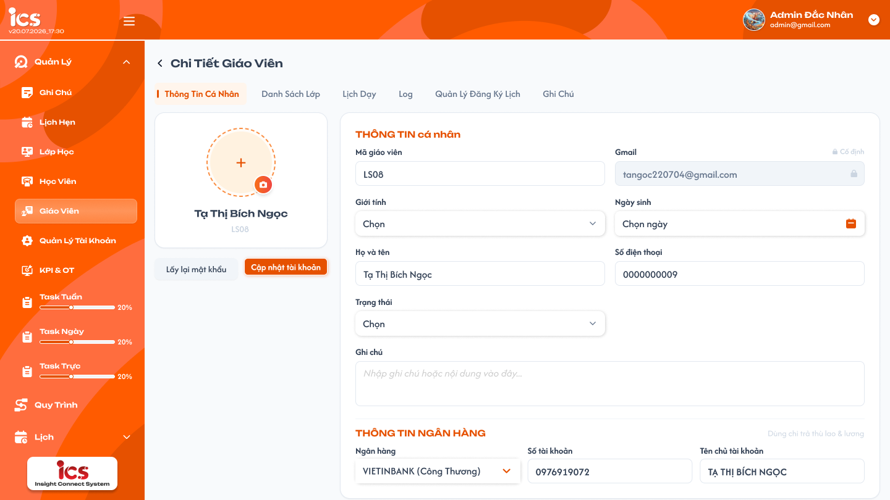
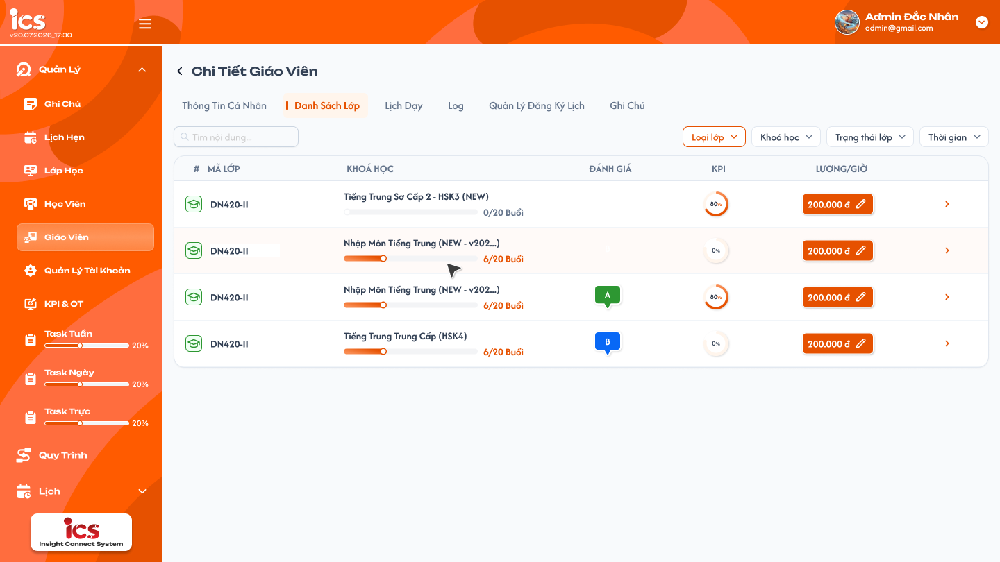
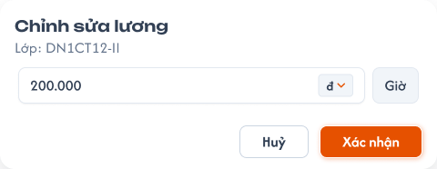
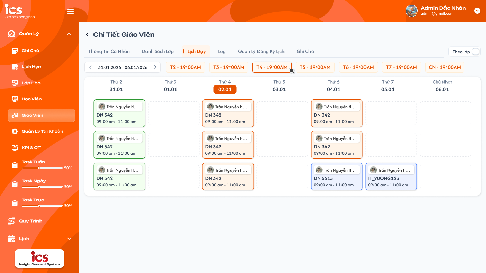
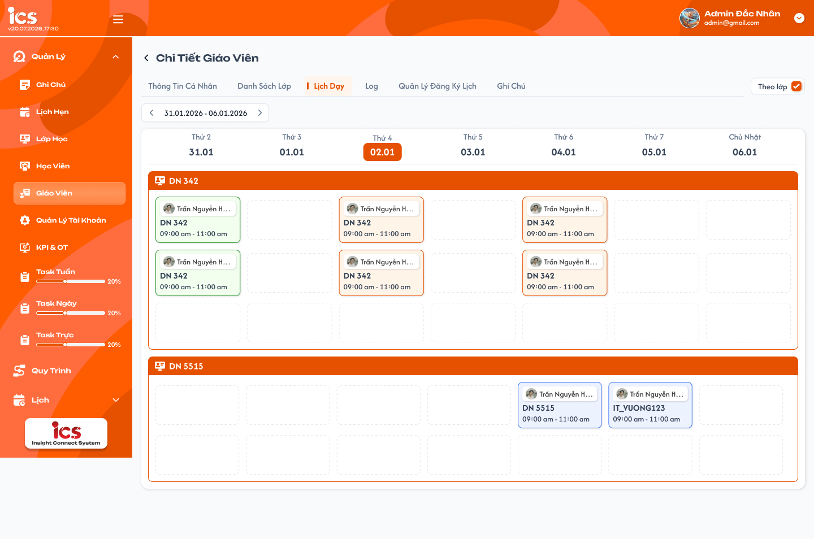
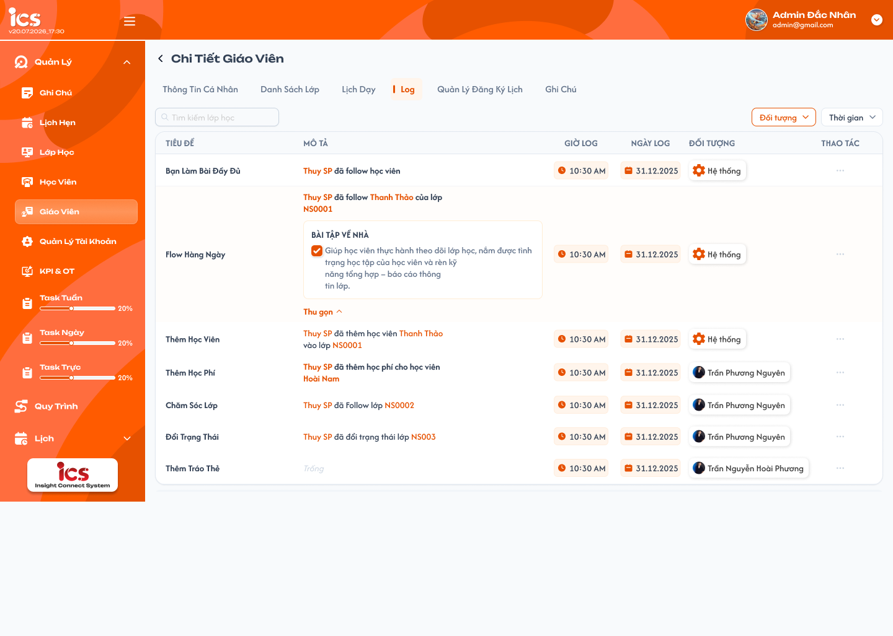
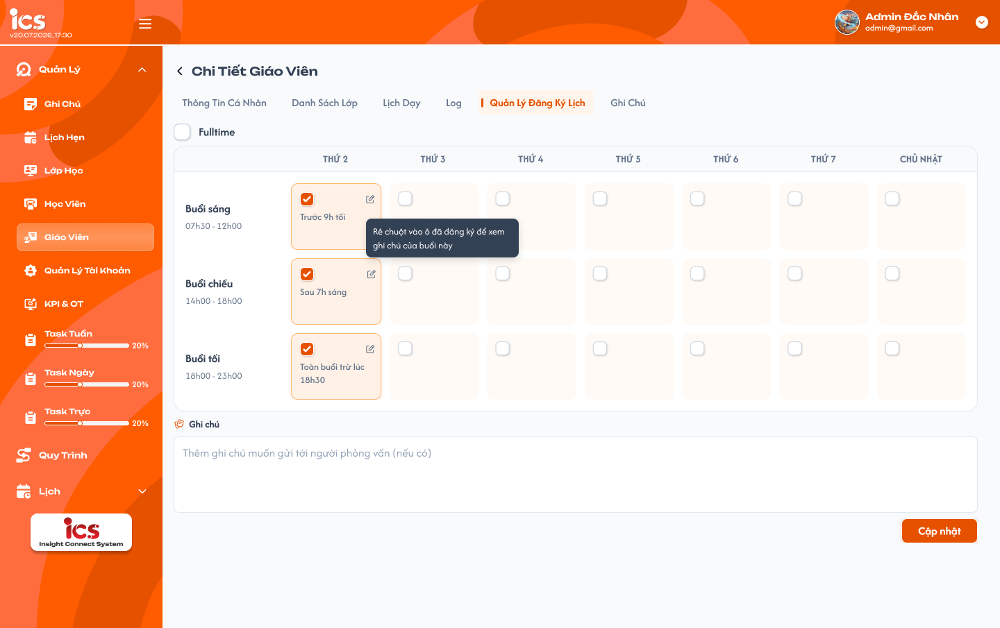
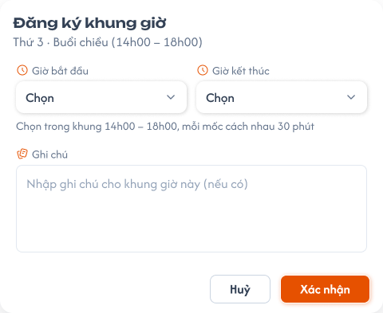
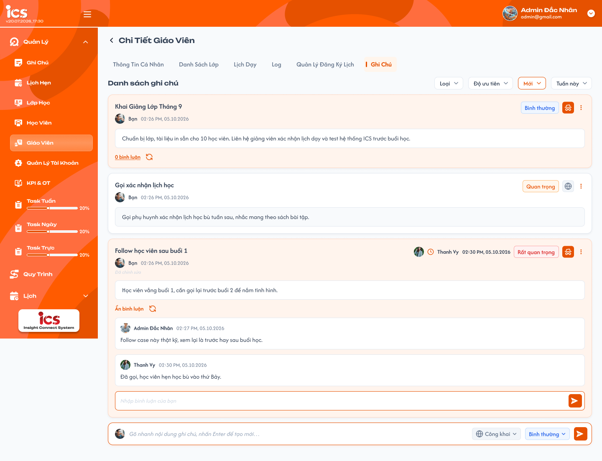

# [Admin] Chi tiết giáo viên

## 1. UI

### Trang 1: ADM-GV-020100 — Chi tiết giáo viên / Thông tin cá nhân



**Mô tả:**
- Màn hình tập trung hồ sơ và toàn bộ dữ liệu vận hành của đúng giáo viên được chọn từ danh sách; mở từ nút chi tiết của đúng giáo viên tại `teacher_management_requirements.md`.
- Các tab: `Thông tin cá nhân`, `Danh sách lớp`, `Lịch dạy`, `Log`, `Quản lý đăng ký lịch`, `Ghi chú`. Tab này hiển thị hồ sơ, trạng thái, ghi chú và thông tin ngân hàng của giáo viên.

**Điểm cần lưu ý:**
- Khi đổi tab, hệ thống giữ đúng giáo viên đang xem; không được tải hoặc hiển thị dữ liệu của giáo viên khác.
- `Class Handler` và `Support` được truy cập tab `Danh sách lớp` (được cập nhật lương theo từng lớp), tab `Log` (chỉ xem), tab `Quản lý đăng ký lịch` và tab `Ghi chú`. Quyền này không đồng nghĩa được xem hoặc thao tác tại các tab khác.
- `A02.01` Ảnh đại diện: cho phép chọn/thay ảnh, dung lượng tối đa 25 MB.
- `A02.02` Mã giáo viên: code tự sinh khi tạo (vd `LS08`); khóa, không cho chỉnh sửa.
- `A02.03` Gmail: kèm nhãn `Cố định` và icon khóa; không cho chỉnh sửa. Backend bỏ qua hoặc từ chối mọi giá trị ghi đè Mã giáo viên và Email.
- `A02.04` Họ và tên: cho cập nhật, không áp dụng validation bắt buộc khi cập nhật.
- `A02.05` Giới tính: không bắt buộc khi cập nhật.
- `A02.06` Ngày sinh: không bắt buộc khi cập nhật.
- `A02.07` Số điện thoại: không bắt buộc; nếu có giá trị phải đúng 10 chữ số và bắt đầu bằng `0`; xử lý dạng chuỗi để giữ số `0` đầu tiên.
- `A02.08` Trạng thái: `Training`, `Thử việc`, `Chính thức`, `Nghỉ việc`; giáo viên mới tạo mặc định `Training`; chuyển sang `Nghỉ việc` kích hoạt quy tắc nghỉ việc (khóa đăng nhập, loại giáo viên khỏi lịch đăng ký và các lớp đang dạy; giữ hồ sơ, lịch sử, log; không xóa cứng).
- `A02.09` Ghi chú: ghi chú tổng quan riêng của Thông tin cá nhân, hiển thị ở cột Ghi chú của danh sách giáo viên, không dùng chung dữ liệu với tab `Ghi chú`. Cập nhật thành công thì cột Ghi chú ở danh sách hiển thị nội dung mới.
- `A02.10` Ngân hàng: không bắt buộc; chọn từ danh sách ngân hàng hỗ trợ.
- `A02.11` Số tài khoản: không bắt buộc; người dùng nhập.
- `A02.12` Tên chủ tài khoản: không bắt buộc; người dùng nhập và hệ thống tự chuyển thành chữ in hoa trước khi lưu.
- `A02.13` Lấy lại mật khẩu: reset mật khẩu giáo viên về `abc12345`; lưu an toàn, không ghi plain text vào log; không trả mật khẩu qua API đọc, log hoặc notification.
- `A02.14` Cập nhật tài khoản: lưu toàn bộ thay đổi của Thông tin cá nhân, ảnh, ghi chú và thông tin ngân hàng trong một thao tác logic; chỉ validation định dạng/khoảng giá trị/dung lượng với trường có giá trị.
- Không có field lương theo giờ trong tab này (lương quản lý theo từng lớp ở tab `Danh sách lớp`); không có thao tác xóa cứng giáo viên.
- Chuyển tab hoặc quay lại khi có thay đổi chưa lưu: hiển thị cảnh báo xác nhận trước khi rời màn hình.
- `A08.01`–`A08.04` Toast phản hồi CRUD: `Thành Công` (backend xác nhận thành công), `Thông Báo` (đã tiếp nhận, dữ liệu cần thời gian đồng bộ), `Cảnh Báo` (dữ liệu/điều kiện cần kiểm tra), `Có Lỗi Xảy Ra` (backend/network không hoàn tất). Nội dung dòng hai lấy từ flow CRUD tương ứng; mỗi thao tác một Toast; Hủy/chỉ đọc không có Toast CRUD; nút `×` đóng thủ công; không hiển thị dữ liệu nhạy cảm.


### Trang 2: ADM-GV-020200 — Chi tiết giáo viên / Danh sách lớp



**Mô tả:**
- Tab `Danh sách lớp` chỉ hiển thị những lớp mà giáo viên đang xem đã được thêm hoặc phân công. `Admin`, `Class Handler`, `Support` xem danh sách trong phạm vi dữ liệu được cấp.
- Ngoài cập nhật lương theo từng lớp, tab không có thao tác thêm/gỡ giáo viên khỏi lớp hay cập nhật thông tin lớp.

**Điểm cần lưu ý:**
- `A03.01` Tìm kiếm lớp học: tìm theo Mã lớp hoặc Tên khóa học; tự tìm sau 2 giây kể từ lần nhập cuối hoặc tìm ngay khi nhấn `Enter` (hủy debounce đang chờ); kết hợp `AND` với các bộ lọc và đưa danh sách về trang đầu.
- `A03.02` Trạng thái lớp (cột `#`): icon trạng thái kèm tooltip tên; hỗ trợ `Khai giảng`, `Mới tạo`, `Đang học`, `Tạm dừng`, `Hoàn thành`, `Hủy`, `Xóa`, `Trải nghiệm`.
- `A03.03` Mã lớp: hiển thị mã lớp của đúng bản ghi; không dùng mã lớp làm khóa phân quyền hoặc khóa liên kết.
- `A03.04` Khóa học: tên khóa học, thanh tiến độ và số buổi `đã học/tổng số buổi Buổi` (vd `6/20 Buổi`); cùng nguồn với `[đã học/tổng]` ở popover Chi tiết Lớp của danh sách giáo viên.
- `A03.05` Đánh giá: đánh giá hiện hành của lớp theo nguồn dữ liệu đánh giá lớp; độc lập với KPI, không tự suy diễn từ KPI hoặc lương; chưa có công thức đánh giá.
- `A03.06` KPI lớp: tỷ lệ lên kỳ của lớp. Học viên: tỷ lệ lên kỳ = `(Tỷ lệ đi học + Tỷ lệ BTVN) / 2`; tỷ lệ đi học tính các trạng thái `Có mặt`, `Vào trễ`, `Ra sớm`, `Vào trễ & Ra sớm`; tỷ lệ BTVN là tỷ lệ bài `Hoàn thành`. KPI lớp = trung bình cộng của tất cả học viên thuộc lớp. Không có mẫu số hợp lệ thì hiển thị trạng thái không có dữ liệu/giá trị quy ước, tuyệt đối không hiển thị `NaN`, `Infinity` hoặc tỷ lệ âm.
- `A03.08` Mở chi tiết: icon mũi tên cuối dòng; hành vi điều hướng khi click chưa chốt (xem Q04).
- `A03.09` Lọc Loại lớp: `Lớp 1-1`, `Lớp chung`.
- `A03.10` Lọc Khóa học: lấy động từ danh sách khóa học cấu hình trong hệ thống.
- `A03.11` Lọc Trạng thái lớp: đủ 8 trạng thái như `A03.02`.
- `A03.12` Lọc Thời gian: theo `class.created_at`, mặc định `Hôm nay`; gồm `Tới hạn`, `Hôm nay`, `Hôm qua`, `Hôm nay và hôm qua`, `Tuần này`, `Tuần trước`, `Tháng này`, `Tháng trước`, `3 tháng trước`, `Năm nay`, `Năm trước`, `Tùy chọn`. `Tới hạn` từ thời điểm bắt đầu có dữ liệu đến hết hôm nay theo múi giờ nghiệp vụ; `Tùy chọn` bao gồm hai ngày biên và từ chối ngày bắt đầu sau ngày kết thúc.
- Các bộ lọc áp dụng đồng thời theo phép giao; mọi kết quả vẫn thuộc đúng giáo viên đang xem và phạm vi dữ liệu của người dùng. Mỗi trang tối đa 50 lớp; chuyển trang giữ từ khóa và bộ lọc; đổi từ khóa/bộ lọc về trang đầu; chỉ response của tổ hợp điều kiện mới nhất được cập nhật danh sách.
- Phân trang gồm khoảng dữ liệu đang xem, tổng kết quả, trang hiện tại, `Trước`, số trang, `...`, `Sau`; `Trước` vô hiệu ở trang đầu, `Sau` vô hiệu ở trang cuối.
- Loading, rỗng và lỗi phải phân biệt; lỗi tải không hiển thị như danh sách rỗng và cho phép thử lại.

### Trang 3: ADM-GV-020210 — Chi tiết giáo viên / Danh sách lớp / Popup chỉnh sửa lương



**Mô tả:**
- Popup `Chỉnh sửa lương` mở khi click nút lương/icon bút của một dòng lớp; hiển thị `Lớp: <Mã lớp>` của đúng dòng, ô tiền lương, tiền tệ `đ`, đơn vị `Giờ`, nút `Huỷ` và `Xác nhận`.

**Điểm cần lưu ý:**
- `A03.07` Lương giáo viên theo giờ: cột `LƯƠNG/GIỜ`, mỗi dòng là nút màu cam kèm icon bút, định dạng phân tách hàng nghìn kèm `đ` (vd `200.000 đ`, chỉ là định dạng hiển thị). Lương là dữ liệu của quan hệ `giáo viên–lớp`, nên cùng giáo viên có thể có mức lương khác nhau ở các lớp. `Admin`, `Class Handler`, `Support` được mở popup thiết lập/cập nhật.
- Giá trị lương đơn vị `VNĐ/giờ`, số nguyên không âm, cho phép `0`. Tiền tệ cố định `VNĐ` (nếu UI là dropdown thì chỉ áp dụng VNĐ); đơn vị cố định theo giờ, không sửa được.
- Backend xác định quan hệ bằng `teacher_id` + `class_id` (không tin mã/tên hiển thị do client gửi) và kiểm tra role, phạm vi giáo viên, phạm vi lớp, sự tồn tại của quan hệ giáo viên–lớp.
- `Huỷ` đóng popup, không gửi request, không đổi lương, không có notification CUD. `Xác nhận` validation rồi gửi đúng một request; trong khi xử lý vô hiệu hóa xác nhận lặp.
- Thành công: đóng popup, chỉ cập nhật nút lương của đúng quan hệ; ghi nhận actor và thời điểm. Thất bại: popup giữ giá trị vừa nhập để thử lại, giá trị chính thức ngoài bảng không đổi.
- Hai người cùng cập nhật một quan hệ: phải có cơ chế kiểm soát phiên bản/xung đột, không để response cũ ghi đè giá trị mới hơn.

### Trang 4: ADM-GV-020300 — Chi tiết giáo viên / Lịch dạy



**Mô tả:**
- Tab `Lịch dạy` chỉ đọc, hiển thị các buổi dạy đã xếp cho đúng giáo viên đang xem; không hiển thị lịch đăng ký làm việc, log, ghi chú hay dữ liệu giáo viên khác; không thêm/sửa/xóa/đăng ký/hủy lịch. Frame này là chế độ tắt `Theo lớp` (gom theo ngày).

**Điểm cần lưu ý:**
- Mặc định hiển thị tuần chứa ngày hiện tại, `Thứ 2` đến `Chủ Nhật`. Thanh tuần hiển thị `dd.MM.yyyy - dd.MM.yyyy`; mũi tên trái/phải chuyển tuần; click khoảng ngày mở danh sách tuần, chọn một tuần thì đóng danh sách và tải đúng tuần đó. Đổi tuần thay toàn bộ dữ liệu, không trộn tuần trước. Tiêu đề 7 cột kèm ngày `dd.MM`, ngày hiện tại được đánh dấu nếu thuộc tuần đang xem.
- Hàng chip `T2 - 19:00 … CN - 19:00` là tóm tắt lịch đăng ký của giáo viên: mỗi chip = thứ + giờ bắt đầu sớm nhất đã đăng ký trong thứ đó (dữ liệu từ tab Quản lý đăng ký lịch); thứ chưa đăng ký không có chip; chip trùng ngày hiện tại được tô sáng. Chip chỉ đọc, không lọc lịch dạy.
- Card buổi dạy hiển thị avatar + tên giáo viên, mã lớp, khoảng giờ. Màu viền theo mốc thời gian so với hiện tại: xanh lá = đã dạy, cam = hôm nay, xanh dương = sắp dạy.
- `A04.02` Tắt `Theo lớp`: lịch gom theo ngày, mỗi cột ngày hiển thị toàn bộ buổi trong ngày xếp tăng dần theo giờ bắt đầu, nhiều buổi xếp dọc; ngày không có buổi là ô trống viền nét đứt.
- Chỉ lấy buổi có giáo viên được phân công trùng giáo viên đang xem và ngày thuộc tuần được chọn; một buổi chỉ xuất hiện một lần trong cùng chế độ kể cả khi dữ liệu quan hệ giáo viên–lớp bị trùng. Đổi chế độ chỉ đổi cách trình bày, không đổi tập buổi dạy. Mỗi lần đổi tuần/chế độ chỉ nhận response của request mới nhất.

### Trang 5: ADM-GV-020309 — Chi tiết giáo viên / Lịch dạy / Xem theo lớp



**Mô tả:**
- Trạng thái bật `Theo lớp` của tab Lịch dạy: lịch nhóm theo từng lớp.

**Điểm cần lưu ý:**
- `A04.01` Bật `Theo lớp`: mỗi lớp là một nhóm riêng có thanh tiêu đề màu cam ghi mã lớp; bên dưới là lưới 7 cột ngày. Ngày có lịch hiển thị card; ngày không có lịch là ô trống viền nét đứt, không có chữ. Lớp và lịch không được trộn nhau.

### Trang 6: ADM-GV-020400 — Chi tiết giáo viên / Log



**Mô tả:**
- Tab `Log` hiển thị log hệ thống tự ghi cho mọi thay đổi liên quan đến đúng giáo viên đang xem; chỉ đọc, không tạo/sửa/xóa log bằng tay. `Admin`, `Class Handler`, `Support` được xem trong phạm vi dữ liệu được cấp.
- Hệ thống ghi log khi có thao tác thành công liên quan giáo viên: cập nhật hồ sơ, đổi trạng thái, reset mật khẩu, thêm/gỡ giáo viên khỏi lớp, cập nhật lương theo lớp, cập nhật lịch đăng ký, gán tag, tạo lịch hẹn, và thao tác của chính giáo viên với học viên/lớp (vd `Thuy SP đã thêm học viên Thanh Thảo vào lớp NS0001`).

**Điểm cần lưu ý:**
- `A05.01` Tìm kiếm (`Tìm kiếm lớp học`): lọc log theo mã lớp hoặc tên lớp xuất hiện trong mô tả; tự tìm sau 2 giây hoặc nhấn `Enter`.
- `A05.02` Tiêu đề: tên loại log (vd `Thêm Học Viên`, `Đổi Trạng Thái`, `Chăm Sóc Lớp`).
- `A05.03` Mô tả: câu do hệ thống sinh; tên người, học viên, mã lớp tô màu cam và dẫn tới đối tượng tương ứng; mô tả dài có khối chi tiết thu gọn/mở rộng (`Thu gọn`); không có mô tả hiển thị `Trống`.
- `A05.04` Giờ log, Ngày log: thời điểm ghi log dạng `hh:mm AM` và `dd.MM.yyyy` theo múi giờ nghiệp vụ.
- `A05.05` Đối tượng: người thao tác (avatar + tên) hoặc `Hệ thống` với log do tiến trình tự động sinh.
- `A05.06` Thao tác: nút `⋯` mở `Xem chi tiết` (toàn bộ nội dung log); không có sửa/xóa.
- `A05.07` Bộ lọc Đối tượng: chọn `Hệ thống` hoặc một người dùng cụ thể; không chọn thì hiển thị tất cả.
- `A05.08` Bộ lọc Thời gian: lọc theo thời điểm ghi log, cùng danh sách khoảng thời gian của tab Ghi chú; giá trị mặc định chưa chốt (xem Q16).
- Log sắp xếp mới nhất trước, tối đa 50 log/trang. Log là dữ liệu bất biến: không có API tạo/sửa/xóa từ client; mọi role, kể cả `Admin`, không xóa được log.
- Mỗi thao tác thay đổi dữ liệu thành công (cập nhật tài khoản, reset mật khẩu, đổi trạng thái, cập nhật lương, cập nhật lịch đăng ký, gán tag, tạo lịch hẹn) sinh đúng một dòng log với `Đối tượng` là người thao tác thực tế. Log chỉ thuộc đúng giáo viên đang xem.
- Từ khóa, Đối tượng, Thời gian kết hợp `AND`; đổi điều kiện về trang đầu; chỉ response của điều kiện mới nhất được cập nhật danh sách.

### Trang 7: ADM-GV-020500 — Chi tiết giáo viên / Quản lý đăng ký lịch



**Mô tả:**
- Tab hiển thị lịch làm việc đã đăng ký của đúng giáo viên dạng lưới 3 buổi × 7 thứ: `Buổi sáng 07h30 - 12h00`, `Buổi chiều 14h00 - 18h00`, `Buổi tối 18h00 - 23h00`. `Admin`, `Class Handler`, `Support` xem và cập nhật thay giáo viên trong phạm vi dữ liệu được cấp.

**Điểm cần lưu ý:**
- Quy tắc buổi, khung giờ, validation và cách lưu giống chức năng đăng ký lịch phía giáo viên, không tạo bộ quy tắc riêng. Cập nhật thay không đổi owner của lịch; hệ thống lưu người thao tác thực tế (`Admin`/`Class Handler`/`Support`), không ghi nhận giả là giáo viên tự cập nhật.
- `A06.01` Fulltime: tick = chọn thêm các ô còn trống bằng khung giờ trọn buổi, giữ nguyên khung giờ và ghi chú các ô đã đăng ký. Bỏ tick bất kỳ ô nào thì Fulltime tự bỏ tick (chỉ gỡ ô đó). Khi tải tab, Fulltime được tick nếu đủ 21 ô đã chọn, kể cả có ô dùng khung giờ riêng. Chủ động bỏ tick Fulltime thì bỏ chọn toàn bộ ô trong nháp; chỉ `Cập nhật` mới lưu chính thức.
- `A06.02` Cột ngày: `Thứ 2` … `Thứ 7`, `Chủ Nhật`.
- `A06.03` Hàng buổi: ba buổi như trên.
- `A06.04` Ô buổi chưa đăng ký: checkbox trống; tick mở popup `Đăng ký khung giờ` của đúng thứ và buổi.
- `A06.05` Ô buổi đã đăng ký: tick, nền cam, ghi chú ngắn của ô (vd `Trước 9h tối`, `Toàn buổi trừ lúc 18h30`), icon bút mở lại popup sửa khung giờ/ghi chú; hover hiển thị tooltip ghi chú đầy đủ. Bỏ tick = gỡ đăng ký buổi đó. Một ô đã tick = 1 ca ở cột Lịch đăng ký của danh sách giáo viên (tối đa 21 ca).
- `A06.07` Ghi chú (chung): ô văn bản dưới lưới, không bắt buộc, lưu cùng lịch đăng ký; placeholder `gửi tới người phỏng vấn` là copy từ màn giáo viên, đọc là ghi chú chung cho lịch đăng ký.
- `A06.08` Cập nhật: lưu toàn bộ lưới (ô đã tick, khung giờ và ghi chú từng ô, ghi chú chung, cờ Fulltime) atomically, không lưu một phần. Thay đổi trên lưới/popup chỉ là nháp cho tới khi bấm `Cập nhật`; rời tab khi có thay đổi chưa lưu phải hỏi xác nhận.
- Bỏ khung giờ đăng ký vẫn cho Cập nhật dù trong khung đã có lịch dạy được phân công; không cảnh báo/chặn, lịch dạy đã xếp giữ nguyên.
- Sau khi cập nhật thành công, cột `Lịch đăng ký` (`N ngày (M ca)`), popover `Chi tiết lịch đăng ký` ở danh sách giáo viên và hàng chip ở tab Lịch dạy dùng cùng dữ liệu mới (số ngày = số thứ có ít nhất một ô tick; số ca = số ô tick). Vô hiệu hóa xác nhận lặp khi đang xử lý; thất bại thì giữ lựa chọn đang sửa để thử lại. Cập nhật thành công sinh một dòng log ở tab Log.
- Backend kiểm tra role, phạm vi giáo viên, trạng thái tài khoản tại thời điểm xử lý (kể cả gọi API trực tiếp); cập nhật đồng thời không được ghi đè dữ liệu mới hơn, thống nhất với phía giáo viên.

### Trang 8: ADM-GV-020520 — Chi tiết giáo viên / Quản lý đăng ký lịch / Popup đăng ký khung giờ



**Mô tả:**
- Popup `Đăng ký khung giờ` mở khi tick ô buổi chưa đăng ký hoặc bấm icon bút ở ô đã đăng ký.

**Điểm cần lưu ý:**
- `A06.06` Popup Đăng ký khung giờ: dòng phụ `<Thứ> · <Buổi> (<khung buổi>)`; `Giờ bắt đầu`, `Giờ kết thúc` là dropdown các mốc cách nhau 30 phút trong khung buổi (gợi ý `Chọn trong khung 14h00 – 18h00, mỗi mốc cách nhau 30 phút`); cả hai bắt buộc, đều nằm trong khung buổi và `Giờ kết thúc` phải lớn hơn `Giờ bắt đầu`; `Ghi chú` không bắt buộc. `Huỷ` đóng, không đổi ô; `Xác nhận` lưu tạm vào lưới (chưa ghi backend).

### Trang 9: ADM-GV-020600 — Chi tiết giáo viên / Ghi chú



**Mô tả:**
- Tab `Ghi chú` quản lý danh sách ghi chú độc lập liên quan đến đúng giáo viên đang xem; không phải trường `Ghi chú` tổng quan ở tab `Thông tin cá nhân` và không cấp dữ liệu cho cột Ghi chú ở danh sách giáo viên. `Admin`, `Class Handler`, `Support` truy cập trong phạm vi dữ liệu được cấp. Owner là người tạo, xác định bằng định danh tài khoản đã xác thực, không giả mạo được từ client.

**Điểm cần lưu ý:**
- `A07.01` Ô gõ nhanh: thanh cố định cuối tab `Gõ nhanh nội dung ghi chú, nhấn Enter để tạo mới…` kèm dropdown Loại (mặc định `Công khai`), Độ ưu tiên (mặc định `Bình thường`) và nút gửi. `Enter` hoặc nút gửi tạo ghi chú với Nội dung là text đã gõ, Tiêu đề trống, trạng thái `Mới`, owner là người dùng hiện tại. Không có nút `+` hay popup thêm riêng.
- `A07.02` Tiêu đề: không bắt buộc; nhập/sửa qua `Sửa` trong menu `⋮`; card không có tiêu đề hiển thị dòng đầu của nội dung làm tiêu đề.
- `A07.03` Nội dung: bắt buộc (rỗng/chỉ khoảng trắng bị từ chối).
- `A07.04` Loại: `Công khai` (icon quả địa cầu), `Riêng tư` (icon khóa); mặc định `Công khai`.
- `A07.05` Độ ưu tiên: `Bình thường`, `Quan trọng`, `Rất quan trọng`; badge màu trên card; mặc định `Bình thường`.
- `A07.06` Trạng thái: `Mới`, `Đóng`; ghi chú mới mặc định `Mới`.
- `A07.07` Menu `⋮`: chỉ owner thấy; `Sửa` (popup Tiêu đề, Nội dung, Loại, Độ ưu tiên), `Đóng` / `Mở lại`, `Xóa` (có xác nhận, không xóa dữ liệu giáo viên hay ghi chú khác). Người khác không có menu.
- `A07.08` Nhãn `Đã chỉnh sửa`: hiển thị dưới owner khi ghi chú đã được sửa.
- `A07.09` Owner: avatar, tên người tạo và thời gian tạo đầy đủ ngày, tháng, năm, giờ, phút.
- `A07.10` Bình luận: hiển thị số lượng; mở/ẩn danh sách bình luận. Mỗi bình luận có avatar, tên và thời gian tạo đầy đủ. Ghi chú `Mới` cho người có quyền xem thêm bình luận; ghi chú `Đóng` không cho ai thêm/sửa/xóa bình luận (owner phải mở lại trước). Chỉ người tạo bình luận được sửa/xóa bình luận của mình; owner ghi chú không sửa/xóa bình luận của người khác. Sửa bình luận không đổi người tạo.
- `A07.11` Hoạt động bình luận cuối: nếu có bình luận, bên phải card hiển thị avatar và đầy đủ ngày, tháng, năm, giờ của comment mới nhất (theo thời gian tạo). Xóa comment mới nhất thì quay về comment mới nhất còn lại; không còn comment thì không hiển thị.
- `A07.12` Ghi chú `Công khai` + `Mới`: owner xem, sửa, xóa, đóng, comment; Admin/Class Handler/Support khác xem và comment.
- `A07.13` Ghi chú `Riêng tư` + `Mới`: owner xem, sửa, xóa, đóng, comment; người khác không nhìn thấy và không truy cập được.
- `A07.14` Ghi chú `Công khai` + `Đóng`: owner xem, sửa, xóa, mở lại (không comment khi đóng); người khác không nhìn thấy và không truy cập được.
- `A07.15` Ghi chú `Riêng tư` + `Đóng`: như `A07.14`.
- Chỉ owner được cập nhật tiêu đề/nội dung/loại/độ ưu tiên/trạng thái, xóa, đóng và mở lại. Backend áp dụng quyền và tính riêng tư trước khi trả dữ liệu, không chỉ ẩn thao tác ở UI; `Admin` cũng không bỏ qua quyền sở hữu.
- `A07.16` Lọc Loại: `Công khai`, `Riêng tư`; không chọn là không giới hạn; kết quả vẫn tuân thủ quyền riêng tư.
- `A07.17` Lọc Độ ưu tiên: `Bình thường`, `Quan trọng`, `Rất quan trọng`.
- `A07.18` Lọc Trạng thái ghi chú: `Mới`, `Đóng`; ghi chú đóng vẫn chỉ owner nhận được trong kết quả.
- `A07.19` Lọc Thời gian: mặc định `Hôm nay`; lọc theo `created_at` trong múi giờ nghiệp vụ.
- `A07.20` Tới hạn: từ thời điểm bắt đầu lưu dữ liệu của hệ thống đến hết hôm nay.
- `A07.21` Hôm nay: từ đầu ngày đến hết ngày hôm nay (mặc định).
- `A07.22` Hôm qua: toàn bộ ngày liền trước hôm nay.
- `A07.23` Hôm nay và hôm qua: hợp của hôm qua và hôm nay.
- `A07.24` Tuần này: từ đầu Thứ 2 đến hết Chủ Nhật của tuần hiện tại.
- `A07.25` Tuần trước: Thứ 2 đến Chủ Nhật của tuần liền trước.
- `A07.26` Tháng này: từ ngày đầu đến ngày cuối của tháng hiện tại.
- `A07.27` Tháng trước: từ ngày đầu đến ngày cuối của tháng liền trước.
- `A07.28` 3 tháng trước: từ đầu ngày cách ngày hiện tại ba tháng đến thời điểm hiện tại.
- `A07.29` Năm nay: từ 01/01 đến 31/12 của năm hiện tại.
- `A07.30` Năm trước: từ 01/01 đến 31/12 của năm liền trước.
- `A07.31` Tùy chọn: chọn ngày bắt đầu và kết thúc, bao gồm hai ngày biên; từ chối ngày bắt đầu sau ngày kết thúc.
- Các bộ lọc Loại, Độ ưu tiên, Trạng thái, Thời gian kết hợp `AND`; đổi bộ lọc tải lại từ trang đầu và giữ các giá trị lọc còn lại; điều kiện lọc không làm lộ ghi chú riêng tư/đóng của người khác; chỉ response của tổ hợp mới nhất được cập nhật danh sách.
- Mỗi trang tối đa 50 ghi chú sau khi áp dụng quyền; phân trang hiển thị khoảng dữ liệu, tổng số kết quả người dùng được phép xem (không làm lộ ghi chú Riêng tư/Đóng của người khác), trang hiện tại, `Trước`, số trang, `...`, `Sau`. Tạo ghi chú thành công thì về trang đầu; cập nhật/đóng/mở giữ trang nếu bản ghi còn phù hợp, nếu không chuyển đến trang hợp lệ gần nhất.
- Request thay đổi phải chống gửi lặp; backend kiểm tra lại role, phạm vi, owner, trạng thái, quyền xem tại thời điểm xử lý.

---

## 2. Yêu cầu

### 2.1. Flow chính

**Flow 1 / REQ01: Xem chi tiết giáo viên**

```
Admin mở chi tiết giáo viên → Hệ thống kiểm tra quyền, định danh, phạm vi dữ liệu
  → Tải đúng hồ sơ giáo viên → Mở tab Thông tin cá nhân (Mã giáo viên, Email bị khóa)
                    ↓ (thất bại)
              Hiển thị lỗi, không hiển thị dữ liệu giáo viên khác
```

**Flow 2 / REQ02: Cập nhật Thông tin cá nhân**

```
Admin sửa một hoặc nhiều trường cho phép (không trường nào bắt buộc)
  → Validation dữ liệu/tệp được cung cấp → Cập nhật tài khoản
  → Lưu toàn bộ thay đổi → cập nhật ghi chú tổng quan ở danh sách → notification thành công
                    ↓ (thất bại)
              Không hiển thị như đã lưu, giữ dữ liệu để sửa, notification thất bại
```

**Flow 3 / REQ03: Lấy lại mật khẩu giáo viên**

```
Admin chọn Lấy lại mật khẩu → Backend xác định đúng tài khoản
  → Reset về abc12345 (lưu bảo mật) → notification thành công
                    ↓ (thất bại)
              Giữ mật khẩu cũ, notification thất bại
```

**Flow 4 / REQ04: Chuyển giáo viên sang Nghỉ việc**

```
Admin chọn Trạng thái = Nghỉ việc → Cập nhật tài khoản
  → Cập nhật trạng thái → Khóa đăng nhập → Loại khỏi lịch đăng ký và các lớp đang dạy
  → Giữ hồ sơ, lịch sử, log (không xóa cứng) → notification tương ứng
```

**Flow 5 / REQ05: Xem lịch dạy theo tuần**

```
Admin mở tab Lịch dạy → Mặc định tuần hiện tại, chỉ buổi dạy của đúng giáo viên
  → Chuyển tuần bằng mũi tên hoặc chọn từ danh sách → Hiển thị Thứ 2–Chủ Nhật
       ↓ (bật Theo Lớp)                          ↓ (tắt Theo Lớp)
  Nhóm theo lớp, mỗi lớp đủ 7 ô ngày      Gom theo ngày, tăng dần theo giờ bắt đầu
  → Ô không có buổi: nét đứt; viền card theo mốc (đã dạy / hôm nay / sắp dạy)
  → Hàng chip tóm tắt lịch đăng ký (chỉ đọc); không có thêm/sửa/xóa lịch
```

**Flow 6 / REQ07: Xem log hệ thống của giáo viên**

```
Admin / Class Handler / Support mở tab Log
  → Tải log tự ghi của đúng giáo viên, mới nhất trước, tối đa 50/trang
  → Tìm theo mã lớp, lọc Đối tượng và Thời gian (AND) → mở rộng/thu gọn mô tả, ⋯ → Xem chi tiết
  → Không tạo/sửa/xóa log; mỗi thao tác thành công ở tab khác sinh đúng một dòng log
```

**Flow 7 / REQ08: Xem, lọc và quản lý ghi chú**

```
Admin / Class Handler / Support mở tab Ghi chú
  → Áp dụng quyền: Công khai + Mới cho các role được cấp; Riêng tư hoặc Đóng chỉ owner
  → Mặc định lọc created_at = Hôm nay → kết hợp Loại, Độ ưu tiên, Trạng thái, Thời gian
  → Gõ nhanh ở ô cuối tab + Enter để tạo → Owner sửa/xóa/đóng/mở lại
  → Người không phải owner chỉ xem và comment ghi chú Công khai đang Mới
```

**Flow 8 / REQ09: Bình luận ghi chú**

```
Mở phần bình luận của ghi chú Mới có quyền xem → Thêm comment
  → Cập nhật metadata comment cuối trên card
  → Người tạo comment sửa/xóa comment của mình (khi ghi chú còn Mới)
                    ↓ (ghi chú Đóng)
              Mọi comment chỉ đọc, chỉ owner còn xem được
```

**Flow 9 / REQ10: Cập nhật lịch đăng ký của giáo viên**

```
Mở tab Quản lý đăng ký lịch → Tải lưới 3 buổi × Thứ 2–Chủ Nhật
  → Tick ô trống → Popup Đăng ký khung giờ → Xác nhận (lưu tạm vào ô)
  → Bỏ tick ô = gỡ buổi; tick Fulltime = thêm ô trống trọn buổi; bỏ Fulltime = bỏ chọn toàn bộ ô trong nháp
  → Cập nhật → Backend kiểm tra role, phạm vi, phiên bản, validation như phía giáo viên
  → Thành công: lưu atomically, ghi actor thực tế, cập nhật danh sách, notification thành công
                    ↓ (thất bại/xung đột)
              Không ghi đè dữ liệu mới hơn, giữ lựa chọn để thử lại, notification thất bại
```

**Flow 10 / REQ11: Xem lớp và cập nhật lương giáo viên theo lớp**

```
Mở tab Danh sách lớp → Kiểm tra role, phạm vi → Chỉ tải lớp đã thêm giáo viên
  → Tìm theo Mã lớp/Tên khóa học + lọc Loại lớp, Khóa học, Trạng thái, Thời gian tạo lớp (50 lớp/trang)
  → Click nút lương/icon bút → Popup Chỉnh sửa lương của đúng lớp
       ↓ (Huỷ)                           ↓ (Xác nhận)
  Đóng, không request           Nhập số nguyên VNĐ/giờ ≥ 0 → một request → Backend kiểm tra role, lớp, quan hệ, phiên bản
                                  → Thành công: cập nhật đúng quan hệ, ghi actor/thời gian, notification thành công
                                  → Thất bại/xung đột: giữ giá trị đã lưu, notification thất bại
```

### 2.2. Ngoại lệ

- **EX01:** Giáo viên không tồn tại hoặc không còn thuộc phạm vi người dùng → từ chối hiển thị, không dùng dữ liệu giáo viên khác thay thế.
- **EX02:** Tải chi tiết thất bại hoặc hết thời gian chờ → hiển thị lỗi và cho phép thử lại; không hiển thị form với dữ liệu cũ như dữ liệu hiện tại.
- **EX03:** Số điện thoại sai định dạng hoặc ảnh đại diện lớn hơn 25 MB → không gửi/lưu dữ liệu không hợp lệ, hiển thị lỗi tại trường và notification thất bại.
- **EX04:** Cập nhật Thông tin cá nhân hoặc reset mật khẩu thất bại → không hiển thị thành công giả; dữ liệu đã lưu và mật khẩu cũ không đổi.
- **EX05:** Client gửi yêu cầu sửa Mã giáo viên hoặc Email → backend bỏ qua hoặc từ chối, giữ nguyên hai giá trị đã khóa.
- **EX06:** Chuyển tab hoặc quay lại khi có thay đổi chưa lưu → hiển thị cảnh báo; chỉ rời màn hình sau khi Admin xác nhận bỏ thay đổi.
- **EX07:** Giáo viên không có buổi dạy trong tuần được chọn → hiển thị lưới trống (ô nét đứt) đúng theo chế độ; không tái sử dụng dữ liệu tuần hoặc giáo viên khác.
- **EX08:** Tải lịch dạy thất bại hoặc hết thời gian chờ → hiển thị lỗi và cho phép thử lại; không dùng lịch đăng ký hoặc dữ liệu cũ thay thế.
- **EX09:** Đổi tuần/chế độ khi request cũ chưa hoàn tất → chỉ response của điều kiện mới nhất được cập nhật lịch.
- **EX10:** Client gửi request tạo, sửa hoặc xóa log → backend từ chối; log bất biến.
- **EX11:** Không có log phù hợp với từ khóa, Đối tượng hoặc Thời gian đang chọn → hiển thị trạng thái không có dữ liệu và giữ điều kiện để chỉnh sửa.
- **EX12:** Ghi log thất bại sau một thao tác thành công → không làm thất bại thao tác chính; hệ thống ghi nhận lỗi để đồng bộ log sau, không hiển thị thành công giả cho log.
- **EX13:** Tải danh sách/trang log thất bại hoặc response trang cũ trả về sau → hiển thị lỗi, cho phép thử lại, chỉ nhận response của trang mới nhất; không coi lỗi là danh sách rỗng, không hiển thị dữ liệu giáo viên khác.
- **EX14:** Người không phải owner truy cập ghi chú `Riêng tư` hoặc `Đóng` bằng danh sách, filter hay ID trực tiếp → không trả nội dung hoặc metadata.
- **EX15:** Nội dung ghi chú hoặc comment rỗng/chỉ có khoảng trắng → từ chối tạo/cập nhật, hiển thị lỗi validation và notification thất bại; Tiêu đề được phép trống.
- **EX16:** Người không phải owner gửi request cập nhật, xóa, đóng hoặc mở ghi chú → backend từ chối, giữ nguyên dữ liệu.
- **EX17:** Người dùng gửi request sửa/xóa comment do người khác tạo, kể cả là owner ghi chú → backend từ chối, giữ nguyên comment.
- **EX18:** Request tạo/sửa/xóa comment khi ghi chú đang `Đóng` → backend từ chối; owner phải mở lại ghi chú trước.
- **EX19:** Tải danh sách/trang ghi chú thất bại → hiển thị lỗi và cho phép thử lại; không coi lỗi là danh sách rỗng, không dùng dữ liệu cũ/ngoài quyền thay thế.
- **EX20:** Đổi trang hoặc filter khi request cũ chưa hoàn tất → chỉ response của trang và tổ hợp filter mới nhất được cập nhật danh sách.
- **EX21:** Khung giờ trong popup trống, ngoài khung buổi hoặc giờ kết thúc không lớn hơn giờ bắt đầu → không lưu ô; tải/cập nhật lịch đăng ký thất bại, hết thời gian chờ hoặc xác nhận lặp → không lưu lịch một phần/trùng request, giữ dữ liệu chính thức cũ và hiển thị đúng một notification thất bại.
- **EX22:** Lịch đăng ký đã được giáo viên hoặc người quản lý khác cập nhật sau khi màn hình tải → không âm thầm ghi đè; xử lý xung đột theo cùng cơ chế phía giáo viên.
- **EX23:** Lương theo lớp là số âm, số thập phân hoặc không phải số → từ chối, giữ giá trị đã lưu, hiển thị lỗi tại trường cùng notification thất bại; số nguyên `0` là hợp lệ.
- **EX24:** Role không thuộc `Admin`, `Class Handler`, `Support`, người dùng ngoài phạm vi hoặc quan hệ giáo viên–lớp không tồn tại gửi request cập nhật lương → backend từ chối, không đổi dữ liệu.
- **EX25:** Tải/tìm/lọc/chuyển trang Danh sách lớp thất bại, hết thời gian chờ hoặc request cũ trả về sau → hiển thị lỗi có thể thử lại, chỉ nhận response của trang, từ khóa và tổ hợp filter mới nhất; không coi lỗi là danh sách rỗng.
- **EX26:** Cập nhật lương thất bại hoặc xác nhận lặp khi đang xử lý → không tạo nhiều lần cập nhật, giữ lương chính thức cũ, đúng một notification thất bại.
- **EX27:** Lương của quan hệ giáo viên–lớp đã được người khác cập nhật sau khi dòng được tải → không âm thầm ghi đè; thông báo xung đột và yêu cầu tải lại theo cơ chế kiểm soát phiên bản.

### 2.3. Yêu cầu khác

| Mã | Tên yêu cầu | Mô tả |
|---|---|---|
| REQ01 | Xem chi tiết giáo viên | `Admin` xem hồ sơ giáo viên thuộc phạm vi; tab mặc định `Thông tin cá nhân` (Giới tính, Ngày sinh, Trạng thái, Ghi chú, thông tin ngân hàng); Mã giáo viên và Gmail bị khóa; không có field lương theo giờ. `Class Handler` và `Support` chỉ truy cập tab `Danh sách lớp` (REQ11), `Log` (REQ07), `Quản lý đăng ký lịch` (REQ10), `Ghi chú` (REQ08–REQ09), không kế thừa quyền các tab khác. |
| REQ02 | Cập nhật Thông tin cá nhân | Cập nhật ảnh, Họ tên, Giới tính, Ngày sinh, Số điện thoại, Trạng thái, Ghi chú tổng quan, thông tin ngân hàng. Không trường nào bắt buộc; dữ liệu có nhập phải đúng định dạng/ràng buộc. Ghi chú tổng quan là dữ liệu riêng, hiển thị ở danh sách giáo viên, không dùng chung với tab `Ghi chú`. |
| REQ03 | Lấy lại mật khẩu | Reset đúng tài khoản giáo viên về `abc12345`, lưu bảo mật, không ghi plain text vào log, notification thành công/thất bại. |
| REQ04 | Nghỉ việc và không xóa cứng | Trạng thái `Nghỉ việc`: khóa đăng nhập, loại khỏi lịch đăng ký và lớp đang dạy, giữ hồ sơ/lịch sử/log. Không có chức năng xóa cứng giáo viên. |
| REQ05 | Lịch dạy chỉ đọc | Chỉ buổi dạy của đúng giáo viên trong tuần chọn, không hiển thị lịch đăng ký làm việc, không CUD lịch. Chuyển/chọn tuần (`dd.MM.yyyy`); bật `Theo lớp` nhóm theo lớp, tắt gom theo ngày, cùng một tập buổi dạy. Hàng chip tóm tắt lịch đăng ký (chỉ đọc, chip ngày hiện tại tô sáng); viền card: xanh lá đã dạy, cam hôm nay, xanh dương sắp dạy. |
| REQ06 | Notification cho thao tác thay đổi | Mọi thao tác cập nhật tài khoản, reset mật khẩu, đổi trạng thái, cập nhật lương theo lớp, cập nhật lịch đăng ký, CUD ghi chú, đóng/mở ghi chú, CUD comment hiển thị đúng một notification thành công/thất bại; thành công chỉ sau khi backend xác nhận; không đưa mật khẩu, stack trace, token hay thông tin kỹ thuật nhạy cảm vào nội dung. Validation client chặn thì báo lỗi tại trường và một notification thất bại tổng quát. Thao tác chỉ đọc (xem, lọc, chuyển tab/tuần, đổi chế độ) không có notification. |
| REQ07 | Log hệ thống của giáo viên | Tab Log chỉ đọc, log do hệ thống ghi cho giáo viên thuộc phạm vi; mỗi log có Tiêu đề, Mô tả (mở rộng/xem chi tiết), Giờ log, Ngày log, Đối tượng (`Hệ thống` hoặc người thao tác). Tìm theo lớp, lọc Đối tượng và Thời gian; mới nhất trước, 50 log/trang. Không có API tạo/sửa/xóa log từ client; mọi thao tác thay đổi dữ liệu thành công liên quan giáo viên sinh đúng một dòng log. |
| REQ08 | Ghi chú giáo viên | `Admin`, `Class Handler`, `Support` tạo ghi chú và xem ghi chú `Công khai` đang `Mới` trong phạm vi. `Riêng tư` và mọi ghi chú `Đóng` chỉ owner xem. Owner sửa, xóa, đóng/mở ghi chú của mình. Lọc Loại, Độ ưu tiên, Trạng thái, Thời gian tạo (mặc định `Hôm nay`; `Tới hạn` từ đầu hệ thống đến hết hôm nay). Tối đa 50 ghi chú được phép xem/trang, không làm lộ số lượng dữ liệu ngoài quyền. |
| REQ09 | Bình luận ghi chú | Người có quyền xem ghi chú `Mới` được comment. Ghi chú `Đóng` không cho thao tác comment nào. Chỉ người tạo comment sửa/xóa comment của mình; owner ghi chú không sửa/xóa comment của người khác. Ghi chú, comment và metadata comment cuối hiển thị đúng người và ngày, tháng, năm, thời gian. |
| REQ10 | Quản lý đăng ký lịch | `Admin`, `Class Handler`, `Support` xem và cập nhật lịch đăng ký của giáo viên thuộc phạm vi. Lưới 3 buổi (`Sáng 07h30 - 12h00`, `Chiều 14h00 - 18h00`, `Tối 18h00 - 23h00`) × Thứ 2–Chủ Nhật; tick ô mở popup `Đăng ký khung giờ` (mốc 30 phút, ghi chú ô); Fulltime chọn thêm ô trống trọn buổi, giữ giờ/ghi chú ô đã đăng ký; chủ động bỏ Fulltime bỏ chọn toàn bộ trong nháp, chỉ Cập nhật mới lưu; Fulltime tự bỏ do gỡ một ô không gỡ ô còn lại; có ghi chú chung. Bỏ ca đang có lịch dạy vẫn lưu bình thường, không cảnh báo/chặn, không đổi lịch dạy đã xếp. 1 ô tick = 1 ca ở danh sách giáo viên. Lưu atomically toàn bộ lưới, cùng validation với phía giáo viên, cập nhật dữ liệu danh sách và chip ở tab Lịch dạy, ghi nhận actor thực tế và sinh log. |
| REQ11 | Danh sách lớp và lương theo lớp | Chỉ hiển thị lớp đã thêm giáo viên: Trạng thái lớp, Mã lớp, Khóa học, Đánh giá, KPI (tỷ lệ lên kỳ), cột `LƯƠNG/GIỜ`. Lương là dữ liệu riêng của quan hệ giáo viên–lớp, VNĐ/giờ, số nguyên không âm, cho phép `0`; nút cam `200.000 đ` kèm icon bút. `Admin`, `Class Handler`, `Support` mở popup `Chỉnh Sửa Lương` (Mã lớp, giá trị hiện tại, VNĐ, Giờ, `Hủy`, `Xác Nhận`). Tìm theo Mã lớp/Tên khóa học; lọc Loại lớp, Khóa học, 8 Trạng thái lớp, Thời gian tạo lớp (cùng danh sách khoảng thời gian tab Ghi chú); 50 lớp/trang. |

### 2.4. Ràng buộc

#### Quyền

| Role | Xem Thông tin cá nhân | Cập nhật Thông tin cá nhân | Reset mật khẩu | Chuyển Nghỉ việc | Xem Lịch dạy | CUD Lịch dạy | Xem Log | Tạo/Sửa/Xóa Log | Xem lịch đăng ký | Cập nhật lịch đăng ký |
|---|:---:|:---:|:---:|:---:|:---:|:---:|:---:|:---:|:---:|:---:|
| Admin | ✅ | ✅ | ✅ | ✅ | ✅ | ❌ | ✅ | ❌ | ✅ | ✅ |
| Class Handler | ❌ | ❌ | ❌ | ❌ | ❌ | ❌ | ✅ | ❌ | ✅ | ✅ |
| Support | ❌ | ❌ | ❌ | ❌ | ❌ | ❌ | ✅ | ❌ | ✅ | ✅ |
| Các role khác | ❌ | ❌ | ❌ | ❌ | ❌ | ❌ | ❌ | ❌ | ❌ | ❌ |

**Quyền tại tab Danh sách lớp:**

| Role | Xem danh sách lớp đã thêm giáo viên | Tìm kiếm/Lọc/Phân trang | Cập nhật lương theo lớp | Thêm/Gỡ giáo viên khỏi lớp | Cập nhật thông tin lớp |
|---|:---:|:---:|:---:|:---:|:---:|
| Admin | ✅ | ✅ | ✅ | ❌ | ❌ |
| Class Handler | ✅ | ✅ | ✅ | ❌ | ❌ |
| Support | ✅ | ✅ | ✅ | ❌ | ❌ |
| Các role khác | ❌ | ❌ | ❌ | ❌ | ❌ |

**Quyền tại tab Ghi chú:**

| Role | Xem Công khai + Mới | Xem Riêng tư/Đóng của mình | Xem Riêng tư/Đóng người khác | Tạo ghi chú | Quản lý ghi chú của mình | Quản lý ghi chú người khác | Comment ghi chú được xem + Mới | Sửa/Xóa comment của mình | Sửa/Xóa comment người khác |
|---|:---:|:---:|:---:|:---:|:---:|:---:|:---:|:---:|:---:|
| Admin | ✅ | ✅ | ❌ | ✅ | ✅ | ❌ | ✅ | ✅ | ❌ |
| Class Handler | ✅ | ✅ | ❌ | ✅ | ✅ | ❌ | ✅ | ✅ | ❌ |
| Support | ✅ | ✅ | ❌ | ✅ | ✅ | ❌ | ✅ | ✅ | ❌ |
| Các role khác | ❌ | ❌ | ❌ | ❌ | ❌ | ❌ | ❌ | ❌ | ❌ |

#### Ràng buộc khác

- Giáo viên nhận diện bằng định danh nội bộ, không dùng tên, email hoặc mã hiển thị làm khóa liên kết; `Admin` chỉ xem/cập nhật giáo viên thuộc phạm vi được cấp.
- `Class Handler` và `Support` chỉ truy cập tab `Danh sách lớp`, `Log`, `Quản lý đăng ký lịch`, `Ghi chú` trong phạm vi được cấp; quyền các tab khác không mở rộng.
- Mã giáo viên và Email được bảo vệ ở cả UI và backend. Mật khẩu mặc định sau reset không được trả về trong API đọc, log hoặc notification.
- Tab `Lịch dạy` chỉ đọc; dữ liệu thuộc đúng giáo viên và đúng tuần đang chọn.
- Danh sách lớp chỉ truy vấn từ quan hệ lớp có đúng giáo viên đang xem và trong phạm vi người dùng. Lương đọc/cập nhật bằng định danh nội bộ của quan hệ giáo viên–lớp; client không tự gán `teacher_id`, `class_id`, actor; backend validation lương không âm, kiểm tra quyền, ghi nhận actor và kiểm soát xung đột.
- Log thuộc đúng giáo viên, do hệ thống ghi; `Đối tượng` lấy từ danh tính đã xác thực hoặc `Hệ thống`; backend không nhận log do client gửi; log bất biến, không role nào xóa được.
- Lịch đăng ký thuộc đúng giáo viên; request cập nhật ghi nhận actor đang đăng nhập, client không ghi đè định danh giáo viên/actor.
- Ghi chú và comment thuộc đúng giáo viên/ghi chú; owner và người comment lấy từ danh tính đã xác thực; quyền riêng tư, trạng thái Đóng, sở hữu áp dụng cả trong truy vấn và API thay đổi.
- Mọi response bất đồng bộ gắn với định danh giáo viên, tab và điều kiện đang xem để không ghi đè sai ngữ cảnh.
- Notification: thành công chỉ hiện sau khi backend xác nhận ghi nhận; backend lỗi/hết thời gian chờ chỉ hiện thất bại; mỗi request thay đổi một notification kể cả khi click lặp.

---

## 3. Testcase

### Feature: [Admin] Chi tiết giáo viên

| Tên testcase | Priority | Scenario | Role | Pre-condition | Given/When/Then | Expected Result |
|---|---|---|---|---|---|---|
| Case 1: Mở đúng chi tiết giáo viên và từ chối giáo viên không hợp lệ | High | Flow 1 / REQ01 / EX01 / EX02 | Admin | Giáo viên tồn tại và thuộc phạm vi; một giáo viên khác không còn thuộc phạm vi | **Given:** Admin chọn giáo viên từ danh sách; mở URL chi tiết cũ hoặc API lỗi<br>**When:** màn chi tiết tải<br>**Then:** hiển thị đúng giáo viên hoặc từ chối/báo lỗi | - Tab mặc định `Thông tin cá nhân`; Mã giáo viên và Gmail bị khóa; không có field lương, không có xóa cứng<br>- Không thay bằng dữ liệu giáo viên khác<br>- Lỗi tải có thể thử lại |
| Case 2: Cập nhật Thông tin cá nhân, ngân hàng và ghi chú tổng quan | High | Flow 2 / REQ02 / REQ06 | Admin | Tab Thông tin cá nhân đã tải | **Given:** Admin chỉ sửa một số trường tùy chọn (gồm Tên chủ tài khoản, Ghi chú)<br>**When:** chọn `Cập nhật tài khoản`<br>**Then:** hệ thống lưu | - Không yêu cầu nhập lại trường khác; lưu trong một thao tác logic<br>- Tên chủ tài khoản thành chữ in hoa<br>- Cột Ghi chú ở danh sách giáo viên hiển thị nội dung mới; tab Ghi chú không đổi<br>- Đúng một notification thành công |
| Case 3: Validation số điện thoại, ảnh và khóa Mã/Email | High | EX03 / EX04 / EX05 / REQ02 | Admin | Tab Thông tin cá nhân đã tải | **Given:** nhập SĐT sai độ dài, không bắt đầu bằng `0`, có chữ; chọn ảnh 26 MB và ảnh 25 MB; client gửi sửa Mã giáo viên/Email<br>**When:** chọn `Cập nhật tài khoản`<br>**Then:** hệ thống validation | - SĐT trống hợp lệ; đúng 10 chữ số bắt đầu `0` hợp lệ, giữ số `0` đầu<br>- Ảnh lớn hơn 25 MB bị từ chối, giữ ảnh cũ, lỗi tại trường và notification thất bại<br>- Backend giữ nguyên Mã giáo viên và Email |
| Case 4: Lấy lại mật khẩu và chuyển Nghỉ việc | High | Flow 3 / Flow 4 / REQ03 / REQ04 / EX04 | Admin | Giáo viên đang hoạt động, có lịch đăng ký và lớp đang dạy | **Given:** Admin chọn `Lấy lại mật khẩu`; sau đó đổi trạng thái `Nghỉ việc` và cập nhật<br>**When:** backend xử lý thành công hoặc thất bại<br>**Then:** áp dụng nghiệp vụ | - Mật khẩu thành `abc12345`, lưu an toàn, không ghi plain text; thất bại thì mật khẩu cũ giữ nguyên<br>- Nghỉ việc: khóa đăng nhập, loại khỏi lịch đăng ký và lớp đang dạy, giữ hồ sơ/lịch sử/log<br>- Mỗi thao tác đúng một notification |
| Case 5: Cảnh báo thay đổi chưa lưu | High | EX06 / REQ02 | Admin | Form có thay đổi chưa cập nhật | **Given:** form có thay đổi chưa lưu<br>**When:** chuyển tab hoặc bấm quay lại<br>**Then:** hiển thị cảnh báo xác nhận | - Ở lại giữ dữ liệu đã nhập<br>- Xác nhận rời thì bỏ thay đổi và điều hướng<br>- Không gửi request cập nhật ngoài ý muốn |
| Case 6: Danh sách lớp, KPI, tìm kiếm, lọc và phân trang | High | Flow 10 / REQ11 / EX25 | Admin / Class Handler / Support | Giáo viên có lớp thuộc nhiều loại, khóa học, trạng thái, thời gian tạo; một số lớp chưa thêm giáo viên; có hơn 50 lớp | **Given:** mở tab Danh sách lớp; nhập từ khóa (đợi 2 giây hoặc `Enter`); chọn Loại lớp, Khóa học, Trạng thái, Thời gian (mặc định `Hôm nay`, `Tới hạn`, `Tùy chọn`); chuyển trang<br>**When:** danh sách tải lại, kể cả khi API lỗi hoặc response cũ về sau<br>**Then:** áp dụng giao các điều kiện | - Chỉ lớp đã thêm giáo viên; mỗi dòng đủ Trạng thái, Mã lớp, Khóa học, Đánh giá, KPI, Lương<br>- KPI = trung bình `(Đi học + BTVN) / 2`; không mẫu số thì không hiển thị `NaN`/`Infinity`/âm; Đánh giá độc lập KPI<br>- Lọc theo `class.created_at`, bao gồm hai ngày biên, từ chối ngày bắt đầu sau ngày kết thúc<br>- Tối đa 50 lớp/trang, giữ từ khóa/lọc khi chuyển trang, đổi lọc về trang đầu<br>- Lỗi không bị coi là rỗng; chỉ response mới nhất được hiển thị |
| Case 7: Cập nhật lương theo lớp | High | Flow 10 / REQ11 / REQ06 / EX23 / EX26 / EX27 | Admin / Class Handler / Support | Quan hệ giáo viên–lớp tồn tại; cùng giáo viên có lương khác nhau ở hai lớp | **Given:** click nút lương/icon bút; nhập `0`, số dương, số âm, số thập phân, chữ; `Hủy` một lần; click `Xác nhận` lặp; người khác đã cập nhật trước<br>**When:** chọn `Xác nhận`<br>**Then:** hệ thống xử lý | - Popup có đúng Mã lớp, giá trị hiện tại, VNĐ, Giờ; `Hủy` không gửi request, không notification<br>- Chỉ chấp nhận số nguyên không âm (`0` hợp lệ), từ chối giá trị khác, giữ lương chính thức<br>- Một request, chỉ đổi đúng quan hệ, ghi actor/thời điểm, một notification<br>- Thất bại hoặc xung đột: popup giữ giá trị vừa nhập, không ghi đè dữ liệu mới hơn |
| Case 8: Lịch dạy theo tuần, Theo lớp và theo ngày | High | Flow 5 / REQ05 / EX07 / EX08 / EX09 | Admin | Giáo viên có buổi dạy ở nhiều lớp và nhiều tuần; một tuần không có buổi | **Given:** mở tab Lịch dạy; dùng mũi tên/chọn tuần; bật/tắt `Theo lớp`; API lỗi hoặc request cũ về sau<br>**When:** lịch tải<br>**Then:** hiển thị theo chế độ | - Mặc định tuần hiện tại, Thứ 2–Chủ Nhật, ngày hiện tại chỉ nổi bật khi thuộc tuần xem<br>- Bật: mỗi lớp một nhóm với thanh mã lớp, đủ 7 ô; tắt: gom theo ngày, tăng dần theo giờ<br>- Ô trống nét đứt; đổi chế độ không đổi tập buổi dạy<br>- Tuần rỗng không coi là lỗi; lỗi tải có thử lại và không dùng dữ liệu cũ/lịch đăng ký<br>- Chỉ response mới nhất được hiển thị |
| Case 9: Chip lịch đăng ký, màu card và không CUD lịch | Medium | REQ05 / Ràng buộc quyền | Admin | Giáo viên đăng ký tối T2–T6 (sớm nhất 19:00), không đăng ký T7, CN; tuần có buổi đã qua, hôm nay, tương lai | **Given:** xem tab Lịch dạy<br>**When:** kiểm tra chip, màu viền card và UI/request CUD lịch<br>**Then:** hiển thị đúng và chặn CUD | - Có chip `T2 - 19:00` … `T6 - 19:00`, không có T7/CN; chip ngày hiện tại tô sáng; bấm chip không lọc<br>- Đã qua xanh lá, hôm nay cam, tương lai xanh dương<br>- Không có nút thêm/sửa/xóa/đăng ký/hủy lịch; request CUD bị từ chối |
| Case 10: Tab Log | High | Flow 6 / REQ07 / EX10 / EX11 / EX12 / EX13 | Admin / Class Handler / Support | Giáo viên có log do nhiều người và `Hệ thống`, hơn 50 log; vừa cập nhật lương một lớp | **Given:** mở tab Log; tìm `NS0001`; lọc Đối tượng và Thời gian; `Thu gọn`, `⋯` → `Xem chi tiết`; gọi API tạo/sửa/xóa log; API log lỗi<br>**When:** danh sách tải<br>**Then:** hiển thị log | - Chỉ log của đúng giáo viên, mới nhất trước, 50 log/trang, điều kiện kết hợp AND, đổi điều kiện về trang đầu<br>- Cập nhật lương thành công sinh một dòng log với Đối tượng là người thao tác; log của tiến trình tự động hiển thị `Hệ thống`; thao tác thất bại không sinh log<br>- Không có sửa/xóa; backend từ chối API thay đổi log<br>- Không có kết quả thì hiển thị không có dữ liệu; lỗi không coi là rỗng, có thử lại; ghi log lỗi không làm hỏng thao tác chính |
| Case 11: Tạo, sửa, xóa, đóng/mở ghi chú | High | Flow 7 / REQ08 / REQ06 / EX15 / EX16 | Admin / Class Handler / Support | Tab Ghi chú đã tải; có ghi chú Công khai đang Mới của người khác | **Given:** gõ nhanh nội dung + Loại/Độ ưu tiên rồi `Enter`; để trống/chỉ khoảng trắng; owner sửa, đóng, mở lại, xóa; người khác gọi API sửa/xóa/đóng/mở<br>**When:** hệ thống xử lý<br>**Then:** tạo/cập nhật hoặc từ chối | - Ghi chú mới: owner là người đăng nhập, Tiêu đề trống (card hiện dòng đầu nội dung), mặc định `Mới`, `Công khai`, `Bình thường`<br>- Nội dung rỗng bị từ chối kèm lỗi và notification thất bại<br>- Không đổi owner/thời gian tạo; hiện nhãn `Đã chỉnh sửa`; xóa có xác nhận<br>- Người không phải owner không thấy menu `⋮`, backend từ chối<br>- Mỗi thao tác đúng một notification |
| Case 12: Quyền riêng tư và trạng thái Đóng của ghi chú | High | Flow 7 / REQ08 / EX14 | Admin / Class Handler / Support | Có ghi chú Riêng tư và Đóng của người dùng hiện tại và người khác | **Given:** mở danh sách, lọc Loại/Trạng thái, gọi API trực tiếp bằng ID<br>**When:** hệ thống xác định owner<br>**Then:** chỉ trả dữ liệu được phép | - Riêng tư/Đóng chỉ owner xem và truy cập được, kể cả `Admin`<br>- Bộ lọc và tổng số kết quả không làm lộ ghi chú Riêng tư/Đóng của người khác<br>- Chỉ owner mở lại được ghi chú Đóng |
| Case 13: Bình luận ghi chú | High | Flow 8 / REQ09 / REQ06 / EX15 / EX17 / EX18 | Admin / Class Handler / Support | Ghi chú Công khai đang Mới có comment; một ghi chú đang Đóng có comment cũ | **Given:** thêm comment hợp lệ và rỗng; người tạo sửa/xóa comment của mình; owner ghi chú sửa/xóa comment người khác; thao tác comment khi Đóng<br>**When:** hệ thống xử lý<br>**Then:** áp dụng quy tắc bình luận | - Comment hiện avatar, tên, ngày–tháng–năm–giờ–phút; số lượng tăng; avatar/thời gian comment cuối bên phải card cập nhật (quay về comment còn lại khi xóa comment cuối)<br>- Owner ghi chú không sửa/xóa comment người khác; API bị từ chối<br>- Ghi chú Đóng chặn mọi thao tác comment, comment cũ chỉ đọc<br>- Đúng một notification mỗi thao tác |
| Case 14: Lọc, phân trang ghi chú và xử lý lỗi | High | Flow 7 / REQ08 / EX19 / EX20 | Admin / Class Handler / Support | Có ghi chú nhiều loại, ưu tiên, trạng thái, mốc thời gian, hơn 50 ghi chú được phép xem | **Given:** mở tab lần đầu; chọn Loại, Độ ưu tiên, Trạng thái; chọn lần lượt `Tới hạn`, `Hôm qua`, `Hôm nay và hôm qua`, tuần/tháng/năm, `3 tháng trước`, `Tùy chọn`; chuyển trang; API lỗi hoặc response cũ về sau<br>**When:** danh sách tải lại<br>**Then:** áp dụng giao các điều kiện | - Mặc định `Hôm nay` theo `created_at`, múi giờ nghiệp vụ, bao gồm mốc biên; `Tùy chọn` từ chối ngày bắt đầu sau ngày kết thúc<br>- Tối đa 50 ghi chú/trang, giữ lọc khi chuyển trang, đổi lọc về trang đầu, tạo mới về trang đầu<br>- Lỗi không coi là rỗng, có thử lại; chỉ response mới nhất được hiển thị |
| Case 15: Quản lý đăng ký lịch: lưới, popup, Fulltime, cập nhật | High | Flow 9 / REQ10 / REQ06 / EX21 / EX22 | Admin / Class Handler / Support | Giáo viên đăng ký Thứ 2 cả 3 buổi với khung giờ và ghi chú; ô `Thứ 3 · Buổi chiều` trống | **Given:** mở tab; tick ô trống, bỏ trống giờ hoặc giờ kết thúc không lớn hơn giờ bắt đầu, chọn `14:30`–`17:00` + ghi chú, `Xác nhận`; tick/bỏ Fulltime; bỏ tick một ô; `Cập nhật` lặp hoặc lỗi hoặc xung đột<br>**When:** bấm `Cập nhật`<br>**Then:** hệ thống lưu hoặc từ chối | - Lưới hiển thị đúng ô đã tick, ghi chú ngắn, icon bút, tooltip; popup có dòng phụ `Thứ 3 · Buổi chiều (14h00 – 18h00)`, chỉ mốc 30 phút trong khung buổi, giờ trống/sai bị từ chối<br>- Fulltime chọn đủ 21 ô, giữ giờ/ghi chú ô cũ; bỏ một ô thì Fulltime tự bỏ; chủ động bỏ Fulltime bỏ chọn toàn bộ trong nháp, chưa ghi backend<br>- Lưu atomically, không đổi owner, ghi actor thực tế, một dòng log; danh sách giáo viên và chip Lịch dạy cập nhật; bỏ ca có lịch dạy vẫn lưu và không đổi lịch dạy<br>- Xác nhận lặp bị vô hiệu; thất bại giữ lựa chọn; xung đột không ghi đè dữ liệu mới hơn; một notification mỗi lần |
| Case 16: Chặn role không có quyền và kiểm tra notification | High | Ràng buộc quyền / REQ01 / REQ06 | Role khác; Class Handler; Support | Người dùng đăng nhập nhưng không thuộc role được cấp cho màn hình/tab | **Given:** mở URL hoặc gửi request trực tiếp vào tab/thao tác ngoài quyền (Class Handler/Support vào Thông tin cá nhân hoặc Lịch dạy; role khác vào bất kỳ tab)<br>**When:** hệ thống kiểm tra quyền<br>**Then:** từ chối | - Không nhận dữ liệu ngoài quyền, không thực hiện thao tác thay đổi, dữ liệu không đổi<br>- Class Handler/Support chỉ truy cập Danh sách lớp, Log (chỉ xem), Quản lý đăng ký lịch, Ghi chú<br>- Toast `Thành Công`, `Cảnh Báo`, `Có Lỗi Xảy Ra`, `Thông Báo` đúng ngữ cảnh, chỉ một Toast mỗi request, nút `×` đóng được, không lộ thông tin nhạy cảm |

---

## 4. Câu hỏi cần xác nhận

- **Q01:** Định dạng ảnh đại diện được chấp nhận, kích thước pixel tối thiểu/tối đa, có cho phép xóa ảnh hiện tại không (dung lượng tối đa đã chốt 25 MB)?
- **Q02:** Danh sách giá trị Giới tính được phép chọn?
- **Q03:** Khi chỉ nhập một phần thông tin ngân hàng, cho phép lưu hay yêu cầu đủ Ngân hàng, Số tài khoản, Tên chủ tài khoản?
- **Q04:** Click vào một dòng/mã lớp hoặc icon mở chi tiết ở Danh sách lớp thì điều hướng đi đâu? Thứ tự sắp xếp mặc định của Danh sách lớp?
- **Q05:** Sau khi reset về `abc12345`, có bắt buộc giáo viên đổi mật khẩu ở lần đăng nhập tiếp theo và có hủy các phiên đăng nhập hiện tại không?
- **Q06:** Khi chuyển `Nghỉ việc`, khóa tài khoản/gỡ lịch/gỡ lớp có hiệu lực ngay hay theo ngày nghỉ việc; có cho chuyển lại trạng thái hoạt động không; giáo viên `Nghỉ việc` có được xem/cập nhật tab Quản lý đăng ký lịch không?
- **Q07:** Nguồn, thang điểm và cách hiển thị khi chưa có dữ liệu của `Đánh giá lớp`?
- **Q08:** Quy tắc làm tròn KPI lớp và giá trị hiển thị khi chưa có mẫu số hợp lệ (`—`, `0%` hay khác)?
- **Q09:** Số buổi `đã học/tổng số buổi` và thanh tiến độ tính theo trạng thái buổi học nào; có bắt buộc hiển thị khi khóa học chưa cấu hình tổng số buổi không?
- **Q10:** Các bộ lọc `Loại lớp`, `Khóa học`, `Trạng thái` (Danh sách lớp) và `Loại`, `Độ ưu tiên`, `Trạng thái` (Ghi chú) chọn một hay nhiều giá trị?
- **Q11:** Filter Thời gian của Danh sách lớp theo `class.created_at` có đổi sang ngày khai giảng, ngày giáo viên được thêm vào lớp hay trường khác không?
- **Q12:** Giá trị tối đa của Lương giáo viên theo giờ; mức lương mới áp dụng từ thời điểm cập nhật, từ buổi kế tiếp hay hồi tố; cách xử lý xung đột cập nhật lương (chặn và tải lại, ghi đè có xác nhận, lịch sử phiên bản)?
- **Q13:** Lịch dạy hiển thị những trạng thái buổi học nào; xử lý buổi bị hủy, dời lịch, học bù, thay giáo viên ra sao? Số tuần trong danh sách chọn tuần, giới hạn quá khứ/tương lai, có tải thêm khi cuộn không?
- **Q14:** `Theo Lớp` mặc định bật mỗi lần mở tab hay ghi nhớ lựa chọn gần nhất? Click card buổi dạy không có hành động hay điều hướng tới màn chỉ đọc của lớp/buổi học?
- **Q15:** Múi giờ nghiệp vụ dùng để xác định tuần, ngày hiện tại, giờ buổi dạy, ngày giờ hiển thị ghi chú/comment?
- **Q16:** Danh sách đầy đủ các loại log (Tiêu đề), thời gian lưu log và giá trị mặc định của bộ lọc Thời gian ở tab Log?
- **Q17:** Khung giờ 3 buổi cố định toàn hệ thống hay cấu hình theo trung tâm? Lịch đăng ký lặp cố định theo tuần hay có ngày hiệu lực? Có cho cập nhật thành lịch rỗng hay phải giữ tối thiểu một ca?
- **Q18:** Cách xử lý xung đột đồng thời cụ thể ở lịch đăng ký (chặn và tải lại, ghi đè có xác nhận, hợp nhất từng ca); vị trí hiển thị audit người cập nhật lịch thay và có cần lịch sử thay đổi không?
- **Q19:** Số ký tự tối đa của Tiêu đề, Nội dung ghi chú, Nội dung comment; có cho xuống dòng hay rich text không? Thứ tự sắp xếp mặc định của danh sách Ghi chú?
- **Q20:** Xóa ghi chú/comment là xóa mềm hay cứng; có audit và cho khôi phục không? Khi comment được sửa, có hiển thị thời gian cập nhật và nhãn `Đã chỉnh sửa` không?
- **Q21:** Nội dung chính xác, vị trí hiển thị, thời gian tự đóng và khả năng đóng thủ công của notification thành công/thất bại cho từng thao tác (cập nhật tài khoản, reset mật khẩu, đổi trạng thái, cập nhật lịch đăng ký, CUD ghi chú, đóng/mở ghi chú, CUD comment)?
