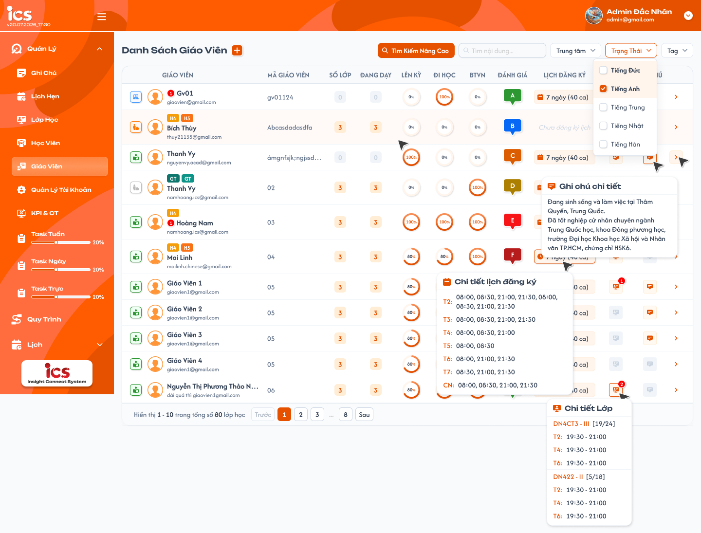
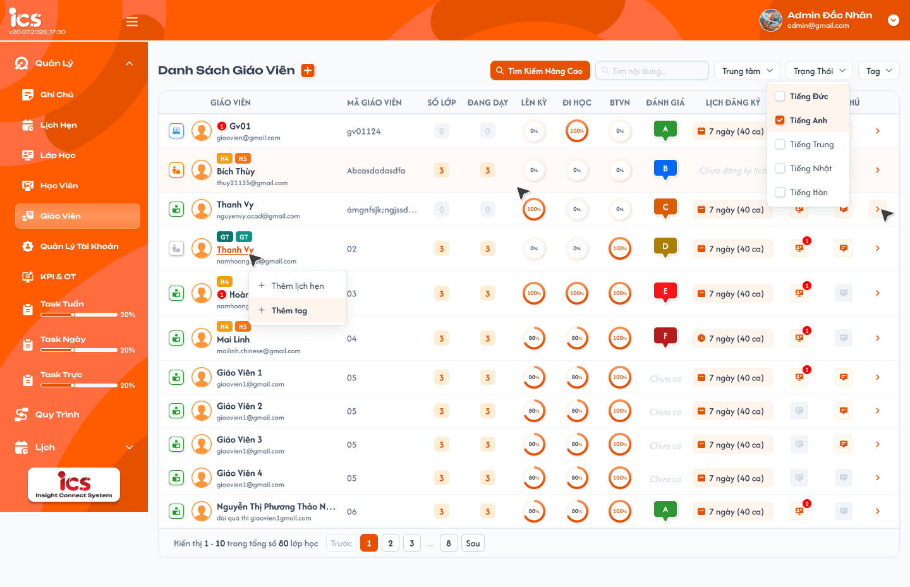
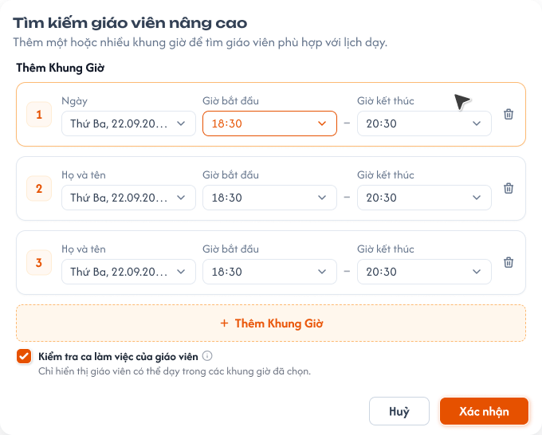
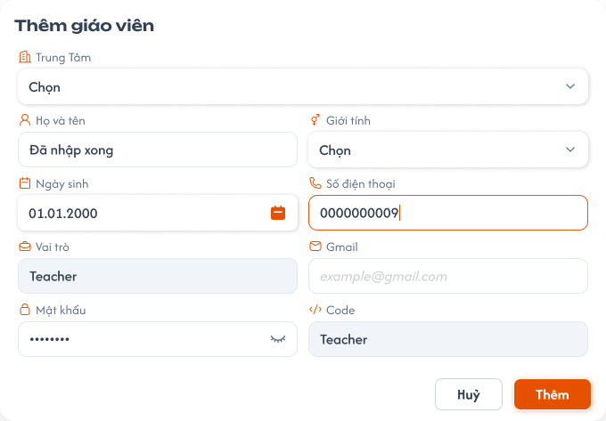
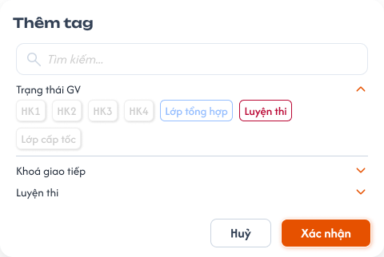
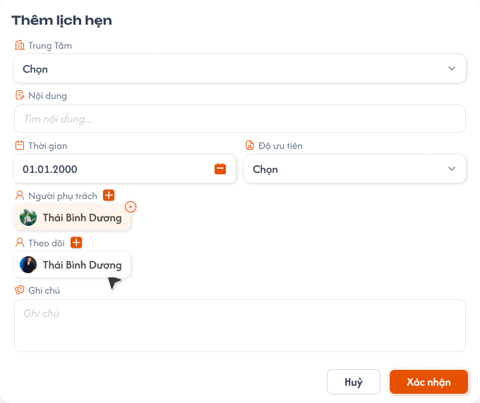
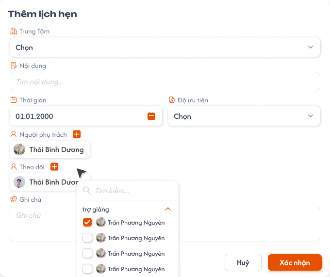
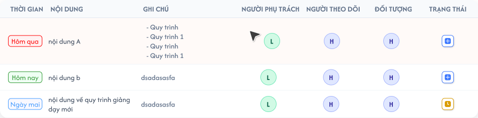

# [Admin] Quản lý danh sách giáo viên

## 1. UI

### Trang 1: ADM-GV-010000 — Danh sách giáo viên



**Mô tả:**
- `Admin` xem danh sách giáo viên thuộc phạm vi dữ liệu được cấp để theo dõi trạng thái, lớp được phân công, kết quả học tập tổng hợp, lịch đăng ký, lịch dạy và ghi chú.
- Nút `+` cạnh tiêu đề mở popup `Thêm giáo viên` (Trang 4); `Tìm Kiếm Nâng Cao` mở Trang 3; click tên giáo viên mở menu thao tác (Trang 2).
- Màn danh sách chỉ xem và sao chép ghi chú; ghi chú được nhập / sửa tại chi tiết giáo viên.

**Điểm cần lưu ý:**
- `A01.01` Trạng thái: cột đầu dòng, mỗi giáo viên đúng một trạng thái `Training` (xanh dương), `Thử việc` (cam), `Chính thức` (xanh lá), `Nghỉ việc` (xám); không có trạng thái `Testing`; đây là trạng thái nghiệp vụ riêng, không đồng nhất với trạng thái hoạt động của tài khoản.
- `A01.02` Giáo viên: tag lấy từ dữ liệu gắn với giáo viên (không hard-code), nhiều tag thì xuống dòng trong đúng ô; badge đỏ cạnh tên = số lịch hẹn **chưa hoàn tất** của giáo viên, bằng 0 thì ẩn; click tên mở menu thao tác (Trang 2), hover badge mở Trang 8.
- `A01.03` Mã giáo viên: do hệ thống sinh khi tạo giáo viên.
- `A01.04` Số lớp: tổng số lớp **duy nhất** giáo viên đã được thêm vào, không phụ thuộc trạng thái lớp.
- `A01.05` Đang dạy: số lớp duy nhất có trạng thái `Đang học`; `Số lớp`, `Đang dạy`, `Lịch dạy` dùng chung một nguồn quan hệ giáo viên–lớp, lớp trùng bản ghi chỉ tính một lần.
- `A01.06` Lên kỳ: vòng tiến độ `0%`–`100%`, tổng hợp từ các lớp của giáo viên có trạng thái `Đang học` hoặc `Hoàn thành` (công thức ở mục 2.4); lớp trạng thái khác không tham gia; không tự thay giá trị rỗng bằng `0` nếu chưa xác định được.
- `A01.07` Đi học: vòng tiến độ `0%`–`100%`, cùng phạm vi lớp và công thức như `A01.06`.
- `A01.08` BTVN: vòng tiến độ `0%`–`100%`, cùng phạm vi lớp và công thức như `A01.06`.
- `A01.09` Đánh giá: badge hạng theo kết quả đánh giá giáo viên, chưa có dữ liệu hiển thị `Chưa có`; chưa có công thức nên không tự quy đổi từ ba tỷ lệ ra hạng `A`–`F`.
- `A01.10` Lịch đăng ký: `N ngày (M ca)` theo lịch đăng ký hiện hành, chưa đăng ký hiển thị `Chưa đăng ký lịch`; hover mở popover chi tiết (nhóm `A02` bên dưới).
- `A01.11` Lịch dạy: icon lịch kèm badge đỏ = số lớp `Đang học`, bằng 0 thì icon mờ và không mở popover; hover mở popover `Chi tiết Lớp` (nhóm `A03` bên dưới).
- `A01.12` Ghi chú: chỉ đọc ghi chú tổng quan ở tab Thông tin cá nhân của chi tiết giáo viên (không lấy từ danh sách ghi chú ở tab `Ghi chú`); hover xem đầy đủ, click sao chép nguyên văn vào clipboard (không mở form sửa, không đổi dữ liệu); không có ghi chú thì icon mờ, hover / click không làm gì.
- `A01.13` Chi tiết: mở chi tiết đúng giáo viên của dòng theo định danh nội bộ; giáo viên không còn tồn tại hoặc ngoài phạm vi thì không mở dữ liệu giáo viên khác. Nội dung màn đích xem [teacher_detail_requirements.md](./teacher_detail_requirements.md).
- `A02.01` Tổng quan: định dạng `[số ngày] ngày ([số ca] ca)`, ví dụ `5 ngày (12 ca)`.
- `A02.02` Số ngày: số thứ trong tuần có ít nhất một buổi đăng ký.
- `A02.03` Số ca: số ô buổi đã đăng ký trong lưới 3 buổi (sáng, chiều, tối) × 7 thứ; 1 ô buổi = 1 ca, tối đa 21.
- `A02.04` Popover `Chi tiết lịch đăng ký`: mỗi thứ một dòng `T2` … `CN` liệt kê các buổi kèm khung giờ, ví dụ `T2: Sáng 07:30 - 09:00 · Tối 18:00 - 23:00`; thứ không đăng ký không có dòng. Vùng hover gồm ô lịch và popover; đóng khi con trỏ rời hoặc danh sách chuyển dòng / trang.
- `A02.05` Thứ tự: trong cùng một thứ, các buổi theo thứ tự sáng, chiều, tối.
- `A02.06` Chưa đăng ký: hiển thị `Chưa đăng ký lịch`, không mở popover rỗng. Lưới đăng ký xem tab Quản lý đăng ký lịch tại [teacher_detail_requirements.md](./teacher_detail_requirements.md).
- `A03.01` Badge số lớp: bằng giá trị `Đang dạy`; popover liệt kê **tất cả** lớp đang dạy của đúng giáo viên, không hiển thị ngày khai giảng.
- `A03.02` Khối lớp trong popover: mỗi lớp một khối gồm mã lớp kèm `[số buổi đã học/tổng số buổi]`, ví dụ `DN4CT3 - III [19/24]`, bên dưới là lịch học cố định theo thứ.
- `A03.03` Số buổi: `Đã học` = số buổi đã diễn ra tính tới hiện tại, `tổng` = tổng số buổi của lớp; cùng nguồn với tiến độ `6/20 Buổi` ở tab Danh sách lớp của Chi tiết giáo viên.
- `A03.04` Lịch cố định: các thứ từ `T2` đến `CN`, trong cùng một thứ các ca theo giờ bắt đầu tăng dần, khoảng giờ `HH:mm - HH:mm`, ví dụ `T2: 19:30 - 21:00`.
- Bộ lọc `Trung tâm` nằm cùng hàng với các bộ lọc khác, chọn một hoặc nhiều tên trung tâm (Đắc Nhân, Sakumi, Saechang, Créatis, Creative English, Betreux) dạng checkbox; kết hợp `AND` với bộ lọc khác, không chọn thì hiển thị mọi trung tâm; Role Admin không dùng ô chọn trung tâm trên header.
- Ô tìm kiếm chỉ tìm theo tên giáo viên; bộ lọc `Trạng Thái` và `Tag` là checkbox có `Tất cả`, chọn nhiều giá trị cùng bộ lọc là OR, giữa các bộ lọc là AND; chân bảng `Hiển thị a - b trong tổng số N giáo viên`.
- `A08.01` Toast `Thành Công`: backend xác nhận thao tác thành công.
- `A08.02` Toast `Thông Báo`: thao tác đã tiếp nhận nhưng dữ liệu cần thời gian đồng bộ.
- `A08.03` Toast `Cảnh Báo`: dữ liệu / điều kiện cần người dùng kiểm tra.
- `A08.04` Toast `Có Lỗi Xảy Ra`: backend / network không hoàn tất. Mỗi thao tác một Toast, nội dung dòng hai lấy từ flow tương ứng, nút `×` đóng thủ công.

### Trang 2: ADM-GV-010001 — Danh sách giáo viên / Hover menu thao tác



**Mô tả:**
- Menu mở khi click tên hoặc avatar giáo viên, gồm `Thêm lịch hẹn` (mở Trang 6) và `Thêm tag` (mở Trang 5).

**Điểm cần lưu ý:**
- `A05.01` Menu thao tác: 2 mục, mỗi mục có icon `+`, gắn với đúng dòng; click ra ngoài hoặc `Esc` đóng menu; không điều hướng sang chi tiết. Chỉ `Admin` có menu, role khác không thấy và backend từ chối request ngoài quyền.

### Trang 3: ADM-GV-010010 — Danh sách giáo viên / Popup tìm kiếm nâng cao



**Mô tả:**
- `Admin` tìm giáo viên theo lịch đăng ký của một hoặc nhiều khung giờ; mỗi khung giờ là một dòng độc lập gồm `Ngày`, `Giờ bắt đầu`, `Giờ kết thúc`.

**Điểm cần lưu ý:**
- Không có nút `Chọn nhanh`; mọi khung giờ do `Admin` nhập, có thể `Thêm Khung Giờ` (thêm vào cuối, không mất dữ liệu dòng khác), sửa hoặc xoá riêng từng dòng; số thứ tự cập nhật liên tục.
- Checkbox `Kiểm tra ca làm việc của giáo viên` mặc định được tick; chỉ bổ sung điều kiện loại giáo viên có lịch dạy giao với bất kỳ khung giờ đã chọn, không đổi điều kiện bắt buộc về lịch đăng ký.
- `Xác Nhận` chỉ gửi khi có ít nhất một khung giờ và mọi dòng đủ ngày, giờ, `Giờ kết thúc` > `Giờ bắt đầu`; `Hủy` đóng, không áp dụng điều kiện vừa sửa.
- Sau khi áp dụng, phía trên bảng có banner `Đang hiển thị N giáo viên rảnh theo K khung giờ đã chọn`; icon thùng rác ở cuối banner xoá toàn bộ điều kiện nâng cao, ẩn banner và tải lại từ trang đầu theo từ khóa, trạng thái, tag còn lại (mở lại modal thì danh sách khung giờ trống). Chuyển trang giữ nguyên khung giờ và giá trị checkbox.

### Trang 4: ADM-GV-010020 — Danh sách giáo viên / Popup thêm giáo viên



**Mô tả:**
- `Admin` tạo giáo viên mới từ nút `+` cạnh tiêu đề.

**Điểm cần lưu ý:**
- Popup không có `Trạng thái` và `Ghi chú`: giáo viên mới luôn nhận trạng thái `Training` (client không gửi trạng thái), Trạng thái và Ghi chú chỉ sửa tại tab Thông tin cá nhân của Chi tiết giáo viên.
- `A07.01` Họ và tên: bắt buộc.
- `A07.02` Giới tính: không bắt buộc; nếu chọn thì lấy từ danh sách giới tính được cấu hình.
- `A07.03` Ngày sinh: không bắt buộc; nếu chọn phải là ngày hợp lệ từ date picker.
- `A07.04` Số điện thoại: không bắt buộc; nếu nhập phải đúng 10 chữ số và bắt đầu bằng `0` (ví dụ `0912345678`), xử lý dạng chuỗi để giữ số `0`, không chấp nhận chữ cái, khoảng trắng, dấu phân cách.
- `A07.05` Vai trò: hệ thống gán cố định `Teacher`, chỉ đọc.
- `A07.06` Gmail: bắt buộc, đúng định dạng email.
- `A07.07` Mật khẩu: bắt buộc, mặc định che, icon mắt bật / tắt hiển thị; không ghi vào log, thông báo lỗi hoặc phản hồi danh sách.
- `A07.08` Trung tâm: bắt buộc chọn một trung tâm, giáo viên thuộc trung tâm đã chọn; backend kiểm tra lại khi lưu.
- `A07.09` Code: chỉ đọc, backend tự sinh duy nhất theo số thứ tự tăng dần, xử lý đồng thời an toàn, không nhận giá trị ghi đè từ client.
- `A07.10` `Huỷ`: đóng popup, không tạo, không giữ dữ liệu chưa xác nhận.
- `A07.11` `Thêm`: validation rồi gửi tạo; trong khi gửi vô hiệu hoá xác nhận lặp. Thành công: đóng popup, notification thành công, tải lại danh sách. Thất bại: giữ dữ liệu đã nhập, notification thất bại (không chứa mật khẩu), cho thử lại.

### Trang 5: ADM-GV-010030 — Danh sách giáo viên / Popup thêm tag



**Mô tả:**
- Gán tag cho giáo viên theo nhóm tag của [Define Tag](../../tag_definition_requirement/tag_definition_requirements.md).

**Điểm cần lưu ý:**
- `A05.03` Popup Thêm tag: ô `Tìm kiếm...` lọc tag theo tên; các nhóm tag thu gọn / mở rộng (vd `Trạng thái GV`, `Khoá giao tiếp`, `Luyện thi`); chip tag đang gán tô màu theo tag, chưa gán màu xám; tick một hoặc nhiều tag, `Xác nhận` lưu **toàn bộ** tập tag mới của giáo viên (theo định danh, không theo tên), `Huỷ` đóng không lưu.
- Tag sau khi lưu hiển thị ngay ở cột Giáo viên và có trong bộ lọc `Tag`.

### Trang 6: ADM-GV-010040 — Danh sách giáo viên / Popup thêm lịch hẹn



**Mô tả:**
- Tạo lịch hẹn cho giáo viên đang chọn; popup dùng chung với [requirement Lịch hẹn](../../appointment_requirement/appointment_requirements.md) (loại đối tượng Giáo viên).

**Điểm cần lưu ý:**
- `A05.02` Popup Thêm lịch hẹn: Đối tượng là giáo viên đang chọn, `Trung Tâm` điền sẵn theo trung tâm của giáo viên; field, validation, trạng thái và quyền theo requirement Lịch hẹn. Tạo thành công thì badge lịch hẹn của dòng tăng và lịch hẹn xuất hiện ở menu `Lịch Hẹn` → tab `Giáo viên`.

### Trang 7: ADM-GV-010042 — Danh sách giáo viên / Popup thêm lịch hẹn / Đang mở



**Mô tả:**
- Popup `Thêm lịch hẹn` khi đang mở danh sách chọn `Người phụ trách` (ô tìm kiếm, danh sách nhân sự kèm vai trò).

**Điểm cần lưu ý:**
- Nội dung và quy tắc chọn người phụ trách theo requirement Lịch hẹn.

### Trang 8: ADM-GV-010050 — Danh sách giáo viên / Popup danh sách lịch hẹn



**Mô tả:**
- Popup chỉ đọc mở khi hover badge lịch hẹn cạnh tên giáo viên.

**Điểm cần lưu ý:**
- `A05.04` Popup Danh sách lịch hẹn: chỉ gồm lịch hẹn **chưa hoàn tất** của đúng giáo viên, số dòng bằng số trên badge, sắp xếp theo thời gian tăng dần; cột `Thời gian` (nhãn `Hôm qua` đỏ, `Hôm nay` xanh lá, `Ngày mai` xanh dương, ngày khác `dd.MM.yyyy`), `Nội dung`, `Ghi chú`, `Người phụ trách`, `Người theo dõi`, `Đối tượng`, `Trạng thái`. Không có thao tác sửa / xoá; sửa, xoá, đổi trạng thái thực hiện tại menu `Lịch Hẹn` → tab `Giáo viên`.

---

## 2. Yêu cầu

### 2.1. Flow chính

**Flow 1: Xem danh sách giáo viên**

```
Admin mở Quản lý → Giáo viên (Trang 1)
  → kiểm tra quyền và phạm vi dữ liệu → hiển thị trạng thái đang tải
  → Thành công: trang đầu, tối đa 10 giáo viên, thông tin phân trang
  → Thất bại: hiển thị lỗi + cho thử lại (không coi là danh sách rỗng)
```

**Flow 2: Tìm kiếm, lọc và phân trang**

```
Nhập từ khóa tên → ngừng gõ 2 giây: tự tìm / Enter: tìm ngay và huỷ debounce đang chờ
Tick Trạng Thái / Tag / Trung tâm (hoặc Tất cả) → tên, Trạng Thái, Tag, Trung tâm kết hợp AND; giá trị cùng bộ lọc OR
  → từ khóa hoặc bộ lọc đổi: về trang đầu → đang tải
  → Thành công: đúng dữ liệu, đúng trang
  → Không có kết quả: trạng thái không có dữ liệu, giữ điều kiện
  → Thất bại: giữ điều kiện, báo lỗi, cho thử lại
```

**Flow 2A: Tìm kiếm giáo viên nâng cao theo lịch đăng ký**

```
Tìm Kiếm Nâng Cao → modal (Trang 3), checkbox Kiểm tra ca làm việc mặc định tick
  → nhập/thêm/sửa/xoá khung giờ → Xác Nhận → kiểm tra ≥ 1 khung giờ, mọi dòng hợp lệ
  → lấy giáo viên có lịch đăng ký phù hợp TOÀN BỘ khung giờ
        ↓ (không tick)                      ↓ (tick)
  giữ cả GV có lịch dạy giao       loại GV có lịch dạy giao bất kỳ khung giờ nào
  → kết hợp từ khóa/trạng thái/tag, tải từ trang đầu, giữ điều kiện khi chuyển trang
  → banner "Đang hiển thị N giáo viên rảnh theo K khung giờ đã chọn" + thùng rác xoá điều kiện
```

**Flow 3: Tổng hợp lớp và tỷ lệ học tập**

```
Tải quan hệ giáo viên–lớp + học viên của lớp Đang học / Hoàn thành → loại lớp trùng
  → Số lớp: tất cả lớp trong phạm vi
  → Đang dạy, Lịch dạy: lớp Đang học
  → Đi học, BTVN từng học viên → Lên kỳ từng học viên = trung bình Đi học và BTVN
  → tỷ lệ giáo viên = trung bình của mọi học viên trong phạm vi
  → hiển thị 0–100, không chia cho 0, không tự đặt ngưỡng đạt
```

**Flow 4: Xem thông tin hover và sao chép ghi chú**

```
Hover Lịch đăng ký → popover đúng thứ/ca của giáo viên
Hover Lịch dạy → Chi tiết Lớp (mọi lớp Đang học, [đã học/tổng buổi], lịch theo thứ)
Hover Ghi chú → đầy đủ nội dung → click → sao chép nguyên văn
                                   ↓ (thất bại)
                          không sao chép dữ liệu sai
```

**Flow 5: Mở chi tiết giáo viên**

```
Chọn nút Chi tiết ở cuối dòng → xác định giáo viên theo định danh dòng
  → Thành công: mở đúng chi tiết giáo viên
  → Không còn tồn tại / ngoài quyền: báo lỗi, không mở giáo viên khác
```

**Flow 6: Thêm mới giáo viên**

```
Nút + → popup Thêm giáo viên (Trang 4), Vai trò = Teacher, Trạng thái = Training
  → nhập Họ và tên, Gmail, Mật khẩu, Trung tâm (Giới tính / Ngày sinh / Số điện thoại tuỳ chọn) → Thêm
  → validation → backend sinh Code duy nhất tăng dần → tạo giáo viên trong phạm vi Admin
  → Thành công: đóng popup, notification thành công, tải lại danh sách
  → Thất bại: giữ dữ liệu, không tạo bản ghi một phần, notification thất bại, cho thử lại
```

**Flow 7: Thêm lịch hẹn, thêm tag, xem lịch hẹn từ danh sách**

```
Click tên giáo viên → menu (Trang 2)
  → Thêm lịch hẹn (Trang 6) → Xác nhận → tạo lịch hẹn theo requirement Lịch hẹn → badge cập nhật → Toast Thành Công
  → Thêm tag (Trang 5) → tick / bỏ tick → Xác nhận → lưu toàn bộ tập tag → cột Giáo viên + bộ lọc Tag cập nhật → Toast Thành Công
  → Huỷ: đóng, không đổi dữ liệu, không Toast
Hover badge lịch hẹn → Danh sách lịch hẹn chưa hoàn tất (Trang 8, chỉ đọc)
```

### 2.2. Ngoại lệ

- **EX01:** Người dùng không có quyền mở menu, URL hoặc gửi request trực tiếp → từ chối truy cập, không trả dữ liệu giáo viên, không đổi dữ liệu.
- **EX02:** Tải danh sách thất bại hoặc hết thời gian chờ → hiển thị lỗi và cho thử lại; không hiển thị như danh sách rỗng.
- **EX03:** Không có giáo viên phù hợp điều kiện → hiển thị trạng thái không có dữ liệu, giữ từ khóa và bộ lọc.
- **EX04:** Học viên không có mẫu số điểm danh hoặc bài tập → không chia cho 0, không hiển thị `NaN` / vô cực, xử lý theo quy tắc xác nhận ở mục 4.
- **EX05:** Không tải được chi tiết lịch đăng ký hoặc chi tiết lớp → không hiển thị dữ liệu đã tải của giáo viên / lớp khác thay thế.
- **EX06:** Sao chép clipboard thất bại → ghi chú đã lưu không đổi, không sao chép nội dung dòng khác.
- **EX07:** Đổi điều kiện khi request cũ chưa xong → chỉ kết quả của điều kiện mới nhất được cập nhật danh sách.
- **EX08:** Giáo viên bị xoá hoặc không còn thuộc phạm vi trước khi mở chi tiết → không mở dữ liệu giáo viên khác, hiển thị lỗi phù hợp.
- **EX09:** Tìm nâng cao không có khung giờ hoặc có dòng thiếu ngày / giờ bắt đầu / giờ kết thúc, hoặc giờ kết thúc không lớn hơn giờ bắt đầu → không gửi tìm kiếm, giữ dữ liệu đã nhập, lỗi tại dòng / trường liên quan.
- **EX10:** Không có giáo viên có lịch đăng ký phù hợp toàn bộ khung giờ, hoặc mọi giáo viên phù hợp đều bị loại do có lịch dạy khi tick `Kiểm tra ca làm việc của giáo viên` → hiển thị trạng thái không có dữ liệu, giữ điều kiện nâng cao.
- **EX11:** Thiếu trường bắt buộc; Họ tên, Gmail, Mật khẩu không hợp lệ; Giới tính, Ngày sinh nhập nhưng không hợp lệ; Số điện thoại nhập nhưng không đúng 10 chữ số / không bắt đầu bằng `0` → không tạo, lỗi tại trường, giữ dữ liệu. Trạng thái không nhận từ client, giáo viên mới luôn là `Training`.
- **EX12:** Nhiều request tạo giáo viên đồng thời → backend sinh code atomically, không trùng code, không tin code từ client.
- **EX13:** Tạo giáo viên thất bại hoặc gửi lặp → không tạo bản ghi một phần / trùng, giữ popup cùng dữ liệu, đúng một notification thất bại, cho thử lại an toàn.
- **EX14:** Gán tag hoặc tạo lịch hẹn từ danh sách thất bại → tập tag / lịch hẹn không đổi, popup giữ dữ liệu để thử lại, Toast `Có Lỗi Xảy Ra`.
- **EX15:** Giáo viên không còn thuộc phạm vi hoặc không tồn tại khi xác nhận gán tag / tạo lịch hẹn → backend từ chối, không gán cho giáo viên khác.

### 2.3. Yêu cầu khác

| Mã | Tên yêu cầu | Mô tả |
|---|---|---|
| REQ01 | Hiển thị danh sách giáo viên | `Admin` xem theo phạm vi dữ liệu được cấp. Mỗi dòng: Trạng thái, Giáo viên (avatar, tag, tên, email, badge lịch hẹn chưa hoàn tất), Mã giáo viên, Số lớp, Đang dạy, Lên kỳ, Đi học, BTVN, Đánh giá, Lịch đăng ký, Lịch dạy, Ghi chú, điều hướng chi tiết. Trạng thái là một trong `Training`, `Thử việc`, `Chính thức`, `Nghỉ việc`. |
| REQ02 | Tìm kiếm, lọc, phân trang | Từ khóa chỉ tìm theo tên; tự tìm sau 2 giây hoặc tìm ngay khi `Enter` (huỷ debounce đang chờ). Bộ lọc `Trạng Thái` và `Tag` dạng checkbox có `Tất cả`; cùng bộ lọc OR, giữa tên / Trạng Thái / Tag AND. Đổi điều kiện về trang đầu; mỗi trang tối đa 10 giáo viên, chuyển trang giữ điều kiện. `Trước` vô hiệu ở trang đầu, `Sau` vô hiệu ở trang cuối. |
| REQ02A | Tìm kiếm nâng cao theo lịch đăng ký | Thêm / sửa / xoá nhiều dòng khung giờ (ngày, giờ bắt đầu, giờ kết thúc), không có chọn nhanh. Kết quả luôn phải có lịch đăng ký phù hợp toàn bộ khung giờ; checkbox `Kiểm tra ca làm việc của giáo viên` (mặc định tick) khi tick thì loại GV có lịch dạy giao. Kết hợp với điều kiện danh sách khác, giữ khi phân trang, hiện banner kèm thùng rác xoá điều kiện. |
| REQ03 | Tổng hợp lớp và chỉ số | `Số lớp` đếm lớp duy nhất; `Đang dạy` và `Lịch dạy` chỉ lớp `Đang học`; `Đi học`, `BTVN`, `Lên kỳ` từ lớp `Đang học` hoặc `Hoàn thành` theo công thức mục 2.4. Không tự tính `Đánh giá` khi chưa có công thức được duyệt. |
| REQ04 | Lịch, lớp và ghi chú | Lịch đăng ký `N ngày (M ca)` và chi tiết buổi theo thứ; Lịch dạy mở `Chi tiết Lớp` với `[đã học/tổng buổi]` và lịch theo thứ; ghi chú chỉ đọc tại danh sách, hover xem đầy đủ, click sao chép nguyên văn. |
| REQ05 | Điều hướng và nhất quán | Nút cuối dòng mở đúng chi tiết giáo viên. Dữ liệu hover, kết quả request và nội dung clipboard gắn đúng định danh giáo viên / lớp, không tái sử dụng dữ liệu cũ cho đối tượng khác. |
| REQ06 | Thêm mới giáo viên | Nút `+` mở popup. Bắt buộc: Họ và tên, Vai trò, Gmail, Mật khẩu, Trung tâm, Code; không bắt buộc: Giới tính, Ngày sinh, Số điện thoại (nếu nhập: đúng 10 chữ số, bắt đầu `0`). Không có Trạng thái, Ghi chú; giáo viên mới là `Training`. Vai trò cố định `Teacher`; Code backend sinh duy nhất tăng dần. Class Handler / Support chỉ gọi popup dùng chung từ ngữ cảnh Chi tiết lớp theo [requirement Tab Giáo viên](../class_management/class_detail_teachers_requirements.md), không có quyền màn quản lý toàn cục. Tạo thành công tải lại ngữ cảnh gọi. |
| REQ07 | Notification khi thêm mới | Tạo giáo viên luôn có notification kết quả: thành công chỉ sau khi backend xác nhận; validation hoặc xử lý lỗi hiển thị thất bại; mỗi request một notification, không chứa mật khẩu, stack trace hay thông tin kỹ thuật nhạy cảm. |
| REQ08 | Trung tâm | Bộ lọc `Trung tâm` chọn một hoặc nhiều, danh sách / tổng số / phân trang chỉ tính trung tâm đã chọn, AND với bộ lọc khác; không chọn thì mọi trung tâm. Tạo mới bắt buộc chọn `Trung tâm`, bản ghi thuộc trung tâm đó; backend kiểm tra lại, không chỉ dựa vào UI. |
| REQ09 | Lịch hẹn và tag từ danh sách | Click tên giáo viên mở menu `Thêm lịch hẹn`, `Thêm tag`. Thêm lịch hẹn dùng popup và quy tắc requirement Lịch hẹn (Đối tượng là giáo viên đang chọn, Trung Tâm điền sẵn). Thêm tag chọn nhiều tag theo nhóm Define Tag, lưu toàn bộ tập tag theo định danh giáo viên. Badge đếm lịch hẹn chưa hoàn tất, hover mở danh sách chỉ đọc. Chỉ `Admin`; backend kiểm tra quyền và phạm vi. |

### 2.4. Ràng buộc

#### Quyền

| Role | Xem danh sách | Tìm kiếm / Lọc / Nâng cao / Phân trang | Thêm mới | Mở chi tiết | Xem thông tin hover | Sao chép ghi chú | Thêm lịch hẹn / Thêm tag |
|---|:---:|:---:|:---:|:---:|:---:|:---:|:---:|
| Admin | ✅ | ✅ | ✅ | ✅ | ✅ | ✅ | ✅ |
| Các role khác | ❌ | ❌ | ❌ | ❌ | ❌ | ❌ | ❌ |

#### Ràng buộc khác

- Bảng quyền áp dụng cho màn `Quản lý → Giáo viên`. `Class Handler` và `Support` chỉ được mở popup tạo dùng chung từ `Chi tiết lớp → Giáo viên`, trong phạm vi lớp được phân quyền; không cấp quyền xem danh sách quản lý toàn cục.
- Không cho truy cập hoặc thực hiện hành động bị `❌`, kể cả gọi trực tiếp bằng URL hoặc request.
- `Admin` chỉ xem giáo viên và dữ liệu liên quan theo bộ lọc `Trung tâm`; giáo viên mới tạo trong đúng phạm vi dữ liệu của `Admin`.
- Giáo viên và lớp nhận diện bằng định danh nội bộ, không dùng tên, email hay mã hiển thị làm khoá liên kết. Tag, lịch hẹn, lịch đăng ký, lớp, điểm danh, bài tập, ghi chú phải thuộc đúng giáo viên đang hiển thị.
- `Số lớp` đếm lớp duy nhất có quan hệ với giáo viên; `Đang dạy` là tập con có trạng thái `Đang học`; `Lịch dạy` chỉ đếm và liệt kê các lớp trong `Đang dạy`. `Đi học`, `BTVN`, `Lên kỳ` chỉ dùng lớp `Đang học` hoặc `Hoàn thành`.
- Tìm nâng cao: mỗi request chứa ít nhất một khung giờ (ngày, giờ bắt đầu, giờ kết thúc) và cờ `Kiểm tra ca làm việc của giáo viên`; ngày và khoảng giờ đánh giá theo cùng múi giờ nghiệp vụ của trung tâm; ứng viên ban đầu chỉ gồm GV có lịch đăng ký phù hợp toàn bộ khung giờ; cờ `false` thì không áp dụng loại trừ theo lịch dạy; cờ `true` thì loại GV có lịch dạy giao ít nhất một khung giờ (lịch dạy ngoài các khung giờ không làm GV bị loại); loại trùng theo định danh GV; danh sách khung giờ và cờ gửi lại nhất quán khi phân trang.
- Công thức: Đi học của học viên = số lượt có trạng thái `Có mặt`, `Vào trễ`, `Ra sớm`, `Vào trễ & Ra sớm` / tổng số lượt phải tham gia × 100% (trạng thái khác không tự tính là đi học). BTVN của học viên = số BTVN đã hoàn thành / tổng số BTVN được giao × 100%. Lên kỳ của học viên = (Đi học + BTVN) / 2. Mỗi chỉ số của giáo viên = tổng tỷ lệ của từng học viên / tổng số học viên trong phạm vi.
- Không chia cho 0; không tự đặt ngưỡng đạt / không đạt cho `Lên kỳ`; không làm tròn từng thành phần theo cách làm lệch kết quả tổng hợp; `Đánh giá` chưa có công thức.
- Trạng thái `Training` do hệ thống gán khi tạo; hệ thống không có trạng thái giáo viên `Testing`.
- Mỗi thao tác một Toast: `Thành Công`, `Thông Báo`, `Cảnh Báo` hoặc `Có Lỗi Xảy Ra`; `Huỷ` và thao tác chỉ đọc không có Toast CRUD; không hiển thị dữ liệu nhạy cảm.


---

## 3. Testcase

### Feature: [Admin] Quản lý danh sách giáo viên

| Tên testcase | Priority | Scenario | Role | Pre-condition | Given/When/Then | Expected Result |
|---|---|---|---|---|---|---|
| Case 1: Xem danh sách và trạng thái | High | Flow 1 / REQ01 | Admin | Có dữ liệu giáo viên đủ 4 trạng thái | **Given:** Admin ở dashboard<br>**When:** mở `Quản lý` → `Giáo viên`<br>**Then:** hệ thống tải trang đầu | - Tối đa 10 giáo viên, có phân trang, đủ cột theo REQ01<br>- Mỗi giáo viên đúng một trạng thái đúng icon / màu, không có `Testing`<br>- Không thay đổi dữ liệu |
| Case 2: Tìm theo tên (debounce và Enter) | High | Flow 2 / REQ02 | Admin | Có GV khớp và không khớp tên | **Given:** đang ở danh sách<br>**When:** nhập từ khóa rồi ngừng gõ 2 giây; lần khác nhập rồi nhấn `Enter` khi chưa đủ 2 giây<br>**Then:** hệ thống tìm theo tên | - Không gửi request khi vẫn đang gõ, mỗi lần gõ khởi động lại thời gian chờ<br>- `Enter` tìm ngay và huỷ debounce, không gửi trùng<br>- Chỉ tìm theo tên, kết quả về trang đầu |
| Case 3: Lọc Trạng Thái / Tag / Trung tâm và phân trang | High | Flow 2 / REQ02 / REQ08 | Admin | Hơn 50 GV thoả đồng thời tên, trạng thái, tag; có GV ở trung tâm A và B | **Given:** áp dụng từ khóa, nhiều trạng thái, nhiều tag, trung tâm B<br>**When:** tick `Tất cả` ở từng bộ lọc; chuyển trang, `Trước`, `Sau`<br>**Then:** hệ thống lọc và phân trang | - Cùng bộ lọc là OR, giữa các điều kiện là AND<br>- Tick giá trị riêng thì `Tất cả` bỏ tick và ngược lại<br>- Không chọn trung tâm thì hiện mọi trung tâm; tổng số và phân trang theo trung tâm đã chọn<br>- Chuyển trang giữ điều kiện, `Trước` / `Sau` vô hiệu ở biên |
| Case 4: Rỗng, lỗi và request cũ | High | EX02 / EX03 / EX07 | Admin | Mô phỏng điều kiện không khớp, lỗi tải, hai request phản hồi lệch thời gian | **Given:** điều kiện không có GV; request lỗi; request cũ chưa xong<br>**When:** hệ thống nhận kết quả; Admin đổi bộ lọc, request mới xong trước<br>**Then:** hiển thị tương ứng | - Rỗng: trạng thái không có dữ liệu, giữ điều kiện, không còn dữ liệu cũ<br>- Lỗi: báo lỗi, có thử lại, không coi là rỗng<br>- Kết quả request cũ không ghi đè danh sách |
| Case 5: Tìm nâng cao: UI, thêm / sửa / xoá khung giờ và validation | High | Flow 2A / REQ02A / EX09 | Admin | Modal tìm nâng cao đang mở | **Given:** mở `Tìm Kiếm Nâng Cao`<br>**When:** thêm khung giờ, sửa một dòng, xoá dòng khác; thử `Xác Nhận` khi không có dòng, thiếu ngày / giờ hoặc giờ kết thúc ≤ giờ bắt đầu<br>**Then:** hệ thống cập nhật và kiểm tra | - Không có `Chọn nhanh`, checkbox mặc định tick<br>- Dòng mới thêm cuối, các dòng khác giữ nguyên, số thứ tự liên tục<br>- Dữ liệu sai thì không gửi, lỗi tại dòng / trường, giữ dữ liệu, danh sách không đổi<br>- `Hủy` không áp dụng thay đổi |
| Case 6: Tìm nâng cao: kết quả tick / không tick, banner | High | Flow 2A / REQ02A / EX10 | Admin | 2 khung giờ: GV A đăng ký đủ và có lịch dạy giao; GV B đăng ký đủ, lịch dạy ngoài khung; GV C đăng ký đủ, không lịch dạy; GV D chỉ đăng ký một khung | **Given:** xác nhận lần 1 không tick, lần 2 có tick<br>**When:** chuyển trang, rồi bấm thùng rác trên banner<br>**Then:** hệ thống lọc theo lịch đăng ký và lịch dạy | - Không tick: A, B, C xuất hiện; D không<br>- Tick: A không xuất hiện; B, C xuất hiện; D không<br>- Banner `Đang hiển thị N giáo viên rảnh theo K khung giờ đã chọn`, mỗi GV chỉ một lần, giữ khung giờ khi chuyển trang<br>- Tất cả bị loại thì trạng thái rỗng và giữ điều kiện<br>- Thùng rác ẩn banner, tải lại từ trang đầu, mở lại modal thì trống |
| Case 7: Cột lớp và tỷ lệ | High | Flow 3 / REQ03 / EX04 | Admin | GV có lớp trùng bản ghi, lớp nhiều trạng thái; học viên A đi học 8/10, BTVN 9/10; B đi học 6/10, BTVN 5/10; có lớp trạng thái khác và học viên chưa có mẫu số | **Given:** danh sách tải xong<br>**When:** hệ thống tổng hợp<br>**Then:** hiển thị `Số lớp`, `Đang dạy`, `Lịch dạy`, `Đi học`, `BTVN`, `Lên kỳ`, `Đánh giá` | - Lớp trùng chỉ tính một lần; `Đang dạy` chỉ `Đang học`; số trên badge `Lịch dạy` bằng `Đang dạy`<br>- Chỉ dùng lớp `Đang học` / `Hoàn thành`: Đi học 70%, BTVN 70%, Lên kỳ 70%<br>- Không chia cho 0, không `NaN`; không tự tính `Đánh giá`, chưa có dữ liệu hiển thị `Chưa có` |
| Case 8: Hover Lịch đăng ký và Lịch dạy | High | Flow 4 / REQ04 / EX05 | Admin | GV có đăng ký nhiều thứ và 2 lớp `Đang học` (`DN4CT3 - III` 19/24, `DN422 - II` 5/18); GV khác chưa đăng ký lịch, không có lớp đang học | **Given:** danh sách tải xong<br>**When:** hover ô Lịch đăng ký và icon Lịch dạy của từng GV<br>**Then:** hiển thị popover | - `N ngày (M ca)` đúng (1 ô buổi = 1 ca), thứ tự sáng / chiều / tối, đúng khung giờ<br>- `Chi tiết Lớp` liệt kê đủ 2 lớp kèm `[19/24]`, `[5/18]` và lịch theo thứ<br>- Chưa đăng ký: `Chưa đăng ký lịch`, không mở popover rỗng; không có lớp: icon mờ, không mở popover<br>- Không trộn dữ liệu GV khác; lỗi tải không hiển thị dữ liệu GV / lớp khác |
| Case 9: Xem và sao chép ghi chú | Medium | Flow 4 / REQ04 / EX06 | Admin | GV có ghi chú; GV khác ghi chú rỗng | **Given:** ghi chú nhập ở chi tiết GV<br>**When:** hover rồi click icon Ghi chú; click icon của GV không có ghi chú; giả lập clipboard lỗi<br>**Then:** hệ thống hiển thị và sao chép | - Hiển thị đầy đủ, clipboard nhận nguyên văn, ghi chú đã lưu không đổi<br>- GV không có ghi chú: icon mờ, không sao chép<br>- Clipboard lỗi: không sao chép nội dung dòng khác |
| Case 10: Mở chi tiết giáo viên | High | Flow 5 / REQ05 / EX08 | Admin | Danh sách nhiều GV; một GV bị xoá sau khi danh sách tải | **Given:** các dòng có định danh khác nhau<br>**When:** chọn nút chi tiết của một dòng; chọn nút của dòng GV đã bị xoá<br>**Then:** hệ thống mở chi tiết | - Mở đúng GV đã chọn<br>- GV không còn tồn tại: báo lỗi, không mở GV khác |
| Case 11: Thêm giáo viên thành công | High | Flow 6 / REQ06 / REQ07 / REQ08 | Admin | Code gần nhất là `N` | **Given:** mở popup bằng nút `+`, nhập đủ Trung Tâm, Họ và tên, Gmail, Mật khẩu; có thể để trống Giới tính / Ngày sinh / Số điện thoại<br>**When:** chọn `Thêm`<br>**Then:** backend tạo giáo viên | - Popup không có Trạng thái, Ghi chú; Vai trò `Teacher`, Code chỉ đọc; Mật khẩu che, có icon hiện / ẩn<br>- Code kế tiếp, duy nhất, không lấy từ client; Trạng thái `Training`; thuộc trung tâm đã chọn<br>- Popup đóng, danh sách tải lại, một notification thành công sau khi backend xác nhận<br>- `Huỷ` đóng và không tạo |
| Case 12: Thêm giáo viên: validation, lỗi, gửi lặp, đồng thời | High | EX11 / EX12 / EX13 / REQ06 / REQ07 | Admin | Popup đang mở | **Given:** thiếu trường bắt buộc / Trung tâm; Số điện thoại 9 hoặc 11 chữ số, không bắt đầu `0`, có chữ; client gửi kèm trạng thái khác; bấm `Thêm` nhiều lần; nhiều request đồng thời; backend lỗi<br>**When:** xác nhận<br>**Then:** hệ thống từ chối hoặc xử lý an toàn | - Lỗi tại trường, giữ dữ liệu, trống Giới tính / Ngày sinh / Số điện thoại không phải lỗi<br>- Số điện thoại hợp lệ `0912345678` được giữ số `0`<br>- Trạng thái từ client bị bỏ qua, luôn `Training`<br>- Vô hiệu xác nhận khi đang gửi, không tạo trùng; code không trùng khi đồng thời<br>- Lỗi: đúng một notification thất bại, không lộ mật khẩu, không tạo bản ghi một phần, cho thử lại |
| Case 13: Thêm lịch hẹn và thêm tag từ menu thao tác | High | Flow 7 / REQ09 | Admin | GV thuộc trung tâm Đắc Nhân, badge lịch hẹn = 1, đang có tag `HK4` | **Given:** click tên GV, menu có đúng 2 mục<br>**When:** `Thêm lịch hẹn` nhập Nội dung, Thời gian, Độ ưu tiên, `Xác nhận`; `Thêm tag` bỏ `HK4`, tick `HK5` và `Luyện thi`, `Xác nhận`<br>**Then:** hệ thống lưu | - Menu gắn đúng dòng, click ngoài / `Esc` đóng, không điều hướng<br>- `Trung Tâm` điền sẵn Đắc Nhân, badge thành 2, lịch hẹn có ở `Lịch Hẹn` → tab `Giáo viên`<br>- GV còn đúng 2 tag mới, lọc `Tag` = `Luyện thi` thấy GV<br>- Toast `Thành Công` cho mỗi thao tác |
| Case 14: Danh sách lịch hẹn, huỷ popup và lỗi | Medium | Flow 7 / REQ09 / EX14 / EX15 | Admin | GV có 2 lịch hẹn chưa hoàn tất và 1 đã hoàn tất | **Given:** hover badge `2`; mở popup tag / lịch hẹn rồi `Huỷ`; giả lập backend lỗi hoặc GV ngoài phạm vi khi xác nhận<br>**When:** thao tác<br>**Then:** hệ thống xử lý | - Popup liệt kê đúng 2 dòng chưa hoàn tất, sắp xếp thời gian tăng dần, không có sửa / xoá<br>- `Huỷ` không lưu, không Toast<br>- Lỗi: dữ liệu không đổi, giữ popup, Toast `Có Lỗi Xảy Ra`; GV ngoài phạm vi bị backend từ chối |
| Case 15: Role khác bị chặn | High | EX01 / Ràng buộc quyền | Các role khác | Đã đăng nhập, không phải Admin | **Given:** người dùng không có quyền màn danh sách GV<br>**When:** mở menu, URL hoặc gửi request (xem, tìm, thêm, thêm tag / lịch hẹn) trực tiếp<br>**Then:** hệ thống từ chối | - Không xem được danh sách, không nhận dữ liệu ngoài phạm vi, dữ liệu không đổi<br>- Ngoại lệ: Class Handler / Support tạo GV từ Chi tiết lớp theo requirement Tab Giáo viên |

---

## 4. Câu hỏi cần xác nhận

- **Q01:** Trạng thái giáo viên lưu bằng enum nào; một giáo viên chỉ có một trạng thái hiện tại? Giáo viên nhận diện chỉ bằng role `Teacher` hay còn loại hồ sơ / trạng thái tài khoản khác?
- **Q02:** Định dạng `Code` giáo viên (tiền tố, số chữ số, giá trị bắt đầu, reset theo năm, tái sử dụng code của GV đã xoá / nghỉ việc)? Code hiển thị sẵn trong popup hay chỉ sau khi tạo; có chấp nhận khoảng trống số thứ tự khi tạo thất bại?
- **Q03:** Danh sách giá trị `Giới tính`; `Gmail` chỉ nhận `@gmail.com` hay mọi email hợp lệ, duy nhất toàn hệ thống hay từng trung tâm; quy tắc mật khẩu; số điện thoại duy nhất toàn hệ thống hay từng trung tâm?
- **Q04:** Nội dung, vị trí, thời gian tự đóng của notification thành công / thất bại khi thêm giáo viên; phản hồi sau khi sao chép ghi chú thành công / thất bại (tooltip, toast hay notification)?
- **Q05:** Tìm theo tên có phân biệt hoa / thường, dấu tiếng Việt; có hỗ trợ tìm gần đúng hay chỉ chứa chuỗi?
- **Q06:** Tìm nâng cao: số khung giờ tối đa; có cho dòng trùng / giao nhau và validation thế nào; lịch đăng ký "phù hợp" khi bao phủ toàn bộ khoảng, có ít nhất một ca nằm trong khoảng hay giao một phần; quy tắc giao nhau tại biên của lịch dạy; xử lý buổi huỷ, dời, học bù, thay giáo viên; múi giờ nghiệp vụ?
- **Q07:** Học viên có mặt trong nhiều lớp của cùng giáo viên được tính một lần hay theo từng quan hệ học viên–lớp? Mẫu số Đi học có loại buổi huỷ, buổi tương lai, buổi trước khi học viên vào lớp? Trạng thái điểm danh nào khác ngoài 4 trạng thái được tính đi học và ảnh hưởng mẫu số thế nào?
- **Q08:** "Hoàn thành BTVN" xác định bằng trạng thái nào; có loại bài chưa tới hạn, bị huỷ hoặc không bắt buộc khỏi mẫu số? Xử lý học viên chưa có buổi / chưa được giao bài / thiếu một trong hai tỷ lệ khi tính `Lên kỳ`; quy tắc làm tròn và số chữ số thập phân?
- **Q09:** Giá trị và trạng thái rỗng của cột `Đánh giá` trước khi có công thức; nguồn dữ liệu sau khi công thức được duyệt? Nội dung trạng thái rỗng cho tag, lịch hẹn, tỷ lệ, lịch đăng ký, lịch dạy, ghi chú?
- **Q10:** Lịch đăng ký áp dụng cố định theo tuần hay theo khoảng ngày? Thứ tự lớp trong popover `Chi tiết Lớp` (theo mã lớp hay ngày khai giảng)? Quy tắc đếm `đã học/tổng số buổi` khi buổi huỷ, dời, học bù?
- **Q11:** Popup `Thêm lịch hẹn` mở từ danh sách: ô `Trung Tâm` điền sẵn theo giáo viên có cho đổi hay bị khoá?
