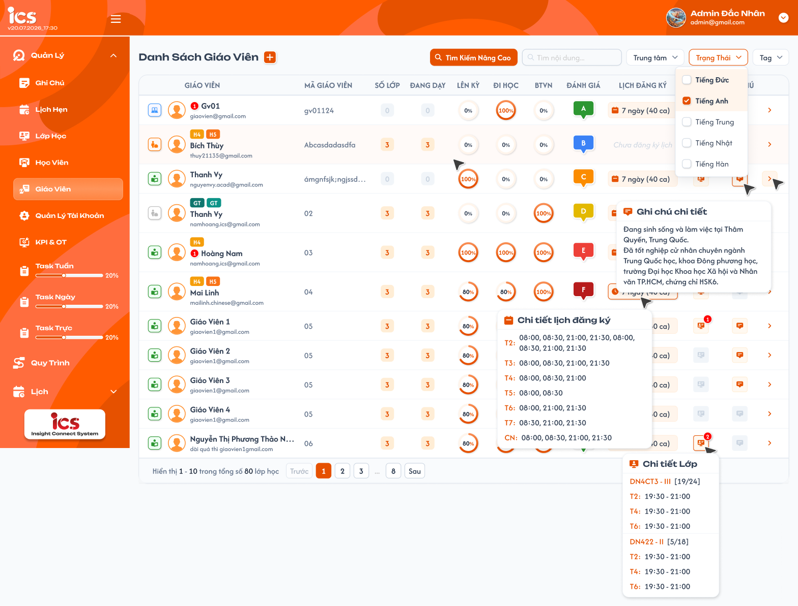
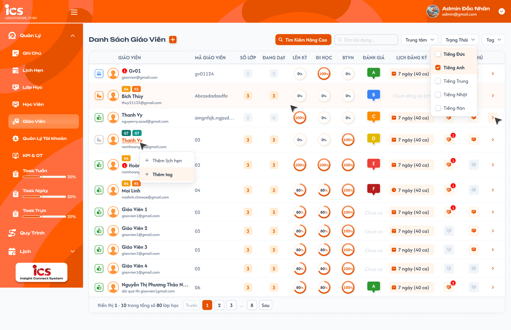
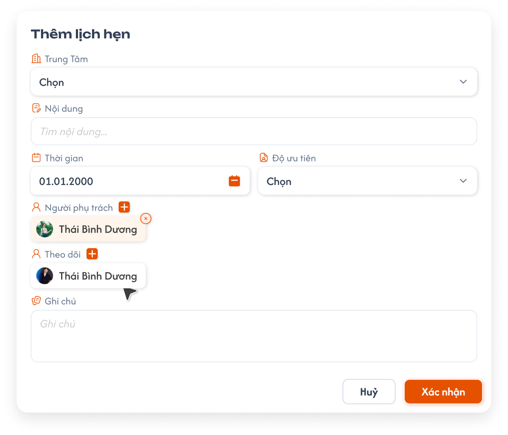
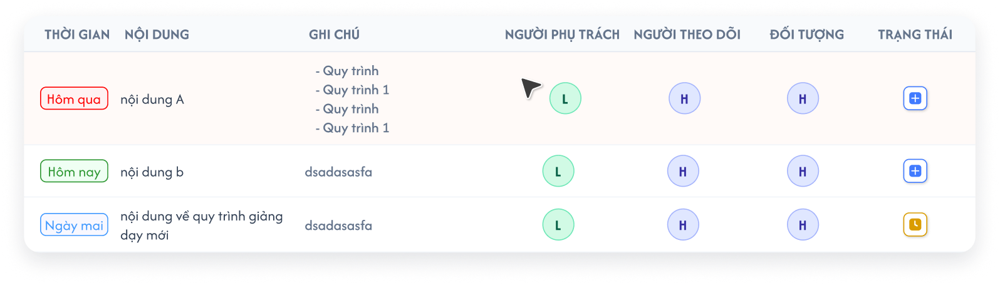
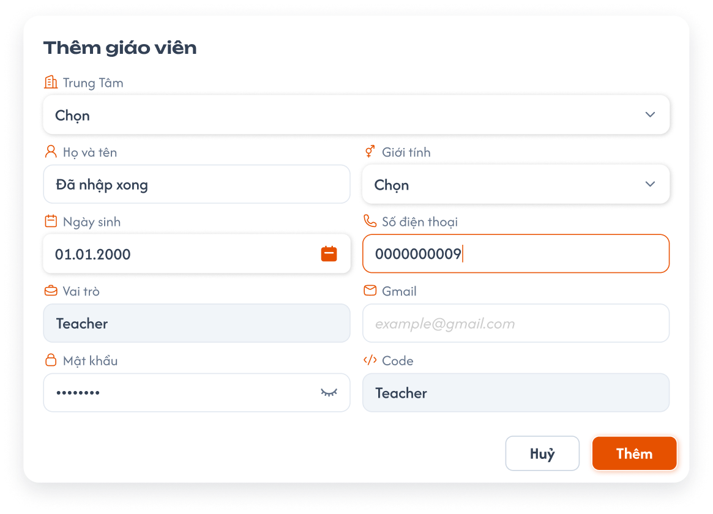
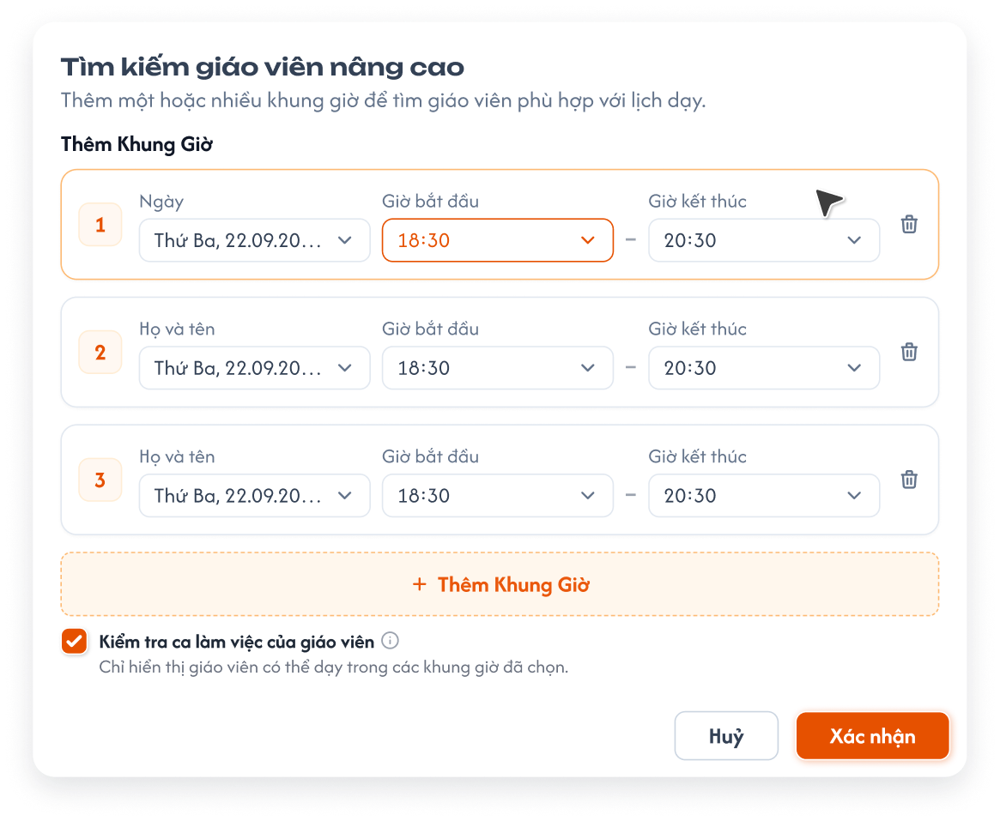
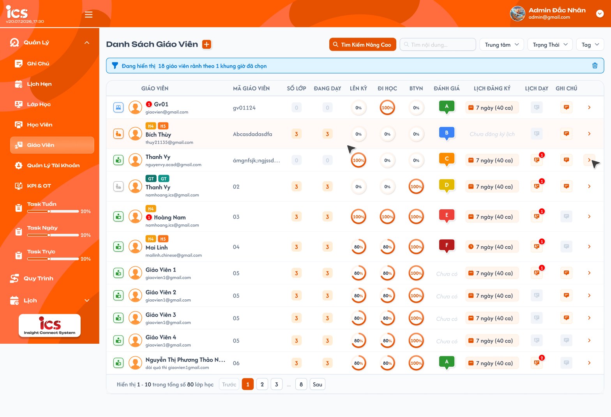

# [Admin] Quản lý danh sách giáo viên

Flow chọn/tạo giáo viên từ một lớp và quyền Giáo viên phụ trách chính được đặc tả riêng tại [Chi tiết lớp học — Tab Giáo viên](../class_management/class_detail_teachers_requirements.md).

## 1. UI

### Trang 1: ADM-GV-010000 — Danh sách giáo viên




*Danh sách giáo viên: bộ lọc Trung tâm, popover Chi tiết lịch đăng ký, Chi tiết Lớp và Ghi chú chi tiết — nhấn để xem ảnh gốc*

**Mô tả:**

- `Admin` xem danh sách giáo viên thuộc phạm vi dữ liệu được cấp để theo dõi trạng thái, lớp được phân công, kết quả học tập tổng hợp, lịch đăng ký, lịch dạy và ghi chú.
- Click nút dấu `+` cạnh tiêu đề để mở popup `Thêm giáo viên`.
- Click tên giáo viên mở menu thao tác `Thêm lịch hẹn`, `Thêm tag`; hover badge lịch hẹn cạnh tên mở popup `Danh sách lịch hẹn` (xem khu vực Menu thao tác trên dòng).
- Màn hình danh sách chỉ cho xem và sao chép ghi chú. Ghi chú được nhập hoặc chỉnh sửa tại chi tiết giáo viên.
- Chọn nút chi tiết ở cuối dòng để mở đúng chi tiết giáo viên.

**Giải thích field/thành phần:**

- `A01.01` **Trạng thái**: Cột đầu dòng: icon trạng thái giáo viên theo bảng Trạng thái giáo viên.
- `A01.02` **Giáo viên**: Avatar, các tag (badge màu phía trên tên), tên, email. Badge đỏ cạnh tên = số lịch hẹn **chưa hoàn tất** của giáo viên; không có thì ẩn. Click tên mở menu thao tác.
- `A01.03` **Mã giáo viên**: Mã do hệ thống sinh khi tạo giáo viên.
- `A01.04` **Số lớp**: Tổng số lớp duy nhất mà giáo viên đã được thêm vào, không phụ thuộc trạng thái lớp.
- `A01.05` **Đang dạy**: Tổng số lớp duy nhất mà giáo viên đã được thêm vào và lớp đang ở trạng thái `Đang học`.
- `A01.06` **Lên kỳ**: Vòng tiến độ hiển thị tỷ lệ kèm ký hiệu `%` (`0%`–`100%`), tính theo REQ03.
- `A01.07` **Đi học**: Vòng tiến độ hiển thị tỷ lệ kèm ký hiệu `%`, tính theo REQ03.
- `A01.08` **BTVN**: Vòng tiến độ hiển thị tỷ lệ kèm ký hiệu `%`, tính theo REQ03.
- `A01.09` **Đánh giá**: Badge hạng (vd `A`–`F`) theo kết quả đánh giá giáo viên; chưa có dữ liệu hiển thị `Chưa có`. Hiện chưa có công thức tính hoặc quy tắc quy đổi hạng.
- `A01.10` **Lịch đăng ký**: `N ngày (M ca)` theo lịch đăng ký hiện hành; hover để xem chi tiết theo thứ; chưa đăng ký hiển thị `Chưa đăng ký lịch`.
- `A01.11` **Lịch dạy**: Icon lịch kèm badge đỏ = số lớp `Đang học` của giáo viên; bằng 0 thì icon mờ. Hover icon mở popover `Chi tiết Lớp` liệt kê mọi lớp đang dạy.
- `A01.12` **Ghi chú**: Icon ghi chú; hover để xem đầy đủ nội dung; click để sao chép; không có ghi chú thì icon mờ.
- `A01.13` **Chi tiết**: Điều hướng đến đúng chi tiết giáo viên của dòng đang chọn.

**Điểm cần lưu ý:**

- `Số lớp`, `Đang dạy` và `Lịch dạy` phải dùng cùng nguồn quan hệ giáo viên–lớp để không mâu thuẫn nhau.
- Một lớp chỉ được tính một lần cho cùng giáo viên dù dữ liệu liên kết bị trùng.
- Số trên badge `Lịch dạy` và số lớp trong popover `Chi tiết Lớp` phải bằng giá trị `Đang dạy`.
- Các giá trị `Lên kỳ`, `Đi học`, `BTVN` có đơn vị phần trăm; vòng tiến độ hiển thị `0%`–`100%`.
- `Lên kỳ`, `Đi học`, `BTVN` được tổng hợp từ toàn bộ lớp của giáo viên có trạng thái `Đang học` hoặc `Hoàn thành`; lớp ở trạng thái khác không tham gia tính ba chỉ số này.
- Tag được lấy từ dữ liệu gắn với giáo viên, không hard-code theo dữ liệu minh họa trong ảnh.
- Danh sách có bộ lọc `Trung tâm` nằm cùng hàng với các bộ lọc khác, cho chọn một hoặc nhiều trung tâm; khi chọn thì danh sách, tổng số và phân trang chỉ tính dữ liệu của các trung tâm đã chọn, kết hợp `AND` với các bộ lọc khác. Không chọn thì hiển thị dữ liệu của mọi trung tâm. Role Admin không dùng ô chọn trung tâm trên header. Bộ lọc liệt kê **tên trung tâm** (Đắc Nhân, Sakumi, Saechang, Créatis, Creative English, Betreux) dạng checkbox; ảnh Figma đang ghi tên ngôn ngữ là lỗi copy.
- Badge lịch hẹn hiển thị số lịch hẹn **chưa hoàn tất** của giáo viên (trạng thái theo requirement Lịch hẹn); bằng 0 thì ẩn badge.
- Khi có nhiều tag, tag được xuống dòng trong đúng ô và không lẫn sang giáo viên khác.
- Chân bảng hiển thị `Hiển thị a - b trong tổng số N giáo viên`; chữ `lớp học` trên Figma là lỗi copy. Ô tìm kiếm có placeholder `Tìm nội dung...` nhưng nghiệp vụ chỉ tìm theo tên giáo viên.
- Các lỗi chữ khác trên Figma không phải yêu cầu: nhãn bộ lọc `Trọng Thái` đọc là `Trạng Thái`.
- Trạng thái rỗng không được tự thay bằng `0` nếu hệ thống chưa xác định giá trị thực tế bằng 0.

### Trang 2: ADM-GV-010000 — Chi tiết lịch đăng ký khi hover


**Mô tả:**

- Popover `Chi tiết lịch đăng ký` (ảnh `teacher-list.png`) cho phép `Admin` xem chi tiết lịch đăng ký hiện hành của đúng giáo viên ngay tại danh sách.
- Lịch đăng ký theo lưới **3 buổi mỗi ngày** (sáng, chiều, tối) × 7 thứ, mỗi buổi có khung giờ cụ thể — xem tab Quản lý đăng ký lịch tại [teacher_detail_requirements.md](./teacher_detail_requirements.md).

**Giải thích field/thành phần:**

- `A02.01` **Tổng quan**: Hiển thị theo định dạng `[số ngày] ngày ([số ca] ca)`, ví dụ `5 ngày (12 ca)`; giá trị `7 ngày (40 ca)` trên Figma là dữ liệu mẫu cũ.
- `A02.02` **Số ngày**: Số thứ trong tuần có ít nhất một buổi đăng ký.
- `A02.03` **Số ca**: Số ô buổi đã đăng ký trong lưới 3 buổi × 7 thứ (1 ô buổi = 1 ca, tối đa 21).
- `A02.04` **Popover**: Tiêu đề `Chi tiết lịch đăng ký`; mỗi thứ một dòng `T2` … `CN` liệt kê các buổi đã đăng ký kèm khung giờ, ví dụ `T2: Sáng 07:30 - 09:00 · Tối 18:00 - 23:00`; thứ không đăng ký không hiển thị dòng. Danh sách giờ trên Figma là dữ liệu mẫu cũ.
- `A02.05` **Thứ tự**: Trong cùng một thứ, các buổi hiển thị theo thứ tự sáng, chiều, tối.
- `A02.06` **Chưa đăng ký**: Hiển thị `Chưa đăng ký lịch` và không mở popover rỗng.

**Điểm cần lưu ý:**

- Hover ô lịch đăng ký chỉ mở dữ liệu của đúng giáo viên.
- Vùng hover bao gồm ô lịch và popover để người dùng có thể di chuyển con trỏ sang đọc nội dung.
- Popover đóng khi con trỏ rời vùng liên quan hoặc khi danh sách chuyển sang dòng/trang khác.

### Trang 3: ADM-GV-010000 — Chi tiết lớp đang dạy khi hover


**Mô tả:**

- Cột `Lịch dạy` hiển thị icon lịch kèm badge đỏ là số lớp `Đang học` của giáo viên; hover icon mở popover `Chi tiết Lớp` liệt kê **tất cả** lớp đang dạy (ảnh `teacher-list.png`).

**Giải thích field/thành phần:**

- `A03.01` **Badge số lớp**: Bằng giá trị `Đang dạy`; bằng 0 thì icon mờ và không mở popover.
- `A03.02` **Khối lớp trong popover**: Mỗi lớp một khối: mã lớp kèm `[số buổi đã học/tổng số buổi]`, ví dụ `DN4CT3 - III [19/24]`; bên dưới là lịch học cố định theo thứ `T2: 19:30 - 21:00`.
- `A03.03` **Số buổi**: `Đã học` = số buổi của lớp đã diễn ra tính tới hiện tại; `tổng` = tổng số buổi của lớp; dùng cùng nguồn với tiến độ `6/20 Buổi` ở tab Danh sách lớp của Chi tiết giáo viên.
- `A03.04` **Lịch cố định**: Các thứ hiển thị từ `T2` đến `CN`; trong cùng một thứ, các ca hiển thị theo giờ bắt đầu tăng dần; khoảng giờ dạng `HH:mm - HH:mm`.

**Điểm cần lưu ý:**

- Popover chỉ gồm lớp của đúng giáo viên và chỉ các lớp được tính trong `Đang dạy`; không hiển thị ngày khai giảng.
- Vùng hover gồm icon và popover; popover đóng khi con trỏ rời vùng liên quan hoặc danh sách chuyển trang.
- Thứ tự các lớp trong popover cần xác nhận tại mục 3.

### Trang 4: ADM-GV-010000 — Ghi chú giáo viên


**Mô tả:**

- Cột `Ghi chú` dùng để xem nhanh và sao chép ghi chú tổng quan của đúng giáo viên tại màn danh sách.

**Giải thích field/thành phần:**

- Cột `Ghi chú` chỉ đọc dữ liệu được nhập tại chi tiết giáo viên.
- Cột `Ghi chú` chỉ sử dụng ghi chú tổng quan tại tab Thông tin cá nhân. Danh sách ghi chú trong tab `Ghi chú` là dữ liệu độc lập và không hiển thị tại cột này.
- Giáo viên có ghi chú hiển thị icon khả dụng. Hover icon hiển thị toàn bộ nội dung của đúng giáo viên.
- Click icon sao chép nguyên văn ghi chú vào clipboard, không thêm, xóa hoặc định dạng lại nội dung.

**Điểm cần lưu ý:**

- Sao chép không mở form chỉnh sửa và không thay đổi ghi chú đã lưu.
- Giáo viên không có ghi chú hiển thị icon không khả dụng; hover/click không được hiển thị hoặc sao chép dữ liệu của dòng khác.
- Phản hồi sau khi sao chép thành công hoặc thất bại cần xác nhận tại mục 3.

### Trang 5: ADM-GV-010040 — Menu thao tác trên dòng: Thêm lịch hẹn, Thêm tag và Danh sách lịch hẹn




*Click tên giáo viên mở menu `Thêm lịch hẹn`, `Thêm tag` — nhấn để xem ảnh gốc*



*Popup Thêm lịch hẹn (dùng chung với requirement Lịch hẹn) và popup Thêm tag — nhấn để xem ảnh gốc*



*Popup Danh sách lịch hẹn khi hover badge lịch hẹn — nhấn để xem ảnh gốc*

**Mô tả:**

- Click tên hoặc avatar giáo viên mở menu 2 mục `Thêm lịch hẹn`, `Thêm tag`; click ra ngoài hoặc `Esc` đóng menu.
- `Thêm lịch hẹn` mở popup `Thêm lịch hẹn` dùng chung với [requirement Lịch hẹn](../../appointment_requirement/appointment_requirements.md) (loại đối tượng Giáo viên): Đối tượng là giáo viên đang chọn, `Trung Tâm` điền sẵn theo trung tâm của giáo viên. Field, validation, trạng thái và quyền theo tài liệu đó.
- `Thêm tag` mở popup gán tag cho giáo viên theo nhóm tag của [Define Tag](../../tag_definition_requirement/tag_definition_requirements.md); tick một hoặc nhiều tag, `Xác nhận` lưu **toàn bộ** tập tag mới của giáo viên.
- Hover badge lịch hẹn cạnh tên mở popup `Danh sách lịch hẹn` chỉ đọc gồm các lịch hẹn chưa hoàn tất của giáo viên.

**Giải thích field/thành phần:**

- `A05.01` **Menu thao tác**: 2 mục `Thêm lịch hẹn`, `Thêm tag`, mỗi mục có icon `+`; mở cạnh tên của đúng dòng.
- `A05.02` **Popup Thêm lịch hẹn**: `Trung Tâm` (điền sẵn), `Nội dung`, `Thời gian`, `Độ ưu tiên`, `Người phụ trách` (+, chip có `×`), `Theo dõi` (+), `Ghi chú`, `Huỷ`, `Xác nhận`; nội dung và quy tắc theo requirement Lịch hẹn. Tạo thành công thì badge lịch hẹn của dòng tăng.
- `A05.03` **Popup Thêm tag**: Ô `Tìm kiếm...` lọc tag theo tên; các nhóm tag thu gọn / mở rộng (vd `Trạng thái GV`, `Khoá giao tiếp`, `Luyện thi`); chip tag đang gán tô màu theo tag, chưa gán màu xám; `Huỷ` đóng không lưu; `Xác nhận` lưu tập tag đang tick.
- `A05.04` **Popup Danh sách lịch hẹn**: Bảng chỉ đọc: `Thời gian` (nhãn `Hôm qua` đỏ, `Hôm nay` xanh lá, `Ngày mai` xanh dương, ngày khác hiển thị `dd.MM.yyyy`), `Nội dung`, `Ghi chú`, `Người phụ trách`, `Người theo dõi`, `Đối tượng` (avatar chữ cái), `Trạng thái` (icon trạng thái lịch hẹn). Sắp xếp theo thời gian tăng dần; số dòng bằng số trên badge.

**Điểm cần lưu ý:**

- Tag sau khi lưu hiển thị ngay trên cột Giáo viên của dòng và có trong bộ lọc `Tag`; tag được gắn theo định danh giáo viên, không theo tên.
- Danh sách lịch hẹn chỉ gồm lịch hẹn chưa hoàn tất của đúng giáo viên; sửa, xoá, đổi trạng thái lịch hẹn thực hiện tại menu `Lịch Hẹn` → tab `Giáo viên`.
- Chỉ `Admin` có menu thao tác; role khác không thấy menu và backend từ chối request gán tag / tạo lịch hẹn ngoài quyền.
- Thêm lịch hẹn hoặc gán tag thành công / thất bại có đúng một Toast theo khu vực Toast phản hồi CRUD.

### Trang 6: ADM-GV-010000 — Điều hướng đến chi tiết giáo viên


**Mô tả:**

- Nút chi tiết ở cuối dòng mở màn hình Chi tiết giáo viên của đúng bản ghi được chọn.

**Giải thích field/thành phần:**

- Nút chi tiết ở cuối mỗi dòng sử dụng định danh nội bộ của đúng giáo viên đang hiển thị.
- Nội dung màn hình đích được đặc tả độc lập tại [teacher_detail_requirements.md](./teacher_detail_requirements.md).

**Điểm cần lưu ý:**

- Khi giáo viên không còn tồn tại hoặc không còn thuộc phạm vi của `Admin`, hệ thống không được mở dữ liệu của giáo viên khác thay thế.

### Trang 7: ADM-GV-010020 — Thêm mới giáo viên




*Popup thêm mới giáo viên — nhấn để xem ảnh gốc*

**Mô tả:**

- `Admin` click nút dấu `+` cạnh tiêu đề `Danh Sách Giáo Viên` để mở popup `Thêm giáo viên`.
- Tất cả trường đều bắt buộc, ngoại trừ `Giới tính`, `Ngày sinh`, `Số điện thoại`.
- Popup **không có** `Trạng thái` và `Ghi chú`: giáo viên mới nhận trạng thái `Training`; Trạng thái và Ghi chú chỉ sửa tại tab Thông tin cá nhân của Chi tiết giáo viên.
- `Vai trò` được hệ thống gán cố định là `Teacher` và không cho phép chỉnh sửa.
- `Code` do hệ thống tự động sinh theo số thứ tự tăng dần, không cho phép `Admin` tự nhập hoặc chỉnh sửa.

**Giải thích field/thành phần:**

- `A07.01` **Họ và tên**: Bắt buộc: ✅; Cho phép nhập họ tên giáo viên.
- `A07.02` **Giới tính**: Bắt buộc: ❌; Có thể để trống; nếu chọn thì chọn một giá trị từ danh sách giới tính được cấu hình.
- `A07.03` **Ngày sinh**: Bắt buộc: ❌; Có thể để trống; nếu chọn thì phải là ngày sinh hợp lệ từ date picker.
- `A07.04` **Số điện thoại**: Bắt buộc: ❌; Có thể để trống; nếu nhập phải gồm đúng 10 chữ số và bắt đầu bằng `0`, ví dụ `0912345678`.
- `A07.05` **Vai trò**: Bắt buộc: ✅; Tự điền `Teacher`, chỉ đọc và không cho phép thay đổi.
- `A07.06` **Gmail**: Bắt buộc: ✅; Cho phép nhập địa chỉ email và phải đúng định dạng email hợp lệ.
- `A07.07` **Mật khẩu**: Bắt buộc: ✅; Mặc định che nội dung; icon mắt cho phép chuyển đổi hiển thị/ẩn mật khẩu.
- `A07.08` **Trung tâm**: Bắt buộc: ✅; Chọn một trung tâm từ danh sách trung tâm; giáo viên được tạo thuộc trung tâm đã chọn.
- `A07.09` **Code**: Bắt buộc: ✅; Chỉ đọc; được backend tự sinh tăng dần khi tạo giáo viên.
- `A07.10` **`Huỷ`**: Bắt buộc: —; Đóng popup, không tạo giáo viên và không giữ dữ liệu chưa xác nhận.
- `A07.11` **`Thêm`**: Bắt buộc: —; Validation dữ liệu và gửi yêu cầu tạo giáo viên.

**Điểm cần lưu ý:**

- Popup không được yêu cầu nhập `Giới tính`, `Ngày sinh` hoặc `Số điện thoại` để có thể xác nhận.
- Số điện thoại phải được xử lý dưới dạng chuỗi để giữ số `0` ở đầu; không chấp nhận chữ cái, khoảng trắng, dấu phân cách, ít hơn hoặc nhiều hơn 10 chữ số.
- Không cho phép bỏ trống Họ và tên, Gmail, Mật khẩu hoặc Trung tâm; `Vai trò` và `Code` phải luôn có giá trị hệ thống hợp lệ.
- Trạng thái ban đầu do hệ thống gán là `Training`; client không gửi trạng thái khi tạo. Hệ thống không có trạng thái giáo viên `Testing`.
- `Code` được sinh ở backend tại thời điểm tạo, dựa trên số thứ tự tiếp theo của giáo viên và phải duy nhất.
- Việc sinh `Code` phải xử lý đồng thời an toàn: hai request tạo giáo viên không được nhận cùng một code.
- Không dùng giá trị code do client gửi lên để ghi đè code hệ thống.
- Trong khi đang gửi request, vô hiệu hóa thao tác xác nhận lặp để không tạo trùng giáo viên.
- Mật khẩu không được ghi vào log, thông báo lỗi hoặc phản hồi danh sách sau khi tạo.
- Tạo thành công: đóng popup, hiển thị notification thành công và tải lại danh sách giáo viên.
- Tạo thất bại: giữ dữ liệu người dùng đã nhập, hiển thị notification thất bại, không hiển thị mật khẩu trong nội dung notification và cho phép thử lại.

### Trang 8: ADM-GV-010000 — Toast phản hồi CRUD


*Toast phản hồi Create, Update, Delete và đổi trạng thái — nhấn để xem ảnh gốc*

**Mô tả:** Toast phản hồi kết quả các thao tác thay đổi dữ liệu trong requirement này.

**Điểm cần lưu ý:**

- `A08.01` **Thành công**: Tiêu đề: `Thành Công`; Khi sử dụng: Backend xác nhận thao tác thành công.
- `A08.02` **Thông tin**: Tiêu đề: `Thông Báo`; Khi sử dụng: Thao tác đã tiếp nhận nhưng dữ liệu cần thời gian đồng bộ.
- `A08.03` **Cảnh báo**: Tiêu đề: `Cảnh Báo`; Khi sử dụng: Dữ liệu/điều kiện cần người dùng kiểm tra.
- `A08.04` **Lỗi**: Tiêu đề: `Có Lỗi Xảy Ra`; Khi sử dụng: Backend/network không hoàn tất thao tác.

**Điểm cần lưu ý:** Nội dung dòng hai lấy từ flow CRUD tương ứng; mỗi thao tác chỉ có một Toast; Hủy/chỉ đọc không có Toast CRUD; nút `×` đóng thủ công; không hiển thị dữ liệu nhạy cảm.

---

## 2. Yêu cầu

### 2.1. Flow chính

**Flow 1 / REQ01: Xem danh sách giáo viên**

```text
Admin mở Quản lý → Giáo viên
      → Hệ thống kiểm tra quyền và phạm vi dữ liệu
      → Hệ thống hiển thị trạng thái đang tải
      → Thành công: hiển thị trang đầu, tối đa 10 giáo viên và thông tin phân trang
      → Mỗi dòng hiển thị đúng trạng thái, thông tin giáo viên (tag, badge lịch hẹn), mã, lớp, tỷ lệ, đánh giá, lịch và ghi chú
      → Thất bại: hiển thị lỗi và cho phép thử lại; không coi lỗi là danh sách rỗng
```

**Flow 2 / REQ02: Tìm kiếm, lọc và phân trang**

```text
Admin nhập từ khóa tên giáo viên
      → Ngừng gõ 2 giây: hệ thống tự động tìm kiếm
      → Hoặc nhấn Enter: hệ thống tìm kiếm ngay và hủy lần debounce đang chờ
      → Admin tick một hoặc nhiều checkbox Trạng Thái và Tag, hoặc tick Tất cả để bỏ giới hạn của bộ lọc tương ứng
      → Hệ thống kết hợp tên, Trạng Thái và Tag theo AND; các giá trị trong cùng bộ lọc theo OR
      → Nếu từ khóa hoặc checkbox bộ lọc thay đổi: danh sách quay về trang đầu
      → Hệ thống hiển thị trạng thái đang tải
      → Thành công: hiển thị đúng dữ liệu phù hợp và đúng trang
      → Không có kết quả: hiển thị trạng thái không có dữ liệu và giữ nguyên điều kiện
      → Thất bại: giữ điều kiện, hiển thị lỗi và cho phép thử lại
```

**Flow 2A / REQ02A: Tìm kiếm giáo viên nâng cao theo lịch đăng ký**

```text
Admin chọn Tìm Kiếm Nâng Cao
      → Hệ thống mở modal với checkbox Kiểm tra ca làm việc của giáo viên được tick mặc định
      → Admin chọn ngày, giờ bắt đầu và giờ kết thúc cho từng dòng
      → Admin có thể Thêm Khung Giờ, chỉnh sửa hoặc xóa từng dòng
      → Tùy chọn giữ tick hoặc bỏ tick Kiểm tra ca làm việc của giáo viên
      → Chọn Xác Nhận
      → Hệ thống kiểm tra có ít nhất một khung giờ và tất cả dòng đều hợp lệ
      → Hệ thống lấy giáo viên có lịch đăng ký làm việc phù hợp với toàn bộ khung giờ đã chọn
      → Nếu không tick: giữ tất cả giáo viên thỏa lịch đăng ký, kể cả giáo viên có lịch dạy giao với một hoặc nhiều khung giờ
      → Nếu tick: loại giáo viên có lịch dạy giao với bất kỳ khung giờ đã chọn
      → Hệ thống kết hợp điều kiện nâng cao với từ khóa, trạng thái và tag đang áp dụng
      → Hệ thống tải kết quả từ trang đầu và giữ điều kiện khi chuyển trang
      → Bảng hiển thị banner Đang hiển thị N giáo viên rảnh theo K khung giờ đã chọn; icon thùng rác xoá điều kiện nâng cao
```

**Flow 3 / REQ03: Tổng hợp lớp và tỷ lệ học tập**

```text
Hệ thống tải quan hệ giáo viên–lớp và dữ liệu học viên từ toàn bộ lớp của giáo viên có trạng thái Đang học hoặc Hoàn thành
      → Loại bản ghi lớp trùng của cùng giáo viên
      → Tính Số lớp từ tất cả lớp thuộc phạm vi
      → Tính Đang dạy và Lịch dạy từ các lớp có trạng thái Đang học
      → Chỉ dùng lớp Đang học và Hoàn thành để tính Đi học, BTVN và Lên kỳ
      → Tính tỷ lệ Đi học của từng học viên từ các trạng thái được công nhận là đi học
      → Tính tỷ lệ BTVN của từng học viên từ số bài đã hoàn thành trên tổng bài được giao
      → Tính Lên kỳ của từng học viên bằng trung bình cộng Đi học và BTVN
      → Tính các tỷ lệ của giáo viên bằng trung bình cộng tỷ lệ của tất cả học viên thuộc phạm vi
      → Hiển thị kết quả từ 0 đến 100; không chia cho 0 và không tự đặt ngưỡng đạt
```

**Flow 4 / REQ04: Xem thông tin hover và sao chép ghi chú**

```text
Admin hover Lịch đăng ký
      → Hệ thống hiển thị đúng thứ và các ca đăng ký của giáo viên
      → Admin hover icon Lịch dạy (badge = số lớp Đang học)
      → Hệ thống hiển thị Chi tiết Lớp gồm mọi lớp Đang học kèm [đã học/tổng buổi] và lịch theo thứ
      → Admin hover icon Ghi chú
      → Hệ thống hiển thị đầy đủ ghi chú của đúng giáo viên
      → Admin click icon Ghi chú
      → Thành công: sao chép nguyên văn nội dung; dữ liệu hệ thống không thay đổi
      → Thất bại: không sao chép dữ liệu sai và phản hồi theo cơ chế được xác nhận
```

**Flow 5 / REQ05: Mở chi tiết giáo viên**

```text
Admin chọn nút chi tiết ở cuối một dòng
      → Hệ thống xác định giáo viên theo định danh của dòng
      → Thành công: mở đúng chi tiết giáo viên
      → Giáo viên không còn tồn tại hoặc Admin không còn quyền: không hiển thị dữ liệu của giáo viên khác và báo lỗi phù hợp
```

**Flow 6 / REQ06: Thêm mới giáo viên**

```text
Admin click nút dấu + cạnh tiêu đề Danh Sách Giáo Viên
      → Hệ thống mở popup Thêm Giáo Viên
      → Hệ thống gán Vai trò = Teacher và không cho chỉnh sửa
      → Admin nhập Họ và tên, Gmail và Mật khẩu
      → Admin có thể nhập hoặc bỏ trống Giới tính, Ngày sinh, Số điện thoại
      → Hệ thống gán Trạng thái = Training; popup không có Trạng thái và Ghi chú
      → Admin chọn Thêm
      → Hệ thống validation toàn bộ dữ liệu
      → Backend sinh atomically code duy nhất theo số thứ tự tăng dần
      → Hệ thống tạo giáo viên với vai trò Teacher trong đúng phạm vi của Admin
      → Thành công: đóng popup, hiển thị notification tạo thành công và tải lại danh sách
      → Thất bại: giữ dữ liệu đã nhập, không tạo bản ghi một phần, hiển thị notification thất bại và cho phép thử lại
```

**Flow 7 / REQ09: Thêm lịch hẹn, thêm tag và xem lịch hẹn từ danh sách**

```text
Admin click tên giáo viên → menu Thêm lịch hẹn / Thêm tag
      → Thêm lịch hẹn: popup Lịch hẹn với Đối tượng = giáo viên, Trung Tâm điền sẵn → Xác nhận
            → Tạo lịch hẹn theo requirement Lịch hẹn; badge lịch hẹn của dòng cập nhật; Toast Thành Công
      → Thêm tag: popup tag theo nhóm Define Tag, tô màu tag đang gán → tick / bỏ tick → Xác nhận
            → Lưu toàn bộ tập tag mới của giáo viên; cột Giáo viên và bộ lọc Tag cập nhật; Toast Thành Công
      → Huỷ ở popup nào: đóng, không đổi dữ liệu, không Toast
Admin hover badge lịch hẹn → popup Danh sách lịch hẹn chưa hoàn tất của giáo viên (chỉ đọc)
```

### 2.2. Ngoại lệ

- **EX01:** Người dùng không có quyền mở menu, URL hoặc gửi request trực tiếp → hệ thống từ chối truy cập, không trả dữ liệu giáo viên và không thay đổi dữ liệu.
- **EX02:** Tải danh sách thất bại hoặc hết thời gian chờ → hiển thị lỗi và khả năng thử lại; không hiển thị lỗi như danh sách rỗng.
- **EX03:** Không có giáo viên phù hợp với điều kiện hiện tại → hiển thị trạng thái không có dữ liệu, giữ từ khóa và bộ lọc để người dùng chỉnh sửa.
- **EX04:** Một học viên không có mẫu số điểm danh hoặc bài tập → hệ thống không chia cho 0, không hiển thị `NaN`/vô cực và xử lý theo quy tắc được xác nhận tại mục 3.
- **EX05:** Không tải được chi tiết lịch đăng ký hoặc chi tiết lớp → không hiển thị dữ liệu đã tải của giáo viên/lớp khác thay thế.
- **EX06:** Sao chép clipboard thất bại → ghi chú đã lưu không thay đổi và không sao chép nội dung của dòng khác.
- **EX07:** Người dùng thay đổi điều kiện khi request cũ chưa hoàn tất → chỉ kết quả của điều kiện mới nhất được phép cập nhật danh sách.
- **EX08:** Giáo viên bị xóa hoặc không còn thuộc phạm vi trước khi mở chi tiết → không mở dữ liệu của giáo viên khác và hiển thị lỗi phù hợp.
- **EX09:** Không có khung giờ hoặc có ít nhất một dòng thiếu ngày, thiếu giờ bắt đầu, thiếu giờ kết thúc hay giờ kết thúc không lớn hơn giờ bắt đầu → không gửi tìm kiếm nâng cao, giữ dữ liệu đã nhập và hiển thị lỗi validation tại dòng/trường liên quan.
- **EX10:** Không có giáo viên có lịch đăng ký phù hợp với toàn bộ khung giờ hoặc tất cả giáo viên phù hợp đều bị loại do có lịch dạy khi tick `Kiểm tra ca làm việc của giáo viên` → hiển thị trạng thái không có dữ liệu và giữ nguyên điều kiện nâng cao để chỉnh sửa.
- **EX11:** Thiếu trường bắt buộc; Họ tên, Gmail, Mật khẩu không hợp lệ; Giới tính, Ngày sinh có nhập nhưng không hợp lệ; hoặc Số điện thoại có nhập nhưng không gồm đúng 10 chữ số/bắt đầu bằng `0` → không tạo giáo viên, hiển thị lỗi tại trường liên quan và giữ dữ liệu đã nhập. Trạng thái không nhận từ client khi tạo mới; giáo viên mới luôn là `Training`.
- **EX12:** Có nhiều request tạo giáo viên đồng thời → backend phải sinh code atomically, không cho phép hai giáo viên có cùng code và không tin cậy code do client cung cấp.
- **EX13:** Request tạo giáo viên thất bại hoặc bị gửi lặp → không tạo bản ghi một phần/trùng lặp, giữ popup cùng dữ liệu đã nhập, hiển thị đúng một notification thất bại và cho phép thử lại an toàn.
- **EX14:** Gán tag hoặc tạo lịch hẹn từ danh sách thất bại → tập tag / lịch hẹn của giáo viên không đổi, popup giữ dữ liệu để thử lại, Toast `Có Lỗi Xảy Ra`.
- **EX15:** Giáo viên không còn thuộc phạm vi hoặc không tồn tại khi xác nhận gán tag / tạo lịch hẹn → backend từ chối, không gán cho giáo viên khác.

### 2.3. Yêu cầu khác

- **REQ01 – Hiển thị danh sách giáo viên:** `Admin` xem danh sách theo phạm vi dữ liệu được cấp. Mỗi dòng hiển thị Trạng thái, Giáo viên (avatar, tag, tên, email, badge lịch hẹn chưa hoàn tất), Mã giáo viên, Số lớp, Đang dạy, Lên kỳ, Đi học, BTVN, Đánh giá, Lịch đăng ký, Lịch dạy (icon + số lớp Đang học), Ghi chú và điều hướng chi tiết. Cột đầu dòng hiển thị đúng một trong bốn trạng thái `Training`, `Thử việc`, `Chính thức`, `Nghỉ việc`; không có trạng thái Testing.
- **REQ02 – Tìm kiếm, lọc và phân trang:** Từ khóa chỉ tìm theo tên giáo viên; tự tìm kiếm sau 2 giây kể từ lần nhập cuối hoặc tìm ngay khi nhấn `Enter`. `Enter` phải hủy lần debounce đang chờ để không gửi trùng request. Bộ lọc `Trạng Thái` và `Tag` đều hiển thị dạng checkbox, có `Tất cả` và cho tick một hoặc nhiều giá trị. Trong cùng bộ lọc áp dụng OR; giữa tên, Trạng thái và Tag áp dụng AND. Thay đổi điều kiện đưa danh sách về trang đầu; mỗi trang tối đa 10 giáo viên và giữ nguyên điều kiện khi chuyển trang.
- **REQ02A – Tìm kiếm nâng cao theo lịch đăng ký:** Giao diện cho phép thêm, sửa và xóa một hoặc nhiều dòng khung giờ (không có chọn nhanh); mỗi dòng gồm ngày, giờ bắt đầu và giờ kết thúc. Checkbox `Kiểm tra ca làm việc của giáo viên` được tick mặc định. Kết quả luôn phải có lịch đăng ký làm việc phù hợp với toàn bộ khung giờ. Khi không tick, không loại giáo viên có lịch dạy; khi tick, loại giáo viên có lịch dạy giao với bất kỳ khung giờ đã chọn. Điều kiện nâng cao kết hợp với các điều kiện danh sách khác và được giữ khi phân trang. Sau khi áp dụng, bảng hiển thị banner `Đang hiển thị N giáo viên rảnh theo K khung giờ đã chọn` kèm icon thùng rác xoá điều kiện nâng cao.
- **REQ03 – Tổng hợp lớp và chỉ số:** `Số lớp` đếm lớp duy nhất mà giáo viên được thêm; `Đang dạy` và `Lịch dạy` chỉ dùng lớp `Đang học`. `Đi học`, `BTVN`, `Lên kỳ` được tổng hợp từ toàn bộ lớp của giáo viên có trạng thái `Đang học` hoặc `Hoàn thành`, sau đó tính theo công thức tại mục 2.4. Lớp ở trạng thái khác không tham gia tính ba chỉ số. Không tự tính `Đánh giá` từ ba tỷ lệ khi chưa có công thức được duyệt.
- **REQ04 – Lịch, lớp và ghi chú:** Lịch đăng ký hiển thị `N ngày (M ca)` (1 ô buổi = 1 ca, tối đa 21) và chi tiết buổi kèm khung giờ theo thứ; icon Lịch dạy kèm badge số lớp Đang học mở popover `Chi tiết Lớp` gộp mọi lớp Đang học với `[đã học/tổng buổi]` và lịch theo thứ; ghi chú chỉ đọc tại danh sách, được xem đầy đủ khi hover và sao chép nguyên văn khi click.
- **REQ05 – Điều hướng và tính nhất quán:** Nút cuối dòng mở đúng chi tiết giáo viên. Dữ liệu hover, kết quả request và nội dung clipboard phải gắn với đúng định danh giáo viên/lớp, không tái sử dụng dữ liệu cũ cho đối tượng khác.
- **REQ06 – Thêm mới giáo viên:** Nút dấu `+` mở popup `Thêm Giáo Viên`. Họ và tên, Vai trò, Gmail, Mật khẩu, Trung tâm và Code là bắt buộc; Giới tính, Ngày sinh, Số điện thoại không bắt buộc. Popup không có Trạng thái và Ghi chú; giáo viên mới nhận trạng thái `Training`, chỉnh sửa tại Chi tiết giáo viên. Nếu có nhập, Số điện thoại phải là chuỗi đúng 10 chữ số và bắt đầu bằng `0`. Vai trò cố định là `Teacher`. Code chỉ đọc, do backend tự sinh duy nhất theo số thứ tự tăng dần và không nhận giá trị ghi đè từ client. Class Handler/Support chỉ được gọi popup dùng chung từ ngữ cảnh Chi tiết lớp theo requirement Tab Giáo viên; không mặc nhiên có quyền màn quản lý giáo viên toàn cục. Tạo thành công tải lại ngữ cảnh gọi và hiển thị notification; tạo thất bại không sinh bản ghi một phần hoặc làm lộ mật khẩu.
- **REQ07 – Notification khi thêm mới:** Thao tác tạo giáo viên phải hiển thị notification kết quả. Thành công chỉ hiển thị notification sau khi backend xác nhận đã tạo; validation hoặc xử lý thất bại hiển thị notification thất bại. Mỗi request chỉ hiển thị một notification kết quả và không đưa mật khẩu, stack trace hoặc thông tin kỹ thuật nhạy cảm vào nội dung.
- **REQ08 – Trung tâm:** Danh sách có bộ lọc `Trung tâm` nằm cùng hàng với các bộ lọc khác, cho chọn một hoặc nhiều trung tâm; khi chọn thì danh sách, tổng số và phân trang chỉ tính dữ liệu của các trung tâm đã chọn, kết hợp `AND` với các bộ lọc khác. Không chọn thì hiển thị dữ liệu của mọi trung tâm. Role Admin không dùng ô chọn trung tâm trên header. Khi tạo mới bắt buộc chọn `Trung tâm`; bản ghi được lưu thuộc trung tâm đã chọn. Backend kiểm tra lại trung tâm khi lưu, không chỉ dựa vào UI. Bộ lọc liệt kê tên trung tâm.
- **REQ09 – Lịch hẹn và tag từ danh sách:** Click tên giáo viên mở menu `Thêm lịch hẹn`, `Thêm tag`. Thêm lịch hẹn dùng popup và quy tắc của requirement Lịch hẹn với Đối tượng là giáo viên đang chọn, Trung Tâm điền sẵn. Thêm tag chọn nhiều tag theo nhóm của Define Tag và lưu toàn bộ tập tag mới theo định danh giáo viên. Badge lịch hẹn đếm lịch hẹn chưa hoàn tất; hover mở popup `Danh sách lịch hẹn` chỉ đọc. Chỉ `Admin` có các thao tác này; backend kiểm tra quyền và phạm vi.

### 2.4. Ràng buộc

#### Quyền

| Role | Xem danh sách | Tìm kiếm/Lọc/Nâng cao/Phân trang | Thêm mới | Mở chi tiết | Xem thông tin hover | Sao chép ghi chú | Thêm lịch hẹn / Thêm tag |
|---|:---:|:---:|:---:|:---:|:---:|:---:|:---:|
| Admin | ✅ | ✅ | ✅ | ✅ | ✅ | ✅ | ✅ |
| Các role khác | ❌ | ❌ | ❌ | ❌ | ❌ | ❌ | ❌ |

- Bảng trên áp dụng cho màn `Quản lý → Giáo viên`. Riêng `Class Handler` và `Support` được mở popup tạo dùng chung từ `Chi tiết lớp → Giáo viên`, chỉ trong phạm vi lớp được phân quyền; quyền này không cấp quyền xem danh sách quản lý giáo viên toàn cục.

#### Ràng buộc khác

**Phạm vi dữ liệu**

- `Admin` chỉ được xem giáo viên và dữ liệu liên quan theo bộ lọc `Trung tâm` trên danh sách.
- Giáo viên mới phải được tạo trong đúng phạm vi dữ liệu của `Admin` đang thao tác.
- Giáo viên được nhận diện bằng định danh nội bộ, không dùng tên, email hoặc mã hiển thị làm khóa liên kết.
- Lớp được nhận diện bằng định danh nội bộ; mã lớp chỉ dùng để hiển thị.
- `Số lớp` đếm số lớp duy nhất có quan hệ với giáo viên.
- `Đang dạy` đếm số lớp duy nhất trong `Số lớp` có trạng thái hiện tại là `Đang học`.
- `Lịch dạy` chỉ đếm và liệt kê các lớp được tính trong `Đang dạy`.
- Phạm vi tính `Đi học`, `BTVN`, `Lên kỳ` gồm toàn bộ lớp của giáo viên có trạng thái `Đang học` hoặc `Hoàn thành`.
- Lớp có trạng thái khác `Đang học` và `Hoàn thành` không được đưa học viên, điểm danh hoặc bài tập vào ba chỉ số trên.
- Tag, lịch hẹn, lịch đăng ký, lớp, điểm danh, bài tập và ghi chú phải thuộc đúng giáo viên đang hiển thị.
- Không cho phép truy cập hoặc thực hiện hành động bị đánh dấu `❌`, kể cả khi gọi trực tiếp bằng URL hoặc request.

#### Tìm kiếm nâng cao theo lịch đăng ký

- Mỗi request tìm kiếm nâng cao chứa danh sách có ít nhất một khung giờ; mỗi phần tử gồm ngày, giờ bắt đầu, giờ kết thúc và request có cờ `Kiểm tra ca làm việc của giáo viên`.
- Ngày và khoảng thời gian phải được đánh giá theo cùng múi giờ nghiệp vụ của trung tâm; múi giờ cụ thể cần xác nhận tại mục 3.
- Tập ứng viên ban đầu chỉ gồm giáo viên có lịch đăng ký làm việc phù hợp với toàn bộ khung giờ đã chọn.
- Khi cờ `Kiểm tra ca làm việc của giáo viên` bằng `false`, không truy vấn hoặc áp dụng điều kiện loại trừ theo lịch dạy.
- Khi cờ `Kiểm tra ca làm việc của giáo viên` bằng `true`, loại giáo viên có ít nhất một lịch dạy giao với bất kỳ khung giờ đã chọn.
- Lịch dạy ngoài ngày hoặc không giao với bất kỳ khung giờ đã chọn không làm giáo viên bị loại.
- Kết quả phải loại trùng theo định danh nội bộ của giáo viên nếu một giáo viên có nhiều bản ghi lịch đăng ký phù hợp.
- Danh sách khung giờ và cờ checkbox phải được gửi lại nhất quán khi phân trang hoặc kết hợp với từ khóa, trạng thái và tag.

#### Công thức tỷ lệ

**Tỷ lệ đi học của một học viên:**

```text
Số lượt có trạng thái được tính đi học
-------------------------------------- × 100%
Tổng số lượt học viên phải tham gia
```

- Các trạng thái được tính đi học gồm `Có mặt`, `Vào trễ`, `Ra sớm`, `Vào trễ & Ra sớm`.
- Các trạng thái khác không được tự tính là đi học nếu chưa được xác nhận.

**Đi học của giáo viên:**

```text
Tổng tỷ lệ đi học của từng học viên
-----------------------------------
Tổng số học viên thuộc phạm vi tính
```

**Tỷ lệ BTVN của một học viên:**

```text
Số bài tập về nhà đã hoàn thành
-------------------------------- × 100%
Tổng số bài tập về nhà được giao
```

**BTVN của giáo viên:**

```text
Tổng tỷ lệ BTVN của từng học viên
---------------------------------
Tổng số học viên thuộc phạm vi tính
```

**Lên kỳ của một học viên:**

```text
Tỷ lệ đi học + Tỷ lệ BTVN
--------------------------
            2
```

**Lên kỳ của giáo viên:**

```text
Tổng tỷ lệ lên kỳ của từng học viên
-----------------------------------
Tổng số học viên thuộc phạm vi tính
```

- Không tự đặt ngưỡng đạt/không đạt cho `Lên kỳ` khi chưa có quy tắc được duyệt.
- Không chia cho 0. Quy tắc loại/giữ học viên thiếu mẫu số và cách hiển thị cần xác nhận tại mục 3.
- Không làm tròn từng thành phần theo cách làm thay đổi kết quả tổng hợp. Số chữ số thập phân cần xác nhận tại mục 3.
- `Đánh giá` chưa có công thức; không tự quy đổi các tỷ lệ thành hạng `A`–`F` theo dữ liệu minh họa.

---

---

## 3. Testcase

### Feature: [Admin] Quản lý danh sách giáo viên

| Tên testcase | Priority | Scenario | Role | Pre-condition | Given/When/Then | Expected Result |
|---|---|---|---|---|---|---|
| Case 1: Hiển thị danh sách giáo viên | High · Smoke | Flow 1 / REQ01 | Admin | Admin đã đăng nhập; có dữ liệu giáo viên trong phạm vi | **Given** Admin đang ở dashboard<br>**When** mở `Quản lý` → `Giáo viên`<br>**Then** hệ thống tải trang đầu | - Hiển thị tối đa 10 giáo viên<br>- Có thông tin phân trang<br>- Có đầy đủ các cột theo REQ01<br>- Không thay đổi dữ liệu |
| Case 45: Lọc danh sách theo trung tâm | High | REQ08 | Admin | Có giáo viên ở trung tâm A và trung tâm B | **Given** bộ lọc `Trung tâm` chưa chọn giá trị nào<br>**When** chọn trung tâm B ở bộ lọc `Trung tâm`, sau đó bỏ chọn<br>**Then** danh sách chỉ hiển thị giáo viên của trung tâm B | - Không lẫn dữ liệu của trung tâm A<br>- Tổng số và phân trang cập nhật theo trung tâm B<br>- Bỏ chọn thì hiển thị lại dữ liệu của mọi trung tâm |
| Case 2: Hiển thị đúng trạng thái giáo viên | High | REQ01 | Admin | Có giáo viên thuộc từng trạng thái | **Given** có dữ liệu `Training`, `Thử việc`, `Chính thức`, `Nghỉ việc`<br>**When** danh sách được hiển thị<br>**Then** hệ thống hiển thị trạng thái tại cột đầu dòng | - Mỗi giáo viên có đúng một trạng thái<br>- Icon và màu đúng bảng trạng thái<br>- Không có trạng thái Testing<br>- Không dùng trạng thái tài khoản thay thế trạng thái giáo viên |
| Case 4: Lọc theo một trạng thái | High | Flow 2 / REQ02 | Admin | Danh sách có đủ bốn trạng thái | **Given** bộ lọc hiển thị checkbox `Tất cả`, `Training`, `Thử việc`, `Chính thức`, `Nghỉ việc`<br>**When** Admin tick một trạng thái riêng<br>**Then** hệ thống tải lại từ trang đầu | - `Tất cả` không còn được tick<br>- Chỉ giáo viên thuộc trạng thái đã tick xuất hiện<br>- Các điều kiện khác đang áp dụng được giữ |
| Case 5: Lọc theo nhiều trạng thái | High | Flow 2 / REQ02 | Admin | Danh sách có dữ liệu thuộc và không thuộc các trạng thái được tick | **Given** bộ lọc trạng thái hiển thị các giá trị dưới dạng checkbox<br>**When** Admin tick từ hai trạng thái trở lên<br>**Then** hệ thống lọc danh sách | - Giáo viên thuộc ít nhất một trạng thái đã tick xuất hiện<br>- Giáo viên ngoài các trạng thái đã tick không xuất hiện<br>- `Tất cả` không được tick |
| Case 6: Chọn Tất cả trạng thái | Medium | Flow 2 / REQ02 | Admin | Đang tick một hoặc nhiều trạng thái riêng | **Given** danh sách đang bị lọc theo trạng thái<br>**When** Admin tick `Tất cả`<br>**Then** hệ thống bỏ các checkbox trạng thái riêng | - Hiển thị tất cả trạng thái trong phạm vi<br>- Chỉ `Tất cả` được tick<br>- Danh sách quay về trang đầu |
| Case 7: Kết hợp điều kiện và giữ khi chuyển trang | High | Flow 2 / REQ02 | Admin | Có hơn 50 giáo viên thỏa đồng thời tên, trạng thái và tag | **Given** Admin đang áp dụng từ khóa tên giáo viên, nhiều trạng thái và nhiều tag<br>**When** chọn trang khác, `Trước` hoặc `Sau`<br>**Then** hệ thống tải đúng giao của các điều kiện và đúng trang | - Điều kiện giữa tên, Trạng thái và Tag là AND<br>- Giá trị trong từng bộ lọc là OR<br>- Giữ nguyên từ khóa và checkbox đang tick<br>- Trang hiện tại được đánh dấu<br>- `Trước`/`Sau` vô hiệu hóa đúng ở biên |
| Case 31: Tự động tìm theo tên sau 2 giây | High | Flow 2 / REQ02 | Admin | Có giáo viên khớp và không khớp tên cần tìm | **Given** Admin đang ở danh sách giáo viên<br>**When** nhập từ khóa và ngừng gõ<br>**Then** hệ thống tự tìm kiếm sau 2 giây tính từ lần nhập cuối | - Chỉ tìm theo tên giáo viên<br>- Không gửi request trước khi đủ 2 giây nếu người dùng vẫn tiếp tục gõ<br>- Mỗi lần gõ tiếp sẽ khởi động lại thời gian chờ<br>- Kết quả quay về trang đầu |
| Case 32: Nhấn Enter để tìm ngay | High | Flow 2 / REQ02 | Admin | Đang có request debounce chờ thực thi | **Given** Admin vừa nhập từ khóa nhưng chưa đủ 2 giây<br>**When** nhấn `Enter`<br>**Then** hệ thống tìm kiếm ngay với từ khóa hiện tại | - Không chờ hết thời gian còn lại<br>- Hủy request debounce đang chờ<br>- Không gửi request tìm kiếm trùng sau đó<br>- Kết quả quay về trang đầu |
| Case 33: Lọc theo một hoặc nhiều tag | High | Flow 2 / REQ02 | Admin | Danh sách có giáo viên thuộc nhiều tag khác nhau | **Given** bộ lọc Tag hiển thị `Tất cả` và các tag động dưới dạng checkbox<br>**When** Admin tick một hoặc nhiều tag riêng<br>**Then** hệ thống lọc theo các tag đã tick | - `Tất cả` không còn được tick<br>- Giáo viên có ít nhất một tag đã tick xuất hiện<br>- Giáo viên không có tag nào đã tick không xuất hiện<br>- Danh sách quay về trang đầu |
| Case 34: Chọn Tất cả tag | Medium | Flow 2 / REQ02 | Admin | Đang tick một hoặc nhiều tag riêng | **Given** danh sách đang bị lọc theo tag<br>**When** Admin tick `Tất cả`<br>**Then** hệ thống bỏ các checkbox tag riêng | - Chỉ `Tất cả` được tick<br>- Không giới hạn kết quả theo tag<br>- Các điều kiện tên và trạng thái vẫn được giữ<br>- Danh sách quay về trang đầu |
| Case 25: Hiển thị đúng UI tìm kiếm nâng cao mới | High | Flow 2A / REQ02A | Admin | Admin đang ở danh sách giáo viên | **Given** chưa mở tìm kiếm nâng cao<br>**When** Admin chọn `Tìm Kiếm Nâng Cao`<br>**Then** modal tìm kiếm nâng cao được hiển thị | - Không có nút `Chọn nhanh`<br>- Mỗi dòng có số thứ tự, ngày, giờ bắt đầu, giờ kết thúc và icon xóa<br>- Có nút `Thêm Khung Giờ`<br>- Có checkbox `Kiểm tra ca làm việc của giáo viên`, nút `Hủy` và `Xác Nhận`<br>- Checkbox mặc định được tick |
| Case 26: Thêm, chỉnh sửa và xóa nhiều khung giờ | High | Flow 2A / REQ02A | Admin | Modal tìm kiếm nâng cao đang mở và có ít nhất một dòng | **Given** các dòng hiện tại đã có dữ liệu<br>**When** Admin thêm khung giờ, chỉnh sửa một dòng rồi xóa một dòng khác<br>**Then** hệ thống cập nhật đúng danh sách khung giờ | - Dòng mới được thêm ở cuối<br>- Mỗi dòng chỉnh sửa độc lập<br>- Chỉ dòng được chọn bị xóa<br>- Dữ liệu các dòng còn lại được giữ nguyên<br>- Số thứ tự được cập nhật liên tục |
| Case 27: Validation danh sách khung giờ | High | EX09 / REQ02A | Admin | Modal đang mở | **Given** không có dòng nào hoặc có ít nhất một dòng thiếu ngày, thiếu giờ hay giờ kết thúc không lớn hơn giờ bắt đầu<br>**When** Admin chọn `Xác Nhận`<br>**Then** hệ thống từ chối gửi tìm kiếm | - Hiển thị lỗi tại dòng và trường liên quan<br>- Giữ dữ liệu đã nhập để chỉnh sửa<br>- Danh sách giáo viên hiện tại không thay đổi |
| Case 28: Tìm tất cả giáo viên đã đăng ký khi không kiểm tra ca làm việc | High | Flow 2A / REQ02A | Admin | Với hai khung giờ đã chọn: GV A đăng ký đủ và có lịch dạy giao nhau; GV B đăng ký đủ và không có lịch dạy; GV C chỉ đăng ký một khung giờ | **Given** checkbox `Kiểm tra ca làm việc của giáo viên` không được tick<br>**When** Admin xác nhận tìm kiếm<br>**Then** hệ thống lọc theo lịch đăng ký của toàn bộ khung giờ mà không loại theo lịch dạy | - GV A và GV B xuất hiện<br>- GV C không xuất hiện<br>- Giáo viên không bị loại chỉ vì có lịch dạy trong một khung giờ đã chọn |
| Case 29: Chỉ tìm giáo viên chưa có lịch dạy khi kiểm tra ca làm việc | High | Flow 2A / REQ02A / EX10 | Admin | Với hai khung giờ đã chọn: GV A đăng ký đủ và có lịch dạy giao một khung; GV B đăng ký đủ và chỉ có lịch dạy ngoài các khung; GV C đăng ký đủ và không có lịch dạy; GV D chỉ đăng ký một khung | **Given** checkbox `Kiểm tra ca làm việc của giáo viên` được tick<br>**When** Admin xác nhận tìm kiếm<br>**Then** hệ thống loại giáo viên có lịch dạy giao với bất kỳ khung giờ đã chọn | - GV A không xuất hiện<br>- GV B và GV C xuất hiện<br>- GV D không xuất hiện<br>- Không loại theo lịch dạy ngoài các khung giờ đã chọn<br>- Nếu tất cả giáo viên phù hợp bị loại thì hiển thị trạng thái không có dữ liệu và giữ điều kiện |
| Case 30: Kết hợp và giữ điều kiện tìm kiếm nâng cao | High | Flow 2A / REQ02A | Admin | Có hơn 50 giáo viên thỏa toàn bộ khung giờ, checkbox và các bộ lọc hiện tại | **Given** Admin đã áp dụng từ khóa, trạng thái hoặc tag cùng điều kiện nâng cao<br>**When** xác nhận rồi chuyển trang<br>**Then** hệ thống tải đúng giao của các điều kiện | - Xác nhận đưa danh sách về trang đầu<br>- Không hiển thị giáo viên chỉ thỏa một phần điều kiện<br>- Chuyển trang giữ toàn bộ danh sách khung giờ và giá trị checkbox<br>- Một giáo viên chỉ xuất hiện một lần dù có nhiều bản ghi lịch đăng ký phù hợp |
| Case 35: Banner kết quả và xoá điều kiện nâng cao | High | Flow 2A / REQ02A | Admin | Đã áp dụng 1 khung giờ, có 18 giáo viên phù hợp | **Given** danh sách đang hiển thị kết quả nâng cao<br>**When** xem phía trên bảng rồi bấm icon thùng rác trên banner<br>**Then** banner `Đang hiển thị 18 giáo viên rảnh theo 1 khung giờ đã chọn` hiển thị; sau khi bấm, điều kiện nâng cao bị xoá | - Banner ẩn<br>- Danh sách tải lại từ trang đầu theo từ khóa, trạng thái, tag còn lại<br>- Mở lại modal thì danh sách khung giờ trống |
| Case 8: Không có kết quả phù hợp | Medium | EX03 / REQ02 | Admin | Điều kiện hiện tại không khớp giáo viên nào | **Given** Admin đã nhập/chọn điều kiện<br>**When** hệ thống hoàn tất tìm kiếm/lọc<br>**Then** hiển thị trạng thái không có dữ liệu | - Giữ từ khóa và bộ lọc<br>- Không hiển thị dữ liệu cũ<br>- Không thay đổi dữ liệu |
| Case 9: Tải danh sách thất bại | High | EX02 | Admin | Mô phỏng lỗi hoặc hết thời gian chờ | **Given** request danh sách không thành công<br>**When** màn hình nhận lỗi<br>**Then** hệ thống hiển thị lỗi | - Có cách thử lại<br>- Không coi lỗi là danh sách rỗng<br>- Không thay đổi dữ liệu |
| Case 10: Chỉ nhận kết quả của điều kiện mới nhất | High | EX07 / REQ02 | Admin | Hai lần thay đổi điều kiện có thời gian phản hồi khác nhau | **Given** request cũ đang xử lý<br>**When** Admin đổi bộ lọc và request mới hoàn tất trước<br>**Then** danh sách dùng kết quả mới | - Kết quả request cũ không ghi đè danh sách<br>- Bộ lọc và dữ liệu hiển thị nhất quán |
| Case 3: Từ chối role không có quyền tại màn Quản lý giáo viên | High | EX01 / Ràng buộc quyền | Các role khác | Người dùng đã đăng nhập nhưng không phải Admin | **Given** người dùng không có quyền màn danh sách giáo viên độc lập<br>**When** mở menu, URL hoặc gửi request của màn này trực tiếp<br>**Then** hệ thống từ chối | - Không xem được danh sách quản lý toàn cục<br>- Không nhận dữ liệu ngoài phạm vi<br>- Ngoại lệ: Class Handler/Support được tạo giáo viên từ ngữ cảnh Chi tiết lớp theo requirement Tab Giáo viên<br>- Dữ liệu không thay đổi nếu ngoài ngữ cảnh/quyền đó |
| Case 11: Không đếm trùng lớp | High | Flow 3 / REQ03 | Admin | Cùng giáo viên có nhiều bản ghi liên kết đến một lớp | **Given** dữ liệu quan hệ giáo viên–lớp bị trùng<br>**When** hệ thống tính Số lớp, Đang dạy và Lịch dạy<br>**Then** hệ thống loại lớp trùng | - Mỗi lớp chỉ được tính một lần<br>- Các cột dùng cùng tập lớp duy nhất |
| Case 12: Tính lớp đang dạy | High | Flow 3 / REQ03 | Admin | Giáo viên có lớp ở nhiều trạng thái | **Given** chỉ một phần lớp có trạng thái `Đang học`<br>**When** danh sách được hiển thị<br>**Then** hệ thống tính Đang dạy và Lịch dạy | - Số lớp tính tất cả lớp thuộc phạm vi<br>- Đang dạy chỉ tính lớp `Đang học`<br>- Số mã lớp tại Lịch dạy bằng Đang dạy |
| Case 13: Tính tỷ lệ Đi học | High | Flow 3 / REQ03 | Admin | Trong các lớp `Đang học` hoặc `Hoàn thành`, học viên A có 8/10 lượt được tính đi học và học viên B có 6/10; đồng thời có dữ liệu điểm danh ở lớp trạng thái khác | **Given** lượt được tính gồm Có mặt, Vào trễ, Ra sớm, Vào trễ & Ra sớm<br>**When** hệ thống tổng hợp cho giáo viên<br>**Then** chỉ dùng dữ liệu lớp `Đang học` và `Hoàn thành`, rồi tính trung bình tỷ lệ hai học viên | - Dữ liệu lớp trạng thái khác bị loại<br>- A bằng 80%<br>- B bằng 60%<br>- Đi học của giáo viên bằng 70% |
| Case 14: Tính tỷ lệ BTVN | High | Flow 3 / REQ03 | Admin | Trong các lớp `Đang học` hoặc `Hoàn thành`, học viên A hoàn thành 9/10 bài và học viên B hoàn thành 5/10; đồng thời có bài tập ở lớp trạng thái khác | **Given** bài tập thuộc phạm vi tính<br>**When** hệ thống tổng hợp cho giáo viên<br>**Then** chỉ dùng dữ liệu lớp `Đang học` và `Hoàn thành`, rồi tính trung bình tỷ lệ hai học viên | - Dữ liệu lớp trạng thái khác bị loại<br>- A bằng 90%<br>- B bằng 50%<br>- BTVN của giáo viên bằng 70% |
| Case 15: Tính tỷ lệ Lên kỳ | High | Flow 3 / REQ03 | Admin | Trong các lớp `Đang học` hoặc `Hoàn thành`, học viên A có Đi học 80%, BTVN 90%; học viên B có Đi học 60%, BTVN 50% | **Given** dữ liệu thành phần đã được tính đúng và dữ liệu lớp trạng thái khác đã bị loại<br>**When** hệ thống tính Lên kỳ<br>**Then** tính cho từng học viên rồi lấy trung bình | - A bằng 85%<br>- B bằng 55%<br>- Lên kỳ của giáo viên bằng 70% |
| Case 16: Không tự tính Đánh giá | High | REQ03 | Admin | Chưa có công thức đánh giá được duyệt | **Given** giáo viên có đủ ba tỷ lệ<br>**When** danh sách được hiển thị<br>**Then** hệ thống không tự quy đổi | - Không tự tạo hạng A–F từ ba tỷ lệ<br>- Không dùng dữ liệu minh họa làm kết quả thật |
| Case 17: Không chia cho 0 | High | EX04 / REQ03 | Admin | Có học viên chưa có lượt phải tham gia hoặc chưa được giao BTVN | **Given** mẫu số bằng 0<br>**When** hệ thống tổng hợp tỷ lệ<br>**Then** hệ thống áp dụng xử lý an toàn | - Không hiển thị `NaN` hoặc vô cực<br>- Không làm lỗi toàn bộ danh sách<br>- Giá trị hiển thị theo quy tắc được chốt tại mục 3 |
| Case 18: Xem chi tiết lịch đăng ký | High | Flow 4 / REQ04 | Admin | Giáo viên có lịch đăng ký trên nhiều thứ | **Given** lịch có số ngày và số ca đã biết<br>**When** Admin hover ô Lịch đăng ký<br>**Then** mở `Chi tiết lịch đăng ký` | - Tổng số ngày và ca đúng dữ liệu (1 ô buổi = 1 ca)<br>- Hiển thị đúng thứ, buổi và khung giờ của giáo viên<br>- Buổi trong cùng thứ theo thứ tự sáng, chiều, tối |
| Case 19: Giáo viên chưa đăng ký lịch | Medium | REQ04 | Admin | Giáo viên không có ca đăng ký | **Given** dòng giáo viên không có lịch<br>**When** Admin xem hoặc hover cột Lịch đăng ký<br>**Then** hệ thống hiển thị trạng thái chưa đăng ký | - Không mở popover rỗng<br>- Không hiển thị lịch của giáo viên khác |
| Case 20: Xem chi tiết các lớp đang dạy | High | Flow 4 / REQ04 | Admin | Giáo viên có 2 lớp Đang học: `DN4CT3 - III` đã học 19/24 buổi, `DN422 - II` đã học 5/18 buổi | **Given** badge Lịch dạy hiển thị `2`<br>**When** Admin hover icon Lịch dạy<br>**Then** mở popover `Chi tiết Lớp` | - Liệt kê đủ 2 lớp kèm `[19/24]`, `[5/18]`<br>- Mỗi lớp có lịch theo thứ đúng dữ liệu<br>- Không trộn lớp của giáo viên khác |
| Case 20a: Không có lớp đang dạy | Medium | REQ04 | Admin | Giáo viên không có lớp `Đang học` | **Given** `Đang dạy` = 0<br>**When** Admin hover icon Lịch dạy<br>**Then** icon mờ, không mở popover | - Không hiển thị badge số<br>- Không hiển thị dữ liệu lớp khác |
| Case 21: Xem và sao chép ghi chú | High | Flow 4 / REQ04 | Admin | Giáo viên có ghi chú | **Given** ghi chú đã được nhập tại chi tiết giáo viên<br>**When** Admin hover rồi click icon Ghi chú<br>**Then** hệ thống hiển thị và sao chép ghi chú | - Nội dung hiển thị đầy đủ<br>- Clipboard nhận nguyên văn nội dung<br>- Ghi chú đã lưu và dữ liệu khác không thay đổi |
| Case 22: Giáo viên không có ghi chú | Medium | REQ04 | Admin | Ghi chú đang rỗng | **Given** icon ở trạng thái không khả dụng<br>**When** Admin hover hoặc click icon<br>**Then** hệ thống không thực hiện sao chép | - Không hiển thị dữ liệu dòng khác<br>- Clipboard không bị thay bằng dữ liệu sai<br>- Dữ liệu không thay đổi |
| Case 47: Mở menu thao tác | High | Flow 7 / REQ09 | Admin | Danh sách có giáo viên | **Given** Admin click tên giáo viên `Thanh Vy`<br>**When** menu hiển thị<br>**Then** có đúng 2 mục `Thêm lịch hẹn`, `Thêm tag` | - Menu gắn với đúng dòng<br>- Click ra ngoài thì đóng<br>- Không điều hướng sang chi tiết |
| Case 48: Thêm lịch hẹn cho giáo viên | High · Smoke | Flow 7 / REQ09 | Admin | Giáo viên thuộc trung tâm Đắc Nhân, badge lịch hẹn = 1 | **Given** chọn `Thêm lịch hẹn`<br>**When** popup mở, nhập Nội dung, Thời gian, Độ ưu tiên, bấm `Xác nhận`<br>**Then** tạo lịch hẹn loại Giáo viên cho đúng giáo viên | - `Trung Tâm` điền sẵn Đắc Nhân<br>- Badge lịch hẹn thành 2<br>- Lịch hẹn xuất hiện ở menu Lịch Hẹn → tab Giáo viên<br>- Toast `Thành Công` |
| Case 49: Gán và bỏ tag | High · Smoke | Flow 7 / REQ09 | Admin | Giáo viên đang có tag `HK4` | **Given** chọn `Thêm tag`, popup tô màu `HK4`<br>**When** bỏ tick `HK4`, tick `HK5` và `Luyện thi`, bấm `Xác nhận`<br>**Then** giáo viên còn đúng 2 tag `HK5`, `Luyện thi` | - Cột Giáo viên hiển thị 2 tag mới<br>- Lọc `Tag` = `Luyện thi` thấy giáo viên<br>- Toast `Thành Công` |
| Case 50: Xem danh sách lịch hẹn | Medium | Flow 7 / REQ09 | Admin | Giáo viên có 2 lịch hẹn chưa hoàn tất và 1 đã hoàn tất | **Given** badge lịch hẹn hiển thị `2`<br>**When** hover badge<br>**Then** popup `Danh sách lịch hẹn` liệt kê 2 dòng | - Không có lịch hẹn đã hoàn tất<br>- Cột Thời gian, Nội dung, Người phụ trách, Trạng thái đúng dữ liệu<br>- Không có thao tác sửa / xoá trong popup |
| Case 51: Huỷ popup tag / lịch hẹn | Low | REQ09 | Admin | Popup đang mở có thay đổi | **Given** đã tick thêm tag hoặc nhập lịch hẹn<br>**When** bấm `Huỷ`<br>**Then** đóng popup, không lưu | - Tag và lịch hẹn của giáo viên không đổi<br>- Không có Toast CRUD |
| Case 23: Mở đúng chi tiết giáo viên | High · Smoke | Flow 5 / REQ05 | Admin | Danh sách có nhiều giáo viên | **Given** mỗi dòng có định danh khác nhau<br>**When** Admin chọn nút chi tiết của một dòng<br>**Then** hệ thống mở chi tiết | - Đúng giáo viên đã chọn<br>- Không mở dữ liệu của dòng khác |
| Case 24: Giáo viên không còn tồn tại khi mở chi tiết | High | EX08 / REQ05 | Admin | Giáo viên đã bị xóa hoặc ra ngoài phạm vi sau khi danh sách tải | **Given** dòng cũ vẫn đang hiển thị<br>**When** Admin chọn mở chi tiết<br>**Then** hệ thống từ chối hiển thị dữ liệu không còn hợp lệ | - Không hiển thị giáo viên khác thay thế<br>- Có lỗi phù hợp<br>- Dữ liệu không thay đổi |
| Case 36: Mở popup thêm giáo viên | High | Flow 6 / REQ06 | Admin | Admin đang ở danh sách giáo viên | **Given** popup chưa mở<br>**When** Admin click nút dấu `+` cạnh tiêu đề<br>**Then** popup `Thêm giáo viên` được hiển thị | - Có đầy đủ Trung Tâm, Họ và tên, Giới tính, Ngày sinh, Số điện thoại, Vai trò, Gmail, Mật khẩu, Code; không có Trạng thái, Ghi chú<br>- Vai trò `Teacher` và Code chỉ đọc<br>- Mật khẩu được che và có icon hiện/ẩn<br>- Có nút `Huỷ` và `Thêm` |
| Case 37: Tạo giáo viên thành công và tự sinh code tăng dần | High · Smoke | Flow 6 / REQ06 / REQ07 | Admin | Code gần nhất là `N` và dữ liệu bắt buộc hợp lệ | **Given** Admin nhập đầy đủ dữ liệu, có thể để trống Giới tính/Ngày sinh/Số điện thoại<br>**When** chọn `Thêm`<br>**Then** backend tạo giáo viên với code kế tiếp | - Code mới có số thứ tự lớn hơn code gần nhất theo đúng quy tắc tăng dần<br>- Code là duy nhất và không lấy từ dữ liệu client<br>- Vai trò là `Teacher` và Trạng thái là `Training`<br>- Popup đóng, danh sách tải lại và có notification thành công |
| Case 38: Cho phép bỏ trống giới tính, ngày sinh, số điện thoại | High | Flow 6 / REQ06 | Admin | Các trường bắt buộc hợp lệ | **Given** Giới tính, Ngày sinh, Số điện thoại để trống (từng trường hoặc cả ba)<br>**When** Admin xác nhận<br>**Then** hệ thống không báo lỗi bắt buộc cho các trường này | - Request tạo giáo viên được gửi<br>- Giáo viên được tạo nếu không có lỗi khác |
| Case 39: Validation các trường bắt buộc | High | EX11 / REQ06 | Admin | Popup đang mở | **Given** thiếu ít nhất một trường bắt buộc hoặc dữ liệu không hợp lệ<br>**When** Admin chọn `Xác Nhận`<br>**Then** hệ thống từ chối tạo | - Hiển thị lỗi tại trường liên quan<br>- Không gửi request khi lỗi có thể xác định ở client<br>- Giữ dữ liệu đã nhập<br>- Giới tính/Ngày sinh/Số điện thoại trống không bị xem là lỗi |
| Case 40: Hủy thêm giáo viên | Medium | Flow 6 / REQ06 | Admin | Popup có dữ liệu chưa xác nhận | **Given** Admin đã nhập một phần dữ liệu<br>**When** chọn `Hủy`<br>**Then** popup đóng | - Không tạo giáo viên<br>- Danh sách không thay đổi<br>- Dữ liệu chưa xác nhận không được lưu |
| Case 41: Sinh code duy nhất khi tạo đồng thời | High | EX12 / REQ06 | Admin | Có từ hai request tạo giáo viên hợp lệ xảy ra đồng thời | **Given** các request cùng yêu cầu code kế tiếp<br>**When** backend xử lý tạo giáo viên<br>**Then** mỗi giáo viên nhận một code khác nhau | - Không trùng code<br>- Thứ tự code tăng theo cơ chế sinh code của hệ thống<br>- Không dựa vào code do client cung cấp |
| Case 42: Tạo giáo viên thất bại hoặc xác nhận lặp | High | EX13 / REQ06 / REQ07 | Admin | Popup có dữ liệu hợp lệ | **Given** request đang xử lý hoặc backend trả lỗi<br>**When** Admin click xác nhận nhiều lần hoặc nhận lỗi<br>**Then** hệ thống không tạo trùng giáo viên | - Vô hiệu hóa xác nhận trong khi xử lý<br>- Khi lỗi, popup giữ dữ liệu đã nhập và cho phép thử lại<br>- Hiển thị đúng một notification thất bại<br>- Không lộ mật khẩu trong notification, lỗi hoặc log phía client<br>- Danh sách không hiển thị bản ghi chưa tạo thành công |
| Case 43: Validation số điện thoại Việt Nam | High | EX11 / REQ06 | Admin | Các trường bắt buộc khác hợp lệ | **Given** Admin có nhập Số điện thoại<br>**When** nhập số hợp lệ hoặc không hợp lệ rồi chọn `Xác Nhận`<br>**Then** hệ thống validation trường Số điện thoại | - Chấp nhận chuỗi gồm đúng 10 chữ số và bắt đầu bằng `0`, ví dụ `0912345678`<br>- Từ chối số có 9 hoặc 11 chữ số<br>- Từ chối số không bắt đầu bằng `0`<br>- Từ chối chữ cái, khoảng trắng và dấu phân cách<br>- Giữ số `0` ở đầu |
| Case 44: Không nhận trạng thái từ client khi tạo | High | EX11 / REQ06 | Admin | Popup đang mở | **Given** client gửi kèm trạng thái `Chính thức`, `Nghỉ việc` hoặc giá trị không hợp lệ trong request tạo<br>**When** backend xử lý<br>**Then** backend bỏ qua giá trị trạng thái của client | - Giáo viên được tạo với trạng thái `Training`<br>- Không tạo hồ sơ ở trạng thái khác<br>- Trạng thái chỉ đổi được tại Chi tiết giáo viên |
| Case 46: Bắt buộc chọn trung tâm khi tạo | High | REQ08 | Admin | Popup/dòng tạo giáo viên đang mở | **Given** các field bắt buộc khác hợp lệ<br>**When** bỏ trống `Trung tâm` rồi xác nhận; sau đó chọn trung tâm A và xác nhận<br>**Then** thiếu Trung tâm thì không tạo; chọn A thì tạo thành công | - Báo lỗi tại field Trung tâm khi bỏ trống<br>- Giáo viên mới thuộc trung tâm A; lọc trung tâm A thì thấy, lọc trung tâm B thì không thấy |
| Toast Case 1: Thành công | High | Ràng buộc Toast CRUD | Role có quyền CRUD | Dữ liệu hợp lệ | **Given** người dùng xác nhận thay đổi<br>**When** backend thành công<br>**Then** hiển thị Toast `Thành Công` | - Đúng nội dung nghiệp vụ<br>- Đúng một Toast<br>- Chỉ hiện sau khi backend xác nhận |
| Toast Case 2: Cảnh báo | High | Ràng buộc Toast CRUD | Role có quyền CRUD | Dữ liệu/điều kiện chưa hợp lệ | **Given** thao tác chưa đủ điều kiện<br>**When** người dùng xác nhận<br>**Then** hiển thị Toast `Cảnh Báo` nếu flow có Toast validation | - Không lưu dữ liệu sai<br>- Vẫn đánh dấu field lỗi<br>- Không hiện thành công |
| Toast Case 3: Lỗi | High | Ràng buộc Toast CRUD | Role có quyền CRUD | Backend/network lỗi | **Given** request hợp lệ đã gửi<br>**When** xử lý thất bại<br>**Then** hiển thị Toast `Có Lỗi Xảy Ra` | - Không cập nhật một phần<br>- Cho phép thử lại<br>- Không lộ lỗi kỹ thuật |
| Toast Case 4: Thông tin, đóng và chống lặp | Medium | Ràng buộc Toast CRUD | Role có quyền CRUD | Đang đồng bộ hoặc Toast đang hiển thị | **Given** thao tác xử lý bất đồng bộ hoặc callback lặp<br>**When** UI nhận trạng thái hoặc người dùng bấm `×`<br>**Then** hiển thị tối đa một Toast `Thông Báo` và cho đóng thủ công | - Không báo thành công sớm<br>- Không nhân đôi Toast<br>- Đóng không hoàn tác dữ liệu |

| Trạng thái | Icon tham khảo | Màu nhận diện |
|---|---|---|
| Chính thức |  | Xanh lá |
| Nghỉ việc |  | Xám |
| Thử việc |  | Cam |
| Training |  | Xanh dương |

#### Trạng thái giáo viên

- Mỗi giáo viên chỉ hiển thị một trạng thái hiện tại tại cột đầu dòng (trước avatar).
- Trạng thái giáo viên là trạng thái nghiệp vụ riêng, không được tự đồng nhất với trạng thái hoạt động của tài khoản.

##### Testcase — Trạng thái giáo viên

#### Tìm kiếm, bộ lọc và phân trang

- Màn hình có ô tìm kiếm theo `Tên giáo viên`, nút `Tìm Kiếm Nâng Cao`, bộ lọc `Trung tâm`, bộ lọc `Trạng Thái` và bộ lọc `Tag`.
- Bộ lọc `Trung tâm` hiển thị checkbox theo **tên trung tâm**, cho tick một hoặc nhiều; không tick giá trị nào thì hiển thị mọi trung tâm (REQ08).
- Sau khi `Admin` ngừng gõ từ khóa trong 2 giây, hệ thống tự động tìm kiếm theo tên giáo viên.
- Nhấn `Enter` tìm kiếm ngay với từ khóa hiện tại, không chờ đủ 2 giây; request debounce đang chờ phải được hủy để không gửi trùng request.
- Bộ lọc `Trạng Thái` hiển thị dạng checkbox gồm `Tất cả`, `Training`, `Thử việc`, `Chính thức`, `Nghỉ việc` và cho phép tick một hoặc nhiều trạng thái.
- Khi tick nhiều trạng thái, giáo viên thuộc ít nhất một trạng thái đã tick được xem là phù hợp.
- Tick `Tất cả` tại bộ lọc `Trạng Thái` sẽ bỏ các lựa chọn trạng thái riêng và hiển thị tất cả trạng thái; khi tick một trạng thái riêng thì `Tất cả` không còn được tick.
- Bộ lọc `Tag` hiển thị dạng checkbox gồm `Tất cả` và danh sách tag động của giáo viên; cho phép tick một hoặc nhiều tag.
- Khi tick nhiều tag, giáo viên có ít nhất một tag đã tick được xem là phù hợp.
- Tick `Tất cả` tại bộ lọc `Tag` sẽ bỏ các lựa chọn tag riêng và không giới hạn kết quả theo tag; khi tick một tag riêng thì `Tất cả` không còn được tick.
- Từ khóa tên giáo viên, trạng thái và tag được kết hợp theo điều kiện `AND`; các giá trị được tick trong cùng một bộ lọc được kết hợp theo điều kiện `OR`.
- Thay đổi từ khóa hoặc bộ lọc đưa danh sách về trang đầu.
- Mỗi trang hiển thị tối đa 10 giáo viên.
- Phân trang hiển thị khoảng dữ liệu đang xem, tổng số kết quả, trang hiện tại, nút `Trước`, các số trang, dấu `...` khi cần và nút `Sau`.
- `Trước` bị vô hiệu hóa ở trang đầu; `Sau` bị vô hiệu hóa ở trang cuối.
- Chuyển trang giữ nguyên từ khóa và các bộ lọc đang áp dụng.
- Quy tắc phân biệt chữ hoa/thường, dấu tiếng Việt và tìm kiếm tên gần đúng cần xác nhận tại mục 3.

##### Testcase — Tìm kiếm, bộ lọc và phân trang

| Thành phần | Yêu cầu |
|---|---|
| Tiêu đề và mô tả | Hiển thị `Tìm Kiếm Giáo Viên Nâng Cao` và mô tả cho phép thêm một hoặc nhiều khung giờ. |
| Dòng khung giờ | Hiển thị số thứ tự, trường `Ngày`, `Giờ bắt đầu`, `Giờ kết thúc` và icon xóa dòng (nhãn `Họ và tên` ở dòng 2–3 trên Figma là lỗi copy, đọc là `Ngày`). |
| `Thêm Khung Giờ` | Thêm một dòng khung giờ mới vào cuối danh sách mà không làm mất dữ liệu các dòng hiện có. |
| `Kiểm tra ca làm việc của giáo viên` | Checkbox quyết định có loại giáo viên đang có lịch dạy giao với bất kỳ khung giờ đã chọn hay không; mặc định được tick khi mở modal; mô tả dưới checkbox `Chỉ hiển thị giáo viên có thể dạy trong các khung giờ đã chọn.` |
| Banner kết quả | Sau khi áp dụng, phía trên bảng hiển thị `Đang hiển thị N giáo viên rảnh theo K khung giờ đã chọn` (N = tổng kết quả, K = số khung giờ). Icon thùng rác ở cuối banner xoá toàn bộ điều kiện nâng cao, ẩn banner và tải lại danh sách từ trang đầu với từ khóa, trạng thái, tag còn lại. |
| `Hủy` | Đóng tìm kiếm nâng cao, không áp dụng điều kiện vừa chỉnh sửa và không làm thay đổi danh sách hiện tại. |
| `Xác Nhận` | Kiểm tra toàn bộ khung giờ hợp lệ, áp dụng tìm kiếm nâng cao và tải danh sách từ trang đầu. |

#### Tìm kiếm giáo viên nâng cao

<p align="center">
  <a href="./images/teacher-advanced-search.png"></a><br>
  <em>Modal tìm kiếm giáo viên theo một hoặc nhiều khung giờ — nhấn để xem ảnh gốc</em>
</p>

<p align="center">
  <a href="./images/teacher-advanced-search-result.png"></a><br>
  <em>Banner kết quả tìm kiếm nâng cao phía trên bảng, icon thùng rác xoá điều kiện — nhấn để xem ảnh gốc</em>
</p>

**Mô tả:**

- `Admin` chọn `Tìm Kiếm Nâng Cao` tại trang danh sách để tìm giáo viên theo lịch đăng ký của một hoặc nhiều khung giờ.
- Mỗi khung giờ là một dòng độc lập gồm `Ngày`, `Giờ bắt đầu` và `Giờ kết thúc`.
- `Admin` có thể thêm khung giờ, chỉnh sửa từng trường hoặc xóa riêng từng dòng trước khi xác nhận.
- Không có nút `Chọn nhanh`; mọi khung giờ đều do `Admin` nhập. Sau khi áp dụng, bảng hiển thị banner kết quả kèm icon xoá điều kiện.

**Thông tin hiển thị:**

**Quy tắc kết quả:**

- Điều kiện bắt buộc đầu tiên: giáo viên phải có lịch đăng ký làm việc phù hợp với **tất cả** khung giờ đã chọn.
- Khi **không tick** `Kiểm tra ca làm việc của giáo viên`, trả về tất cả giáo viên thỏa lịch đăng ký của toàn bộ khung giờ; không loại trừ giáo viên chỉ vì họ đang có lịch dạy trong một hoặc nhiều khung giờ đó.
- Khi **tick** `Kiểm tra ca làm việc của giáo viên`, chỉ trả về giáo viên vừa thỏa lịch đăng ký của toàn bộ khung giờ vừa **không có lịch dạy giao với bất kỳ khung giờ nào đã chọn**.
- Checkbox chỉ bổ sung điều kiện loại trừ lịch dạy; không được làm thay đổi điều kiện bắt buộc về lịch đăng ký.
- Điều kiện nâng cao được kết hợp với từ khóa, trạng thái và tag đang áp dụng trên danh sách.
- Khi áp dụng hoặc thay đổi điều kiện nâng cao, danh sách quay về trang đầu. Chuyển trang giữ nguyên danh sách khung giờ và giá trị checkbox; banner giữ hiển thị cho tới khi xoá điều kiện.

**Điểm cần lưu ý:**

- Phải có ít nhất một khung giờ hợp lệ trước khi xác nhận.
- Trên mỗi dòng, `Giờ kết thúc` phải lớn hơn `Giờ bắt đầu`; không gửi tìm kiếm khi bất kỳ dòng nào thiếu ngày, thiếu giờ hoặc có khoảng thời gian không hợp lệ.
- Thêm, sửa hoặc xóa một dòng không được làm thay đổi dữ liệu của các dòng khác; số thứ tự được cập nhật liên tục theo thứ tự hiển thị.
- Không sử dụng `Lịch đăng ký` và `Lịch dạy` của ngày hoặc giáo viên khác để xác định kết quả.
- Giáo viên không có lịch đăng ký phù hợp luôn bị loại, bất kể checkbox có được tick hay không.
- Khi checkbox được tick, chỉ lịch dạy giao với ít nhất một khung giờ đã chọn mới làm giáo viên bị loại; lịch dạy ngoài các khung giờ không làm thay đổi kết quả.
- Quy tắc khớp lịch đăng ký, biên giao nhau của lịch dạy, giới hạn số dòng và xử lý khung giờ trùng nhau cần xác nhận tại mục 3.

##### Testcase — Tìm kiếm giáo viên nâng cao

#### Trạng thái tải, rỗng và lỗi

- Trong khi tải, bảng hiển thị trạng thái đang xử lý và không hiển thị dữ liệu cũ như kết quả của điều kiện mới.
- Khi không có giáo viên phù hợp, bảng hiển thị trạng thái không có dữ liệu và giữ nguyên điều kiện để `Admin` thay đổi.
- Khi tải thất bại, giao diện hiển thị lỗi và cho phép thử lại; không tự coi lỗi là danh sách rỗng.
- Nếu `Admin` thay đổi trang hoặc bộ lọc khi request trước chưa hoàn tất, chỉ kết quả của điều kiện mới nhất được hiển thị.

##### Testcase — Trạng thái tải, rỗng và lỗi

#### Testcase — Quyền và dữ liệu tổng hợp tại Danh sách giáo viên

---

---

## 4. Câu hỏi cần xác nhận

- **Q01:** Trạng thái giáo viên được lưu bằng enum/giá trị nào; giáo viên có đồng thời nhiều trạng thái hay chỉ một trạng thái hiện tại.
- **Q02:** Giáo viên được nhận diện chỉ bằng role `Teacher` hay còn phụ thuộc loại hồ sơ hoặc trạng thái tài khoản khác.
- **Q03:** Định dạng code giáo viên: tiền tố, số chữ số, giá trị bắt đầu, có reset theo năm hay không và có tái sử dụng code của giáo viên đã xóa/nghỉ việc hay không.
- **Q04:** Code được hiển thị sẵn trong popup trước khi xác nhận hay chỉ hiển thị sau khi backend tạo thành công; có chấp nhận khoảng trống số thứ tự khi request thất bại hay không.
- **Q05:** Danh sách giá trị Giới tính được phép chọn.
- **Q06:** Trường `Gmail` chỉ chấp nhận địa chỉ `@gmail.com` hay mọi email hợp lệ; email có bắt buộc duy nhất trong hệ thống hay trong từng trung tâm hay không.
- **Q07:** Quy tắc mật khẩu: độ dài tối thiểu/tối đa, ký tự bắt buộc và chính sách cấp mật khẩu cho giáo viên.
- **Q08:** Số điện thoại có bắt buộc duy nhất trong toàn hệ thống hay chỉ trong từng trung tâm hay không.
- **Q09:** Nội dung chính xác, vị trí hiển thị, thời gian tự đóng và khả năng đóng thủ công của notification thành công/thất bại khi thêm mới giáo viên.
- **Q10:** Tìm kiếm tên giáo viên có phân biệt chữ hoa/thường và dấu tiếng Việt hay không; có hỗ trợ tìm gần đúng hoặc chỉ khớp chuỗi chứa từ khóa.
- **Q11:** Số khung giờ tối đa được phép thêm; có cho phép các dòng trùng nhau hoặc giao nhau hay không và cách validation.
- **Q12:** Với từng khung giờ, một lịch đăng ký được xem là phù hợp khi bao phủ toàn bộ khoảng thời gian, có ít nhất một ca nằm trong khoảng hay chỉ cần giao nhau một phần.
- **Q13:** Quy tắc xác định lịch dạy giao nhau tại biên thời gian; cách xử lý buổi học bị hủy, dời lịch, học bù hoặc thay giáo viên.
- **Q14:** Múi giờ nghiệp vụ dùng để so sánh ngày, lịch đăng ký và lịch dạy.
- **Q15:** Khi một học viên có mặt trong nhiều lớp của cùng giáo viên, học viên được tính một lần hay tính riêng theo từng quan hệ học viên–lớp.
- **Q16:** Mẫu số tỷ lệ đi học có loại các buổi bị hủy, buổi tương lai hoặc buổi trước khi học viên được thêm vào lớp hay không.
- **Q17:** Trạng thái điểm danh ngoài `Có mặt`, `Vào trễ`, `Ra sớm`, `Vào trễ & Ra sớm` và ảnh hưởng của từng trạng thái đến mẫu số.
- **Q18:** `Hoàn thành bài tập về nhà` được xác định bằng trạng thái nào; có loại bài chưa tới hạn, bài bị hủy hoặc bài không bắt buộc khỏi mẫu số hay không.
- **Q19:** Cách xử lý học viên chưa có buổi phải tham gia, chưa được giao bài tập hoặc thiếu một trong hai tỷ lệ khi tính `Lên kỳ`.
- **Q20:** Quy tắc làm tròn và số chữ số thập phân của ba tỷ lệ.
- **Q21:** Giá trị và trạng thái rỗng của cột `Đánh giá` trước khi có công thức; nguồn dữ liệu đánh giá sau khi công thức được duyệt.
- **Q22:** Lịch đăng ký áp dụng cố định theo tuần hay theo khoảng ngày.
- **Q23:** Thứ tự các lớp trong popover `Chi tiết Lớp` (theo mã lớp hay ngày khai giảng).
- **Q24:** Popup `Thêm lịch hẹn` mở từ danh sách: ô `Trung Tâm` điền sẵn theo giáo viên có cho đổi hay bị khoá.
- **Q25:** Quy tắc đếm `đã học/tổng số buổi` trong popover `Chi tiết Lớp`: buổi huỷ, dời, học bù tính thế nào.
- **Q26:** Nội dung trạng thái rỗng cho tag, lịch hẹn, tỷ lệ, lịch đăng ký, lịch dạy và ghi chú.
- **Q27:** Phản hồi sau khi sao chép ghi chú thành công/thất bại: tooltip, toast hay notification và nội dung chính xác.
