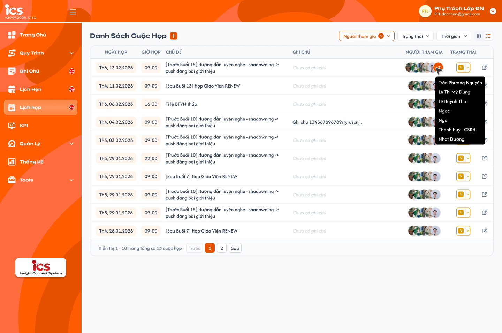
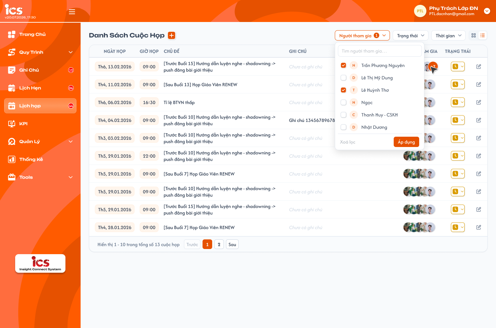
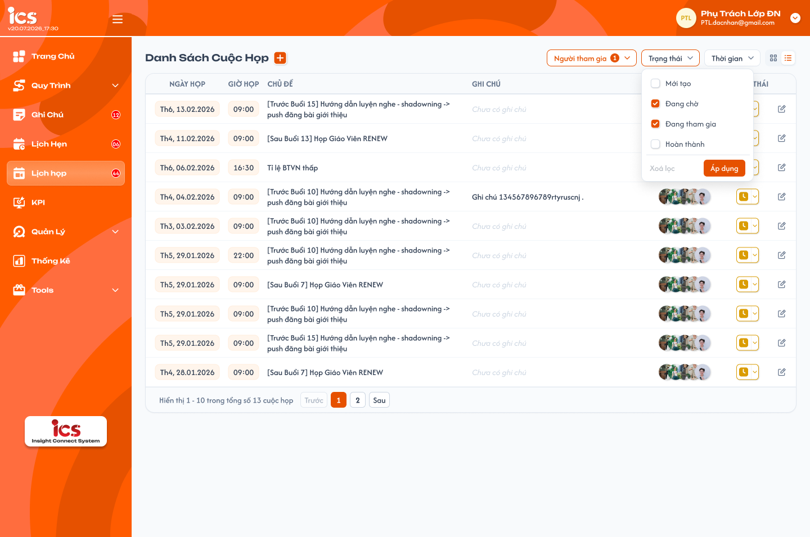
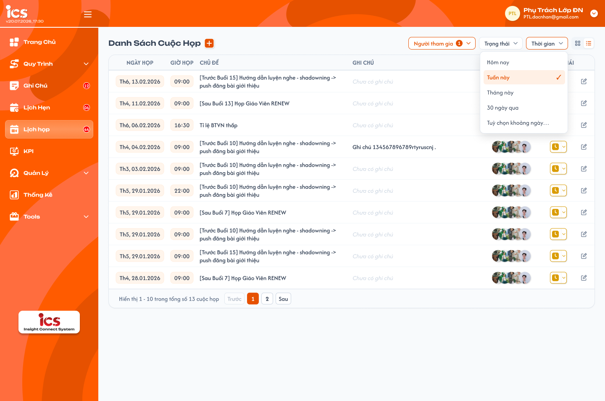
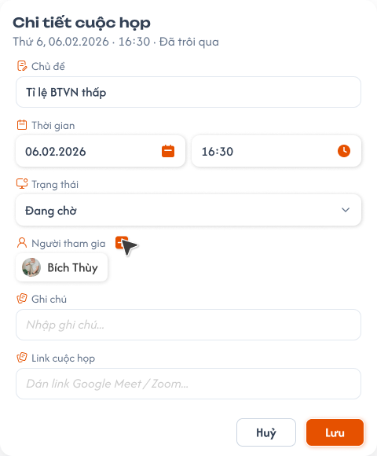
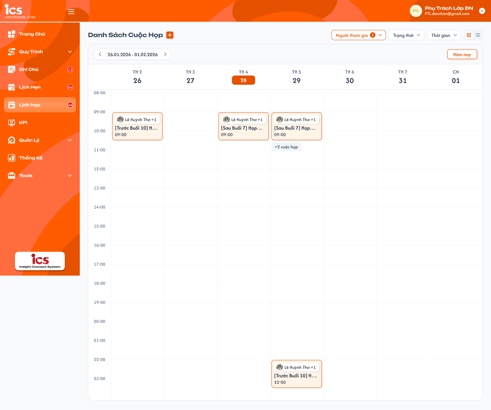

# [Phụ trách lớp, Admin] Lịch Họp

## 1. UI

### Trang 1: SP-LHP-010000 — Lịch họp / Dạng danh sách



**Mô tả:**
- Menu **Lịch Họp** ở sidebar của role `Class Handler` (Phụ trách lớp) và `Admin`: quản lý các cuộc họp theo dạng danh sách hoặc lịch tuần. Người dùng xem các cuộc họp trong phạm vi được xem, lọc theo người tham gia, trạng thái, thời gian; tạo cuộc họp mới bằng nút `+` cạnh tiêu đề; bấm icon bút để mở Chi tiết cuộc họp. Hai icon góc phải chuyển giữa dạng lịch (Trang 6) và dạng danh sách (trang này).

**Điểm cần lưu ý:**
- Số liệu và tên trong ảnh là dữ liệu mẫu.
- `A01.11` Sidebar (MENU - CLASS HANDLER): menu `Lịch Họp` có badge = số cuộc họp người dùng **là người tạo hoặc người tham gia** đang ở trạng thái `Mới tạo`, `Đang chờ` hoặc `Đang tham gia`, không tính `Hoàn thành`. Áp dụng cả Admin: chỉ đếm cuộc họp liên quan đến chính mình, không đếm toàn hệ thống. Badge không phụ thuộc bộ lọc trên trang; cập nhật sau mỗi lần tạo / sửa / xoá / đổi trạng thái; ẩn khi 0; lớn hơn 99 hiển thị `99+`.
- **Phạm vi dữ liệu:** Admin xem **tất cả** cuộc họp trong hệ thống; Phụ trách lớp chỉ thấy cuộc họp mình là **người tạo** hoặc nằm trong **Người tham gia**. **Người tạo** được sửa, đổi trạng thái và xoá cuộc họp; mọi người khác (người tham gia, Admin xem cuộc họp của người khác) chỉ xem.
- `A01.01` Bộ lọc `Người tham gia`: chọn nhiều, có ô tìm kiếm; mỗi dòng `Tên (Role)`; lọc cuộc họp có người được chọn là người tạo hoặc người tham gia; badge số trên nút = số người đã chọn; danh sách gồm tài khoản mọi role của ICS; mặc định là chính người đang đăng nhập; bỏ chọn hết = không lọc theo người (Admin thấy toàn bộ cuộc họp).
- `A01.02` Bộ lọc `Trạng thái`: chọn nhiều `Mới tạo`, `Hoàn thành`, `Đang tham gia`, `Đang chờ`, có ô tìm kiếm; mặc định Tất cả.
- `A01.03` Bộ lọc `Thời gian`: chọn 1 trong Tới hạn, Hôm nay, Hôm qua, Tuần này, Tuần trước, Tuần sau, Tháng này, Tháng trước, 3 tháng trước, Tháng sau, Năm nay, Năm trước, Tùy chọn, Hôm nay và hôm qua; lọc theo ngày họp; mặc định Không giới hạn. Phạm vi: `Tới hạn` = từ khi có dữ liệu đến hết hôm nay; tuần từ Thứ 2 đến Chủ Nhật; `Tuần sau` / `Tháng sau` là toàn bộ tuần / tháng liền sau; `3 tháng trước` = từ đầu ngày cách hiện tại 3 tháng đến hiện tại; `Tùy chọn` gồm cả 2 ngày biên.
- Trong cùng bộ lọc là `OR`, giữa các bộ lọc là `AND`. Giá trị đang chọn tô cam. Bộ lọc chỉ thu hẹp trong phạm vi dữ liệu ở trên; chọn người khác không làm lộ cuộc họp mà người đang đăng nhập không được xem. Đổi bộ lọc → về trang 1.
- `A01.04` Cột `Ngày họp`: `Thứ, dd.MM.yyyy` (vd `Th6, 13.02.2026`; Chủ Nhật là `CN`).
- `A01.05` Cột `Giờ họp`: `HH:mm`.
- `A01.06` Cột `Chủ đề`: tối đa 2 dòng, dài hơn cắt `…`, hover hiện đủ.
- `A01.07` Cột `Ghi chú`: tối đa 1 dòng, cắt `…`; trống hiển thị `Chưa có ghi chú` màu xám.
- `A01.08` Cột `Người tham gia`: avatar xếp chồng, tối đa 4 avatar, còn lại hiển thị vòng `+N`; hover vùng avatar hiện tooltip đủ tên người tham gia.
- `A01.09` Cột `Trạng thái`: icon trạng thái kèm mũi tên dropdown. Người tạo bấm để đổi trạng thái ngay (lưu khi chọn); người tham gia chỉ thấy icon, không mở dropdown; hover icon hiện tên trạng thái.
- `A01.10` Icon bút: mở popup Chi tiết cuộc họp (Trang 5): người tạo ở chế độ sửa, người tham gia ở chế độ chỉ xem.
- Sắp xếp theo ngày giờ họp giảm dần (mới nhất trước). Phân trang 10 cuộc họp/trang, có `Hiển thị x - y trong tổng số N cuộc họp`, `Trước`, số trang, `Sau`. Không có dữ liệu → `Bảng dữ liệu này đang trống`.

### Trang 2: SP-LHP-010001 — Lịch họp / Dropdown lọc · Người tham gia



**Mô tả:**
- Dropdown bộ lọc `Người tham gia` của Trang 1 và Trang 6; quy tắc bộ lọc xem Trang 1.

**Điểm cần lưu ý:**
- Checkbox chọn nhiều, ô tìm kiếm không phân biệt hoa thường; áp dụng ngay khi tick.

### Trang 3: SP-LHP-010002 — Lịch họp / Dropdown lọc · Trạng thái



**Mô tả:**
- Dropdown bộ lọc `Trạng thái` của Trang 1 và Trang 6.

**Điểm cần lưu ý:**
- Checkbox chọn nhiều (`Mới tạo`, `Hoàn thành`, `Đang tham gia`, `Đang chờ`), ô tìm kiếm không phân biệt hoa thường; áp dụng ngay khi tick.

### Trang 4: SP-LHP-010003 — Lịch họp / Dropdown lọc · Thời gian



**Mô tả:**
- Dropdown bộ lọc `Thời gian` của Trang 1.

**Điểm cần lưu ý:**
- Chọn 1 giá trị; chọn `Tùy chọn` mở lịch chọn khoảng ngày; Từ ngày > Đến ngày thì báo lỗi, giữ điều kiện cũ.

### Trang 5: SP-LHP-010010 — Lịch họp / Popup chi tiết cuộc họp



**Mô tả:**
- Popup dùng chung cho tạo mới (nút `+` cạnh tiêu đề, tiêu đề popup `Thêm cuộc họp`) và xem / sửa (icon bút hoặc card lịch, tiêu đề `Chi tiết cuộc họp`).

**Điểm cần lưu ý:**
- `A03.01` Dòng phụ dưới tiêu đề: `Thứ, dd.MM.yyyy · HH:mm · <nhãn>`; nhãn `Đã trôi qua` nếu thời điểm họp đã qua, `Sắp diễn ra` nếu chưa tới. Chỉ có ở Chi tiết cuộc họp.
- `A03.02` `Chủ đề`: bắt buộc, tối đa 255 ký tự.
- `A03.03` `Thời gian`: ngày (`dd.MM.yyyy`, date picker) và giờ (`HH:mm`, time picker), đều bắt buộc. Tạo mới mặc định ngày hôm nay, giờ trống. Cho phép chọn thời điểm quá khứ và trùng giờ với cuộc họp khác.
- `A03.04` `Trạng thái`: dropdown `Mới tạo`, `Đang chờ`, `Đang tham gia`, `Hoàn thành`; tạo mới mặc định `Mới tạo`; không tự đổi theo thời gian.
- `A03.05` `Người tham gia`: chip avatar + tên; nút `+` mở danh sách chọn nhiều người (tìm kiếm, mỗi dòng `Tên (Role)`, chỉ tài khoản đang hoạt động). Chọn được tài khoản mọi role của ICS, gồm Giáo viên, Học viên, Trợ giảng. Hover chip hiện `x` để bỏ. Không bắt buộc; người tạo không tự được thêm vào danh sách.
- `A03.06` `Ghi chú`: không bắt buộc, tối đa 500 ký tự.
- `A03.07` `Link cuộc họp`: không bắt buộc; phải là URL bắt đầu bằng `http://` hoặc `https://`. Ở chế độ chỉ xem hiển thị dạng link, bấm mở tab mới.
- `A03.08` `Huỷ`: đóng popup, bỏ thay đổi chưa lưu.
- `A03.09` `Lưu`: validate → lưu → đóng popup → cập nhật danh sách / lịch và badge sidebar → Toast. Chống bấm lặp.
- `A03.10` `Xoá`: chỉ người tạo, ở Chi tiết cuộc họp; mở popup xác nhận `Xoá cuộc họp?` hiển thị chủ đề + ngày giờ; xác nhận mới xoá. Xoá là xoá mềm: cuộc họp biến mất khỏi danh sách / lịch của người tạo và người tham gia, không tính vào badge.
- Người không phải người tạo (người tham gia, hoặc Admin xem cuộc họp của người khác) mở popup ở chế độ chỉ xem: mọi field disable, ẩn `+`, `x` trên chip, `Lưu`, `Xoá`; chỉ còn nút đóng.

### Trang 6: SP-LHP-020000 — Lịch họp / Dạng bảng



**Mô tả:**
- Dạng lịch tuần: hiển thị cuộc họp theo Thứ 2 – Chủ Nhật, trục dọc là giờ trong ngày.

**Điểm cần lưu ý:**
- Thanh điều hướng tuần `dd.MM.yyyy - dd.MM.yyyy` với `<` `>` để lùi / tiến 1 tuần; nút `Hôm nay` quay về tuần hiện tại. Mặc định mở tuần hiện tại.
- Header ngày `TH 2` … `CN` kèm ngày; ngày hôm nay tô nền cam.
- Trục giờ theo từng giờ, cuộn dọc xem đủ 00:00–23:59; mặc định cuộn tới 08:00.
- Card cuộc họp đặt ở ô ngày + giờ bắt đầu: avatar và tên người tham gia đầu tiên kèm `+N` (số người còn lại), chủ đề cắt `…`, giờ `HH:mm`. Bấm card → popup Chi tiết cuộc họp.
- Nhiều cuộc họp trong cùng ô ngày + giờ: hiển thị card đầu tiên (sớm nhất) và nút `+N cuộc họp` bên dưới; bấm mở danh sách các cuộc họp còn lại của ô đó (chủ đề, giờ, trạng thái), bấm một dòng để mở chi tiết.
- Dạng lịch áp dụng bộ lọc `Người tham gia` và `Trạng thái`; **không áp dụng** `Thời gian` (dùng điều hướng tuần thay thế), nút `Thời gian` bị disable. Dạng hiển thị đang chọn được ghi nhớ theo người dùng khi tải lại trang.

---

## 2. Yêu cầu

### 2.1. Flow chính

**Flow 1: Xem danh sách / lịch**

```
User (Admin / Phụ trách lớp) mở Lịch Họp
  → BE lấy cuộc họp chưa xoá: Admin = tất cả; Phụ trách lớp = cuộc họp mình tạo hoặc tham gia
  → áp bộ lọc mặc định (Người tham gia = chính mình) → FE hiển thị dạng đã ghi nhớ (danh sách hoặc lịch tuần)
  → đổi bộ lọc / trang / tuần → BE trả dữ liệu tương ứng
```

**Flow 2: Tạo cuộc họp**

```
Bấm + cạnh tiêu đề → popup Thêm cuộc họp (Trạng thái = Mới tạo, ngày = hôm nay)
  → nhập Chủ đề, Thời gian, chọn Người tham gia, Ghi chú, Link → Lưu
  → BE validate, lưu người tạo = user hiện tại → cập nhật danh sách/lịch, badge sidebar, Toast Thành Công
                    ↓ (thiếu/sai field)
              Báo lỗi tại field, không lưu
```

**Flow 3: Sửa / đổi trạng thái / xoá**

```
Người tạo bấm icon bút hoặc card → popup Chi tiết (chế độ sửa) → sửa → Lưu
Người tạo bấm dropdown Trạng thái ở bảng → chọn trạng thái → lưu ngay
Người tạo bấm Xoá → xác nhận → BE xoá mềm
  → BE kiểm tra user là người tạo → lưu → cập nhật danh sách/lịch, badge, Toast
                    ↓ (không phải người tạo)
              Popup chỉ xem; request trực tiếp bị từ chối
```

### 2.2. Ngoại lệ

- **EX01:** Thiếu Chủ đề / ngày / giờ, Chủ đề > 255 ký tự, Ghi chú > 500 ký tự, Link không phải URL `http(s)` → không lưu, báo lỗi tại field, Toast `Cảnh Báo`.
- **EX02:** Người không phải người tạo gửi request sửa / đổi trạng thái / xoá → backend từ chối, dữ liệu giữ nguyên.
- **EX03:** Mở cuộc họp đã bị xoá hoặc user đã bị bỏ khỏi danh sách tham gia → thông báo không còn quyền xem, tải lại danh sách.
- **EX04:** Lưu / xoá thất bại → giữ dữ liệu trong popup, Toast `Có Lỗi Xảy Ra`, không cập nhật danh sách giả.
- **EX05:** Tải danh sách lỗi → vùng lỗi có `Thử lại`; không hiển thị bảng rỗng giả.
- **EX06:** Hai người cùng sửa (người tạo mở 2 tab) → bản lưu sau bị từ chối nếu dữ liệu đã đổi, thông báo tải lại.

### 2.3. Yêu cầu khác

| Mã | Tên yêu cầu | Mô tả |
|---|---|---|
| REQ01 | Badge sidebar | Đếm cuộc họp user là người tạo hoặc người tham gia, trạng thái Mới tạo + Đang chờ + Đang tham gia; không theo bộ lọc; ẩn khi 0, `99+` khi > 99. |
| REQ02 | Phạm vi và quyền | Admin xem tất cả cuộc họp; Phụ trách lớp chỉ thấy cuộc họp mình tạo hoặc tham gia. Người tạo: sửa, đổi trạng thái, xoá. Người khác: chỉ xem. Quyền sửa / xoá kiểm tra theo `created_by`, không theo role. |
| REQ03 | Bộ lọc | Người tham gia (mặc định chính mình, danh sách mọi role ICS), Trạng thái (4 giá trị), Thời gian (14 giá trị, chọn 1); OR trong bộ lọc, AND giữa bộ lọc. |
| REQ04 | Dạng danh sách | Cột Ngày họp, Giờ họp, Chủ đề, Ghi chú, Người tham gia (4 avatar + `+N`, tooltip tên), Trạng thái (dropdown cho người tạo), icon bút; sắp xếp mới nhất trước; 10 dòng/trang. |
| REQ05 | Dạng lịch tuần | Điều hướng tuần, nút Hôm nay, highlight hôm nay, card theo giờ bắt đầu, `+N cuộc họp` khi trùng ô; không áp bộ lọc Thời gian. Ghi nhớ dạng hiển thị theo user. |
| REQ06 | Popup | Dùng chung Thêm / Chi tiết; field Chủ đề, Thời gian, Trạng thái, Người tham gia, Ghi chú, Link cuộc họp; nhãn Đã trôi qua / Sắp diễn ra; Xoá có xác nhận, xoá mềm. |
| REQ07 | Toast | `Thành Công`: `Đã thêm cuộc họp.`, `Đã cập nhật cuộc họp.`, `Đã cập nhật trạng thái.`, `Đã xoá cuộc họp.`; `Cảnh Báo` khi validate lỗi; `Có Lỗi Xảy Ra` khi lỗi. Một thao tác một Toast. |
| REQ08 | Log | Lưu người / thời điểm tạo, sửa, đổi trạng thái, xoá. |
| REQ09 | Người tham gia | Chọn được tài khoản mọi role của ICS (Admin, Phụ trách lớp, Support, Sale, Giáo viên, Trợ giảng, Học viên), chỉ tài khoản đang hoạt động. |

### 2.4. Ràng buộc

#### Quyền

| Role | Xem | Tạo | Sửa / đổi trạng thái | Xoá |
|---|:---:|:---:|:---:|:---:|
| Admin | ✅ tất cả cuộc họp | ✅ | ✅ chỉ cuộc họp mình tạo | ✅ chỉ cuộc họp mình tạo |
| Class Handler | ✅ cuộc họp mình tạo / tham gia | ✅ | ✅ chỉ cuộc họp mình tạo | ✅ chỉ cuộc họp mình tạo |
| Người tham gia (mọi role) | ✅ chỉ xem cuộc họp được mời | — | ❌ | ❌ |

#### Ràng buộc khác

- `created_by` lấy từ token khi tạo, không nhận từ client, không đổi được sau khi tạo.
- Mỗi người chỉ xuất hiện một lần trong Người tham gia của một cuộc họp.
- Ngày giờ lưu theo Asia/Saigon.
- Cuộc họp đã xoá không hiển thị ở danh sách, lịch, bộ lọc và badge.

---

## 3. Testcase

### Feature: Lịch Họp

| Tên testcase | Priority | Scenario | Role | Pre-condition | Given/When/Then | Expected Result |
|---|---|---|---|---|---|---|
| Case 1: Mở danh sách mặc định | High | Flow 1 / REQ02 / REQ03 / REQ04 | Class Handler | H tạo 3 cuộc họp, được mời 2 cuộc họp; có 4 cuộc họp H không liên quan; cuộc họp M có 7 người tham gia, không có ghi chú | **Given:** H đăng nhập<br>**When:** mở Lịch Họp, hover vùng avatar của M<br>**Then:** hiển thị 5 cuộc họp, bộ lọc Người tham gia = H (badge 1) | - Không có 4 cuộc họp không liên quan<br>- Sắp xếp mới nhất trước, 10 dòng/trang<br>- M: 4 avatar + `+3`, tooltip đủ 7 tên, Ghi chú `Chưa có ghi chú` |
| Case 2: Admin xem tất cả và badge sidebar | High | Flow 1 / REQ01 / REQ02 | Admin | Hệ thống có 20 cuộc họp; A tạo / tham gia 6 cuộc họp: 2 Mới tạo, 1 Đang chờ, 1 Đang tham gia, 2 Hoàn thành | **Given:** A mở Lịch Họp (mặc định Người tham gia = A)<br>**When:** bỏ chọn hết bộ lọc Người tham gia; đổi 1 cuộc họp Mới tạo sang Hoàn thành<br>**Then:** hiển thị 6 rồi 20 cuộc họp; badge 4 rồi 3 | - Cuộc họp người khác tạo: popup chỉ xem, không đổi trạng thái / xoá<br>- Đổi bộ lọc không làm đổi badge; badge chỉ đếm cuộc họp của A; về 0 thì ẩn |
| Case 3: Tạo cuộc họp | High | Flow 2 / REQ06 / REQ08 / REQ09 | Class Handler | - | **Given:** bấm `+`<br>**When:** nhập Chủ đề, ngày, giờ, thêm 2 người tham gia (1 Giáo viên, 1 Học viên), Link `https://meet.google.com/abc`, Lưu<br>**Then:** tạo thành công, Trạng thái Mới tạo | - Popup `Thêm cuộc họp`, ngày mặc định hôm nay, người tạo không tự có trong Người tham gia<br>- Người tạo = H; 2 người tham gia thấy cuộc họp ở chế độ chỉ xem<br>- Badge +1, Toast `Đã thêm cuộc họp.`; lưu log người / thời điểm |
| Case 4: Validate form | High | EX01 | Class Handler | Popup Thêm đang mở | **Given:** để trống Chủ đề / giờ; nhập Link `meet.google.com`; Ghi chú 501 ký tự; Chủ đề > 255 ký tự<br>**When:** Lưu<br>**Then:** không lưu, báo lỗi từng field | - Toast `Cảnh Báo`<br>- Dữ liệu đã nhập giữ nguyên<br>- Thời điểm quá khứ và trùng giờ cuộc họp khác vẫn hợp lệ |
| Case 5: Người tạo sửa và đổi trạng thái | High | Flow 3 / REQ02 / REQ04 / REQ07 | Admin | A là người tạo cuộc họp M | **Given:** A bấm icon bút của M<br>**When:** đổi giờ, Lưu; sau đó đổi trạng thái tại bảng sang Đang tham gia<br>**Then:** lưu thành công | - Popup ở chế độ sửa; Toast `Đã cập nhật cuộc họp.`<br>- Trạng thái lưu ngay khi chọn, Toast `Đã cập nhật trạng thái.`, không tự đổi theo thời gian |
| Case 6: Người tham gia chỉ xem | High | REQ02 / EX02 / Ràng buộc quyền | Class Handler | H là người tham gia của M, không phải người tạo | **Given:** H mở M; bấm icon trạng thái<br>**When:** thử sửa hoặc gửi request sửa / xoá trực tiếp<br>**Then:** popup chỉ xem | - Mọi field disable, không có Lưu / Xoá / `+` / `x`, icon trạng thái không mở dropdown<br>- Backend từ chối request, dữ liệu giữ nguyên<br>- Link cuộc họp bấm mở tab mới |
| Case 7: Xoá cuộc họp | High | Flow 3 / REQ06 | Class Handler | H tạo M (Mới tạo) có 2 người tham gia | **Given:** H mở Chi tiết M<br>**When:** bấm Xoá → Huỷ; rồi Xoá → xác nhận<br>**Then:** Huỷ giữ nguyên; xác nhận thì M biến mất | - Popup `Xoá cuộc họp?` hiển thị chủ đề + ngày giờ<br>- M không còn ở danh sách / lịch của H và 2 người tham gia; xoá mềm<br>- Badge giảm 1, Toast `Đã xoá cuộc họp.` |
| Case 8: Bộ lọc kết hợp | High | REQ03 | Class Handler | Có cuộc họp nhiều trạng thái, nhiều tuần; B cùng tham gia một số cuộc họp H không được xem | **Given:** chọn Người tham gia = H và B, Trạng thái = Đang chờ + Mới tạo, Thời gian = Tuần sau; thử Tùy chọn Từ ngày > Đến ngày<br>**When:** áp dụng<br>**Then:** chỉ cuộc họp tuần sau có H hoặc B, trạng thái Đang chờ hoặc Mới tạo | - OR trong bộ lọc, AND giữa các bộ lọc; về trang 1<br>- Không hiện cuộc họp H không được xem dù B tham gia<br>- Từ ngày > Đến ngày: báo lỗi, giữ điều kiện cũ |
| Case 9: Dạng lịch tuần | High | REQ05 | Class Handler | Thứ 5 tuần này có 3 cuộc họp lúc 09:00 | **Given:** chuyển sang dạng lịch<br>**When:** xem tuần hiện tại; bấm `+2 cuộc họp`; bấm `>` rồi `Hôm nay`; tải lại trang<br>**Then:** ô Thứ 5 09:00 có 1 card + `+2 cuộc họp`; bấm mở danh sách 2 cuộc họp còn lại | - Hôm nay tô cam; mặc định cuộn tới 08:00<br>- Nút Thời gian disable<br>- Tải lại trang vẫn ở dạng lịch |
| Case 10: Nhãn thời điểm trong popup | Low | REQ06 | Class Handler | M1 lúc 16:30 hôm qua, M2 ngày mai | **Given:** mở chi tiết M1, M2<br>**When:** xem dòng phụ<br>**Then:** M1 `… · 16:30 · Đã trôi qua`; M2 `… · Sắp diễn ra` | - Đúng định dạng `Thứ, dd.MM.yyyy · HH:mm` |
| Case 11: Lỗi lưu, lỗi tải, cuộc họp đã xoá, sửa đồng thời | Medium | EX03 / EX04 / EX05 / EX06 | Class Handler | API lỗi; M bị người tạo xoá khi H đang xem; người tạo mở 2 tab | **Given:** H Lưu khi API lỗi; mở M đã xoá; tải danh sách lỗi; lưu bản cũ ở tab thứ hai<br>**When:** xử lý<br>**Then:** Toast `Có Lỗi Xảy Ra` giữ dữ liệu popup; báo không còn quyền xem M; vùng lỗi có `Thử lại`; bản lưu sau bị từ chối | - Không cập nhật danh sách / badge giả<br>- Thông báo tải lại khi dữ liệu đã đổi |

---

## 4. Câu hỏi cần xác nhận

- **Q01:** Nút `Xoá` trong popup Chi tiết cuộc họp (và popup xác nhận `Xoá cuộc họp?`) chưa có thiết kế trên Figma. Khi nào bổ sung?
