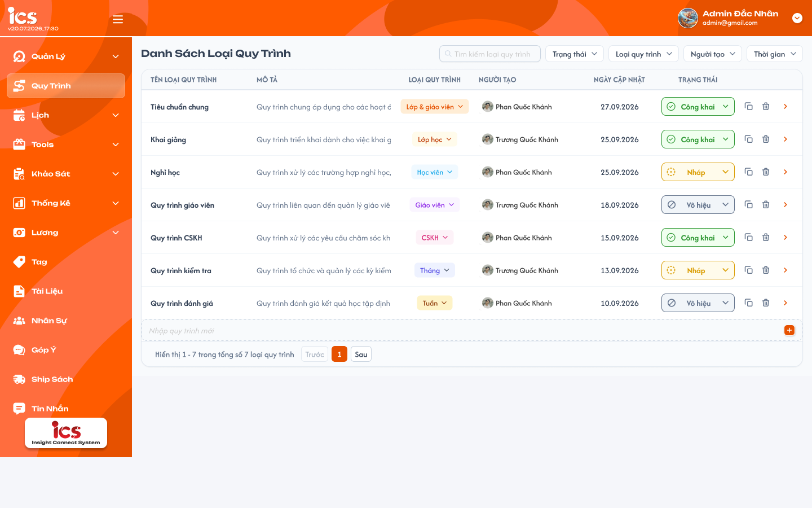
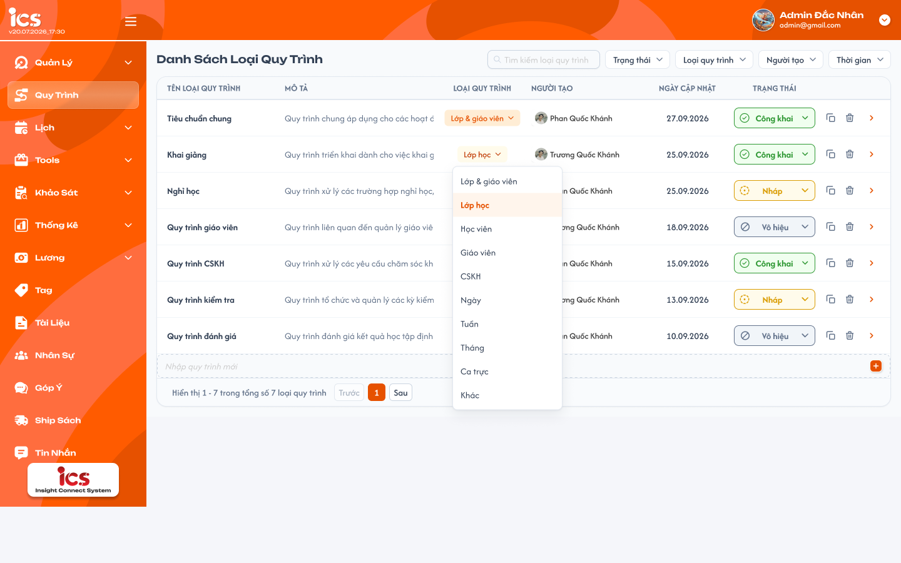
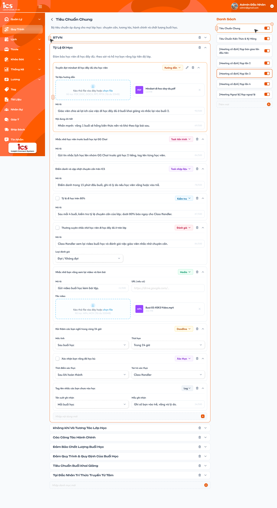
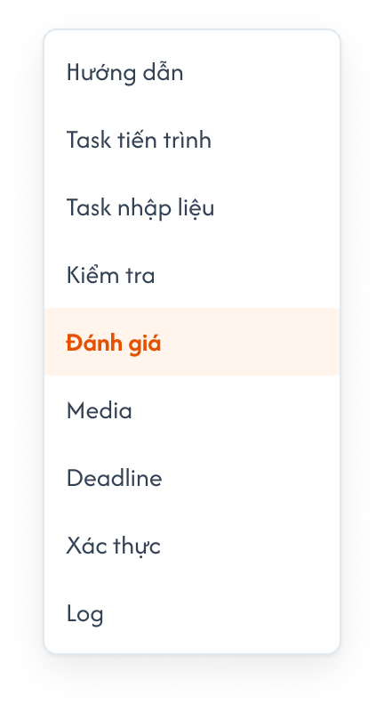

# Define quy trình

## 1. UI

### Trang 1: ADM-QT-010000 — Quy trình / Danh sách loại quy trình



**Mô tả:**
- Menu Quy trình định nghĩa nguồn Action Board theo cấu trúc **Package → Category → Action Item**, để sử dụng ở nhiều nơi như các tab quy trình trong lớp và menu [Quy Trình của Phụ trách lớp](../class_handler_support/process/process.md). Chỉ quy trình Công khai mới được thêm vào lớp hoặc được Phụ trách lớp chọn.
- Admin quản lý định nghĩa; Class Handler, Support và Assistant Teacher chỉ xem. Quy trình ICS dùng chung bảng với ComGao và **không chia theo trung tâm**: danh sách hiển thị toàn bộ quy trình, không có bộ lọc hay field `Trung tâm`.
- Admin có **toàn quyền** trên mọi quy trình, không phụ thuộc người tạo: sửa, đổi trạng thái, xóa, nhân bản quy trình do mình hoặc Admin khác tạo, vẫn theo rule trạng thái (REQ02, REQ10, REQ11).
- Admin nhân bản (duplicate) một quy trình có sẵn để tạo nhanh quy trình mới.

**Điểm cần lưu ý:**
- Trạng thái theo rule của Khóa học: `Nháp` → `Công khai` ↔ `Vô hiệu`. Chỉ cho phép **Nháp → Công khai** và **Công khai ↔ Vô hiệu**; không cho **Nháp → Vô hiệu**; Công khai hoặc Vô hiệu không quay về Nháp. Đổi trạng thái chuyển ngay, không mở popup.
- Đã Công khai/Vô hiệu thì chỉ sửa được Tên và Mô tả, mọi nội dung bên trong chỉ đọc; chỉ quy trình `Nháp` được xóa. Vô hiệu vẫn hiển thị nội dung đã thêm nhưng chỉ xem.
- Quyền sửa theo trạng thái (giống Khóa học):

  | Trạng thái | Sửa được | Chỉ đọc | Xóa |
  |---|---|---|:---:|
  | `Nháp` | Toàn bộ: Tên, Mô tả, Loại quy trình, Package, Category, Action Item, Loại task, field cấu hình, file/URL, kéo thả, toggle Package | Người tạo, Ngày cập nhật | ✅ |
  | `Công khai` | **Chỉ** Tên loại quy trình và Mô tả | Loại quy trình và **toàn bộ nội dung bên trong**: Package, Category, Action Item, Loại task, field cấu hình, file/URL, kéo thả, toggle Enable/Disable | ❌ |
  | `Vô hiệu` | Giống `Công khai` | Giống `Công khai` | ❌ |

- Muốn thay đổi nội dung quy trình đã Công khai thì dùng **Nhân bản** để có bản Nháp mới.
- Mọi field nhập/chọn cấu hình đều bắt buộc; thiếu field thì không lưu và chỉ rõ field cần bổ sung.
- `A02.01` Nhân bản · Tên quy trình mới: bấm `Nhân bản` ở cuối dòng → popup xác nhận `Nhân bản quy trình`. Điền sẵn `<Tên gốc> (copy)`, sửa được, bắt buộc, không giới hạn ký tự, được trùng tên quy trình khác.
- `A02.02` Nhân bản · Loại quy trình: điền sẵn loại của quy trình gốc, đổi được sang 1 trong 10 loại, bắt buộc.
- `A02.03` Nhân bản · `Hủy` / `Xác nhận`: Hủy đóng popup, không tạo gì. Xác nhận tạo một quy trình mới ở trạng thái `Nháp` với toàn bộ cấu trúc của quy trình gốc, sau đó Admin chỉnh sửa như một quy trình Nháp bình thường.
  - **Được sao chép:** Mô tả; toàn bộ Package (gồm trạng thái Enable/Disable), Category, Action Item theo đúng thứ tự; Loại task và mọi field cấu hình, file/URL đã tải.
  - **Không sao chép:** trạng thái (bản sao luôn là `Nháp`), Người tạo (= người nhân bản), Ngày cập nhật (= thời điểm nhân bản), Result, nơi đã sử dụng (lớp đã thêm, lựa chọn của Phụ trách lớp).
  - Nhân bản được quy trình ở mọi trạng thái `Nháp`, `Công khai`, `Vô hiệu`; quy trình gốc không thay đổi gì. Bản sao độc lập với bản gốc (sửa/xóa file, Package, Category, Action Item ở bản sao không ảnh hưởng bản gốc và ngược lại).
  - Tạo bản sao là thao tác toàn vẹn: lỗi giữa chừng thì không tạo quy trình nào, không có bản sao thiếu nội dung. Thành công → đóng popup, bản sao xuất hiện trong danh sách, Toast `Thành Công`.
- `A03.01` Xóa · Tiêu đề popup: `Xóa quy trình`.
- `A03.02` Xóa · Nội dung popup: `Xóa quy trình "<Tên quy trình>"? Toàn bộ Package, Category, Action Item của quy trình sẽ bị xóa.`
- `A03.03` Xóa · `Hủy` / `Xóa`: Hủy đóng popup, không xóa; Xóa gọi API xóa mềm.
  - **Chỉ quy trình `Nháp` được xóa.** `Công khai` / `Vô hiệu`: nút mờ + tooltip; gọi API trực tiếp thì backend từ chối (EX09). Muốn ngừng dùng thì chuyển `Vô hiệu`.
  - Xóa là **xóa mềm**: đánh dấu đã xóa quy trình và toàn bộ Package, Category, Action Item, file/URL bên trong; không xóa dữ liệu vật lý. Quy trình đã xóa không hiển thị trong danh sách, không tìm/lọc ra được, không mở chi tiết được bằng URL.
  - Quy trình Nháp chưa từng được thêm vào lớp hoặc được Phụ trách lớp chọn (chỉ Công khai mới được dùng), nên không cần kiểm tra đang sử dụng.
  - Backend kiểm tra lại trạng thái lúc xóa: quy trình vừa được chuyển Công khai bởi người khác thì từ chối.
  - Thành công → đóng popup, bỏ dòng khỏi danh sách, cập nhật tổng số/phân trang, Toast `Thành Công`. Lỗi → giữ dữ liệu, Toast `Có Lỗi Xảy Ra`.
- `A07.01` Toast `Thành Công`: thay đổi được lưu thành công, gồm tạo bản sao khi nhân bản.
- `A07.02` Toast `Thông Báo`: chỉ khi thao tác đã được tiếp nhận nhưng còn chờ đồng bộ.
- `A07.03` Toast `Cảnh Báo`: thiếu field bắt buộc, vượt giới hạn, sai file, vượt quyền hoặc sửa định nghĩa đã khóa.
- `A07.04` Toast `Có Lỗi Xảy Ra`: không hoàn tất được thao tác.
- Mỗi thao tác chỉ có một Toast kết quả; chỉ xem, mở/thu gọn hoặc Hủy không có Toast CRUD. Không báo thành công trước khi lưu xong.

### Trang 2: ADM-QT-010001 — Dropdown chọn loại quy trình



**Mô tả:**
- Danh sách loại quy trình với dropdown chọn Loại quy trình đang mở.

**Điểm cần lưu ý:**
- `A01.01` Danh sách: các cột Tên loại quy trình, Mô tả, Loại quy trình, Người tạo, Ngày cập nhật, Trạng thái, thao tác cuối dòng.
- `A01.02` Tìm kiếm: theo tên loại quy trình, chứa chuỗi, không phân biệt hoa thường, **hỗ trợ gõ không dấu** (VD gõ `nghi hoc` ra `Nghỉ học`).
- `A01.03` Bộ lọc: Trạng thái, Đối tượng, Người tạo, Thời gian. Mỗi bộ lọc **chọn nhiều** giá trị; trong cùng bộ lọc là `OR`, giữa các bộ lọc và với Tìm kiếm là `AND`.
- `A01.04` Sắp xếp: mặc định theo `Ngày cập nhật` giảm dần (mới nhất lên đầu).
- `A01.05` Loại quy trình: đúng 10 loại theo thứ tự `Lớp - Giáo viên`, `Lớp học`, `Học viên`, `Giáo viên`, `CSKH` (Support), `Ngày`, `Tuần`, `Tháng`, `Ca trực`, `Khác`. Năm loại `Ngày`, `Tuần`, `Tháng`, `Ca trực`, `Khác` là quy trình của Phụ trách lớp (xem `A06.04`). Bộ lọc `Đối tượng` có đủ 10 loại.
- `A01.06` Trạng thái quy trình: `Nháp`, `Công khai`, `Vô hiệu`; chọn tại dropdown của dòng. Dropdown chỉ hiện lựa chọn hợp lệ: đang `Nháp` chỉ hiện `Công khai`; đang `Công khai` chỉ hiện `Vô hiệu`; đang `Vô hiệu` chỉ hiện `Công khai`.
- `A01.07` Nhập quy trình mới: dòng cuối bảng và nút `+` dùng để thêm quy trình Nháp; không chọn `Trung tâm`; chỉ Admin được thao tác; Class Handler không được tạo quy trình.
- `A01.08` Thông tin quy trình: Tên loại quy trình, Mô tả và Loại quy trình đều bắt buộc khi lưu; Tên và Mô tả **không giới hạn ký tự**, không chấp nhận chỉ có khoảng trắng. **Cho phép trùng tên** với quy trình khác. Người tạo/Ngày cập nhật do hệ thống ghi nhận.
- `A01.09` Nút `Xóa` cuối dòng: chỉ hiển thị với Admin. Quy trình `Nháp`: bấm được → popup xác nhận xóa. Quy trình `Công khai` / `Vô hiệu`: nút mờ, không bấm được, hover hiện tooltip `Chỉ xóa được quy trình ở trạng thái Nháp. Chuyển Vô hiệu nếu muốn ngừng dùng.`
- `A01.10` Nút `Nhân bản` cuối dòng: icon nhân bản đặt trước mũi tên; chỉ hiển thị với Admin; áp dụng cho quy trình ở mọi trạng thái. Bấm → popup xác nhận nhân bản.
- `A01.11` Mũi tên cuối dòng: mở chi tiết quy trình đã chọn.
- `A01.12` Phân trang: **50 dòng/trang**. Hiển thị khoảng bản ghi, tổng số quy trình và Trước/Sau/số trang. Đổi tìm kiếm/bộ lọc thì về trang 1.
- `A01.13` Trạng thái `Nháp`: sửa toàn bộ, được xóa.
- `A01.14` Trạng thái `Công khai`: chỉ sửa Tên và Mô tả, không được xóa.
- `A01.15` Trạng thái `Vô hiệu`: giống `Công khai`.

### Trang 3: ADM-QT-020000 — Quy trình / Chi tiết loại quy trình



**Mô tả:**
- Chọn Package ở Danh Sách bên phải; bên trái hiển thị tên, mô tả và các Category/Action Item của Package đó. Khi còn Nháp, mỗi Action Item chọn một Loại task và cấu hình field tương ứng; sau Công khai chỉ xem cấu hình đã định nghĩa.

**Điểm cần lưu ý:**
- Admin chỉ thay đổi nội dung bên trong khi quy trình còn Nháp. Ở `Công khai` / `Vô hiệu` chỉ sửa được Tên và Mô tả; khóa Loại quy trình, Package, Category, Action Item, Loại task, field cấu hình, file/URL, kéo thả và toggle Enable/Disable. Các control thay đổi nội dung bên trong được ẩn hoặc vô hiệu hóa; vẫn chọn Package và mở/thu gọn để xem được.
- Tên, mô tả và các field cấu hình Package/Category/Action Item đều bắt buộc khi lưu; chỉ kiểm tra field của Loại task đang chọn.
- `A04.01` Quay lại: trở về danh sách loại quy trình.
- `A04.02` Danh Sách Package: chọn Package để xem nội dung. Toggle và tay nắm kéo thả chỉ được thao tác khi còn Nháp.
- `A04.03` Thêm mới Package: khi còn Nháp, nhập tên tại dòng `Thêm mới` và bấm `+`.
- `A04.04` Category: hiển thị tên, mô tả, mở/thu gọn, kéo thả và nút xóa. Dòng `Nhập danh mục mới` thêm Category vào Package đang chọn.
- `A04.05` Action Item: hiển thị tên, Loại task, field cấu hình, mở/thu gọn và nút sửa/xóa theo UI. Dòng `Nhập nội dung mới` thêm item vào Category hiện tại.
- `A04.06` Kéo thả: khi còn Nháp, sắp xếp Package trong Danh Sách, Category trong Package và Action Item trong Category.
- `A04.07` Toggle Package: Enable/Disable Package; độc lập với trạng thái Nháp/Công khai/Vô hiệu của quy trình, không đổi trạng thái quy trình và không đưa quy trình về Nháp.
- Dropdown Loại task có đúng 9 loại theo thứ tự dưới đây; không thêm `Nhận xét` từ Action Board cũ vào UI mới. Chỉ đổi Loại task khi còn Nháp; hiển thị đúng bộ field. Quy trình Nháp chưa được thêm vào lớp nên thao tác này không tác động Result của lớp. Field văn bản có bộ đếm `/500` tối đa 500 ký tự. Tất cả field của Loại task đang chọn đều bắt buộc, gồm file/URL khi loại đó có các field này (áp dụng cả với URL mà ảnh ghi “nếu có”). Các giá trị đang chọn trong ảnh là ví dụ; không mặc định là toàn bộ lựa chọn dropdown.

  

- `A05.01` Loại task `Hướng dẫn`: Tài liệu hướng dẫn, Mô tả, Nội dung chi tiết. Kéo thả/chọn file `PDF`, `DOC`, `DOCX`, `PPT`, `PPTX`, tối đa `20MB` mỗi file. Hiển thị file đã tải với tên/định dạng/dung lượng.
- `A05.02` Loại task `Task tiến trình`: Mô tả công việc cần thực hiện.
- `A05.03` Loại task `Task nhập liệu`: Mô tả nội dung cần nhập khi sử dụng.
- `A05.04` Loại task `Kiểm tra`: Mô tả tiêu chí kiểm tra.
- `A05.05` Loại task `Đánh giá`: Mô tả và Loại đánh giá; ví dụ đang chọn `Đạt / Không đạt`.
- `A05.06` Loại task `Media`: Mô tả, URL, File video; kéo thả/chọn file `MP4`, `MOV`, tối đa `500MB` mỗi file. Có nút gỡ file đã tải.
- `A05.07` Loại task `Deadline`: Mốc tính và Thời hạn; ví dụ `Sau buổi học`, `Trong 24 giờ`.
- `A05.08` Loại task `Xác thực`: Thời điểm xác thực và Vai trò xác thực; ví dụ `Sau khi hoàn thành`, `Admin`.
- `A05.09` Loại task `Log`: Tần suất ghi nhận và Mẫu ghi nhận; ví dụ `Mỗi buổi học`.
- Sử dụng nguồn trong lớp: các tab trong lớp chỉ thêm mới từ quy trình Công khai. Khi quy trình đã thêm chuyển Vô hiệu, vẫn hiện nội dung và Result đã ghi nhưng chỉ xem.
- `A06.01` Nội dung đã thêm: sử dụng định nghĩa đã Công khai; không có tình huống xóa Category hoặc sửa Action Item ở nguồn sau khi đã thêm vào lớp.
- `A06.02` Result: quy trình Công khai cập nhật theo quyền lớp; quy trình Vô hiệu giữ Result đã ghi để xem, khóa mọi cập nhật Result. Chuyển Vô hiệu không xóa/ẩn nội dung đã thêm; khi Công khai lại, áp dụng quyền cập nhật Result theo role lớp.
- `A06.03` Tab trong lớp: Tiêu chuẩn lớp - giáo viên lấy loại `Lớp - Giáo viên`; CSKH lấy `CSKH` (Support); Quy trình lớp lấy `Lớp học`. Quy trình không gắn trung tâm nên dùng được cho lớp ở mọi trung tâm. Popup và thao tác lưu chỉ nhận quy trình Công khai; Nháp/Vô hiệu không được thêm mới vào lớp.
- `A06.04` Quy Trình của Phụ trách lớp: `Task Hôm Nay` lấy loại `Ngày`, `Task Tuần Này` lấy `Tuần`, `Task Tháng Này` lấy `Tháng`, `Ca Trực` lấy `Ca trực`, `Task Khác` lấy `Khác`. Phụ trách lớp chỉ **chọn** trong các quy trình Công khai đã define để tick (mặc định quy trình đứng đầu danh sách Define của loại tương ứng), không tạo/sửa quy trình tại đó. Chi tiết tại [Quy Trình của Phụ trách lớp](../class_handler_support/process/process.md).
- Quyền thêm/cập nhật Result trong lớp vẫn theo role được add vào lớp; quyền define nguồn chỉ dành cho Admin.

---

## 2. Yêu cầu

### 2.1. Flow chính

**Flow 1: Xem quy trình**

```
Kiểm tra role → Mở menu Quy trình (toàn bộ quy trình, không lọc trung tâm) → Tìm/lọc danh sách → Chọn dòng
      → Mở chi tiết (Trang 3) → Chọn Package → Xem Category và Action Item
```

**Flow 2: Đổi trạng thái**

```
Chọn trạng thái → Kiểm tra quyền và trạng thái hiện tại
      → Nháp: chỉ cho chuyển Công khai (không cho Vô hiệu)
      → Công khai: chỉ cho chuyển Vô hiệu; Vô hiệu: chỉ cho chuyển Công khai; không về Nháp
      → Công khai lần đầu: khóa nội dung bên trong vĩnh viễn, chỉ còn sửa Tên/Mô tả; chuyển Vô hiệu ↔ Công khai không mở khóa
      → Lưu thành công → Cập nhật trạng thái và Toast
```

**Flow 3: Quản lý cấu trúc nguồn**

```
Kiểm tra quyền và quy trình còn Nháp → Chọn Package → Thêm/sửa/xóa Category và Action Item
      → Sắp xếp bằng kéo thả trong cùng cấp cha hoặc Enable/Disable Package
      → Lưu thành công → Cập nhật định nghĩa nguồn và Toast
```

**Flow 4: Cấu hình Action Item**

```
Kiểm tra quy trình còn Nháp → Chọn Action Item → Chọn Loại task → Hiển thị field tương ứng
      → Nhập đầy đủ cấu hình/tải file → Kiểm tra bắt buộc và giới hạn → Lưu định nghĩa → Phản hồi kết quả
```

**Flow 5: Tạo quy trình**

```
Admin nhập tại dòng Nhập quy trình mới → Bấm +
      → Kiểm tra thông tin bắt buộc và Loại quy trình (1 trong 10 loại)
      → Lưu quy trình Nháp vào bảng dùng chung ComGao, không gắn trung tâm → Cập nhật danh sách và Toast
```

**Flow 6: Nhân bản quy trình**

```
Admin bấm Nhân bản ở dòng quy trình (mọi trạng thái) → Popup điền sẵn Tên `<Tên gốc> (copy)` và Loại
      → Sửa Tên/Loại nếu cần → Xác nhận → Kiểm tra quyền, field bắt buộc
      → Tạo quy trình Nháp mới + sao chép Package/Category/Action Item/cấu hình/file trong một thao tác toàn vẹn
      → Cập nhật danh sách và Toast Thành Công
                    ↓ (lỗi)
              Không tạo quy trình, Toast Có Lỗi Xảy Ra
```

**Flow 7: Xóa quy trình**

```
Admin bấm Xóa ở dòng quy trình (chỉ bấm được khi Nháp; Công khai/Vô hiệu: nút mờ + tooltip)
      → Popup xác nhận → Hủy: đóng popup, không xóa
      → Xóa: FE gọi API xóa mềm → BE kiểm tra quyền và trạng thái
            → Nháp: đánh dấu xóa quy trình + Package/Category/Action Item → bỏ khỏi danh sách, Toast Thành Công
            → Không phải Nháp / lỗi: từ chối, giữ dữ liệu, Toast lỗi (EX09)
```

### 2.2. Ngoại lệ

- **EX01:** Nháp → Vô hiệu, Công khai/Vô hiệu → Nháp hoặc vượt quyền → từ chối, giữ trạng thái cũ; kiểm tra cả request trực tiếp.
- **EX02:** File sai định dạng hoặc vượt giới hạn theo loại → không nhận file, nêu rõ lý do.
- **EX03:** Lưu lỗi → không giữ thay đổi chưa lưu như kết quả thành công; phản hồi lỗi để thử lại.
- **EX04:** Sửa bất kỳ field nào ngoài Tên/Mô tả hoặc nội dung bên trong của quy trình `Công khai` / `Vô hiệu` (kể cả gửi từ form Nháp cũ hoặc request trực tiếp) → từ chối, giữ nguyên dữ liệu.
- **EX05:** Thêm nguồn Nháp/Vô hiệu vào lớp hoặc cập nhật Result của quy trình Vô hiệu → từ chối; nội dung/Result cũ vẫn hiển thị.
- **EX06:** Thiếu field bắt buộc hoặc field có `/500` vượt 500 ký tự → không lưu, chỉ rõ field lỗi.
- **EX07:** Support/Assistant Teacher hoặc người không có quyền gửi thao tác define/nhân bản → từ chối, không thay dữ liệu.
- **EX08:** Nhân bản lỗi giữa chừng hoặc quy trình gốc không còn tồn tại → không tạo quy trình nào, Toast `Có Lỗi Xảy Ra`.
- **EX09:** Xóa quy trình `Công khai` / `Vô hiệu` (gọi API trực tiếp, hoặc vừa được chuyển trạng thái trước lúc xóa), quy trình không tồn tại hoặc người không có quyền → backend từ chối, Toast lỗi với nội dung backend trả về (VD `Chỉ xóa được quy trình ở trạng thái Nháp.`), dữ liệu giữ nguyên.

### 2.3. Yêu cầu khác

| Mã | Tên yêu cầu | Mô tả |
|---|---|---|
| REQ01 | Danh sách | Hiển thị đúng cột; mặc định sắp `Ngày cập nhật` giảm dần; 50 dòng/trang; tìm theo tên không phân biệt hoa thường, hỗ trợ không dấu; bộ lọc chọn nhiều (OR trong bộ lọc, AND giữa bộ lọc); mở đúng quy trình đã chọn. |
| REQ02 | Trạng thái quy trình (giống Khóa học) | Nháp → Công khai; Công khai ↔ Vô hiệu; không cho Nháp → Vô hiệu; không quay về Nháp. Dropdown chỉ hiện lựa chọn hợp lệ: Nháp → `Công khai`, Công khai → `Vô hiệu`, Vô hiệu → `Công khai`. Chuyển ngay, không popup. |
| REQ03 | Cấu trúc và khóa định nghĩa | Package → Category → Action Item. Admin quản lý nội dung khi còn Nháp. Đã Công khai thì khóa mọi thêm/sửa/xóa, kéo thả, cấu hình task/file và toggle Package; chuyển Vô hiệu không mở khóa. Toggle Enable/Disable là cấu hình Package riêng với trạng thái quy trình. |
| REQ04 | Loại task | Đúng 9 loại và field cấu hình trong bảng UI; mọi field của loại đang chọn bắt buộc, kiểm tra định dạng/dung lượng file tương ứng và tối đa 500 ký tự ở field có `/500`. |
| REQ05 | Sử dụng nguồn | Chỉ quy trình Công khai mới được thêm vào lớp, đúng loại của tab Tiêu chuẩn lớp - giáo viên/CSKH/Quy trình lớp. Kiểm tra cả lúc tải popup và lưu lựa chọn. Định nghĩa đã Công khai không sửa/xóa được. Quy trình chuyển Vô hiệu vẫn hiện nội dung/Result đã thêm nhưng chỉ xem; Công khai lại thì áp dụng quyền cập nhật theo [requirement Chi tiết lớp](../management_requirement/class_management/class_detail_processes_requirements.md). |
| REQ06 | Phản hồi | Thay đổi có Toast theo kết quả xử lý; không báo thành công trước khi lưu. |
| REQ07 | ComGao, không chia trung tâm | ICS dùng chung bảng quy trình với ComGao; không sao chép thành bảng/bản ghi riêng cho ICS. Quy trình không gắn trung tâm: tạo mới không chọn Trung tâm, danh sách không có bộ lọc Trung tâm, lớp và Phụ trách lớp ở mọi trung tâm đều dùng được quy trình Công khai. |
| REQ08 | Tạo mới | Admin thêm quy trình Nháp bằng dòng Nhập quy trình mới và `+`; Tên, Mô tả, Loại quy trình bắt buộc. Loại gồm Lớp - Giáo viên/Lớp học/Học viên/Giáo viên/CSKH (Support)/Ngày/Tuần/Tháng/Ca trực/Khác. Tên/Mô tả không giới hạn ký tự, cho phép trùng tên. Class Handler không được tạo. |
| REQ09 | Nhân bản | Admin nhân bản quy trình ở mọi trạng thái thành quy trình Nháp mới; Tên mặc định `<Tên gốc> (copy)`, Loại mặc định theo gốc, đều sửa được. Sao chép Mô tả, Package (gồm Enable/Disable), Category, Action Item, Loại task, cấu hình, file/URL; không sao chép trạng thái, Người tạo, Result và nơi đã sử dụng. Bản sao độc lập với bản gốc; tạo toàn vẹn. Hậu tố luôn là ` (copy)`, không cắt tên, cho phép trùng tên (nhân bản nhiều lần tạo nhiều bản cùng tên). |
| REQ10 | Quyền sửa theo trạng thái | `Nháp` sửa toàn bộ. `Công khai` / `Vô hiệu` chỉ sửa Tên loại quy trình và Mô tả; Loại quy trình và toàn bộ nội dung bên trong chỉ đọc. Muốn đổi nội dung thì nhân bản. |
| REQ11 | Xóa quy trình | Chỉ quy trình `Nháp` được xóa, có popup xác nhận; xóa mềm quy trình và toàn bộ nội dung bên trong; quy trình đã xóa không hiển thị/tìm/lọc/mở được. `Công khai` / `Vô hiệu` không được xóa (nút mờ + tooltip, backend từ chối). |
| REQ12 | Quyền Admin | Admin được toàn quyền chỉnh sửa, đổi trạng thái, xóa và nhân bản mọi quy trình, kể cả quy trình do Admin khác tạo; giới hạn duy nhất là rule trạng thái (REQ02, REQ10, REQ11). Người tạo không đổi khi Admin khác chỉnh sửa. |

### 2.4. Ràng buộc

#### Quyền

| Role | Xem | Sửa Tên/Mô tả | Sửa nội dung bên trong | Kéo thả | Đổi trạng thái | Xóa quy trình | Nhân bản | Ghi Result tại menu Define |
|---|:---:|:---:|:---:|:---:|:---:|:---:|:---:|:---:|
| Admin — quy trình Nháp | ✅ | ✅ | ✅ | ✅ | ✅ | ✅ | ✅ | ❌ |
| Admin — Công khai / Vô hiệu | ✅ | ✅ | ❌ | ❌ | ✅ | ❌ | ✅ | ❌ |
| Class Handler | ✅ | ❌ | ❌ | ❌ | ❌ | ❌ | ❌ | ❌ |
| Support | ✅ | ❌ | ❌ | ❌ | ❌ | ❌ | ❌ | ❌ |
| Assistant Teacher | ✅ | ❌ | ❌ | ❌ | ❌ | ❌ | ❌ | ❌ |
| Không có quyền truy cập | ❌ | ❌ | ❌ | ❌ | ❌ | ❌ | ❌ | ❌ |

#### Ràng buộc khác

- Quyền Admin trong bảng áp dụng cho mọi quy trình, không phân biệt người tạo (REQ12); backend không kiểm tra người tạo khi sửa/xóa/đổi trạng thái/nhân bản.
- Đổi trạng thái chỉ theo REQ02; quyền sửa theo REQ10; xóa theo REQ11. Toggle Package tuân thủ khóa định nghĩa.
- Quyền dùng nội dung/cập nhật Result trong lớp không tự cấp quyền sửa định nghĩa ở menu Quy trình.
- Kiểm tra liên kết Package → Category → Action Item, quyền thao tác và rule trạng thái khi lưu, kể cả URL/request trực tiếp.
- Quy trình không chia theo trung tâm; quyền trong bảng áp dụng cho toàn bộ quy trình. Backend không lọc hay kiểm tra trung tâm khi xem, define, nhân bản hoặc chọn quy trình tại nơi sử dụng.
- Quyền chỉ xem của Support/Assistant Teacher tại menu Define khác với quyền cập nhật Result của Support đã được add vào lớp; quy trình Vô hiệu vẫn chỉ xem ở lớp.


---

## 3. Testcase

### Feature: Define quy trình

| Tên testcase | Priority | Scenario | Role | Pre-condition | Given/When/Then | Expected Result |
|---|---|---|---|---|---|---|
| Case 1: Xem danh sách theo role, không tạo/nhân bản vượt quyền | High | Flow 1 / REQ01 / REQ07 / REQ08 / EX07 | Admin / Class Handler / Support / Assistant Teacher | Có quy trình do người dùng ở nhiều trung tâm tạo | **Given:** mở danh sách<br>**When:** tìm/lọc, mở chi tiết; Class Handler/Support/Assistant Teacher thử thay đổi dữ liệu, tạo hoặc nhân bản (UI và request trực tiếp)<br>**Then:** thấy toàn bộ quy trình, không có bộ lọc Trung tâm; chặn vượt quyền | - Phân trang/tổng số đúng kết quả<br>- Chỉ xem: không được thêm/sửa/xóa, kéo thả, toggle, đổi trạng thái; không thấy dòng Nhập quy trình mới, không thấy nút Nhân bản/Xóa<br>- Backend từ chối, không tạo quy trình |
| Case 2: Tìm kiếm không dấu, lọc nhiều giá trị, sắp xếp, phân trang | Medium | Flow 1 / REQ01 | Admin / Class Handler | Có 120 quy trình, có `Nghỉ học`, `NGHỈ HỌC 2` | **Given:** mở danh sách<br>**When:** xem mặc định; gõ `nghi hoc`; chọn Trạng thái = Nháp + Công khai, Đối tượng = Ngày + Tuần<br>**Then:** kết quả đúng | - Mặc định sắp Ngày cập nhật giảm dần, 50 dòng/trang, 3 trang<br>- `nghi hoc` ra cả 2 quy trình<br>- Lọc: (Nháp OR Công khai) AND (Ngày OR Tuần); về trang 1 |
| Case 3: Tạo quy trình, field bắt buộc và 10 loại | High | Flow 5 / REQ07 / REQ08 / EX06 | Admin | Danh sách đang mở | **Given:** nhập tại dòng Nhập quy trình mới và bấm `+`; chọn lần lượt Loại `Ngày`, `Tuần`, `Tháng`, `Ca trực`, `Khác`<br>**When:** lưu đủ thông tin, rồi thử để trống từng field<br>**Then:** tạo quy trình Nháp dùng chung toàn hệ thống; thiếu field không lưu | - Dùng chung bảng ComGao, không tạo bản sao riêng cho ICS; không có field Trung tâm<br>- Loại có đúng 10 giá trị, gồm `CSKH` và `Ngày`, `Tuần`, `Tháng`, `Ca trực`, `Khác`; badge Loại đúng nhãn<br>- Lọc `Đối tượng` ra đúng quy trình; sau Công khai xuất hiện ở bộ chọn của menu con tương ứng bên Phụ trách lớp |
| Case 4: Chuyển trạng thái và menu trạng thái | High | Flow 2 / REQ02 | Admin | Có quy trình ở ba trạng thái | **Given:** mở dropdown trạng thái từng dòng<br>**When:** quan sát lựa chọn; thực hiện Nháp → Công khai, Công khai → Vô hiệu, Vô hiệu → Công khai<br>**Then:** chỉ hiện lựa chọn hợp lệ, lưu được | - Nháp chỉ hiện Công khai; Công khai chỉ hiện Vô hiệu; Vô hiệu chỉ hiện Công khai<br>- Chuyển ngay, không popup; tải lại vẫn giữ trạng thái; Toast Thành Công |
| Case 5: Chặn Nháp → Vô hiệu và quay về Nháp | High | EX01 / REQ02 | Admin | Có quy trình Nháp, Công khai, Vô hiệu | **Given:** gửi request Nháp → Vô hiệu, Công khai → Nháp, Vô hiệu → Nháp<br>**When:** backend kiểm tra<br>**Then:** từ chối | - UI không có các lựa chọn này<br>- Trạng thái cũ giữ nguyên; Toast lỗi |
| Case 6: Khóa định nghĩa khi Công khai / Vô hiệu | High | REQ03 / REQ10 / EX04 | Admin | Quy trình P Công khai, Q Vô hiệu | **Given:** mở P và Q<br>**When:** sửa Tên, Mô tả; thử đổi Loại quy trình, thêm/sửa/xóa Package/Category/Action Item, đổi Loại task/file, kéo thả, toggle Package qua UI hoặc request<br>**Then:** Tên, Mô tả lưu được; mọi thay đổi khác bị từ chối ở cả hai trạng thái | - Control nội dung bên trong chỉ đọc (ẩn/disable)<br>- Request trực tiếp bị từ chối, dữ liệu và Result lớp giữ nguyên<br>- Lớp/Phụ trách lớp đang dùng P thấy tên mới; trạng thái vẫn đổi được theo rule |
| Case 7: Admin chỉnh sửa quy trình của Admin khác | High | REQ12 | Admin | Admin A tạo quy trình P (Nháp) và Q (Công khai); Admin B đăng nhập | **Given:** B mở P và Q<br>**When:** sửa nội dung P, đổi trạng thái/xóa P; sửa Tên/Mô tả Q, chuyển Q sang Vô hiệu, nhân bản Q<br>**Then:** đều thực hiện được | - Người tạo của P, Q vẫn là A; Ngày cập nhật đổi theo lần sửa của B<br>- Q vẫn chỉ sửa được Tên/Mô tả theo REQ10 |
| Case 8: Nhân bản và chỉnh bản sao độc lập | High | Flow 6 / REQ09 / REQ03 | Admin | Quy trình `Check-in` Công khai, loại `Ngày`, 2 Package (1 Disable), Action Item có file Hướng dẫn | **Given:** bấm `Nhân bản` ở dòng `Check-in`<br>**When:** giữ tên mặc định và bấm `Xác nhận`; sau đó sửa bản sao (đổi tên, đổi loại sang `Tuần`, xóa 1 Category, gỡ 1 file)<br>**Then:** tạo `Check-in (copy)` trạng thái Nháp, chỉnh được độc lập | - Loại `Ngày`; đủ Package/Category/Action Item, thứ tự, cấu hình, file và trạng thái Enable/Disable<br>- Người tạo = người nhân bản; không có Result<br>- Bản gốc giữ Công khai, giữ nguyên tên, loại, Category và file; đang dùng ở lớp không bị ảnh hưởng |
| Case 9: Validate, lỗi, nhân bản nhiều lần và tên dài | Medium | REQ09 / REQ08 / EX06 / EX08 | Admin | Popup Nhân bản đang mở; có `Check-in` và quy trình L có tên dài hơn 500 ký tự | **Given:** xóa trống Tên hoặc chỉ nhập khoảng trắng; lần khác API lỗi giữa chừng; nhân bản `Check-in` 2 lần, nhân bản tiếp `Check-in (copy)`, nhân bản L<br>**When:** bấm `Xác nhận`<br>**Then:** lỗi thì không tạo; hợp lệ thì đều tạo được | - Báo lỗi tại field Tên; lỗi API: Toast `Có Lỗi Xảy Ra`, không có bản sao thiếu nội dung; Hủy không tạo gì, không có Toast<br>- Hai bản `Check-in (copy)` cùng tồn tại; bản sao của bản sao là `Check-in (copy) (copy)`<br>- Tên dài giữ đủ + ` (copy)`, không cắt |
| Case 10: Xóa mềm quy trình Nháp | High | Flow 7 / REQ11 | Admin | Quy trình P Nháp có 2 Package, Category, Action Item | **Given:** bấm `Xóa` ở dòng P<br>**When:** bấm `Xóa` trong popup<br>**Then:** P bị xóa mềm | - P không còn trong danh sách, tìm/lọc không ra, URL chi tiết báo không tồn tại<br>- Tổng số giảm 1<br>- Dữ liệu vẫn còn trong DB (đánh dấu đã xóa) |
| Case 11: Không xóa được Công khai / Vô hiệu, hủy, lỗi và vượt quyền | High | REQ11 / EX03 / EX07 / EX09 | Admin / Class Handler / Support | Quy trình Công khai, Vô hiệu và quy trình Nháp P | **Given:** hover nút Xóa ở Công khai/Vô hiệu; gửi request xóa trực tiếp; Admin bấm Hủy; xóa khi API lỗi; P vừa được chuyển Công khai trước khi xác nhận; Class Handler/Support gửi request xóa<br>**When:** xử lý<br>**Then:** không xóa | - Nút mờ + tooltip `Chỉ xóa được quy trình ở trạng thái Nháp. Chuyển Vô hiệu nếu muốn ngừng dùng.`; backend từ chối, dữ liệu giữ nguyên<br>- Hủy không có Toast; lỗi: Toast `Có Lỗi Xảy Ra`<br>- Class Handler/Support không thấy nút Xóa, request bị từ chối |
| Case 12: Chi tiết — chọn Package/Category và quản lý cấu trúc khi Nháp | High | Flow 1 / Flow 3 / REQ03 | Admin / Class Handler / Support / Assistant Teacher | Có nhiều Package và Category; quy trình còn Nháp | **Given:** mở chi tiết<br>**When:** đổi Package và mở/thu gọn Category; Admin thêm, sửa, xóa hoặc sắp xếp nội dung và lưu thành công<br>**Then:** hiển thị đúng tên, mô tả và Action Item; cấu trúc nguồn cập nhật đúng vị trí | - Không lẫn nội dung của Package/Category khác<br>- Tải lại giữ thay đổi; không tự tạo Result tại nơi sử dụng |
| Case 13: Loại task, field cấu hình, tài liệu và Media | High | Flow 4 / REQ04 / EX02 / EX06 | Admin | Quy trình Nháp có Action Item | **Given:** mở dropdown Loại task và lần lượt chọn 9 loại; cấu hình Hướng dẫn hoặc Media<br>**When:** tải file hợp lệ, rồi thử file sai định dạng/vượt dung lượng; thiếu field hoặc vượt 500 ký tự<br>**Then:** hiển thị đúng field của từng loại; file hợp lệ hiển thị, file không hợp lệ bị từ chối | - Đúng 9 nhãn; chỉ validate field của loại đang chọn; không ghi Result khi đổi loại<br>- Hướng dẫn: 20MB, PDF/DOC/DOCX/PPT/PPTX; Media: 500MB, MP4/MOV<br>- Không mất cấu hình đã lưu khi upload lỗi |
| Case 14: Chỉ thêm quy trình Công khai vào lớp | High | REQ05 / EX05 | Class Handler / Support của lớp | Có quy trình đúng loại ở ba trạng thái | **Given:** mở popup Thêm ở lớp<br>**When:** chọn nguồn rồi lưu; đồng thời thử gửi ID nguồn Nháp/Vô hiệu hoặc nguồn vừa bị Vô hiệu sau khi mở popup<br>**Then:** chỉ thêm được nguồn còn Công khai | - Kiểm tra trạng thái lúc lưu; nguồn Nháp/Vô hiệu bị từ chối<br>- Nguồn đã thêm chuyển Vô hiệu vẫn hiện nội dung/Result nhưng chặn cập nhật qua UI/request; không mất kết quả cũ |
| Case 15: Toast phản hồi thao tác | High | REQ06 / EX03 | Admin | Có thao tác thay đổi | **Given:** xác nhận thay đổi<br>**When:** hệ thống trả thành công, cảnh báo hoặc lỗi<br>**Then:** hiển thị một Toast đúng loại | - Lưu lỗi giữ dữ liệu cũ; không báo thành công giả<br>- Thông Báo chỉ khi thực sự chờ đồng bộ |

---

## 4. Câu hỏi cần xác nhận

- **Q01:** Package Disable hiển thị và thao tác tại nơi sử dụng ra sao?
- **Q02:** Cách lưu/xác nhận xóa khi Nháp, các lựa chọn dropdown cấu hình và ý nghĩa checkbox trước Action Item chưa rõ.
- **Q03:** Chưa có frame riêng cho nút `Xóa`, popup `Xóa quy trình` và tooltip khi nút bị mờ.
- **Q04:** Chưa có frame riêng cho nút và popup `Nhân bản`.
- **Q05:** Màu badge của 5 loại `Ngày`, `Tuần`, `Tháng`, `Ca trực`, `Khác` ở cột Loại quy trình và bộ lọc Đối tượng chưa chốt.
