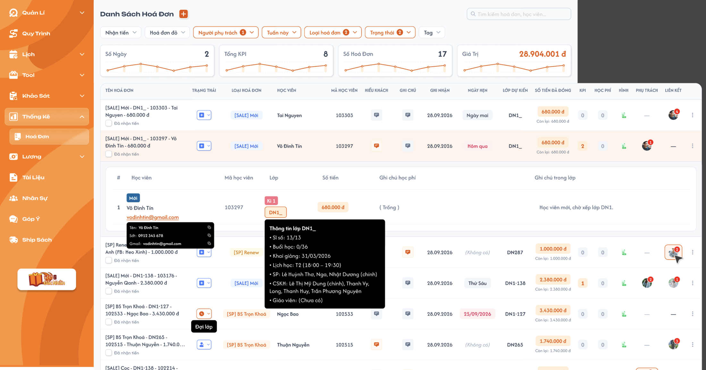
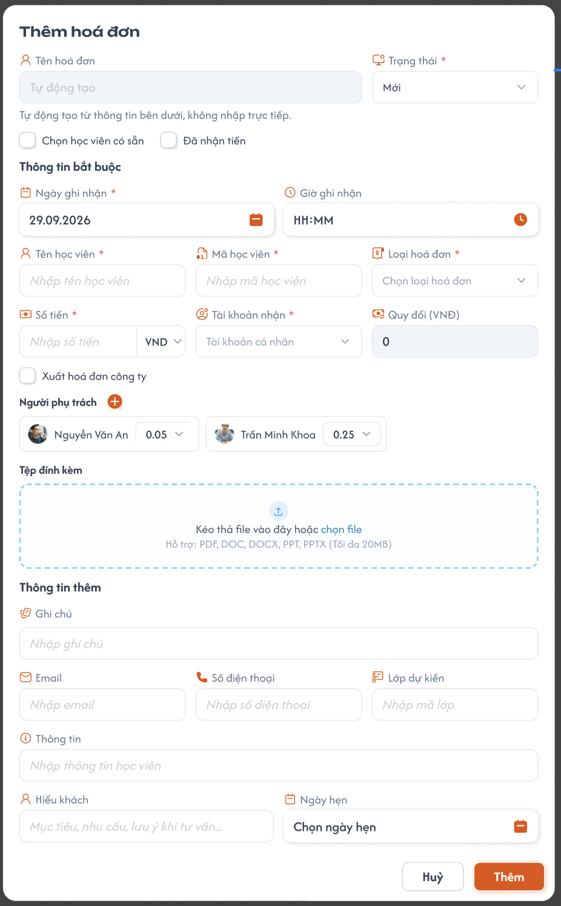
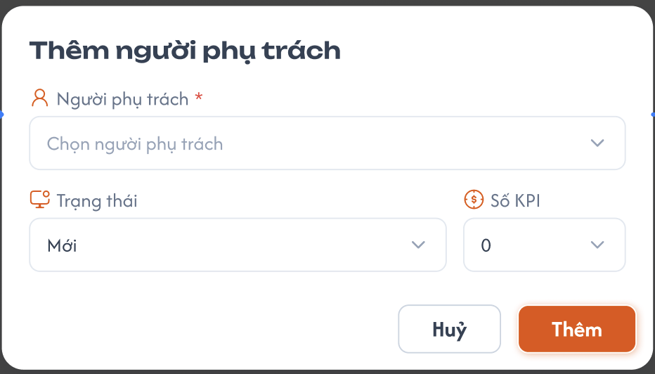
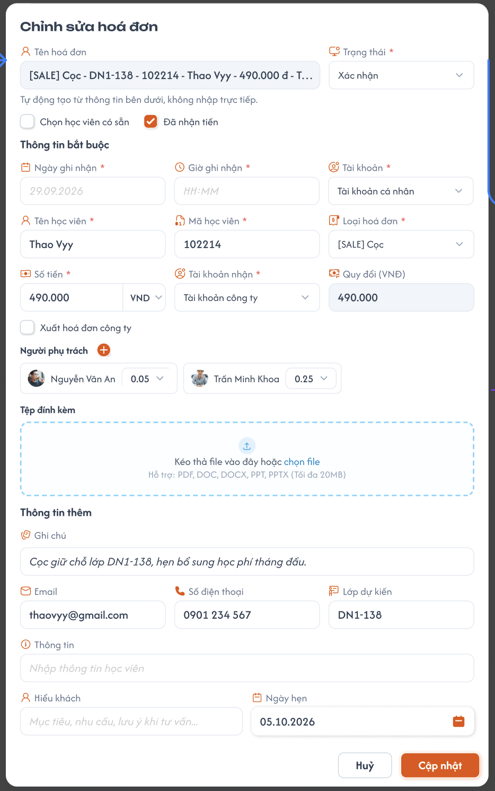
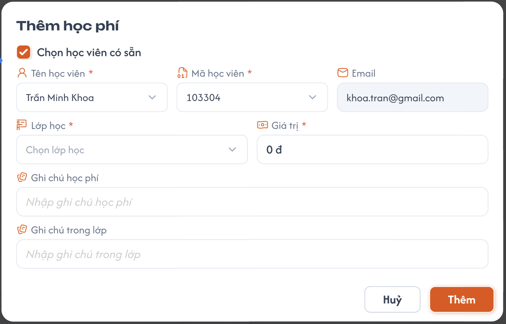

# Hoá Đơn

## 1. UI

### Trang 1: Trang 1: Danh Sách Hoá Đơn


**Mô tả:**
- Quản lý hoá đơn của học viên (cọc, đóng tiền, hẹn chuyển khoản...): thêm / sửa / copy / xoá hoá đơn, xem học phí của từng hoá đơn, thêm học phí, lọc và tìm kiếm. Dữ liệu đồng bộ với CG.

**Điểm cần lưu ý:**
- Nút **+** cạnh tiêu đề "Danh Sách Hoá Đơn" mở popup Thêm hoá đơn.
- **Tìm kiếm:** theo hoá đơn, học viên.
- Danh sách có bộ lọc `Trung tâm` nằm cùng hàng với các bộ lọc khác, cho chọn một hoặc nhiều trung tâm; khi chọn thì danh sách, tổng số và phân trang chỉ tính dữ liệu của các trung tâm đã chọn, kết hợp `AND` với các bộ lọc khác. Không chọn thì hiển thị dữ liệu của mọi trung tâm. Role Admin không dùng ô chọn trung tâm trên header.
- **Bộ lọc** (giá trị đang chọn hiển thị màu cam, bộ lọc chọn nhiều hiển thị số lượng đã chọn):

  | Bộ lọc | Cách chọn | Giá trị |
  |---|---|---|
  | Trung tâm | Chọn nhiều | Danh sách trung tâm |
  | Nhận tiền | Chọn 1 | Đã nhận tiền, Chưa nhận tiền |
  | Hoá đơn đỏ | Chọn 1 | Đã tạo (đã tick "Xuất hoá đơn công ty"), Chưa có (chưa tick) |
  | Người phụ trách | Chọn nhiều | Danh sách người phụ trách |
  | Thời gian (nhãn hiển thị giá trị đang chọn, vd "Hôm nay") | Chọn 1 | Tới hạn, Hôm nay, Hôm qua, Hôm nay và hôm qua, Tuần này, Tuần trước, Tháng này, Tháng trước, 3 tháng trước, Năm nay, Năm trước, Tuỳ chọn |
  | Loại hoá đơn | Chọn nhiều | 14 loại (bên dưới) |
  | Trạng thái | Chọn nhiều | Mới, Xác nhận, Đợi lớp, Học trước, Dời lịch, Hoàn tiền, Huỷ đơn, Hỗ trợ sau chốt |
  | Tag | Chọn nhiều | Các tag được gắn cho hoá đơn (lấy từ danh sách tag, không cố định) |

  - **14 loại hoá đơn** (đúng thứ tự hiển thị trong dropdown): [SALE] Mới, [SALE] Cọc, [SALE] BS Đủ Kỳ, [SALE] BS Trọn Khoá, [SALE] Cọc Giữ Chỗ, [SALE] Resale, [SP] Upsale, [SP] Renew, [SP] Resale, [SP] BS Trọn Khoá, [SP] BS Đủ Kỳ, Bán Ứng Dụng, Hoàn tiền, [SP] Cọc Học Tiếp.
  - Mỗi loại hoá đơn có **1 màu cố định** (hiển thị ở cột Loại hoá đơn và trong bộ lọc), xem màu ở Figma.
  - Bộ lọc Thời gian áp dụng cho **Ngày ghi nhận**, mặc định là **Hôm nay**. Option **Tới hạn** = Ngày ghi nhận từ hôm nay trở về trước. "Tuỳ chọn" cho chọn khoảng ngày.
  - **Bộ lọc lưu riêng theo từng user:** mỗi user chọn bộ lọc của mình và chỉ thấy bộ lọc của mình (vd user 1 chọn Hôm qua + loại [SALE] Mới, user 2 chọn Hôm nay thì mỗi người thấy kết quả theo lựa chọn của mình).
- **Thẻ thống kê** phía trên bảng: Số ngày, Tổng KPI, Số hoá đơn, Giá trị (kèm biểu đồ đường nhỏ). Giá trị các thẻ **thay đổi theo bộ lọc** hiện tại của danh sách. **Số ngày** = số ngày của khoảng thời gian đang lọc (vd Hôm nay = 1).
- **Cột Tên hoá đơn:**
  - Tên tự động tạo theo rule (REQ01), kèm dropdown Trạng thái dạng icon (mỗi trạng thái 1 icon, hover hiển thị tên trạng thái, vd "Đợi lớp"), và checkbox **"Đã nhận tiền"** bên dưới.
  - **Bấm vào item hoá đơn → xổ xuống (dropdown) danh sách học phí của hoá đơn đó.** Popup Chỉnh sửa **chỉ mở từ menu ba chấm**, không mở khi bấm vào item.
- **Phần học phí xổ xuống:** bảng gồm #, Học viên (kèm email), Mã học viên, Lớp, Số tiền, Ghi chú học phí, Ghi chú trong lớp.
  - Hover **Học viên**: tooltip Tên, SĐT, Email, mỗi dòng có icon copy.
  - Hover **Lớp**: tooltip "Thông tin lớp" (Sĩ số, Buổi học, Khai giảng, Lịch học, SP, CSKH, Giáo viên).
- **Cột Học phí** hiển thị **số lượng học phí** của hoá đơn, phải khớp số dòng trong phần học phí xổ xuống (hiện lỗi hiển thị 0 trong khi hoá đơn đã có 1 học phí, cần sửa thành 1).
- **Cột KPI:** **tổng KPI** của các người phụ trách trong hoá đơn (REQ08).
- **Cột Hình:** tệp đính kèm của hoá đơn.
- **Cột Ngày hẹn:** hiển thị nhãn tương đối (Hôm nay, Ngày mai, Hôm qua, Thứ ...) hoặc ngày cụ thể; quá hạn hiển thị màu đỏ; không có ngày hẹn hiển thị "(Không có)".
- **Cột Số tiền đã đóng:** hiển thị số tiền đã đóng và "Còn lại: ...".
  - Số tiền đã đóng = số tiền khi làm hoá đơn bên CG.
  - Còn lại = Số tiền đã đóng − tổng Giá trị các học phí đã thêm.
- **Cột Ghi chú, Hiểu khách:** icon, hover xem nội dung (icon màu cam khi có nội dung, xám khi không có).
- **Cột Phụ trách:** avatar người phụ trách kèm số lượng (khi có nhiều người), hover hiển thị danh sách tên.
- **Cột Liên kết:** học viên đã liên kết hoá đơn, kèm số lượng, hover hiển thị danh sách học viên (Tên, Email, SĐT có icon copy).
- Nút **ba chấm** mở menu: Thêm học phí, Chỉnh sửa, Copy, Lịch sử hành động, Xuất hoá đơn, Xoá hoá đơn. **Hiện chỉ làm 4 mục:** Thêm học phí, Chỉnh sửa, Copy, Xoá hoá đơn. **Lịch sử hành động** và **Xuất hoá đơn** hiển thị nhưng **disable**.

### Trang 2: Trang 2: Popup Thêm hoá đơn / Chỉnh sửa hoá đơn




**Mô tả:**
- Nhập mới hoặc chỉnh sửa 1 hoá đơn. Popup Chỉnh sửa dùng lại form của popup Thêm, tiêu đề đổi thành "Chỉnh sửa hoá đơn", nút "Thêm" đổi thành "Cập nhật", điền sẵn dữ liệu của hoá đơn.

**Điểm cần lưu ý:**
- **Tên hoá đơn:** chỉ đọc, tự động tạo theo rule (REQ01), cập nhật ngay khi các thành phần thay đổi.
- Trường bắt buộc (dấu *): Trung tâm, Trạng thái, Ngày ghi nhận, Tên học viên, Mã học viên, Loại hoá đơn, Số tiền, Tài khoản nhận, và Quy đổi (VND) khi đơn vị khác VND.
- **Giá trị mặc định:** Trạng thái = Mới, Ngày ghi nhận = ngày hôm nay, Quy đổi (VND) = 0.
- Checkbox **"Chọn học viên có sẵn"** (rule giống Ship Sách):
  - Chưa tick: Tên học viên và Mã học viên nhập tay.
  - Tick: Tên học viên và Mã học viên chuyển thành dropdown, chọn Tên thì Mã tự điền theo, chọn Mã thì Tên tự điền theo (đồng bộ 2 chiều).
- Checkbox **"Đã nhận tiền"**: cùng dữ liệu với checkbox "Đã nhận tiền" ở danh sách.
- **Số tiền:** nhập số + chọn đơn vị tiền tệ (VND, USD, EUR, JPY, CNY, KRW, GBP; mặc định VND).
- **Quy đổi (VND):** nếu đơn vị là VND thì tự điền bằng Số tiền nhưng **vẫn cho sửa**; nếu khác VND thì **không tự quy đổi**, người dùng **bắt buộc tự nhập** giá trị quy đổi.
- **Tài khoản nhận:** Tài khoản cá nhân, Tài khoản công ty, Tiền mặt, Khác.
- Checkbox **"Xuất hoá đơn công ty"**: là cơ sở cho bộ lọc Hoá đơn đỏ (tick = Đã tạo, không tick = Chưa có).
- **Người phụ trách:**
  - Popup **Thêm hoá đơn**: hiển thị avatar những người đã chọn, nút **+** mở popup **Thêm người phụ trách**.
  - Popup **Chỉnh sửa hoá đơn**: hiển thị từng người phụ trách, **KPI nằm cạnh tên và chỉnh sửa được**.
  - Popup **Thêm người phụ trách** gồm: **Người phụ trách** (chọn), **Trạng thái** (Mới, Đã xác nhận, Đã huỷ, Đã xoá; chỉ để ghi nhận, không ảnh hưởng hiển thị / KPI), **Số KPI** (chọn từ **-10 đến 10**, mỗi bước **0.05**: 0, 0.05, 0.1, ...).
- **Tệp đính kèm:** kéo thả hoặc chọn file, hỗ trợ PDF, DOC, DOCX, PPT, PPTX, tối đa 20MB. Hiển thị ở cột Hình của danh sách.
- Nhóm "Thông tin thêm" (không bắt buộc): Ghi chú, Email, Số điện thoại, Lớp dự kiến (nhập mã lớp), Thông tin, Hiểu khách, Ngày hẹn. **Giờ ghi nhận** (HH:MM) không bắt buộc.

### Trang 3: Trang 3: Popup Chọn học viên liên kết hoá đơn


**Mô tả:**
- Bước đầu khi bấm "Thêm học phí": chọn học viên đã liên kết với hoá đơn để thêm học phí cho học viên đó.

**Điểm cần lưu ý:**
- Hiển thị danh sách học viên **đã liên kết** hoá đơn (cột Liên kết).
- Có nút **Thêm học viên**: bấm vào sẽ mở **popup Thêm học phí ở chế độ không tick "Chọn học viên có sẵn"** (nhập Tên, Email và chọn Level, xem Trang 4). Học viên mới được tạo và liên kết vào hoá đơn.
- Chọn 1 học viên trong danh sách → mở popup Thêm học phí (Trang 4) với học viên đó.

### Trang 4: Trang 4: Popup Thêm học phí



**Mô tả:**
- Tạo 1 khoản học phí thuộc hoá đơn đang chọn, cho 1 học viên và 1 lớp.

**Điểm cần lưu ý:**
- Trường bắt buộc: Tên học viên, Mã học viên (khi tick), Level (khi không tick), Lớp học, Giá trị.
- Checkbox **"Chọn học viên có sẵn"**:
  - **Tick:** Tên học viên và Mã học viên là dropdown (đồng bộ 2 chiều như Ship Sách), **Email chỉ đọc** tự điền theo học viên.
  - **Bỏ tick:** nhập tay **Tên học viên** và **Email** của học viên mới, **không còn trường Mã học viên**, **thêm trường Level** (dropdown số tự nhiên từ 1 đến 9) để hệ thống tự tạo mã học viên.
- **Mã học viên tự tạo:** Level + 5 chữ số, vd Level 3 → `300001`. Mã không được trùng, nếu trùng thì tự tăng lên (300002, 300003...). Popup này cũng là popup dùng khi bấm "Thêm học viên" ở Trang 3.
- **Lớp học:** dropdown chọn lớp. **Giá trị:** số tiền học phí, mặc định 0 đ, **không được lớn hơn "Còn lại"** của hoá đơn.
- **Ghi chú học phí**, **Ghi chú trong lớp:** không bắt buộc, hiển thị lại ở phần học phí xổ xuống của hoá đơn.

---

---

## 2. Yêu cầu

### 2.1. Flow chính

**Flow 1: Thêm hoá đơn**

```
Bấm "+" → Popup Thêm hoá đơn (Trạng thái = Mới, Ngày ghi nhận = hôm nay)
        → Nhập thông tin (thêm người phụ trách qua popup nếu cần)
        → Tên hoá đơn tự động tạo
        → Bấm "Thêm" → FE validate → BE tạo hoá đơn → Đóng popup → Danh sách cập nhật
```

**Flow 2: Đồng bộ với CG**

```
Tạo hoá đơn bên CG → Đồng bộ sang ICS → Hoá đơn hiển thị trong danh sách ICS
Tạo hoá đơn bên ICS → Đồng bộ sang CG
Bên CG: không sửa / xoá hoá đơn, chỉ sửa KPI
Bên ICS: chỉnh sửa đầy đủ (kể cả hoá đơn có nguồn từ CG)
Học phí: chỉ thêm được bên ICS
Cùng sửa 1 hoá đơn ở 2 bên → bên lưu trước được ưu tiên
        → Bên lưu sau nhận thông báo "đã có dữ liệu mới, vui lòng reload trang"
```

**Flow 3: Chọn học viên có sẵn khi tạo hoá đơn**

```
Tick "Chọn học viên có sẵn" → Tên (dropdown) + Mã học viên (dropdown)
        ├─ Chọn Tên → Mã học viên tự điền
        └─ Chọn Mã học viên → Tên tự điền
```

**Flow 4: Chỉnh sửa hoá đơn**

```
Ba chấm > Chỉnh sửa → Popup Chỉnh sửa (điền sẵn dữ liệu, KPI người phụ trách sửa được)
        → Sửa thông tin → Bấm "Cập nhật" → FE validate → BE lưu
        → Đóng popup → Danh sách cập nhật, tên hoá đơn tạo lại theo rule
```

**Flow 5: Xem học phí của hoá đơn**

```
Bấm vào item hoá đơn → Xổ xuống phần học phí của hoá đơn đó
        → Hover Học viên / Lớp xem tooltip thông tin
        → Bấm lại → Thu gọn
```

**Flow 6: Thêm học phí**

```
Ba chấm > Thêm học phí → Popup chọn học viên đã liên kết hoá đơn
        ├─ Bấm "Thêm học viên" → Popup Thêm học phí (không tick "Chọn học viên có sẵn")
        │       → Nhập Tên, Email, chọn Level → Hệ thống tự tạo mã học viên
        │       → Học viên mới được liên kết vào hoá đơn
        └─ Chọn học viên đã liên kết → Popup Thêm học phí (tick "Chọn học viên có sẵn")
                ├─ Tick → Tên / Mã (dropdown), Email tự điền
                └─ Bỏ tick → Nhập Tên + Email + Level (không có Mã học viên)
        → Chọn Lớp học, nhập Giá trị (không vượt "Còn lại"), ghi chú → Bấm "Thêm" → FE validate → BE tạo học phí
        → Đóng popup → Phần học phí, cột Học phí, "Còn lại" cập nhật
```

**Flow 7: Copy tên hoá đơn**

```
Ba chấm > Copy → FE copy tên hoá đơn vào clipboard → Thông báo đã copy
```

**Flow 8: Xoá hoá đơn**

```
Ba chấm > Xoá hoá đơn → Popup xác nhận xoá
        ├─ Xác nhận → BE xoá mềm và đồng bộ học phí/số dư mọi học viên liên kết
        │       → Khoản học phí của hoá đơn đã xoá không còn hiệu lực; tính lại từ dữ liệu còn hiệu lực
        │       → Hoá đơn biến mất, tải lại số liệu học viên và học phí theo lớp liên quan
        └─ Huỷ → Đóng popup, không thay đổi
```

**Flow 9: Lọc và tìm kiếm**

```
Vào màn hình → Áp dụng bộ lọc đã lưu của user (chưa có thì Thời gian = Hôm nay)
Chọn bộ lọc / nhập từ khoá → FE gọi API với điều kiện lọc → BE lưu bộ lọc theo user
        → Danh sách, phân trang và các thẻ thống kê cập nhật theo kết quả lọc
```

**Flow 10: Thêm người phụ trách và KPI**

```
Popup Thêm hoá đơn → Bấm "+" cạnh Người phụ trách → Popup Thêm người phụ trách
        → Chọn Người phụ trách, Trạng thái, Số KPI (-10 đến 10, bước 0.05) → Xác nhận
        → Avatar người phụ trách hiển thị trong popup hoá đơn
Popup Chỉnh sửa → Sửa KPI cạnh tên người phụ trách → "Cập nhật" → Cột KPI, thẻ Tổng KPI cập nhật
```

### 2.2. Ngoại lệ

- **EX01:** Bấm "Thêm" / "Cập nhật" khi thiếu trường bắt buộc → Báo lỗi tại trường thiếu, không lưu, popup không đóng.
- **EX02:** Bấm "Thêm" ở popup Thêm học phí khi chưa chọn Lớp học, chưa nhập Giá trị (hoặc chưa chọn Level khi không tick) → Báo lỗi, không tạo học phí.
- **EX03:** Hoá đơn chưa có học viên liên kết khi bấm "Thêm học phí" → Popup chọn học viên hiển thị danh sách rỗng, người dùng bấm "Thêm học viên" để tiếp tục.
- **EX04:** Bỏ tick "Chọn học viên có sẵn" ở Thêm học phí, nhập Email sai định dạng → Báo lỗi định dạng email, không lưu.
- **EX05:** Tệp đính kèm sai định dạng (ngoài PDF, DOC, DOCX, PPT, PPTX) hoặc vượt 20MB → Từ chối file, báo lỗi, không đính kèm.
- **EX06:** Thêm / sửa / xoá / thêm học phí thất bại (lỗi hệ thống hoặc đồng bộ CG) → Báo lỗi, giữ nguyên dữ liệu trước đó.
- **EX07:** Mã học viên tự tạo bị trùng → Hệ thống tự tăng số lên đến khi không trùng.
- **EX08:** Hoá đơn (vd KPI) bị sửa đồng thời ở ICS và CG → Giữ dữ liệu của bên lưu trước, bên lưu sau không ghi đè và nhận thông báo "đã có dữ liệu mới, vui lòng reload trang".
- **EX09:** Giá trị học phí lớn hơn "Còn lại" của hoá đơn → Báo lỗi, không tạo học phí (Còn lại không được âm).

### 2.3. Yêu cầu khác

| Mã | Tên yêu cầu | Mô tả |
|---|---|---|
| REQ01 | Tên hoá đơn tự động | Tên tạo theo rule: `[Loại hoá đơn] - [Lớp dự kiến] - [Mã học viên] - [Tên học viên] - [Quy đổi (VND)] - [Tài khoản nhận]` (vd: `[SALE] Mới - DN1_ - 103303 - Tai Nguyen - 680.000 đ - ...`). Không nhập trực tiếp. Tự cập nhật khi một trong các thành phần đổi. **Thành phần nào trống thì bỏ thành phần đó** (kèm dấu phân cách của nó). |
| REQ02 | Đồng bộ Tên - Mã học viên | Khi tick "Chọn học viên có sẵn" (popup hoá đơn và popup học phí), chọn Tên hoặc Mã thì trường còn lại tự điền theo, giống Ship Sách. |
| REQ03 | Đồng bộ với CG | Hoá đơn thêm bên CG hiển thị bên ICS và ngược lại. Bên CG không được sửa / xoá hoá đơn, chỉ được sửa KPI. Bên ICS chỉnh sửa đầy đủ. Học phí chỉ thêm được bên ICS. Khi 2 bên cùng sửa thì bên lưu trước được ưu tiên, bên lưu sau nhận thông báo "đã có dữ liệu mới, vui lòng reload trang". |
| REQ04 | Cột Học phí | Cột Học phí = số lượng học phí của hoá đơn, phải khớp số dòng ở phần học phí xổ xuống (sửa lỗi đang hiển thị 0 khi thực tế là 1). |
| REQ05 | Menu ba chấm | Giai đoạn này chỉ làm: Thêm học phí, Chỉnh sửa, Copy, Xoá hoá đơn. Lịch sử hành động, Xuất hoá đơn hiển thị nhưng disable. |
| REQ06 | Copy | Copy chỉ copy **tên hoá đơn** vào clipboard, không tạo hoá đơn mới. |
| REQ07 | Xoá mềm có xác nhận và đồng bộ học phí | Xoá hoá đơn phải xác nhận và là xoá mềm. Đồng bộ các khoản học phí, số dư của tất cả học viên liên kết và học phí theo lớp liên quan; học phí thuộc hoá đơn đã xoá không còn hiệu lực. Tính lại số liệu từ hoá đơn/học phí còn hiệu lực và tải lại các màn liên quan. Chỉ báo thành công khi đồng bộ hoàn tất; Huỷ/lỗi giữ nguyên toàn bộ, không cập nhật dở dang hoặc tự tạo giao dịch hoàn tiền. |
| REQ08 | KPI người phụ trách | Mỗi người phụ trách có Trạng thái (Mới, Đã xác nhận, Đã huỷ, Đã xoá; chỉ ghi nhận, không ảnh hưởng hiển thị / KPI) và Số KPI (từ -10 đến 10, bước 0.05). Thêm qua popup Thêm người phụ trách; trong popup Chỉnh sửa, KPI cạnh tên người phụ trách sửa trực tiếp được. Cột KPI = tổng KPI các người phụ trách; thẻ Tổng KPI lấy từ dữ liệu này. |
| REQ09 | Thêm học phí 2 bước | Bấm Thêm học phí → popup chọn học viên đã liên kết hoá đơn (có nút Thêm học viên) → popup Thêm học phí. |
| REQ10 | Học viên mới và mã tự tạo | Khi không tick "Chọn học viên có sẵn" (kể cả khi vào từ nút Thêm học viên ở popup chọn học viên liên kết): nhập Tên, Email, chọn Level (số tự nhiên 1-9), ẩn trường Mã học viên. Mã = Level + 5 chữ số (vd Level 3 → 300001), không trùng, trùng thì tự tăng. Học viên mới được liên kết vào hoá đơn. |
| REQ11 | Màu loại hoá đơn | 14 loại hoá đơn, mỗi loại 1 màu cố định lấy theo Figma. |
| REQ12 | Bộ lọc theo user | Bộ lọc (Nhận tiền, Hoá đơn đỏ, Người phụ trách, Thời gian, Loại hoá đơn, Trạng thái, Tag) lưu riêng theo từng user. Mặc định Thời gian = Hôm nay áp dụng cho Ngày ghi nhận; Tới hạn = từ hôm nay trở về trước. Các thẻ thống kê đổi theo bộ lọc (Số ngày = số ngày của khoảng lọc). |
| REQ13 | Tiền tệ, quy đổi | Đơn vị: VND, USD, EUR, JPY, CNY, KRW, GBP. VND thì Quy đổi tự điền bằng Số tiền nhưng vẫn sửa được; khác VND thì không tự quy đổi, bắt buộc nhập tay Quy đổi. |
| REQ14 | Tài khoản nhận | Gồm: Tài khoản cá nhân, Tài khoản công ty, Tiền mặt, Khác. |
| REQ15 | Số tiền đã đóng / Còn lại | Số tiền đã đóng = số tiền làm hoá đơn bên CG. Còn lại = Số tiền đã đóng − tổng học phí đã thêm. **Còn lại không được âm:** Giá trị học phí không được vượt Còn lại (vd Còn lại 500.000 đ thì học phí tối đa 500.000 đ; phần còn thiếu user tự tạo ở hoá đơn khác). |
| REQ16 | Hoá đơn đỏ | Bộ lọc Hoá đơn đỏ dựa vào checkbox "Xuất hoá đơn công ty": tick = Đã tạo, không tick = Chưa có. |
| REQ17 | Tệp đính kèm | Hỗ trợ PDF, DOC, DOCX, PPT, PPTX, tối đa 20MB mỗi file; hiển thị ở cột Hình. |
| REQ18 | Trung tâm | Danh sách có bộ lọc `Trung tâm` nằm cùng hàng với các bộ lọc khác, cho chọn một hoặc nhiều trung tâm; khi chọn thì danh sách, tổng số và phân trang chỉ tính dữ liệu của các trung tâm đã chọn, kết hợp `AND` với các bộ lọc khác. Không chọn thì hiển thị dữ liệu của mọi trung tâm. Role Admin không dùng ô chọn trung tâm trên header. Khi tạo mới bắt buộc chọn `Trung tâm`; bản ghi được lưu thuộc trung tâm đã chọn. Backend kiểm tra lại trung tâm khi lưu, không chỉ dựa vào UI. |

### 2.4. Ràng buộc

#### Quyền

| Role | Xem | Thêm / Sửa | Xoá | Thêm học phí | Copy |
|---|:---:|:---:|:---:|:---:|:---:|
| Admin | ✅ | ✅ | ✅ | ✅ | ✅ |

> Màn Hoá đơn thuộc role Admin.

#### Ràng buộc khác

- Popup Chỉnh sửa dùng chung form với popup Thêm và chỉ mở từ menu ba chấm.
- Tên hoá đơn không cho nhập tay.
- Xoá là xoá mềm.
- Tên và mã học viên khi chọn học viên có sẵn luôn khớp nhau.
- Bộ lọc Người phụ trách, Loại hoá đơn, Trạng thái, Tag cho chọn nhiều; Nhận tiền, Hoá đơn đỏ và Thời gian chọn 1 giá trị.
- Số KPI chỉ nhận giá trị từ -10 đến 10, bước 0.05.
- Mã học viên tự tạo phải duy nhất.
- Bên CG không được sửa / xoá hoá đơn, chỉ sửa KPI; bên ICS chỉnh sửa đầy đủ; học phí chỉ thêm bên ICS.
- Còn lại của hoá đơn không được âm.

---

---

## 3. Testcase

### Feature: Hoá Đơn

| Tên testcase | Priority | Scenario | Role | Pre-condition | Given/When/Then | Expected Result |
|---|---|---|---|---|---|---|
| Case 1: Thêm hoá đơn thành công | High · Smoke | Flow 1, REQ01, REQ13 | Admin | Đang ở màn Danh Sách Hoá Đơn | **Given:** Bấm "+"<br>**When:** Nhập đủ trường bắt buộc, bấm "Thêm"<br>**Then:** Hệ thống tạo hoá đơn | - Popup mặc định Trạng thái = Mới, Ngày ghi nhận = hôm nay<br>- Hoá đơn mới xuất hiện trong danh sách<br>- Tên hoá đơn tạo đúng rule, thành phần trống thì bị bỏ<br>- Đơn vị VND: Quy đổi tự điền = Số tiền và vẫn sửa được<br>- Đơn vị khác VND: bắt buộc nhập tay Quy đổi, thiếu thì báo lỗi |
| Case 2: Thêm hoá đơn thiếu trường bắt buộc | High | EX01 | Admin | Popup Thêm đang mở | **Given:** Bỏ trống 1 trường bắt buộc<br>**When:** Bấm "Thêm"<br>**Then:** Hệ thống kiểm tra | - Báo lỗi tại trường thiếu<br>- Không lưu, popup không đóng |
| Case 3: Chọn học viên có sẵn, đồng bộ Tên - Mã | High | Flow 3, REQ02 | Admin | Có danh sách học viên | **Given:** Tick "Chọn học viên có sẵn"<br>**When:** Chọn Tên rồi đổi sang chọn Mã học viên khác<br>**Then:** Hệ thống đồng bộ 2 dropdown | - Chọn Tên → Mã tự điền<br>- Chọn Mã → Tên tự điền |
| Case 4: Chỉnh sửa hoá đơn và KPI | High · Smoke | Flow 4, Flow 10, REQ08 | Admin | Có hoá đơn có người phụ trách | **Given:** Ba chấm > Chỉnh sửa, popup điền sẵn dữ liệu<br>**When:** Đổi Loại hoá đơn, sửa KPI cạnh tên người phụ trách, bấm "Cập nhật"<br>**Then:** Hệ thống lưu | - Danh sách hiển thị dữ liệu mới, tên hoá đơn tạo lại theo rule<br>- Cột KPI và thẻ Tổng KPI cập nhật<br>- Bấm vào item hoá đơn không mở popup Chỉnh sửa |
| Case 5: Xổ học phí và cột Học phí | High | Flow 5, REQ04 | Admin | Hoá đơn có 1 học phí | **Given:** Danh sách hoá đơn<br>**When:** Bấm vào item hoá đơn, hover Học viên / Lớp<br>**Then:** Quan sát phần xổ xuống và cột Học phí | - Xổ xuống bảng học phí đúng dữ liệu<br>- Cột Học phí = 1 (khớp số dòng)<br>- Tooltip học viên (Tên, SĐT, Email, icon copy), tooltip lớp hiển thị đúng |
| Case 6: Thêm học phí cho học viên đã liên kết | High | Flow 6, REQ09, REQ15, EX09 | Admin | Hoá đơn có ít nhất 1 học viên liên kết, Số tiền đã đóng 1.000.000 đ | **Given:** Ba chấm > Thêm học phí<br>**When:** Chọn học viên ở popup, chọn Lớp, nhập Giá trị, bấm "Thêm" (thử Giá trị hợp lệ, thiếu Lớp, và Giá trị lớn hơn Còn lại)<br>**Then:** Hệ thống kiểm tra và tạo học phí | - Hiện popup chọn học viên liên kết trước, sau đó mới hiện popup Thêm học phí<br>- Hợp lệ: học phí xuất hiện ở phần xổ xuống, cột Học phí tăng 1, Còn lại = Số tiền đã đóng − tổng học phí<br>- Thiếu Lớp / Giá trị: báo lỗi<br>- Giá trị > Còn lại: báo lỗi, không tạo (Còn lại không âm) |
| Case 7: Thêm học viên mới, mã tự tạo theo Level | High | Flow 6, REQ10, EX03, EX04, EX07 | Admin | Hoá đơn chưa có học viên liên kết hoặc muốn thêm mới | **Given:** Popup chọn học viên liên kết (danh sách rỗng hoặc có sẵn)<br>**When:** Bấm "Thêm học viên", nhập Tên, Email (thử sai rồi đúng), chọn Level (1-9, vd 3), Lớp, Giá trị, bấm "Thêm"<br>**Then:** Hệ thống tạo học viên và học phí | - Popup không có trường Mã học viên, có trường Level<br>- Email sai: báo lỗi, không lưu<br>- Mã = Level + 5 chữ số (vd 300001), trùng thì tự tăng (300002...)<br>- Học viên mới được liên kết vào hoá đơn |
| Case 8: Đồng bộ với CG | High | Flow 2, REQ03, EX08 | Admin | Có hoá đơn tạo bên CG | **Given:** Hoá đơn tạo bên CG<br>**When:** Kiểm tra bên ICS; sửa / xoá hoá đơn và sửa KPI ở bên CG; sửa cùng 1 hoá đơn đồng thời ở 2 bên<br>**Then:** Hệ thống đồng bộ | - Hoá đơn CG hiển thị bên ICS (và ngược lại)<br>- Bên CG không sửa / xoá được hoá đơn, chỉ sửa được KPI<br>- Bên ICS chỉnh sửa đầy đủ, học phí chỉ thêm được bên ICS<br>- Sửa đồng thời: giữ bản lưu trước, bên lưu sau nhận thông báo "đã có dữ liệu mới, vui lòng reload trang" |
| Case 9: Bộ lọc lưu theo user | High | Flow 9, REQ12, REQ16 | Admin (2 user) | Có nhiều hoá đơn nhiều loại, trạng thái, người phụ trách | **Given:** User 1 và user 2 cùng vào màn hình lần đầu<br>**When:** User 1 chọn Hôm qua + loại [SALE] Mới, user 2 giữ Hôm nay; sau đó reload; thử các bộ lọc Nhận tiền, Hoá đơn đỏ, Tag<br>**Then:** Quan sát danh sách và thẻ thống kê | - Mặc định Thời gian = Hôm nay (theo Ngày ghi nhận)<br>- Mỗi user thấy đúng bộ lọc của mình, giữ nguyên sau reload<br>- Hoá đơn đỏ: Đã tạo = đã tick Xuất hoá đơn công ty<br>- Thẻ thống kê đổi theo bộ lọc, bộ lọc chọn nhiều hiển thị số lượng |
| Case 10: Copy tên, xoá mềm hoá đơn và menu disable | High | Flow 7, Flow 8, REQ05, REQ06, REQ07 | Admin | Có ít nhất 1 hoá đơn | **Given:** Mở menu ba chấm<br>**When:** Bấm Copy, dán nội dung; bấm Xoá hoá đơn, ở popup bấm Huỷ rồi thử lại và bấm Xác nhận; bấm Lịch sử hành động / Xuất hoá đơn<br>**Then:** Hệ thống xử lý | - Clipboard là tên hoá đơn, không tạo hoá đơn mới<br>- Huỷ/lỗi: hoá đơn, học phí và số dư giữ nguyên; Xác nhận thành công: hoá đơn biến mất (xoá mềm), đồng bộ học phí và số dư mọi học viên liên kết<br>- Khoản học phí của hoá đơn đã xoá không còn hiệu lực; số liệu học viên/lớp liên quan tính lại từ dữ liệu còn hiệu lực<br>- Lịch sử hành động, Xuất hoá đơn hiển thị nhưng disable, không bấm được |
| Case 11: Lọc danh sách theo trung tâm | High | REQ18 | Admin | Có hoá đơn ở trung tâm A và trung tâm B | **Given:** bộ lọc `Trung tâm` chưa chọn giá trị nào<br>**When:** chọn trung tâm B ở bộ lọc `Trung tâm`, sau đó bỏ chọn<br>**Then:** danh sách chỉ hiển thị hoá đơn của trung tâm B | - Không lẫn dữ liệu của trung tâm A<br>- Tổng số và phân trang cập nhật theo trung tâm B<br>- Bỏ chọn thì hiển thị lại dữ liệu của mọi trung tâm |
| Case 12: Bắt buộc chọn trung tâm khi tạo | High | REQ18 | Admin | Popup/dòng tạo hoá đơn đang mở | **Given:** các field bắt buộc khác hợp lệ<br>**When:** bỏ trống `Trung tâm` rồi xác nhận; sau đó chọn trung tâm A và xác nhận<br>**Then:** thiếu Trung tâm thì không tạo; chọn A thì tạo thành công | - Báo lỗi tại field Trung tâm khi bỏ trống<br>- Hoá đơn mới thuộc trung tâm A; lọc trung tâm A thì thấy, lọc trung tâm B thì không thấy |

### Feature: Hoá Đơn
