c# Chi Tiết Học Phí

## 1. UI

### Trang 1: Item học phí (phần học phí xổ xuống của hoá đơn) và menu học viên
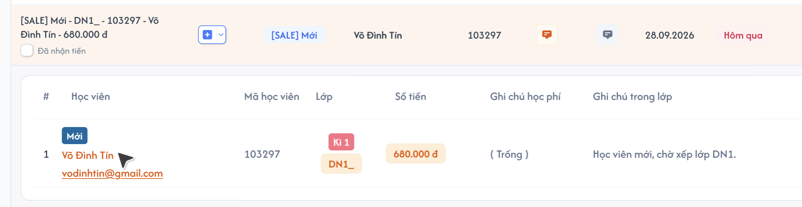
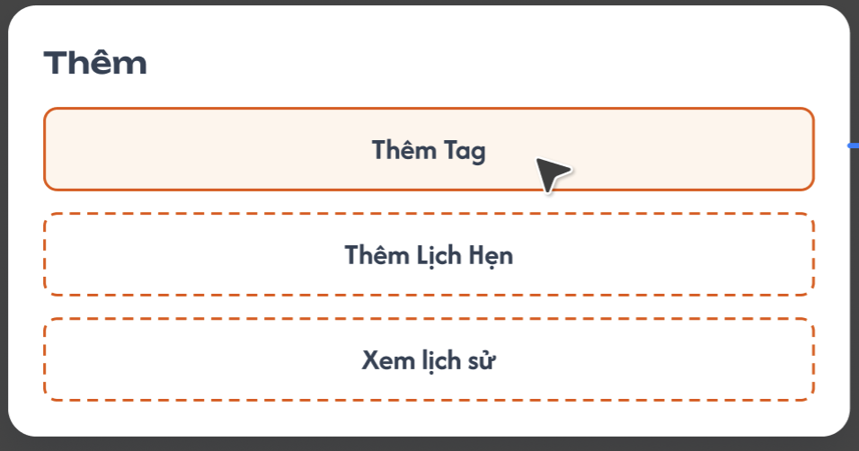

**Mô tả:**
- Mỗi dòng học phí trong phần xổ xuống của hoá đơn (xem `receipt.md`) có tên học viên bấm được. Bấm vào tên học viên để thêm tag, thêm lịch hẹn hoặc xem hồ sơ lịch sử của học viên đó.

**Điểm cần lưu ý:**
- Bấm vào **tên học viên** trong item học phí → hiện popup / menu gồm 3 option: **Thêm tag**, **Thêm lịch hẹn**, **Xem lịch sử**.
- **Tag** đã thêm hiển thị **phía trên tên học viên** trong item học phí (chính vùng bấm vào tên). Nhãn **Mới** cạnh tên học viên trong chi tiết hóa đơn là **tag** của item học phí.
- **Hình tròn số lượng lịch hẹn** hiển thị **phía trước tên học viên** khi học viên đã có lịch hẹn. Bấm vào hình tròn mở popup Danh sách lịch hẹn.

### Trang 2: Popup Thêm tag
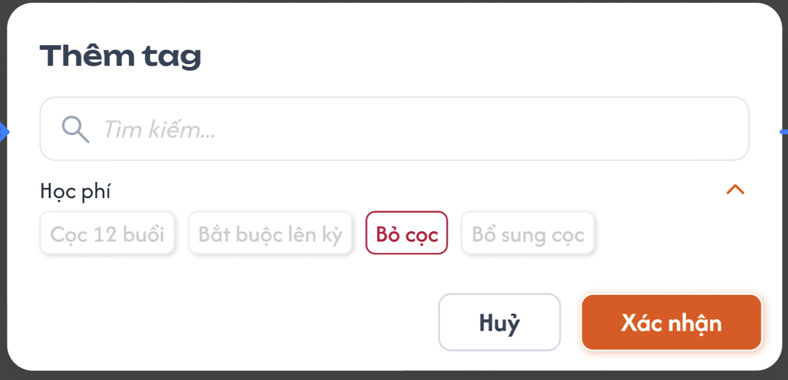
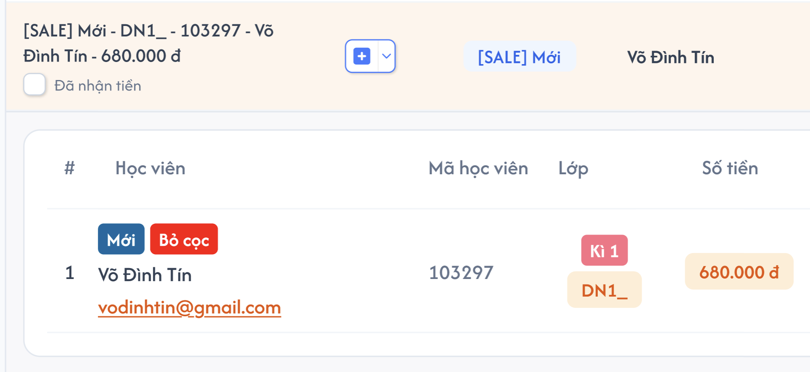

**Mô tả:**
- Chọn tag gắn cho **item học phí** (tag thuộc riêng item học phí đó, không gắn chung cho học viên).

**Điểm cần lưu ý:**
- Hiển thị **danh sách các tag**; tag lấy từ danh sách tag có sẵn (không cố định). **Cho chọn nhiều tag.**
- Các tag đã gắn cho item được **tick sẵn**. **Gỡ tag = bỏ chọn tag** cần gỡ trong danh sách này rồi xác nhận.
- Sau khi thêm, tag hiển thị phía trên tên học viên ở item học phí.

### Trang 3: Popup Thêm lịch hẹn / Chỉnh sửa lịch hẹn
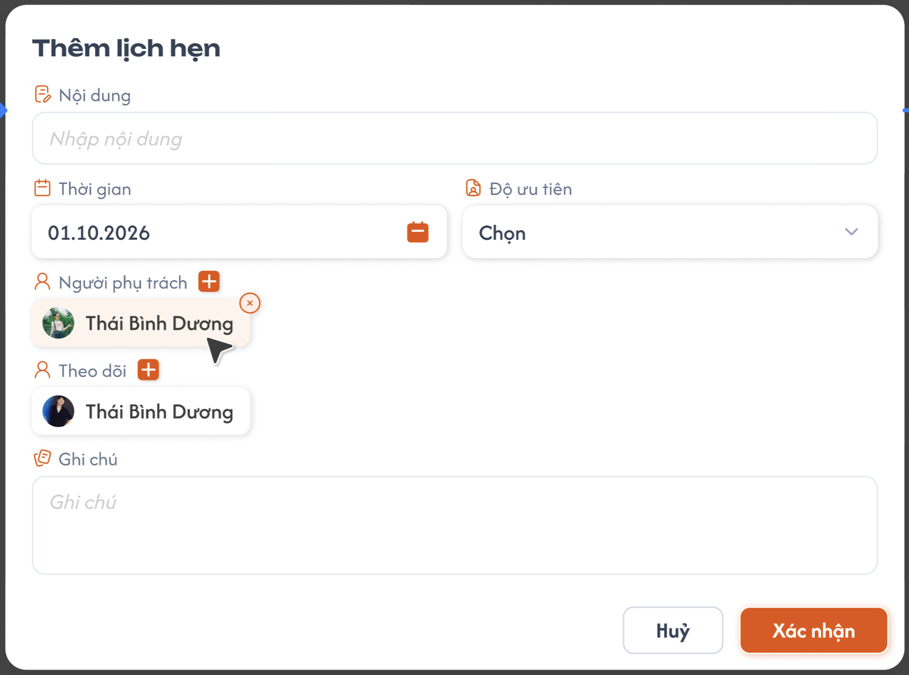
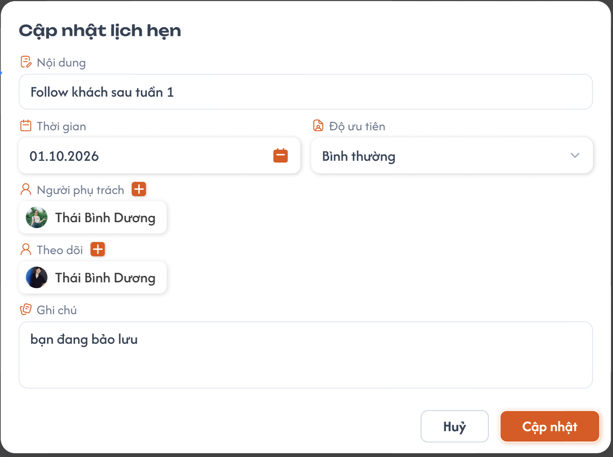
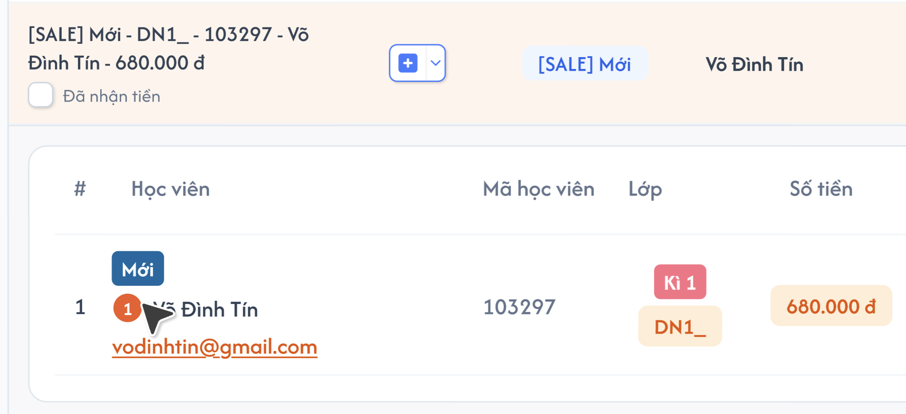

**Mô tả:**
- Tạo lịch hẹn cho học viên. Popup Chỉnh sửa lịch hẹn dùng lại form của popup Thêm, tiêu đề đổi thành "Cập nhật lịch hẹn", điền sẵn dữ liệu của lịch hẹn.

**Điểm cần lưu ý:**
- Trường: Nội dung, Thời gian, Độ ưu tiên, Người phụ trách, Theo dõi, Ghi chú. Nút Huỷ / Xác nhận.
- **Người phụ trách** và **Theo dõi**: nút **+** để thêm người; mỗi người hiển thị dạng chip (avatar + tên), người phụ trách có nút **×** để gỡ.
- **Thời gian** hiển thị dạng ngày (vd 01.10.2026) với icon lịch.
- **Nội dung:** nhập tự do, **bắt buộc**.
- **Thời gian:** chỉ chọn **ngày** (không có giờ), có giá trị mặc định (ngày hôm nay).
- **Độ ưu tiên lịch hẹn:** mặc định `Chọn`, user bắt buộc tự chọn trước khi lưu; bộ mức theo requirement Lịch hẹn học viên, không tự chọn Bình thường.
- **Người phụ trách** và **Theo dõi:** cho **chọn nhiều** người, **mặc định điền sẵn người đang đăng nhập**.
- **Ghi chú:** không bắt buộc.

### Trang 4: Popup Danh sách lịch hẹn
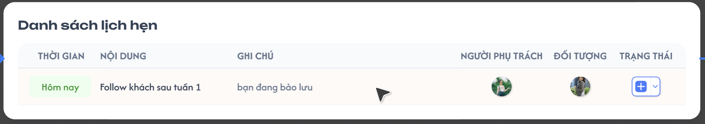

**Mô tả:**
- Danh sách các lịch hẹn của học viên, mở khi bấm hình tròn số lượng lịch hẹn trước tên học viên.

**Điểm cần lưu ý:**
- Bấm vào 1 lịch hẹn bất kỳ → mở popup **Chỉnh sửa lịch hẹn** (giống popup Thêm lịch hẹn, có dữ liệu của lịch hẹn đó).

### Trang 5: Popup Hồ sơ học viên - tab Lịch sử hoá đơn
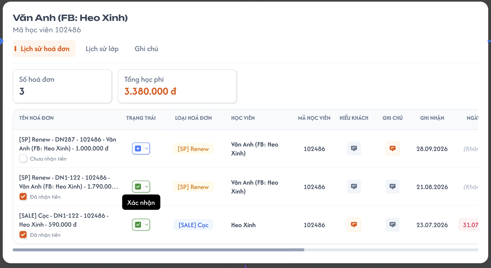
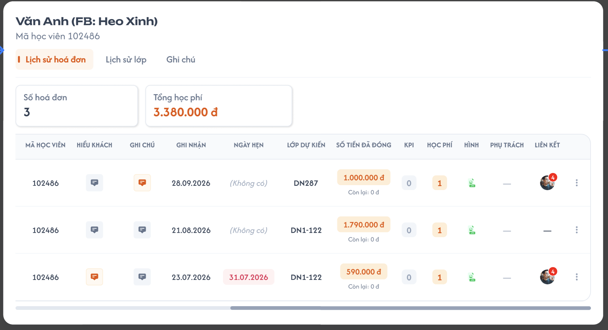
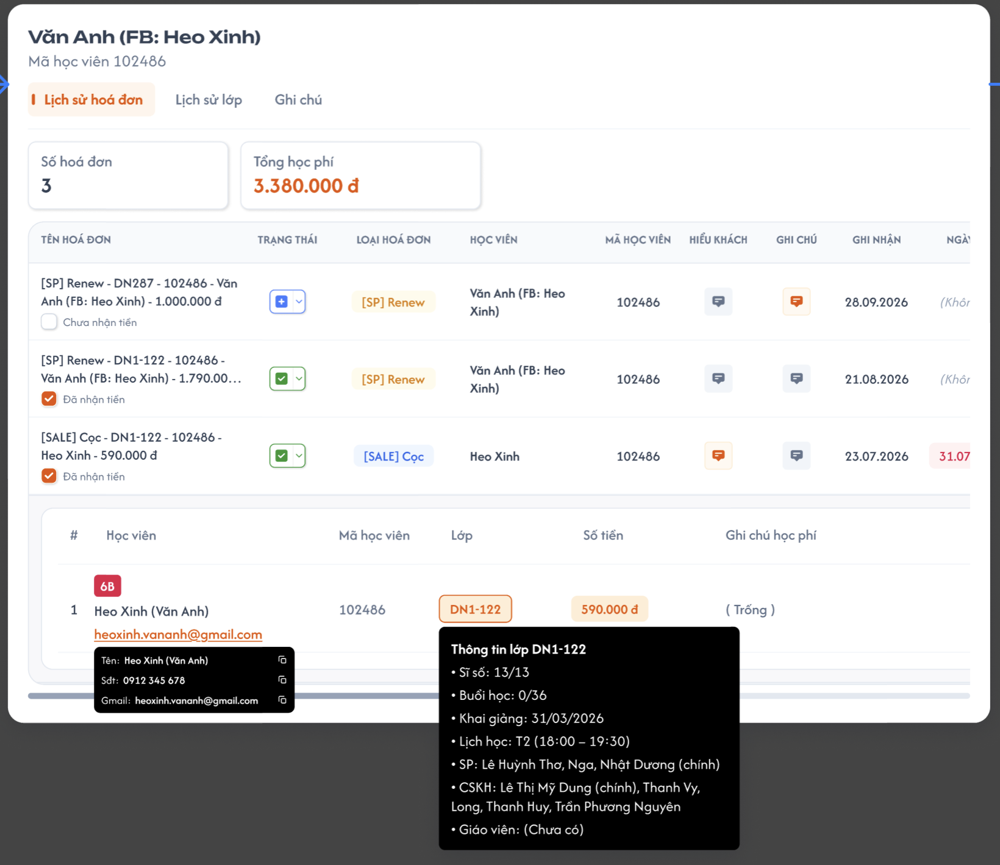

**Mô tả:**
- Mở khi bấm "Xem lịch sử". Hiển thị hồ sơ học viên gồm 3 tab: **Lịch sử hoá đơn** (mặc định), **Lịch sử lớp**, **Ghi chú**.

**Điểm cần lưu ý:**
- Tiêu đề: tên học viên, Mã học viên (ở tab Lịch sử lớp và Ghi chú có thêm "Lớp hiện tại ...").
- Tab **Lịch sử hoá đơn**:
  - Thẻ thống kê: **Số hoá đơn**, **Tổng học phí** (= tổng **Giá trị học phí của học viên đó**, không phải tổng Số tiền của hoá đơn).
  - Bảng hoá đơn cùng cột với màn Danh Sách Hoá Đơn (Tên hoá đơn, Trạng thái, Loại hoá đơn, Học viên, Mã học viên, Hiểu khách, Ghi chú, Ghi nhận, Ngày hẹn, Lớp dự kiến, Số tiền đã đóng, KPI, Học phí, Hình, Phụ trách, Liên kết, ba chấm).
  - **Chỉ hiển thị hoá đơn có chi tiết học phí của học viên đã chọn.**
  - **Bấm vào hoá đơn** → xổ xuống chi tiết học phí, giống phần học phí xổ xuống ở Danh Sách Hoá Đơn.
  - Bảng rộng nên **cuộn ngang** (các cột bên phải: Mã học viên ... Liên kết xem bằng cách cuộn ngang).
  - Menu **ba chấm** của mỗi hoá đơn gồm: **Thêm học phí**, **Chỉnh sửa**, **Copy**, **Lịch sử hành động**, **Xuất hoá đơn**, **Xoá hoá đơn**; thao tác theo [Hoá Đơn](../receipt/receipt.md). Lịch sử hành động và Xuất hoá đơn chưa làm nên disable; bốn mục còn lại hoạt động. **Không tạo hoá đơn mới trong lịch sử**; Copy chỉ sao chép tên vào clipboard. Phạm vi mới nhất tại [Quản lý học viên — tab Học phí](../../management_requirement/student_management/student_management_requirements.md#thao-tác-học-phí-và-hóa-đơn-hiện-có).

- **Xóa hóa đơn đồng bộ học phí:** sau xác nhận xóa mềm, các khoản học phí của hóa đơn đã xóa không còn hiệu lực; tính lại học phí, số dư của tất cả học viên liên kết và dữ liệu học phí theo lớp liên quan từ các hóa đơn/khoản học phí còn hiệu lực. Tải lại bảng/thẻ thống kê ở các màn liên quan. Hủy/lỗi giữ nguyên toàn bộ dữ liệu; không tự tạo giao dịch hoàn tiền.

### Trang 6: Popup Hồ sơ học viên - tab Lịch sử lớp
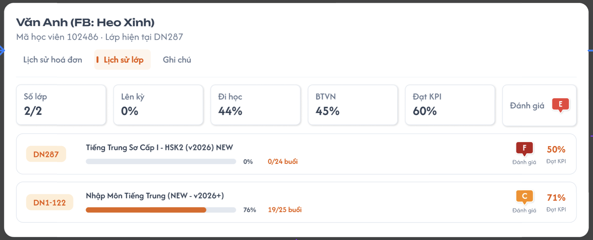

**Mô tả:**
- Tổng quan quá trình học của học viên qua các lớp.

**Điểm cần lưu ý:**
- Thẻ thống kê: **Số lớp** = số lớp chính thức / tổng số lớp trong lịch sử (vd 1/6); **Đi học** và **BTVN** = trung bình cộng tỷ lệ của học viên trong từng lớp đủ dữ liệu, mỗi lớp trọng số bằng nhau; làm tròn kết quả cuối **1 chữ số thập phân**. Đi học chỉ tính buổi đã điểm danh; BTVN chỉ tính bài đã nộp hoặc đã qua bài mới mà chưa nộp. Lớp chưa có mẫu số hợp lệ không tính vào trung bình tương ứng; 0% hợp lệ vẫn tính. **Lên kỳ** = trung bình getUpTerm của lớp chính thức đã Hoàn thành; **Đạt KPI** = trung bình getUpTerm của tất cả lớp chính thức. getUpTerm tính trên cả lớp theo trạng thái lớp, vòng % từng dòng dùng cùng giá trị; định dạng 2 chữ số có nghĩa theo ICS cũ. **Đánh giá** = đổi trung bình điểm scoreEvaluateClass của các lớp chính thức sang A–F; không lấy trung bình hạng chữ.
- Mỗi lớp 1 dòng: mã lớp, tên lớp, thanh tiến độ của **cả lớp** (% và số buổi cả lớp đã học/tổng số buổi), **Đánh giá** (hạng chữ cái) và **Đạt KPI** (%) của lớp đó.
- Các tỷ lệ Đi học/BTVN từng lớp lấy từ dữ liệu của học viên; tiến độ x/N Buổi lấy theo cả lớp; thẻ tổng hợp theo [Lịch sử lớp học viên](../../management_requirement/student_management/student_management_requirements.md#lịch-sử-lớp). Ba thẻ Lên kỳ/Đạt KPI/Đánh giá theo công thức ICS cũ đã chốt tại requirement học viên. Mũ xanh là trạng thái lớp Hoàn thành; badge Đánh giá theo getEvaluate(scoreEvaluateClass), vòng % theo getUpTerm của cả lớp. Không có lớp chính thức: Lên kỳ/Đạt KPI 0%, Đánh giá trống; không chia 0.
- **Bấm vào 1 lớp** → chuyển sang trang chi tiết lớp đó **nằm dưới popup**; khi tắt popup Hồ sơ học viên sẽ thấy trang chi tiết lớp.

### Trang 7: Popup Hồ sơ học viên - tab Ghi chú
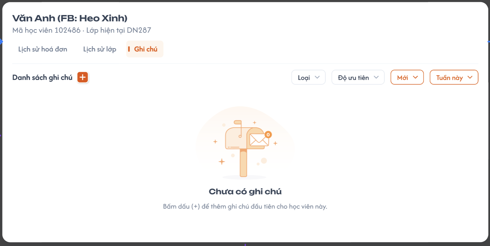
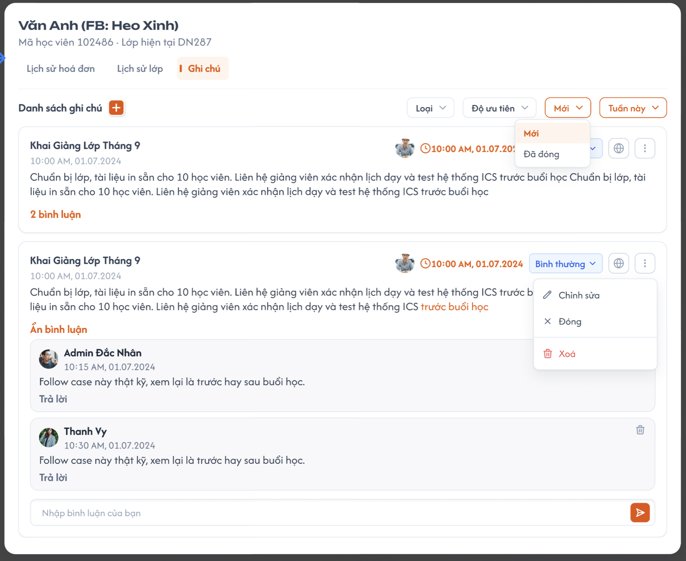

**Mô tả:**
- Danh sách ghi chú về học viên; có thể thêm ghi chú và bình luận trong từng ghi chú. Bộ lọc mặc định, metadata và quyền owner theo [Ghi chú học viên](../../management_requirement/student_management/student_management_requirements.md#ghi-chú--danh-sách-bình-luận-và-popup-thêm).

**Điểm cần lưu ý:**
- Nút **+** cạnh "Danh sách ghi chú" mở popup Thêm ghi chú.
- Bộ lọc: **Loại** (Công khai, Riêng tư), **Độ ưu tiên**, **Trạng thái ghi chú** (hiển thị nhãn "Mới": gồm **Mới** = ghi chú chưa đóng, **Đã đóng**), **Tuần này** (thời gian).
- Khi mở tab, mặc định Trạng thái = Mới, Thời gian = Tuần này; Loại/Độ ưu tiên chưa chọn và không giới hạn kết quả theo hai bộ lọc đó.
- Card hiển thị tiêu đề, thời gian tạo ghi chú, nội dung, Độ ưu tiên, icon loại và ba chấm. Avatar phía phải là tác giả bình luận gần nhất; thời gian cam là lúc tạo bình luận đó. Chưa có bình luận thì ẩn cả avatar/thời gian cam. Chỉ owner đổi Loại/Độ ưu tiên qua Chỉnh sửa. Metadata người tạo (avatar/tên/ngày tạo, Bạn khi chính mình tạo) nằm dưới tiêu đề, có nhãn Đã chỉnh sửa sau khi sửa. Badge ưu tiên/icon loại/menu dùng UI Ghi chú mới của lịch sử học viên.
  - **Icon quả địa cầu:** **sáng = Công khai, tối = Riêng tư**.
  - **Ba chấm:** menu của ghi chú gồm **Đóng ghi chú** (ghi chú đã đóng đổi thành **Mở lại ghi chú**), **Chỉnh sửa**, **Xoá**. **Chỉ người tạo ghi chú mới thao tác được.** Xoá phải qua **popup xác nhận**.
  - Ghi chú **Riêng tư** hoặc **Đã đóng** chỉ owner ghi chú (người tạo ghi chú) xem được, gồm cả bình luận; user khác không nhận dữ liệu kể cả gọi trực tiếp.
- **Bình luận:** link "n bình luận" / "Ẩn bình luận" để mở / ẩn danh sách bình luận. Mỗi bình luận hiển thị avatar, tên, thời gian, nội dung, theo card mới; ô bình luận là văn bản thuần, không có toolbar hoặc nút Trả lời riêng. Ô **"Nhập bình luận của bạn"** kèm nút gửi ở cuối danh sách bình luận.

### Trang 8: Popup Thêm ghi chú
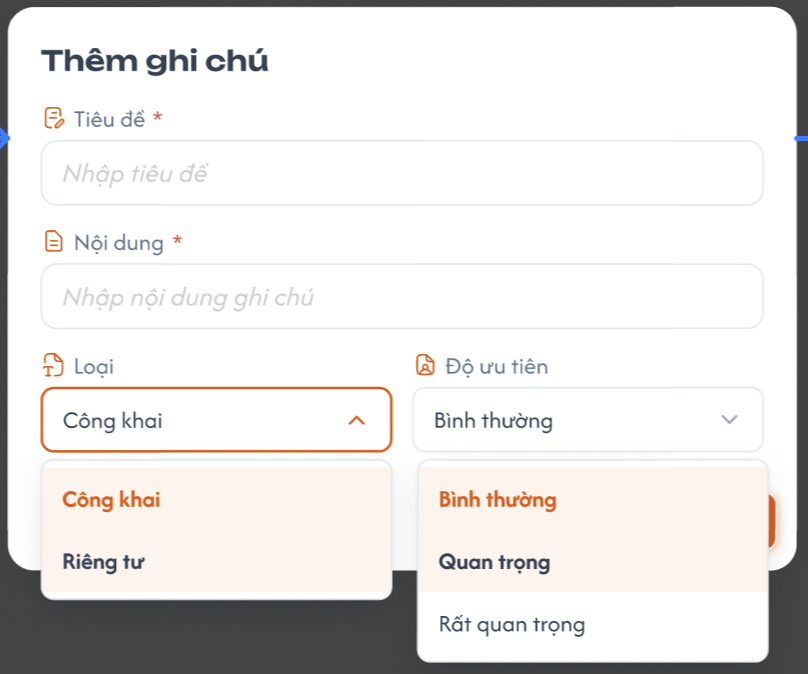

**Mô tả:**
- Tạo ghi chú mới cho học viên. Popup **Chỉnh sửa ghi chú** (từ ba chấm) dùng lại form này, điền sẵn dữ liệu của ghi chú.

**Điểm cần lưu ý:**
- Trường bắt buộc: **Tiêu đề**, **Nội dung**; không giới hạn độ dài. Ô Nội dung là văn bản thuần, không hỗ trợ định dạng chữ.
- **Loại:** Công khai (mặc định), Riêng tư (chỉ người tạo xem được).
- **Độ ưu tiên:** Bình thường (mặc định), Quan trọng, Rất quan trọng.

---

---

## 2. Yêu cầu

### 2.1. Flow chính

**Flow 1: Mở menu học viên**

```
Bấm tên học viên trong item học phí → Hiện menu: Thêm tag / Thêm lịch hẹn / Xem lịch sử
```

**Flow 2: Thêm tag**

```
Chọn "Thêm tag" → Popup danh sách tag (tag đã gắn được tick sẵn)
        ├─ Chọn thêm tag (chọn nhiều) → Xác nhận → BE lưu
        └─ Bỏ chọn tag cần gỡ → Xác nhận → BE lưu
        → Tag hiển thị phía trên tên học viên ở item học phí (cập nhật theo danh sách tag đã chọn)
```

**Flow 3: Thêm lịch hẹn**

```
Chọn "Thêm lịch hẹn" → Popup Thêm lịch hẹn → Nhập thông tin → Bấm "Xác nhận" → BE lưu
        → Hình tròn số lượng lịch hẹn hiển thị (hoặc tăng) trước tên học viên
```

**Flow 4: Xem và chỉnh sửa lịch hẹn**

```
Bấm hình tròn số lượng lịch hẹn → Popup Danh sách lịch hẹn
        → Bấm 1 lịch hẹn → Popup Chỉnh sửa lịch hẹn (điền sẵn dữ liệu)
        → Sửa → Bấm "Xác nhận" → BE lưu → Danh sách / số lượng cập nhật
```

**Flow 5: Xem lịch sử hoá đơn**

```
Chọn "Xem lịch sử" → Popup Hồ sơ học viên (tab Lịch sử hoá đơn mặc định)
        → FE gọi API lấy hoá đơn có học phí của học viên → Hiển thị thẻ Số hoá đơn, Tổng học phí + bảng
        → Bấm vào hoá đơn → Xổ xuống chi tiết học phí (giống Danh Sách Hoá Đơn)
```

**Flow 6: Xem lịch sử lớp**

```
Hồ sơ học viên → Chọn tab "Lịch sử lớp" → Hiển thị thẻ thống kê + danh sách lớp của học viên
        → Bấm vào 1 lớp → Chuyển đến trang chi tiết lớp (nằm dưới popup)
        → Tắt popup Hồ sơ học viên → Thấy trang chi tiết lớp
```

**Flow 7: Thêm ghi chú**

```
Hồ sơ học viên → Tab "Ghi chú" → Bấm "+" → Popup Thêm ghi chú
        → Nhập Tiêu đề, Nội dung, chọn Loại, Độ ưu tiên → Xác nhận → FE validate → BE lưu
        → Ghi chú mới xuất hiện trong danh sách
```

**Flow 8: Bình luận ghi chú**

```
Tab "Ghi chú" → Bấm "n bình luận" → Hiển thị danh sách bình luận
        ├─ Nhập bình luận → Bấm gửi → BE lưu → Bình luận mới xuất hiện, số bình luận tăng
        ├─ Làm mới → Tải lại bình luận/số bình luận/metadata gần nhất của đúng note, giữ bản nháp
        └─ Bấm icon xoá → Xoá bình luận
```

**Flow 9: Đóng ghi chú**

```
Tab "Ghi chú" → Ba chấm của ghi chú > Đóng ghi chú (chỉ người tạo ghi chú) → BE cập nhật trạng thái = Đã đóng
        → Ghi chú không còn ở lọc "Mới"; chỉ owner xem được ở lọc "Đã đóng", user khác không thấy ghi chú/bình luận
Ghi chú đã đóng → Ba chấm > Mở lại ghi chú → Trạng thái = Mới → Quay lại lọc "Mới"
```

**Flow 10: Chỉnh sửa / xoá ghi chú**

```
Ba chấm của ghi chú (chỉ người tạo ghi chú)
        ├─ Chỉnh sửa → Popup Chỉnh sửa ghi chú (điền sẵn dữ liệu) → Sửa → Xác nhận → BE lưu → Card cập nhật
        └─ Xoá → Popup xác nhận xoá
                ├─ Xác nhận → BE xoá mềm → Ghi chú biến mất khỏi danh sách
                └─ Huỷ → Đóng popup, không thay đổi
```

### 2.2. Ngoại lệ

- **EX01:** Bấm Xác nhận ở popup Thêm ghi chú khi thiếu Tiêu đề hoặc Nội dung → Báo lỗi bắt buộc nhập, không lưu, popup không đóng.
- **EX02:** Gửi bình luận rỗng → Không gửi.
- **EX03:** Học viên không có hoá đơn nào có học phí → Tab Lịch sử hoá đơn hiển thị Số hoá đơn = 0, Tổng học phí = 0 và bảng rỗng.
- **EX04:** Học viên chưa có lớp → Tab Lịch sử lớp hiển thị trạng thái rỗng, Số lớp = 0.
- **EX05:** Học viên chưa có lịch hẹn → Không hiển thị hình tròn số lượng lịch hẹn.
- **EX06:** Thêm / sửa / xoá thất bại (lỗi hệ thống) → Báo lỗi, giữ nguyên dữ liệu trước đó.
- **EX07:** Bấm Xác nhận ở popup Thêm lịch hẹn khi để trống Nội dung → Báo lỗi bắt buộc nhập, không lưu, popup không đóng.
- **EX08:** Ghi chú Riêng tư của user khác → Không hiển thị trong danh sách.
- **EX09:** User không phải người tạo ghi chú → Không đóng / mở lại / chỉnh sửa / xoá được ghi chú đó.

### 2.3. Yêu cầu khác

| Mã | Tên yêu cầu | Mô tả |
|---|---|---|
| REQ01 | Menu tên học viên | Bấm tên học viên trong item học phí hiện menu 3 option: Thêm tag, Thêm lịch hẹn, Xem lịch sử. |
| REQ02 | Hiển thị và gỡ tag | Tag thuộc riêng item học phí, cho chọn nhiều. Tag hiển thị phía trên tên học viên ở item học phí; nhãn Mới trong ảnh là tag. Gỡ tag bằng cách mở lại Thêm tag và bỏ chọn tag cần gỡ. Danh sách tag lấy từ danh sách tag có sẵn. |
| REQ03 | Hình tròn số lượng lịch hẹn | Hiển thị phía trước tên học viên, số = số lịch hẹn của học viên; tự cập nhật sau khi thêm / sửa. Bấm vào mở popup Danh sách lịch hẹn. |
| REQ04 | Chỉnh sửa lịch hẹn | Bấm lịch hẹn trong danh sách mở popup Chỉnh sửa, dùng chung form với Thêm lịch hẹn. |
| REQ05 | Lịch sử hoá đơn lọc theo học viên | Chỉ hiển thị hoá đơn có chi tiết học phí của học viên đã chọn. Bấm vào hoá đơn xổ xuống chi tiết học phí như Danh Sách Hoá Đơn. |
| REQ06 | Thẻ thống kê hồ sơ | Tab Lịch sử hoá đơn: Số hoá đơn, Tổng học phí (= tổng Giá trị học phí của học viên). Tab Lịch sử lớp: Số lớp = lớp chính thức/tổng lớp trong lịch sử; Đi học/BTVN = trung bình cộng tỷ lệ của học viên trong các lớp đủ dữ liệu, làm tròn kết quả cuối 1 chữ số thập phân; chỉ tính buổi đã điểm danh và bài đã nộp hoặc đã qua bài mới mà chưa nộp. Mẫu số 0 loại khỏi trung bình tương ứng, 0% hợp lệ vẫn tính. Lên kỳ = trung bình getUpTerm lớp chính thức Hoàn thành; Đạt KPI = trung bình getUpTerm tất cả lớp chính thức; định dạng 2 chữ số có nghĩa theo nguồn, không đếm lớp đạt ≥ 80%. Đánh giá = trung bình scoreEvaluateClass các lớp chính thức rồi đổi A–F. Mũ xanh là trạng thái lớp Hoàn thành; vòng % dòng lấy getUpTerm cả lớp. Tập lớp tính rỗng: Lên kỳ/Đạt KPI 0%, Đánh giá trống khi không có lớp chính thức. Tiến độ x/N Buổi theo cả lớp; đánh giá/KPI từng lớp theo dữ liệu nguồn. |
| REQ07 | Bảng cuộn ngang | Bảng ở tab Lịch sử hoá đơn cuộn ngang để xem đủ cột. |
| REQ08 | Ghi chú | Thêm ghi chú qua popup (Tiêu đề, Nội dung bắt buộc; Loại mặc định Công khai; Độ ưu tiên mặc định Bình thường). Chỉ owner đổi Loại/Độ ưu tiên qua Chỉnh sửa; trên card là badge ưu tiên và icon loại theo UI mới. Mở tab mặc định Mới + Tuần này; bộ lọc Loại/Độ ưu tiên chưa chọn. Tiêu đề/Nội dung không giới hạn độ dài; Nội dung thêm ghi chú là văn bản thuần. Avatar/timestamp cam lấy tác giả/ngày giờ tạo bình luận gần nhất, chưa có bình luận thì ẩn cả hai. Ba chấm gồm Đóng / Mở lại ghi chú, Chỉnh sửa (dùng chung form Thêm), Xoá mềm (có popup xác nhận). |
| REQ09 | Bình luận | Mỗi ghi chú có danh sách bình luận (mở / ẩn), thêm bình luận, trả lời ghi chú bằng một bình luận trong cùng danh sách, sửa/xoá bình luận. Chỉ người tạo bình luận được sửa/xoá bình luận đó. Bình luận không giới hạn độ dài; nội dung rỗng không gửi. |
| REQ10 | Hồ sơ theo học viên | Popup Hồ sơ học viên hiển thị dữ liệu của đúng học viên đã bấm; header gồm tên và mã học viên. |
| REQ11 | Lịch hẹn | Nội dung nhập tự do, bắt buộc. Thời gian chỉ chọn ngày (mặc định hôm nay). Độ ưu tiên mặc định Chọn, bắt buộc tự chọn một mức theo requirement Lịch hẹn học viên. Người phụ trách và Theo dõi chọn nhiều người, mặc định điền sẵn người đang đăng nhập. |
| REQ12 | Ghi chú Công khai / Riêng tư | Công khai chưa đóng: user có quyền trên học viên xem được; Riêng tư hoặc đã Đóng: chỉ người tạo ghi chú xem được, gồm cả bình luận. Icon quả địa cầu sáng = Công khai, tối = Riêng tư. |
| REQ13 | Chuyển đến lớp | Ở tab Lịch sử lớp, bấm vào lớp chuyển đến trang chi tiết lớp nằm dưới popup; tắt popup Hồ sơ học viên sẽ thấy lớp đó. |
| REQ14 | Menu hoá đơn trong hồ sơ | Tab lịch sử cho đầy đủ thao tác học phí/hoá đơn hiện có theo Hoá Đơn: Thêm học phí, Chỉnh sửa, Copy tên, Xoá mềm có xác nhận; Lịch sử hành động/Xuất hoá đơn disable. Không có tạo hoá đơn mới; Copy không tạo bản sao. Xóa hóa đơn đồng bộ học phí và số dư của mọi học viên liên kết, không giữ học phí hiệu lực từ hóa đơn đã xóa; Hủy/lỗi giữ nguyên toàn bộ. |
| REQ15 | Quyền thao tác ghi chú | Chỉ người tạo ghi chú được đóng, mở lại, chỉnh sửa, xoá ghi chú. Chỉ owner thấy ghi chú đã đóng ở lọc "Đã đóng" và mở lại được (về lọc "Mới"); user khác không thấy ghi chú/bình luận. Chỉ owner đổi Loại/Độ ưu tiên. Xoá là xoá mềm và phải qua popup xác nhận. |

### 2.4. Ràng buộc

#### Quyền

| Role | Thêm tag | Thêm / sửa lịch hẹn | Xem lịch sử | Thêm ghi chú | Bình luận |
|---|:---:|:---:|:---:|:---:|:---:|
| Admin | ✅ | ✅ | ✅ | ✅ | ✅ |

> Chỉ role Admin.

#### Ràng buộc khác

- Tiêu đề và Nội dung ghi chú là bắt buộc, không giới hạn độ dài; ô Nội dung khi thêm là văn bản thuần. Bình luận không giới hạn độ dài. Chỉ người tạo bình luận được sửa/xóa bình luận đó; Trả lời ghi chú là bình luận trong cùng danh sách.
- Popup Chỉnh sửa lịch hẹn dùng chung form với popup Thêm lịch hẹn.
- Tab Lịch sử hoá đơn chỉ hiển thị hoá đơn có học phí của học viên đã chọn.
- Ghi chú Riêng tư chỉ người tạo xem được; chỉ người tạo bình luận được xoá bình luận; chỉ người tạo ghi chú được đóng / mở lại / chỉnh sửa / xoá ghi chú; xoá ghi chú là xoá mềm và phải qua popup xác nhận.

---

---

## 3. Testcase

### Feature: c# Chi Tiết Học Phí

| Tên testcase | Priority | Scenario | Role | Pre-condition | Given/When/Then | Expected Result |
|---|---|---|---|---|---|---|
| Case 1: Menu tên học viên | High | Flow 1, REQ01 | Admin | Hoá đơn có ít nhất 1 học phí, đã xổ xuống | **Given:** Item học phí hiển thị tên học viên<br>**When:** Bấm vào tên học viên<br>**Then:** Quan sát | - Hiện popup 3 option: Thêm tag, Thêm lịch hẹn, Xem lịch sử |
| Case 2: Thêm và gỡ tag | High | Flow 2, REQ02 | Admin | Có danh sách tag | **Given:** Chọn "Thêm tag"<br>**When:** Chọn 2 tag, xác nhận; mở lại Thêm tag, bỏ chọn 1 tag, xác nhận<br>**Then:** Hệ thống lưu | - Hiển thị danh sách tag, chọn được nhiều tag<br>- Tag hiển thị phía trên tên học viên ở item học phí<br>- Mở lại: tag đã gắn được tick sẵn<br>- Bỏ chọn: tag bị gỡ khỏi item học phí đó (không ảnh hưởng item khác) |
| Case 3: Thêm lịch hẹn và hình tròn số lượng | High | Flow 3, REQ03, REQ11, EX05, EX07 | Admin | Học viên chưa có lịch hẹn | **Given:** Chọn "Thêm lịch hẹn"<br>**When:** Bấm Xác nhận khi trống Nội dung; sau đó nhập đủ Nội dung/các field bắt buộc, tự chọn Độ ưu tiên và xác nhận; thêm lịch hẹn thứ 2<br>**Then:** Hệ thống kiểm tra và lưu | - Trống Nội dung: báo lỗi, không lưu<br>- Thời gian mặc định là ngày, Độ ưu tiên mặc định Chọn (chưa chọn thì chặn lưu), Người phụ trách / Theo dõi mặc định là người đang đăng nhập (chọn nhiều được)<br>- Sau lần 1: hình tròn hiển thị 1 trước tên học viên; sau lần 2: hiển thị 2 |
| Case 4: Danh sách và chỉnh sửa lịch hẹn | High | Flow 4, REQ04 | Admin | Học viên có ít nhất 1 lịch hẹn | **Given:** Bấm hình tròn số lượng<br>**When:** Bấm 1 lịch hẹn, sửa, bấm "Xác nhận"<br>**Then:** Hệ thống lưu | - Mở popup Danh sách lịch hẹn<br>- Popup Chỉnh sửa giống Thêm, điền sẵn dữ liệu<br>- Danh sách hiển thị dữ liệu mới |
| Case 5: Hồ sơ - Lịch sử hoá đơn | High · Smoke | Flow 5, REQ05, REQ06, REQ07 | Admin | Học viên có học phí ở 3 hoá đơn, và có hoá đơn khác không có học phí của học viên | **Given:** Chọn "Xem lịch sử"<br>**When:** Quan sát tab mặc định, bấm vào 1 hoá đơn, cuộn ngang bảng<br>**Then:** Xem dữ liệu | - Mặc định tab Lịch sử hoá đơn<br>- Số hoá đơn = 3, chỉ hiện hoá đơn có học phí của học viên đó<br>- Bấm hoá đơn xổ xuống chi tiết học phí<br>- Cuộn ngang xem đủ cột |
| Case 6: Hồ sơ - Lịch sử lớp | Medium | Flow 6, REQ06, REQ13, EX04 | Admin | Học viên có 2 lớp, 1 chính thức đã Hoàn thành có getUpTerm 60%, Q=7.2; Đi học 80%/60%, BTVN 90%/50% | **Given:** Mở Hồ sơ học viên<br>**When:** Chọn Lịch sử lớp, bấm vào 1 lớp<br>**Then:** Xem đúng thống kê và điều hướng | - Số lớp 1/2, Đi học 70.0%, BTVN 70.0%<br>- Chỉ tính buổi/bài đủ điều kiện theo requirement học viên, bỏ lớp chưa có dữ liệu khỏi từng trung bình<br>- Tiến độ x/N Buổi của cả lớp, không phải số buổi học viên đi học<br>- Lên kỳ 60%, Đạt KPI 60%, Đánh giá B; lớp không chính thức không tham gia ba thẻ này<br>- Mũ xanh là lớp Hoàn thành, vòng % dòng lấy getUpTerm cả lớp<br>- Bấm lớp chuyển sang chi tiết lớp dưới popup, tắt popup thấy lớp đó<br>- Không có lớp: Số lớp 0/0, Đi học/BTVN và Đánh giá trống, Lên kỳ/Đạt KPI 0% |
| Case 7: Thêm ghi chú | High | Flow 7, Flow 10, REQ08, EX01 | Admin | Đang ở tab Ghi chú | **Given:** Bấm "+" mở popup Thêm ghi chú<br>**When:** Bỏ trống Tiêu đề, bấm Xác nhận; sau đó nhập đủ và Xác nhận; sau đó dùng ba chấm để Chỉnh sửa và Xoá ghi chú (thử Huỷ ở popup xác nhận xoá rồi xác nhận)<br>**Then:** Hệ thống kiểm tra và lưu | - Thiếu trường: báo lỗi, không lưu<br>- Mặc định Loại = Công khai, Độ ưu tiên = Bình thường<br>- Nhập đủ: ghi chú mới xuất hiện trong danh sách<br>- Tiêu đề/Nội dung không giới hạn độ dài; ô Nội dung là văn bản thuần<br>- Chỉnh sửa: popup giống Thêm, điền sẵn dữ liệu, lưu xong card cập nhật<br>- Xoá: hiện popup xác nhận; Huỷ giữ nguyên, Xác nhận thì ghi chú biến mất khỏi danh sách (xoá mềm) |
| Case 8: Lọc, đóng ghi chú và ghi chú riêng tư | Medium | Flow 9, REQ08, REQ12, REQ15, EX08, EX09 | Admin (2 user) | Có ghi chú khác loại, độ ưu tiên, trạng thái | **Given:** Danh sách ghi chú<br>**When:** Lọc Loại, Độ ưu tiên, Mới / Đã đóng, thời gian; đổi Độ ưu tiên; Đóng 1 ghi chú của mình rồi mở lại, thử đóng / sửa / xoá ghi chú của user khác; user khác tạo ghi chú Riêng tư<br>**Then:** Quan sát danh sách | - Chỉ hiện ghi chú thoả điều kiện lọc<br>- Chỉ owner đổi Loại/Độ ưu tiên qua Chỉnh sửa<br>- Mặc định Mới + Tuần này, Loại/Độ ưu tiên chưa chọn<br>- Ghi chú đã đóng chỉ owner thấy ở lọc "Đã đóng"; user khác không thấy ghi chú/bình luận; mở lại thì về lọc "Mới"<br>- Chỉ người tạo mới đóng / mở lại / sửa / xoá được<br>- Icon quả địa cầu sáng = Công khai, tối = Riêng tư<br>- Ghi chú Riêng tư của user khác không hiển thị |
| Case 9: Bình luận ghi chú | High | Flow 8, REQ09, EX02 | Admin (2 user) | Ghi chú có 2 bình luận của các user khác nhau | **Given:** Bấm "2 bình luận"<br>**When:** Gửi bình luận mới qua ô văn bản thuần, làm mới, gửi bình luận rỗng, xoá bình luận của mình, xoá bình luận của user khác<br>**Then:** Hệ thống xử lý | - Hiện / ẩn được danh sách bình luận<br>- Bình luận mới vào cùng danh sách ghi chú, không tạo thread riêng; bình luận rỗng không gửi<br>- Avatar/thời gian cam lấy tác giả/lúc tạo bình luận gần nhất; chưa có bình luận ẩn cả hai<br>- Sửa chỉ người tạo bình luận; không giới hạn độ dài<br>- Xoá được bình luận của chính mình, số bình luận cập nhật<br>- Không xoá được bình luận của người khác |
| Case 10: Học viên chưa có dữ liệu | Medium | EX03, EX04, EX05 | Admin | Học viên chưa có hoá đơn có học phí, lớp, lịch hẹn | **Given:** Mở Hồ sơ học viên<br>**When:** Lần lượt xem các tab<br>**Then:** Quan sát | - Lịch sử hoá đơn: Số hoá đơn = 0, bảng rỗng<br>- Lịch sử lớp: trạng thái rỗng<br>- Không có hình tròn số lượng lịch hẹn ở item học phí |
| Case 11: Thao tác học phí trên hóa đơn hiện có trong lịch sử | High | Flow 5, REQ14 | Admin | Có hóa đơn của học viên trong popup lịch sử | **Given:** Mở menu ba chấm<br>**When:** Thêm học phí, Chỉnh sửa, Copy tên hoặc Xóa hóa đơn<br>**Then:** Dùng flow Hoá Đơn trên hóa đơn hiện có | - Thêm học phí có 2 bước, giá trị không vượt Còn lại<br>- Copy chỉ tên vào clipboard, không tạo bản sao<br>- Xóa mềm phải xác nhận và đồng bộ học phí/số dư của mọi học viên liên kết; học phí từ hóa đơn đã xóa không còn hiệu lực<br>- Hủy/lỗi giữ nguyên cả hóa đơn, học phí và số dư<br>- Không có tạo hóa đơn mới<br>- Lịch sử hành động/Xuất hóa đơn disable |

### Feature: Chi Tiết Học Phí
