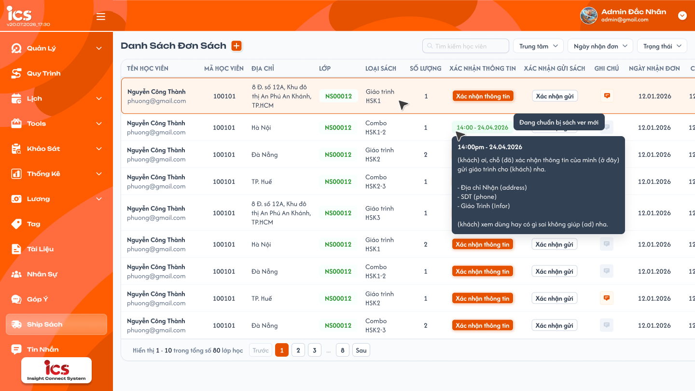
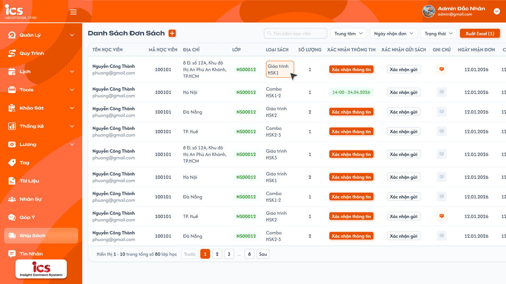
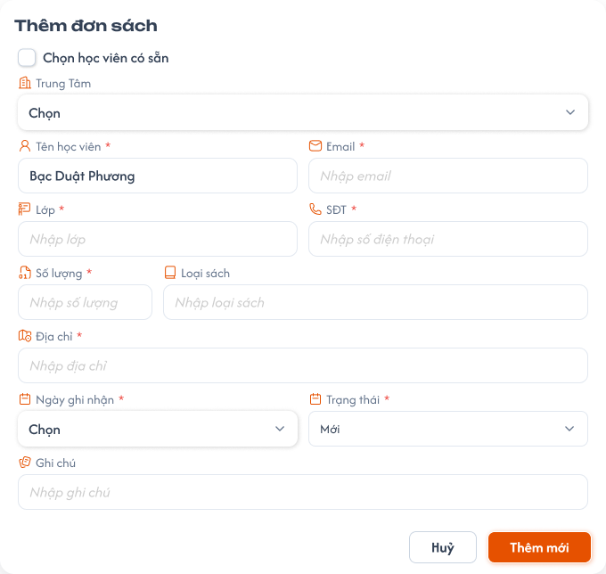
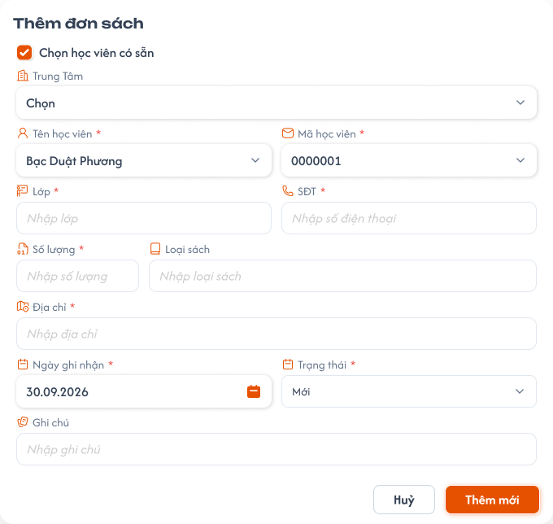
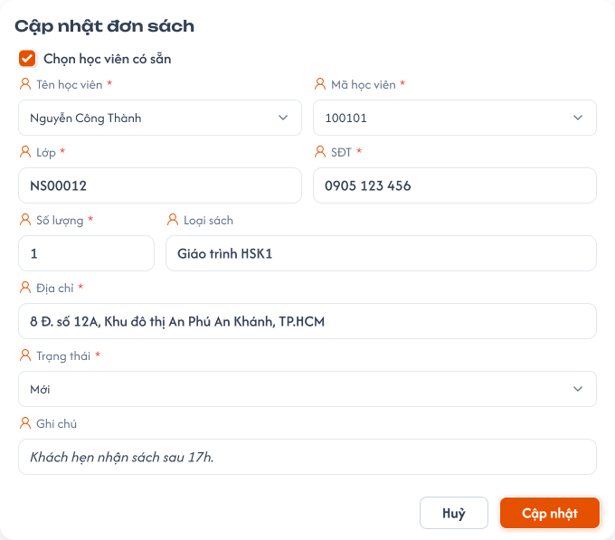
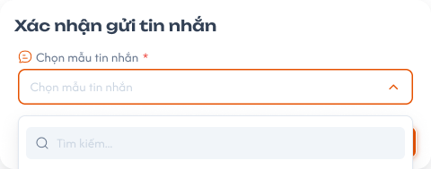
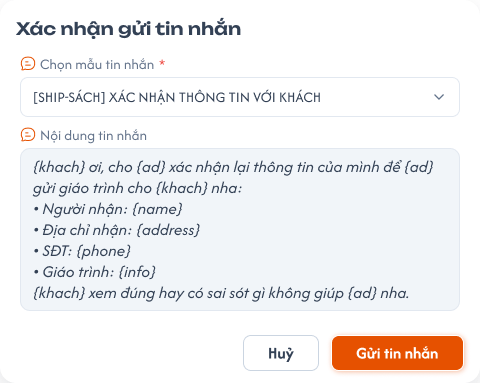

# Ship Sách

## 1. UI

### Trang 1: ADM-SS-010000 — Ship sách / Danh sách đơn sách



**Mô tả:**
- Quản lý các đơn gửi giáo trình cho học viên: thêm / sửa / xoá đơn, xác nhận thông tin và xác nhận gửi sách với khách qua tin nhắn, cập nhật trạng thái đơn, xuất Excel.

**Điểm cần lưu ý:**
- Nút **+** cạnh tiêu đề "Danh Sách Đơn Sách" mở popup Thêm đơn sách.
- Click vào 1 dòng (item) đơn sách / bấm nút Chỉnh sửa → mở popup Cập nhật đơn sách.
- Cột **Tên học viên** hiển thị tên + email bên dưới.
- Cột **Xác nhận thông tin** và **Xác nhận gửi sách**: chưa gửi thì hiển thị nút "Xác nhận thông tin" / "Xác nhận gửi", bấm mở popup Xác nhận gửi tin nhắn. Đã gửi thì nút đổi thành **thời gian gửi** (vd `14:00 - 24.04.2026`); hover hiển thị tooltip gồm thời gian gửi + nội dung tin nhắn đã gửi. **Không cho gửi lại**: nút ở trạng thái này không mở popup gửi nữa.
- Cột **Ghi chú**: icon ghi chú, chỉ hover để xem nội dung (không click sửa), cùng dữ liệu với ô Ghi chú trong popup (icon màu cam khi có ghi chú, xám khi không có).
- Cột **Trạng thái**: dropdown đổi trực tiếp, gồm Mới, Tiếp nhận, Gói hàng, Đã gửi, Đã nhận, Hoàn trả, Huỷ.
- Cột **Ngày nhận đơn** là giá trị "Ngày ghi nhận" trong popup. Cột **Cập nhật** là thời điểm đơn được cập nhật gần nhất.
- Nút **ba chấm** cuối hàng mở menu: Chỉnh sửa, Xoá. Chỉ xoá từng đơn, không có xoá hàng loạt.
- Thanh công cụ: ô tìm kiếm học viên, filter Ngày nhận đơn, filter Trạng thái. Có phân trang.
- Bộ lọc `Trung tâm` nằm cùng hàng với các bộ lọc khác, cho chọn một hoặc nhiều trung tâm; khi chọn thì danh sách, tổng số và phân trang chỉ tính dữ liệu của các trung tâm đã chọn, kết hợp `AND` với các bộ lọc khác. Không chọn thì hiển thị dữ liệu của mọi trung tâm. Role Admin không dùng ô chọn trung tâm trên header.

### Trang 2: ADM-SS-010001 — Ship sách / Danh sách đơn sách / Chọn 1 đơn · Xuất Excel



**Mô tả:**
- Danh sách khi đã chọn 1 đơn: hiện nút `Xuất Excel (1)`.

**Điểm cần lưu ý:**
- **Checkbox cuối hàng**: chọn đơn. Khi có ít nhất 1 đơn được chọn, hiện nút **Xuất Excel (n)** (n = số đơn đã chọn) bên phải filter Trạng thái. Bỏ chọn hết thì ẩn nút.
- Bấm nút tải file Excel các đơn đã chọn, gồm các cột: STT, Tên học viên, Số điện thoại, Địa chỉ, Mã học viên, Loại giáo trình, Ghi chú, Lớp, Trung tâm, Trạng thái, Ngày cập nhật.

### Trang 3: ADM-SS-010002 — Ship sách / Danh sách đơn sách / Chọn tất cả · Xuất Excel


**Mô tả:**
- Danh sách khi chọn tất cả: hiện nút `Xuất Excel (80)`.

**Điểm cần lưu ý:**
- **Checkbox ở header** (cạnh chữ "Trạng thái"): chọn / bỏ chọn tất cả các đơn đang hiển thị theo bộ lọc hiện tại; n của `Xuất Excel (n)` là số đơn đã chọn.

### Trang 4: ADM-SS-010010 — Ship sách / Popup thêm đơn sách



**Mô tả:**
- Nhập mới thông tin 1 đơn sách. Popup `Thêm đơn sách` gồm checkbox `Chọn học viên có sẵn`, Trung tâm, Tên học viên, Email, Lớp, SĐT, Số lượng, Loại sách, Địa chỉ, Ngày ghi nhận, Trạng thái, Ghi chú; nút `Huỷ` / `Thêm mới`.

**Điểm cần lưu ý:**
- Trường bắt buộc (dấu *): Trung tâm, Tên học viên, Email / Mã học viên, Lớp, SĐT, Số lượng, Địa chỉ, Ngày ghi nhận, Trạng thái. Không bắt buộc: Loại sách, Ghi chú.
- **Ngày ghi nhận** mặc định là ngày hôm nay (cho phép đổi). **Trạng thái** mặc định là "Mới".
- Checkbox **"Chọn học viên có sẵn"** chưa tick: **Tên học viên** và **Email** là ô nhập tay.

### Trang 5: ADM-SS-010012 — Ship sách / Popup thêm đơn sách / Đã chọn học viên có sẵn



**Mô tả:**
- Popup Thêm khi đã tick `Chọn học viên có sẵn`: Ngày ghi nhận tự điền ngày hôm nay.

**Điểm cần lưu ý:**
- Tick: **Tên học viên** chuyển thành dropdown, ô **Email** được thay bằng **Mã học viên** (dropdown).
- Chọn Tên → Mã học viên tự điền theo. Chọn Mã học viên → Tên tự điền theo (đồng bộ 2 chiều). Cặp Tên / Mã học viên luôn khớp nhau.

### Trang 6: ADM-SS-010040 — Ship sách / Popup cập nhật đơn sách



**Mô tả:**
- Chỉnh sửa thông tin 1 đơn sách. Popup `Cập nhật đơn sách` dùng lại đúng form của popup Thêm, khác ở tiêu đề và dữ liệu đã được điền sẵn.

**Điểm cần lưu ý:**
- Điền sẵn toàn bộ dữ liệu của đơn đang chọn; nút xác nhận đổi từ "Thêm mới" thành "Cập nhật".

### Trang 7: ADM-SS-010020 — Ship sách / Popup xác nhận xoá đơn sách


**Mô tả:**
- Popup `Xác nhận xoá đơn sách`: "Bạn có chắc chắn muốn xoá đơn sách này?...", nút `Huỷ` / `Xoá`.

**Điểm cần lưu ý:**
- Mọi thao tác xoá đơn đều phải qua popup này. Xoá là xoá mềm; `Huỷ` đóng popup, không thay đổi.

### Trang 8: ADM-SS-010032 — Ship sách / Popup xác nhận gửi tin nhắn / Đang mở



**Mô tả:**
- Chọn mẫu tin nhắn và gửi cho học viên để xác nhận thông tin / xác nhận gửi sách. Frame này là dropdown `Chọn mẫu tin nhắn` đang mở, có ô tìm kiếm và danh sách mẫu (vd `[SHIP-SÁCH] XÁC NHẬN THÔNG TIN VỚI KHÁCH`, `[SHIP-SÁCH] BÁO ĐÃ GỬI`).

**Điểm cần lưu ý:**
- Dropdown **Chọn mẫu tin nhắn** (bắt buộc) chỉ liệt kê các template **đang bật**. Template được định nghĩa ở màn hình khác, màn này chỉ chọn, không sửa.
- Không có template nào đang bật thì dropdown rỗng, không cho gửi tin nhắn.

### Trang 9: ADM-SS-010034 — Ship sách / Popup xác nhận gửi tin nhắn / Đã chọn mẫu



**Mô tả:**
- Popup `Xác nhận gửi tin nhắn` sau khi chọn mẫu: hiện ô `Nội dung tin nhắn`, nút `Huỷ` / `Gửi tin nhắn`.

**Điểm cần lưu ý:**
- **Nội dung tin nhắn** chỉ đọc, hiển thị theo template đã chọn, thay đổi khi đổi template.
- Template có các biến dạng `{khach}`, `{ad}`, `{name}`, `{address}`, `{phone}`, `{info}`. Tin nhắn được gửi qua tin nhắn bên CG; CG tự xác định khách và lấy dữ liệu các field này của khách, màn này không tự thay biến.
- Popup mở từ cột nào (Xác nhận thông tin hay Xác nhận gửi sách) thì sau khi gửi, thời gian gửi hiển thị ở đúng nút của cột đó.

---

## 2. Yêu cầu

### 2.1. Flow chính

**Flow 1: Thêm đơn sách**

```
Bấm "+" → Mở popup Thêm (Ngày ghi nhận = hôm nay, Trạng thái = Mới)
        → Nhập thông tin → Bấm "Thêm mới" → FE validate → BE tạo đơn
        → Đóng popup → Danh sách cập nhật, đơn mới xuất hiện
```

**Flow 2: Thêm đơn cho học viên có sẵn**

```
Tick "Chọn học viên có sẵn" → Tên (dropdown) + Mã học viên (dropdown)
        ├─ Chọn Tên → Mã học viên tự điền
        └─ Chọn Mã học viên → Tên tự điền
        → Nhập các trường còn lại → "Thêm mới"
```

**Flow 3: Cập nhật đơn sách**

```
Bấm vào item (hoặc ba chấm > Chỉnh sửa) → Mở popup Cập nhật (có sẵn dữ liệu)
        → Sửa thông tin → Bấm "Cập nhật" → BE lưu → Đóng popup
        → Danh sách cập nhật, cột "Cập nhật" đổi theo
```

**Flow 4: Xoá đơn sách**

```
Ba chấm > Xoá → Popup xác nhận xoá
        ├─ Xác nhận → BE xoá mềm → Danh sách cập nhật (đơn không còn hiển thị)
        └─ Huỷ → Đóng popup, không thay đổi
```

**Flow 5: Xác nhận thông tin / Xác nhận gửi sách qua tin nhắn**

```
Bấm nút ở cột Xác nhận thông tin / Xác nhận gửi sách → Popup Xác nhận gửi tin nhắn
        → Chọn mẫu tin nhắn (chỉ template đang bật) → Xem nội dung
        → Bấm "Gửi tin nhắn" → BE gửi tin qua tin nhắn CG, lưu thời gian + nội dung đã gửi
        → Nút đổi thành thời gian gửi → Hover: hiện thời gian + nội dung tin đã gửi
        (đã gửi rồi thì không cho gửi lại)
```

**Flow 6: Chọn đơn và xuất Excel**

```
Check checkbox dòng (hoặc checkbox header = chọn tất cả)
        → Hiện nút "Xuất Excel (n)" bên phải filter Trạng thái
        → Bấm nút → Tải file Excel các đơn đã chọn (các cột xem REQ05)
        (bỏ chọn hết → ẩn nút)
```

### 2.2. Ngoại lệ

- **EX01:** Bấm "Thêm mới" / "Cập nhật" khi thiếu trường bắt buộc → Hiển thị lỗi tại trường thiếu, không lưu, không đóng popup.
- **EX02:** Chưa chọn mẫu tin nhắn → Không cho bấm "Gửi tin nhắn" (disable) hoặc báo lỗi bắt buộc chọn.
- **EX03:** Không có template nào đang bật → Dropdown rỗng, không cho gửi tin nhắn.
- **EX04:** Gửi tin nhắn thất bại → Báo lỗi, giữ popup, nút xác nhận giữ nguyên trạng thái chưa gửi.
- **EX05:** Học viên có sẵn bị đổi lại (đổi Tên hoặc Mã học viên sang người khác) → Cặp Tên / Mã học viên luôn khớp nhau, không để lệch dữ liệu.
- **EX06:** Đơn đã gửi tin ở cột nào → Nút ở cột đó không cho bấm gửi lại.

### 2.3. Yêu cầu khác

| Mã | Tên yêu cầu | Mô tả |
|---|---|---|
| REQ01 | Giá trị mặc định | Popup Thêm: Ngày ghi nhận = ngày hôm nay, Trạng thái = Mới. |
| REQ02 | Đồng bộ Tên - Mã học viên | Khi tick "Chọn học viên có sẵn", chọn 1 trong 2 dropdown thì dropdown còn lại tự điền theo (2 chiều). |
| REQ03 | Popup xác nhận xoá | Mọi thao tác xoá đơn đều phải qua popup xác nhận trước khi xoá. |
| REQ04 | Lưu thông tin gửi tin | Lưu thời gian gửi + nội dung tin đã gửi theo từng cột (Xác nhận thông tin / Xác nhận gửi sách) của từng đơn. Hover nút hiển thị lại 2 thông tin này. Mỗi cột chỉ gửi 1 lần, không gửi lại. |
| REQ05 | Chọn nhiều + Xuất Excel | Nút "Xuất Excel (n)" chỉ hiện khi có ít nhất 1 đơn được chọn, n = số đơn đã chọn, vị trí bên phải filter Trạng thái. Checkbox header chọn / bỏ chọn tất cả các đơn đang hiển thị theo bộ lọc hiện tại. File Excel gồm các cột: STT, Tên học viên, Số điện thoại, Địa chỉ, Mã học viên, Loại giáo trình, Ghi chú, Lớp, Trung tâm, Trạng thái, Ngày cập nhật. |
| REQ06 | Đổi trạng thái tại danh sách | Dropdown Trạng thái ở từng dòng đổi trực tiếp, lưu ngay và cập nhật cột "Cập nhật". Hiện chưa có ràng buộc thứ tự giữa các trạng thái, và không liên kết với việc đã gửi tin. |
| REQ07 | Xoá mềm | Xoá đơn là xoá mềm (đánh dấu xoá, không hiển thị trên danh sách). Chỉ xoá từng đơn, không có xoá hàng loạt. |
| REQ08 | Trung tâm | Danh sách có bộ lọc `Trung tâm` nằm cùng hàng với các bộ lọc khác, cho chọn một hoặc nhiều trung tâm; khi chọn thì danh sách, tổng số và phân trang chỉ tính dữ liệu của các trung tâm đã chọn, kết hợp `AND` với các bộ lọc khác. Không chọn thì hiển thị dữ liệu của mọi trung tâm. Role Admin không dùng ô chọn trung tâm trên header. Khi tạo mới bắt buộc chọn `Trung tâm`; bản ghi được lưu thuộc trung tâm đã chọn. Backend kiểm tra lại trung tâm khi lưu, không chỉ dựa vào UI. |

### 2.4. Ràng buộc

#### Quyền

| Role | Xem danh sách | Thêm / Sửa | Xoá | Gửi tin nhắn | Xuất Excel | Đổi trạng thái |
|---|:---:|:---:|:---:|:---:|:---:|:---:|
| Admin | ✅ | ✅ | ✅ | ✅ | ✅ | ✅ |

#### Ràng buộc khác

- Toàn bộ chức năng màn Ship Sách thuộc role Admin.
- Popup Cập nhật dùng chung form với popup Thêm.
- Danh sách template trong popup Xác nhận gửi tin nhắn chỉ gồm template đang bật.
- Template tin nhắn không được tạo / sửa ở màn này.
- Tin nhắn gửi qua tin nhắn bên CG; mỗi cột xác nhận chỉ gửi được 1 lần.
- Xoá là xoá mềm, không xoá hàng loạt.

---

## 3. Testcase

### Feature: Ship Sách

| Tên testcase | Priority | Scenario | Role | Pre-condition | Given/When/Then | Expected Result |
|---|---|---|---|---|---|---|
| Case 1: Thêm đơn sách thành công | High | Flow 1 / REQ01 | Admin | Đang ở màn Danh Sách Đơn Sách | **Given:** mở popup Thêm đơn sách<br>**When:** nhập đủ trường bắt buộc, bấm "Thêm mới"<br>**Then:** đơn được tạo | - Popup đóng<br>- Đơn mới xuất hiện trong danh sách<br>- Ngày ghi nhận mặc định hôm nay, trạng thái mặc định Mới |
| Case 2: Thêm đơn thiếu trường bắt buộc | High | EX01 | Admin | Popup Thêm đang mở | **Given:** bỏ trống 1 trường bắt buộc<br>**When:** bấm "Thêm mới"<br>**Then:** hệ thống kiểm tra dữ liệu | - Báo lỗi tại trường thiếu<br>- Không lưu, popup không đóng |
| Case 3: Chọn học viên có sẵn, đồng bộ Tên - Mã | High | Flow 2 / REQ02 / EX05 | Admin | Có sẵn danh sách học viên | **Given:** tick "Chọn học viên có sẵn"<br>**When:** chọn Tên, sau đó đổi sang chọn Mã học viên khác<br>**Then:** hệ thống đồng bộ 2 dropdown | - Ô Email được thay bằng Mã học viên (dropdown)<br>- Chọn Tên → Mã tự điền<br>- Chọn Mã → Tên tự điền, cặp luôn khớp |
| Case 4: Cập nhật đơn sách | High | Flow 3 | Admin | Có ít nhất 1 đơn | **Given:** bấm vào item đơn sách<br>**When:** sửa thông tin, bấm "Cập nhật"<br>**Then:** đơn được lưu | - Popup hiển thị đúng dữ liệu của đơn, nút "Cập nhật"<br>- Danh sách hiển thị dữ liệu mới, cột Cập nhật đổi |
| Case 5: Xoá đơn có popup xác nhận | High | Flow 4 / REQ03 / REQ07 | Admin | Có ít nhất 1 đơn | **Given:** ba chấm > Xoá<br>**When:** bấm Huỷ rồi thử lại và bấm Xác nhận<br>**Then:** hệ thống xử lý theo lựa chọn | - Huỷ: đơn giữ nguyên<br>- Xác nhận: đơn không còn hiển thị trên danh sách (xoá mềm)<br>- Không có lựa chọn xoá hàng loạt |
| Case 6: Gửi tin xác nhận thông tin, không gửi lại | High | Flow 5 / REQ04 / EX06 | Admin | Có ít nhất 1 template đang bật; đơn chưa xác nhận thông tin | **Given:** bấm "Xác nhận thông tin"<br>**When:** chọn template, bấm "Gửi tin nhắn"<br>**Then:** tin nhắn được gửi | - Nút đổi thành thời gian gửi<br>- Hover hiện thời gian + nội dung tin đã gửi<br>- Cột "Xác nhận gửi sách" không bị ảnh hưởng<br>- Nút đã hiện thời gian thì bấm không mở popup gửi lại |
| Case 7: Popup chỉ liệt kê template đang bật | Medium | Flow 5 / EX03 | Admin | Có template bật và tắt (và một lần không có template nào bật) | **Given:** mở popup Xác nhận gửi tin nhắn<br>**When:** mở dropdown mẫu tin nhắn<br>**Then:** xem danh sách | - Chỉ thấy template đang bật; đổi template thì nội dung thay đổi theo<br>- Không có template bật: dropdown rỗng, không gửi được |
| Case 8: Gửi tin nhắn thất bại / chưa chọn template | Medium | EX02 / EX04 | Admin | Popup Xác nhận gửi tin nhắn đang mở | **Given:** chưa chọn template (hoặc gửi bị lỗi)<br>**When:** bấm "Gửi tin nhắn"<br>**Then:** hệ thống xử lý lỗi | - Không gửi khi chưa chọn template<br>- Lỗi gửi: báo lỗi, giữ popup, nút vẫn ở trạng thái chưa gửi |
| Case 9: Chọn đơn và xuất Excel | Medium | Flow 6 / REQ05 | Admin | Có nhiều đơn | **Given:** chưa chọn đơn nào<br>**When:** check 2 đơn, sau đó check checkbox header, rồi bỏ chọn hết<br>**Then:** quan sát nút Xuất Excel | - Chưa chọn: không hiện nút<br>- Chọn 2 đơn: hiện "Xuất Excel (2)" bên phải filter Trạng thái<br>- Bỏ hết: nút ẩn; check header chọn các đơn đang hiển thị theo bộ lọc<br>- Bấm nút: tải file Excel đúng các đơn đã chọn, đủ các cột theo REQ05 |
| Case 10: Đổi trạng thái tại danh sách | Medium | REQ06 | Admin | Có ít nhất 1 đơn | **Given:** dropdown Trạng thái ở 1 dòng<br>**When:** chọn "Đã gửi"<br>**Then:** hệ thống lưu | - Trạng thái đổi ngay trên dòng<br>- Cột Cập nhật đổi theo |
| Case 11: Lọc danh sách theo trung tâm | High | REQ08 | Admin | Có đơn sách ở trung tâm A và trung tâm B | **Given:** bộ lọc `Trung tâm` chưa chọn giá trị nào<br>**When:** chọn trung tâm B ở bộ lọc `Trung tâm`, sau đó bỏ chọn<br>**Then:** danh sách chỉ hiển thị đơn sách của trung tâm B | - Không lẫn dữ liệu của trung tâm A<br>- Tổng số và phân trang cập nhật theo trung tâm B<br>- Bỏ chọn thì hiển thị lại dữ liệu của mọi trung tâm |
| Case 12: Bắt buộc chọn trung tâm khi tạo | High | REQ08 / EX01 | Admin | Popup/dòng tạo đơn sách đang mở | **Given:** các field bắt buộc khác hợp lệ<br>**When:** bỏ trống `Trung tâm` rồi xác nhận; sau đó chọn trung tâm A và xác nhận<br>**Then:** thiếu Trung tâm thì không tạo; chọn A thì tạo thành công | - Báo lỗi tại field Trung tâm khi bỏ trống<br>- Đơn sách mới thuộc trung tâm A; lọc trung tâm A thì thấy, lọc trung tâm B thì không thấy |
