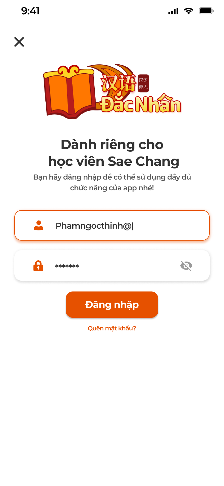
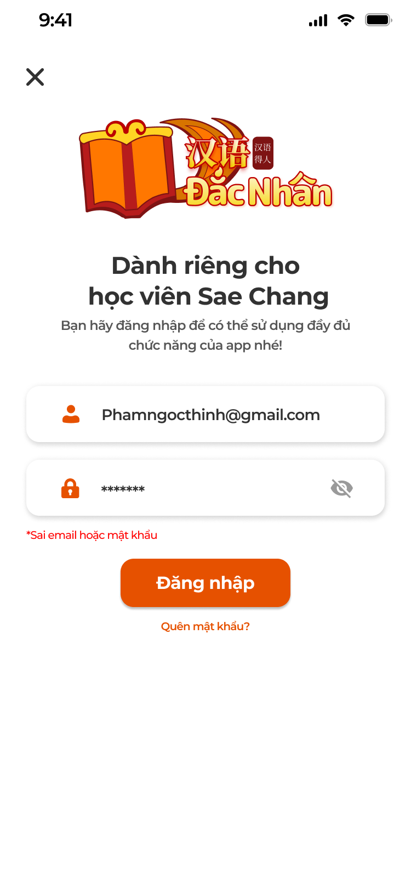
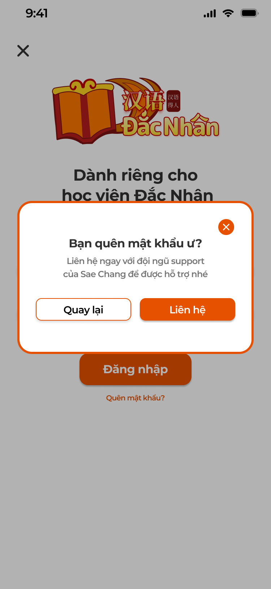

# [Học viên] Tài khoản

## 1. UI

### Trang 1: Đăng nhập






**Mô tả:**
- Màn đăng nhập mở từ `Dành cho học viên` ở chế độ trải nghiệm (nút `×` quay lại) hoặc khi mở app lần đầu đã chọn học viên. Tài khoản học viên do Support tạo trên ICS ([Quản lý học viên](../../management_requirement/student_management/student_management_requirements.md)).

**Điểm cần lưu ý:**
- Tiêu đề `Dành riêng cho học viên <Trung tâm>`, dòng phụ `Bạn hãy đăng nhập để có thể sử dụng đầy đủ chức năng của app nhé!`.
- `Đăng nhập` luôn bấm được; validate: trống → `Vui lòng nhập email` / `Vui lòng nhập mật khẩu`; sai định dạng → `Email không hợp lệ`; sai thông tin → `*Sai email hoặc mật khẩu` (dòng đỏ dưới field, không phân biệt email không tồn tại hay sai mật khẩu, để không lộ email tồn tại); tài khoản bị khoá → `Tài khoản đã bị khoá, liên hệ Support`.
- Đăng nhập thành công: lưu phiên, vào Màn chính học viên; nếu có dữ liệu trải nghiệm trên máy thì hỏi gộp (xem [Màn chính và trải nghiệm](../home_trial/home_trial.md)).
- Sai 5 lần liên tiếp: khoá 15 phút, thông báo `Bạn đã nhập sai quá nhiều lần, thử lại sau 15 phút`.

### Trang 2: Popup Quên mật khẩu



**Mô tả:**
- Popup `Bạn quên mật khẩu ư?` mở từ `Quên mật khẩu?` ở màn Đăng nhập.

**Điểm cần lưu ý:**
- Nội dung `Liên hệ ngay với đội ngũ support của <Trung tâm> để được hỗ trợ nhé`; `Quay lại` đóng; `Liên hệ` mở kênh liên hệ trung tâm (Zalo / gọi / email theo cấu hình).
- Không tự đặt lại mật khẩu.

### Trang 3: Hồ sơ

**Mô tả:**
- Cài đặt → `Chỉnh sửa hồ sơ`: xem / sửa thông tin cá nhân; có nút `Đổi mật khẩu`.

**Điểm cần lưu ý:**
- Ảnh đại diện: icon bút mở chọn ảnh (thư viện / chụp); tối đa 5MB, cắt vuông.
- `Họ và tên` sửa được, bắt buộc, 2–50 ký tự. `Email` chỉ đọc. `Số điện thoại` sửa được, bàn phím số, 9–11 số. `Tỉnh / Thành phố` sửa được, chọn từ danh sách.
- Trường chưa có dữ liệu để trống cho học viên điền.
- `Lưu thông tin`: validate, lưu; Toast `Thành Công` `Cập nhật hồ sơ thành công`; đồng bộ Họ tên, SĐT, Tỉnh / Thành phố sang hồ sơ học viên trên ICS (Support thấy).

### Trang 4: Đổi mật khẩu

**Mô tả:**
- Màn đổi mật khẩu mở từ nút `Đổi mật khẩu` ở Hồ sơ.

**Điểm cần lưu ý:**
- Field: Mật khẩu cũ, Mật khẩu mới (≥ 6 ký tự), Xác nhận mật khẩu mới; bấm `Lưu thông tin`.
- Lỗi: sai mật khẩu cũ → `Mật khẩu cũ không đúng`; không khớp → `Mật khẩu xác nhận không khớp`; ngắn → `Mật khẩu phải có ít nhất 6 ký tự`.
- Thành công → Toast `Đổi mật khẩu thành công` và đăng xuất các thiết bị khác.

### Trang 5: Cài đặt

**Mô tả:**
- Màn ⚙ từ header: `Chỉnh sửa hồ sơ` (học viên), `Nâng cấp VIP` / `Dùng mã quà tặng` / `Khôi phục thanh toán` (chế độ trải nghiệm chưa VIP, xem [Màn chính và trải nghiệm](../home_trial/home_trial.md)), `Điều khoản`, `Chính sách riêng tư`, `Phiên bản`, `Đăng xuất` (học viên) / `Đăng nhập` (trải nghiệm).

**Điểm cần lưu ý:**
- Mục VIP ẩn với học viên có lớp Đang học và người dùng đã VIP.
- `Đăng xuất`: popup xác nhận; xoá phiên, về chế độ trải nghiệm; dữ liệu trải nghiệm trên máy giữ nguyên.
- `Điều khoản`, `Chính sách riêng tư`: trang văn bản cuộn; lỗi tải hiện `Không thể tải … Vui lòng thử lại sau.`

### Trang 6: Popup Góp ý


**Mô tả:**
- Học viên gửi góp ý về trung tâm từ nút `Gửi góp ý đến trung tâm` ở tab Tổng quan của lớp; có thể ẩn danh. Góp ý gửi về ICS cho Support / Ban quản lý chất lượng xử lý, hiện ở menu Góp ý của Admin / Support.

**Điểm cần lưu ý:**
- `Loại góp ý`: dropdown, bắt buộc: `Góp ý chung`, `Góp ý về Giáo trình`, `Góp ý về Giảng viên`, `Góp ý về Hỗ trợ học viên`, `Góp ý về Lộ trình`, `Góp ý về Bài tập về nhà`, `Góp ý về Kiểm tra`, `Góp ý về Học phí` (danh sách do trung tâm mở rộng).
- `Nội dung góp ý`: bắt buộc, tối đa 1000 ký tự; placeholder `Góp ý của bạn rất quan trọng với chúng tôi. Bạn hãy thoải mái góp ý mọi điểm tại đây nhé!`.
- `Tệp đính kèm`: không bắt buộc; ảnh / file, tối đa 3 tệp, mỗi tệp 25MB.
- `Ẩn danh`: tick thì không gửi Họ tên, Email, SĐT; luôn gửi mã lớp.
- `Gửi góp ý`: thiếu loại → `Vui lòng chọn loại góp ý`; thiếu nội dung → `Vui lòng nhập nội dung góp ý`; thành công → Toast `Thành Công` `Gửi góp ý thành công`, đóng popup. `Hủy` đóng, không gửi.
- Góp ý gắn lớp đang mở và trung tâm của lớp; trạng thái xử lý do ICS quản lý.

---

## 2. Yêu cầu

### 2.1. Flow chính

**Flow 1: Đăng nhập**

```
Dành cho học viên → màn Đăng nhập → nhập email, mật khẩu → Đăng nhập
      → Hợp lệ: lưu phiên → (hỏi gộp dữ liệu trải nghiệm) → màn chính học viên
      → Sai: lỗi tại field; Quên mật khẩu → popup Liên hệ Support
```

**Flow 2: Hồ sơ và mật khẩu**

```
⚙ → Chỉnh sửa hồ sơ → sửa ảnh / tên / SĐT / tỉnh → Lưu thông tin → Toast → đồng bộ ICS
      → Đổi mật khẩu → cũ / mới / xác nhận → Lưu → Toast → đăng xuất thiết bị khác
```

**Flow 3: Cài đặt và đăng xuất**

```
⚙ → mục theo chế độ → Đăng xuất → xác nhận → về chế độ trải nghiệm
```

**Flow 4: Góp ý**

```
Tổng quan lớp → Gửi góp ý đến trung tâm → popup → loại, nội dung, tệp, Ẩn danh → Gửi góp ý
      → Validate → gửi ICS (kèm lớp, trung tâm; ẩn danh thì không kèm thông tin cá nhân) → Toast
```

### 2.2. Ngoại lệ

- **EX01:** Field trống / sai định dạng / sai thông tin → lỗi tại field; không phân biệt email tồn tại.
- **EX02:** Sai 5 lần liên tiếp → khoá 15 phút.
- **EX03:** Đổi mật khẩu: sai mật khẩu cũ, không khớp, dưới 6 ký tự → lỗi tại field.
- **EX04:** Góp ý thiếu loại / nội dung → cảnh báo tại field; tệp quá 25MB → Toast `Cảnh Báo`.
- **EX05:** Tài khoản bị khoá / xoá trên ICS → đăng nhập bị từ chối `Tài khoản đã bị khoá, liên hệ Support`; phiên đang mở bị đăng xuất ở lần gọi API kế tiếp.
- **EX06:** Mất mạng → Toast `Cảnh Báo`, giữ dữ liệu đã nhập.

### 2.3. Yêu cầu khác

| Mã | Tên yêu cầu | Mô tả |
|---|---|---|
| REQ01 | Đăng nhập | Email + mật khẩu do Support cấp; phiên lưu tới khi đăng xuất hoặc mật khẩu đổi; thông báo lỗi gộp `Sai email hoặc mật khẩu`; Quên mật khẩu chỉ hướng dẫn liên hệ, không tự đặt lại. |
| REQ02 | Hồ sơ | Sửa ảnh, Họ tên, SĐT, Tỉnh / Thành phố; Email chỉ đọc; đồng bộ ICS; đổi mật khẩu ≥ 6 ký tự, cần mật khẩu cũ. |
| REQ03 | Cài đặt | Mục theo chế độ (học viên / trải nghiệm / VIP); Điều khoản, Chính sách riêng tư, Phiên bản, Đăng xuất. |
| REQ04 | Góp ý | 8 loại mặc định (trung tâm mở rộng), nội dung ≤ 1000 ký tự, tối đa 3 tệp 25MB, Ẩn danh; gửi về ICS kèm lớp và trung tâm. |

### 2.4. Ràng buộc

#### Quyền

| Role | Đăng nhập | Hồ sơ / mật khẩu | Góp ý | Đăng xuất |
|---|:---:|:---:|:---:|:---:|
| Học viên | ✅ | ✅ | ✅ | ✅ |
| Người dùng trải nghiệm | ✅ (chuyển sang học viên) | ❌ | ❌ | ❌ |

#### Ràng buộc khác

- Backend kiểm tra phiên, trạng thái tài khoản; góp ý chỉ gửi được cho lớp học viên thuộc.
- Mỗi thao tác một Toast: `Thành Công` (`Cập nhật hồ sơ thành công`; `Đổi mật khẩu thành công`; `Gửi góp ý thành công`), `Cảnh Báo` (`Tệp vượt quá 25MB`; `Không có kết nối, vui lòng thử lại`), `Có Lỗi Xảy Ra` (`Không gửi được, vui lòng thử lại`). Lỗi validation hiện tại field, không Toast.


---

## 3. Testcase

### Feature: [Học viên] Tài khoản

| Tên testcase | Priority | Scenario | Role | Pre-condition | Given/When/Then | Expected Result |
|---|---|---|---|---|---|---|
| Case 1: Đăng nhập đúng | High | Flow 1 / REQ01 | Học viên | Tài khoản do Support cấp | **Given:** nhập email, mật khẩu đúng<br>**When:** bấm `Đăng nhập`<br>**Then:** vào màn chính học viên | - Phiên được lưu, mở lại app không hỏi lại |
| Case 2: Trống field | High | EX01 / REQ01 | Học viên | Không nhập gì | **Given:** ở màn Đăng nhập<br>**When:** bấm `Đăng nhập`<br>**Then:** hiện `Vui lòng nhập email` | - Nhập email, trống mật khẩu: `Vui lòng nhập mật khẩu` |
| Case 3: Sai thông tin | High | EX01 | Học viên | Mật khẩu sai | **Given:** nhập email đúng, mật khẩu sai<br>**When:** backend từ chối<br>**Then:** hiện `*Sai email hoặc mật khẩu` | - Không nói rõ email có tồn tại |
| Case 4: Quên mật khẩu | Medium | Flow 1 | Học viên | Ở màn Đăng nhập | **Given:** bấm `Quên mật khẩu?`<br>**When:** popup mở<br>**Then:** `Liên hệ` mở kênh Support | - `Quay lại` đóng popup |
| Case 5: Sai nhiều lần và tài khoản khoá | Medium | EX02 / EX05 | Học viên | Sai 5 lần; một tài khoản khác bị khoá trên ICS | **Given:** đăng nhập lần 6; đăng nhập tài khoản bị khoá<br>**When:** bấm `Đăng nhập`<br>**Then:** bị chặn | - `Bạn đã nhập sai quá nhiều lần, thử lại sau 15 phút`<br>- `Tài khoản đã bị khoá, liên hệ Support`<br>- Backend chặn |
| Case 6: Sửa hồ sơ | High | Flow 2 / REQ02 | Học viên | Đã đăng nhập | **Given:** đổi tên, SĐT, ảnh<br>**When:** bấm `Lưu thông tin`<br>**Then:** lưu thành công | - Toast `Cập nhật hồ sơ thành công`<br>- ICS hiện thông tin mới<br>- Email là field xám, không sửa được |
| Case 7: Đổi mật khẩu sai cũ | High | EX03 / REQ02 | Học viên | Màn đổi mật khẩu | **Given:** nhập mật khẩu cũ sai<br>**When:** bấm `Lưu thông tin`<br>**Then:** hiện `Mật khẩu cũ không đúng` | - Không đổi mật khẩu<br>- Không khớp / dưới 6 ký tự báo lỗi tương ứng |
| Case 8: Đổi mật khẩu đúng | High | Flow 2 / REQ02 | Học viên | Đủ 3 field hợp lệ | **Given:** nhập đủ 3 field hợp lệ<br>**When:** bấm `Lưu thông tin`<br>**Then:** đổi thành công | - Toast `Đổi mật khẩu thành công`<br>- Đăng nhập lại bằng mật khẩu mới<br>- Các thiết bị khác bị đăng xuất |
| Case 9: Đăng xuất | High | Flow 3 / REQ03 | Học viên | Đã đăng nhập | **Given:** ⚙ → `Đăng xuất` → xác nhận<br>**When:** xoá phiên<br>**Then:** về chế độ trải nghiệm, header `Dành cho học viên` | - Mở lại app không tự đăng nhập<br>- Dữ liệu trải nghiệm giữ nguyên |
| Case 10: Mục Cài đặt theo chế độ | Medium | REQ03 | Học viên | Học viên có lớp Đang học; người dùng trải nghiệm chưa VIP | **Given:** mở ⚙ ở từng chế độ<br>**When:** render<br>**Then:** học viên không có `Nâng cấp VIP`, có `Chỉnh sửa hồ sơ`, `Đăng xuất` | - Trải nghiệm chưa VIP: có `Nâng cấp VIP`, `Đăng nhập`, không có `Chỉnh sửa hồ sơ` |
| Case 11: Gửi góp ý | High | Flow 4 / REQ04 | Học viên | Ở Tổng quan lớp | **Given:** chọn `Góp ý về Giáo trình`, nhập nội dung<br>**When:** bấm `Gửi góp ý`<br>**Then:** gửi thành công, popup đóng | - Toast `Gửi góp ý thành công`<br>- ICS nhận góp ý kèm tên học viên, mã lớp |
| Case 12: Góp ý ẩn danh | Medium | REQ04 | Học viên | Tick `Ẩn danh` | **Given:** gửi góp ý<br>**When:** ICS nhận<br>**Then:** không có Họ tên / Email / SĐT | - Vẫn có mã lớp |
| Case 13: Góp ý thiếu field hoặc tệp quá lớn | High | EX04 | Học viên | Popup Góp ý đang mở | **Given:** không chọn loại hoặc nội dung; hoặc đính kèm tệp > 25MB<br>**When:** bấm `Gửi góp ý`<br>**Then:** báo lỗi, không gửi | - `Vui lòng chọn loại góp ý` / `Vui lòng nhập nội dung góp ý`<br>- Toast `Cảnh Báo` cho tệp quá 25MB |
| Case 14: Mất mạng khi gửi | Medium | EX06 / Ràng buộc Toast | Học viên | Mất mạng | **Given:** bấm `Gửi góp ý`<br>**When:** thất bại<br>**Then:** báo lỗi, giữ nội dung | - Toast `Có Lỗi Xảy Ra` hoặc `Cảnh Báo`<br>- Thử lại được |
| Case 15: Người dùng trải nghiệm bị chặn | High | Ràng buộc quyền | Người dùng trải nghiệm | Chưa đăng nhập | **Given:** gọi API hồ sơ, đổi mật khẩu, góp ý<br>**When:** hệ thống xử lý<br>**Then:** bị từ chối | - Dữ liệu không đổi |

---

## 4. Câu hỏi cần xác nhận

- **Q01:** Các trang chưa có mã màn Figma, cần design cấp mã (theo quy ước `<HỌ>-<MODULE>-NNNNNN`) hoặc cho biết frame nằm ở file Figma nào.
- **Q02:** Kênh `Liên hệ` của popup Quên mật khẩu (Zalo / gọi / email) theo cấu hình trung tâm nào trên ICS.
- **Q03:** App có hiện lịch sử góp ý đã gửi và trạng thái xử lý không.
- **Q04:** Trang 3 Hồ sơ, Trang 4 Đổi mật khẩu, Trang 5 Cài đặt chưa có ảnh thiết kế; Trang 6 Popup Góp ý mới có ảnh nút `Gửi góp ý`, chưa có ảnh popup.
- **Q05:** Giới hạn tệp góp ý (3 tệp, 25MB) và khoá 15 phút sau 5 lần sai là đề xuất, cần xác nhận.
