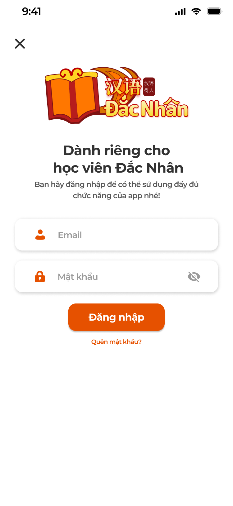
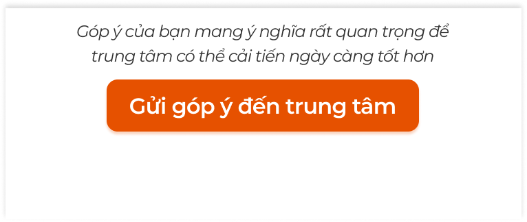

# [Học viên] Tài khoản

Đăng nhập, quên mật khẩu, hồ sơ, đổi mật khẩu, cài đặt và góp ý của app học viên. Tài khoản học viên do Support tạo trên ICS ([Quản lý học viên](../../management_requirement/student_management/student_management_requirements.md)); góp ý gửi về ICS cho Support / Ban quản lý chất lượng xử lý.

Có ảnh Đăng nhập (4 màn) và nút Góp ý; Hồ sơ, Đổi mật khẩu, Cài đặt, popup Góp ý chưa có ảnh.

## 1. UI

### Trang 1: Đăng nhập


*Đăng nhập: mặc định, đang nhập, lỗi `Sai email hoặc mật khẩu`, popup Quên mật khẩu — nhấn để xem ảnh gốc*

**Mô tả:**

- Màn đăng nhập mở từ `Dành cho học viên` ở chế độ trải nghiệm (nút `×` quay lại) hoặc khi mở app lần đầu đã chọn học viên.

**Giải thích field/thành phần:**

- `A01.01` **Logo + tiêu đề**: Logo trung tâm; `Dành riêng cho học viên <Trung tâm>`; dòng phụ `Bạn hãy đăng nhập để có thể sử dụng đầy đủ chức năng của app nhé!`.
- `A01.02` **Email**: Bắt buộc; placeholder `Email`; viền cam khi focus.
- `A01.03` **Mật khẩu**: Bắt buộc; placeholder `Mật khẩu`; icon ẩn / hiện.
- `A01.04` **`Đăng nhập`**: Luôn bấm được; validate: trống → `Vui lòng nhập email` / `Vui lòng nhập mật khẩu`; sai định dạng → `Email không hợp lệ`; sai thông tin → `*Sai email hoặc mật khẩu` (dòng đỏ dưới field, không phân biệt email không tồn tại hay sai mật khẩu); tài khoản bị khoá → `Tài khoản đã bị khoá, liên hệ Support`.
- `A01.05` **`Quên mật khẩu?`**: Popup `Bạn quên mật khẩu ư?` + `Liên hệ ngay với đội ngũ support của <Trung tâm> để được hỗ trợ nhé`; `Quay lại` đóng; `Liên hệ` mở kênh liên hệ trung tâm (Zalo / gọi / email theo cấu hình).

**Điểm cần lưu ý:**

- Khác spec cũ: spec tách lỗi `Email không tồn tại` / `Mật khẩu không đúng`; ảnh gộp thành `Sai email hoặc mật khẩu` → dùng theo ảnh để không lộ email tồn tại.
- Đăng nhập thành công: lưu phiên, vào Màn chính học viên; nếu có dữ liệu trải nghiệm trên máy thì hỏi gộp (xem [Màn chính và trải nghiệm](../home_trial/home_trial.md)).
- Sai 5 lần liên tiếp: khoá 15 phút, thông báo `Bạn đã nhập sai quá nhiều lần, thử lại sau 15 phút`.

### Trang 2: Hồ sơ và Đổi mật khẩu
**Mô tả:**

- Cài đặt → `Chỉnh sửa hồ sơ`: xem / sửa thông tin cá nhân; nút `Đổi mật khẩu`.

**Giải thích field/thành phần:**

- `A02.01` **Ảnh đại diện**: Icon bút mở chọn ảnh (thư viện / chụp); tối đa 5MB, cắt vuông.
- `A02.02` **Họ và tên**: Sửa được; bắt buộc, 2–50 ký tự.
- `A02.03` **Email**: Chỉ đọc.
- `A02.04` **Số điện thoại**: Sửa được; bàn phím số; 9–11 số.
- `A02.05` **Tỉnh / Thành phố**: Sửa được; chọn từ danh sách.
- `A02.06` **`Lưu thông tin`**: Validate, lưu; Toast `Thành Công` `Cập nhật hồ sơ thành công`; đồng bộ sang hồ sơ học viên trên ICS.
- `A02.07` **`Đổi mật khẩu`**: Màn: Mật khẩu cũ, Mật khẩu mới (≥ 6 ký tự), Xác nhận mật khẩu mới; `Lưu thông tin`: sai mật khẩu cũ → `Mật khẩu cũ không đúng`; không khớp → `Mật khẩu xác nhận không khớp`; ngắn → `Mật khẩu phải có ít nhất 6 ký tự`; thành công → Toast + đăng xuất các thiết bị khác.

**Điểm cần lưu ý:**

- Trường chưa có dữ liệu để trống cho học viên điền.
- Sửa hồ sơ ở app cập nhật Họ tên, SĐT, Tỉnh / Thành phố của học viên trên ICS (Support thấy).

### Trang 3: Cài đặt
**Mô tả:**

- Màn ⚙ từ header: `Chỉnh sửa hồ sơ` (học viên), `Nâng cấp VIP` / `Dùng mã quà tặng` / `Khôi phục thanh toán` (chế độ trải nghiệm chưa VIP, xem [Màn chính và trải nghiệm](../home_trial/home_trial.md)), `Điều khoản`, `Chính sách riêng tư`, `Phiên bản`, `Đăng xuất` (học viên) / `Đăng nhập` (trải nghiệm).

**Điểm cần lưu ý:**

- `A03.01` **`Đăng xuất`**: Popup xác nhận; xoá phiên, về chế độ trải nghiệm; dữ liệu trải nghiệm trên máy giữ nguyên.
- `A03.02` **`Điều khoản`, `Chính sách riêng tư`**: Trang văn bản cuộn; lỗi tải: `Không thể tải … Vui lòng thử lại sau.`

- Mục VIP ẩn với học viên có lớp Đang học và người dùng đã VIP.

### Trang 4: Góp ý


*Khối Gửi góp ý đến trung tâm ở tab Tổng quan — nhấn để xem ảnh gốc*

**Mô tả:**

- Học viên gửi góp ý về trung tâm từ tab Tổng quan của lớp; có thể ẩn danh. Góp ý hiện ở menu Góp ý của Admin / Support trên ICS.

**Giải thích field/thành phần:**

- `A04.01` **`Loại góp ý`**: Dropdown, bắt buộc: `Góp ý chung`, `Góp ý về Giáo trình`, `Góp ý về Giảng viên`, `Góp ý về Hỗ trợ học viên`, `Góp ý về Lộ trình`, `Góp ý về Bài tập về nhà`, `Góp ý về Kiểm tra`, `Góp ý về Học phí` (danh sách do trung tâm mở rộng).
- `A04.02` **`Nội dung góp ý`**: Textbox bắt buộc, tối đa 1000 ký tự; placeholder `Góp ý của bạn rất quan trọng với chúng tôi. Bạn hãy thoải mái góp ý mọi điểm tại đây nhé!`.
- `A04.03` **`Tệp đính kèm`**: Không bắt buộc; ảnh / file, tối đa 3 tệp, mỗi tệp 25MB.
- `A04.04` **`Ẩn danh`**: Checkbox; tick thì không gửi Họ tên, Email, SĐT; luôn gửi mã lớp.
- `A04.05` **`Gửi góp ý`**: Validate: thiếu loại → `Vui lòng chọn loại góp ý`; thiếu nội dung → `Vui lòng nhập nội dung góp ý`; thành công → Toast `Thành Công` `Gửi góp ý thành công`, đóng popup.
- `A04.06` **`Hủy`**: Đóng, không gửi.

**Điểm cần lưu ý:**

- Góp ý gắn lớp đang mở và trung tâm của lớp; trạng thái xử lý do ICS quản lý, app không hiện lịch sử góp ý (Cần xác nhận).

### Trang 5: Toast phản hồi CRUD


*Toast Thành Công, Thông Báo, Cảnh Báo và Có Lỗi Xảy Ra — nhấn để xem ảnh gốc*

**Mô tả:**

- Phản hồi sau sửa hồ sơ, đổi mật khẩu, gửi góp ý.

**Điểm cần lưu ý:**

- `A05.01` **Thành công**: Tiêu đề cố định: `Thành Công`; Khi sử dụng: `Cập nhật hồ sơ thành công`; `Đổi mật khẩu thành công`; `Gửi góp ý thành công`
- `A05.02` **Cảnh báo**: Tiêu đề cố định: `Cảnh Báo`; Khi sử dụng: `Tệp vượt quá 25MB`; `Không có kết nối, vui lòng thử lại`
- `A05.03` **Lỗi**: Tiêu đề cố định: `Có Lỗi Xảy Ra`; Khi sử dụng: `Không gửi được, vui lòng thử lại`

- Lỗi validation hiện tại field, không Toast.

---

## 2. Yêu cầu

### 2.1. Flow chính

**Flow 1 / REQ01: Đăng nhập**

```text
Dành cho học viên → màn Đăng nhập → nhập email, mật khẩu → Đăng nhập
      → Hợp lệ: lưu phiên → (hỏi gộp dữ liệu trải nghiệm) → màn chính học viên
      → Sai: lỗi tại field; Quên mật khẩu → popup Liên hệ Support
```

**Flow 2 / REQ02: Hồ sơ và mật khẩu**

```text
⚙ → Chỉnh sửa hồ sơ → sửa ảnh / tên / SĐT / tỉnh → Lưu thông tin → Toast → đồng bộ ICS
      → Đổi mật khẩu → cũ / mới / xác nhận → Lưu → Toast → đăng xuất thiết bị khác
```

**Flow 3 / REQ03: Cài đặt và đăng xuất**

```text
⚙ → mục theo chế độ → Đăng xuất → xác nhận → về chế độ trải nghiệm
```

**Flow 4 / REQ04: Góp ý**

```text
Tổng quan lớp → Gửi góp ý đến trung tâm → popup → loại, nội dung, tệp, Ẩn danh → Gửi góp ý
      → Validate → gửi ICS (kèm lớp, trung tâm; ẩn danh thì không kèm thông tin cá nhân) → Toast
```

### 2.2. Ngoại lệ

- **EX01:** Field trống / sai định dạng / sai thông tin → lỗi tại field; không phân biệt email tồn tại.
- **EX02:** Sai 5 lần liên tiếp → khoá 15 phút.
- **EX03:** Đổi mật khẩu: sai mật khẩu cũ, không khớp, dưới 6 ký tự → lỗi tại field.
- **EX04:** Góp ý thiếu loại / nội dung → cảnh báo tại field; tệp quá 25MB → Toast `Cảnh Báo`.
- **EX05:** Tài khoản bị khoá / xoá trên ICS → đăng nhập bị từ chối `Tài khoản đã bị khoá, liên hệ Support`; phiên đang mở bị đăng xuất ở lần gọi API kế tiếp.
- **EX06:** Mất mạng → Toast `Cảnh Báo`, giữ dữ liệu đã nhập.

### 2.3. Yêu cầu khác

| Mã | Tên yêu cầu | Mô tả |
|---|---|---|
| REQ01 | Đăng nhập | Email + mật khẩu do Support cấp; phiên lưu tới khi đăng xuất hoặc mật khẩu đổi; thông báo lỗi gộp `Sai email hoặc mật khẩu`; Quên mật khẩu chỉ hướng dẫn liên hệ, không tự đặt lại. |
| REQ02 | Hồ sơ | Sửa ảnh, Họ tên, SĐT, Tỉnh / Thành phố; Email chỉ đọc; đồng bộ ICS; đổi mật khẩu ≥ 6 ký tự, cần mật khẩu cũ. |
| REQ03 | Cài đặt | Mục theo chế độ (học viên / trải nghiệm / VIP); Điều khoản, Chính sách riêng tư, Phiên bản, Đăng xuất. |
| REQ04 | Góp ý | 8 loại mặc định (trung tâm mở rộng), nội dung ≤ 1000 ký tự, tối đa 3 tệp 25MB, Ẩn danh; gửi về ICS kèm lớp và trung tâm. |

### 2.4. Ràng buộc

#### Quyền

| Role | Đăng nhập | Hồ sơ / mật khẩu | Góp ý | Đăng xuất |
|---|:---:|:---:|:---:|:---:|
| Học viên | ✅ | ✅ | ✅ | ✅ |
| Người dùng trải nghiệm | ✅ (chuyển sang học viên) | ❌ | ❌ | ❌ |

#### Ràng buộc khác

**Phạm vi dữ liệu**

- Backend kiểm tra phiên, trạng thái tài khoản; góp ý chỉ gửi được cho lớp học viên thuộc.

---

---

## 3. Testcase

### Feature: [Học viên] Tài khoản

| Tên testcase | Priority | Scenario | Role | Pre-condition | Given/When/Then | Expected Result |
|---|---|---|---|---|---|---|
| Case 1: Đăng nhập đúng | High · Smoke | Flow 1 / REQ01 | Học viên | Tài khoản do Support cấp | **Given** nhập email, mật khẩu<br>**When** `Đăng nhập`<br>**Then** vào màn chính học viên | - Phiên được lưu, mở lại app không hỏi lại |
| Case 2: Trống field | High | EX01 / REQ01 | Học viên | Không nhập | **Given** bấm `Đăng nhập`<br>**When** validate<br>**Then** `Vui lòng nhập email` | - Nhập email, trống mật khẩu: `Vui lòng nhập mật khẩu` |
| Case 3: Sai thông tin | High | EX01 | Học viên | Mật khẩu sai | **Given** bấm `Đăng nhập`<br>**When** backend từ chối<br>**Then** `*Sai email hoặc mật khẩu` | - Không nói rõ email có tồn tại |
| Case 4: Quên mật khẩu | Medium | Flow 1 | Học viên | Ở màn đăng nhập | **Given** bấm `Quên mật khẩu?`<br>**When** popup<br>**Then** `Liên hệ` mở kênh Support | - `Quay lại` đóng |
| Case 5: Sai nhiều lần | Medium | EX02 | Học viên | Sai 5 lần | **Given** lần 6<br>**When** bấm<br>**Then** `Bạn đã nhập sai quá nhiều lần, thử lại sau 15 phút` | - Backend chặn |
| Case 6: Sửa hồ sơ | High · Smoke | Flow 2 / REQ02 | Học viên | Đã đăng nhập | **Given** đổi tên, SĐT, ảnh<br>**When** `Lưu thông tin`<br>**Then** Toast `Cập nhật hồ sơ thành công` | - ICS hiện thông tin mới |
| Case 7: Email chỉ đọc | Low | REQ02 | Học viên | Màn hồ sơ | **Given** chạm Email<br>**When** không sửa được<br>**Then** field xám | - |
| Case 8: Đổi mật khẩu sai cũ | High | EX03 / REQ02 | Học viên | Màn đổi mật khẩu | **Given** mật khẩu cũ sai<br>**When** `Lưu thông tin`<br>**Then** `Mật khẩu cũ không đúng` | - Không đổi |
| Case 9: Đổi mật khẩu đúng | High | Flow 2 / REQ02 | Học viên | Đủ 3 field hợp lệ | **Given** `Lưu thông tin`<br>**When** thành công<br>**Then** Toast `Đổi mật khẩu thành công` | - Đăng nhập lại bằng mật khẩu mới |
| Case 10: Đăng xuất | High · Smoke | Flow 3 / REQ03 | Học viên | Đã đăng nhập | **Given** ⚙ → `Đăng xuất` → xác nhận<br>**When** xoá phiên<br>**Then** về chế độ trải nghiệm, header `Dành cho học viên` | - Mở lại app không tự đăng nhập |
| Case 11: Mục theo chế độ | Medium | REQ03 | Học viên có lớp | Đang học | **Given** mở ⚙<br>**When** render<br>**Then** không có `Nâng cấp VIP`, có `Chỉnh sửa hồ sơ`, `Đăng xuất` | - Trải nghiệm free: ngược lại |
| Case 12: Gửi góp ý | High · Smoke | Flow 4 / REQ04 | Học viên | Ở Tổng quan lớp | **Given** chọn `Góp ý về Giáo trình`, nhập nội dung<br>**When** `Gửi góp ý`<br>**Then** Toast `Gửi góp ý thành công`, popup đóng | - ICS nhận góp ý kèm tên học viên, mã lớp |
| Case 13: Ẩn danh | Medium | REQ04 | Học viên | Tick `Ẩn danh` | **Given** gửi<br>**When** ICS nhận<br>**Then** không có Họ tên / Email / SĐT, có mã lớp | - |
| Case 14: Thiếu field | High | EX04 | Học viên | Không chọn loại | **Given** `Gửi góp ý`<br>**When** validate<br>**Then** `Vui lòng chọn loại góp ý` | - Thiếu nội dung: `Vui lòng nhập nội dung góp ý` |
| Toast Case 1: Lỗi gửi | Medium | Ràng buộc Toast CRUD | Học viên | Mất mạng | **Given** `Gửi góp ý`<br>**When** thất bại<br>**Then** Toast `Có Lỗi Xảy Ra`, nội dung giữ nguyên | - Thử lại được |

---

---

## 4. Câu hỏi cần xác nhận

- **Q01:** Kênh `Liên hệ` của popup Quên mật khẩu (Zalo / gọi / email) theo cấu hình trung tâm nào trên ICS.
- **Q02:** App có hiện lịch sử góp ý đã gửi và trạng thái xử lý không.
- **Q03:** Màn Hồ sơ, Đổi mật khẩu, Cài đặt, popup Góp ý chưa có ảnh.
- **Q04:** Giới hạn tệp góp ý (3 tệp, 25MB) và khoá 15 phút sau 5 lần sai là đề xuất.
