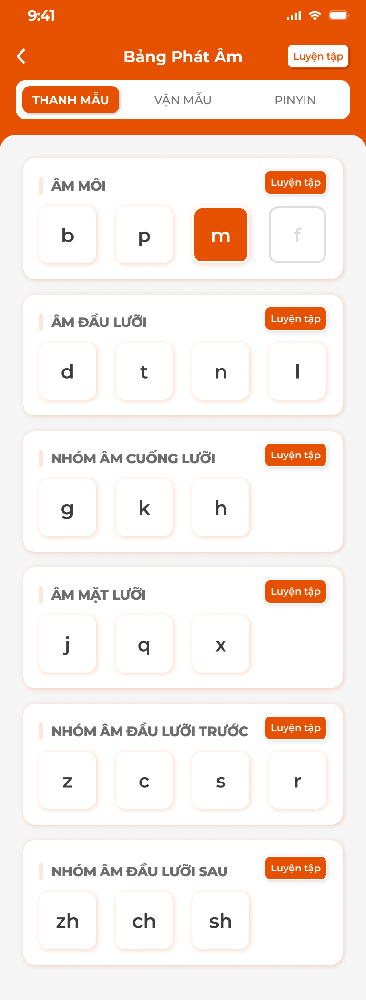
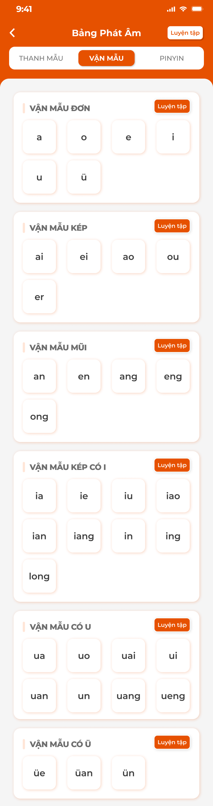
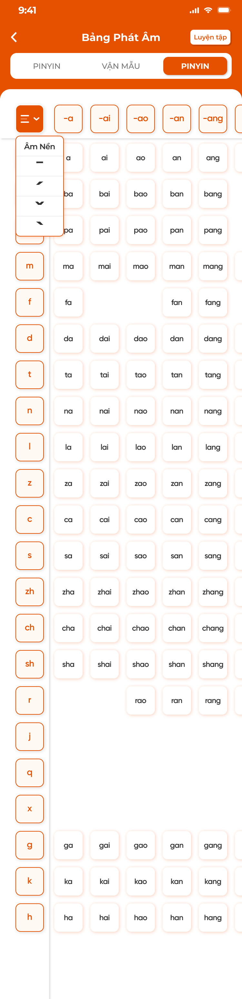
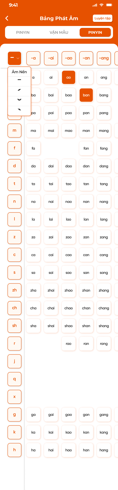
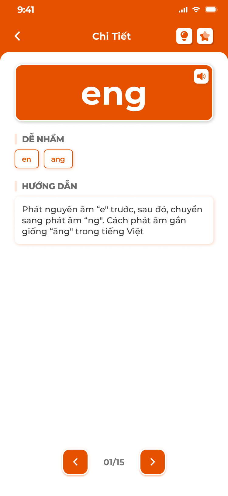

# [Học viên] Bảng chữ

## 1. UI

### Trang 1: Bảng phát âm Pinyin · Tab Thanh mẫu (Đắc Nhân)



**Mô tả:**
- Mục Bảng chữ khác theo trung tâm: **Đắc Nhân** là Bảng phát âm Pinyin (Thanh mẫu, Vận mẫu, bảng Pinyin), **Sakumi** là bảng chữ Hiragana / Katakana, **Saechang** là bảng chữ Hangul; Betreux, Creative English, Créatis không có mục này.
- Mở từ thẻ `Bảng chữ` trong [Chi tiết bài học](../lesson/lesson.md), từ khối `BẢNG PHÁT ÂM` / `BẢNG CHỮ` ở màn chính trải nghiệm (xem [Màn chính và trải nghiệm](../home_trial/home_trial.md)), hoặc từ [Thư viện học tập](../library/library.md). Dữ liệu từ tab Phát âm / Bảng chữ của [Kiến thức (S1)](../../course_management/knowledge-s1/knowledge-s1.md); app chỉ đọc.
- Màn `Bảng Phát Âm` gồm 3 tab `THANH MẪU`, `VẬN MẪU`, `PINYIN`; mỗi nhóm có nút `Luyện tập`; bấm ô mở chi tiết âm. Dữ liệu là bảng pinyin của S1 (Loại `Thanh mẫu` / `Vận mẫu` / `Âm tiết`, 12 nhóm, 4 thanh, audio theo thanh).

**Điểm cần lưu ý:**
- Header: Back, `Bảng Phát Âm`, nút `Luyện tập` (toàn bảng).
- Tab `THANH MẪU`: 6 khối theo Nhóm của S1 (`ÂM MÔI` b p m f, `ÂM ĐẦU LƯỠI` d t n l, `NHÓM ÂM CUỐNG LƯỠI` g k h, `ÂM MẶT LƯỠI` j q x, `NHÓM ÂM ĐẦU LƯỠI TRƯỚC` z c s r, `NHÓM ÂM ĐẦU LƯỠI SAU` zh ch sh); mỗi khối có tên nhóm + nút `Luyện tập` + ô âm.
- Ô Đã thuộc nền cam; ô đang chọn viền cam; âm có trong bảng chuẩn nhưng S1 chưa có dữ liệu thì mờ (vd `f`), bấm không mở.
- Từ bài học: chỉ hiện nhóm và âm gắn với bài; từ màn chính trải nghiệm: toàn bảng.
- `Luyện tập`: popup chế độ `Duyệt`, `Flashcard`, `Trắc nghiệm`, `Thử thách` trên phạm vi nhóm (hoặc toàn bảng); nội dung như Luyện tập ở [Kiến thức](../knowledge/knowledge.md): Trắc nghiệm nghe audio chọn âm / xem âm chọn audio; Thử thách 16 ô, 3 tim.
- Tiến độ: khối `BẢNG PHÁT ÂM` ở màn chính và thẻ `Bảng chữ` trong bài học hiện % = số âm Đã thuộc / tổng âm của phạm vi.

### Trang 2: Bảng phát âm Pinyin · Tab Vận mẫu



**Mô tả:**
- Tab `VẬN MẪU` của Bảng Phát Âm, hiển thị cùng cách với tab Thanh mẫu.

**Điểm cần lưu ý:**
- 6 khối: `VẬN MẪU ĐƠN`, `VẬN MẪU KÉP`, `VẬN MẪU MŨI`, `VẬN MẪU KÉP CÓ I`, `VẬN MẪU CÓ U`, `VẬN MẪU CÓ Ü`.

### Trang 3: Bảng phát âm Pinyin · Tab Pinyin





**Mô tả:**
- Lưới âm tiết thanh mẫu × vận mẫu.

**Điểm cần lưu ý:**
- Cột trái là thanh mẫu (ô viền cam), hàng trên là vận mẫu (`-a`, `-ai`, `-ao`…), ô giao là âm tiết có trong bảng; ô trống = tổ hợp không tồn tại. Cuộn ngang / dọc, header hàng và cột ghim.
- Dropdown thanh điệu ở góc trái trên lưới: `Âm Nền` (không thanh), thanh 1 `ˉ`, 2 `ˊ`, 3 `ˇ`, 4 `ˋ`; chọn thanh thì ô hiện âm tiết kèm dấu thanh và loa phát audio theo thanh.
- Audio: thanh mẫu 1 file; vận mẫu và âm tiết theo thanh (file `pinyin_<thanh>.mp3` của S1); không có file thì TTS.

### Trang 4: Bảng phát âm Pinyin · Chi tiết âm




**Mô tả:**
- Chi tiết một âm, mở khi bấm ô ở Trang 1–3.

**Điểm cần lưu ý:**
- Âm lớn + loa; `DỄ NHẦM` (chip các âm dễ nhầm, bấm chuyển sang âm đó); `HƯỚNG DẪN` (hướng dẫn phát âm).
- Với âm tiết thêm `Thanh mẫu`, `Vận mẫu` thành phần và 4 nút thanh để nghe; `Cách đọc`, video hướng dẫn nếu có.
- 💡 Đã thuộc, ⭐ lưu thư viện; `<` `>` `n/N` trong nhóm.
- Ba kiểu ô: thanh mẫu / vận mẫu, chữ + âm, âm tiết.

### Trang 5: Bảng chữ Kana (Sakumi)

**Mô tả:**
- Màn `Bảng Chữ` cho tiếng Nhật: chuyển `Hiragana` / `Katakana`; 3 tab theo Loại của S1: `Cơ bản` (Âm cơ bản 46), `Biến âm` (Âm đục 20 + Âm bán đục 5), `Kết hợp` (Âm ghép 33); lưới 5 cột nguyên âm `a i u e o` × hàng phụ âm; chữ Đã thuộc nền cam.

**Điểm cần lưu ý:**
- Header: Back, `Bảng Chữ`, nút `Luyện tập`, icon ⭐+ (chọn nhiều vào thư viện).
- Một mục S1 là cặp chữ nên trạng thái thuộc và lưu dùng chung cho cả hai bộ `Hiragana` / `Katakana`.
- Lưới: hàng trên nguyên âm; cột trái hàng (`あ行`…); ô = chữ + romaji; vị trí không có chữ là ô xám. Bấm tên hàng / cột hoặc tiêu đề tab mở popup Luyện tập cho phạm vi đó.
- Âm ngắt `っ` và trường âm không là ô riêng (quyết định S1), hiển thị trong ví dụ.
- Từ bài học chỉ hiện chữ gắn với bài (ô khác mờ); từ màn chính trải nghiệm toàn bảng.
- Chi tiết chữ: chữ lớn (cả Hiragana và Katakana) + romaji + loa; `MẸO NHỚ` (hình + ghi chú); `DỄ NHẦM` (chip chữ dễ nhầm); `TỪ VỰNG` (kana, romaji, nghĩa, loa); nét viết nếu có; 💡, ⭐; `<` `>`.
- ⭐+: popup `Cập nhật danh sách yêu thích` có lọc Loại (Âm cơ bản / Âm đục / Âm bán đục / Âm ghép) và Phạm vi (hàng hoặc cột); ô ba trạng thái: đã có trong thư viện (nền cam đậm, bỏ chọn = gỡ), đang thêm (viền trắng nền cam nhạt), chưa chọn (trắng); `Đồng ý` lưu, Toast `Đã cập nhật thư viện!`.
- `Luyện tập`: popup chế độ `Duyệt bài`, `Học`, `Chi tiết`, `Luyện viết`, `Flashcard`, `Trắc nghiệm`, `Thử thách 1`, `Thử thách 2` trên phạm vi đã chọn (bảng / hàng / cột).
- `Duyệt bài`: flashcard một mặt từng chữ; `Đã nhớ` (= Đã thuộc) / bỏ qua; `Quay lại` từ thẻ 2; tổng kết số đã nhớ.
- `Học`: chuỗi card chữ (chữ, romaji, nghĩa, `Hoàn thành`) và flashcard (mặt trước chữ + ⭐ 💡, `Tiếp theo` lật, `Hoàn thành`); sau một số nội dung chèn bài kiểm tra chặn (Nối chữ kéo thả, Trắc nghiệm, Sắp xếp), đúng mới đi tiếp; popup hoàn thành.
- `Chi tiết`: mở Chi tiết chữ, `<` `>` qua phạm vi. `Luyện viết`: nét mẫu động có số thứ tự, khung viết tay, loa, `Hoàn tác`, `Xoá`, `Ẩn / Hiện hướng dẫn`, `<` `>`.
- `Flashcard` 3 loại: 1 hướng viết chữ; 2 chữ + romaji + audio + câu gợi nhớ; 3 hình minh hoạ + nét viết + câu gợi nhớ; lật, 💡, ⭐, `<` `>`; mọi thẻ Đã thuộc thì popup `Chúc mừng`.
- `Trắc nghiệm`: câu hỏi là audio hoặc chữ, 4 đáp án; phản hồi xanh / đỏ, tự chuyển; thanh tiến độ; kết quả % đúng, danh sách chữ, `Làm lại`.
- `Thử thách 1`: 16 câu, hiện romaji → chọn trong 16 ô chữ; 5–7 giây / câu; 3 tim; thông báo `Làm tốt lắm, tiếp tục nào` / `Sai rồi bạn ơi, ‘さ’ mới đúng` / `Hết giờ cho câu này`; kết quả `Thành công rồi!` / `Hãy luyện tập thật tốt nhé!`; đúng thì Đã thuộc. `Thử thách 2`: như Thử thách 1 nhưng hiện chữ → chọn romaji.

### Trang 6: Bảng chữ Hangul (Saechang)

**Mô tả:**
- Màn `Bảng Chữ` cho tiếng Hàn: tab `Phụ âm` (Phụ âm thường 9, bật hơi 5, căng 5), `Nguyên âm` (đơn 10, ghép 11), `Bảng ghép` (lưới 14 phụ âm × 10 nguyên âm = 140 âm tiết, nhóm `Bảng ghép cơ bản` / `Phụ âm căng` / `Nguyên âm ghép` / `Patchim`); cùng bộ thao tác với Kana.

**Điểm cần lưu ý:**
- Tab `Phụ âm`, `Nguyên âm`: khối theo Loại của S1; ô = chữ + tên gọi (phụ âm) hoặc chữ + romaja; Đã thuộc nền cam; mỗi khối có nút `Luyện tập`.
- Tab `Bảng ghép`: lưới phụ âm (hàng) × nguyên âm (cột), ô = âm tiết + romaja; bấm ô mở Chi tiết: âm tiết lớn + phân tích `ㄱ + ㅏ`, phiên âm, Phụ âm (chữ · tên gọi · romaja), Nguyên âm, ví dụ, loa. Âm tiết không là mục riêng: Đã thuộc / lưu tính theo **phụ âm**.
- Chi tiết jamo: chữ lớn + tên gọi + romaja (đầu / cuối) + loa; `Loại`; `TỪ VỰNG` (từ · nghĩa); nét viết nếu có; 💡, ⭐; `<` `>`.
- `Luyện tập` cùng bộ chế độ Kana; `Thử thách 1` là romaja → chữ, `Thử thách 2` là chữ → romaja.
- Chưa có sheet dữ liệu Hangul; field theo Figma Thư viện CD (S1 Phụ lục A.7.2). Từ ví dụ, audio cần dữ liệu CD nhập.

### Trang 7: Trung tâm không có Bảng chữ

**Mô tả:**
- Betreux, Creative English, Créatis: không có thẻ `Bảng chữ` ở Chi tiết bài học và khối `BẢNG CHỮ` ở màn chính; vị trí thẻ thay bằng `Mẫu câu` (xem [Kiến thức](../knowledge/knowledge.md)).

---

## 2. Yêu cầu

### 2.1. Flow chính

**Flow 1: Xem bảng chữ**

```
Mở Bảng chữ (bài học / màn chính trải nghiệm / Thư viện) → màn theo trung tâm (Pinyin / Kana / Hangul)
      → Tab / bộ chữ / nhóm → ô (Đã thuộc nền cam) → Chi tiết: loa, dễ nhầm, hướng dẫn, ví dụ, 💡, ⭐
```

**Flow 2: Luyện tập**

```
Luyện tập (toàn bảng / nhóm / hàng / cột) → popup chế độ → chạy trên phạm vi
      → Duyệt / Học / Flashcard / Thử thách đúng: cập nhật Đã thuộc → kết quả, Làm lại
```

**Flow 3: Lưu vào thư viện**

```
⭐ ở chi tiết → lưu / gỡ → Toast
⭐+ → popup lọc Loại / Phạm vi → tick / bỏ tick → Đồng ý → Toast
```

### 2.2. Ngoại lệ

- **EX01:** Trung tâm không có hệ chữ riêng → không có mục Bảng chữ; API trả rỗng.
- **EX02:** Âm / chữ chưa có dữ liệu ở S1 → ô mờ, không bấm được.
- **EX03:** Thử thách sai hoặc hết giờ 3 lần → popup thua, không ghi Đã thuộc.
- **EX04:** Không có audio → loa dùng TTS; không có TTS cho ký tự thì loa mờ.

### 2.3. Yêu cầu khác

| Mã | Tên yêu cầu | Mô tả |
|---|---|---|
| REQ01 | Theo trung tâm | Đắc Nhân Bảng phát âm Pinyin (3 tab, 12 nhóm, 4 thanh); Sakumi Kana (Hiragana / Katakana, 3 tab theo Loại, lưới 5 × 11); Saechang Hangul (Phụ âm, Nguyên âm, Bảng ghép 14 × 10); trung tâm khác không có. Phạm vi theo nơi mở (bài / màn chính trải nghiệm / Thư viện). |
| REQ02 | Trạng thái thuộc | Theo mục S1 (âm, cặp kana, jamo); Đã thuộc nền cam; dùng chung mọi màn; Hangul âm tiết ghép tính theo phụ âm; Kana cặp chữ dùng chung cho 2 bộ. |
| REQ03 | Luyện tập | Pinyin: Duyệt, Flashcard, Trắc nghiệm, Thử thách; Kana / Hangul: 8 chế độ; thời gian và tim theo spec (5–7 giây / câu, 3 tim, 16 câu). |
| REQ04 | Thư viện | ⭐ từng mục; ⭐+ chọn nhiều có lọc Loại / Phạm vi; mục đã lưu bỏ tick = gỡ. |
| REQ05 | Audio | Pinyin theo thanh; Kana / Hangul một file; không có thì TTS. |

### 2.4. Ràng buộc

#### Quyền

| Role | Xem | Đã thuộc / lưu | Luyện tập |
|---|:---:|:---:|:---:|
| Học viên | ✅ | ✅ | ✅ |
| Người dùng trải nghiệm | ✅ | ✅ (trên máy) | ✅ |

#### Ràng buộc khác

- Backend trả bảng theo trung tâm của tài khoản (hoặc trung tâm / cấp độ đang chọn ở màn chính trải nghiệm); trung tâm không có hệ chữ trả rỗng.
- Mỗi thao tác một Toast: `Thành Công` (`Đã cập nhật thư viện!`), `Có Lỗi Xảy Ra` (`Cập nhật thư viện thất bại`). Đổi Đã thuộc không có Toast.


---

## 3. Testcase

### Feature: [Học viên] Bảng chữ

| Tên testcase | Priority | Scenario | Role | Pre-condition | Given/When/Then | Expected Result |
|---|---|---|---|---|---|---|
| Case 1: Mở bảng Pinyin | High | Flow 1 / REQ01 | Học viên Đắc Nhân | Bảng pinyin đầy đủ | **Given:** bấm khối `BẢNG PHÁT ÂM`<br>**When:** màn tải<br>**Then:** có 3 tab, Thanh mẫu 6 nhóm đúng S1 | - Ô Đã thuộc nền cam |
| Case 2: Lưới Pinyin và thanh điệu | High | Flow 1 / REQ01 / REQ05 | Học viên Đắc Nhân | Tab PINYIN | **Given:** chọn thanh `ˇ`<br>**When:** bấm ô `ban`<br>**Then:** mở chi tiết `bǎn`, loa phát audio thanh 3 | - Tổ hợp không có là ô trống |
| Case 3: Dễ nhầm và ô mờ | Medium | Flow 1 / EX02 | Học viên Đắc Nhân | Chi tiết `eng`; âm `f` chưa có dữ liệu | **Given:** bấm chip `en`; bấm ô `f` mờ<br>**When:** thao tác<br>**Then:** chuyển sang chi tiết `en`; ô mờ không mở | - |
| Case 4: Luyện tập nhóm Pinyin | Medium | Flow 2 / REQ03 | Học viên Đắc Nhân | Nhóm Âm môi | **Given:** bấm `Luyện tập` của khối<br>**When:** chọn `Trắc nghiệm`<br>**Then:** câu hỏi chỉ trong b p m f | - Kết quả % đúng |
| Case 5: Mở từ bài học | Medium | REQ01 | Học viên Đắc Nhân | Bài gắn 5 âm | **Given:** mở `Bảng chữ` từ Chi tiết bài<br>**When:** render<br>**Then:** chỉ nhóm chứa 5 âm, ô khác mờ | - Thẻ bài hiện % trên 5 âm |
| Case 6: Lưới Hiragana / Katakana | High | Flow 1 / REQ01 / REQ02 | Học viên Sakumi | 104 mục; `あ` Đã thuộc | **Given:** mở Bảng chữ, tab `Cơ bản`; chuyển `Katakana`<br>**When:** render<br>**Then:** lưới 5 × 11, 46 chữ, ô xám ở vị trí trống (vd `や行` cột i); `ア` cũng nền cam | - Katakana đổi toàn lưới<br>- Trạng thái chung 2 bộ |
| Case 7: Chọn nhiều vào thư viện | High | Flow 3 / REQ04 | Học viên Sakumi | 2 chữ đã lưu | **Given:** ⭐+ → lọc hàng `k`, tick 3 chữ, bỏ 1 đã lưu<br>**When:** bấm `Đồng ý`<br>**Then:** thư viện +3 −1 | - Toast `Đã cập nhật thư viện!`<br>- Ô đã lưu nền cam đậm |
| Case 8: Thử thách Kana | Medium | Flow 2 / REQ03 | Học viên Sakumi | Phạm vi hàng `s` | **Given:** `Luyện tập` → `Thử thách 1`<br>**When:** chọn sai `し` cho `sa`<br>**Then:** `Sai rồi bạn ơi, ‘さ’ mới đúng`, mất 1 tim | - Hết 3 tim: `Hãy luyện tập thật tốt nhé!`, không ghi Đã thuộc (EX03) |
| Case 9: Lưới ghép Hangul | High | Flow 1 / REQ01 | Học viên Saechang | 40 jamo | **Given:** tab `Bảng ghép`<br>**When:** bấm `가`<br>**Then:** chi tiết `ㄱ + ㅏ`, Phụ âm `ㄱ (기역) · g / k` | - Lưới 14 × 10 ô |
| Case 10: Đã thuộc theo phụ âm | Medium | REQ02 | Học viên Saechang | `ㄱ` Đã thuộc | **Given:** xem lưới ghép<br>**When:** render hàng `ㄱ`<br>**Then:** cả hàng nền cam | - |
| Case 11: Trung tâm không có Bảng chữ | Medium | EX01 / REQ01 | Học viên Creative English | Bài có mẫu câu | **Given:** mở Chi tiết bài<br>**When:** xem hàng Kiến thức<br>**Then:** thẻ đầu là `Mẫu câu`, không có `Bảng chữ` | - API bảng chữ trả rỗng |
| Case 12: Lỗi cập nhật thư viện | Medium | Flow 3 / Ràng buộc Toast | Học viên | Mất mạng hoặc backend lỗi | **Given:** bấm ⭐ lưu một mục<br>**When:** thất bại<br>**Then:** báo lỗi | - Toast `Có Lỗi Xảy Ra` `Cập nhật thư viện thất bại` |
| Case 13: Người dùng trải nghiệm | Medium | Ràng buộc quyền | Người dùng trải nghiệm | Chưa đăng nhập | **Given:** mở bảng chữ, đánh dấu Đã thuộc và lưu ⭐<br>**When:** thao tác<br>**Then:** thực hiện được | - Dữ liệu lưu trên máy |

---

## 4. Câu hỏi cần xác nhận

- **Q01:** Các trang chưa có mã màn Figma, cần design cấp mã (theo quy ước `<HỌ>-<MODULE>-NNNNNN`) hoặc cho biết frame nằm ở file Figma nào.
- **Q02:** Trang 5 (Kana) và Trang 6 (Hangul) chưa có ảnh thiết kế app; cấu trúc theo spec Sakumi 3.22 và S1 A.7.
- **Q03:** Hangul: chưa có sheet dữ liệu (từ ví dụ, audio, nét viết); `Patchim` trong lưới ghép cần quy tắc sinh.
- **Q04:** Pinyin: ô mờ (`f` trong ảnh) là do thiếu dữ liệu hay thiết kế cố ý.
