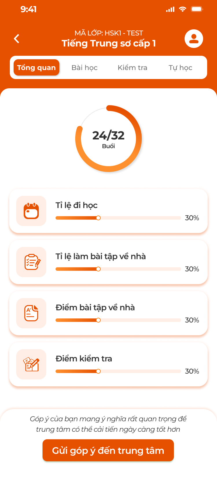
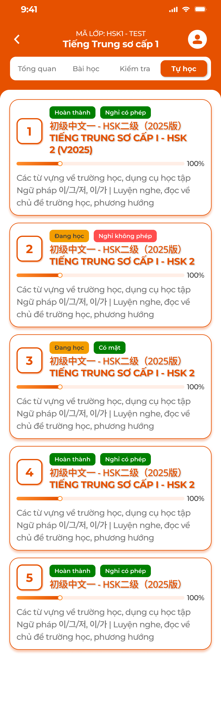

# [Học viên] Lớp học

Màn **chi tiết lớp** của app học viên, mở từ thẻ khoá học ở màn chính: header mã lớp + tên khoá, 4 tab `Tổng quan`, `Bài học`, `Kiểm tra`, `Tự học`. File này đặc tả tab **Tổng quan** và **Tự học**; tab Bài học xem [Bài học](../lesson/lesson.md), tab Kiểm tra xem [Kiểm tra](../test/test.md). Số liệu lấy từ ICS theo công thức của [Admin — Tổng quan lớp](../../management_requirement/class_management/class_detail_overview_requirements.md) và [Admin — Tự học](../../management_requirement/class_management/class_detail_self_study_requirements.md), tính riêng cho học viên đang đăng nhập.

## 1. UI

### Trang 1: Tab Tổng quan


*Tổng quan: vòng số buổi, 4 chỉ số, nút Gửi góp ý đến trung tâm — nhấn để xem ảnh gốc*

**Mô tả:**

- Tab mặc định khi vào lớp: tình hình học của chính học viên trong lớp và lối tắt gửi góp ý.

**Điểm cần lưu ý:**

- `A01.01` **Header**: Back (về màn chính), `MÃ LỚP: <mã>`, tên khoá học, icon tài khoản (mở Hồ sơ, xem [Tài khoản](../account/account.md)).
- `A01.02` **Thanh tab**: `Tổng quan` (mặc định), `Bài học`, `Kiểm tra`, `Tự học`; giữ tab khi quay lại từ màn con.
- `A01.03` **Vòng `x/y Buổi`**: x = số buổi lớp đã `Hoàn thành`; y = tổng số buổi của khoá học; vòng tô theo tỉ lệ.
- `A01.04` **`Tỉ lệ đi học`**: % = số buổi học viên được điểm danh đi học (Có mặt, Vào trễ, Ra sớm, Vào trễ & Ra sớm) / số buổi đã hoàn thành.
- `A01.05` **`Tỉ lệ làm bài tập về nhà`**: % = số BTVN học viên đã nộp / số BTVN đã giao (bài đã mở, học viên thuộc diện).
- `A01.06` **`Điểm bài tập về nhà`**: Trung bình điểm BTVN đã chấm (thang 10) của học viên, hiện dạng thanh % (điểm × 10).
- `A01.07` **`Điểm kiểm tra`**: Trung bình điểm bài kiểm tra đã chấm (thang 10) của học viên, thanh % tương tự.
- `A01.08` **Khối góp ý**: Dòng `Góp ý của bạn mang ý nghĩa rất quan trọng để trung tâm có thể cải tiến ngày càng tốt hơn` + nút `Gửi góp ý đến trung tâm` mở popup Góp ý ([Tài khoản](../account/account.md)).

- Chưa có dữ liệu (chưa buổi nào, chưa bài nào) → chỉ số `0` và thanh rỗng; không lỗi.
- Khác ảnh: ảnh ghi mọi thanh 30% (dữ liệu mẫu); hai thanh điểm hiển thị kèm số điểm `x.x` ở cuối thanh.
- Lớp `Hoàn thành` / `Huỷ bỏ` vẫn xem được tổng quan.

### Trang 2: Tab Tự học


*Tự học: thẻ bài tự học với tên gốc + tên dịch, tiến độ — nhấn để xem ảnh gốc*

**Mô tả:**

- Danh sách bài tự học của lớp (bài do Support thêm từ khoá học khác hoặc bài bổ sung); học viên học bất kỳ lúc nào; cấu trúc màn bài giống Chi tiết bài học nhưng không có Bài tập củng cố và không phụ thuộc giáo viên mở bài.

**Điểm cần lưu ý:**

- `A02.01` **Thẻ bài tự học**: Số thứ tự (ô cam), tag trạng thái học của học viên (`Chưa bắt đầu` / `Đang học` / `Hoàn thành`), tên bài gốc (cam) + tên dịch, thanh tiến độ % (trung bình 3 bước ôn tập + Kiến thức + Kỹ năng), mô tả.
- `A02.02` **Bấm thẻ**: Mở Chi tiết bài tự học: `PHẦN BẮT BUỘC` 3 bước (Duyệt kiến thức, Flashcard, Luyện nhớ chuyên sâu), `KIẾN THỨC`, `KỸ NĂNG` như [Bài học](../lesson/lesson.md); không có bước Bài tập củng cố.
- `A02.03` **Thời gian học**: App ghi thời gian học viên ở trong từng phần (Flashcard, Luyện nhớ, Từ vựng, Ngữ pháp, Chữ, Nghe, Đọc…) để ICS hiển thị cho giáo viên / Support.
- `A02.04` **Trống**: `Chưa có bài tự học nào`.

- Khác ảnh: ảnh có tag điểm danh trên thẻ tự học; bài tự học không có điểm danh, requirement bỏ tag này.
- Tiến độ làm tròn số nguyên %.

---

## 2. Yêu cầu

### 2.1. Flow chính

**Flow 1 / REQ01: Xem tổng quan lớp**

```text
Màn chính → thẻ khoá học → chi tiết lớp, tab Tổng quan
      → Hệ thống tính x/y buổi, 4 chỉ số của học viên từ dữ liệu ICS
      → Gửi góp ý đến trung tâm → popup Góp ý
```

**Flow 2 / REQ02 / REQ03: Tự học**

```text
Tab Tự học → danh sách bài tự học của lớp → bấm bài → 3 bước ôn tập + Kiến thức + Kỹ năng
      → App ghi thời gian từng phần → đồng bộ ICS
```

### 2.2. Ngoại lệ

- **EX01:** Chưa có buổi / bài → chỉ số 0, thanh rỗng.
- **EX02:** Lớp chưa có bài tự học → `Chưa có bài tự học nào`.
- **EX03:** Mất mạng → hiện số liệu lần tải gần nhất kèm nhãn `Dữ liệu cũ`, thời gian học lưu máy và đồng bộ sau.

### 2.3. Yêu cầu khác

| Mã | Tên yêu cầu | Mô tả |
|---|---|---|
| REQ01 | Chỉ số tổng quan | x/y buổi, Tỉ lệ đi học, Tỉ lệ làm BTVN, Điểm BTVN, Điểm kiểm tra tính cho học viên đang đăng nhập theo công thức Admin Tổng quan lớp; điểm thang 10. |
| REQ02 | Tự học | Bài tự học của lớp (Support thêm); cấu trúc như bài học trừ Bài tập củng cố; không điểm danh; học mọi lúc. |
| REQ03 | Thời gian học | Ghi thời gian ở từng phần của bài tự học theo học viên, đồng bộ ICS (giáo viên xem ở Chi tiết lớp → Tự học). |

### 2.4. Ràng buộc

#### Quyền

| Role | Xem Tổng quan | Tự học | Gửi góp ý |
|---|:---:|:---:|:---:|
| Học viên của lớp | ✅ | ✅ | ✅ |
| Người dùng trải nghiệm | ❌ | ❌ | ❌ |

#### Ràng buộc khác

**Phạm vi dữ liệu**

- Chỉ lớp học viên đang tham gia; số liệu của riêng học viên; backend kiểm tra thành viên lớp.

---

---

## 3. Testcase

### Feature: [Học viên] Lớp học

| Tên testcase | Priority | Scenario | Role | Pre-condition | Given/When/Then | Expected Result |
|---|---|---|---|---|---|---|
| Case 1: Mở lớp | High · Smoke | Flow 1 / REQ01 | Học viên | Lớp 32 buổi, 24 hoàn thành; học viên đi 20 buổi; nộp 18/22 BTVN, TB 7.2; KT TB 6.5 | **Given** bấm thẻ khoá<br>**When** tab Tổng quan<br>**Then** `24/32`, đi học 83%, BTVN 82%, điểm BTVN 7.2, KT 6.5 | - Công thức đúng |
| Case 2: Chưa có dữ liệu | Low | EX01 | Học viên | Lớp mới, chưa buổi | **Given** mở lớp<br>**When** render<br>**Then** `0/32`, 4 chỉ số 0 | - |
| Case 3: Gửi góp ý | Medium | Flow 1 | Học viên | Ở Tổng quan | **Given** bấm `Gửi góp ý đến trung tâm`<br>**When** popup<br>**Then** popup Góp ý mở | - Theo requirement Tài khoản |
| Case 4: Mở bài tự học | High · Smoke | Flow 2 / REQ02 | Học viên | Lớp có 5 bài tự học | **Given** tab `Tự học` → bấm bài 1<br>**When** màn tải<br>**Then** 3 bước bắt buộc, Kiến thức, Kỹ năng; không có Bài tập củng cố | - Không có tag điểm danh |
| Case 5: Ghi thời gian học | Medium | REQ03 | Học viên | Đang ở Flashcard bài tự học 2 phút | **Given** thoát<br>**When** đồng bộ<br>**Then** ICS ghi `00:02:00` cho phần Flashcard của học viên | - |
| Case 6: Không có bài | Low | EX02 | Học viên | Lớp chưa thêm | **Given** tab `Tự học`<br>**When** tải<br>**Then** `Chưa có bài tự học nào` | - |

---

---

## 4. Câu hỏi cần xác nhận

- **Q01:** Màn Chi tiết bài tự học chưa có ảnh (dùng chung bố cục Chi tiết bài học).
- **Q02:** Khác ảnh: tag điểm danh trên thẻ tự học bỏ; thanh điểm kèm số.
