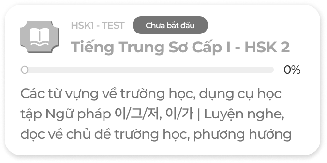
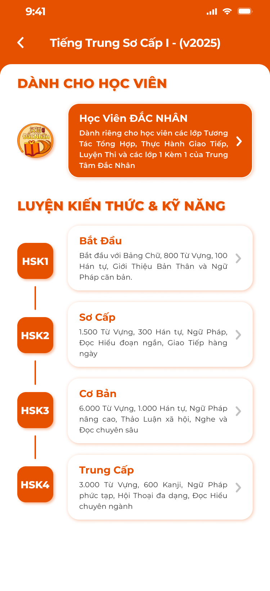

# [Học viên] Màn chính và trải nghiệm

## 1. UI

### Trang 1: Màn chính học viên




**Mô tả:**
- App học viên có hai chế độ: **Học viên** (đã đăng nhập, có lớp) và **Trải nghiệm** (chưa đăng nhập, học theo cấp độ, dùng thử 30 ngày; tương đương "247" của Sakumi). Màn chính đổi theo chế độ.
- Màn đầu sau đăng nhập: thư viện cá nhân, danh sách lớp đang tham gia, ưu đãi của trung tâm.

**Điểm cần lưu ý:**
- Header: logo trung tâm; dropdown chế độ `Học viên <Trung tâm>` (đổi sang chế độ trải nghiệm theo cấp độ); icon ⚙ Cài đặt.
- Banner `THƯ VIỆN HỌC TẬP`: mô tả + thanh % tổng thư viện; bấm mở [Thư viện học tập](../library/library.md).
- `KHOÁ HỌC CỦA BẠN`: thẻ mỗi lớp gồm mã lớp, tag trạng thái (`Chưa bắt đầu` xám, `Chưa hoàn thành` cam, `Hoàn thành` xanh lá), tên khoá, thanh % (bài đã hoàn thành / tổng bài), mô tả khoá. Thẻ `Chưa bắt đầu` mờ. Mặc định hiện 4 thẻ, `Xem thêm (N)` mở rộng. Bấm thẻ vào [Lớp học](../course/course.md).
- Trạng thái lớp: `Chưa bắt đầu` = lớp `Mới tạo` / `Trải nghiệm` / `Khai giảng` chưa mở bài; `Chưa hoàn thành` = `Đang học` / `Tạm ngưng`; `Hoàn thành` = `Hoàn thành`; lớp `Huỷ bỏ` không hiện.
- Thứ tự thẻ: `Chưa hoàn thành` → `Chưa bắt đầu` → `Hoàn thành`, trong nhóm mới nhất trước.
- `ƯU ĐÃI CỦA BẠN`: banner ưu đãi do trung tâm cấu hình (ảnh, link); bấm mở trang / popup chi tiết; không có thì ẩn khối.
- Trống: chưa được phân lớp hiện `Bạn chưa được phân công khoá học nào` + nút `Liên hệ Support`.
- Học viên thuộc nhiều trung tâm: dropdown chọn trung tâm; dữ liệu theo trung tâm đang chọn.

### Trang 2: Màn chính trải nghiệm theo cấp độ


**Mô tả:**
- Chế độ không cần tài khoản: học nội dung công khai của một cấp độ (HSK1…, N5…), có quảng cáo và giới hạn, thanh tab dưới `Kiến thức`, `Thư viện`.

**Điểm cần lưu ý:**
- Header: logo; dropdown cấp độ `HSK1 - Sơ Cấp 1` (mở Chọn trình độ); ⚙ Cài đặt.
- Banner quảng cáo: banner khuyến mãi của trung tâm + `Xem Chi Tiết`; người dùng VIP không thấy.
- Banner `THƯ VIỆN HỌC TẬP` như màn học viên; dữ liệu lưu trên máy.
- `BẢNG PHÁT ÂM` / `BẢNG CHỮ`: khối theo trung tâm (Pinyin / Kana / Hangul) với %; trung tâm không có hệ chữ thì ẩn (xem [Bảng chữ](../alphabet/alphabet.md)).
- `KIẾN THỨC NỀN`: thẻ `TỪ VỰNG`, `NGỮ PHÁP`, `HANZI` / `KANJI` (theo trung tâm) với %, mô tả; icon 👑 = nội dung VIP (mở popup VIP nếu chưa VIP). `KỸ NĂNG`: thẻ `NGHE`, `NÓI`, `ĐỌC` với %, icon 👑 tương tự.
- Thanh tab dưới chỉ có `Kiến thức` (màn này) và `Thư viện`; không có tab `Kiểm tra` và `Lộ trình` ở mọi trung tâm.
- Nội dung trải nghiệm = khoá học `Công khai` gắn cấp độ đó của trung tâm; cấp độ chưa có nội dung hiện `Hiện chưa có nội dung cho cấp độ này`.
- Học viên đã đăng nhập cũng vào được chế độ này qua dropdown header; dữ liệu Đã thuộc / thư viện khi đó lưu theo tài khoản.

### Trang 3: Chọn trình độ



**Mô tả:**
- Chọn cấp độ cho chế độ trải nghiệm, hoặc đi tới đăng nhập học viên.

**Điểm cần lưu ý:**
- Khối `DÀNH CHO HỌC VIÊN`: thẻ `Học Viên <Trung tâm>` mở màn Đăng nhập (xem [Tài khoản](../account/account.md)).
- Khối `LUYỆN KIẾN THỨC & KỸ NĂNG`: danh sách cấp độ của trung tâm (từ [Quản lý cấp độ](../../curriculum_management_requirement/level_management/level_management_requirements.md)) với tên, mô tả; chọn thì lưu và lọc toàn bộ nội dung theo cấp độ.

### Trang 4: Popup Trải nghiệm miễn phí 30 ngày


**Mô tả:**
- Người dùng chưa VIP được dùng thử toàn bộ nội dung một khoá học cấp độ trong 30 ngày kể từ lần đồng ý đầu tiên; hết hạn thì nội dung VIP khoá lại.

**Điểm cần lưu ý:**
- Nội dung: tiêu đề `Trải nghiệm MIỄN PHÍ khoá học 30 ngày`; 2 gạch đầu dòng: bấm Bài Học để xem lộ trình từng buổi (nội dung theo sát 100% trên lớp); app chỉ là công cụ ôn luyện và làm bài tập, nội dung chính là trực tiếp với giáo viên tại lớp.
- `Đồng Ý`: lần đầu bắt đầu đếm 30 ngày theo thiết bị + tài khoản (nếu có); các lần sau đóng popup. `Còn lại N ngày`: số ngày còn lại, `0` khi hết hạn.
- Khi hiện: mở app ở chế độ trải nghiệm khi chưa VIP; lần đầu bắt buộc, các lần sau hiện mỗi ngày một lần tới khi hết hạn; hết hạn hiện popup `Hết hạn trải nghiệm` với `Nâng cấp VIP` / `Tiếp tục dùng bản miễn phí`.
- Trong thời gian trải nghiệm: không quảng cáo, mở mọi nội dung 👑 của cấp độ đã chọn.
- Học viên đã đăng nhập (có lớp) không thấy popup và không bị giới hạn.

### Trang 5: VIP, mã quà tặng, khôi phục thanh toán, quảng cáo

**Mô tả:**
- Theo spec Sakumi 247, áp dụng cho chế độ trải nghiệm của mọi trung tâm.

**Điểm cần lưu ý:**
- Popup giới hạn (free): bấm nội dung 👑 khi chưa VIP / hết trải nghiệm hiện `Bài học này dành riêng cho thành viên VIP…`; `Nâng cấp VIP` mở màn thanh toán, `Đóng` đóng popup.
- Popup bản miễn phí: khi mở app hoặc sau một số thao tác hiện `Cảm ơn bạn đã sử dụng ứng dụng…` + `Bản miễn phí có thể xuất hiện quảng cáo và giới hạn một số tính năng…`; `Nâng cấp VIP` / `Tiếp tục dùng bản miễn phí`.
- Quảng cáo: free có banner cố định (chân màn, giữa bài), toàn màn hình trước nội dung 👑 (nút tắt sau vài giây), video ngắn ngẫu nhiên; VIP và đang trải nghiệm không quảng cáo.
- Thanh toán VIP: màn chọn gói `Tháng`, `3 tháng`, `6 tháng`, `12 tháng`, `Vĩnh viễn` với giá; `Thanh toán` gọi Apple Pay (iOS) / Google Play (Android). Thành công: tài khoản / thiết bị VIP, badge VIP, mở nội dung, tắt quảng cáo, popup cảm ơn (thay cho Toast). Thất bại: báo lỗi và thử lại. Chân màn có link `Điều Khoản`, `Chính sách riêng tư` (trang văn bản cuộn; lỗi tải `Không thể tải … Vui lòng thử lại sau.`). Không có gói: `Hiện chưa thể hiển thị danh sách gói VIP. Vui lòng thử lại sau.`
- Mã quà tặng: Cài đặt → `Nâng cấp VIP` → `Dùng mã quà tặng` gồm Họ tên, SĐT, Mã (2 chữ + 4 số, vd `AA1234`); icon QR mở camera (trước / sau, chọn ảnh) tự điền mã; `Kích hoạt mã` bật khi đủ 3 field đúng định dạng. Sai: `Mã không hợp lệ`, tối đa 3 lần / ngày, hết lượt thì khoá nút + `Vui lòng thử lại vào ngày mai`. Đúng: VIP + popup chúc mừng. Mã do Admin tạo ở [Gift code](../../tools/move_video/move_video.md).
- Khôi phục thanh toán: Cài đặt → `Khôi phục thanh toán` (chỉ hiện khi free), kiểm tra giao dịch theo Apple ID / Google. Có: `Khôi phục thành công, chúc mừng bạn!`; không: `Không tìm thấy gói VIP nào đã mua với tài khoản hiện tại`.
- VIP gắn với tài khoản cửa hàng (Apple / Google) và, nếu đăng nhập, với tài khoản app.
- Học viên có lớp `Đang học` được coi như VIP ở chế độ trải nghiệm của trung tâm mình.

---

## 2. Yêu cầu

### 2.1. Flow chính

**Flow 1: Màn chính học viên**

```
Đăng nhập → màn chính: Thư viện (% tổng), Khoá học của bạn (lớp của học viên theo trung tâm), Ưu đãi
      → thẻ lớp → chi tiết lớp
```

**Flow 2: Chế độ trải nghiệm**

```
Mở app chưa đăng nhập → Chọn trình độ → màn chính trải nghiệm theo cấp độ
      → Bảng chữ / Kiến thức nền / Kỹ năng / Thư viện (dữ liệu trên máy)
      → Dành cho học viên → Đăng nhập → màn chính học viên
```

**Flow 3: Trải nghiệm 30 ngày và giới hạn free**

```
Lần đầu chế độ trải nghiệm → popup 30 ngày → Đồng Ý → mở toàn bộ, không quảng cáo, đếm ngày
      → Hết hạn → popup hết hạn → free: nội dung 👑 khoá + quảng cáo, hoặc Nâng cấp VIP
```

**Flow 4: VIP**

```
Nâng cấp VIP → chọn gói → thanh toán cửa hàng → VIP (hoặc Dùng mã quà tặng → Kích hoạt mã → VIP)
      → Cài lại app → Khôi phục thanh toán → VIP
```

### 2.2. Ngoại lệ

- **EX01:** Học viên chưa được phân lớp → thông báo + `Liên hệ Support`; vẫn dùng Thư viện và chế độ trải nghiệm.
- **EX02:** Free bấm nội dung 👑 → popup giới hạn, không vào.
- **EX03:** Hết hạn trải nghiệm → popup hết hạn, khoá nội dung 👑, bật quảng cáo.
- **EX04:** Mã quà tặng sai 3 lần / ngày → khoá nút tới ngày mai.
- **EX05:** Thanh toán huỷ / lỗi → không đổi trạng thái, thông báo lỗi, thử lại.
- **EX06:** Cấp độ chưa có khoá học công khai → `Hiện chưa có nội dung cho cấp độ này`.
- **EX07:** Đăng nhập sau khi đã có dữ liệu trải nghiệm trên máy → hỏi `Gộp thư viện trải nghiệm vào tài khoản?`; đồng ý thì gộp (Đã thuộc và thư viện), từ chối thì giữ riêng trên máy.

### 2.3. Yêu cầu khác

| Mã | Tên yêu cầu | Mô tả |
|---|---|---|
| REQ01 | Màn chính học viên | Lớp của học viên theo trung tâm đang chọn, trạng thái theo bảng, thứ tự Chưa hoàn thành → Chưa bắt đầu → Hoàn thành; lớp Huỷ bỏ ẩn; 4 thẻ + Xem thêm; Ưu đãi theo cấu hình trung tâm. |
| REQ02 | Chế độ trải nghiệm | Không cần đăng nhập; cấp độ từ Quản lý cấp độ của trung tâm; nội dung = khoá học Công khai của cấp độ; dữ liệu học lưu thiết bị (lưu tài khoản nếu đã đăng nhập); thanh tab Kiến thức / Thư viện (không có Kiểm tra tổng hợp, Lộ trình). |
| REQ03 | Trải nghiệm và free | 30 ngày từ lần Đồng Ý đầu; trong hạn mở toàn bộ, không quảng cáo; ngoài hạn: nội dung 👑 cần VIP, quảng cáo banner / toàn màn / video; học viên có lớp Đang học không bị giới hạn. |
| REQ04 | VIP | 5 gói qua Apple Pay / Google Play; mã quà tặng `AA1234`, 3 lần / ngày, QR; khôi phục theo tài khoản cửa hàng; Điều khoản và Chính sách riêng tư; VIP tắt quảng cáo và mở nội dung. |

### 2.4. Ràng buộc

#### Quyền

| Role | Màn chính học viên | Chế độ trải nghiệm | Nội dung 👑 | Mua VIP / mã |
|---|:---:|:---:|:---:|:---:|
| Học viên có lớp Đang học | ✅ | ✅ | ✅ | ✅ |
| Học viên không có lớp Đang học | ✅ | ✅ | theo VIP / trải nghiệm | ✅ |
| Người dùng chưa đăng nhập | ❌ | ✅ | theo VIP / trải nghiệm | ✅ |

#### Ràng buộc khác

- Trải nghiệm chỉ thấy khoá học Công khai của cấp độ; học viên chỉ thấy lớp của mình; trạng thái VIP kiểm tra ở backend khi trả nội dung 👑.
- Mỗi thao tác một Toast: `Thành Công` (`Đã chuyển sang <cấp độ>`; `Kích hoạt VIP thành công`), `Cảnh Báo` (`Mã không hợp lệ`; `Vui lòng thử lại vào ngày mai`), `Có Lỗi Xảy Ra` (`Thanh toán không hoàn tất, vui lòng thử lại`). Popup chúc mừng VIP thay cho Toast khi thanh toán thành công.


---

## 3. Testcase

### Feature: [Học viên] Màn chính và trải nghiệm

| Tên testcase | Priority | Scenario | Role | Pre-condition | Given/When/Then | Expected Result |
|---|---|---|---|---|---|---|
| Case 1: Đăng nhập vào màn chính | High | Flow 1 / REQ01 | Học viên có lớp Đang học | 7 lớp: 2 Đang học, 1 Khai giảng, 3 Hoàn thành, 1 Huỷ | **Given:** đăng nhập thành công<br>**When:** màn chính render<br>**Then:** hiện 4 thẻ + `Xem thêm (2)`, lớp Huỷ không hiện | - Thứ tự đúng REQ01 |
| Case 2: Chưa có lớp | Medium | EX01 | Học viên không có lớp Đang học | Chưa phân lớp | **Given:** mở màn chính<br>**When:** render<br>**Then:** hiện `Bạn chưa được phân công khoá học nào` + `Liên hệ Support` | - Banner Thư viện vẫn có |
| Case 3: Ẩn ưu đãi | Low | REQ01 | Học viên có lớp Đang học | Trung tâm không cấu hình ưu đãi | **Given:** mở màn chính<br>**When:** render<br>**Then:** không có khối Ưu đãi | - |
| Case 4: Chọn trình độ | High | Flow 2 / REQ02 | Người dùng chưa đăng nhập | Trung tâm có 4 cấp độ | **Given:** mở app lần đầu<br>**When:** chọn `HSK2`<br>**Then:** màn chính theo HSK2, header `HSK2 - ...` | - Mở lại app giữ HSK2<br>- Toast `Đã chuyển sang HSK2` |
| Case 5: Học viên vào chế độ trải nghiệm | Medium | REQ02 | Học viên có lớp Đang học | Đã đăng nhập | **Given:** dropdown header → cấp độ `HSK1`<br>**When:** đổi<br>**Then:** vào màn chính trải nghiệm; Đã thuộc lưu theo tài khoản | - Dropdown → `Học viên` để quay về |
| Case 6: Bắt đầu trải nghiệm 30 ngày | High | Flow 3 / REQ03 | Người dùng chưa đăng nhập | Lần đầu mở, chưa VIP | **Given:** popup trải nghiệm hiện<br>**When:** bấm `Đồng Ý`<br>**Then:** `Còn lại 30 ngày`, nội dung 👑 mở, không quảng cáo | - Hôm sau mở app: popup `Còn lại 29 ngày` |
| Case 7: Hết hạn trải nghiệm | High | EX03 / REQ03 | Người dùng chưa đăng nhập | Ngày thứ 31 | **Given:** mở app<br>**When:** popup hết hạn hiện<br>**Then:** có `Nâng cấp VIP` / `Tiếp tục dùng bản miễn phí` | - Nội dung 👑 khoá, quảng cáo bật |
| Case 8: Nội dung VIP khi free | High | EX02 / REQ03 | Người dùng chưa đăng nhập | Hết trải nghiệm; thẻ NGỮ PHÁP có 👑 | **Given:** bấm thẻ có 👑<br>**When:** chưa VIP<br>**Then:** popup `Bài học này dành riêng cho thành viên VIP…` với `Nâng cấp VIP` / `Đóng` | - Không vào nội dung |
| Case 9: Mua VIP | High | Flow 4 / REQ04 | Người dùng chưa đăng nhập | Hết trải nghiệm | **Given:** `Nâng cấp VIP` → gói `3 tháng`<br>**When:** thanh toán cửa hàng thành công<br>**Then:** badge VIP, nội dung 👑 mở, quảng cáo tắt, popup cảm ơn | - Thất bại / huỷ: báo lỗi, thử lại, không đổi trạng thái (EX05) |
| Case 10: Mã quà tặng sai 3 lần | High | EX04 / REQ04 | Người dùng chưa đăng nhập | Đã sai 2 lần hôm nay | **Given:** nhập `AB1234` sai<br>**When:** bấm `Kích hoạt mã`<br>**Then:** `Mã không hợp lệ`, nút khoá, `Vui lòng thử lại vào ngày mai` | - Hôm sau mở lại được<br>- Quét QR tự điền ô Mã, vẫn cần `Kích hoạt mã` |
| Case 11: Khôi phục thanh toán | Medium | Flow 4 / REQ04 | Người dùng chưa đăng nhập | Từng mua VIP, cài lại app | **Given:** Cài đặt → `Khôi phục thanh toán`<br>**When:** tìm thấy giao dịch<br>**Then:** VIP, popup `Khôi phục thành công, chúc mừng bạn!` | - Không có giao dịch: `Không tìm thấy gói VIP nào đã mua với tài khoản hiện tại` |
| Case 12: Quảng cáo bản free | Medium | REQ03 | Người dùng chưa đăng nhập | Hết trải nghiệm, chưa VIP | **Given:** chuyển tab, mở nội dung 👑<br>**When:** render<br>**Then:** banner chân màn; quảng cáo toàn màn có nút tắt sau vài giây | - VIP không thấy quảng cáo |
| Case 13: Gộp dữ liệu trải nghiệm khi đăng nhập | Medium | EX07 | Người dùng chưa đăng nhập | Có dữ liệu thư viện trải nghiệm trên máy | **Given:** đăng nhập học viên<br>**When:** popup `Gộp thư viện trải nghiệm vào tài khoản?`<br>**Then:** đồng ý thì gộp Đã thuộc và thư viện; từ chối thì giữ riêng | - Người dùng chưa đăng nhập không vào được màn chính học viên |
| Case 14: Cấp độ chưa có nội dung | Low | EX06 | Người dùng chưa đăng nhập | Cấp độ chưa có khoá học Công khai | **Given:** chọn cấp độ đó<br>**When:** render<br>**Then:** hiện `Hiện chưa có nội dung cho cấp độ này` | - |

---

## 4. Câu hỏi cần xác nhận

- **Q01:** Các trang chưa có mã màn Figma, cần design cấp mã (theo quy ước `<HỌ>-<MODULE>-NNNNNN`) hoặc cho biết frame nằm ở file Figma nào.
- **Q02:** Giá gói VIP, nội dung nào gắn 👑.
- **Q03:** Nội dung banner quảng cáo / ưu đãi do ai cấu hình trên ICS (chưa có requirement).
- **Q04:** Trang 5 (màn thanh toán, mã quà tặng, khôi phục) và màn Cài đặt chưa có ảnh thiết kế.
