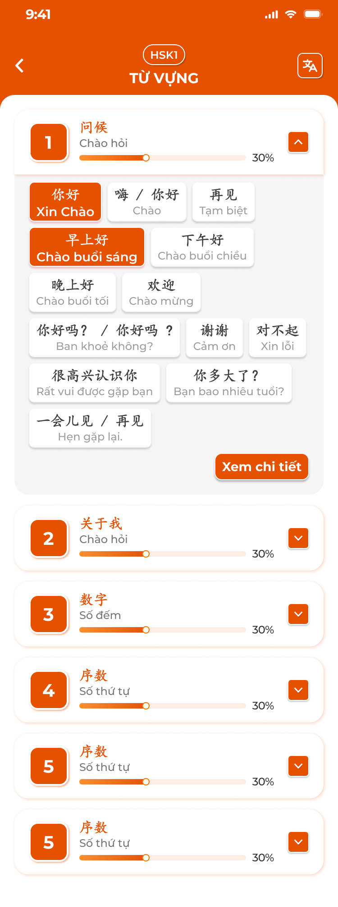
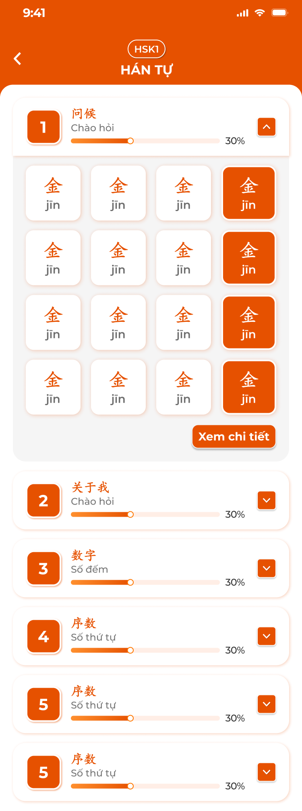
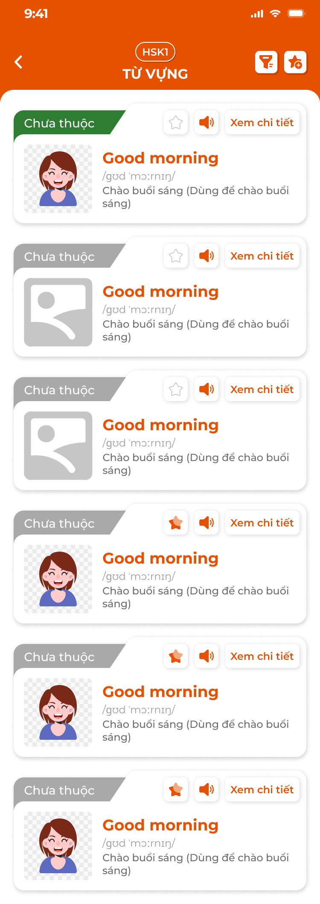
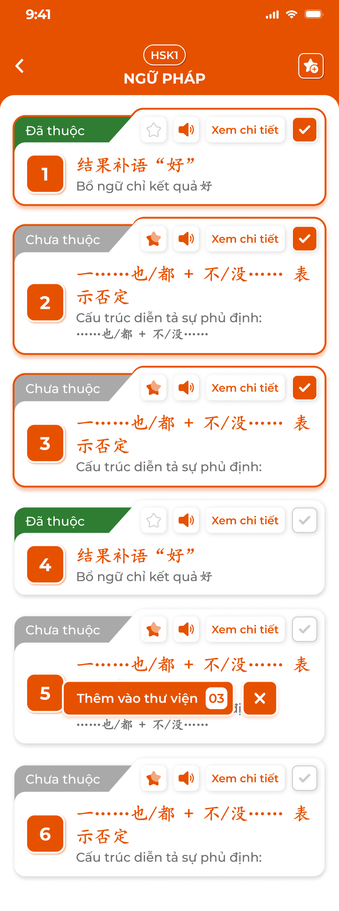
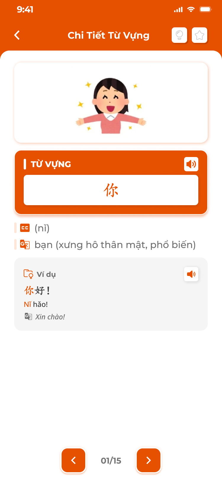
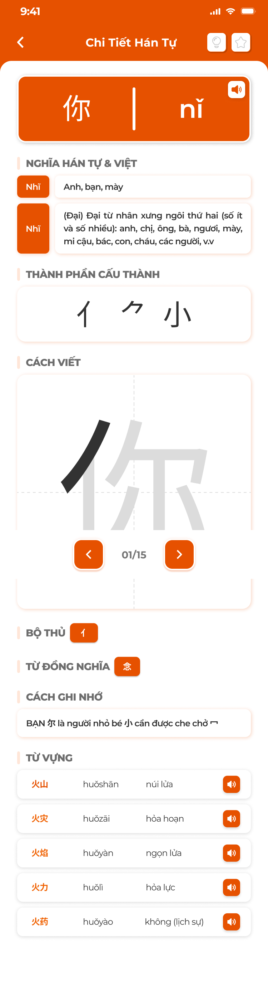
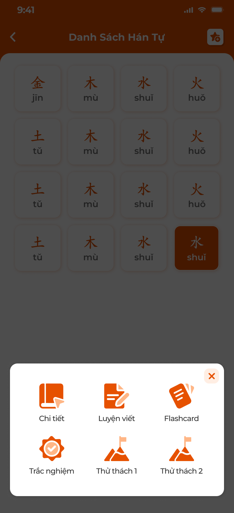

# [Học viên] Kiến thức

Các màn **Kiến thức** của app học viên: Từ vựng, Ngữ pháp, Chữ (Hanzi ở Đắc Nhân / Kanji ở Sakumi), Mẫu câu. Mở từ hàng thẻ Kiến thức trong [Chi tiết bài học](../lesson/lesson.md) (phạm vi: kiến thức của bài), từ màn chính 247 theo cấp độ (phạm vi: cả cấp độ, xem [Màn chính và trải nghiệm](../home_trial/home_trial.md)) hoặc từ [Thư viện học tập](../library/library.md) (phạm vi: mục đã lưu). Nội dung lấy từ [Kiến thức (S1)](../../course_management/knowledge-s1/knowledge-s1.md); app chỉ đọc.

Mỗi loại dùng chung bộ thao tác: danh sách theo cụm, chi tiết mục, đánh dấu `Đã thuộc`, lưu vào thư viện, Duyệt, Luyện tập (Học / Flashcard / Thử thách / Trắc nghiệm / Luyện viết tuỳ loại). Ảnh ví dụ tiếng Trung; chỗ chưa có ảnh để trống.

## 1. UI

### Trang 1: HV-KTH-010000 — Danh sách theo cụm




*Từ vựng theo cụm: chip từ, bật / tắt dịch nghĩa, popup xem nhanh — nhấn để xem ảnh gốc*



*Hanzi theo cụm: ô chữ + phiên âm; 4 trạng thái ô: chưa thuộc, đã thuộc, chọn nhiều, đã chọn — nhấn để xem ảnh gốc*

**Mô tả:**

- Màn đầu của mỗi loại kiến thức: các cụm (chủ đề) của S1, mỗi cụm mở ra danh sách mục dạng chip; bấm chip xem nhanh, `Xem chi tiết` mở danh sách thẻ đầy đủ.

**Điểm cần lưu ý:**

- `A01.01` **Header**: Back, badge cấp độ (vd `HSK1`), tên loại (`TỪ VỰNG`, `NGỮ PHÁP`, `HÁN TỰ` / `KANJI`, `MẪU CÂU`), nút góc phải: icon dịch (bật / tắt nghĩa) ở Từ vựng; icon lọc và icon ⭐+ (chọn nhiều) ở danh sách thẻ.
- `A01.02` **Thẻ cụm**: Số thứ tự (ô cam), tên cụm gốc + nghĩa, thanh tiến độ `%` = số mục Đã thuộc / tổng mục của cụm; nút `⌄` / `⌃` mở / thu. Mặc định mở cụm đầu tiên.
- `A01.03` **Chip mục**: Từ vựng, Mẫu câu: từ / câu gốc + nghĩa (ẩn nghĩa khi tắt dịch); Hanzi / Kanji: ô vuông chữ + phiên âm; Ngữ pháp: không dùng chip, đi thẳng danh sách thẻ. Chip Đã thuộc nền cam chữ trắng; Chưa thuộc nền trắng.
- `A01.04` **Bấm chip**: Popup xem nhanh: từ, nghĩa, hình (nếu có), nút loa, ví dụ `Vd1`, `Vd2` có highlight và dịch; nút `×`. Hanzi / Kanji: popup gồm chữ, phiên âm, Hán Việt, nghĩa, nút loa.
- `A01.05` **`Xem chi tiết`**: Mở Danh sách thẻ của cụm đang chọn.
- `A01.06` **Icon dịch**: Bật / tắt phần nghĩa dưới mọi chip; trạng thái nhớ theo thiết bị.

- Phạm vi mục theo nơi mở: từ bài học chỉ cụm / mục gắn với bài; từ màn 247 là toàn bộ cụm của cấp độ; từ Thư viện là mục đã lưu.
- Cụm không có mục nào gắn với phạm vi thì không hiện.
- Không có dữ liệu: `Hiện chưa có nội dung <loại> cho cấp độ này`.

### Trang 2: HV-KTH-010001 — Danh sách thẻ và chọn nhiều




*Thẻ mục: tag Đã thuộc / Chưa thuộc, ⭐ lưu, loa, Xem chi tiết; chế độ chọn nhiều với thanh "Thêm vào thư viện 03" — nhấn để xem ảnh gốc*



*Ngữ pháp chọn nhiều; lưới Hanzi với nút Duyệt / Luyện tập và chế độ chọn nhiều — nhấn để xem ảnh gốc*

**Mô tả:**

- Danh sách đầy đủ mục của cụm / phạm vi: Từ vựng, Ngữ pháp, Mẫu câu dạng thẻ; Hanzi / Kanji dạng lưới ô. Có chế độ chọn nhiều để lưu hàng loạt vào Thư viện; chân màn có `Duyệt` và `Luyện Tập`.

**Giải thích field/thành phần:**

- `A02.01` **Thẻ Từ vựng**: Góc trái tag `Đã thuộc` (xanh lá) / `Chưa thuộc` (xám); hình (hoặc ảnh mặc định); từ (cam), phiên âm, nghĩa (kèm chú thích cách dùng); nút ⭐ (lưu thư viện, sáng cam khi đã lưu), loa, `Xem chi tiết`.
- `A02.02` **Thẻ Ngữ pháp**: Tag thuộc, số thứ tự, cấu trúc (cam), mô tả ngắn; ⭐, loa, `Xem chi tiết`.
- `A02.03` **Thẻ Mẫu câu**: Tag thuộc, câu gốc, phiên âm, nghĩa; ⭐, loa, `Xem chi tiết`.
- `A02.04` **Ô Hanzi / Kanji**: Chữ + phiên âm; Đã thuộc nền cam; bấm ô mở Chi tiết chữ. Chân màn: nút `Duyệt`, `Luyện Tập`.
- `A02.05` **Icon lọc**: Lọc `Tất cả` / `Đã thuộc` / `Chưa thuộc`.
- `A02.06` **Icon ⭐+**: Bật chế độ chọn nhiều: mỗi thẻ / ô có checkbox; thẻ đã chọn viền cam; thanh nổi `Thêm vào thư viện` + số đã chọn và nút `×` thoát chế độ. Mục đã có trong thư viện tick sẵn, bỏ tick rồi xác nhận = gỡ khỏi thư viện.
- `A02.07` **⭐ trên thẻ**: Bấm để lưu / gỡ ngay một mục; Toast `Thành Công` `Đã cập nhật thư viện!`.

**Điểm cần lưu ý:**

- Trạng thái Đã thuộc và lưu thư viện đồng bộ với mọi màn khác (Duyệt, Flashcard, Chi tiết, Thư viện).
- Nhấn `Thêm vào thư viện` lưu toàn bộ tick, gỡ toàn bộ bỏ tick; Toast một lần.
- Ngữ pháp không có bước cụm: mở từ Chi tiết bài đi thẳng vào danh sách thẻ.

### Trang 3: HV-KTH-020000 — Chi tiết mục




*Chi tiết từ vựng (hình, từ, phiên âm, nghĩa, ví dụ); chi tiết ngữ pháp (cấu trúc, giải thích, cách dùng, ghi nhớ) — nhấn để xem ảnh gốc*



*Chi tiết Hanzi: nghĩa Hán tự & Việt, thành phần, cách viết từng nét, bộ thủ, từ đồng nghĩa, cách ghi nhớ, từ vựng liên quan — nhấn để xem ảnh gốc*

**Mô tả:**

- Màn đầy đủ một mục, điều hướng `<` `>` trong phạm vi danh sách; góc phải có 💡 (Đã thuộc) và ⭐ (lưu thư viện).

**Giải thích field/thành phần:**

- `A03.01` **Từ vựng**: Nội dung hiển thị: Hình minh hoạ; khối `TỪ VỰNG` + loa; phiên âm; nghĩa (kèm loại từ, chú thích); khối `Ví dụ` mỗi ví dụ gồm câu gốc có highlight, phiên âm, dịch, loa. Mở rộng (nếu có) hiện dưới ví dụ.
- `A03.02` **Ngữ pháp**: Nội dung hiển thị: Khối `CẤU TRÚC`; `GIẢI THÍCH NGỮ PHÁP`; `Cách Dùng VD1..n` (câu, phiên âm, dịch, loa, highlight điểm ngữ pháp); `GHI NHỚ 1..n` (lưu ý) kèm ví dụ `Ghi Nhớ VDn`; nút `Video` nếu có link video (mở popup YouTube, tốc độ 0.25x–2x, toàn màn hình).
- `A03.03` **Hanzi**: Nội dung hiển thị: Khối chữ + phiên âm + loa; `NGHĨA HÁN TỰ & VIỆT` (các âm Hán Việt và nghĩa); `THÀNH PHẦN CẤU THÀNH`; `CÁCH VIẾT` (hoạt hình nét, `n/N` nét, `<` `>`); `BỘ THỦ`; `TỪ ĐỒNG NGHĨA` (chip chữ giống); `CÁCH GHI NHỚ`; `TỪ VỰNG` (chữ, phiên âm, nghĩa, loa).
- `A03.04` **Kanji**: Nội dung hiển thị: Như Hanzi nhưng `Âm On`, `Âm Kun` dạng tag thay cho phiên âm; không có Thành phần nếu S1 không nhập.
- `A03.05` **Mẫu câu**: Nội dung hiển thị: Câu, phiên âm, nghĩa, loa; ví dụ ngữ cảnh nếu có.
- `A03.06` **💡**: Nội dung hiển thị: Bật = Đã thuộc (icon cam), tắt = Chưa thuộc; đổi ngay, không Toast.
- `A03.07` **⭐**: Nội dung hiển thị: Lưu / gỡ thư viện; Toast `Đã cập nhật thư viện!`.
- `A03.08` **`<` `>` `n/N`**: Nội dung hiển thị: Chuyển mục trong danh sách đang mở (giữ bộ lọc).

**Điểm cần lưu ý:**

- Field trống ở S1 thì ẩn khối tương ứng, không hiện `— trống —`.
- Loa phát audio của mục, không có thì TTS.
- Ảnh Chi tiết Hán tự: khối Cách viết dùng nét SVG của S1; chưa có SVG thì ẩn khối.

### Trang 4: HV-KTH-020010 — Duyệt


**Mô tả:**

- Xem lần lượt mục của phạm vi dạng thẻ một mặt, tự đánh giá `Đã thuộc` / `Cần học lại`, có `Quay lại`; kết thúc hiện tổng kết và `Duyệt lại`. Giống bước Duyệt kiến thức trong [Bài học](../lesson/lesson.md) nhưng chỉ cho loại đang mở.

**Điểm cần lưu ý:**

- `A04.01` **Thẻ**: Từ vựng: từ, nghĩa, ví dụ highlight; Ngữ pháp: cấu trúc, giải thích, ví dụ; Hanzi / Kanji: chữ, phiên âm, nghĩa, từ liên quan + loa; Mẫu câu: câu, phiên âm, nghĩa.
- `A04.02` **Nút**: `Cần Học Lại` / `Đã Thuộc`; `Quay Lại` từ thẻ 2.
- `A04.03` **Tổng kết**: `ĐÃ THUỘC` / `CẦN HỌC LẠI` số lượng, `Duyệt Lại`.

- `Đã thuộc` cập nhật trạng thái thuộc và % tiến độ; `Cần học lại` đưa mục về Chưa thuộc.
- Không có mục: `Không có <loại> nào để duyệt` + `Quay lại`.

### Trang 5: HV-KTH-020020 — Luyện tập




*Popup chọn chế độ luyện tập (Hanzi): Chi tiết, Luyện viết, Flashcard, Trắc nghiệm, Thử thách 1, Thử thách 2 — nhấn để xem ảnh gốc*

**Mô tả:**

- Bấm `Luyện Tập` mở popup chọn chế độ; bộ chế độ theo loại:

- `A05.01` **Từ vựng**: Chế độ: `Học`, `Flashcard`, `Thử thách`
- `A05.02` **Ngữ pháp**: Chế độ: `Học`, `Flashcard`, `Trắc nghiệm`
- `A05.03` **Hanzi / Kanji**: Chế độ: `Chi tiết`, `Luyện viết`, `Flashcard`, `Trắc nghiệm`, `Thử thách 1`, `Thử thách 2`
- `A05.04` **Mẫu câu**: Chế độ: `Học`, `Flashcard`

**Điểm cần lưu ý:**

- `A05.05` **`Học`**: Chuỗi Card nội dung (từ, nghĩa, ví dụ, `Tiếp tục`) và Flashcard (mặt trước câu ví dụ + loa; `Tiếp theo` lật; mặt sau hình, nghĩa, loại từ, dịch; `Hoàn thành` → `Tiếp tục`); sau 3–5 thẻ chèn câu kiểm tra (Trắc nghiệm 1 đáp án, Sắp xếp từ, Nối từ); sai thì hiện đáp án và làm lại; hết chuỗi: `Chúc mừng đã hoàn thành phần học`. Ngữ pháp: thẻ cấu trúc + ví dụ, câu kiểm tra Điền chỗ trống / Sắp xếp. Chữ: thẻ chữ → mặt sau âm, nghĩa, bộ thủ, ví dụ; câu kiểm tra chọn nghĩa / chọn âm đọc.
- `A05.06` **`Flashcard`**: Như Học qua Flashcard ở Bài học: 3 loại thẻ, Tuỳ chỉnh (Xem tất cả, Xáo trộn, Chạy tự động, Loại 1–3), tag Đã thuộc / Chưa thuộc, loa, `<` `>` và vuốt. Chữ: loại 1 chữ → nghĩa + âm + ví dụ; loại 2 nghĩa → chữ + âm + ví dụ; loại 3 chữ + hình → đầy đủ. Mọi thẻ Đã thuộc: màn `Chúc mừng bạn hoàn thành Flashcard` + `Xem tất cả`.
- `A05.07` **`Thử thách` (Từ vựng)**: Trắc nghiệm hình + từ → 4 nghĩa; đồng hồ 10 giây / câu; 3 sao = 3 lượt sai; đúng viền xanh, sai viền đỏ mất 1 sao; hết sao: popup `Thật tiếc, bạn không vượt qua được thử thách`; hết câu: `Chúc mừng bạn đã vượt qua thử thách!`; nút `Quay lại` / `Làm lại`. Không đổi trạng thái thuộc.
- `A05.08` **`Trắc nghiệm` (Ngữ pháp)**: Câu Điền chỗ trống (4 lựa chọn) và Sắp xếp câu; `<` `>` chuyển câu, `n/N`, `Xem hướng dẫn`, `Kết thúc` → popup xác nhận `Số câu chưa hoàn thành: X/Y` với `Làm lại` / `Xem đáp án`; kết quả: từng câu đúng xanh / sai đỏ, câu bỏ qua ghi `Bạn đã bỏ qua câu này`, đáp án đúng, điểm thang 10 và nhận xét. Kết quả không lưu.
- `A05.09` **`Trắc nghiệm` (Chữ)**: Câu hỏi là chữ hoặc audio; 4 đáp án (nghĩa hoặc âm); phản hồi xanh / đỏ, tự chuyển câu; thanh tiến độ; kết quả % đúng, danh sách chữ, `Làm lại`.
- `A05.10` **`Luyện viết` (Chữ)**: Khung chữ mẫu, khung kẻ ô để viết tay theo thứ tự nét; `Hoàn tác`, `Xoá`, `Ẩn / Hiện hướng dẫn`, loa, `<` `>`; `Kiểm tra` so nét với mẫu: popup xanh `Đúng` hoặc đỏ `Sai` kèm chữ mẫu.
- `A05.11` **`Thử thách 1` / `2` (Chữ)**: 16 câu, mỗi câu 5–7 giây; Thử thách 1: hiện phiên âm → chọn 1 trong 16 ô chữ; Thử thách 2: hiện chữ → chọn 1 trong 16 ô phiên âm; sai hoặc hết giờ mất 1 tim (3 tim); thông báo `Làm tốt lắm, tiếp tục nào` / `Sai rồi bạn ơi, ‘x’ mới đúng` / `Hết giờ cho câu này`; kết quả `Thành công rồi!` / `Hãy luyện tập thật tốt nhé!`. Đúng thì chữ chuyển Đã thuộc.
- `A05.12` **`Chi tiết` (Chữ)**: Mở Chi tiết mục, duyệt bằng `<` `>` qua cả phạm vi.

- Chế độ `Học`, `Flashcard` cập nhật trạng thái thuộc khi học viên bấm tag; `Thử thách` Từ vựng và `Trắc nghiệm` Ngữ pháp không đổi trạng thái; Thử thách chữ đổi khi trả lời đúng.
- Phạm vi luyện tập = danh sách đang mở (cụm hoặc bộ lọc).
- Không có mục: `Không có nội dung để luyện tập`.

### Trang 6: Toast phản hồi CRUD


*Toast Thành Công, Thông Báo, Cảnh Báo và Có Lỗi Xảy Ra — nhấn để xem ảnh gốc*

**Mô tả:**

- Phản hồi khi lưu / gỡ thư viện; đổi trạng thái thuộc không Toast.

**Điểm cần lưu ý:**

- `A06.01` **Thành công**: Tiêu đề cố định: `Thành Công`; Khi sử dụng: `Đã cập nhật thư viện!`
- `A06.02` **Cảnh báo**: Tiêu đề cố định: `Cảnh Báo`; Khi sử dụng: `Không có kết nối, vui lòng thử lại`
- `A06.03` **Lỗi**: Tiêu đề cố định: `Có Lỗi Xảy Ra`; Khi sử dụng: `Cập nhật thư viện thất bại`

- Chọn nhiều: một Toast cho cả lần xác nhận.

---

## 2. Yêu cầu

### 2.1. Flow chính

**Flow 1 / REQ01 / REQ02: Xem kiến thức**

```text
Mở loại kiến thức (từ bài học / 247 / Thư viện) → cụm trong phạm vi, cụm đầu mở sẵn
      → Chip → popup xem nhanh; Xem chi tiết → danh sách thẻ (lọc, chọn nhiều)
      → Thẻ → Chi tiết mục (< > trong danh sách), 💡 Đã thuộc, ⭐ lưu
```

**Flow 2 / REQ03: Lưu vào thư viện**

```text
⭐ trên thẻ / chi tiết → lưu hoặc gỡ ngay → Toast "Đã cập nhật thư viện!"
⭐+ → chế độ chọn nhiều → tick / bỏ tick → "Thêm vào thư viện N" → lưu tick, gỡ bỏ tick → Toast → thoát chế độ
```

**Flow 3 / REQ04: Duyệt**

```text
Duyệt → thẻ 1/N → Đã Thuộc / Cần Học Lại (Quay Lại để sửa) → tổng kết → Duyệt Lại
```

**Flow 4 / REQ05: Luyện tập**

```text
Luyện Tập → popup chế độ theo loại → chạy chế độ trên phạm vi đang mở
      → Học / Flashcard: đổi trạng thái thuộc khi bấm tag; Thử thách / Trắc nghiệm: chỉ kết quả phiên
      → Kết thúc: màn / popup kết quả, Làm lại hoặc Quay lại
```

### 2.2. Ngoại lệ

- **EX01:** Phạm vi không có mục → `Hiện chưa có nội dung <loại> cho cấp độ này` / `Không có <loại> nào để duyệt` / `Không có nội dung để luyện tập`.
- **EX02:** Thử thách: sai 3 lần hoặc hết giờ 3 lần → popup thua, cho làm lại; không ghi gì.
- **EX03:** Mất mạng khi lưu thư viện / đổi thuộc → giữ trạng thái cũ, Toast `Cảnh Báo`.
- **EX04:** Mục bị CD chuyển Vô hiệu hoặc gỡ khỏi bài → không còn trong danh sách bài; mục đã lưu thư viện vẫn xem được ở Thư viện.
- **EX05:** Trả lời sai trong chế độ Học → hiện đáp án đúng, bắt làm lại; không chuyển tiếp.

### 2.3. Yêu cầu khác

| Mã | Tên yêu cầu | Mô tả |
|---|---|---|
| REQ01 | Nguồn và phạm vi | Dữ liệu từ S1 (cụm, mục, field) chỉ đọc; phạm vi theo nơi mở: bài học (mục gắn bài), 247 (cấp độ), Thư viện (mục đã lưu). Loại Chữ theo trung tâm (Hanzi Đắc Nhân, Kanji Sakumi). |
| REQ02 | Hiển thị | Cụm có tiến độ % Đã thuộc; chip / thẻ / ô theo loại; chi tiết mục đủ field có dữ liệu, ẩn field trống; bật / tắt dịch nghĩa nhớ theo thiết bị; bộ lọc Tất cả / Đã thuộc / Chưa thuộc. |
| REQ03 | Thư viện | ⭐ lưu / gỡ một mục; chọn nhiều lưu / gỡ hàng loạt; Toast `Đã cập nhật thư viện!`. |
| REQ04 | Trạng thái thuộc | Một trạng thái theo học viên và mục, dùng chung mọi màn; 💡, tag trên thẻ, Duyệt, Flashcard, Thử thách chữ (đúng) đều đổi được; Cần học lại = Chưa thuộc. |
| REQ05 | Luyện tập | Bộ chế độ theo loại như bảng; Học chèn kiểm tra sau 3–5 thẻ; Flashcard 3 loại + Tuỳ chỉnh; Thử thách 10 giây / câu, 3 sao; Trắc nghiệm ngữ pháp điểm thang 10 không lưu; Luyện viết so nét; Thử thách chữ 16 câu, 5–7 giây, 3 tim. |
| REQ06 | Audio | Loa phát audio mục, không có thì TTS theo ngôn ngữ trung tâm. |

### 2.4. Ràng buộc

#### Quyền

| Role | Xem | Đã thuộc / lưu thư viện | Duyệt / Luyện tập |
|---|:---:|:---:|:---:|
| Học viên (đăng nhập) | ✅ | ✅ | ✅ |
| Người dùng trải nghiệm (chưa đăng nhập) | ✅ nội dung mở của cấp độ | ✅ lưu trên máy | ✅ |

#### Ràng buộc khác

**Phạm vi dữ liệu**

- Học viên: trạng thái thuộc và thư viện lưu server theo tài khoản; người dùng trải nghiệm lưu trên thiết bị (xem [Màn chính và trải nghiệm](../home_trial/home_trial.md)).
- Backend chỉ trả mục thuộc khoá học / cấp độ học viên được phép.

---

---

## 3. Testcase

### Feature: [Học viên] Kiến thức

| Tên testcase | Priority | Scenario | Role | Pre-condition | Given/When/Then | Expected Result |
|---|---|---|---|---|---|---|
| Case 1: Mở Từ vựng từ bài học | High · Smoke | Flow 1 / REQ01 | Học viên | Bài gắn 2 cụm từ vựng | **Given** bấm thẻ `Từ vựng` ở Chi tiết bài<br>**When** màn tải<br>**Then** 2 cụm, cụm 1 mở sẵn, chip đúng mục của bài | - % cụm theo số Đã thuộc |
| Case 2: Tắt dịch nghĩa | Medium | REQ02 | Học viên | Đang bật dịch | **Given** bấm icon dịch<br>**When** đổi<br>**Then** chip chỉ còn từ gốc | - Vào lại vẫn tắt |
| Case 3: Popup xem nhanh | Medium | REQ02 | Học viên | Chip `你好` | **Given** bấm chip<br>**When** popup<br>**Then** từ, nghĩa, hình, loa, 2 ví dụ | - `×` đóng, không đổi trạng thái |
| Case 4: Hanzi theo cụm | Medium | REQ01 | Học viên Đắc Nhân | Cụm 1 có 16 chữ, 4 đã thuộc | **Given** mở Hán tự<br>**When** render<br>**Then** 16 ô, 4 ô nền cam | - Học viên Sakumi thấy tiêu đề `KANJI` |
| Case 5: Lưu một mục | High · Smoke | Flow 2 / REQ03 | Học viên | Thẻ `Good morning` chưa lưu | **Given** bấm ⭐<br>**When** backend lưu<br>**Then** ⭐ sáng cam, Toast `Đã cập nhật thư viện!` | - Thư viện có mục này |
| Case 6: Chọn nhiều | High | Flow 2 / REQ03 | Học viên | 6 thẻ, 2 đã lưu | **Given** bấm ⭐+ → tick thêm 1, bỏ tick 1 đã lưu<br>**When** `Thêm vào thư viện 02`<br>**Then** thư viện: +1, −1 | - Một Toast<br>- Thoát chế độ chọn |
| Case 7: Lọc Chưa thuộc | Medium | REQ02 | Học viên | 6 thẻ, 2 Đã thuộc | **Given** lọc `Chưa thuộc`<br>**When** áp dụng<br>**Then** 4 thẻ | - |
| Case 8: Lưới Hanzi | Medium | REQ01 | Học viên Đắc Nhân | Cụm 16 chữ | **Given** mở danh sách<br>**When** render<br>**Then** lưới 4 cột, nút `Duyệt` `Luyện Tập` | - Bấm ô mở Chi tiết chữ |
| Case 9: Chi tiết từ vựng | High · Smoke | Flow 1 / REQ02 | Học viên | Từ `你` có 1 ví dụ | **Given** `Xem chi tiết`<br>**When** màn tải<br>**Then** hình, từ, phiên âm, nghĩa, ví dụ highlight `你`, `01/15` | - Loa phát audio |
| Case 10: Đánh dấu thuộc | High | REQ04 | Học viên | 💡 đang tắt | **Given** bấm 💡<br>**When** lưu<br>**Then** icon cam; thẻ ở danh sách tag `Đã thuộc` | - % cụm tăng |
| Case 11: Ngữ pháp có video | Medium | REQ02 | Học viên | Điểm ngữ pháp có link YouTube | **Given** bấm `Video`<br>**When** popup<br>**Then** video phát, đổi được tốc độ | - Không có link thì ẩn nút |
| Case 12: Chi tiết Hanzi | Medium | REQ02 | Học viên Đắc Nhân | Chữ `你` có SVG nét | **Given** bấm ô<br>**When** màn tải<br>**Then** khối Cách viết chạy nét, bộ thủ `亻`, từ vựng liên quan | - |
| Case 13: Duyệt cụm | High · Smoke | Flow 3 / REQ04 | Học viên | Cụm 10 từ | **Given** bấm `Duyệt`<br>**When** 8 Đã thuộc, 2 Cần học lại<br>**Then** tổng kết `8` / `2` | - % cụm = 80% |
| Case 14: Duyệt rỗng | Low | EX01 | Học viên | Cụm 0 mục trong phạm vi | **Given** bấm `Duyệt`<br>**When** tải<br>**Then** `Không có từ nào để duyệt` | - |
| Case 15: Chọn chế độ theo loại | High · Smoke | Flow 4 / REQ05 | Học viên | Mở Từ vựng, Ngữ pháp, Hanzi | **Given** bấm `Luyện Tập` ở từng màn<br>**When** popup<br>**Then** Từ vựng 3 chế độ, Ngữ pháp 3, Hanzi 6 | - Đúng bảng chế độ |
| Case 16: Học có câu kiểm tra | High | Flow 4 / REQ05 | Học viên | Cụm 10 từ | **Given** chế độ Học<br>**When** qua 4 thẻ<br>**Then** chèn câu kiểm tra; sai thì làm lại | - Hết chuỗi: thông báo hoàn thành |
| Case 17: Thử thách thua | Medium | EX02 / REQ05 | Học viên | Chế độ Thử thách | **Given** sai 3 câu<br>**When** mất sao thứ 3<br>**Then** popup `Thật tiếc...`, `Quay lại` / `Làm lại` | - Trạng thái thuộc không đổi |
| Case 18: Trắc nghiệm ngữ pháp | Medium | REQ05 | Học viên | 13 câu, làm 2 | **Given** `Kết thúc`<br>**When** popup `Số câu chưa hoàn thành: 11/13`<br>**Then** `Xem đáp án` hiện kết quả, câu trống ghi bỏ qua | - Điểm thang 10, không lưu |
| Case 19: Luyện viết Hanzi | Medium | REQ05 | Học viên Đắc Nhân | Chữ `你` | **Given** viết tay, `Kiểm tra`<br>**When** nét khớp<br>**Then** popup xanh `Đúng` | - `Hoàn tác` bỏ nét cuối |
| Case 20: Thử thách 1 Hanzi | Medium | REQ05 | Học viên Đắc Nhân | 16 chữ | **Given** chọn đúng 16 câu<br>**When** hết<br>**Then** `Thành công rồi!`, 16 chữ Đã thuộc | - Hết giờ 1 câu mất 1 tim |
| Toast Case 1: Thành công | High | Ràng buộc Toast CRUD | Học viên | Mạng ổn | **Given** bấm ⭐<br>**When** lưu xong<br>**Then** Toast `Thành Công` | - Một Toast |
| Toast Case 2: Lỗi | Medium | Ràng buộc Toast CRUD | Học viên | Backend lỗi | **Given** bấm ⭐<br>**When** thất bại<br>**Then** Toast `Có Lỗi Xảy Ra`, ⭐ giữ trạng thái cũ | - |

---

---

## 4. Câu hỏi cần xác nhận

- **Q01:** Màn Duyệt, chế độ Học, Thử thách, Trắc nghiệm ngữ pháp, Luyện viết, Thử thách 1–2 chữ, chi tiết Mẫu câu chưa có ảnh thiết kế.
- **Q02:** Thời gian Thử thách (10 giây / câu) và Thử thách chữ (5–7 giây / câu) lấy theo spec cũ, cần chốt số cụ thể.
- **Q03:** Kanji: field `Thành phần cấu thành` và `Cách viết` có hiển thị như Hanzi không (S1 Kanji không bắt buộc Thứ tự nét).
