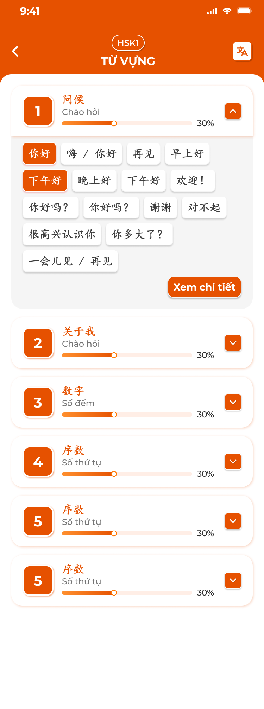
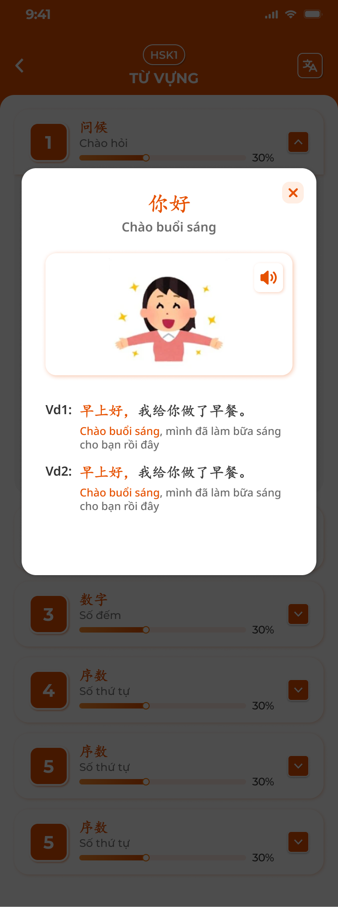
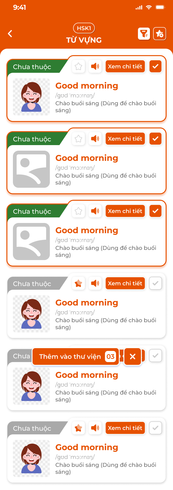
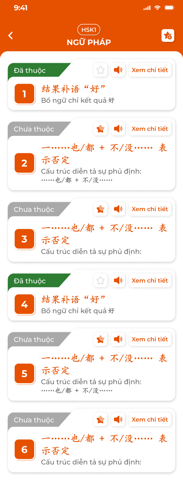
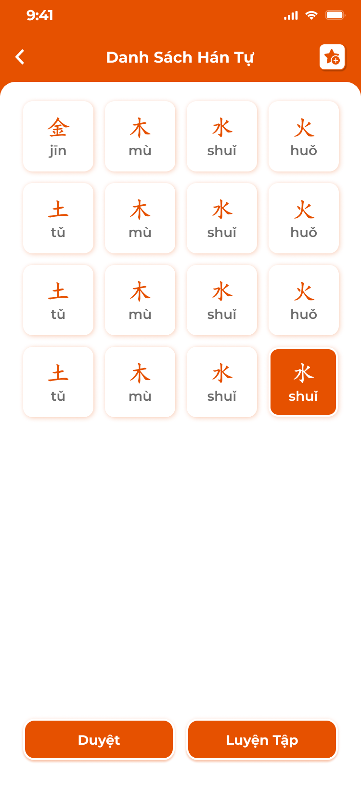
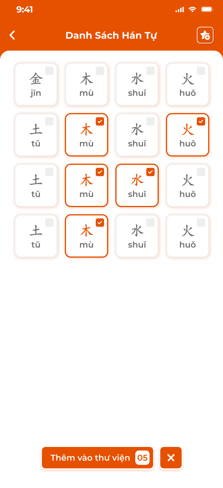
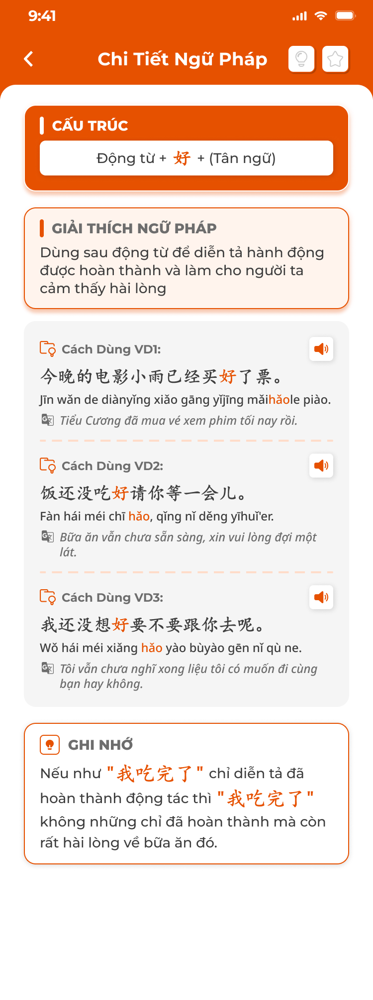
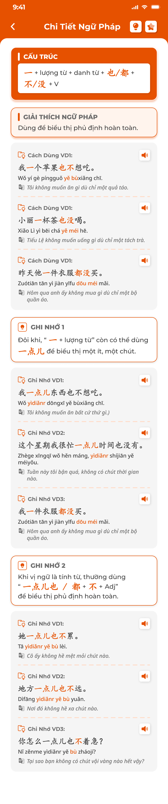

# [Học viên] Kiến thức

## 1. UI

### Trang 1: Danh sách theo cụm







**Mô tả:**
- Các màn **Kiến thức** của app học viên: Từ vựng, Ngữ pháp, Chữ (Hanzi ở Đắc Nhân / Kanji ở Sakumi), Mẫu câu. Mở từ hàng thẻ Kiến thức trong [Chi tiết bài học](../lesson/lesson.md) (phạm vi: kiến thức của bài), từ màn chính trải nghiệm theo cấp độ (phạm vi: cả cấp độ, xem [Màn chính và trải nghiệm](../home_trial/home_trial.md)) hoặc từ [Thư viện học tập](../library/library.md) (phạm vi: mục đã lưu). Nội dung lấy từ [Kiến thức (S1)](../../course_management/knowledge-s1/knowledge-s1.md); app chỉ đọc.
- Mỗi loại dùng chung bộ thao tác: danh sách theo cụm, chi tiết mục, đánh dấu `Đã thuộc`, lưu vào thư viện, Duyệt, Luyện tập. Ảnh ví dụ tiếng Trung.
- Màn đầu của mỗi loại: các cụm (chủ đề) của S1, mỗi cụm mở ra danh sách mục dạng chip; bấm chip xem nhanh, `Xem chi tiết` mở danh sách thẻ đầy đủ.

**Điểm cần lưu ý:**
- Header: Back, badge cấp độ (vd `HSK1`), tên loại (`TỪ VỰNG`, `NGỮ PHÁP`, `HÁN TỰ` / `KANJI`, `MẪU CÂU`); icon dịch (bật / tắt nghĩa) ở Từ vựng, nhớ theo thiết bị.
- Thẻ cụm: số thứ tự (ô cam), tên cụm gốc + nghĩa, thanh tiến độ `%` = số mục Đã thuộc / tổng mục của cụm; nút `⌄` / `⌃` mở / thu. Mặc định mở cụm đầu tiên.
- Chip mục: Từ vựng, Mẫu câu hiện từ / câu gốc + nghĩa (ẩn nghĩa khi tắt dịch); Hanzi / Kanji hiện ô vuông chữ + phiên âm; Ngữ pháp không dùng chip, đi thẳng danh sách thẻ. Chip Đã thuộc nền cam chữ trắng; Chưa thuộc nền trắng.
- Bấm chip mở popup xem nhanh: từ, nghĩa, hình (nếu có), loa, ví dụ `Vd1`, `Vd2` có highlight và dịch, nút `×`. Hanzi / Kanji: popup gồm chữ, phiên âm, Hán Việt, nghĩa, loa. `Xem chi tiết` mở Danh sách thẻ của cụm đang chọn.
- Phạm vi mục theo nơi mở: từ bài học chỉ cụm / mục gắn với bài; từ màn chính trải nghiệm là toàn bộ cụm của cấp độ; từ Thư viện là mục đã lưu. Cụm không có mục nào gắn với phạm vi thì không hiện.
- Không có dữ liệu: `Hiện chưa có nội dung <loại> cho cấp độ này`.

### Trang 2: Danh sách thẻ và chọn nhiều











**Mô tả:**
- Danh sách đầy đủ mục của cụm / phạm vi: Từ vựng, Ngữ pháp, Mẫu câu dạng thẻ; Hanzi / Kanji dạng lưới ô. Có chế độ chọn nhiều để lưu hàng loạt vào Thư viện; chân màn có `Duyệt` và `Luyện Tập`.

**Điểm cần lưu ý:**
- Thẻ Từ vựng: góc trái tag `Đã thuộc` (xanh lá) / `Chưa thuộc` (xám); hình (hoặc ảnh mặc định); từ (cam), phiên âm, nghĩa (kèm chú thích cách dùng); ⭐ (sáng cam khi đã lưu), loa, `Xem chi tiết`.
- Thẻ Ngữ pháp: tag thuộc, số thứ tự, cấu trúc (cam), mô tả ngắn. Thẻ Mẫu câu: tag thuộc, câu gốc, phiên âm, nghĩa. Ngữ pháp không có bước cụm: mở từ Chi tiết bài đi thẳng vào danh sách thẻ.
- Ô Hanzi / Kanji: chữ + phiên âm; Đã thuộc nền cam; bấm ô mở Chi tiết chữ. Chân màn có `Duyệt`, `Luyện Tập`.
- Icon lọc: `Tất cả` / `Đã thuộc` / `Chưa thuộc`.
- Icon ⭐+ bật chế độ chọn nhiều: mỗi thẻ / ô có checkbox; thẻ đã chọn viền cam; thanh nổi `Thêm vào thư viện` + số đã chọn và nút `×` thoát chế độ. Mục đã có trong thư viện tick sẵn, bỏ tick rồi xác nhận = gỡ khỏi thư viện. Nhấn `Thêm vào thư viện` lưu toàn bộ tick, gỡ toàn bộ bỏ tick; Toast một lần.
- ⭐ trên thẻ: lưu / gỡ ngay một mục; Toast `Thành Công` `Đã cập nhật thư viện!`.
- Trạng thái Đã thuộc và lưu thư viện đồng bộ với mọi màn khác (Duyệt, Flashcard, Chi tiết, Thư viện).

### Trang 3: Chi tiết mục







**Mô tả:**
- Màn đầy đủ một mục, điều hướng `<` `>` `n/N` trong phạm vi danh sách đang mở (giữ bộ lọc); góc phải có 💡 (Đã thuộc) và ⭐ (lưu thư viện).

**Điểm cần lưu ý:**
- Từ vựng: hình minh hoạ; khối `TỪ VỰNG` + loa; phiên âm; nghĩa (kèm loại từ, chú thích); khối `Ví dụ` mỗi ví dụ gồm câu gốc có highlight, phiên âm, dịch, loa. Mở rộng (nếu có) hiện dưới ví dụ.
- Ngữ pháp: `CẤU TRÚC`; `GIẢI THÍCH NGỮ PHÁP`; `Cách Dùng VD1..n` (câu, phiên âm, dịch, loa, highlight điểm ngữ pháp); `GHI NHỚ 1..n` kèm ví dụ `Ghi Nhớ VDn`; nút `Video` nếu có link video (mở popup YouTube, tốc độ 0.25x–2x, toàn màn hình).
- Hanzi: khối chữ + phiên âm + loa; `NGHĨA HÁN TỰ & VIỆT`; `THÀNH PHẦN CẤU THÀNH`; `CÁCH VIẾT` (hoạt hình nét, `n/N` nét, `<` `>`); `BỘ THỦ`; `TỪ ĐỒNG NGHĨA` (chip chữ giống); `CÁCH GHI NHỚ`; `TỪ VỰNG` (chữ, phiên âm, nghĩa, loa). Kanji như Hanzi nhưng `Âm On`, `Âm Kun` dạng tag thay cho phiên âm; không có Thành phần nếu S1 không nhập.
- Mẫu câu: câu, phiên âm, nghĩa, loa; ví dụ ngữ cảnh nếu có.
- 💡 bật = Đã thuộc (icon cam), tắt = Chưa thuộc; đổi ngay, không Toast. ⭐ lưu / gỡ thư viện; Toast `Đã cập nhật thư viện!`.
- Field trống ở S1 thì ẩn khối tương ứng, không hiện `— trống —`. Cách viết dùng nét SVG của S1; chưa có SVG thì ẩn khối.
- Loa phát audio của mục, không có thì TTS.

### Trang 4: Duyệt

**Mô tả:**
- Xem lần lượt mục của phạm vi dạng thẻ một mặt, tự đánh giá `Đã thuộc` / `Cần học lại`, có `Quay lại`; kết thúc hiện tổng kết và `Duyệt lại`. Giống bước Duyệt kiến thức trong [Bài học](../lesson/lesson.md) nhưng chỉ cho loại đang mở.

**Điểm cần lưu ý:**
- Thẻ: Từ vựng hiện từ, nghĩa, ví dụ highlight; Ngữ pháp hiện cấu trúc, giải thích, ví dụ; Hanzi / Kanji hiện chữ, phiên âm, nghĩa, từ liên quan + loa; Mẫu câu hiện câu, phiên âm, nghĩa.
- Nút `Cần Học Lại` / `Đã Thuộc`; `Quay Lại` từ thẻ 2. Tổng kết `ĐÃ THUỘC` / `CẦN HỌC LẠI` số lượng, `Duyệt Lại`.
- `Đã thuộc` cập nhật trạng thái thuộc và % tiến độ; `Cần học lại` đưa mục về Chưa thuộc.
- Không có mục: `Không có <loại> nào để duyệt` + `Quay lại`.

### Trang 5: Luyện tập


**Mô tả:**
- Bấm `Luyện Tập` mở popup chọn chế độ; bộ chế độ theo loại: Từ vựng `Học`, `Flashcard`, `Thử thách`; Ngữ pháp `Học`, `Flashcard`, `Trắc nghiệm`; Hanzi / Kanji `Chi tiết`, `Luyện viết`, `Flashcard`, `Trắc nghiệm`, `Thử thách 1`, `Thử thách 2`; Mẫu câu `Học`, `Flashcard`.

**Điểm cần lưu ý:**
- `Học`: chuỗi Card nội dung (từ, nghĩa, ví dụ, `Tiếp tục`) và Flashcard (mặt trước câu ví dụ + loa; `Tiếp theo` lật; mặt sau hình, nghĩa, loại từ, dịch; `Hoàn thành` → `Tiếp tục`); sau 3–5 thẻ chèn câu kiểm tra (Trắc nghiệm 1 đáp án, Sắp xếp từ, Nối từ); sai thì hiện đáp án và làm lại; hết chuỗi: `Chúc mừng đã hoàn thành phần học`. Ngữ pháp: thẻ cấu trúc + ví dụ, câu kiểm tra Điền chỗ trống / Sắp xếp. Chữ: thẻ chữ → mặt sau âm, nghĩa, bộ thủ, ví dụ; câu kiểm tra chọn nghĩa / chọn âm đọc.
- `Flashcard`: như Học qua Flashcard ở Bài học: 3 loại thẻ, Tuỳ chỉnh (Xem tất cả, Xáo trộn, Chạy tự động, Loại 1–3), tag Đã thuộc / Chưa thuộc, loa, `<` `>` và vuốt. Chữ: loại 1 chữ → nghĩa + âm + ví dụ; loại 2 nghĩa → chữ + âm + ví dụ; loại 3 chữ + hình → đầy đủ. Mọi thẻ Đã thuộc: màn `Chúc mừng bạn hoàn thành Flashcard` + `Xem tất cả`.
- `Thử thách` (Từ vựng): trắc nghiệm hình + từ → 4 nghĩa; đồng hồ 10 giây / câu; 3 sao = 3 lượt sai; đúng viền xanh, sai viền đỏ mất 1 sao; hết sao popup `Thật tiếc, bạn không vượt qua được thử thách`; hết câu `Chúc mừng bạn đã vượt qua thử thách!`; `Quay lại` / `Làm lại`.
- `Trắc nghiệm` (Ngữ pháp): câu Điền chỗ trống (4 lựa chọn) và Sắp xếp câu; `<` `>`, `n/N`, `Xem hướng dẫn`, `Kết thúc` mở popup `Số câu chưa hoàn thành: X/Y` với `Làm lại` / `Xem đáp án`; kết quả từng câu đúng xanh / sai đỏ, câu bỏ qua ghi `Bạn đã bỏ qua câu này`, đáp án đúng, điểm thang 10 và nhận xét. Kết quả không lưu.
- `Trắc nghiệm` (Chữ): câu hỏi là chữ hoặc audio; 4 đáp án (nghĩa hoặc âm); phản hồi xanh / đỏ, tự chuyển câu; thanh tiến độ; kết quả % đúng, danh sách chữ, `Làm lại`.
- `Luyện viết` (Chữ): khung chữ mẫu, khung kẻ ô viết tay theo thứ tự nét; `Hoàn tác`, `Xoá`, `Ẩn / Hiện hướng dẫn`, loa, `<` `>`; `Kiểm tra` so nét với mẫu: popup xanh `Đúng` hoặc đỏ `Sai` kèm chữ mẫu.
- `Thử thách 1` / `2` (Chữ): 16 câu, mỗi câu 5–7 giây; Thử thách 1 hiện phiên âm → chọn 1 trong 16 ô chữ; Thử thách 2 hiện chữ → chọn 1 trong 16 ô phiên âm; sai hoặc hết giờ mất 1 tim (3 tim); thông báo `Làm tốt lắm, tiếp tục nào` / `Sai rồi bạn ơi, ‘x’ mới đúng` / `Hết giờ cho câu này`; kết quả `Thành công rồi!` / `Hãy luyện tập thật tốt nhé!`. Đúng thì chữ chuyển Đã thuộc. `Chi tiết` (Chữ) mở Chi tiết mục, duyệt bằng `<` `>` qua cả phạm vi.
- `Học`, `Flashcard` cập nhật trạng thái thuộc khi học viên bấm tag; `Thử thách` Từ vựng và `Trắc nghiệm` Ngữ pháp không đổi trạng thái; Thử thách chữ đổi khi trả lời đúng.
- Phạm vi luyện tập = danh sách đang mở (cụm hoặc bộ lọc). Không có mục: `Không có nội dung để luyện tập`.

---

## 2. Yêu cầu

### 2.1. Flow chính

**Flow 1: Xem kiến thức**

```
Mở loại kiến thức (từ bài học / màn chính trải nghiệm / Thư viện) → cụm trong phạm vi, cụm đầu mở sẵn
      → Chip → popup xem nhanh; Xem chi tiết → danh sách thẻ (lọc, chọn nhiều)
      → Thẻ → Chi tiết mục (< > trong danh sách), 💡 Đã thuộc, ⭐ lưu
```

**Flow 2: Lưu vào thư viện**

```
⭐ trên thẻ / chi tiết → lưu hoặc gỡ ngay → Toast "Đã cập nhật thư viện!"
⭐+ → chế độ chọn nhiều → tick / bỏ tick → "Thêm vào thư viện N" → lưu tick, gỡ bỏ tick → Toast → thoát chế độ
```

**Flow 3: Duyệt**

```
Duyệt → thẻ 1/N → Đã Thuộc / Cần Học Lại (Quay Lại để sửa) → tổng kết → Duyệt Lại
```

**Flow 4: Luyện tập**

```
Luyện Tập → popup chế độ theo loại → chạy chế độ trên phạm vi đang mở
      → Học / Flashcard: đổi trạng thái thuộc khi bấm tag; Thử thách / Trắc nghiệm: chỉ kết quả phiên
      → Kết thúc: màn / popup kết quả, Làm lại hoặc Quay lại
```

### 2.2. Ngoại lệ

- **EX01:** Phạm vi không có mục → `Hiện chưa có nội dung <loại> cho cấp độ này` / `Không có <loại> nào để duyệt` / `Không có nội dung để luyện tập`.
- **EX02:** Thử thách: sai 3 lần hoặc hết giờ 3 lần → popup thua, cho làm lại; không ghi gì.
- **EX03:** Mất mạng khi lưu thư viện / đổi thuộc → giữ trạng thái cũ, Toast `Cảnh Báo`.
- **EX04:** Mục bị CD chuyển Vô hiệu hoặc gỡ khỏi bài → không còn trong danh sách bài; mục đã lưu thư viện vẫn xem được ở Thư viện.
- **EX05:** Trả lời sai trong chế độ Học → hiện đáp án đúng, bắt làm lại; không chuyển tiếp.

### 2.3. Yêu cầu khác

| Mã | Tên yêu cầu | Mô tả |
|---|---|---|
| REQ01 | Nguồn và phạm vi | Dữ liệu từ S1 (cụm, mục, field) chỉ đọc; phạm vi theo nơi mở: bài học (mục gắn bài), màn chính trải nghiệm (cấp độ), Thư viện (mục đã lưu). Loại Chữ theo trung tâm (Hanzi Đắc Nhân, Kanji Sakumi). |
| REQ02 | Hiển thị | Cụm có tiến độ % Đã thuộc; chip / thẻ / ô theo loại; chi tiết mục đủ field có dữ liệu, ẩn field trống; bật / tắt dịch nghĩa nhớ theo thiết bị; bộ lọc Tất cả / Đã thuộc / Chưa thuộc. |
| REQ03 | Thư viện | ⭐ lưu / gỡ một mục; chọn nhiều lưu / gỡ hàng loạt; Toast `Đã cập nhật thư viện!`. |
| REQ04 | Trạng thái thuộc | Một trạng thái theo học viên và mục, dùng chung mọi màn; 💡, tag trên thẻ, Duyệt, Flashcard, Thử thách chữ (đúng) đều đổi được; Cần học lại = Chưa thuộc. |
| REQ05 | Luyện tập | Bộ chế độ theo loại; Học chèn kiểm tra sau 3–5 thẻ; Flashcard 3 loại + Tuỳ chỉnh; Thử thách 10 giây / câu, 3 sao; Trắc nghiệm ngữ pháp điểm thang 10 không lưu; Luyện viết so nét; Thử thách chữ 16 câu, 5–7 giây, 3 tim. |
| REQ06 | Audio | Loa phát audio mục, không có thì TTS theo ngôn ngữ trung tâm. |

### 2.4. Ràng buộc

#### Quyền

| Role | Xem | Đã thuộc / lưu thư viện | Duyệt / Luyện tập |
|---|:---:|:---:|:---:|
| Học viên (đăng nhập) | ✅ | ✅ | ✅ |
| Người dùng trải nghiệm (chưa đăng nhập) | ✅ nội dung mở của cấp độ | ✅ lưu trên máy | ✅ |

#### Ràng buộc khác

- Học viên: trạng thái thuộc và thư viện lưu server theo tài khoản; người dùng trải nghiệm lưu trên thiết bị (xem [Màn chính và trải nghiệm](../home_trial/home_trial.md)).
- Backend chỉ trả mục thuộc khoá học / cấp độ học viên được phép.
- Mỗi thao tác một Toast: `Thành Công` (`Đã cập nhật thư viện!`), `Cảnh Báo` (`Không có kết nối, vui lòng thử lại`), `Có Lỗi Xảy Ra` (`Cập nhật thư viện thất bại`). Chọn nhiều: một Toast cho cả lần xác nhận; đổi trạng thái thuộc không có Toast.


---

## 3. Testcase

### Feature: [Học viên] Kiến thức

| Tên testcase | Priority | Scenario | Role | Pre-condition | Given/When/Then | Expected Result |
|---|---|---|---|---|---|---|
| Case 1: Mở Từ vựng từ bài học | High | Flow 1 / REQ01 | Học viên (đăng nhập) | Bài gắn 2 cụm từ vựng | **Given:** bấm thẻ `Từ vựng` ở Chi tiết bài<br>**When:** màn tải<br>**Then:** 2 cụm, cụm 1 mở sẵn, chip đúng mục của bài | - % cụm theo số Đã thuộc |
| Case 2: Tắt dịch nghĩa và popup xem nhanh | Medium | Flow 1 / REQ02 | Học viên (đăng nhập) | Đang bật dịch; chip `你好` | **Given:** bấm icon dịch, rồi bấm chip<br>**When:** đổi và mở popup<br>**Then:** chip chỉ còn từ gốc; popup có từ, nghĩa, hình, loa, 2 ví dụ | - Vào lại vẫn tắt dịch<br>- `×` đóng, không đổi trạng thái |
| Case 3: Hanzi / Kanji theo cụm | Medium | Flow 1 / REQ01 | Học viên Đắc Nhân | Cụm 1 có 16 chữ, 4 đã thuộc | **Given:** mở Hán tự<br>**When:** render<br>**Then:** 16 ô, 4 ô nền cam | - Học viên Sakumi thấy tiêu đề `KANJI`<br>- Lưới 4 cột, có `Duyệt`, `Luyện Tập` |
| Case 4: Lưu một mục | High | Flow 2 / REQ03 | Học viên (đăng nhập) | Thẻ `Good morning` chưa lưu | **Given:** bấm ⭐<br>**When:** backend lưu<br>**Then:** ⭐ sáng cam | - Toast `Đã cập nhật thư viện!`<br>- Thư viện có mục này |
| Case 5: Chọn nhiều | High | Flow 2 / REQ03 | Học viên (đăng nhập) | 6 thẻ, 2 đã lưu | **Given:** bấm ⭐+ → tick thêm 1, bỏ tick 1 đã lưu<br>**When:** bấm `Thêm vào thư viện 02`<br>**Then:** thư viện +1, −1 | - Một Toast<br>- Thoát chế độ chọn |
| Case 6: Lọc Chưa thuộc | Medium | REQ02 | Học viên (đăng nhập) | 6 thẻ, 2 Đã thuộc | **Given:** lọc `Chưa thuộc`<br>**When:** áp dụng<br>**Then:** còn 4 thẻ | - |
| Case 7: Chi tiết mục và đánh dấu thuộc | High | Flow 1 / REQ02 / REQ04 | Học viên (đăng nhập) | Từ `你` có 1 ví dụ; 💡 đang tắt | **Given:** `Xem chi tiết`, rồi bấm 💡<br>**When:** màn tải và lưu<br>**Then:** hiện hình, từ, phiên âm, nghĩa, ví dụ highlight `你`, `01/15`; 💡 cam | - Loa phát audio<br>- Thẻ ở danh sách tag `Đã thuộc`, % cụm tăng |
| Case 8: Ngữ pháp có video và chi tiết Hanzi | Medium | Flow 1 / REQ02 | Học viên Đắc Nhân | Điểm ngữ pháp có link YouTube; chữ `你` có SVG nét | **Given:** bấm `Video`; mở chi tiết `你`<br>**When:** popup và màn tải<br>**Then:** video phát, đổi được tốc độ; khối Cách viết chạy nét, bộ thủ `亻`, từ vựng liên quan | - Không có link thì ẩn nút `Video` |
| Case 9: Duyệt cụm | High | Flow 3 / REQ04 | Học viên (đăng nhập) | Cụm 10 từ | **Given:** bấm `Duyệt`<br>**When:** 8 Đã thuộc, 2 Cần học lại<br>**Then:** tổng kết `8` / `2` | - % cụm = 80% |
| Case 10: Phạm vi rỗng | Low | EX01 | Học viên (đăng nhập) | Cụm 0 mục trong phạm vi | **Given:** bấm `Duyệt`<br>**When:** tải<br>**Then:** hiện `Không có từ nào để duyệt` | - Cấp độ chưa có nội dung: `Hiện chưa có nội dung <loại> cho cấp độ này` |
| Case 11: Chế độ luyện tập theo loại | High | Flow 4 / REQ05 | Học viên (đăng nhập) | Mở Từ vựng, Ngữ pháp, Hanzi | **Given:** bấm `Luyện Tập` ở từng màn<br>**When:** popup mở<br>**Then:** Từ vựng 3 chế độ, Ngữ pháp 3, Hanzi 6 | - Đúng bảng chế độ |
| Case 12: Học có câu kiểm tra | High | Flow 4 / EX05 / REQ05 | Học viên (đăng nhập) | Cụm 10 từ | **Given:** chế độ Học<br>**When:** qua 4 thẻ, trả lời sai câu kiểm tra<br>**Then:** chèn câu kiểm tra; sai thì hiện đáp án đúng và làm lại | - Hết chuỗi: `Chúc mừng đã hoàn thành phần học` |
| Case 13: Thử thách thua | Medium | EX02 / REQ05 | Học viên (đăng nhập) | Chế độ Thử thách Từ vựng | **Given:** sai 3 câu<br>**When:** mất sao thứ 3<br>**Then:** popup `Thật tiếc, bạn không vượt qua được thử thách`, `Quay lại` / `Làm lại` | - Trạng thái thuộc không đổi |
| Case 14: Trắc nghiệm ngữ pháp | Medium | Flow 4 / REQ05 | Học viên (đăng nhập) | 13 câu, làm 2 | **Given:** bấm `Kết thúc`<br>**When:** popup `Số câu chưa hoàn thành: 11/13`<br>**Then:** `Xem đáp án` hiện kết quả, câu trống ghi bỏ qua | - Điểm thang 10, không lưu |
| Case 15: Luyện viết và Thử thách Hanzi | Medium | Flow 4 / REQ05 | Học viên Đắc Nhân | Chữ `你`; 16 chữ | **Given:** viết tay rồi `Kiểm tra`; chọn đúng 16 câu Thử thách 1<br>**When:** nét khớp; hết câu<br>**Then:** popup xanh `Đúng`; `Thành công rồi!`, 16 chữ Đã thuộc | - `Hoàn tác` bỏ nét cuối<br>- Hết giờ 1 câu mất 1 tim |
| Case 16: Lỗi mạng khi lưu | Medium | EX03 | Học viên (đăng nhập) | Backend lỗi hoặc mất mạng | **Given:** bấm ⭐<br>**When:** thất bại<br>**Then:** ⭐ giữ trạng thái cũ | - Toast `Có Lỗi Xảy Ra` hoặc `Cảnh Báo` |
| Case 17: Người dùng trải nghiệm | Medium | Ràng buộc quyền | Người dùng trải nghiệm | Chưa đăng nhập | **Given:** xem nội dung mở, đánh dấu Đã thuộc, lưu ⭐, Luyện tập<br>**When:** thao tác<br>**Then:** thực hiện được | - Dữ liệu lưu trên máy |

---

## 4. Câu hỏi cần xác nhận

- **Q01:** Các trang chưa có mã màn Figma, cần design cấp mã (theo quy ước `<HỌ>-<MODULE>-NNNNNN`) hoặc cho biết frame nằm ở file Figma nào.
- **Q02:** Trang 4 (Duyệt), chế độ Học, Thử thách, Trắc nghiệm ngữ pháp, Luyện viết, Thử thách 1–2 chữ ở Trang 5 và chi tiết Mẫu câu ở Trang 3 chưa có ảnh thiết kế.
- **Q03:** Thời gian Thử thách (10 giây / câu) và Thử thách chữ (5–7 giây / câu) lấy theo spec cũ, cần chốt số cụ thể.
- **Q04:** Kanji: field `Thành phần cấu thành` và `Cách viết` có hiển thị như Hanzi không (S1 Kanji không bắt buộc Thứ tự nét).
