# [Học viên] Bài học

## 1. UI

### Trang 1: Danh sách bài học

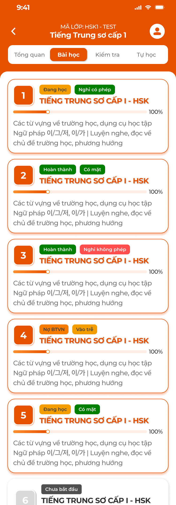

**Mô tả:**
- Tab `Bài học` trong chi tiết lớp: học viên xem toàn bộ buổi học của lớp theo thứ tự; bấm thẻ để mở chi tiết bài học. Nội dung bài lấy từ bài học CD đã định nghĩa (kiến thức gắn từ [Kiến thức (S1)](../../course_management/knowledge-s1/knowledge-s1.md), kỹ năng từ Kỹ năng (S6)); trạng thái điểm danh và bài tập đồng bộ từ luồng dạy của giáo viên ([Giáo viên — Giảng dạy](../../teacher_role/class/class_teaching_requirements.md)).
- App dùng chung cho mọi trung tâm; ví dụ trong ảnh là tiếng Trung (Đắc Nhân). Các mục Kiến thức, Kỹ năng, Bảng chữ đặc tả ở [Kiến thức](../knowledge/knowledge.md), [Kỹ năng](../skill/skill.md), [Bảng chữ](../alphabet/alphabet.md).

**Điểm cần lưu ý:**
- Header: back, `MÃ LỚP: <mã>`, tên khoá học, icon tài khoản (mở Hồ sơ). Thanh tab `Tổng quan`, `Bài học`, `Kiểm tra`, `Tự học` (xem [Lớp học](../course/course.md)).
- Thẻ buổi học: số thứ tự buổi (ô cam), tag trạng thái học, tag điểm danh, tên bài (in hoa, cam), thanh tiến độ `%`, mô tả bài.
- Tag trạng thái học: `Chưa bắt đầu` (xám, thẻ mờ): giáo viên chưa mở bài; `Đang học` (cam): bài đã mở, buổi chưa hoàn thành; `Hoàn thành` (xanh lá): buổi đã hoàn thành; `Nợ BTVN` (đỏ nhạt): buổi hoàn thành nhưng học viên chưa nộp BTVN.
- `Nợ BTVN` ưu tiên hiển thị thay `Hoàn thành` khi học viên chưa nộp bài tập củng cố của buổi đã hoàn thành.
- Tag điểm danh theo điểm danh của giáo viên: `Có mặt` (xanh lá), `Vào trễ`, `Ra sớm`, `Vào trễ & Ra sớm` (cam), `Nghỉ có phép` (xanh lá đậm), `Nghỉ không phép` (đỏ); chưa điểm danh thì không có tag.
- Thanh tiến độ: % hoàn thành bài của học viên = trung bình % của 4 mục Phần bắt buộc (mỗi mục hoàn thành = 100%).
- Thứ tự theo số thứ tự bài trong khoá; bài `Chưa bắt đầu` vẫn hiện, mờ, bấm vào vẫn xem được nội dung (REQ02).
- Chỉ hiện buổi của lớp học viên đang tham gia; dữ liệu trạng thái do giáo viên cập nhật, app chỉ đọc.
- Lớp chưa có buổi học: `Chưa có buổi học nào được tạo cho lớp này`.

### Trang 2: Chi tiết bài học

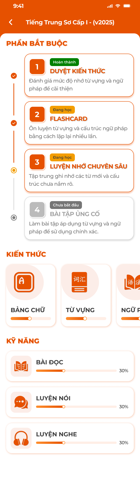

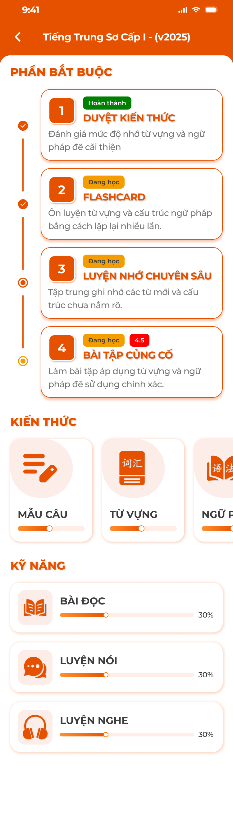

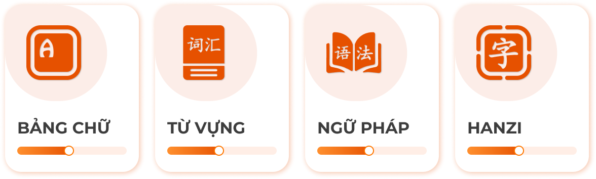

**Mô tả:**
- Màn tổng hợp mọi hoạt động của một bài học: timeline 4 bước bắt buộc, hàng thẻ Kiến thức, danh sách Kỹ năng với tiến độ.

**Điểm cần lưu ý:**
- `PHẦN BẮT BUỘC`: timeline 4 bước theo thứ tự `1 Duyệt kiến thức`, `2 Flashcard`, `3 Luyện nhớ chuyên sâu`, `4 Bài tập củng cố`. Mỗi thẻ có số bước, tag trạng thái (`Chưa bắt đầu` xám, `Đang học` cam, `Hoàn thành` xanh lá), tên, mô tả ngắn. Bước đang làm viền cam, chấm timeline tô theo trạng thái.
- Badge điểm (bước 4): khi BTVN đã chấm, badge đỏ hiện điểm (vd `4.5`) cạnh tag trạng thái; thang 10.
- `KIẾN THỨC`: hàng thẻ cuộn ngang `Bảng chữ` / `Mẫu câu` (theo trung tâm, REQ04), `Từ vựng`, `Ngữ pháp`, `Hanzi` / `Kanji`; mỗi thẻ có thanh tiến độ % đã thuộc. Chỉ hiện loại có dữ liệu trong bài. Tiến độ tính trên số mục `Đã thuộc` / tổng mục của loại đó trong bài.
- `KỸ NĂNG`: danh sách `Bài đọc`, `Luyện nói`, `Luyện nghe` với thanh tiến độ %; chỉ hiện kỹ năng có bài trong bài học.
- Bấm thẻ mở màn tương ứng; các bước bắt buộc không khoá theo thứ tự (làm bước nào cũng được, REQ03).
- Bài `Chưa bắt đầu` (giáo viên chưa mở): xem được Kiến thức, Kỹ năng và 3 bước đầu; `Bài tập củng cố` hiện `Chưa bắt đầu` và không làm được vì BTVN chỉ được giao khi giáo viên mở bài (REQ02).
- Bài không có nội dung ở một mục thì ẩn mục đó; toàn bộ trống hiện `Chưa có nội dung học tập cho buổi học này`.

### Trang 3: Duyệt kiến thức

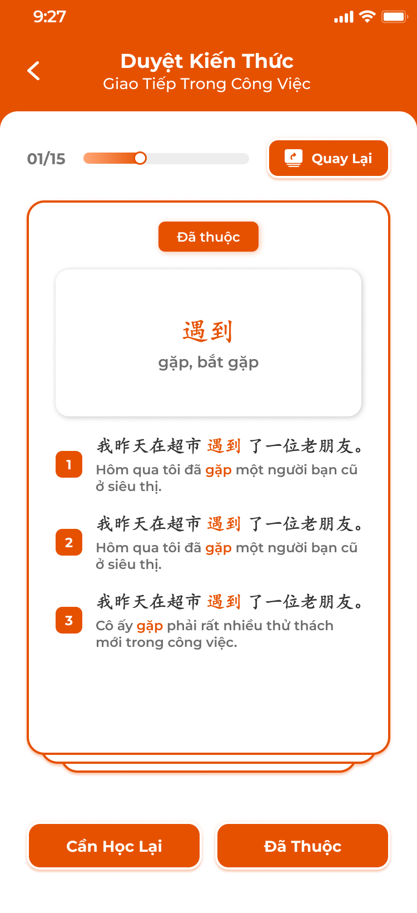

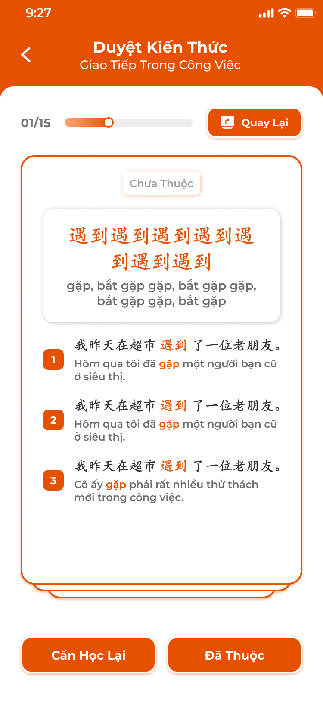

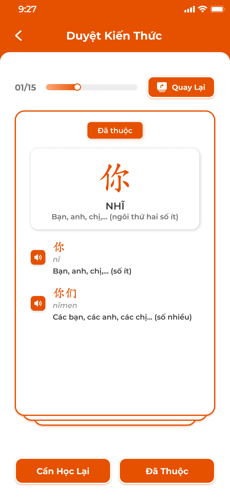

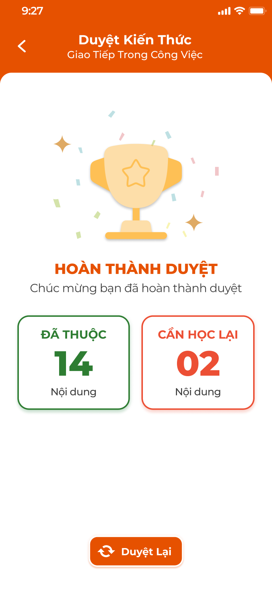

**Mô tả:**
- Bước 1 Phần bắt buộc: lần lượt xem các thẻ kiến thức của bài (từ vựng, ngữ pháp, chữ, mẫu câu), tự đánh giá `Đã thuộc` / `Cần học lại`; thẻ không lật.

**Điểm cần lưu ý:**
- Header: Back, `Duyệt Kiến Thức`, dòng phụ tên cụm / tên bài. Thanh tiến độ `n/N` thẻ; nút `Quay Lại` (từ thẻ 2) về thẻ trước, giữ đánh giá đã chọn.
- Thẻ: tag trạng thái hiện tại `Đã thuộc` (cam) / `Chưa thuộc` (xám); khung chính hiện từ / cấu trúc / chữ, nghĩa (chữ có thêm phiên âm, Hán Việt); danh sách ví dụ đánh số có highlight từ trọng tâm, kèm dịch; chữ có danh sách từ liên quan với nút loa.
- Nút `Cần Học Lại` (trái), `Đã Thuộc` (phải): lưu đánh giá, sang thẻ kế.
- Tổng kết: icon cúp, `HOÀN THÀNH DUYỆT`, hai ô `ĐÃ THUỘC` (xanh lá) / `CẦN HỌC LẠI` (đỏ) với số lượng; `Duyệt Lại` làm lại từ đầu.
- Thứ tự thẻ: theo loại Từ vựng → Ngữ pháp → Chữ → Mẫu câu, trong loại theo thứ tự cụm của S1.
- `Đã thuộc` ghi trạng thái thuộc của mục (dùng chung với mọi màn: Kiến thức, Thư viện, Flashcard); `Cần học lại` đưa mục về `Chưa thuộc` nếu trước đó đã thuộc (REQ05).
- Bước hoàn thành khi đi hết thẻ cuối, bất kể số `Cần học lại`; thoát giữa chừng giữ vị trí thẻ để lần sau tiếp tục.
- Bài không có kiến thức: `Không có nội dung để duyệt`, bước tự tính hoàn thành.

### Trang 4: Học qua Flashcard

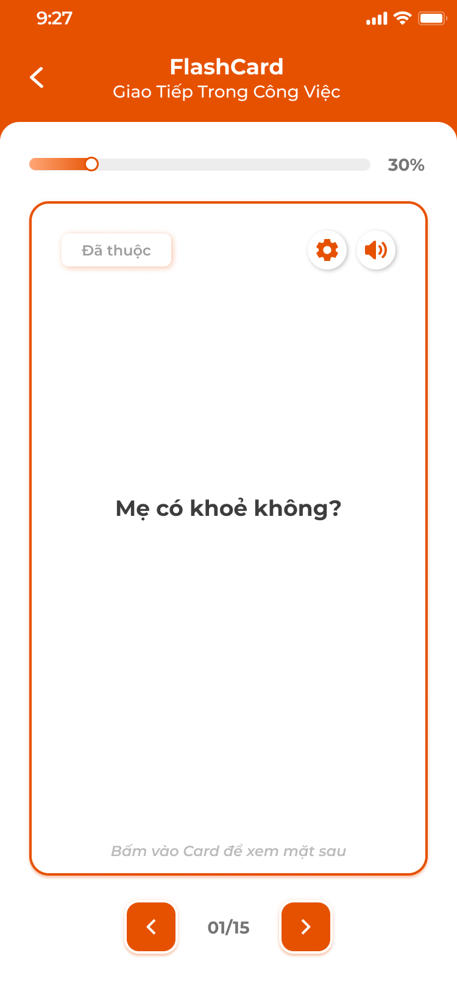

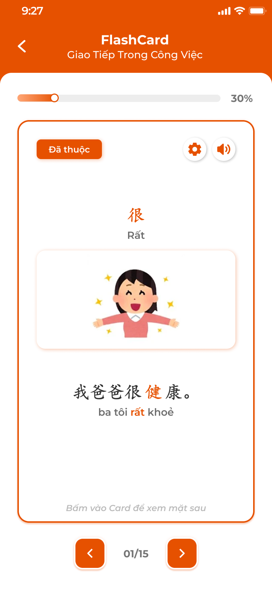

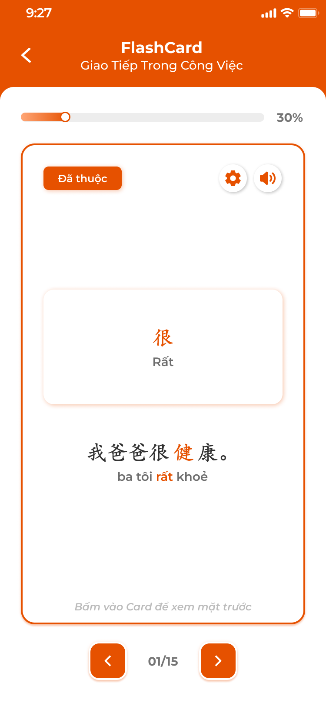

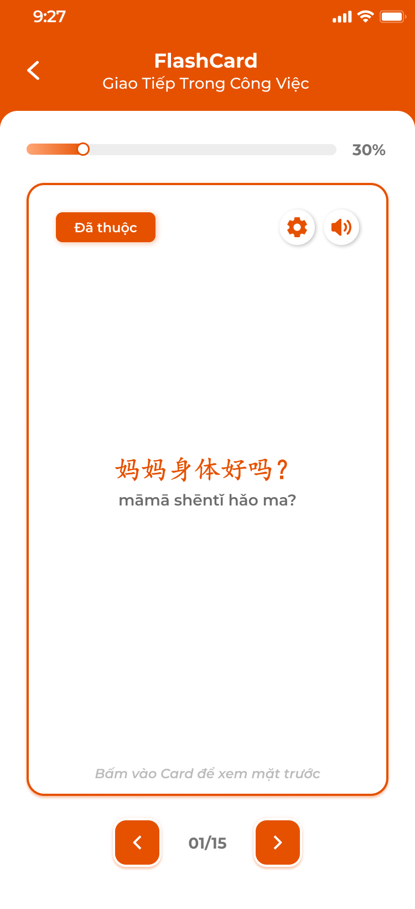

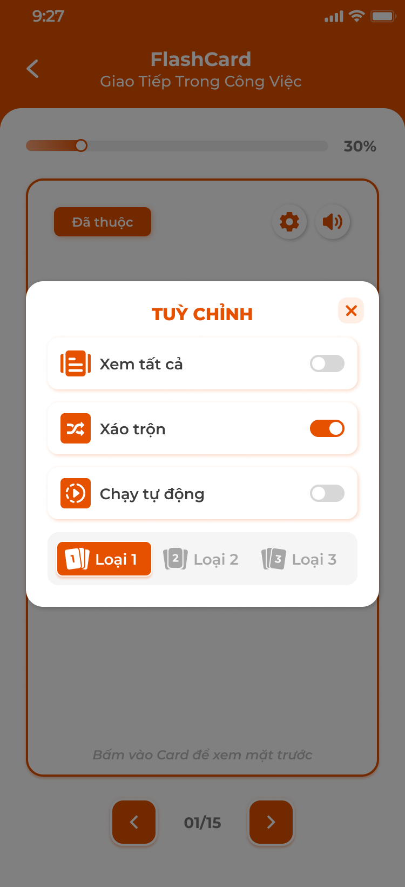

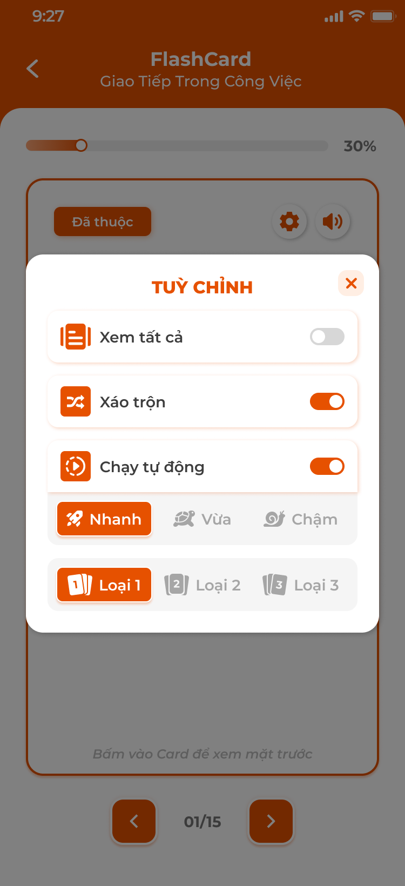


**Mô tả:**
- Bước 2 Phần bắt buộc: ôn kiến thức của bài bằng thẻ hai mặt, có phát âm, 3 loại thẻ và tuỳ chỉnh cách chạy.

**Điểm cần lưu ý:**
- Thanh tiến độ % thẻ đã xem trong bộ; `n/N` dưới cùng với nút `<` `>`; vuốt ngang cũng chuyển thẻ.
- Thẻ có nút tag `Đã thuộc` / `Chưa thuộc` (bấm để đổi trạng thái thuộc của mục), nút ⚙ Tuỳ chỉnh, nút loa; bấm thân thẻ để lật; dòng gợi ý `Bấm vào Card để xem mặt sau / mặt trước`.
- Loại 1: mặt trước từ, phiên âm, nghĩa, ví dụ; mặt sau dịch nghĩa ví dụ. Loại 2: mặt trước hình minh hoạ + nghĩa; mặt sau từ, phiên âm, ví dụ. Loại 3: mặt trước câu ví dụ gốc (có phiên âm); mặt sau nghĩa, từ trọng tâm, hình, phiên âm.
- Mục của Ngữ pháp dùng thẻ theo cấu trúc: loại 1 tiêu đề → ví dụ, loại 2 tiêu đề + ví dụ → ví dụ dịch, loại 3 ví dụ → tiêu đề + dịch nghĩa.
- Popup `TUỲ CHỈNH`: `Xem tất cả` (bật: cả thẻ đã thuộc và chưa thuộc; tắt: chỉ thẻ chưa thuộc), `Xáo trộn`, `Chạy tự động` (bật thì hiện `Nhanh` / `Vừa` / `Chậm`), chọn `Loại 1` / `Loại 2` / `Loại 3`. Tuỳ chỉnh được nhớ cho lần sau trong cùng thiết bị.
- Chạy tự động: Nhanh 3 giây, Vừa 5 giây, Chậm 8 giây mỗi mặt; đang chạy mà người dùng chạm thẻ thì tạm dừng.
- Loa phát audio của mục; không có file thì đọc bằng TTS.
- Hoàn thành: xem hết thẻ cuối hiện màn `HOÀN THÀNH FLASHCARD` + nút `Học Lại`; bước 2 chuyển `Hoàn thành`. Không còn thẻ chưa thuộc và `Xem tất cả` tắt: hiện màn hoàn thành ngay kèm gợi ý bật `Xem tất cả`.

### Trang 5: Luyện nhớ chuyên sâu

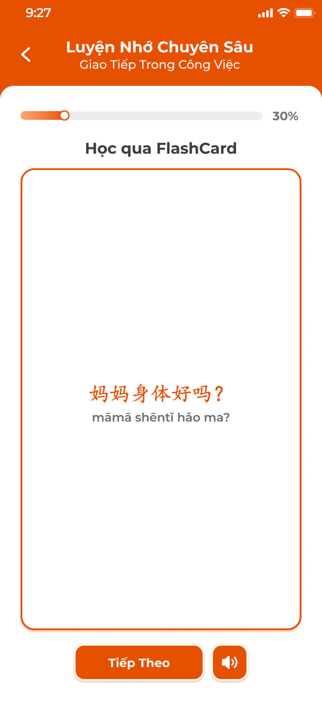

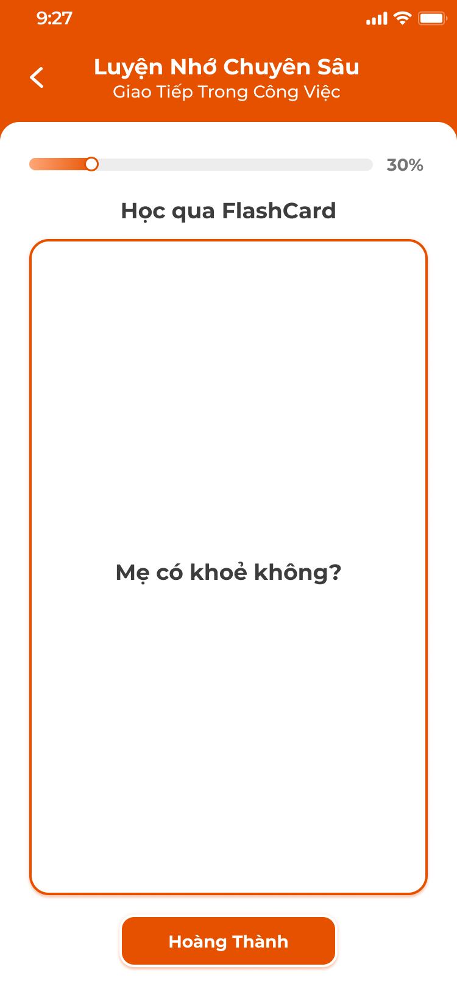

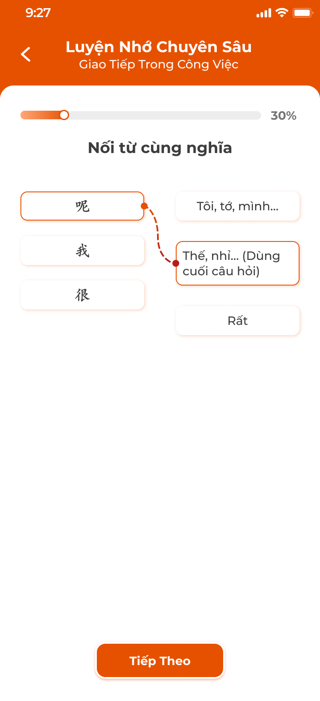

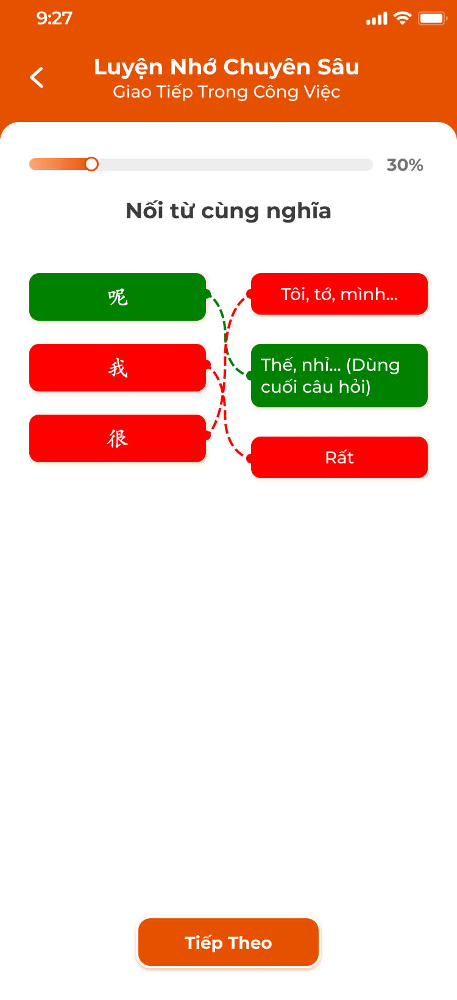

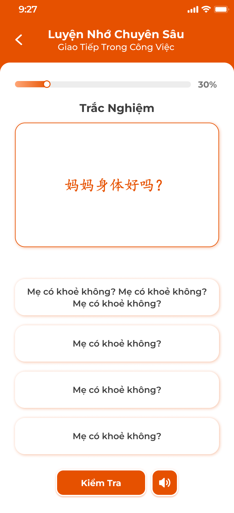

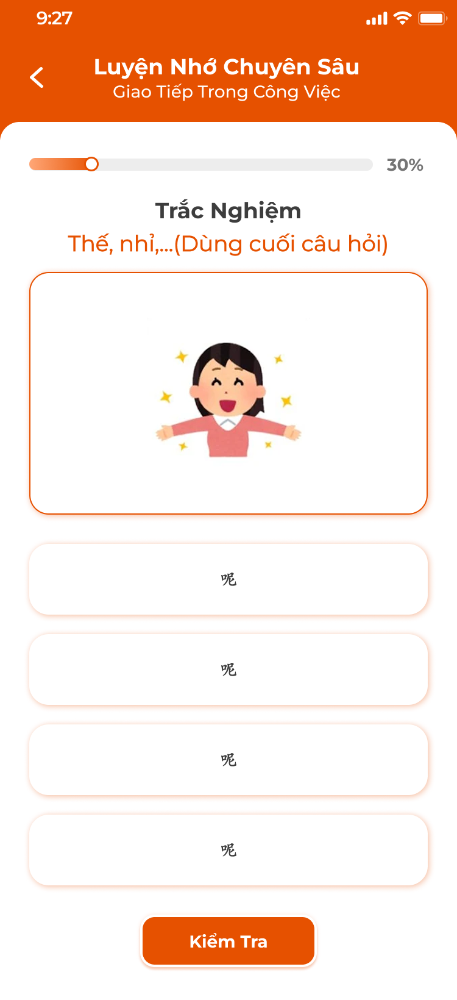

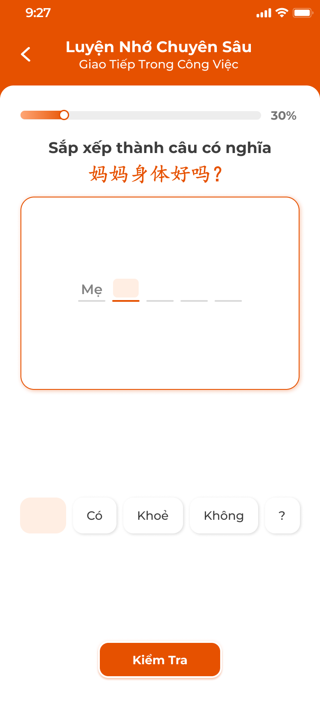

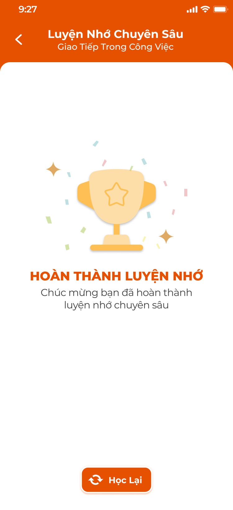

**Mô tả:**
- Bước 3 Phần bắt buộc: học theo chuỗi nội dung xen kẽ kiểm tra; trả lời đúng mới được đi tiếp.

**Điểm cần lưu ý:**
- Thanh tiến độ: % nội dung đã qua của phiên.
- Học qua FlashCard: mặt trước câu gốc + phiên âm, nút `Tiếp Theo` và loa; lật sang nghĩa, nút `Hoàn Thành` để sang nội dung kế. Card nội dung: từ, nghĩa, ví dụ highlight (không lật), nút `Tiếp tục`.
- Nối từ cùng nghĩa: hai cột (từ gốc, nghĩa) 3–4 cặp xáo trộn; kéo nối; bấm `Tiếp Theo` để chấm: cặp đúng xanh lá, sai đỏ kèm đường nối; sai thì phải nối lại cặp sai.
- Trắc nghiệm: chiều 1 câu / từ gốc → 4 đáp án nghĩa; chiều 2 nghĩa (+ hình) → 4 đáp án từ gốc; nút `Kiểm Tra` + loa; đúng xanh, sai đỏ và hiện đáp án đúng, chọn lại.
- Sắp xếp thành câu: hiện câu gốc, các từ nghĩa xáo trộn ở dưới; chạm từ để đẩy lên ô trống theo thứ tự, chạm ô để bỏ xuống; `Kiểm Tra`.
- Hoàn thành: `HOÀN THÀNH LUYỆN NHỚ` + nút `Học Lại`; bước 3 chuyển `Hoàn thành`.
- Chuỗi do hệ thống sinh từ kiến thức của bài: cứ 3–5 nội dung học thì chèn 1 câu kiểm tra; loại câu lấy ngẫu nhiên trong 3 loại.
- Trả lời sai không trừ điểm, chỉ phải làm lại câu đó cho đúng; không có `Đã thuộc` / lưu thư viện trong bước này.
- Thoát giữa chừng giữ tiến độ phiên để tiếp tục.

### Trang 6: Bài tập củng cố

**Mô tả:**
- Bước 4 Phần bắt buộc: bài tập về nhà (BTVN) của bài, được giao tự động khi giáo viên mở bài; học viên làm liên tiếp các câu, nộp, chờ giáo viên chấm phần tự luận và xem kết quả. Bộ câu hỏi do CD soạn ở [Bài tập về nhà và Kiểm tra](../../course_management/homework-test/homework-test.md); chấm theo [Giáo viên — Giảng dạy](../../teacher_role/class/class_teaching_requirements.md).

**Điểm cần lưu ý:**
- Màn làm bài: số câu `n/N`, nút `<` `>` chuyển câu tự do, nút `Xem hướng dẫn` (nếu câu có hướng dẫn), nút `Nộp bài` ở câu cuối; câu chưa trả lời được phép bỏ qua.
- 8 loại câu của CD: `Trắc nghiệm` (chọn 1 trong 4), `Sắp xếp` (kéo thả thẻ từ thành câu), `Nối từ` (nối 2 cột), `Nói` (nhấn giữ mic ghi âm, nghe lại, ghi lại), `Đọc` (đọc đoạn văn, trả lời), `Viết` (ô nhập văn bản), `Hình ảnh` (xem hình, trả lời / ghi âm), `Câu hỏi con` (câu cha có nhiều câu con, mỗi câu con một loại).
- Ánh xạ từ spec cũ (11 loại) sang 8 loại đã chốt với CD: viết chữ từ phiên âm và nghĩa → `Viết`; nối từ → `Nối từ`; sắp xếp câu → `Sắp xếp`; điền chỗ trống, chọn đáp án, chọn câu đúng nghĩa → `Trắc nghiệm`; nghe chọn đáp án → `Trắc nghiệm` có audio; đọc to từ, nói đoạn văn → `Nói`; đặt câu với từ / cấu trúc → `Viết`. Không thêm loại mới.
- Nộp bài: popup xác nhận `Nộp bài?` nêu số câu chưa làm; `Nộp` gửi toàn bộ; mỗi BTVN nộp một lần.
- Kết quả chưa chấm: icon đồng hồ, `Kết quả đang được chấm. Bạn đợi một tí nhé!`; các câu app tự chấm (Trắc nghiệm, Sắp xếp, Nối từ) hiện đúng / sai ngay; câu giáo viên chấm hiện `Chờ chấm`.
- Kết quả đã chấm: `Điểm số: x` (thang 10, trung bình điểm các câu), danh sách câu: đúng viền xanh + tick, sai viền đỏ + ×, bỏ qua `Bạn đã bỏ qua câu này!`; câu Nói / Hình ảnh phát lại ghi âm; câu Sắp xếp / Nối hiện `Đáp án của bạn` và `Đáp án đúng`; nhận xét của giáo viên (chữ, ảnh, ghi âm) dưới từng câu nếu có.
- Trạng thái bước 4: `Chưa bắt đầu` (chưa giao hoặc chưa vào), `Đang học` (đã vào, chưa nộp hoặc chờ chấm), `Hoàn thành` + badge điểm (đã chấm).
- Đáp án đang làm lưu nháp trên server; thoát rồi vào lại vẫn còn.
- Support có thể `Thiết lập lại nộp bài`; khi đó bài về trạng thái chưa nộp, đáp án cũ bị xoá, học viên làm lại (requirement ICS).
- Học viên không thuộc diện làm BTVN của bài (Nghỉ học, Rời lớp, Xóa tại thời điểm mở bài) không thấy bài tập.

---

## 2. Yêu cầu

### 2.1. Flow chính

**Flow 1: Xem danh sách và chi tiết bài học**

```
Học viên vào lớp → tab Bài học
      → Hệ thống tải buổi học của lớp theo thứ tự, trạng thái học + điểm danh từ ICS
      → Bấm thẻ → Chi tiết bài học: Phần bắt buộc, Kiến thức (theo trung tâm), Kỹ năng
      → Bấm mục → màn tương ứng
```

**Flow 2: Duyệt kiến thức**

```
Bấm Duyệt kiến thức → thẻ 1/N
      → Đã Thuộc / Cần Học Lại → lưu trạng thái thuộc của mục → thẻ kế (Quay Lại để sửa)
      → Hết thẻ → tổng kết Đã thuộc / Cần học lại → bước 1 Hoàn thành; Duyệt Lại để làm lại
```

**Flow 3: Học qua Flashcard**

```
Bấm Flashcard → thẻ theo loại và tuỳ chỉnh đã lưu
      → Chạm lật, loa phát âm, tag Đã thuộc / Chưa thuộc, < > hoặc vuốt
      → Qua thẻ cuối → màn hoàn thành → bước 2 Hoàn thành
```

**Flow 4: Luyện nhớ chuyên sâu**

```
Bấm Luyện nhớ → chuỗi: FlashCard / Card nội dung ... → câu kiểm tra (Nối từ / Trắc nghiệm / Sắp xếp)
      → Đúng: tiếp; Sai: hiện đáp án, làm lại câu đó
      → Hết chuỗi → màn hoàn thành → bước 3 Hoàn thành
```

**Flow 5: Bài tập củng cố**

```
Giáo viên mở bài → BTVN được giao → bước 4 hiện bài
      → Học viên làm các câu (nháp lưu server) → Nộp bài → popup xác nhận → Nộp
      → App chấm câu tự động; câu khác Chờ chấm → "Kết quả đang được chấm"
      → Giáo viên chấm xong → màn kết quả điểm thang 10 + nhận xét → bước 4 Hoàn thành + badge điểm
```

### 2.2. Ngoại lệ

- **EX01:** Lớp chưa có buổi học → `Chưa có buổi học nào được tạo cho lớp này`.
- **EX02:** Bài chưa được giáo viên mở → bước 4 không vào được, Toast `Thông Báo` `Bài tập sẽ có sau khi giáo viên mở bài`; 3 bước còn lại và Kiến thức / Kỹ năng vẫn dùng được.
- **EX03:** Trả lời sai ở Luyện nhớ → hiện đáp án đúng, bắt làm lại câu đó, không ghi điểm.
- **EX04:** Nộp bài khi còn câu trống → popup nêu số câu chưa làm; vẫn cho nộp, câu trống tính bỏ qua.
- **EX05:** Nộp lặp hoặc request nộp sau khi đã nộp → backend từ chối; app chỉ hiện kết quả.
- **EX06:** Support thiết lập lại nộp bài → đáp án và điểm cũ xoá, bài về chưa nộp; app Toast `Thông Báo` khi mở lại.
- **EX07:** Mất mạng khi lưu nháp / nộp → giữ dữ liệu trên máy, Toast `Cảnh Báo`, thử lại khi có mạng.
- **EX08:** Học viên không thuộc diện làm BTVN (Nghỉ học, Rời lớp, Xóa tại thời điểm mở bài) → không thấy bước 4 của bài đó.

### 2.3. Yêu cầu khác

| Mã | Tên yêu cầu | Mô tả |
|---|---|---|
| REQ01 | Danh sách bài học | Mọi buổi của lớp theo thứ tự bài; tag trạng thái học (Chưa bắt đầu / Đang học / Hoàn thành / Nợ BTVN) và tag điểm danh lấy từ ICS, app chỉ đọc. |
| REQ02 | Nội dung bài | Kiến thức, kỹ năng của bài lấy từ bài học CD đã gắn (S1, S6); xem được cả khi bài chưa mở; BTVN chỉ có sau khi giáo viên mở bài. |
| REQ03 | Tiến độ | % bài = trung bình 4 bước bắt buộc; 4 bước không khoá thứ tự; thoát giữa chừng giữ vị trí. |
| REQ04 | Thẻ Kiến thức theo trung tâm | `Bảng chữ` ở Đắc Nhân (Pinyin), Sakumi (Kana), Saechang (Hangul); trung tâm Anh / Đức / Pháp thay bằng `Mẫu câu`; `Hanzi` chỉ Đắc Nhân, `Kanji` chỉ Sakumi. |
| REQ05 | Trạng thái thuộc | Mỗi mục kiến thức có một trạng thái `Đã thuộc` / `Chưa thuộc` theo học viên, dùng chung ở Duyệt, Flashcard, Kiến thức, Thư viện; `Cần học lại` đưa về Chưa thuộc; Luyện nhớ không đổi trạng thái thuộc. |
| REQ06 | Bài tập củng cố | 8 loại câu của CD; nháp lưu server; nộp một lần; app tự chấm Trắc nghiệm, Sắp xếp, Nối từ; điểm bài thang 10 = trung bình điểm các câu, chỉ hiện khi giáo viên chấm xong; nhận xét giáo viên hiện dưới câu. |
| REQ07 | Audio | Mục không có file audio đọc bằng TTS theo ngôn ngữ trung tâm. |

### 2.4. Ràng buộc

#### Quyền

| Role | Xem bài học | Làm 3 bước ôn tập | Làm BTVN | Xem kết quả BTVN |
|---|:---:|:---:|:---:|:---:|
| Học viên của lớp | ✅ | ✅ | ✅ (bài đã mở, thuộc diện) | ✅ |
| Học viên lớp khác / chưa đăng nhập | ❌ | ❌ | ❌ | ❌ |

#### Ràng buộc khác

- Chỉ dữ liệu lớp học viên đang tham gia; backend kiểm tra học viên thuộc lớp và diện làm BTVN.
- Trạng thái thuộc, tiến độ bước, nháp bài tập lưu theo học viên trên server, dùng được trên nhiều thiết bị.
- Mỗi thao tác một Toast: `Thành Công` (`Nộp bài thành công`), `Thông Báo` (`Bài tập sẽ có sau khi giáo viên mở bài`; `Bài tập đã được mở lại, bạn làm lại nhé`), `Cảnh Báo` (`Cần quyền micro để ghi âm`; `Không có kết nối, vui lòng thử lại`), `Có Lỗi Xảy Ra` (`Nộp bài thất bại, vui lòng thử lại`). Đổi trạng thái `Đã thuộc` không có Toast, lưu nền; thao tác chỉ đọc không có Toast.


---

## 3. Testcase

### Feature: [Học viên] Bài học

| Tên testcase | Priority | Scenario | Role | Pre-condition | Given/When/Then | Expected Result |
|---|---|---|---|---|---|---|
| Case 1: Mở tab Bài học | High | Flow 1 / REQ01 | Học viên của lớp | Lớp có 6 buổi, buổi 1–5 đã mở | **Given:** vào lớp<br>**When:** bấm tab `Bài học`<br>**Then:** 6 thẻ đúng thứ tự | - Buổi 6 mờ `Chưa bắt đầu`<br>- Tag điểm danh đúng dữ liệu giáo viên |
| Case 2: Tag Nợ BTVN và tiến độ | High | REQ01 / REQ03 | Học viên của lớp | Buổi 4 Hoàn thành, chưa nộp BTVN; bài khác xong Duyệt kiến thức và Flashcard, 2 mục còn lại chưa | **Given:** xem thẻ các buổi<br>**When:** render<br>**Then:** buổi 4 tag `Nợ BTVN` thay cho `Hoàn thành`; thẻ bài kia `50%` | - Nộp bài xong thì tag về `Hoàn thành` |
| Case 3: Lớp chưa có buổi | Low | EX01 | Học viên của lớp | Lớp mới | **Given:** mở tab<br>**When:** không có buổi<br>**Then:** hiện `Chưa có buổi học nào được tạo cho lớp này` | - Không lỗi |
| Case 4: Mở chi tiết bài và thẻ theo trung tâm | High | Flow 1 / REQ02 / REQ04 | Học viên của lớp | Bài đủ 4 bước, 3 loại kiến thức, 3 kỹ năng; học viên Đắc Nhân và Creative English | **Given:** bấm thẻ buổi 2<br>**When:** màn tải<br>**Then:** timeline 4 bước, thẻ Kiến thức, Kỹ năng; Đắc Nhân có `Bảng chữ` (Pinyin) và `Hanzi`, Creative English có `Mẫu câu`, không có Hanzi | - Trạng thái từng bước đúng |
| Case 5: Bài chưa mở | High | EX02 / REQ02 | Học viên của lớp | Buổi 6 `Chưa bắt đầu` | **Given:** mở chi tiết<br>**When:** bấm `Bài tập củng cố`<br>**Then:** Toast `Thông Báo` `Bài tập sẽ có sau khi giáo viên mở bài` | - Duyệt kiến thức, Flashcard vẫn vào được |
| Case 6: Duyệt kiến thức | High | Flow 2 / REQ05 | Học viên của lớp | Bài có 16 mục; mục `你` đang Đã thuộc | **Given:** mở Duyệt kiến thức<br>**When:** 14 Đã thuộc, 2 Cần học lại tới thẻ cuối; `Quay Lại` rồi đánh giá lại<br>**Then:** tổng kết `14` / `02`; đánh giá ghi đè | - Bước 1 `Hoàn thành`<br>- Mục Cần học lại về Chưa thuộc ở Kiến thức và Thư viện<br>- Thoát giữa chừng tiếp tục từ thẻ cũ, bước 1 tag `Đang học` |
| Case 7: Học qua Flashcard | High | Flow 3 / REQ05 | Học viên của lớp | Bộ 15 thẻ, 10 đã thuộc; thẻ `很` Chưa thuộc | **Given:** mở Flashcard, chạm thẻ, bấm `>` tới thẻ 15 rồi `>`<br>**When:** thao tác<br>**Then:** thẻ lật, màn hoàn thành | - Bước 2 `Hoàn thành`<br>- Bấm tag đổi sang `Đã thuộc`, % Từ vựng tăng, đồng bộ sang Kiến thức, Thư viện |
| Case 8: Tuỳ chỉnh Flashcard | Medium | REQ05 | Học viên của lớp | Đang Loại 1; 15 thẻ, 10 đã thuộc | **Given:** ⚙ → `Loại 2`; tắt `Xem tất cả`; bật Chạy tự động `Nhanh`<br>**When:** đóng popup, bộ tải lại, không chạm 3 giây<br>**Then:** mặt trước hình + nghĩa, giữ vị trí thẻ; `n/5` chỉ thẻ chưa thuộc; thẻ tự lật rồi chuyển | - Bật lại `Xem tất cả` về 15<br>- Chạm thẻ thì dừng |
| Case 9: Luyện nhớ hoàn thành chuỗi | High | Flow 4 / REQ05 | Học viên của lớp | Bài có 12 mục | **Given:** mở Luyện nhớ<br>**When:** đi hết chuỗi, trả lời đúng mọi câu<br>**Then:** màn hoàn thành | - Bước 3 `Hoàn thành`<br>- Sắp xếp đúng thì chuyển tiếp, chạm ô đã xếp để bỏ xuống |
| Case 10: Luyện nhớ trả lời sai | High | EX03 / REQ05 | Học viên của lớp | Câu nối 3 cặp; câu chọn nghĩa | **Given:** nối sai 2 cặp rồi `Tiếp Theo`; chọn sai ở trắc nghiệm rồi `Kiểm Tra`<br>**When:** hệ thống chấm<br>**Then:** 1 cặp xanh, 2 cặp đỏ, chưa sang câu kế; đáp án sai đỏ, đúng xanh, cho chọn lại | - Nối lại đúng mới đi tiếp<br>- Không trừ tiến độ |
| Case 11: Làm và nộp Bài tập củng cố | High | Flow 5 / REQ06 | Học viên của lớp | Bài đã mở, BTVN 10 câu, có 4 câu Trắc nghiệm và câu Viết | **Given:** mở Bài tập củng cố<br>**When:** trả lời 10 câu, `Nộp bài` → `Nộp`<br>**Then:** màn `Kết quả đang được chấm`; câu tự chấm đúng / sai ngay, câu Viết `Chờ chấm` | - Toast `Nộp bài thành công`<br>- Giáo viên thấy bài đã nộp |
| Case 12: Xem kết quả đã chấm | High | Flow 5 / REQ06 | Học viên của lớp | Giáo viên chấm xong, điểm 7.5 | **Given:** mở lại bước 4<br>**When:** màn kết quả<br>**Then:** `Điểm số: 7.5`, từng câu đúng / sai, nhận xét giáo viên | - Thẻ bước 4 badge `7.5`, tag `Hoàn thành` |
| Case 13: Nộp khi còn câu trống và nộp lặp | High | EX04 / EX05 | Học viên của lớp | 3 câu chưa làm; sau đó đã nộp | **Given:** bấm `Nộp bài`; sau khi nộp mở lại bước 4<br>**When:** popup; vào bước 4<br>**Then:** nêu `Còn 3 câu chưa làm`, `Nộp` vẫn cho nộp; sau nộp chỉ xem kết quả, không có nút Nộp | - Câu trống hiện `Bạn đã bỏ qua câu này!`<br>- Request nộp lại bị từ chối |
| Case 14: Ghi âm câu Nói | Medium | REQ06 | Học viên của lớp | Câu Nói | **Given:** nhấn giữ mic 5 giây<br>**When:** thả<br>**Then:** có bản ghi, nút nghe lại và `Ghi lại` | - Không cấp quyền mic: Toast `Cảnh Báo` `Cần quyền micro để ghi âm` |
| Case 15: Support thiết lập lại nộp bài | Medium | EX06 | Học viên của lớp | Support reset bài đã chấm | **Given:** mở bước 4<br>**When:** tải<br>**Then:** về màn làm bài trống | - Toast `Thông Báo` `Bài tập đã được mở lại, bạn làm lại nhé`<br>- Badge điểm cũ mất |
| Case 16: Mất mạng khi nộp | High | EX07 / Ràng buộc Toast | Học viên của lớp | Mất mạng | **Given:** bấm `Nộp`<br>**When:** thất bại<br>**Then:** đáp án giữ nguyên, cho nộp lại | - Toast `Có Lỗi Xảy Ra` `Nộp bài thất bại, vui lòng thử lại` |
| Case 17: Không thuộc diện và quyền | High | EX08 / Ràng buộc quyền | Học viên lớp khác / chưa đăng nhập | Học viên Nghỉ học / Rời lớp tại thời điểm mở bài; tài khoản lớp khác | **Given:** mở lớp và bước 4; hoặc gọi API lớp khác<br>**When:** hệ thống xử lý<br>**Then:** không thấy bước 4 của bài đó; lớp khác bị từ chối | - Dữ liệu không đổi |

---

## 4. Câu hỏi cần xác nhận

- **Q01:** Các trang chưa có mã màn Figma, cần design cấp mã (theo quy ước `<HỌ>-<MODULE>-NNNNNN`) hoặc cho biết frame nằm ở file Figma nào.
- **Q02:** Số nội dung giữa hai câu kiểm tra của Luyện nhớ chuyên sâu (tạm 3–5) và thời gian Chạy tự động của Flashcard (tạm 3 / 5 / 8 giây).
- **Q03:** Trang 6 (màn làm Bài tập củng cố, popup Nộp bài, màn kết quả) chưa có ảnh thiết kế.
