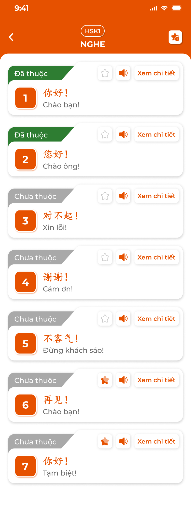
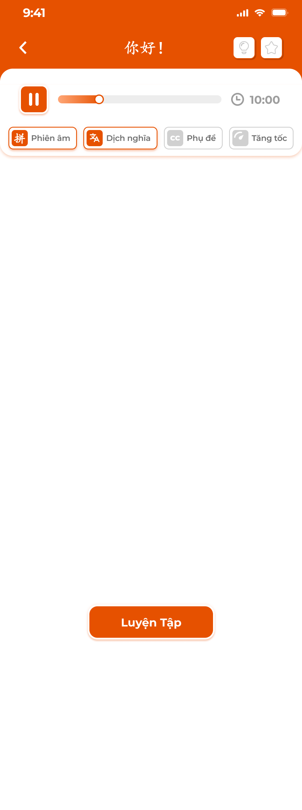

# [Học viên] Kỹ năng

Các màn **Kỹ năng** của app học viên: **Nghe**, **Đọc**, **Nói**. Mở từ khối Kỹ năng trong [Chi tiết bài học](../lesson/lesson.md) (phạm vi: bài kỹ năng gắn với bài học), từ màn chính 247 (phạm vi: cấp độ) hoặc [Thư viện học tập](../library/library.md) (bài đã lưu). Nội dung là bài kỹ năng CD soạn ở Kỹ năng (S6) của khoá học: bài Nghe có audio và khối thoại theo thời gian, bài Đọc có đoạn văn và từ vựng highlight, bài Nói có danh sách từ / câu với audio mẫu; mỗi bài có bộ câu hỏi trắc nghiệm kèm giải thích. App chỉ đọc.

Ảnh có cho Nghe; Đọc và Nói chưa có ảnh, đặc tả theo spec. Ví dụ tiếng Trung.

## 1. UI

### Trang 1: HV-KN-010000 — Danh sách bài kỹ năng




*Danh sách bài nghe: tag Đã thuộc / Chưa thuộc, ⭐, loa, Xem chi tiết; chế độ chọn nhiều — nhấn để xem ảnh gốc*

**Mô tả:**

- Danh sách bài của một kỹ năng theo thứ tự chương trình; mỗi bài một thẻ; bấm `Xem chi tiết` mở bài; ⭐+ để lưu nhiều bài vào Thư viện.

**Điểm cần lưu ý:**

- `A01.01` **Header**: Back, badge cấp độ, tên kỹ năng (`NGHE`, `ĐỌC`, `NÓI`), icon ⭐+ (chọn nhiều).
- `A01.02` **Thẻ bài**: Tag `Đã thuộc` (xanh lá) / `Chưa thuộc` (xám); số thứ tự (ô cam); tiêu đề gốc (cam) + nghĩa; nút ⭐ (lưu), loa (phát audio bài / câu đầu), `Xem chi tiết`. Bài Nói thêm thanh tiến độ % (số mục đạt 3 tim / tổng).
- `A01.03` **Chọn nhiều**: Như Kiến thức: checkbox, thanh `Thêm vào thư viện N`, `×`; bài đã lưu tick sẵn, bỏ tick = gỡ.
- `A01.04` **Trống**: `Không có bài luyện nghe nào` / `... đọc ...` / `... nói ...`.

- `Đã thuộc` của bài Nghe / Đọc do học viên bấm 💡 ở chi tiết; bài Nói tự Đã thuộc khi mọi mục đạt 3 tim.
- Phạm vi: từ bài học chỉ bài kỹ năng gắn bài; từ 247 toàn cấp độ; từ Thư viện bài đã lưu.

### Trang 2: HV-KN-020000 — Chi tiết bài Nghe




*Trình phát audio, nút Phiên âm / Dịch nghĩa / Phụ đề / Tăng tốc, nút Luyện Tập; vùng khối thoại (trống trong ảnh) — nhấn để xem ảnh gốc*

**Mô tả:**

- Nghe hội thoại có audio, khối thoại highlight theo thời gian, bật / tắt lớp hiển thị, đổi tốc độ, đánh dấu Đã thuộc, lưu thư viện, vào Luyện tập.

**Điểm cần lưu ý:**

- `A02.01` **Header**: Back, tiêu đề bài, 💡 (Đã thuộc), ⭐ (lưu).
- `A02.02` **Trình phát**: Nút play / pause, thanh tiến độ kéo được, thời gian còn lại / tổng.
- `A02.03` **Nút lớp**: `Phiên âm`, `Dịch nghĩa`, `Phụ đề` (bật / tắt độc lập, sáng cam khi bật; tắt Phụ đề ẩn toàn bộ khối thoại), `Tăng tốc` (chu kỳ `Chậm 0.75x` → `Bình thường 1x` → `Nhanh 1.25x`).
- `A02.04` **Khối thoại**: Theo S6: nhân vật (`A`, `B`), câu gốc, phiên âm, dịch; khối đang phát highlight cam theo mốc bắt đầu / kết thúc; bấm khối → seek tới mốc bắt đầu và phát tiếp.
- `A02.05` **`Luyện Tập`**: Popup chế độ: `Học`, `Flashcard`, `Trắc nghiệm`.

- Bài không có audio: trình phát mờ, khối thoại vẫn xem; không có khối thoại: `Bài nghe chưa có nội dung`.
- Trạng thái nút lớp nhớ theo thiết bị.
- Khác ảnh: ảnh vẽ vùng khối thoại trống; requirement hiển thị khối thoại ngay dưới hàng nút.

### Trang 3: HV-KN-030000 — Chi tiết bài Đọc


**Mô tả:**

- Đọc đoạn văn chia câu, từ vựng được highlight để tra nghĩa, tuỳ chỉnh chế độ dịch và cỡ chữ, 💡 Đã thuộc, ⭐ lưu, `Luyện Tập`.

**Giải thích field/thành phần:**

- `A03.01` **Header**: Back, tiêu đề bài, 💡, ⭐, nút ⚙ `Tuỳ chỉnh`.
- `A03.02` **Nội dung**: Đoạn văn của S6 chia theo câu; từ thuộc danh sách `Từ vựng` riêng của bài (S6) highlight cam; bấm từ mở popup tra nghĩa (từ, phiên âm, loại từ, nghĩa, ví dụ) lấy từ danh sách đó, không lấy từ S1. Audio đọc mẫu nếu bài có file.
- `A03.05` **Khối `Từ vựng`**: Dưới đoạn văn: danh sách từ của bài theo thứ tự CD sắp (từ, phiên âm, nghĩa; chạm mở popup tra nghĩa). Bài không có từ thì ẩn khối.
- `A03.03` **Popup `Tuỳ chỉnh`**: `Chế độ dịch`: `Đọc hiểu` (chỉ câu gốc), `Dịch câu` (mỗi câu có nút bật / tắt dịch dưới câu), `Dịch từ` (highlight từ, bấm tra nghĩa); bật / tắt `Phiên âm`; thanh trượt `Cỡ chữ`. Nhớ theo thiết bị.
- `A03.04` **`Luyện Tập`**: Popup chế độ: `Học`, `Flashcard`, `Trắc nghiệm`.

**Điểm cần lưu ý:**

- Bài chưa có đoạn văn: `Bài đọc chưa có nội dung`.
- Từ trong đoạn văn chỉ highlight khi khớp một từ trong danh sách Từ vựng của bài; sửa từ ở S1 không ảnh hưởng.
- 💡 Đã thuộc cập nhật % Đọc; ⭐ lưu thư viện.

### Trang 4: HV-KN-040000 — Chi tiết bài Nói và luyện nói


**Mô tả:**

- Bài Nói gồm 2 tab `Từ vựng` và `Câu`; mỗi mục có gốc, nghĩa, audio mẫu và 3 tim đánh giá phát âm; bấm mục vào màn luyện nói: nghe mẫu, nhấn giữ mic ghi âm, app chấm và hiện số tim; đạt 3 tim = Đã thuộc.

**Giải thích field/thành phần:**

- `A04.01` **Header**: Back, tiêu đề bài, ⭐ (lưu).
- `A04.02` **Tab**: `Từ vựng` / `Câu`; danh sách mục: gốc, nghĩa, icon 💬, 3 tim (xám chưa luyện; 1 tim chưa tốt, 2 tạm ổn, 3 tốt).
- `A04.03` **Màn luyện nói**: Mục hiện tại (gốc, nghĩa), nút loa phát mẫu, nút mic (nhấn giữ ghi, thả dừng), 3 tim đổi màu theo kết quả, `Đã hoàn thành` khi đạt 3 tim; `<` `>` hoặc vuốt chuyển mục; thanh `n/N`; `Xem kết quả` tổng hợp đúng / sai; `Làm lại` có popup xác nhận (xoá tim của phiên).
- `A04.04` **Chấm**: App so sánh bản ghi với audio mẫu (dịch vụ nhận dạng giọng nói); kết quả 1–3 tim lưu theo mục.

**Điểm cần lưu ý:**

- Không cấp quyền mic: Toast `Cảnh Báo` `Cần quyền micro để ghi âm`.
- Tiến độ bài Nói = số mục 3 tim / tổng; bài tự `Đã thuộc` khi 100%.
- Bài Nói lấy từ tab Nói của S6; nếu trung tâm chưa có bài Nói thì kỹ năng không hiện.

### Trang 5: HV-KN-050000 — Luyện tập Nghe / Đọc


**Mô tả:**

- Popup `Luyện Tập` của bài Nghe / Đọc có 3 chế độ dùng khối thoại / câu của bài và bộ câu hỏi của bài.
- Bộ câu hỏi = câu CD soạn ở tab Câu hỏi của bài (S6), đủ 8 loại câu như BTVN (câu a–d cũ đã gộp thành câu Trắc nghiệm).

**Điểm cần lưu ý:**

- `A05.01` **`Học`**: Theo từng câu của bài: Phần 1 Flashcard (Nghe: tự phát audio khi hiện; `Tiếp theo` lật, `Hoàn thành`) → Phần 2 Ghi nhớ nội dung (câu gốc + nghĩa, `Tiếp tục`) → Phần 3 Sắp xếp thành câu có nghĩa (hiện nghĩa, chạm từ gốc xếp lên ô, `Kiểm tra`; sai thì làm lại); hết: màn chúc mừng. Không có 💡 / ⭐ trong chế độ này.
- `A05.02` **`Flashcard`**: Nghe: 3 loại (1 loa → câu + nghĩa; 2 câu + loa → nghĩa + loa; 3 câu + loa → nghĩa), tự phát khi hiện thẻ; Đọc: 2 loại (1 câu → nghĩa; 2 nghĩa → câu). Tag Đã thuộc / Chưa thuộc trên thẻ (không ảnh hưởng % kỹ năng), `n/N`, Tuỳ chỉnh (Xem tất cả, Xáo trộn, Chạy tự động).
- `A05.03` **`Trắc nghiệm`**: Bộ câu hỏi của bài (S6), mọi loại câu kể cả câu hỏi con; câu App chấm có đúng / sai, câu GV chấm hiện bài mẫu để tự so; `<` `>`, menu số câu để nhảy, `Nộp bài` ở câu cuối → popup `Hãy kiểm tra lại xem các câu đã được trả lời chính xác chưa nhé!` (`Xem lại` / `Nộp bài`); sau nộp: đúng xanh / sai đỏ, khối `GIẢI THÍCH` dưới mỗi câu, duyệt lại từng câu. Kết quả không lưu.

- Chế độ Luyện tập **không lưu điểm**, không đổi % kỹ năng.
- Bài không có câu hỏi: `Trắc nghiệm` dùng câu **app tự sinh như cũ** từ câu / khối thoại của bài (chọn nghĩa đúng, sắp xếp
  câu); không có câu / khối thoại: ẩn `Trắc nghiệm`, các chế độ khác hiện `Không có nội dung để luyện tập`.

### Trang 6: Toast phản hồi CRUD


*Toast Thành Công, Thông Báo, Cảnh Báo và Có Lỗi Xảy Ra — nhấn để xem ảnh gốc*

**Mô tả:**

- Phản hồi lưu thư viện và ghi âm.

**Điểm cần lưu ý:**

- `A06.01` **Thành công**: Tiêu đề cố định: `Thành Công`; Khi sử dụng: `Đã cập nhật thư viện!`
- `A06.02` **Cảnh báo**: Tiêu đề cố định: `Cảnh Báo`; Khi sử dụng: `Cần quyền micro để ghi âm`; `Không có kết nối, vui lòng thử lại`
- `A06.03` **Lỗi**: Tiêu đề cố định: `Có Lỗi Xảy Ra`; Khi sử dụng: `Không chấm được bản ghi, thử lại nhé`

- Đổi Đã thuộc, phát audio không Toast.

---

## 2. Yêu cầu

### 2.1. Flow chính

**Flow 1 / REQ01: Danh sách bài kỹ năng**

```text
Mở Nghe / Đọc / Nói (bài học / 247 / Thư viện) → thẻ bài theo thứ tự, tag thuộc, ⭐, loa
      → Xem chi tiết → màn bài
```

**Flow 2 / REQ02 / REQ03: Xem bài Nghe / Đọc**

```text
Nghe: play → khối highlight theo mốc → bấm khối seek → lớp Phiên âm / Dịch / Phụ đề / Tốc độ
Đọc: đoạn văn → từ highlight → popup tra nghĩa → Tuỳ chỉnh chế độ dịch, cỡ chữ
      → 💡 Đã thuộc (cập nhật % kỹ năng), ⭐ lưu, Luyện Tập
```

**Flow 3 / REQ05: Luyện nói**

```text
Bài Nói → tab Từ vựng / Câu → mục → loa mẫu → nhấn giữ mic → thả → app chấm → 1–3 tim
      → 3 tim: Đã hoàn thành; mọi mục 3 tim: bài Đã thuộc → Xem kết quả / Làm lại
```

**Flow 4 / REQ04: Lưu thư viện**

```text
⭐ trên thẻ / chi tiết → lưu / gỡ → Toast; ⭐+ → chọn nhiều → Thêm vào thư viện N → Toast
```

**Flow 5 / REQ06: Luyện tập Nghe / Đọc**

```text
Luyện Tập → Học (Flashcard → Ghi nhớ → Sắp xếp) / Flashcard / Trắc nghiệm (nộp → giải thích)
      → Trắc nghiệm: bộ câu hỏi CD soạn của bài; 0 câu thì app tự sinh như cũ; không lưu điểm
```

### 2.2. Ngoại lệ

- **EX01:** Phạm vi không có bài → `Không có bài luyện <kỹ năng> nào`.
- **EX02:** Bài thiếu audio / đoạn văn / câu hỏi → ẩn phần tương ứng; không có nội dung luyện: `Không có nội dung để luyện tập`.
- **EX03:** Chưa cấp quyền mic → Toast `Cảnh Báo`, không ghi âm.
- **EX04:** Chấm giọng nói thất bại → Toast `Có Lỗi Xảy Ra`, giữ tim cũ, cho ghi lại.
- **EX05:** Mất mạng khi lưu Đã thuộc / thư viện → giữ trạng thái cũ, Toast `Cảnh Báo`.
- **EX06:** Bài bị CD chuyển Vô hiệu / gỡ khỏi bài học → không còn ở danh sách bài; bài đã lưu vẫn xem ở Thư viện.

### 2.3. Yêu cầu khác

| Mã | Tên yêu cầu | Mô tả |
|---|---|---|
| REQ01 | Nguồn và phạm vi | Bài kỹ năng từ S6, chỉ đọc; phạm vi theo nơi mở; kỹ năng không có bài thì ẩn ở Chi tiết bài học. |
| REQ02 | Nghe / Đọc | Nghe: khối thoại theo mốc thời gian, highlight, seek, 3 lớp và 3 tốc độ nhớ theo thiết bị; Đọc: đoạn văn theo câu, từ highlight tra nghĩa theo danh sách Từ vựng của bài (S6), khối Từ vựng dưới đoạn văn, 3 chế độ dịch, phiên âm, cỡ chữ. |
| REQ03 | Đã thuộc | 💡 theo bài và học viên; % kỹ năng = bài Đã thuộc / tổng bài của phạm vi; Flashcard luyện tập không đổi. |
| REQ04 | Thư viện | ⭐ từng bài, ⭐+ nhiều bài; Toast `Đã cập nhật thư viện!`. |
| REQ05 | Nói | Mục từ / câu có audio mẫu; ghi âm nhấn giữ; chấm 1–3 tim lưu theo mục; 3 tim = Đã thuộc mục; bài Đã thuộc khi mọi mục 3 tim; Làm lại xoá tim của bài. |
| REQ06 | Luyện tập | Học 3 phần theo câu; Flashcard 3 loại (Nghe) / 2 loại (Đọc) + Tuỳ chỉnh; Trắc nghiệm từ bộ câu hỏi S6 (đủ loại câu, giải thích sau nộp, không lưu điểm); bài 0 câu thì app tự sinh như cũ. |

### 2.4. Ràng buộc

#### Quyền

| Role | Xem | Đã thuộc / lưu | Luyện tập / Luyện nói |
|---|:---:|:---:|:---:|
| Học viên | ✅ | ✅ | ✅ |
| Người dùng trải nghiệm | ✅ nội dung mở | ✅ (trên máy) | ✅ |

#### Ràng buộc khác

**Phạm vi dữ liệu**

- Backend trả bài theo khoá học / cấp độ được phép; bản ghi âm luyện nói không lưu lâu dài trên server, chỉ kết quả tim.

---

---

## 3. Testcase

### Feature: [Học viên] Kỹ năng

| Tên testcase | Priority | Scenario | Role | Pre-condition | Given/When/Then | Expected Result |
|---|---|---|---|---|---|---|
| Case 1: Mở Nghe từ bài học | High · Smoke | Flow 1 / REQ01 | Học viên | Bài gắn 7 bài nghe | **Given** bấm `Luyện nghe`<br>**When** màn tải<br>**Then** 7 thẻ đúng thứ tự, tag thuộc đúng | - Loa phát audio bài |
| Case 2: Lưu nhiều bài | High | Flow 4 / REQ04 | Học viên | 1 bài đã lưu | **Given** ⭐+ tick 1 bài mới<br>**When** `Thêm vào thư viện 02`<br>**Then** Toast `Đã cập nhật thư viện!` | - Thư viện Kỹ năng có 2 bài |
| Case 3: Không có bài | Low | EX01 | Học viên | Bài học không gắn bài nói | **Given** mở `Luyện nói`<br>**When** tải<br>**Then** `Không có bài luyện nói nào` | - |
| Case 4: Phát và highlight | High · Smoke | Flow 2 / REQ02 | Học viên | Bài 6 khối thoại có mốc thời gian | **Given** bấm play<br>**When** audio tới khối 3<br>**Then** khối 3 highlight cam | - Bấm khối 5 seek tới mốc khối 5 |
| Case 5: Lớp hiển thị | Medium | REQ02 | Học viên | Đang bật cả 3 | **Given** tắt `Dịch nghĩa`<br>**When** render<br>**Then** khối chỉ còn câu gốc + phiên âm | - Tắt `Phụ đề` ẩn hết khối |
| Case 6: Tốc độ | Medium | REQ02 | Học viên | 1x | **Given** bấm `Tăng tốc` 2 lần<br>**When** phát<br>**Then** 1.25x rồi về 0.75x | - Chu kỳ 3 mức |
| Case 7: Đã thuộc | Medium | REQ03 | Học viên | 💡 tắt | **Given** bấm 💡<br>**When** lưu<br>**Then** thẻ bài tag `Đã thuộc`, % Nghe tăng | - |
| Case 8a: Khối Từ vựng của bài | Medium | Flow 2 / REQ02 | Học viên | Bài đọc có 4 từ trong danh sách Từ vựng | **Given** mở bài<br>**When** cuộn xuống dưới đoạn văn<br>**Then** khối `Từ vựng` 4 từ, chạm từ mở popup tra nghĩa | - Bài 0 từ: ẩn khối |
| Case 8: Tra từ highlight | High · Smoke | Flow 2 / REQ02 | Học viên | Bài có 5 từ highlight | **Given** bấm từ `你好`<br>**When** popup<br>**Then** nghĩa, phiên âm, audio, ví dụ | - Đóng popup giữ vị trí đọc |
| Case 9: Chế độ dịch câu | Medium | REQ02 | Học viên | Đang `Đọc hiểu` | **Given** ⚙ → `Dịch câu`<br>**When** bấm nút dịch câu 2<br>**Then** dịch hiện dưới câu 2 | - Câu khác không đổi |
| Case 10: Cỡ chữ | Low | REQ02 | Học viên | Mặc định | **Given** kéo thanh Cỡ chữ<br>**When** thả<br>**Then** chữ đoạn văn đổi cỡ, nhớ lần sau | - |
| Case 11: Ghi âm và chấm | High · Smoke | Flow 3 / REQ05 | Học viên | Bài Nói 12 mục, đã cấp mic | **Given** bấm mục 1 → nhấn giữ mic<br>**When** thả<br>**Then** số tim hiện theo kết quả | - 3 tim: `Đã hoàn thành`, tiến độ tăng |
| Case 12: Làm lại | Medium | REQ05 | Học viên | 5 mục có tim | **Given** `Làm lại` → xác nhận<br>**When** xoá<br>**Then** tim về xám | - Huỷ popup giữ nguyên |
| Case 13: Chưa cấp mic | Medium | EX03 | Học viên | Từ chối quyền mic | **Given** nhấn mic<br>**When** hệ điều hành từ chối<br>**Then** Toast `Cần quyền micro để ghi âm` | - Có hướng dẫn mở Cài đặt |
| Case 14: Chế độ Học bài nghe | High · Smoke | Flow 5 / REQ06 | Học viên | Bài 6 câu | **Given** `Luyện Tập` → `Học`<br>**When** đi hết 3 phần của 6 câu<br>**Then** màn chúc mừng | - Sắp xếp sai thì làm lại |
| Case 15: Trắc nghiệm có giải thích | High | REQ06 | Học viên | Bài có 5 câu hỏi | **Given** làm 5 câu → `Nộp bài` → xác nhận<br>**When** kết quả<br>**Then** đúng / sai từng câu, khối `GIẢI THÍCH` | - Trước nộp không hiện giải thích |
| Case 15a: Bài không có câu hỏi | High | Flow 5 / REQ06 | Học viên | Bài đọc 6 câu, bộ câu hỏi 0 câu | **Given** `Luyện Tập` → `Trắc nghiệm`<br>**When** làm và nộp<br>**Then** câu tự sinh từ 6 câu của bài, có kết quả đúng / sai | - Không lưu điểm |
| Case 15b: Câu Sắp xếp và câu con từ bộ câu hỏi | Medium | Flow 5 / REQ06 | Học viên | Bài nghe có 1 câu Sắp xếp, 1 câu hỏi con 2 câu con | **Given** `Trắc nghiệm`<br>**When** làm và nộp<br>**Then** hiện đủ 3 câu (`2.1`, `2.2`), chấm đúng / sai | - Kết quả không lưu |
| Case 16: Flashcard nghe tự phát | Medium | REQ06 | Học viên | Loại 1 | **Given** chuyển thẻ<br>**When** thẻ hiện<br>**Then** audio tự phát một lần | - Tag Đã thuộc không đổi % Nghe |
| Toast Case 1: Lỗi chấm | Medium | Ràng buộc Toast CRUD | Học viên | Dịch vụ nhận dạng lỗi | **Given** thả mic<br>**When** chấm thất bại<br>**Then** Toast `Có Lỗi Xảy Ra`, tim giữ nguyên | - Cho ghi lại |

---

---

## 4. Câu hỏi cần xác nhận

- **Q01:** Màn Đọc, Nói, luyện nói, 3 chế độ luyện tập chưa có ảnh thiết kế.
- **Q02:** Dịch vụ chấm phát âm (nhận dạng giọng nói) và ngưỡng 1 / 2 / 3 tim.
- **Q03:** Bài Nói trong S6: tab Nói của CD hiện là màn trống (requirement S6 chưa viết); cấu trúc 2 tab Từ vựng / Câu lấy theo spec Sakumi.
- **Q04:** Khác ảnh: vùng khối thoại ở ảnh Chi tiết bài nghe trống.
