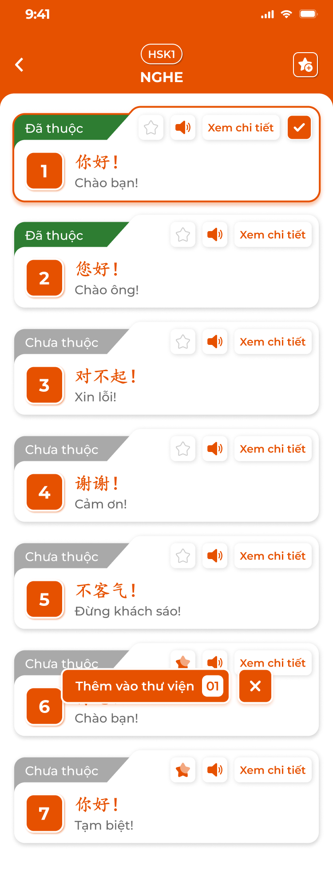

# [Học viên] Kỹ năng

## 1. UI

### Trang 1: Danh sách bài kỹ năng




**Mô tả:**
- Các màn **Kỹ năng** của app học viên: **Nghe**, **Đọc**, **Nói**. Mở từ khối Kỹ năng trong [Chi tiết bài học](../lesson/lesson.md) (phạm vi: bài kỹ năng gắn với bài học), từ màn chính trải nghiệm (phạm vi: cấp độ) hoặc [Thư viện học tập](../library/library.md) (bài đã lưu). Nội dung là bài kỹ năng CD soạn ở Kỹ năng (S6) của khoá học; app chỉ đọc. Ví dụ tiếng Trung.
- Danh sách bài của một kỹ năng theo thứ tự chương trình; mỗi bài một thẻ; bấm `Xem chi tiết` mở bài; ⭐+ để lưu nhiều bài vào Thư viện.

**Điểm cần lưu ý:**
- Header: Back, badge cấp độ, tên kỹ năng (`NGHE`, `ĐỌC`, `NÓI`), icon ⭐+ (chọn nhiều).
- Thẻ bài: tag `Đã thuộc` (xanh lá) / `Chưa thuộc` (xám); số thứ tự (ô cam); tiêu đề gốc (cam) + nghĩa; nút ⭐ (lưu), loa (phát audio bài / câu đầu), `Xem chi tiết`. Bài Nói thêm thanh tiến độ % (số mục đạt 3 tim / tổng).
- Chọn nhiều như Kiến thức: checkbox, thanh `Thêm vào thư viện N`, `×`; bài đã lưu tick sẵn, bỏ tick = gỡ.
- `Đã thuộc` của bài Nghe / Đọc do học viên bấm 💡 ở chi tiết; bài Nói tự Đã thuộc khi mọi mục đạt 3 tim.
- Phạm vi: từ bài học chỉ bài kỹ năng gắn bài; từ màn chính trải nghiệm toàn cấp độ; từ Thư viện bài đã lưu.
- Trống: `Không có bài luyện nghe nào` / `... đọc ...` / `... nói ...`.

### Trang 2: Chi tiết bài Nghe


**Mô tả:**
- Bài Nghe có audio và khối thoại theo thời gian: nghe hội thoại, khối thoại highlight theo thời gian, bật / tắt lớp hiển thị, đổi tốc độ, đánh dấu Đã thuộc, lưu thư viện, vào Luyện tập.

**Điểm cần lưu ý:**
- Header: Back, tiêu đề bài, 💡 (Đã thuộc), ⭐ (lưu).
- Trình phát: play / pause, thanh tiến độ kéo được, thời gian còn lại / tổng.
- Nút lớp `Phiên âm`, `Dịch nghĩa`, `Phụ đề` bật / tắt độc lập, sáng cam khi bật; tắt `Phụ đề` ẩn toàn bộ khối thoại. `Tăng tốc` đổi chu kỳ `Chậm 0.75x` → `Bình thường 1x` → `Nhanh 1.25x`. Trạng thái nút lớp nhớ theo thiết bị.
- Khối thoại theo S6: nhân vật (`A`, `B`), câu gốc, phiên âm, dịch; khối đang phát highlight cam theo mốc bắt đầu / kết thúc; bấm khối thì seek tới mốc bắt đầu và phát tiếp. Khối thoại hiển thị ngay dưới hàng nút.
- Bài không có audio: trình phát mờ, khối thoại vẫn xem; không có khối thoại: `Bài nghe chưa có nội dung`.
- `Luyện Tập`: popup chế độ `Học`, `Flashcard`, `Trắc nghiệm` (xem Trang 5).

### Trang 3: Chi tiết bài Đọc

**Mô tả:**
- Bài Đọc có đoạn văn và từ vựng highlight: đọc đoạn văn chia câu, tra nghĩa từ highlight, tuỳ chỉnh chế độ dịch và cỡ chữ, 💡 Đã thuộc, ⭐ lưu, `Luyện Tập`.

**Điểm cần lưu ý:**
- Header: Back, tiêu đề bài, 💡, ⭐, nút ⚙ `Tuỳ chỉnh`.
- Đoạn văn của S6 chia theo câu; từ thuộc danh sách từ vựng của bài highlight cam; bấm từ mở popup tra nghĩa (từ, phiên âm, nghĩa, audio, hình, ví dụ) lấy từ S1. Audio đọc mẫu nếu bài có file.
- Popup `Tuỳ chỉnh`: `Chế độ dịch` gồm `Đọc hiểu` (chỉ câu gốc), `Dịch câu` (mỗi câu có nút bật / tắt dịch dưới câu), `Dịch từ` (highlight từ, bấm tra nghĩa); bật / tắt `Phiên âm`; thanh trượt `Cỡ chữ`. Nhớ theo thiết bị.
- `Luyện Tập`: popup chế độ `Học`, `Flashcard`, `Trắc nghiệm`.
- Bài chưa có đoạn văn: `Bài đọc chưa có nội dung`.
- 💡 Đã thuộc cập nhật % Đọc; ⭐ lưu thư viện.

### Trang 4: Chi tiết bài Nói và luyện nói

**Mô tả:**
- Bài Nói gồm 2 tab `Từ vựng` và `Câu` với danh sách từ / câu có audio mẫu; mỗi mục có gốc, nghĩa, audio mẫu và 3 tim đánh giá phát âm; bấm mục vào màn luyện nói: nghe mẫu, nhấn giữ mic ghi âm, app chấm và hiện số tim; đạt 3 tim = Đã thuộc.

**Điểm cần lưu ý:**
- Header: Back, tiêu đề bài, ⭐ (lưu). Danh sách mục: gốc, nghĩa, icon 💬, 3 tim (xám chưa luyện; 1 tim chưa tốt, 2 tạm ổn, 3 tốt).
- Màn luyện nói: mục hiện tại (gốc, nghĩa), loa phát mẫu, mic (nhấn giữ ghi, thả dừng), 3 tim đổi màu theo kết quả, `Đã hoàn thành` khi đạt 3 tim; `<` `>` hoặc vuốt chuyển mục; thanh `n/N`; `Xem kết quả` tổng hợp đúng / sai; `Làm lại` có popup xác nhận (xoá tim của phiên).
- Chấm: app so sánh bản ghi với audio mẫu (dịch vụ nhận dạng giọng nói); kết quả 1–3 tim lưu theo mục.
- Không cấp quyền mic: Toast `Cảnh Báo` `Cần quyền micro để ghi âm`.
- Tiến độ bài Nói = số mục 3 tim / tổng; bài tự `Đã thuộc` khi 100%.
- Bài Nói lấy từ tab Nói của S6; nếu trung tâm chưa có bài Nói thì kỹ năng không hiện.

### Trang 5: Luyện tập Nghe / Đọc

**Mô tả:**
- Popup `Luyện Tập` của bài Nghe / Đọc có 3 chế độ dùng khối thoại / câu của bài và bộ câu hỏi trắc nghiệm kèm giải thích của bài.

**Điểm cần lưu ý:**
- `Học`: theo từng câu của bài: Phần 1 Flashcard (Nghe: tự phát audio khi hiện; `Tiếp theo` lật, `Hoàn thành`) → Phần 2 Ghi nhớ nội dung (câu gốc + nghĩa, `Tiếp tục`) → Phần 3 Sắp xếp thành câu có nghĩa (hiện nghĩa, chạm từ gốc xếp lên ô, `Kiểm tra`; sai thì làm lại); hết thì màn chúc mừng. Không có 💡 / ⭐ trong chế độ này.
- `Flashcard`: Nghe 3 loại (1 loa → câu + nghĩa; 2 câu + loa → nghĩa + loa; 3 câu + loa → nghĩa), tự phát khi hiện thẻ; Đọc 2 loại (1 câu → nghĩa; 2 nghĩa → câu). Tag Đã thuộc / Chưa thuộc trên thẻ (không ảnh hưởng % kỹ năng), `n/N`, Tuỳ chỉnh (Xem tất cả, Xáo trộn, Chạy tự động).
- `Trắc nghiệm`: câu hỏi của bài (S6), 1 đáp án đúng, 3–4 lựa chọn; `<` `>`, menu số câu để nhảy, `Nộp bài` ở câu cuối mở popup `Hãy kiểm tra lại xem các câu đã được trả lời chính xác chưa nhé!` (`Xem lại` / `Nộp bài`); sau nộp: đúng xanh / sai đỏ, khối `GIẢI THÍCH` dưới mỗi câu, duyệt lại từng câu. Kết quả không lưu.
- Bài không có câu hỏi: ẩn `Trắc nghiệm`; không có câu / khối thoại: `Không có nội dung để luyện tập`.

---

## 2. Yêu cầu

### 2.1. Flow chính

**Flow 1: Danh sách bài kỹ năng**

```
Mở Nghe / Đọc / Nói (bài học / màn chính trải nghiệm / Thư viện) → thẻ bài theo thứ tự, tag thuộc, ⭐, loa
      → Xem chi tiết → màn bài
```

**Flow 2: Xem bài Nghe / Đọc**

```
Nghe: play → khối highlight theo mốc → bấm khối seek → lớp Phiên âm / Dịch / Phụ đề / Tốc độ
Đọc: đoạn văn → từ highlight → popup tra nghĩa → Tuỳ chỉnh chế độ dịch, cỡ chữ
      → 💡 Đã thuộc (cập nhật % kỹ năng), ⭐ lưu, Luyện Tập
```

**Flow 3: Luyện nói**

```
Bài Nói → tab Từ vựng / Câu → mục → loa mẫu → nhấn giữ mic → thả → app chấm → 1–3 tim
      → 3 tim: Đã hoàn thành; mọi mục 3 tim: bài Đã thuộc → Xem kết quả / Làm lại
```

**Flow 4: Lưu thư viện**

```
⭐ trên thẻ / chi tiết → lưu / gỡ → Toast; ⭐+ → chọn nhiều → Thêm vào thư viện N → Toast
```

**Flow 5: Luyện tập Nghe / Đọc**

```
Luyện Tập → Học (Flashcard → Ghi nhớ → Sắp xếp) / Flashcard / Trắc nghiệm (nộp → giải thích)
```

### 2.2. Ngoại lệ

- **EX01:** Phạm vi không có bài → `Không có bài luyện <kỹ năng> nào`.
- **EX02:** Bài thiếu audio / đoạn văn / câu hỏi → ẩn phần tương ứng; không có nội dung luyện: `Không có nội dung để luyện tập`.
- **EX03:** Chưa cấp quyền mic → Toast `Cảnh Báo`, không ghi âm.
- **EX04:** Chấm giọng nói thất bại → Toast `Có Lỗi Xảy Ra`, giữ tim cũ, cho ghi lại.
- **EX05:** Mất mạng khi lưu Đã thuộc / thư viện → giữ trạng thái cũ, Toast `Cảnh Báo`.
- **EX06:** Bài bị CD chuyển Vô hiệu / gỡ khỏi bài học → không còn ở danh sách bài; bài đã lưu vẫn xem ở Thư viện.

### 2.3. Yêu cầu khác

| Mã | Tên yêu cầu | Mô tả |
|---|---|---|
| REQ01 | Nguồn và phạm vi | Bài kỹ năng từ S6, chỉ đọc; phạm vi theo nơi mở; kỹ năng không có bài thì ẩn ở Chi tiết bài học. |
| REQ02 | Nghe / Đọc | Nghe: khối thoại theo mốc thời gian, highlight, seek, 3 lớp và 3 tốc độ nhớ theo thiết bị; Đọc: đoạn văn theo câu, từ highlight tra nghĩa từ S1, 3 chế độ dịch, phiên âm, cỡ chữ. |
| REQ03 | Đã thuộc | 💡 theo bài và học viên; % kỹ năng = bài Đã thuộc / tổng bài của phạm vi; Flashcard luyện tập không đổi. |
| REQ04 | Thư viện | ⭐ từng bài, ⭐+ nhiều bài; Toast `Đã cập nhật thư viện!`. |
| REQ05 | Nói | Mục từ / câu có audio mẫu; ghi âm nhấn giữ; chấm 1–3 tim lưu theo mục; 3 tim = Đã thuộc mục; bài Đã thuộc khi mọi mục 3 tim; Làm lại xoá tim của bài. |
| REQ06 | Luyện tập | Học 3 phần theo câu; Flashcard 3 loại (Nghe) / 2 loại (Đọc) + Tuỳ chỉnh; Trắc nghiệm từ câu hỏi S6, 1 đáp án, giải thích sau nộp, không lưu. |

### 2.4. Ràng buộc

#### Quyền

| Role | Xem | Đã thuộc / lưu | Luyện tập / Luyện nói |
|---|:---:|:---:|:---:|
| Học viên | ✅ | ✅ | ✅ |
| Người dùng trải nghiệm | ✅ nội dung mở | ✅ (trên máy) | ✅ |

#### Ràng buộc khác

- Backend trả bài theo khoá học / cấp độ được phép; bản ghi âm luyện nói không lưu lâu dài trên server, chỉ kết quả tim.
- Mỗi thao tác một Toast: `Thành Công` (`Đã cập nhật thư viện!`), `Cảnh Báo` (`Cần quyền micro để ghi âm`; `Không có kết nối, vui lòng thử lại`), `Có Lỗi Xảy Ra` (`Không chấm được bản ghi, thử lại nhé`). Đổi Đã thuộc, phát audio không có Toast.


---

## 3. Testcase

### Feature: [Học viên] Kỹ năng

| Tên testcase | Priority | Scenario | Role | Pre-condition | Given/When/Then | Expected Result |
|---|---|---|---|---|---|---|
| Case 1: Mở Nghe từ bài học | High | Flow 1 / REQ01 | Học viên | Bài gắn 7 bài nghe | **Given:** bấm `Luyện nghe`<br>**When:** màn tải<br>**Then:** 7 thẻ đúng thứ tự, tag thuộc đúng | - Loa phát audio bài |
| Case 2: Lưu nhiều bài | High | Flow 4 / REQ04 | Học viên | 1 bài đã lưu | **Given:** ⭐+ tick 1 bài mới<br>**When:** bấm `Thêm vào thư viện 02`<br>**Then:** thư viện Kỹ năng có 2 bài | - Toast `Đã cập nhật thư viện!` |
| Case 3: Không có bài | Low | EX01 | Học viên | Bài học không gắn bài nói | **Given:** mở `Luyện nói`<br>**When:** tải xong<br>**Then:** hiện `Không có bài luyện nói nào` | - |
| Case 4: Phát và highlight bài Nghe | High | Flow 2 / REQ02 | Học viên | Bài 6 khối thoại có mốc thời gian | **Given:** bấm play<br>**When:** audio tới khối 3<br>**Then:** khối 3 highlight cam | - Bấm khối 5 seek tới mốc khối 5 |
| Case 5: Lớp hiển thị và tốc độ | Medium | REQ02 | Học viên | Đang bật cả 3 lớp, tốc độ 1x | **Given:** tắt `Dịch nghĩa`; bấm `Tăng tốc` 2 lần<br>**When:** render và phát<br>**Then:** khối chỉ còn câu gốc + phiên âm; tốc độ 1.25x rồi 0.75x | - Tắt `Phụ đề` ẩn hết khối<br>- Chu kỳ 3 mức |
| Case 6: Đánh dấu Đã thuộc | Medium | Flow 2 / REQ03 | Học viên | 💡 tắt | **Given:** bấm 💡 ở chi tiết bài<br>**When:** lưu<br>**Then:** thẻ bài tag `Đã thuộc` | - % kỹ năng tăng |
| Case 7: Tra từ và tuỳ chỉnh bài Đọc | High | Flow 2 / REQ02 | Học viên | Bài có 5 từ highlight | **Given:** bấm từ `你好`; ⚙ → `Dịch câu`, bấm dịch câu 2; kéo Cỡ chữ<br>**When:** thao tác<br>**Then:** popup nghĩa, phiên âm, audio, ví dụ; dịch hiện dưới câu 2; chữ đổi cỡ | - Đóng popup giữ vị trí đọc<br>- Câu khác không đổi, cỡ chữ nhớ lần sau |
| Case 8: Ghi âm và chấm | High | Flow 3 / REQ05 | Học viên | Bài Nói 12 mục, đã cấp mic | **Given:** bấm mục 1, nhấn giữ mic<br>**When:** thả<br>**Then:** số tim hiện theo kết quả | - 3 tim: `Đã hoàn thành`, tiến độ tăng |
| Case 9: Làm lại bài Nói | Medium | REQ05 | Học viên | 5 mục có tim | **Given:** bấm `Làm lại` rồi xác nhận<br>**When:** xoá<br>**Then:** tim về xám | - Huỷ popup giữ nguyên |
| Case 10: Chưa cấp mic và lỗi chấm | Medium | EX03 / EX04 | Học viên | Từ chối quyền mic; dịch vụ nhận dạng lỗi | **Given:** nhấn mic khi chưa có quyền; thả mic khi dịch vụ lỗi<br>**When:** hệ thống xử lý<br>**Then:** không ghi âm / chấm thất bại | - Toast `Cảnh Báo` `Cần quyền micro để ghi âm`, có hướng dẫn mở Cài đặt<br>- Toast `Có Lỗi Xảy Ra`, tim giữ nguyên, cho ghi lại |
| Case 11: Luyện tập chế độ Học | High | Flow 5 / REQ06 | Học viên | Bài nghe 6 câu | **Given:** `Luyện Tập` → `Học`<br>**When:** đi hết 3 phần của 6 câu<br>**Then:** màn chúc mừng | - Sắp xếp sai thì làm lại |
| Case 12: Trắc nghiệm có giải thích | High | Flow 5 / REQ06 | Học viên | Bài có 5 câu hỏi | **Given:** làm 5 câu → `Nộp bài` → xác nhận<br>**When:** xem kết quả<br>**Then:** đúng / sai từng câu, khối `GIẢI THÍCH` | - Trước nộp không hiện giải thích |
| Case 13: Flashcard Nghe tự phát | Medium | REQ06 | Học viên | Flashcard loại 1 | **Given:** chuyển thẻ<br>**When:** thẻ hiện<br>**Then:** audio tự phát một lần | - Tag Đã thuộc không đổi % Nghe |
| Case 14: Bài thiếu nội dung | Low | EX02 | Học viên | Bài nghe không có audio; bài đọc chưa có đoạn văn | **Given:** mở từng bài<br>**When:** render<br>**Then:** trình phát mờ nhưng khối thoại vẫn xem; hiện `Bài đọc chưa có nội dung` | - Không có nội dung luyện: `Không có nội dung để luyện tập` |
| Case 15: Mất mạng khi lưu | Medium | EX05 | Học viên | Mất mạng | **Given:** bấm 💡 hoặc ⭐<br>**When:** thất bại<br>**Then:** giữ trạng thái cũ | - Toast `Cảnh Báo` |

---

## 4. Câu hỏi cần xác nhận

- **Q01:** Các trang chưa có mã màn Figma, cần design cấp mã (theo quy ước `<HỌ>-<MODULE>-NNNNNN`) hoặc cho biết frame nằm ở file Figma nào.
- **Q02:** Trang 3 (Đọc), Trang 4 (Nói, luyện nói) và Trang 5 (3 chế độ luyện tập) chưa có ảnh thiết kế.
- **Q03:** Dịch vụ chấm phát âm (nhận dạng giọng nói) và ngưỡng 1 / 2 / 3 tim.
- **Q04:** Bài Nói trong S6: tab Nói của CD hiện là màn trống (requirement S6 chưa viết); cấu trúc 2 tab Từ vựng / Câu lấy theo spec Sakumi.
- **Q05:** Ảnh Chi tiết bài Nghe (Trang 2) đang để trống vùng khối thoại; cần design bổ sung khối thoại.
