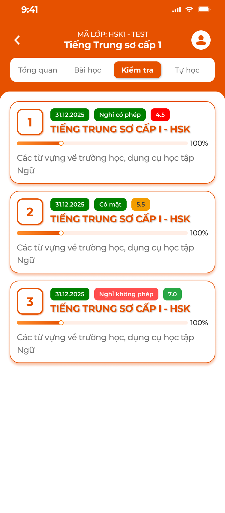

# [Học viên] Kiểm tra

Tab **Kiểm tra** trong chi tiết lớp của app học viên: danh sách bài kiểm tra giáo viên đã giao, làm bài có đếm giờ, nộp, chờ chấm và xem kết quả. Bài kiểm tra do CD soạn ([Bài tập về nhà và Kiểm tra](../../course_management/homework-test/homework-test.md), [Học kỳ — Kiểm tra](../../course_management/semester/test/test.md)); giáo viên giao / kết thúc / thu hồi / chấm theo [Giáo viên — Giảng dạy](../../teacher_role/class/class_teaching_requirements.md).

Có ảnh danh sách; màn làm bài và kết quả chưa có ảnh.

## 1. UI

### Trang 1: HV-KT-010000 — Danh sách bài kiểm tra




*Tab Kiểm tra: thẻ bài với ngày, tag điểm danh, badge điểm — nhấn để xem ảnh gốc*

**Mô tả:**

- Danh sách bài kiểm tra của lớp mà giáo viên đã giao cho học viên; bấm thẻ để làm bài hoặc xem kết quả.

**Điểm cần lưu ý:**

- `A01.01` **Thẻ bài**: Số thứ tự (ô cam); tag ngày giao `dd.MM.yyyy` (xanh lá); tag điểm danh của buổi gắn bài (nếu bài gắn buổi); badge điểm: `Chưa làm` (xám), `Đang làm` (cam), `Chờ chấm` (xanh dương), điểm số `x.x` (màu theo mức: đỏ < Điểm đạt, xanh lá ≥ Điểm đạt); tên bài (cam, in hoa); thanh tiến độ (số câu đã trả lời / tổng khi đang làm; 100% khi đã nộp); mô tả bài.
- `A01.02` **Thứ tự**: Theo ngày giao mới nhất lên đầu.
- `A01.03` **Trống**: `Chưa có bài kiểm tra nào được giao`.

- Chỉ hiện bài trạng thái `Đang đợi nộp bài` trở đi của lớp; bài `Chưa giao` hoặc bị giáo viên `Thu hồi` không hiện (thu hồi xoá bài làm và điểm).
- Bài giáo viên đã `Kết thúc bài` vẫn hiện, thẻ có thêm tag `Đã kết thúc`; bấm thẻ chỉ mở màn kết quả (đã nộp) hoặc báo `Bài kiểm tra đã kết thúc` (chưa nộp), không vào làm bài.
- Khác ảnh: ảnh dùng badge điểm cho mọi thẻ; requirement thêm trạng thái `Chưa làm` / `Đang làm` / `Chờ chấm` trước khi có điểm.

### Trang 2: HV-KT-020000 — Làm bài kiểm tra


**Mô tả:**

- Màn làm bài: thời gian tính từ lúc vào, tạm dừng khi thoát, câu hỏi thứ tự cố định, nộp bài ở câu cuối.

**Giải thích field/thành phần:**

- `A02.01` **Header**: Back (tạm dừng, giữ bài), tên bài, đồng hồ thời gian đã làm (đếm lên; nếu bài có giới hạn `Thời gian` thì đếm ngược và tự nộp khi hết).
- `A02.02` **Thân**: `n/N`, nút `Xem hướng dẫn` (nếu câu có hướng dẫn), câu hỏi theo loại: `Trắc nghiệm` (4 đáp án, chọn 1), `Sắp xếp` (kéo thả thẻ từ), `Nối từ` (nối 2 cột), `Nói` (nhấn giữ mic, nghe lại, ghi lại), `Đọc` (đoạn văn + trả lời), `Viết` (ô nhập), `Hình ảnh` (hình + trả lời / ghi âm), `Câu hỏi con` (câu cha có các câu con, mỗi con một loại, cuộn dọc).
- `A02.03` **Điều hướng**: `<` `>` chuyển câu; menu số câu (1, 2, 3…) nhảy nhanh, câu đã trả lời tô màu; `Nộp bài` ở câu cuối.
- `A02.04` **Nộp**: Popup `Nộp bài?` nêu số câu chưa làm; `Nộp` → gửi; chỉ nộp một lần.

**Điểm cần lưu ý:**

- Đáp án lưu nháp trên server ngay khi trả lời; thoát rồi vào lại tiếp tục từ câu đang làm, thời gian tiếp tục đếm.
- Mỗi bài một lần làm; làm lại chỉ khi giáo viên thu hồi và giao lại (bài về `Chưa làm`).
- Khác spec cũ: 11 loại câu ánh xạ về 8 loại của CD (bảng ánh xạ ở [Bài học](../lesson/lesson.md), khu vực Bài tập củng cố); không thêm loại mới.

### Trang 3: HV-KT-030000 — Kết quả kiểm tra


**Mô tả:**

- Sau khi nộp: câu app tự chấm hiện ngay, câu giáo viên chấm `Chờ chấm`; giáo viên chấm xong: điểm tổng, thời gian làm, từng câu đúng / sai, đáp án đúng, nhận xét giáo viên.

**Giải thích field/thành phần:**

- `A03.01` **Chờ chấm**: Icon đồng hồ, `Kết quả đang được chấm. Bạn đợi một tí nhé!`; danh sách câu: tự chấm đúng / sai, còn lại `Chờ chấm`.
- `A03.02` **Đã chấm**: Vòng điểm tổng `x.x` (thang 10 = trung bình điểm câu; màu xanh lá ≥ Điểm đạt, đỏ < Điểm đạt, dòng `Đạt` / `Chưa đạt`), `Thời gian làm bài mm:ss`, danh sách câu: đúng viền xanh + tick, sai viền đỏ + ×, bỏ qua `Bạn đã bỏ qua câu này!`; `Đáp án của bạn` / `Đáp án đúng` cho Sắp xếp, Nối; phát lại ghi âm cho Nói / Hình ảnh; nhận xét giáo viên (chữ, ảnh, ghi âm) dưới câu.
- `A03.03` **Xem lại**: Bấm từng câu để mở chi tiết; chỉ đọc.

**Điểm cần lưu ý:**

- `Điểm đạt` lấy từ cấu hình bài kiểm tra của CD (0–10).
- Điểm kiểm tra tính vào `Điểm kiểm tra` ở tab Tổng quan lớp.

### Trang 4: Toast phản hồi CRUD


*Toast Thành Công, Thông Báo, Cảnh Báo và Có Lỗi Xảy Ra — nhấn để xem ảnh gốc*

**Mô tả:**

- Phản hồi khi nộp bài.

**Điểm cần lưu ý:**

- `A04.01` **Thành công**: Tiêu đề cố định: `Thành Công`; Khi sử dụng: `Nộp bài thành công`
- `A04.02` **Thông tin**: Tiêu đề cố định: `Thông Báo`; Khi sử dụng: `Hết giờ, bài đã được nộp`; `Bài kiểm tra đã kết thúc`
- `A04.03` **Cảnh báo**: Tiêu đề cố định: `Cảnh Báo`; Khi sử dụng: `Cần quyền micro để ghi âm`; `Không có kết nối, vui lòng thử lại`
- `A04.04` **Lỗi**: Tiêu đề cố định: `Có Lỗi Xảy Ra`; Khi sử dụng: `Nộp bài thất bại, vui lòng thử lại`

- Lưu nháp từng câu không Toast.

---

## 2. Yêu cầu

### 2.1. Flow chính

**Flow 1 / REQ01: Danh sách bài kiểm tra**

```text
Giáo viên giao bài → bài hiện ở tab Kiểm tra (Chưa làm) → học viên bấm thẻ
```

**Flow 2 / REQ02 / REQ03: Làm, nộp, xem kết quả**

```text
Vào bài → đồng hồ chạy → trả lời (nháp server) → thoát: tạm dừng; vào lại: tiếp tục
      → Nộp bài → popup → Nộp → app chấm câu tự động; câu khác Chờ chấm
      → Giáo viên chấm → điểm tổng thang 10, Đạt / Chưa đạt, chi tiết câu, nhận xét
```

### 2.2. Ngoại lệ

- **EX01:** Giáo viên thu hồi → bài biến mất khỏi danh sách, bài làm và điểm xoá; giao lại thì về `Chưa làm`.
- **EX02:** Lớp chưa có bài → `Chưa có bài kiểm tra nào được giao`.
- **EX03:** Hết giới hạn thời gian → tự nộp, câu trống tính bỏ qua, Toast `Thông Báo`.
- **EX04:** Nộp lặp → backend từ chối; app chỉ hiện kết quả.
- **EX05:** Mất mạng khi lưu nháp → giữ trên máy, đồng bộ khi có mạng; nộp thất bại Toast `Có Lỗi Xảy Ra`.
- **EX06:** Học viên không thuộc diện làm bài tại thời điểm giao → không thấy bài.
- **EX07:** Giáo viên kết thúc bài → lưu câu trả lời / nộp bị backend từ chối, Toast `Thông Báo` `Bài kiểm tra đã kết thúc`; bài đã nộp trước đó giữ nguyên, vẫn xem kết quả.

### 2.3. Yêu cầu khác

| Mã | Tên yêu cầu | Mô tả |
|---|---|---|
| REQ01 | Danh sách | Bài đã giao của lớp, mới nhất trước; badge trạng thái `Chưa làm` / `Đang làm` / `Chờ chấm` / điểm; tag ngày giao và điểm danh buổi gắn bài. |
| REQ02 | Làm bài | 8 loại câu của CD; thứ tự câu cố định, chuyển câu tự do; thời gian đếm từ lúc vào, tạm dừng khi thoát; giới hạn thời gian theo cấu hình bài; nháp server; nộp một lần. |
| REQ03 | Kết quả | App tự chấm Trắc nghiệm, Sắp xếp, Nối từ; giáo viên chấm phần còn lại; điểm bài thang 10 = trung bình điểm câu; Đạt khi ≥ Điểm đạt; hiện thời gian làm, chi tiết câu, nhận xét. |
| REQ04 | Bài đã kết thúc | Bài giáo viên đã kết thúc vẫn trong danh sách với tag `Đã kết thúc`; chỉ xem kết quả (đã nộp), không làm, không lưu câu trả lời, không nộp. Điểm vẫn cập nhật khi giáo viên chấm sau khi kết thúc. Làm lại chỉ khi giáo viên thu hồi và giao lại. |

### 2.4. Ràng buộc

#### Quyền

| Role | Xem danh sách | Làm / nộp | Xem kết quả |
|---|:---:|:---:|:---:|
| Học viên của lớp | ✅ | ✅ (bài đã giao, chưa kết thúc, chưa nộp) | ✅ |
| Người dùng trải nghiệm | ❌ | ❌ | ❌ |

#### Ràng buộc khác

**Phạm vi dữ liệu**

- Chỉ bài giao cho học viên trong lớp của họ; backend kiểm tra trạng thái bài và học viên trước khi nhận nộp.

---

---

## 3. Testcase

### Feature: [Học viên] Kiểm tra

| Tên testcase | Priority | Scenario | Role | Pre-condition | Given/When/Then | Expected Result |
|---|---|---|---|---|---|---|
| Case 1: Mở tab | High · Smoke | Flow 1 / REQ01 | Học viên | Giáo viên đã giao 3 bài, 1 đã chấm 7.0 | **Given** bấm `Kiểm tra`<br>**When** tải<br>**Then** 3 thẻ, badge `7.0`, `Chờ chấm`, `Chưa làm` | - Ngày giao đúng |
| Case 2: Bài bị thu hồi | High | EX01 | Học viên | Giáo viên thu hồi bài đã nộp | **Given** mở tab<br>**When** tải lại<br>**Then** bài biến mất | - Điểm cũ không còn |
| Case 3: Không có bài | Low | EX02 | Học viên | Lớp chưa giao | **Given** mở tab<br>**When** tải<br>**Then** `Chưa có bài kiểm tra nào được giao` | - |
| Case 12: Bài đã kết thúc | High | EX07 / REQ04 | Học viên | Giáo viên kết thúc bài; A đã nộp (đã chấm 7.0), B chưa nộp | **Given** A và B mở tab<br>**When** bấm thẻ<br>**Then** A mở màn kết quả `7.0`; B thấy `Bài kiểm tra đã kết thúc` | - Thẻ có tag `Đã kết thúc`<br>- Không vào làm bài |
| Case 13: Đang làm thì giáo viên kết thúc | High | EX07 / REQ04 | Học viên | A đang làm câu 5 | **Given** giáo viên kết thúc bài<br>**When** A lưu câu trả lời hoặc bấm `Nộp`<br>**Then** bị từ chối, Toast `Thông Báo` `Bài kiểm tra đã kết thúc` | - Thoát về danh sách<br>- A vẫn `Chưa nộp` |
| Case 4: Làm và nộp | High · Smoke | Flow 2 / REQ02 | Học viên | Bài 20 câu `Chưa làm` | **Given** bấm thẻ<br>**When** trả lời 20 câu, `Nộp bài` → `Nộp`<br>**Then** màn kết quả chờ chấm, Toast `Nộp bài thành công` | - Thẻ badge `Chờ chấm`, 100% |
| Case 5: Tạm dừng | High | REQ02 | Học viên | Đang câu 7, 05:12 | **Given** back<br>**When** mở lại sau 10 phút<br>**Then** ở câu 7, đồng hồ 05:12 tiếp tục | - Đáp án 1–6 còn |
| Case 6: Hết giờ | Medium | EX03 / REQ02 | Học viên | Bài giới hạn 30 phút | **Given** đồng hồ về 0<br>**When** hết<br>**Then** tự nộp, Toast `Thông Báo` `Hết giờ, bài đã được nộp` | - Câu trống tính bỏ qua |
| Case 7: Menu số câu | Low | REQ02 | Học viên | Đã trả lời câu 1, 3 | **Given** mở menu<br>**When** xem<br>**Then** 1 và 3 tô màu; bấm 15 nhảy tới câu 15 | - |
| Case 8: Nộp lặp | High | EX04 | Học viên | Đã nộp | **Given** mở bài<br>**When** vào<br>**Then** chỉ màn kết quả | - Request nộp bị từ chối |
| Case 9: Chờ chấm | High | Flow 2 / REQ03 | Học viên | Vừa nộp, 12 câu trắc nghiệm + 3 câu Viết | **Given** màn kết quả<br>**When** xem<br>**Then** 12 câu đúng / sai ngay, 3 câu `Chờ chấm`, chưa có điểm | - |
| Case 10: Đã chấm | High · Smoke | Flow 2 / REQ03 | Học viên | Giáo viên chấm xong 8.5, Điểm đạt 5 | **Given** mở bài<br>**When** kết quả<br>**Then** `8.5` xanh lá, `Đạt`, thời gian, nhận xét | - Thẻ badge `8.5` |
| Case 11: Chưa đạt | Medium | REQ03 | Học viên | Điểm 4.0, Điểm đạt 5 | **Given** kết quả<br>**When** render<br>**Then** `4.0` đỏ, `Chưa đạt` | - |
| Toast Case 1: Lỗi nộp | High | Ràng buộc Toast CRUD | Học viên | Mất mạng | **Given** `Nộp`<br>**When** thất bại<br>**Then** Toast `Có Lỗi Xảy Ra`, đáp án giữ, cho nộp lại | - |

---

---

## 4. Câu hỏi cần xác nhận

- **Q01:** Màn làm bài, popup nộp, màn kết quả chưa có ảnh thiết kế.
- **Q02:** Giới hạn thời gian làm bài: dùng field `Thời gian` của bài kiểm tra CD làm đếm ngược hay chỉ để tham khảo.
