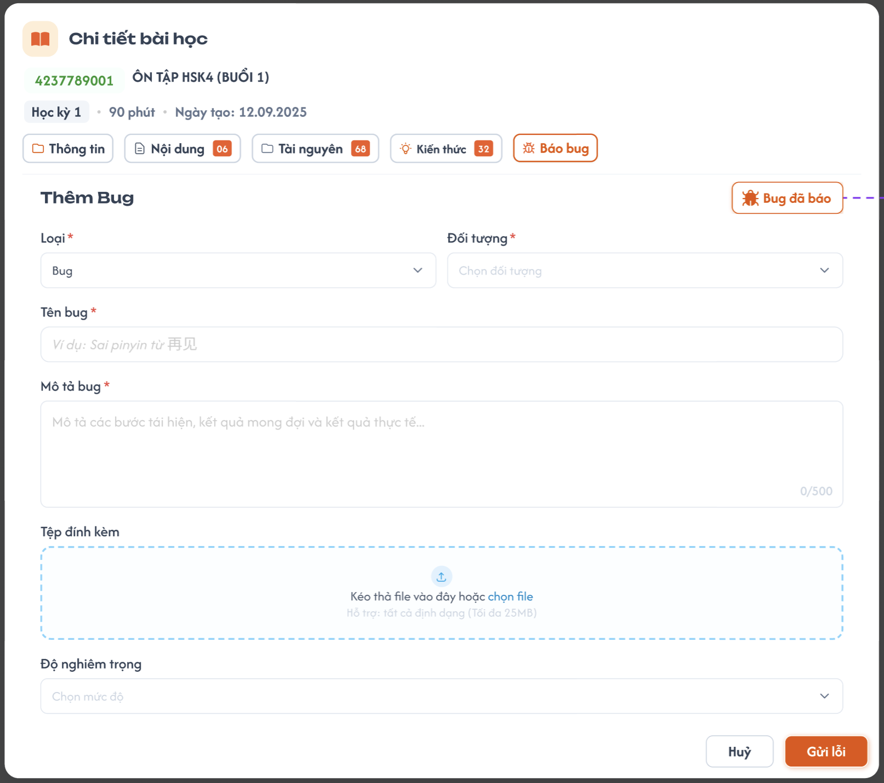
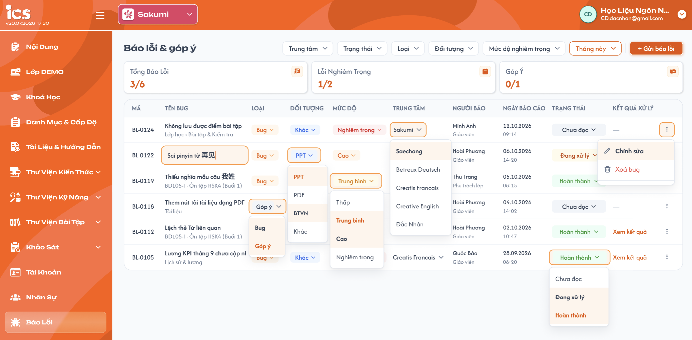
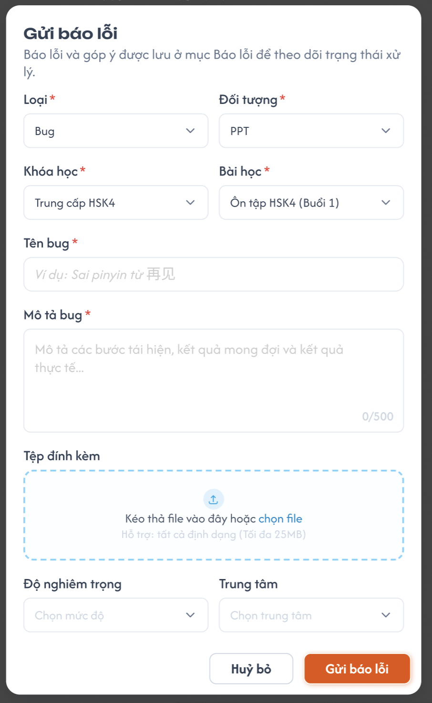
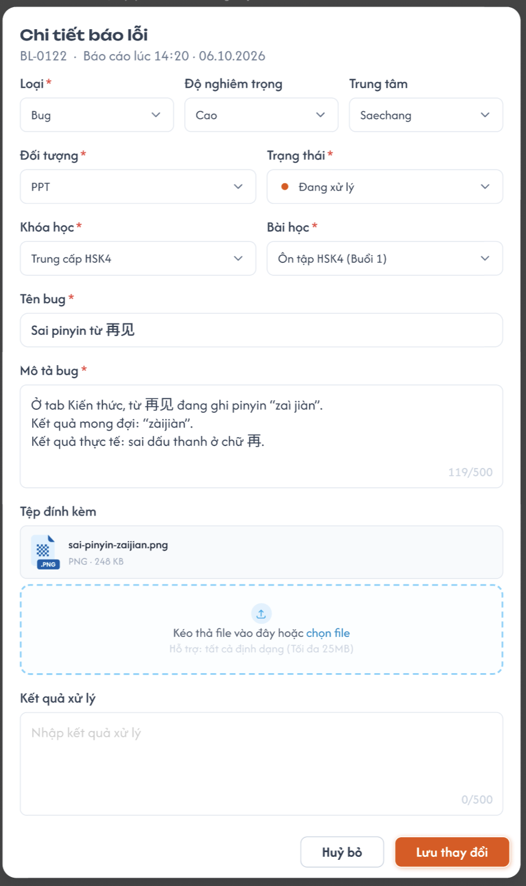
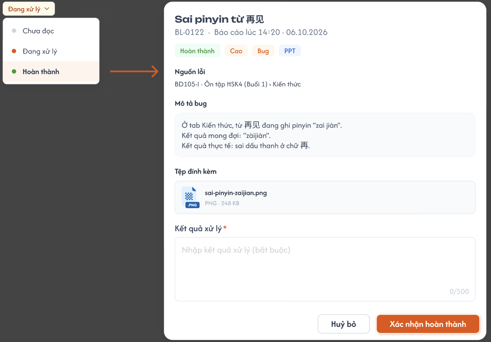
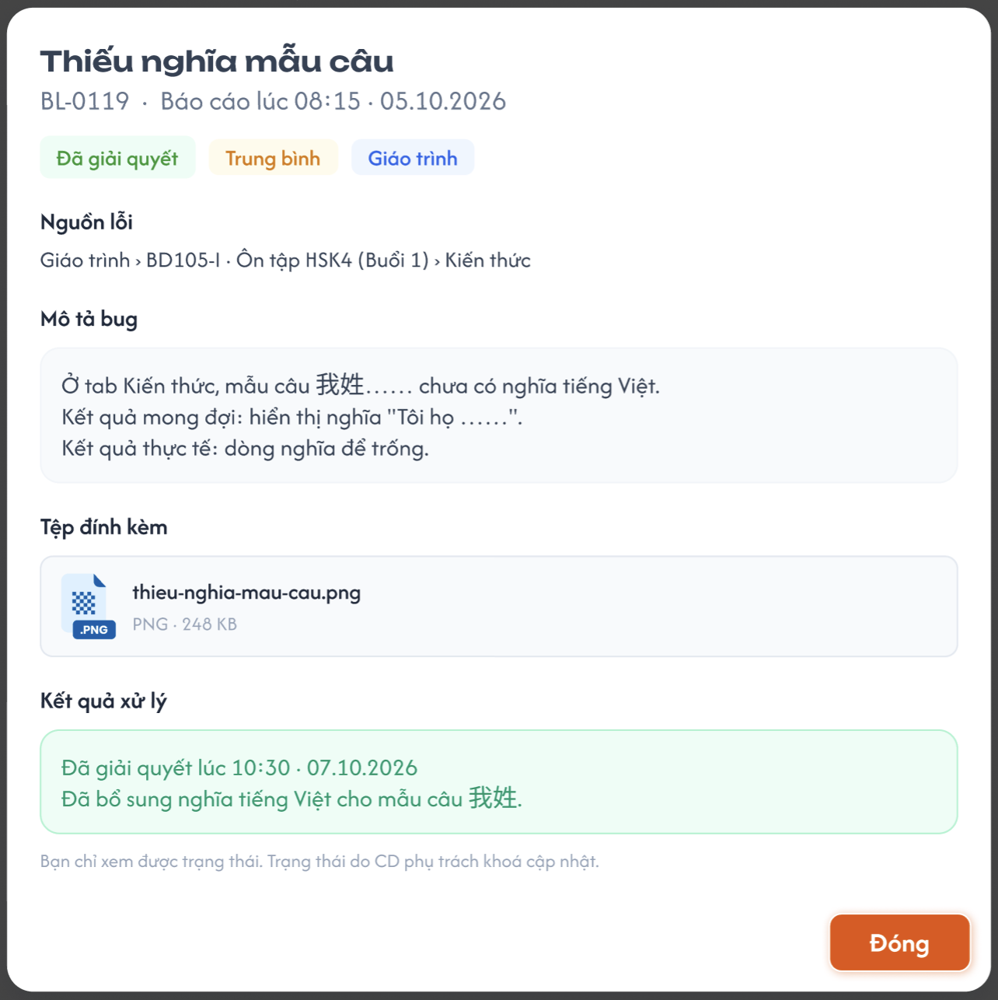
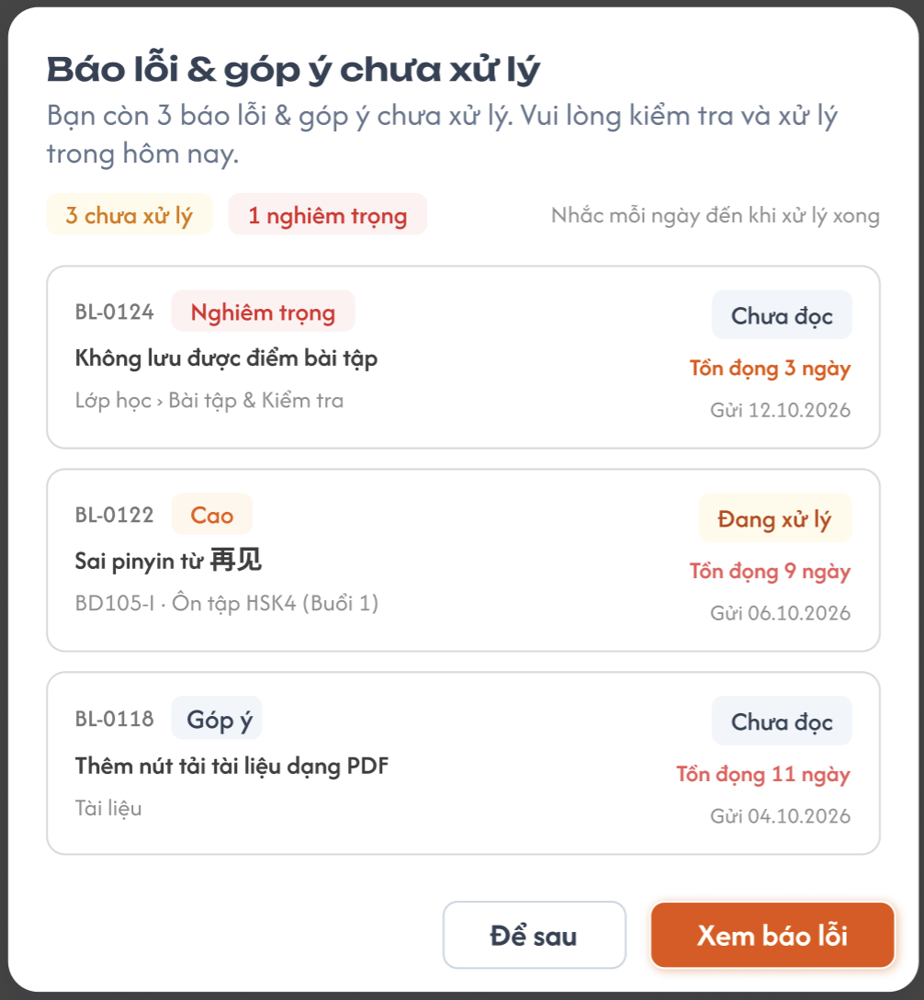

# Báo lỗi & Góp ý

## 1. UI

### Trang 1: Chi tiết bài học – Tab Bug (Thêm Bug)


**Mô tả:**
- GV, CD báo lỗi / góp ý cho chính bài học đang xem mà không phải rời màn hình.

**Điểm cần lưu ý:**
- Thêm bug ở đây luôn tự động gắn với khoá học, bài học hiện tại, kể cả khi Đối tượng = Khác.
- Không có trường Trạng thái: báo lỗi tạo mới luôn là **Chưa đọc**.
- Loại mặc định = **Bug**.
- Tệp đính kèm:
  - Hiển thị dấu `*` khi Loại = Bug, ẩn dấu `*` khi Loại = Góp ý.
  - Cho chọn nhiều file, mỗi file tối đa 25MB.
- Nút **Bug đã báo**: mở **tab trình duyệt mới** tới trang Báo lỗi & góp ý (Trang 2), lọc sẵn trung tâm CD / GV đã chọn; trang hiện tại giữ nguyên.
- Nút **Gửi lỗi** thành công → toast thông báo + reset form về mặc định (không rời trang).
- Nút **Huỷ**: xoá dữ liệu đã nhập, đưa form về mặc định.
- Chỉ GV, CD thấy form Thêm Bug.

### Trang 2: CD-BL-010000, CH-BL-010000, GV-BL-010000 — Danh sách Báo lỗi & góp ý




**Mô tả:**
- Theo dõi và xử lý toàn bộ báo lỗi, góp ý. Truy cập từ menu **Báo Lỗi** (GV, CD, PTL) hoặc nút **Bug đã báo** ở Trang 1.

**Điểm cần lưu ý:**
- Phạm vi dữ liệu theo role:
  - GV, CD: bug thuộc **trung tâm đang chọn** ở header (vd "Sakumi"). Đổi trung tâm → tải lại danh sách.
  - PTL: bug của **tất cả trung tâm**.
- Bộ lọc: Trạng thái, Loại, Đối tượng, Mức độ nghiêm trọng, Thời gian (mặc định **Tháng này**, lọc theo Ngày báo cáo).
  - Chỉ GV: thêm filter **Bug của tôi** (bug do chính user gửi).
  - Chỉ PTL: thêm filter **Trung tâm**.
- 3 thẻ thống kê dạng `X/Y` = số **Hoàn thành** / tổng, tính theo bộ lọc đang áp dụng:
  - Tổng báo lỗi: tất cả bản ghi (Bug, không gồm Góp ý).
  - Lỗi nghiêm trọng: Loại = Bug và Độ nghiêm trọng = Nghiêm trọng.
  - Góp ý: Loại = Góp ý.
- Cột Tên bug: dòng phụ = `Khoá học · Bài học`. Bug không có khoá học / bài học (chỉ xảy ra khi Đối tượng = Khác) → không hiển thị dòng phụ.
- Mức độ trống → hiển thị `—`. Màu badge: Nghiêm trọng đỏ, Cao cam, Trung bình vàng, Thấp xám.
- Ngày báo cáo hiển thị 2 dòng: `dd.MM.yyyy` và `HH:mm`.
- Cột Trạng thái là dropdown đổi nhanh, chỉ bật với CD, PTL. GV luôn thấy badge tĩnh, kể cả với bug của mình.
- Chọn **Hoàn thành** ở dropdown không lưu ngay mà mở popup Xác nhận hoàn thành (Trang 5).
- Cột Kết quả xử lý: link **Xem kết quả** chỉ hiển thị với bug Hoàn thành, còn lại hiển thị `—`.
- Cuối mỗi dòng có **nút 3 chấm** → menu gồm **Chỉnh sửa**, **Xoá**:
  - Chỉ hiển thị mục user có quyền; không có quyền nào → ẩn nút 3 chấm.
  - Chỉnh sửa → mở popup Chi tiết báo lỗi (Trang 4).
- Click vào dòng / Chỉnh sửa (trong menu 3 chấm) → popup Chi tiết báo lỗi (Trang 4).
- Sắp xếp mặc định: Ngày báo cáo mới nhất lên đầu.

### Trang 3: CD-BL-010010, CD-BL-010011, GV-BL-010010 — Popup Gửi báo lỗi




**Mô tả:**
- Gửi báo lỗi / góp ý mới từ trang danh sách (nút **+ Gửi báo lỗi**).

**Điểm cần lưu ý:**
- Khoá học, Bài học luôn hiển thị:
  - Đối tượng = PPT, PDF, BTVN → **bắt buộc**.
  - Đối tượng = Khác → **không bắt buộc**.
- Bài học phụ thuộc Khoá học: disable khi chưa chọn Khoá học; đổi Khoá học → reset Bài học.
- Role PTL: thêm trường **Trung tâm\*** (bắt buộc); bug thuộc trung tâm được chọn.
- Role GV, CD: trường Trung tâm tự fill trung tâm đang chọn hiện tại, GV chỉ hiện những trung tâm được cấp quyền.
- Loại mặc định = Bug; dấu `*` và quy tắc Tệp đính kèm giống Trang 1.
- Không có trường Trạng thái, Kết quả xử lý (tạo mới = Chưa đọc).

### Trang 4: CD-BL-010020, CD-BL-010030, GV-BL-010020 — Popup Chi tiết báo lỗi




**Mô tả:**
- Xem đầy đủ và chỉnh sửa một báo lỗi. Mở khi click vào dòng hoặc chọn **Chỉnh sửa** ở menu 3 chấm.

**Điểm cần lưu ý:**
- Header: `Mã · Báo cáo lúc HH:mm · dd.MM.yyyy`.
- Có thêm trường **Trạng thái\*** so với popup gửi.
- Bắt buộc Khoá học, Bài học theo Đối tượng giống Trang 3.
- GV sửa bug của mình: sửa được các trường thông tin, nhưng **Trạng thái** và **Kết quả xử lý** chỉ đọc.
- **Kết quả xử lý\***: bắt buộc khi Trạng thái = Hoàn thành; 
- Tệp đính kèm: hiển thị các file đã có (tên, định dạng, dung lượng), bấm để xem/tải; có thể thêm file. Loại = Bug thì phải còn ít nhất 1 file.
- Không có quyền sửa → toàn bộ trường chỉ đọc, ẩn nút **Lưu thay đổi**.

### Trang 5: CD-BL-010050, CH-BL-010050 — Popup Xác nhận hoàn thành




**Mô tả:**
- Bắt buộc nhập kết quả xử lý khi chuyển bug sang Hoàn thành từ dropdown Trạng thái trên danh sách.

**Điểm cần lưu ý:**
- Phần trên chỉ đọc: Tên bug, Mã · thời gian báo cáo, tag (Trạng thái, Mức độ, Loại, Đối tượng), Nguồn lỗi, Mô tả bug, Tệp đính kèm.
- Nguồn lỗi = `Khoá học · Bài học`; bug không có khoá học / bài học → ẩn mục Nguồn lỗi.
- Kết quả xử lý\*: bắt buộc nhập mới cho xác nhận hoàn thành.
- **Huỷ bỏ** → đóng popup, dropdown giữ nguyên trạng thái cũ.

### Trang 6: CD-BL-010030, GV-BL-010030 — Popup Xem kết quả




**Mô tả:**
- Xem tóm tắt bug đã Hoàn thành kèm kết quả xử lý.

**Điểm cần lưu ý:**
- Mở từ link **Xem kết quả**, chỉ áp dụng cho bug Hoàn thành.
- Toàn bộ chỉ đọc; Kết quả xử lý hiển thị dạng text; chỉ có nút **Đóng**.
- Quy tắc hiển thị Nguồn lỗi giống Trang 5.

### Trang 7: CH-BL-010070 — Popup nhắc bug chưa xử lý (PTL)




**Mô tả:**
- Nhắc PTL mỗi ngày khi còn bug chưa được xử lý.

**Điểm cần lưu ý:**
- Chỉ role PTL.
- Hiện khi PTL mở / reload trang **lần đầu trong ngày**; các lần mở / reload sau trong cùng ngày không hiện lại.
- Nội dung: số lượng bug Chưa xử lý gồm bug **Chưa đọc**, **Đang xử lý** và **danh sách** các bug đó (tất cả trung tâm, không tính bug đã xoá).
- Nút **Đóng**.

---

---

## 2. Yêu cầu

### 2.1. Flow chính

**Flow 1: Thêm bug tại tab Bug của bài học (GV, CD)**

```
Mở Chi tiết bài học → tab Bug → nhập form Thêm Bug → bấm "Gửi lỗi" → FE validate
       ↓ (không hợp lệ) → báo lỗi tại field, không gọi API
  → FE gọi API tạo (tự gắn khoá học, bài học hiện tại + trung tâm đang chọn)
  → BE sinh mã BL-xxxx, Trạng thái = Chưa đọc, Người báo = user hiện tại, Ngày báo cáo = now
  → FE: toast "Gửi báo lỗi thành công" → reset form về mặc định

Bấm "Bug đã báo" → mở tab trình duyệt mới → trang Báo lỗi & góp ý, lọc sẵn trung tâm đang chọn
```

**Flow 2: Gửi báo lỗi từ danh sách**

```
Bấm "+ Gửi báo lỗi" → popup Gửi báo lỗi (Loại mặc định = Bug)
  → Trung tâm*
       ↓ (PTL)    → chọn Trung tâm
       ↓ (GV, CD) → tự fill trung tâm đang chọn (danh sách trung tâm của GV chỉ gồm trung tâm được cấp quyền)
  → chọn Đối tượng
       ↓ (PPT / PDF / BTVN) → Khoá học*, Bài học* bắt buộc
       ↓ (Khác)             → Khoá học, Bài học không bắt buộc
  → chọn Khoá học → load Bài học → chọn Bài học
  → nhập Tên bug, Mô tả, Tệp (bắt buộc nếu Loại = Bug), Độ nghiêm trọng (tuỳ chọn)
  → bấm "Gửi báo lỗi" → FE validate → API tạo
  → BE kiểm tra quyền trung tâm + lưu (Trạng thái = Chưa đọc, thuộc trung tâm đã chọn trên popup)
  → FE: đóng popup → toast thành công → tải lại danh sách + thẻ thống kê
```

**Flow 3: Xem / sửa chi tiết**

```
Click 1 dòng  hoặc  nút 3 chấm → "Chỉnh sửa"
  → API lấy chi tiết → popup Chi tiết báo lỗi
  ↓ (không có quyền sửa) → toàn bộ chỉ đọc, ẩn "Lưu thay đổi"
  ↓ (GV, bug của mình)   → sửa field; Trạng thái, Kết quả xử lý chỉ đọc
  ↓ (CD, PTL)            → sửa field, kể cả Trạng thái và Kết quả xử lý
                              ↓ (Trạng thái = Hoàn thành) → Kết quả xử lý* bắt buộc
  → "Lưu thay đổi" → FE validate → API cập nhật
  → BE kiểm tra quyền + lưu → đóng popup → toast → tải lại danh sách + thẻ thống kê
```

**Flow 4: Đổi trạng thái nhanh trên danh sách**

```
Bấm dropdown Trạng thái trên dòng (chỉ CD, PTL)
  ↓ (Chưa đọc / Đang xử lý) → API cập nhật → cập nhật badge dòng + thẻ thống kê
  ↓ (Hoàn thành) → popup Xác nhận hoàn thành → nhập Kết quả xử lý*
        ↓ (Huỷ bỏ)               → đóng popup, giữ trạng thái cũ
        ↓ (Xác nhận hoàn thành)  → API cập nhật trạng thái + kết quả
                                 → dòng hiển thị "Hoàn thành" + link "Xem kết quả" → cập nhật thống kê
```

**Flow 5: Xem kết quả**

```
Bấm "Xem kết quả" (bug Hoàn thành) → API lấy chi tiết → popup tóm tắt chỉ đọc (có Kết quả xử lý) → "Đóng"
```

**Flow 6: Xoá báo lỗi**

```
Nút 3 chấm → "Xoá" (chỉ hiện khi có quyền) → popup xác nhận
  ↓ (Huỷ)      → đóng, không xoá
  ↓ (Xác nhận) → API xoá → BE kiểm tra quyền → xoá mềm (đánh dấu xoá, lưu người xoá + thời điểm)
               → toast → tải lại danh sách + thẻ thống kê
```

**Flow 7: Popup nhắc PTL hằng ngày**

```
PTL mở / reload trang → FE gọi API kiểm tra đã nhắc hôm nay chưa
  ↓ (đã nhắc) → không hiện
  ↓ (chưa nhắc) → API lấy bug chưa xử lý (Chưa đọc + Đang xử lý, tất cả trung tâm, chưa xoá)
        ↓ (không có bug) → không hiện
        ↓ (có bug) → hiện popup: số lượng bug chưa xử lý + danh sách → BE ghi nhận đã nhắc (user + ngày)
                   → "Đóng" → đóng popup
```

### 2.2. Ngoại lệ

- **EX01:** Thiếu trường bắt buộc (Loại, Đối tượng, Tên bug, Mô tả bug, Trung tâm, Khoá học / Bài học khi Đối tượng = PPT / PDF / BTVN) → FE báo lỗi tại field, không gọi API.
- **EX02:** Loại = Bug nhưng không có tệp đính kèm (khi tạo, hoặc khi sửa mà xoá hết file) → chặn gửi/lưu, báo "Vui lòng đính kèm ít nhất 1 tệp". Loại = Góp ý → cho gửi không cần tệp.
- **EX03:** Chọn nhiều file, trong đó có file > 25MB → chỉ loại bỏ file vượt dung lượng kèm thông báo; các file hợp lệ vẫn được nhận.
- **EX04:** Mô tả bug / Kết quả xử lý vượt 500 ký tự → chặn nhập thêm.
- **EX05:** Chuyển Trạng thái = Hoàn thành khi Kết quả xử lý trống → không cho Xác nhận / Lưu, báo lỗi tại field.
- **EX06:** Đổi Đối tượng sang Khác → Khoá học, Bài học chuyển sang không bắt buộc, giữ giá trị đã chọn; đổi lại PPT / PDF / BTVN → bắt buộc lại. Đổi Khoá học → reset Bài học.
- **EX07:** User không có quyền gọi API → BE trả 403, FE báo "Bạn không có quyền thực hiện thao tác này". Gồm các trường hợp:
  - Sửa / đổi trạng thái / xoá bug ngoài quyền.
  - GV gửi thay đổi Trạng thái hoặc Kết quả xử lý của bug của mình.
  - GV gửi báo lỗi vào trung tâm không được cấp quyền.
- **EX08:** Bug đã bị người khác xoá trong lúc đang mở / đổi trạng thái → báo "Báo lỗi không còn tồn tại", đóng popup, tải lại danh sách.
- **EX09:** Gửi / lưu thất bại (mất mạng, lỗi BE) → giữ nguyên dữ liệu đã nhập, hiển thị thông báo lỗi; với dropdown trạng thái thì trả về trạng thái cũ.

### 2.3. Yêu cầu khác

| Mã | Tên yêu cầu | Mô tả |
|---|---|---|
| REQ01 | Gắn ngữ cảnh ở tab Bug | User không cần chọn khoá học, bài học; bug tự lưu khoá học, bài học hiện tại và trung tâm đang chọn, kể cả khi Đối tượng = Khác. |
| REQ02 | Sau khi gửi ở tab Bug | Toast "Gửi báo lỗi thành công", reset form về mặc định (Loại = Bug, các trường khác trống). |
| REQ03 | Nút Bug đã báo | Mở tab trình duyệt mới (`target="_blank"`) tới trang Báo lỗi & góp ý, lọc sẵn trung tâm CD / GV đang chọn. |
| REQ04 | Thẻ thống kê | `X/Y` = Hoàn thành / tổng, theo bộ lọc hiện tại. Tổng báo lỗi = Loại Bug (không gồm Góp ý); Lỗi nghiêm trọng = Loại Bug và mức Nghiêm trọng; Góp ý = Loại Góp ý. Cập nhật sau mỗi lần tạo, sửa, đổi trạng thái, xoá. |
| REQ05 | Xem kết quả | Link chỉ hiển thị với bug Hoàn thành; mở popup tóm tắt chỉ đọc. |
| REQ06 | Mở lại bug đã Hoàn thành | Chuyển từ Hoàn thành sang trạng thái khác: Kết quả xử lý giữ nguyên, không còn bắt buộc; chuyển lại Hoàn thành thì bắt buộc trở lại. |
| REQ07 | Menu 3 chấm | Cuối mỗi dòng; gồm Chỉnh sửa, Xoá; chỉ hiển thị mục user có quyền, không có quyền nào thì ẩn nút. |
| REQ08 | Xoá mềm | Có popup xác nhận; chỉ đánh dấu xoá. Bug đã xoá không hiển thị và không được tính ở danh sách, thống kê, popup nhắc PTL. |
| REQ09 | Popup nhắc PTL | Hiện khi mở / reload trang lần đầu trong ngày; nội dung gồm số lượng bug chưa xử lý (Chưa đọc + Đang xử lý) và danh sách các bug đó. Ghi nhận đã nhắc theo user + ngày ở BE ngay khi hiển thị (reload hoặc đổi thiết bị trong cùng ngày không hiện lại). |
| REQ10 | Trung tâm khi gửi từ danh sách | PTL bắt buộc chọn Trung tâm. GV, CD tự fill trung tâm đang chọn; danh sách trung tâm của GV chỉ gồm trung tâm được cấp quyền. Bug thuộc trung tâm đã chọn trên popup. |
| REQ11 | Đổi trung tâm | GV, CD đổi trung tâm ở header → tải lại danh sách và thống kê theo trung tâm mới. |
| REQ12 | Chống gửi trùng | Disable nút Gửi / Lưu / Xác nhận trong lúc chờ API phản hồi. |

### 2.4. Ràng buộc

#### Quyền

| Role | Xem danh sách | Thêm bug ở tab Bug bài học | Gửi báo lỗi từ danh sách | Sửa thông tin | Đổi trạng thái | Xoá | Filter "Bug của tôi" | Filter "Trung tâm" | Nhận popup nhắc |
|---|:---:|:---:|:---:|:---:|:---:|:---:|:---:|:---:|:---:|
| GV | Trung tâm đang chọn | ✅ | ✅ (trung tâm được cấp quyền) | Bug của mình | ❌ | Bug của mình | ✅ | ❌ | ❌ |
| CD | Trung tâm đang chọn | ✅ | ✅ | ✅ Tất cả | ✅ Tất cả | ✅ Tất cả | ❌ | ❌ | ❌ |
| PTL | Tất cả trung tâm | ❌ | ✅ (chọn Trung tâm) | ✅ Tất cả | ✅ Tất cả | ✅ Tất cả | ❌ | ✅ | ✅ |

- "Bug của mình" = bug do chính user đó gửi.
- "Đổi trạng thái" bao gồm cả nhập / sửa Kết quả xử lý. GV không được đổi trạng thái, kể cả bug của mình.
- "Tất cả" của CD giới hạn trong trung tâm đang chọn.
- GV xem được chi tiết mọi bug trong trung tâm đang chọn, nhưng bug của người khác chỉ ở chế độ chỉ đọc.

#### Ràng buộc khác

- Mã báo lỗi dạng `BL-xxxx`, tự sinh, duy nhất, không sửa được.
- Người báo, Ngày báo cáo do hệ thống ghi, không sửa được.
- Trạng thái khi tạo mới luôn = Chưa đọc; sau đó chỉ thay đổi khi user chọn.
- Giá trị cố định:
  - Loại (bắt buộc): Bug, Góp ý.
  - Đối tượng (bắt buộc): PPT, PDF, BTVN, Khác.
  - Trạng thái (bắt buộc): Chưa đọc, Đang xử lý, Hoàn thành.
  - Độ nghiêm trọng (không bắt buộc): Nghiêm trọng, Cao, Trung bình, Thấp.
- Khoá học, Bài học:
  - Thêm ở tab Bug: tự gắn theo bài học hiện tại.
  - Gửi từ danh sách: bắt buộc khi Đối tượng ∈ {PPT, PDF, BTVN}; không bắt buộc khi Đối tượng = Khác.
- Trung tâm:
  - Thêm ở tab Bug: tự gắn trung tâm đang chọn.
  - Gửi từ danh sách: bắt buộc. PTL chọn; GV, CD tự fill trung tâm đang chọn; GV chỉ được chọn trung tâm được cấp quyền.
- Tên bug bắt buộc, không được chỉ chứa khoảng trắng. Mô tả bug và Kết quả xử lý tối đa 500 ký tự.
- Tệp đính kèm: mọi định dạng, cho chọn nhiều file, mỗi file tối đa 25MB; bắt buộc ít nhất 1 file khi Loại = Bug.
- Kết quả xử lý:
  - Không hiển thị ở form gửi báo lỗi (tab Bug của bài học, popup Gửi báo lỗi).
  - Luôn hiển thị ở popup Chi tiết báo lỗi; chỉ bắt buộc khi Trạng thái = Hoàn thành.
- BE phải kiểm tra phạm vi dữ liệu và quyền xem / tạo / sửa / xoá, không chỉ dựa vào việc ẩn nút ở FE.

---

---

## 3. Testcase

### Feature: Báo lỗi & Góp ý

| Tên testcase | Priority | Scenario | Role | Pre-condition | Given/When/Then | Expected Result |
|---|---|---|---|---|---|---|
| Case 1: Thêm bug từ tab Bug của bài học | High | Flow 1, REQ01–REQ03 | GV, CD | Đang chọn trung tâm A; mở Chi tiết bài học "Ôn tập HSK4 (Buổi 1)" | **Given:** Đang ở tab Bug, form Thêm Bug<br>**When:** Chọn Loại = Bug, Đối tượng = Khác, nhập Tên bug, Mô tả, đính kèm 2 file, bấm "Gửi lỗi"; sau đó bấm "Bug đã báo"<br>**Then:** Bug được tạo, tự gắn với bài học hiện tại và mở được danh sách ở tab mới | - Không cần chọn Khoá học, Bài học<br>- Toast "Gửi báo lỗi thành công", form reset về mặc định<br>- "Bug đã báo" mở tab trình duyệt mới, danh sách lọc sẵn trung tâm A; trang cũ giữ nguyên<br>- Bug mới ở đầu danh sách: Chưa đọc, dòng phụ = khoá học · bài học hiện tại (dù Đối tượng = Khác), thuộc trung tâm A |
| Case 2: Gửi báo lỗi từ danh sách theo Trung tâm và Đối tượng | High | Flow 2, EX01, EX06, REQ04, REQ10 | GV, CD | GV được cấp quyền trung tâm A, B (không có C); đang chọn trung tâm A | **Given:** Popup Gửi báo lỗi đang mở<br>**When:** Mở dropdown Trung tâm; chọn Đối tượng = BTVN, bỏ trống Khoá học rồi bấm Gửi; chọn Khoá học → Bài học, đổi Khoá học; đổi Đối tượng sang Khác, xoá Khoá học, chọn Loại = Góp ý, bấm "Gửi báo lỗi"<br>**Then:** Trường bắt buộc đúng theo Đối tượng và gửi thành công | - Trung tâm tự fill = A; dropdown của GV chỉ có A, B<br>- BTVN bỏ trống Khoá học: báo lỗi tại field, không gọi API<br>- Bài học disable khi chưa chọn Khoá học; đổi Khoá học → Bài học bị reset<br>- Khác: Khoá học, Bài học không còn bắt buộc<br>- Gửi thành công: popup đóng, toast, trạng thái Chưa đọc, dòng phụ không hiển thị<br>- Thẻ Góp ý tăng tổng thêm 1; thẻ Tổng báo lỗi không đổi |
| Case 3: Validate tệp đính kèm và giới hạn ký tự | High | EX02–EX04 | GV | Popup Gửi báo lỗi đang mở, Loại = Bug | **Given:** Đã nhập đủ các trường bắt buộc khác<br>**When:** Bấm Gửi khi chưa có tệp; chọn cùng lúc 2 file 10MB và 1 file 30MB; nhập Mô tả quá 500 ký tự; đổi Loại = Góp ý, xoá hết file rồi bấm Gửi<br>**Then:** Chặn đúng các trường hợp không hợp lệ | - Loại = Bug không có tệp: báo "Vui lòng đính kèm ít nhất 1 tệp"<br>- File 30MB bị loại kèm thông báo dung lượng, 2 file 10MB vẫn được nhận<br>- Mô tả không nhập quá 500 ký tự<br>- Loại = Góp ý: dấu `*` của Tệp đính kèm biến mất, gửi thành công không cần tệp |
| Case 4: Chuyển Hoàn thành bắt buộc Kết quả xử lý | High | Flow 3, Flow 4, EX05, REQ04, REQ06 | CD | Bug BL-0122 (Loại Bug) ở trạng thái Đang xử lý | **Given:** Đang ở danh sách<br>**When:** Chọn Hoàn thành ở dropdown → bấm "Xác nhận hoàn thành" khi Kết quả trống → bấm "Huỷ bỏ" → chọn lại Hoàn thành, nhập kết quả, xác nhận; sau đó mở nút 3 chấm → Chỉnh sửa, đổi Trạng thái về Đang xử lý, lưu; mở lại, đổi sang Hoàn thành và xoá trống Kết quả xử lý<br>**Then:** Chỉ lưu Hoàn thành khi có Kết quả xử lý | - Kết quả trống: không cho xác nhận, báo lỗi tại field<br>- Huỷ bỏ: dropdown giữ "Đang xử lý"<br>- Xác nhận: dòng hiển thị "Hoàn thành" + link "Xem kết quả"; thẻ Tổng báo lỗi tăng số Hoàn thành thêm 1<br>- Đổi về Đang xử lý: lưu được, Kết quả xử lý cũ vẫn giữ<br>- Đổi lại Hoàn thành với Kết quả trống: không cho lưu |
| Case 5: Xem kết quả chỉ với bug Hoàn thành | Medium | Flow 5, REQ05 | GV | Có bug Hoàn thành (BL-0119) và bug Chưa đọc (BL-0124) | **Given:** Đang ở danh sách<br>**When:** Quan sát cột Kết quả xử lý; bấm "Xem kết quả" của BL-0119<br>**Then:** Chỉ bug Hoàn thành có link, popup hiển thị đúng | - BL-0124 hiển thị `—`<br>- BL-0119 có link "Xem kết quả"<br>- Popup tóm tắt chỉ đọc, có Nguồn lỗi và Kết quả xử lý, chỉ có nút Đóng |
| Case 6: Phân quyền GV | High | Ràng buộc quyền, EX07, REQ07 | GV | GV-A đang chọn trung tâm A; trung tâm A có bug của GV-A và GV-B; trung tâm B có bug khác | **Given:** GV-A ở trang danh sách<br>**When:** Xem danh sách; bật filter "Bug của tôi"; mở bug của GV-B; dùng menu 3 chấm để sửa bug của GV-A và thử đổi Trạng thái; xoá bug của GV-A; gọi API sửa bug của GV-B, API đổi trạng thái bug của GV-A và API tạo bug ở trung tâm GV-A không được cấp quyền<br>**Then:** GV-A chỉ sửa / xoá được bug của mình và không đổi được trạng thái | - Thấy bug của GV-A và GV-B trong trung tâm A, không thấy bug trung tâm B<br>- "Bug của tôi": chỉ còn bug của GV-A<br>- Cột Trạng thái là badge tĩnh ở mọi dòng, kể cả bug của GV-A<br>- Bug của GV-B: không có nút 3 chấm, popup chi tiết chỉ đọc và ẩn "Lưu thay đổi"<br>- Bug của GV-A: menu có Chỉnh sửa, Xoá; sửa được các trường thông tin, Trạng thái và Kết quả xử lý chỉ đọc; xoá được<br>- Cả 3 lệnh gọi API đều trả 403<br>- Không có filter Trung tâm, không nhận popup nhắc |
| Case 7: Phân quyền CD | High | Ràng buộc quyền, REQ11 | CD | CD đang chọn trung tâm A; trung tâm A và B đều có bug | **Given:** CD ở trang danh sách<br>**When:** Sửa, đổi trạng thái, xoá bug do GV khác gửi; đổi trung tâm ở header sang B<br>**Then:** CD thao tác được mọi bug trong trung tâm đang chọn | - Mọi dòng có nút 3 chấm với Chỉnh sửa, Xoá<br>- Sửa / đổi trạng thái / xoá thành công bug của người khác trong trung tâm A<br>- Đổi sang trung tâm B: danh sách và thống kê tải lại theo trung tâm B<br>- Không có filter "Bug của tôi" và "Trung tâm" |
| Case 8: Phân quyền PTL | High | Ràng buộc quyền, REQ10 | PTL | Hệ thống có bug ở trung tâm A và B | **Given:** PTL ở trang danh sách<br>**When:** Xem danh sách; lọc Trung tâm = A; sửa, xoá bug bất kỳ; mở "+ Gửi báo lỗi", bỏ trống Trung tâm rồi bấm Gửi, sau đó chọn Trung tâm = B và gửi<br>**Then:** PTL xem và thao tác được bug mọi trung tâm | - Không lọc: thấy bug của cả A và B<br>- Lọc Trung tâm = A: chỉ còn bug của A, thống kê cập nhật theo<br>- Sửa / đổi trạng thái / xoá thành công bug bất kỳ<br>- Popup gửi có trường Trung tâm\*; bỏ trống bị chặn; gửi thành công thì bug thuộc trung tâm B<br>- Không có filter "Bug của tôi"; không thêm được bug ở tab Bug của bài học |
| Case 9: Xoá mềm báo lỗi | High | Flow 6, REQ08 | CD | Có bug Chưa đọc BL-0124 | **Given:** CD ở danh sách<br>**When:** Nút 3 chấm → Xoá → Huỷ; nút 3 chấm → Xoá → Xác nhận<br>**Then:** Bug bị ẩn ở mọi nơi nhưng vẫn còn trong DB | - Huỷ: bug không bị xoá<br>- Xác nhận: toast, bug biến mất khỏi danh sách, thống kê giảm<br>- Bug không xuất hiện trong popup nhắc PTL<br>- DB vẫn còn bản ghi, có đánh dấu xoá, người xoá, thời điểm xoá |
| Case 10: Popup nhắc PTL hằng ngày | High | Flow 7, REQ09 | PTL | Có 2 bug Chưa đọc, 1 bug Đang xử lý ở các trung tâm khác nhau, 1 bug Chưa đọc đã xoá mềm; PTL chưa được nhắc hôm nay | **Given:** PTL chưa mở trang nào trong ngày<br>**When:** Mở trang → popup hiện → bấm Đóng; reload trang trong cùng ngày; mở trang ngày hôm sau sau khi đã xử lý xong hết bug<br>**Then:** Popup hiện đúng tần suất và số liệu | - Lần đầu trong ngày: popup hiển thị 3 bug chưa xử lý và danh sách 3 bug này (không có bug đã xoá)<br>- Reload hoặc mở trên thiết bị khác cùng ngày: không hiện<br>- Ngày hôm sau không còn bug chưa xử lý: không hiện<br>- GV, CD không bao giờ thấy popup này |

### Feature: Báo lỗi & Góp ý
