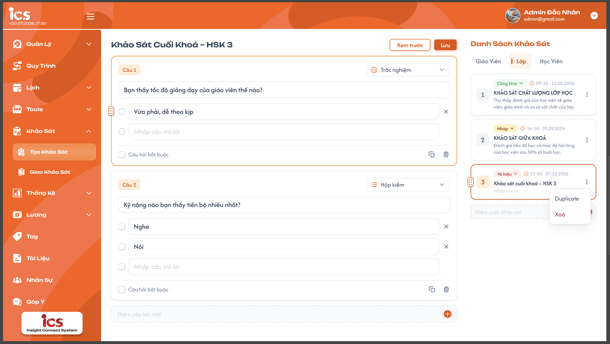
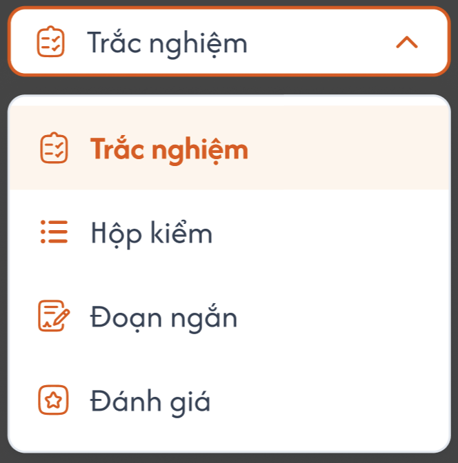
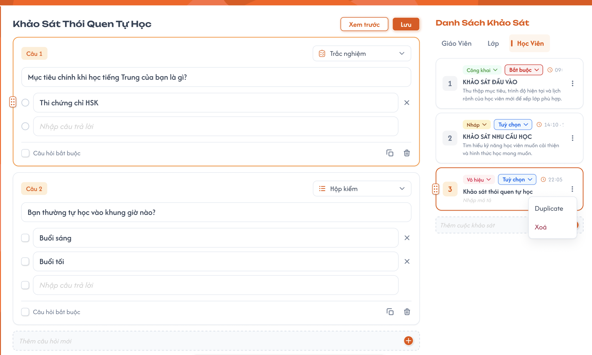
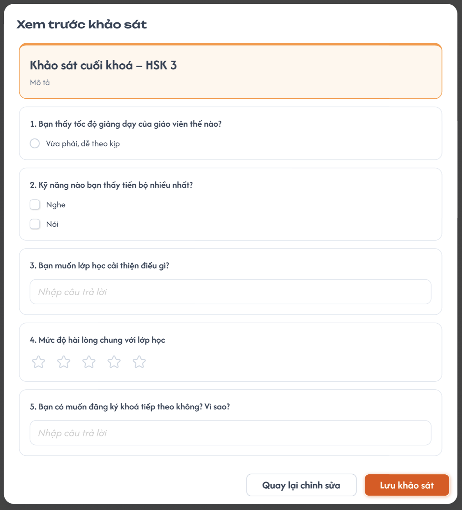

# Tạo khảo sát (Admin)

## 1. UI

### Trang 1: Tạo khảo sát — tab Giáo viên / Lớp




**Mô tả:**
- Admin tạo khảo sát và soạn câu hỏi. Panel phải: danh sách khảo sát theo tab đối tượng (Giáo viên / Lớp / Học viên). Panel giữa: soạn câu hỏi cho khảo sát đang chọn.

**Điểm cần lưu ý:**
- Tab **Giáo viên** và **Lớp** giống hệt nhau, chỉ khác danh sách. Khảo sát tạo ở tab nào chỉ giao được cho đối tượng của tab đó.
- Ô **"Thêm cuộc khảo sát"**: nhập tên → `Enter` hoặc bấm (+) → tạo khảo sát ngay (gọi API), trạng thái **Nháp** → card mới thêm cuối danh sách và được chọn luôn. Ô trống → không làm gì.
- Card:
  - Tag dropdown trạng thái **Nháp / Công khai / Vô hiệu**; dropdown chỉ hiện các trạng thái được phép chuyển tới (mục 2.4).
  - Icon **nhân bản khảo sát** cạnh thùng rác.
  - Card đang chọn: viền cam, icon kéo thả để đổi thứ tự. Khảo sát Nháp: sửa tên và mô tả trực tiếp trên card (placeholder "Nhập mô tả"), lưu khi blur.
  - Thời gian = thời điểm tạo. Mô tả hiển thị tối đa 2 dòng (…).
- Khảo sát **Công khai / Vô hiệu**: panel giữa và card chỉ xem — ẩn nút "Lưu", ô "Thêm câu hỏi mới", icon nhân bản / xoá câu, kéo thả; hiện thông báo "Khảo sát không thể sửa. Nhân bản để tạo bản mới." "Xem trước" vẫn dùng được.
- Câu hỏi đang focus: viền cam + icon kéo thả để đổi thứ tự. "Câu N" tự đánh lại số sau khi kéo thả / xoá / nhân bản.
- Dropdown loại câu hỏi: **Trắc nghiệm** (chọn 1), **Hộp kiểm** (chọn nhiều), **Đoạn ngắn**, **Đánh giá**.
  - Trắc nghiệm / Hộp kiểm: dòng cuối "Nhập câu trả lời" là dòng thêm mới — gõ vào thì thành đáp án và sinh dòng trống mới bên dưới. (X) xoá đáp án. `Enter` ở 1 đáp án → focus dòng kế tiếp.
  - Đoạn ngắn: chỉ hiển thị ô "Câu trả lời ngắn" disable (minh hoạ).
  - Đánh giá: cố định 5 sao, không click được (minh hoạ).
  - Đổi Trắc nghiệm ↔ Hộp kiểm: giữ đáp án. Đổi sang Đoạn ngắn / Đánh giá: bỏ đáp án.
- Icon nhân bản ở câu hỏi: chèn bản sao ngay dưới câu hiện tại. Icon thùng rác: xoá câu (chỉ mất hẳn khi bấm Lưu).
- Ô **"Thêm câu hỏi mới"**: `Enter` hoặc (+) → thêm câu cuối danh sách, loại mặc định Trắc nghiệm, nội dung = text đã nhập (ô trống thì thêm câu rỗng), focus vào câu mới.
- Nút **"Lưu"**: lưu toàn bộ câu hỏi của khảo sát đang chọn trong 1 lần gọi API.

### Trang 2: Tạo khảo sát — tab Học viên


**Mô tả:**
- Giống tab Giáo viên, thêm **loại khảo sát** cho từng khảo sát.

**Điểm cần lưu ý:**
- Mỗi card có dropdown loại: **Bắt buộc** (tag đỏ) / **Tuỳ chọn** (tag xanh). Tạo nhanh mặc định là Tuỳ chọn. Đổi loại → lưu ngay; chỉ đổi được khi khảo sát Nháp.
- Loại khảo sát quyết định popup chọn người nhận khi giao (xem [02-assign-survey.md](./02-assign-survey.md)).

### Trang 3: Popup: Xem trước khảo sát


**Mô tả:**
- Xem khảo sát đúng như người làm nhìn thấy.

**Điểm cần lưu ý:**
- Dùng dữ liệu đang soạn trên màn hình (kể cả chưa lưu).
- Chỉ xem, không chọn / nhập được. Không hiển thị dòng đáp án trống.
- "Quay lại chỉnh sửa" → đóng popup. "Lưu khảo sát" → giống nút Lưu (có validate), lưu thành công thì đóng popup; khảo sát không phải Nháp → ẩn "Lưu khảo sát".

---

---

## 2. Yêu cầu

### 2.1. Flow chính

**Flow 1: Tạo nhanh khảo sát**

```
Chọn tab (GV / Lớp / HV) → nhập tên ở "Thêm cuộc khảo sát" → Enter / (+)
→ API tạo khảo sát (đối tượng = tab, trạng thái = Nháp; tab HV: loại = Tuỳ chọn)
→ thêm card cuối danh sách → tự chọn card → panel giữa trống, focus "Thêm câu hỏi mới"
```

**Flow 2: Soạn câu hỏi & lưu** *(chỉ khảo sát Nháp)*

```
Chọn card → API lấy câu hỏi → thêm / sửa / xoá / nhân bản / kéo thả câu hỏi
→ bấm "Lưu" (hoặc "Lưu khảo sát" trong Xem trước) → FE validate
      ├─ (lỗi) → báo lỗi dưới từng câu lỗi → scroll tới câu lỗi đầu tiên
      └─ (hợp lệ) → API lưu toàn bộ câu hỏi (thứ tự, loại, nội dung, bắt buộc, đáp án)
                  → toast "Lưu thành công"
```

**Flow 3: Đổi trạng thái khảo sát**

```
Chọn trạng thái ở tag dropdown trên card
   ├─ Nháp → Công khai    : kiểm tra (đã lưu, ≥ 1 câu hỏi) → popup xác nhận "Sau khi công khai sẽ không sửa được"
   │                        → API → khoá chỉnh sửa → khảo sát xuất hiện ở "Chọn cuộc khảo sát đã tạo" (trang Giao)
   ├─ Nháp → Vô hiệu      : API → khoá chỉnh sửa
   └─ Công khai ⇄ Vô hiệu : API → Vô hiệu thì ẩn khỏi "Chọn cuộc khảo sát đã tạo"
```

**Flow 4: Nhân bản khảo sát**

```
Bấm icon nhân bản trên card → API tạo khảo sát mới cùng tab:
tên "{tên cũ} (bản sao)", copy mô tả, loại (HV), toàn bộ câu hỏi; trạng thái = Nháp
→ card mới ở cuối danh sách, được chọn → sửa như khảo sát Nháp
```

**Flow 5: Sắp xếp / xoá khảo sát**

```
Kéo thả card → API cập nhật thứ tự

Bấm thùng rác trên card → popup xác nhận → API xoá mềm → bỏ card khỏi danh sách
                                                 ↓ (card đang chọn bị xoá)
                                          chọn card đầu tiên / empty state
```

### 2.2. Ngoại lệ

- **EX01:** Đổi khảo sát / đổi tab / rời trang khi còn thay đổi chưa lưu → popup "Bạn có thay đổi chưa lưu" (Lưu / Bỏ thay đổi / Huỷ).
- **EX02:** Lưu khi có câu hỏi trống nội dung, hoặc câu Trắc nghiệm / Hộp kiểm không có đáp án nào → không lưu, báo lỗi ngay dưới câu đó.
- **EX03:** Chuyển Nháp → Công khai khi chưa có câu hỏi → chặn, toast "Khảo sát chưa có câu hỏi". Khi còn thay đổi chưa lưu → yêu cầu lưu trước.
- **EX04:** Xoá hết tên khảo sát trên card rồi blur → khôi phục tên cũ.

### 2.3. Yêu cầu khác

| Mã | Tên yêu cầu | Mô tả |
|---|---|---|
| REQ01 | Trim dữ liệu | Trim tên, mô tả, nội dung câu hỏi, đáp án. Chỉ có khoảng trắng = trống. |
| REQ02 | Dòng đáp án trống | Không lưu, không hiển thị ở Xem trước. |
| REQ03 | Ký hiệu đáp án | Admin nhập text thuần. A, B, C… do hệ thống tự gắn theo thứ tự khi hiển thị cho người làm và ở kết quả. |
| REQ04 | Empty state | Tab chưa có khảo sát / chưa chọn khảo sát → panel giữa hiển thị hướng dẫn tạo khảo sát ở danh sách bên phải. |
| REQ05 | Thang đánh giá | Cố định 1–5 sao. |
| REQ06 | Khảo sát đã giao | Khảo sát đã thêm vào trang Giao vẫn giữ nguyên (người nhận làm và xem kết quả bình thường) khi khảo sát chuyển Vô hiệu hoặc bị xoá ở trang Tạo. |
| REQ07 | Dùng chung component | Phần hiển thị câu hỏi ở Xem trước dùng chung với màn Làm khảo sát ([03-take-survey.md](./03-take-survey.md)) và popup Kết quả từng giáo viên ([02-assign-survey.md](./02-assign-survey.md)). |

### 2.4. Ràng buộc

#### Quyền

| Role | Xem | Tạo / nhân bản | Sửa | Đổi trạng thái | Xoá |
|---|:---:|:---:|:---:|:---:|:---:|
| Admin | ✅ | ✅ | ✅ | ✅ | ✅ |
| Giáo viên | ❌ | ❌ | ❌ | ❌ | ❌ |
| Học viên | ❌ | ❌ | ❌ | ❌ | ❌ |

#### Ràng buộc khác

- Mặc định khi tạo / nhân bản: **Nháp**.
- Chuyển trạng thái chỉ theo: `Nháp → Công khai`, `Nháp → Vô hiệu`, `Công khai ⇄ Vô hiệu`. Không quay lại Nháp.
- Chỉ khảo sát **Nháp** được sửa (tên, mô tả, loại HV, câu hỏi). Công khai / Vô hiệu không sửa được; muốn sửa → nhân bản.
- Chỉ khảo sát **Công khai** hiển thị ở "Chọn cuộc khảo sát đã tạo" (trang Giao).
- Đối tượng khảo sát (GV / Lớp / HV) cố định khi tạo; loại Bắt buộc / Tuỳ chọn chỉ có ở tab Học viên.
- Chưa giới hạn độ dài tên / mô tả / câu hỏi / đáp án và số đáp án.
- Xoá khảo sát là **xoá mềm**.

---

---

## 3. Testcase

### Feature: Tạo khảo sát (Admin)

| Tên testcase | Priority | Scenario | Role | Pre-condition | Given/When/Then | Expected Result |
|---|---|---|---|---|---|---|
| Case 1: Tạo nhanh khảo sát | High | Flow 1 | Admin | Ở trang Tạo khảo sát | **Given:** Tab Giáo viên, sau đó tab Học viên<br>**When:** Nhập tên rồi `Enter` (lần 2 bấm +); bấm `Enter` khi ô trống<br>**Then:** Kiểm tra danh sách | - Card mới ở cuối list, trạng thái "Nháp", được chọn, ô nhập xoá trắng<br>- Tab HV: card có tag "Tuỳ chọn"<br>- Ô trống: không tạo |
| Case 2: Soạn & lưu đủ 4 loại câu hỏi | High | Flow 2 | Admin | Khảo sát Nháp, chưa có câu hỏi | **Given:** Khảo sát trống<br>**When:** Thêm Trắc nghiệm (2 đáp án, bắt buộc), Hộp kiểm (2 đáp án), Đoạn ngắn, Đánh giá → Lưu<br>**Then:** F5 trang | - Toast lưu thành công<br>- Sau F5 đúng thứ tự, loại, đáp án, cờ bắt buộc |
| Case 3: Nhập đáp án & đổi loại câu | Medium | UI | Admin | Có câu Trắc nghiệm 1 đáp án | **Given:** Câu Trắc nghiệm<br>**When:** Gõ vào dòng "Nhập câu trả lời"; bấm (X) 1 đáp án; đổi sang Hộp kiểm rồi Đoạn ngắn<br>**Then:** Kiểm tra câu hỏi | - Gõ → thành đáp án mới, sinh dòng trống mới; (X) xoá đáp án<br>- Hộp kiểm giữ đáp án; Đoạn ngắn bỏ đáp án, hiện ô "Câu trả lời ngắn" disable |
| Case 4: Nhân bản, kéo thả, xoá câu | Medium | UI | Admin | Khảo sát Nháp có 3 câu | **Given:** Câu 1, 2, 3<br>**When:** Nhân bản câu 1; kéo câu cuối lên đầu; xoá 1 câu; Lưu<br>**Then:** F5 trang | - Bản sao nằm ngay dưới câu gốc<br>- "Câu N" đánh số liên tục từ 1<br>- Sau F5 đúng thứ tự |
| Case 5: Validate khi lưu | High | EX02 | Admin | Khảo sát Nháp | **Given:** 1 câu trống nội dung, 1 câu Hộp kiểm không có đáp án<br>**When:** Bấm Lưu<br>**Then:** Kiểm tra màn hình | - Không gọi API lưu<br>- 2 câu báo lỗi, scroll tới câu lỗi đầu tiên |
| Case 6: Rời khi chưa lưu | High | EX01 | Admin | Có thay đổi chưa lưu | **Given:** Đã sửa câu hỏi, chưa Lưu<br>**When:** Chọn khảo sát khác / đổi tab / đổi menu<br>**Then:** Chọn "Bỏ thay đổi" | - Hiện popup xác nhận<br>- Bỏ thay đổi → dữ liệu về bản đã lưu |
| Case 7: Xem trước | Medium | UI | Admin | Có câu chưa lưu | **Given:** Có câu mới chưa lưu, có dòng đáp án trống<br>**When:** Bấm "Xem trước" → "Lưu khảo sát"<br>**Then:** Kiểm tra popup | - Hiển thị cả câu chưa lưu, không hiện dòng trống, không chọn được<br>- "Lưu khảo sát" lưu như nút Lưu và đóng popup |
| Case 8: Đổi trạng thái khảo sát | High | Flow 3, EX03 | Admin | KS A Nháp có câu hỏi, KS B Nháp chưa có câu hỏi | **Given:** 2 khảo sát trên<br>**When:** Chuyển B → Công khai; chuyển A → Công khai → Vô hiệu → Công khai<br>**Then:** Kiểm tra trang Tạo & dropdown ở trang Giao | - B: bị chặn, toast<br>- A Công khai: có popup xác nhận, panel chỉ xem, dropdown không còn "Nháp"<br>- A Vô hiệu: vẫn chỉ xem, ẩn khỏi dropdown trang Giao; Công khai lại thì hiện |
| Case 9: Nhân bản & xoá khảo sát | High | Flow 4, Flow 5, REQ06 | Admin | KS A Công khai đã thêm vào trang Giao | **Given:** Đang chọn KS A<br>**When:** Nhân bản A; sửa bản sao → Lưu; xoá A<br>**Then:** Kiểm tra trang Tạo & trang Giao | - Bản sao "A (bản sao)" Nháp, đủ câu hỏi, sửa được, không ảnh hưởng A<br>- Xoá A có popup xác nhận, A biến mất ở trang Tạo<br>- Trang Giao: A vẫn còn, làm & xem kết quả bình thường |
| Case 10: Quyền truy cập | High | Ràng buộc quyền | Giáo viên | Đăng nhập GV | **Given:** Tài khoản GV<br>**When:** Truy cập URL trang Tạo khảo sát<br>**Then:** Kiểm tra | - Không thấy menu<br>- Truy cập URL bị chặn / chuyển trang |

### Feature: Tạo khảo sát
