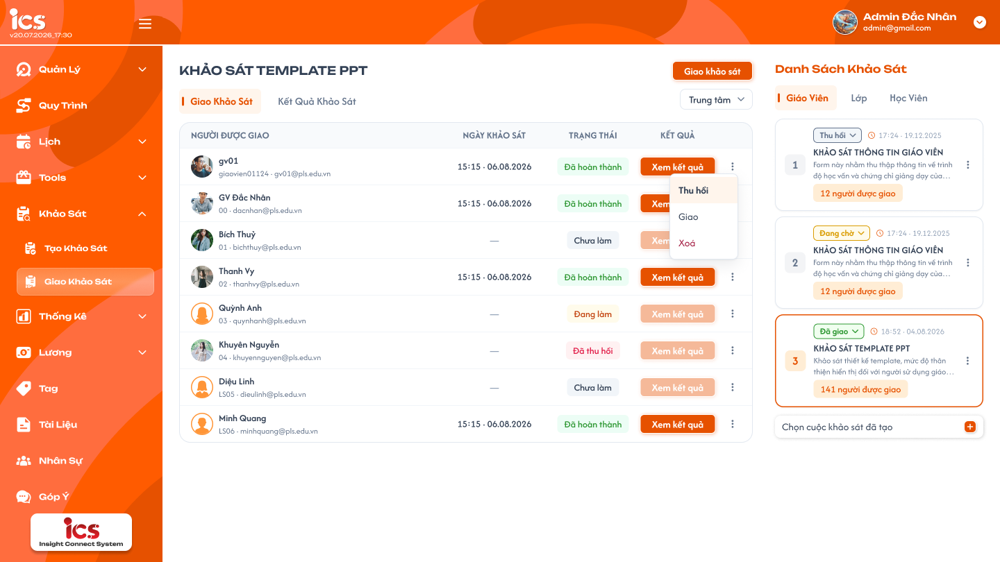
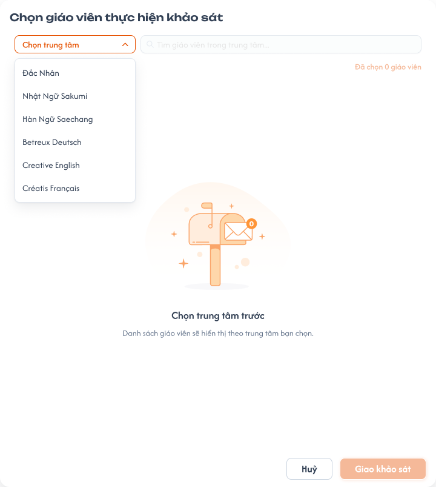
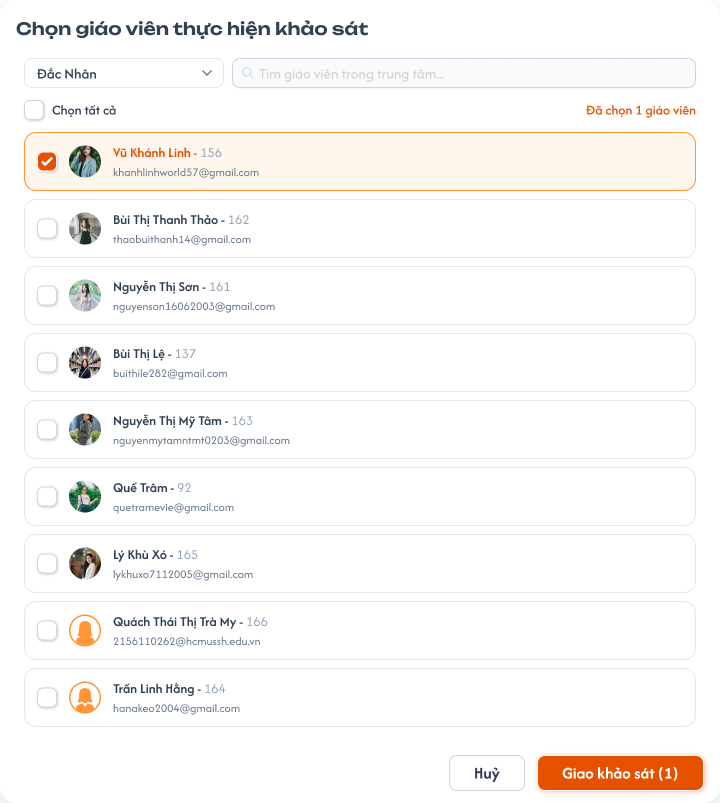
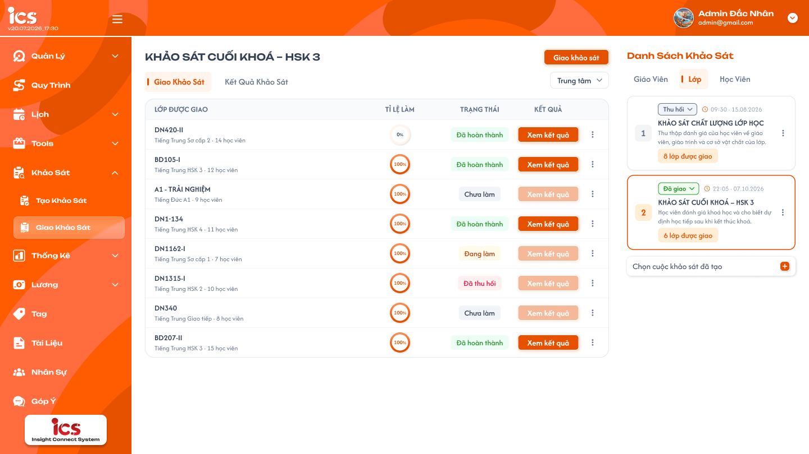
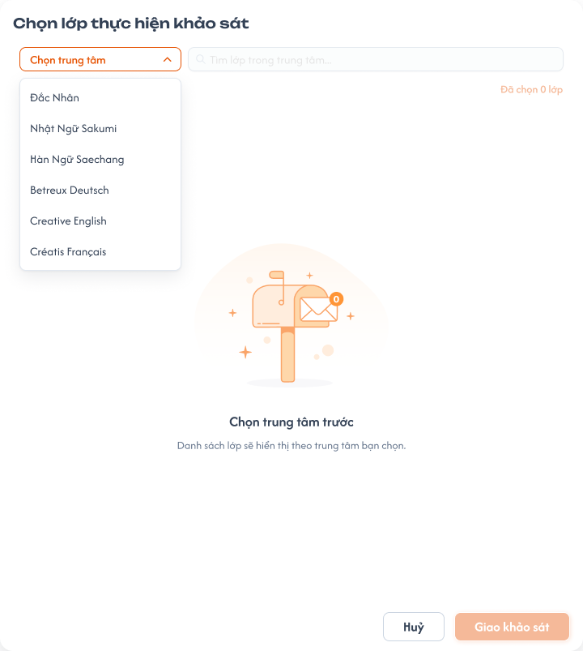
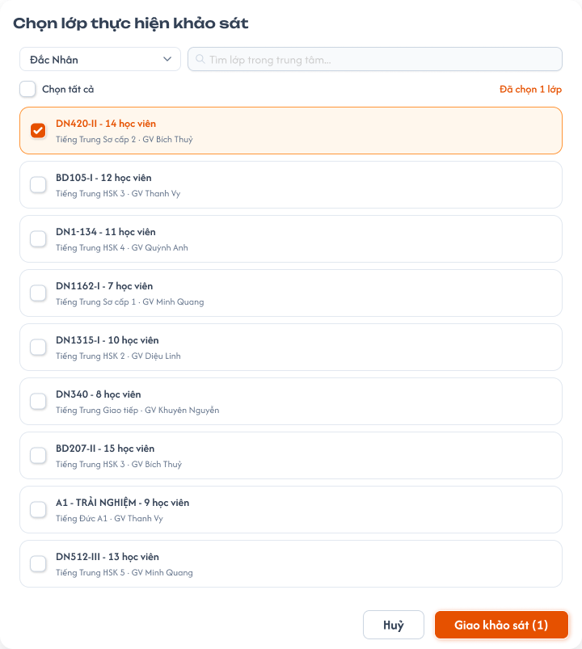
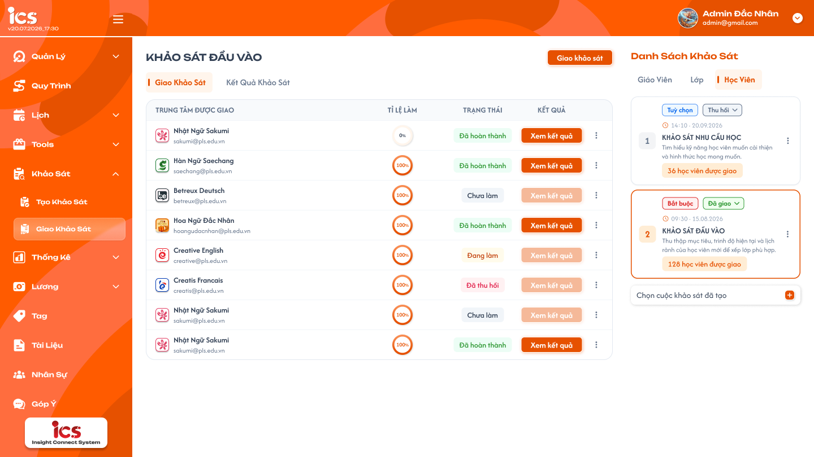

# Giao khảo sát & Kết quả (Admin)

## 1. UI

### Trang 1: ADM-GKS-010000 — Khảo sát / Giao khảo sát / Danh sách người được giao



**Mô tả:**
- Tab **Giáo viên** của trang Giao khảo sát: Admin thêm khảo sát cần giao, chọn người nhận, giao / thu hồi / xoá từng người. Bên phải là danh sách khảo sát (card), bên trái là bảng người được giao của khảo sát đang chọn; có hai tab `Giao Khảo Sát` và `Kết Quả Khảo Sát`.

**Điểm cần lưu ý:**
- Mỗi khảo sát chỉ có **1 mục** trong danh sách bên phải (2 card trùng tên trên figma chỉ là dữ liệu mẫu).
- **"Chọn cuộc khảo sát đã tạo"** (+) mở dropdown có tìm kiếm, chỉ liệt kê khảo sát **Công khai** cùng tab và **chưa có** trong danh sách; chọn thì thêm card cuối danh sách và tự chọn. Không có khảo sát nào để thêm thì dropdown hiện "Không có khảo sát". Khảo sát chuyển Vô hiệu / bị xoá ở trang Tạo vẫn giữ nguyên ở trang Giao.
- Card: dropdown **Đang chờ / Đã giao / Thu hồi** là nhãn admin tự chọn để theo dõi, đổi là lưu ngay, **không** ảnh hưởng người được giao; mặc định khi thêm là Đang chờ. Số được giao: tab GV "N người được giao" (= số dòng), tab Lớp "N lớp được giao", tab HV "N học viên được giao"; không đổi theo bộ lọc trung tâm. Thời gian = thời điểm thêm vào trang Giao. Thùng rác = xoá khảo sát khỏi trang Giao.
- Bảng: mỗi dòng = 1 GV tại 1 trung tâm (BE tự lọc theo trung tâm). GV được giao ở 2 trung tâm thì 2 dòng, mỗi trung tâm 1 bài. "Ngày khảo sát" = thời điểm gửi bài, chưa gửi thì "—".
- Trạng thái dòng: **Chưa làm** (chưa lưu nháp) · **Đang làm** (đã lưu nháp) · **Đã hoàn thành** (đã gửi) · **Đã thu hồi**.
- "Xem kết quả" chỉ enable khi dòng Đã hoàn thành, mở popup Kết quả từng giáo viên: chỉ có ở tab Giáo viên; tiêu đề "Kết quả khảo sát - {Tên GV} ({Mã GV})"; "x/y câu trả lời" = số câu có trả lời / tổng số câu; hiển thị tất cả câu theo thứ tự, câu không trả lời hiện "Chưa trả lời" (chữ xám nghiêng); Trắc nghiệm 1 dòng đáp án đã chọn (kèm A, B, C…), Hộp kiểm mỗi đáp án đã chọn 1 dòng, Đánh giá số sao đã chọn, Đoạn ngắn nội dung trả lời; chỉ xem.
- Menu 3 chấm: **Giao** (enable khi Đã thu hồi) · **Thu hồi** (enable khi Chưa làm / Đang làm) · **Xoá** (có xác nhận). Item không hợp lệ với trạng thái hiện tại thì disable.
- Tab **Kết quả khảo sát** (dùng chung cho cả ba tab Giáo viên / Lớp / Học viên): thống kê câu trả lời của khảo sát đang chọn theo từng câu hỏi. Chỉ tính bài **Đã hoàn thành** (không tính bài nháp, người bị thu hồi khi chưa gửi, dòng đã bị xoá); bài đã hoàn thành luôn được tính kể cả khi nhãn khảo sát hoặc dòng là Thu hồi. Đầu tab hiển thị "Đã hoàn thành X/Y" (người / học viên). Chưa có bài hoàn thành thì hiện empty state "Chưa có kết quả khảo sát". Mỗi câu hỏi là 1 khối thu gọn / mở rộng (chevron), mặc định mở.
- Tab Kết quả — **Trắc nghiệm / Hộp kiểm / Đánh giá**: mỗi đáp án (Đánh giá: mỗi mức 1 sao … 5 sao) có thanh %, số % và avatar người chọn. % = số người chọn / số bài đã hoàn thành, làm tròn số nguyên; Hộp kiểm tổng % có thể > 100%. Avatar tối đa 3 người + "và N người khác"; hover avatar hiện tên, hover "và N người khác" hiện danh sách tên còn lại. Người trả lời không có avatar thì dùng avatar mặc định.
- Tab Kết quả — **Đoạn ngắn**: danh sách câu trả lời kèm avatar người trả lời; bỏ qua bài để trống; hiển thị 10 câu trả lời, "Xem thêm" để tải tiếp.
- Bộ lọc **Trung tâm** phía trên bảng (tab GV và Lớp), mặc định "Tất cả trung tâm".

### Trang 2: ADM-GKS-010005 — Khảo sát / Giao khảo sát / Popup chọn trung tâm



**Mô tả:**
- Bước 1 của popup `Chọn giáo viên thực hiện khảo sát` (tab Giáo viên): chọn trung tâm trước khi hiện danh sách giáo viên.

**Điểm cần lưu ý:**
- Chọn **1 Trung tâm** (bắt buộc), chỉ chọn 1. Chưa chọn thì danh sách trống, hiện "Chọn trung tâm để hiển thị giáo viên" (`Chọn trung tâm trước`) và nút `Giao khảo sát` bị disable.
- Khảo sát giao thuộc trung tâm đã chọn: GV thấy khảo sát khi chọn trung tâm đó ở header.

### Trang 3: ADM-GKS-010010 — Khảo sát / Giao khảo sát / Popup chọn giáo viên



**Mô tả:**
- Bước 2 của popup chọn giáo viên: danh sách GV thuộc trung tâm đã chọn.

**Điểm cần lưu ý:**
- Chọn nhiều GV; tìm theo tên / mã / email. Đổi trung tâm thì bỏ các GV đang chọn.
- "Chọn tất cả" = chọn tất cả GV trong kết quả đang tìm.
- GV đã được giao khảo sát này ở trung tâm đó thì disable + tag "Đã giao" (giao lại dùng menu 3 chấm).
- "Đã chọn N giáo viên" và nút "Giao khảo sát (N)" cập nhật theo lựa chọn; N = 0 thì disable nút.

### Trang 4: ADM-GKS-020000 — Khảo sát / Giao khảo sát lớp / Danh sách lớp được giao



**Mô tả:**
- Tab **Lớp** của trang Giao khảo sát: bảng gộp theo **lớp**, xem tỉ lệ học viên đã làm.

**Điểm cần lưu ý:**
- Mỗi dòng = 1 lớp (mã lớp; dòng phụ: khoá học · N học viên, N = số HV được giao của dòng). Không có cột "Ngày khảo sát".
- **Tỉ lệ làm** (vòng tròn %) = số HV Đã hoàn thành / N, làm tròn số nguyên.
- Trạng thái dòng tự tính từ HV: **Chưa làm** (chưa HV nào gửi) · **Đang làm** (đã có HV gửi, chưa đủ 100%) · **Đã hoàn thành** (100%) · **Đã thu hồi** (admin thu hồi dòng).
- "Xem kết quả" enable khi dòng có ≥ 1 bài Đã hoàn thành, mở popup Kết quả của 1 lớp: tiêu đề "Kết quả khảo sát - {Mã lớp}"; nội dung và cách hiển thị giống tab "Kết quả khảo sát" nhưng chỉ tính bài của HV thuộc lớp đó.
- Menu 3 chấm áp dụng cho cả dòng: **Giao** (dòng Đã thu hồi thì giao lại các HV đã thu hồi) · **Thu hồi** (HV chưa hoàn thành của dòng chuyển Đã thu hồi) · **Xoá** (có xác nhận).
- HV học nhiều lớp cùng được giao thì làm 1 bài cho mỗi lớp (thống kê chung tính đủ các bài).

### Trang 5: ADM-GKS-020005 — Khảo sát / Giao khảo sát lớp / Popup chọn trung tâm



**Mô tả:**
- Bước 1 của popup `Chọn lớp thực hiện khảo sát` (tab Lớp): chọn trung tâm trước khi hiện danh sách lớp.

**Điểm cần lưu ý:**
- Chọn **1 Trung tâm** (bắt buộc), giống Trang 2. Chưa chọn thì danh sách lớp trống (`Chọn trung tâm trước`), nút `Giao khảo sát` disable.

### Trang 6: ADM-GKS-020010 — Khảo sát / Giao khảo sát lớp / Popup chọn lớp



**Mô tả:**
- Bước 2 của popup chọn lớp: danh sách lớp thuộc trung tâm đã chọn.

**Điểm cần lưu ý:**
- Chọn nhiều lớp; tìm theo mã lớp / khoá học / tên GV. Đổi trung tâm thì bỏ các lớp đang chọn.
- Mỗi dòng: "{Mã lớp} - {N} học viên" (N = số HV đang học), dòng phụ: khoá học · GV phụ trách. Lớp 0 học viên thì disable.
- "Chọn tất cả" = chọn tất cả lớp trong kết quả đang tìm. "Đã chọn N lớp", nút "Giao khảo sát (N)"; N = 0 thì disable nút.
- Lớp đã có trong bảng **vẫn chọn lại được** để giao cho HV mới vào lớp (HV đã có thì bỏ qua).

### Trang 7: ADM-GKS-030000 — Khảo sát / Giao khảo sát học viên / Danh sách học viên được giao



**Mô tả:**
- Tab **Học viên** của trang Giao khảo sát: bảng gộp theo **trung tâm** (Trung tâm được giao, Tỉ lệ làm, Trạng thái, Kết quả), xem tỉ lệ học viên đã làm.

**Điểm cần lưu ý:**
- Mỗi dòng = 1 trung tâm (tên trung tâm; dòng phụ: N học viên). Tag loại khảo sát **Bắt buộc / Tuỳ chọn** trên card là chỉ đọc, lấy từ khảo sát. Không có cột "Ngày khảo sát". Tỉ lệ làm, trạng thái dòng, "Xem kết quả" (popup Kết quả của 1 trung tâm, tiêu đề "Kết quả khảo sát - {Tên trung tâm}") và menu 3 chấm giống Trang 4.
- Khảo sát **Tuỳ chọn** — popup chọn trung tâm (chưa có frame): chọn 1 hoặc nhiều trung tâm, giao cho HV của các trung tâm đã chọn.
- Khảo sát **Bắt buộc** — popup chọn buổi học (chưa có frame): chọn Trung tâm → Khoá học (thuộc trung tâm đã chọn) → Buổi học (thuộc khoá đã chọn), mỗi bước chọn nhiều; đổi trung tâm / khoá thì reset bước sau. Lớp nào thuộc khoá đã chọn học tới buổi đã chọn thì HV lớp đó nhận khảo sát (lớp mở trước hay sau lúc giao đều như nhau).

---

## 2. Yêu cầu

### 2.1. Flow chính

**Flow 1: Thêm khảo sát cần giao**

```
Chọn tab → (+) "Chọn cuộc khảo sát đã tạo" → chọn khảo sát (Công khai, chưa có trong danh sách)
→ API thêm (nhãn "Đang chờ") → card mới ở cuối, được chọn, bảng trống
```

**Flow 2: Giao khảo sát**

```
Bấm "Giao khảo sát" → mở popup theo tab
   ├─ Giáo viên → Popup 1: chọn 1 trung tâm → chọn GV
   ├─ Lớp       → Popup 2: chọn 1 trung tâm → chọn lớp
   └─ Học viên ─┬─ Tuỳ chọn → Popup 3: chọn trung tâm
                └─ Bắt buộc → Popup 4: trung tâm → khoá học → buổi học
→ xác nhận → API giao (bỏ qua người đã có)
      ├─ GV / Lớp / HV Tuỳ chọn → người nhận: Chưa làm + gửi thông báo ngay
      └─ HV Bắt buộc            → lưu điều kiện giao → lớp thuộc khoá học tới buổi đã chọn
                                  → HV lớp đó: Chưa làm + gửi thông báo
→ reload bảng (thêm dòng GV / lớp / trung tâm) → cập nhật số được giao → toast "Đã giao thành công"
```

**Flow 3: Người vào giữa chừng**

```
GV mới        → "Giao khảo sát" → chọn trung tâm → chọn GV đó → thêm dòng GV
HV mới vào lớp → "Giao khảo sát" → chọn trung tâm → chọn lại lớp đó → chỉ HV mới được giao → cập nhật N và tỉ lệ làm của dòng lớp
```

**Flow 4: Thao tác từng dòng (menu 3 chấm)**

```
Giao    → (Đã thu hồi)      → Chưa làm + gửi thông báo (dòng lớp / trung tâm: cho các HV đã thu hồi)
Thu hồi → (chưa hoàn thành) → Đã thu hồi → khảo sát biến mất phía người nhận; bài đã hoàn thành giữ nguyên
Xoá     → popup xác nhận → xoá mềm dòng (kèm kết quả) → cập nhật số được giao
```

**Flow 5: Xem kết quả**

```
Tab "Kết quả khảo sát" → API thống kê cả khảo sát → render theo loại câu hỏi
                                    ↓ (chưa có bài hoàn thành)
                           Empty state "Chưa có kết quả khảo sát"

Tab Lớp / HV : "Xem kết quả" của dòng → API thống kê lọc theo lớp / trung tâm → Popup 5
Tab GV       : "Xem kết quả" của dòng → API bài làm của GV → Popup 6
```

### 2.2. Ngoại lệ

- **EX01:** Xoá dòng đã có bài Đã hoàn thành, hoặc xoá khảo sát khỏi trang Giao khi đã có kết quả → popup cảnh báo "Kết quả khảo sát sẽ bị xoá" → xoá mềm, kết quả không còn tính vào thống kê.
- **EX02:** Chọn lại lớp đã có trong bảng → chỉ giao cho HV mới; không có HV mới → toast "Không có học viên mới trong lớp".
- **EX03:** Không có khảo sát Công khai nào để thêm → dropdown hiển thị "Không có khảo sát".
- **EX04:** Khảo sát đang chọn bị xoá khỏi trang Giao → chọn card đầu tiên; không còn card → empty state.
- **EX05:** Người trả lời không có avatar → avatar mặc định.

### 2.3. Yêu cầu khác

| Mã | Tên yêu cầu | Mô tả |
|---|---|---|
| REQ01 | Thông báo | Mỗi lần người nhận chuyển sang Chưa làm (giao lần đầu / giao lại) → gửi thông báo: GV = popup trên web, HV = thông báo app. |
| REQ02 | Nhãn trạng thái | Đang chờ / Đã giao / Thu hồi chỉ để admin theo dõi, không tự giao / thu hồi ai. |
| REQ03 | Giữ kết quả | Bài Đã hoàn thành luôn được tính vào kết quả, kể cả khi nhãn khảo sát là Thu hồi hoặc dòng bị thu hồi. |
| REQ04 | Cập nhật số liệu | Số được giao, N học viên, tỉ lệ làm cập nhật ngay sau mọi thao tác giao / thu hồi / xoá. |
| REQ05 | Disable menu | Item trong menu 3 chấm không hợp lệ với trạng thái hiện tại → disable. |
| REQ06 | Dữ liệu kết quả mới | Gọi lại API mỗi lần mở tab / popup kết quả, không dùng cache cũ. |
| REQ07 | Ký hiệu đáp án | A, B, C… theo thứ tự đáp án, đồng nhất với màn làm khảo sát. |

### 2.4. Ràng buộc

#### Quyền

| Role | Thêm / xoá khảo sát giao | Giao người nhận | Đổi nhãn | Giao / thu hồi / xoá dòng | Xem kết quả |
|---|:---:|:---:|:---:|:---:|:---:|
| Admin | ✅ | ✅ | ✅ | ✅ | ✅ |
| Giáo viên | ❌ | ❌ | ❌ | ❌ | ❌ |
| Học viên | ❌ | ❌ | ❌ | ❌ | ❌ |

#### Ràng buộc khác

- Mỗi khảo sát chỉ có 1 mục ở trang Giao; chỉ thêm được khảo sát **Công khai** cùng đối tượng với tab.
- Khảo sát Lớp tính theo từng lớp: HV học nhiều lớp cùng được giao thì làm 1 bài cho mỗi lớp (thống kê chung tính đủ các bài).
- GV / Lớp / HV Tuỳ chọn: danh sách người nhận chốt khi bấm giao; người vào sau phải giao thêm thủ công (Flow 3). HV Bắt buộc: nhận tự động theo buổi học.
- Mọi thao tác xoá là **xoá mềm**.
- Giao GV / Lớp: mỗi lần giao chỉ chọn 1 trung tâm; khảo sát giao thuộc trung tâm đó.
- Bảng chỉ có lọc trung tâm (tab GV, Lớp), không có tìm kiếm / lọc trạng thái; không xuất Excel; không có hạn chót làm khảo sát.

---

## 3. Testcase

### Feature: Giao khảo sát & Kết quả

| Tên testcase | Priority | Scenario | Role | Pre-condition | Given/When/Then | Expected Result |
|---|---|---|---|---|---|---|
| Case 1: Thêm khảo sát cần giao | High | Flow 1 / EX03 | Admin | Tab GV có KS A Công khai, KS B Nháp, KS C Vô hiệu, KS D Công khai đã có trong trang Giao | **Given:** Trang Giao khảo sát, tab GV<br>**When:** (+) "Chọn cuộc khảo sát đã tạo" → chọn KS A<br>**Then:** Kiểm tra danh sách | - Dropdown chỉ có KS A<br>- Card mới: nhãn "Đang chờ", "0 người được giao", được chọn<br>- Mở lại dropdown: "Không có khảo sát" |
| Case 2: Popup chọn giáo viên | Medium | Popup 1 | Admin | GV X (dạy trung tâm A, B) đã được giao ở trung tâm A | **Given:** Mở popup chọn GV<br>**When:** Chưa chọn trung tâm; chọn trung tâm A, tìm theo tên, "Chọn tất cả"; đổi sang trung tâm B<br>**Then:** Kiểm tra popup | - Chưa chọn trung tâm: danh sách trống, nút disable<br>- Chỉ chọn được 1 trung tâm; chỉ hiện GV của trung tâm đó<br>- Trung tâm A: GV X disable "Đã giao"; "Chọn tất cả" chỉ chọn trong kết quả tìm<br>- Đổi sang B: bỏ chọn cũ, GV X chọn được<br>- Số N đúng, N = 0 thì disable nút |
| Case 3: Giao giáo viên & lọc trung tâm | High | Flow 2 / REQ01 / REQ04 | Admin | GV X dạy trung tâm A, B; GV Y ở B | **Given:** KS tab GV, bảng trống<br>**When:** Giao X ở trung tâm A; giao X, Y ở trung tâm B; X lưu nháp bài ở A; lọc bảng theo A, B, Tất cả<br>**Then:** Kiểm tra bảng & phía GV X | - 3 dòng: X–A "Đang làm", X–B "Chưa làm", Y–B "Chưa làm"; "3 người được giao"<br>- Lọc A: 1 dòng; B: 2 dòng; Tất cả: 3 dòng; số trên card không đổi<br>- GV nhận popup; X thấy khảo sát khi header chọn A và khi chọn B |
| Case 4: Giao lớp & HV vào giữa chừng | High | Flow 2 / Flow 3 / EX02 / Popup 2 / REQ04 | Admin | Lớp A 4 HV; có lớp 0 HV | **Given:** KS tab Lớp<br>**When:** Mở popup chọn lớp, chọn trung tâm T, giao lớp A; thêm 1 HV mới vào lớp A; giao lại lớp A 2 lần<br>**Then:** Kiểm tra popup & bảng | - Popup: chỉ hiện lớp của trung tâm T; lớp 0 HV disable; "Đã chọn N lớp" đúng<br>- Lần 1: dòng A "4 học viên", 0%, "Chưa làm"; "1 lớp được giao"<br>- Lần 2: A "5 học viên", chỉ HV mới nhận thông báo<br>- Lần 3: toast không có HV mới |
| Case 5: Tỉ lệ & trạng thái dòng lớp | High | Trang 2 / REQ04 | Admin | Lớp A 4 HV đã được giao | **Given:** Dòng lớp A<br>**When:** Lần lượt 0, 1, 4 HV gửi bài<br>**Then:** Kiểm tra dòng | - 0 bài: 0%, "Chưa làm", "Xem kết quả" disable<br>- 1 bài: 25%, "Đang làm", "Xem kết quả" enable<br>- 4 bài: 100%, "Đã hoàn thành" |
| Case 6: Giao HV Bắt buộc và Tuỳ chọn | High | Popup 3 / Popup 4 / Flow 2 / REQ01 | Admin | KS Tuỳ chọn và KS Bắt buộc tab HV; lớp L thuộc khoá K đang ở buổi 2 | **Given:** Popup chọn buổi học của KS Bắt buộc; popup chọn trung tâm của KS Tuỳ chọn<br>**When:** Tuỳ chọn: chọn 1 hoặc nhiều trung tâm; Bắt buộc: chọn Trung tâm T → khoá K → buổi 3; lớp L học tới buổi 3; mở lớp M thuộc khoá K, học tới buổi 3<br>**Then:** Kiểm tra bảng | - Đổi trung tâm / khoá thì reset bước sau<br>- Có dòng trung tâm T<br>- Lớp L, M tới buổi 3: HV nhận thông báo, N học viên và tỉ lệ của dòng T tăng tương ứng<br>- Tuỳ chọn: chỉ HV của các trung tâm đã chọn tại lúc giao nhận khảo sát |
| Case 7: Thu hồi, giao lại & đổi nhãn | High | Flow 4 / REQ02 / REQ03 / REQ05 | Admin | Tab GV: A Đang làm, B Đã hoàn thành. Tab Lớp: lớp L có 1 HV đã gửi, 2 HV chưa gửi | **Given:** Mở menu 3 chấm<br>**When:** Thu hồi A rồi Giao lại A; thu hồi lớp L rồi Giao lại L; đổi nhãn card sang "Thu hồi"<br>**Then:** Kiểm tra bảng & phía người nhận | - B: "Thu hồi", "Giao" disable<br>- A: "Đã thu hồi" → GV A không thấy khảo sát; giao lại → "Chưa làm" + thông báo<br>- Lớp L: 2 HV chưa gửi bị thu hồi, bài đã gửi vẫn tính; giao lại → 2 HV nhận lại<br>- Đổi nhãn card: trạng thái các dòng không đổi, người nhận vẫn làm được |
| Case 8: Xoá mềm | Medium | Flow 4 / EX01 / EX04 | Admin | Có GV / lớp đã có bài hoàn thành | **Given:** Khảo sát đang chọn<br>**When:** Xoá 1 GV Đã hoàn thành; xoá 1 lớp; xoá khảo sát (thùng rác trên card)<br>**Then:** Kiểm tra bảng & tab kết quả | - Có popup cảnh báo mất kết quả<br>- Dòng biến mất, số được giao giảm, kết quả không còn tính<br>- Xoá card → tự chọn card đầu; không còn card → empty state |
| Case 9: Thống kê theo loại câu hỏi | High | Flow 5 / REQ06 / REQ07 / EX05 | Admin | 4 bài hoàn thành + 1 người Đang làm. Trắc nghiệm: 2 A, 1 B, 1 C. Hộp kiểm: bài 1 chọn A+B, còn lại A. Đánh giá: 2 × 5 sao, 1 × 4 sao, 1 × 1 sao. Đoạn ngắn: dùng khảo sát khác có 12 câu trả lời; một người trả lời không có avatar; một khảo sát chưa có bài hoàn thành | **Given:** Tab "Kết quả khảo sát"<br>**When:** Xem từng câu, hover avatar và "và N người khác", bấm "Xem thêm"; mở lại tab<br>**Then:** Kiểm tra | - Trắc nghiệm A 50%, B 25%, C 25% (ký hiệu A, B, C…); bài nháp không tính<br>- Hộp kiểm A 100%, B 25%<br>- Đánh giá 5 sao 50%, 4 sao 25%, 1 sao 25%, 2–3 sao 0%<br>- Hover hiện tên / danh sách tên; người không avatar dùng avatar mặc định<br>- Đoạn ngắn: 10 câu, "Xem thêm" tải tiếp<br>- Chưa có bài hoàn thành: empty state "Chưa có kết quả khảo sát"; mỗi lần mở gọi lại API |
| Case 10: Kết quả lớp & từng giáo viên | High | Flow 5 / Popup 5 / Popup 6 / REQ06 | Admin | Lớp A 2 bài, lớp B 3 bài (1 HV học cả A và B); GV X đã gửi, bỏ trống 1 câu không bắt buộc | **Given:** Trang Giao khảo sát<br>**When:** "Xem kết quả" lớp A; mở tab Kết quả của KS lớp; "Xem kết quả" GV X<br>**Then:** Kiểm tra | - Popup lớp A chỉ tính 2 bài; tab Kết quả tính đủ 5 bài<br>- Popup GV X: đúng tên + mã, "x/y câu trả lời", câu bỏ trống hiện "Chưa trả lời" |
| Case 11: Quyền truy cập | High | Ràng buộc quyền | Giáo viên | Đăng nhập GV | **Given:** Tài khoản GV<br>**When:** Truy cập URL / API trang Giao khảo sát, kết quả<br>**Then:** Kiểm tra | - Không thấy menu<br>- Bị chặn / chuyển trang |

---

## 4. Câu hỏi cần xác nhận

- **Q01:** Chưa có frame Figma cho bộ lọc **Trung tâm** phía trên bảng (tab GV và Lớp, mặc định "Tất cả trung tâm"); cần bổ sung thiết kế.
- **Q02:** Chưa có frame Figma cho popup chọn trung tâm (khảo sát HV Tuỳ chọn), popup chọn buổi học (khảo sát HV Bắt buộc), tab `Kết quả khảo sát`, popup Kết quả của 1 lớp / trung tâm và popup Kết quả từng giáo viên; cần bổ sung thiết kế.
