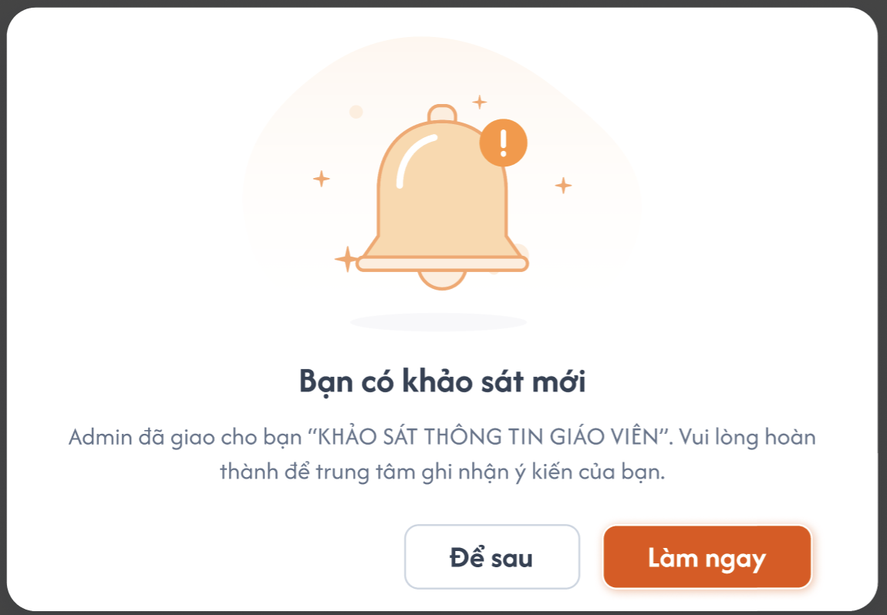
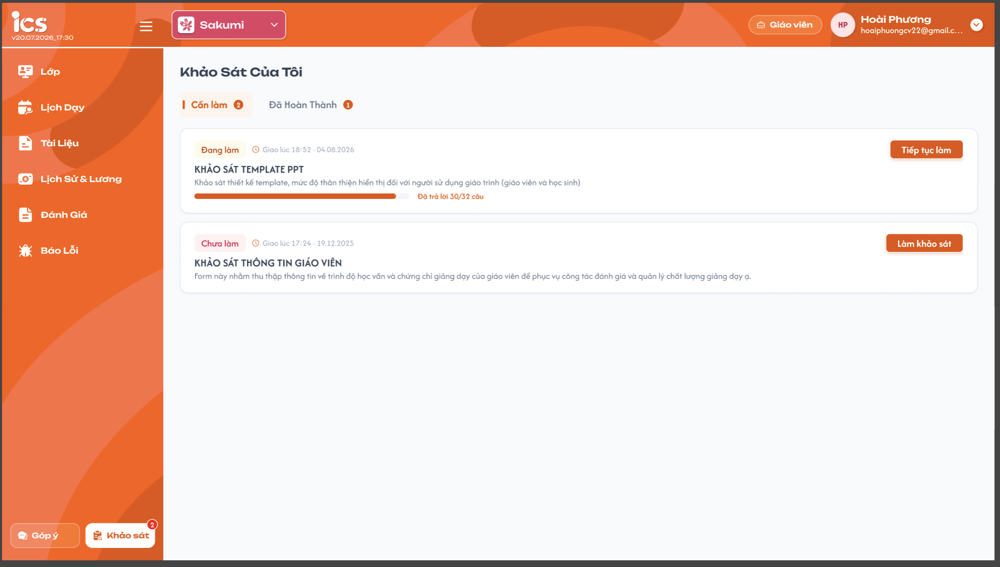
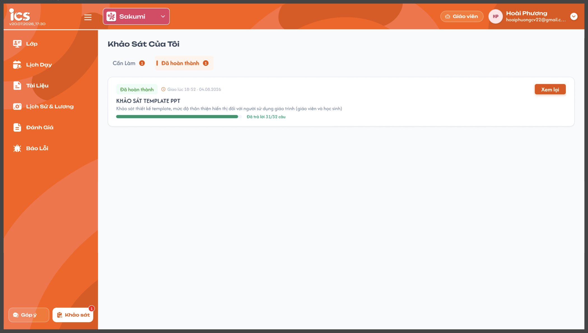
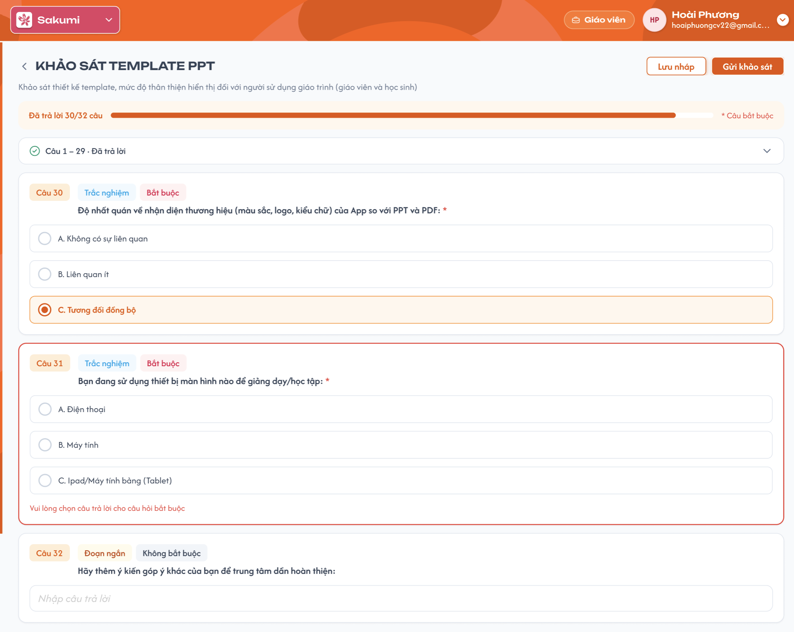
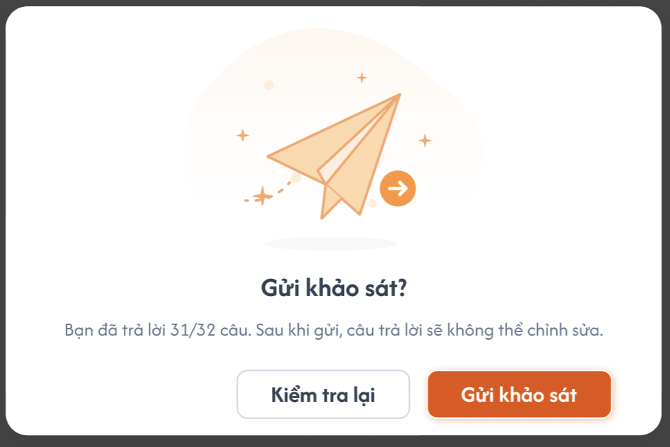
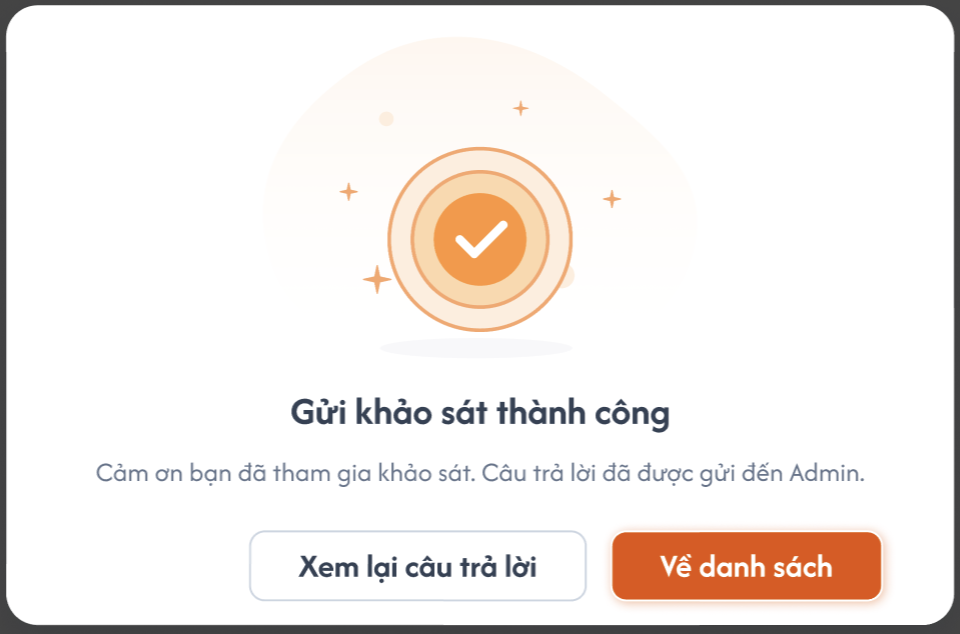

# Giáo viên làm khảo sát (Web)

## 1. UI

### Trang 1: Popup: Thông báo khảo sát mới


**Mô tả:**
- Nhắc GV còn khảo sát chưa làm xong.

**Điểm cần lưu ý:**
- Hiện **mỗi lần GV vào web** (đăng nhập / tải lại trang) khi còn khảo sát ở tab Cần làm (Chưa làm / Đang làm) của trung tâm đang chọn; gửi hết thì không hiện nữa. Không cần hiện ngay khi admin giao lúc GV đang online.
- 1 khảo sát → nêu tên khảo sát. ≥ 2 khảo sát → gộp 1 popup: "Bạn có N khảo sát cần hoàn thành".
- "Làm ngay" → chuyển tới **Khảo sát của tôi** (tab Cần làm). "Để sau" → đóng, lần vào web sau hiện lại.

### Trang 2: Khảo sát của tôi — tab Cần làm


**Mô tả:**
- Danh sách khảo sát GV được giao, chưa gửi.

**Điểm cần lưu ý:**
- Vào từ nút **"Khảo sát"** cuối sidebar; badge đỏ = số khảo sát ở tab Cần làm (= 0 thì ẩn).
- Tab **Cần làm**: trạng thái Chưa làm / Đang làm (đã lưu nháp). Số trên tab = số khảo sát trong tab.
- Sắp xếp theo thời gian giao, mới nhất lên đầu.
- Đang làm: thanh tiến độ "Đã trả lời x/y câu", nút "Tiếp tục làm". Chưa làm: nút "Làm khảo sát".
- Khảo sát bị thu hồi / bị xoá → không còn trong danh sách.
- Danh sách, số trên tab và badge **lọc theo trung tâm đang chọn** ở header (dropdown "Sakumi"); đổi trung tâm → tải lại. Khảo sát thuộc trung tâm admin đã chọn khi giao.

### Trang 3: Khảo sát của tôi — tab Đã hoàn thành


**Mô tả:**
- Danh sách khảo sát GV đã gửi.

**Điểm cần lưu ý:**
- Tag "Đã hoàn thành" và thanh tiến độ màu xanh lá; "Đã trả lời x/y câu" — x có thể < y do câu không bắt buộc được bỏ trống.
- "Xem lại" → mở trang Làm khảo sát ở chế độ chỉ xem: hiển thị câu trả lời đã gửi, không chọn / nhập được, ẩn "Lưu nháp" và "Gửi khảo sát".

### Trang 4: Làm khảo sát




**Mô tả:**
- GV trả lời câu hỏi, lưu nháp hoặc gửi khảo sát.

**Điểm cần lưu ý:**
- Thanh tiến độ "Đã trả lời x/y câu" dính trên đầu khi cuộn; x = số câu đã có câu trả lời (cả câu không bắt buộc).
- Mở lại bài nháp: các câu đã trả lời liên tiếp từ câu 1 được gộp thành 1 dòng "Câu 1 – N · Đã trả lời" (thu gọn, bấm để mở). Câu chưa trả lời hiển thị đầy đủ.
- Câu bắt buộc: tag "Bắt buộc" + dấu `*` đỏ cuối câu hỏi.
- Trắc nghiệm: chọn 1, bấm cả dòng. Hộp kiểm: chọn nhiều. Đoạn ngắn: ô nhập text. Đánh giá: chọn 1–5 sao. Đáp án đang chọn: nền cam nhạt + viền cam.
- Lỗi câu bắt buộc: viền đỏ + "Vui lòng chọn câu trả lời cho câu hỏi bắt buộc" (Đoạn ngắn: "Vui lòng nhập câu trả lời"); trả lời xong thì hết lỗi.
- "Lưu nháp": không validate. "Gửi khảo sát": validate.
- Nút back (<) → về Khảo sát của tôi.

---

---

## 2. Yêu cầu

### 2.1. Flow chính

**Flow 1: Nhận thông báo**

```
GV vào web → API lấy khảo sát Cần làm
   ├─ (không có) → không hiện popup
   └─ (có)       → hiện popup
                    ├─ Làm ngay → Khảo sát của tôi (tab Cần làm)
                    └─ Để sau   → đóng popup (lần vào web sau hiện lại)
```

**Flow 2: Làm & lưu nháp**

```
Khảo sát của tôi → "Làm khảo sát" / "Tiếp tục làm" → API lấy câu hỏi + câu trả lời nháp
→ trả lời → "Lưu nháp" → API lưu (không validate) → toast "Đã lưu nháp"
→ trạng thái Đang làm, cập nhật x/y
```

**Flow 3: Gửi khảo sát**

```
"Gửi khảo sát" → FE validate câu bắt buộc
   ├─ (thiếu) → báo lỗi các câu thiếu → scroll tới câu lỗi đầu tiên
   └─ (đủ)    → popup xác nhận "Sau khi gửi sẽ không thể chỉnh sửa"
              → API gửi → toast "Gửi khảo sát thành công"
              → về Khảo sát của tôi, tab Đã hoàn thành → badge giảm 1
```

### 2.2. Ngoại lệ

- **EX01:** Khảo sát bị thu hồi / xoá khi GV đang làm → Lưu nháp / Gửi trả lỗi → popup "Khảo sát đã bị thu hồi" → về Khảo sát của tôi.
- **EX02:** Rời trang (back, đổi menu) khi còn thay đổi chưa lưu → popup xác nhận (Lưu nháp & rời / Rời không lưu / Ở lại). Đóng tab / F5 → cảnh báo mặc định của trình duyệt.
- **EX03:** Truy cập URL khảo sát không được giao / đã thu hồi → báo "Không tìm thấy khảo sát" → về danh sách. Đã hoàn thành → chuyển sang chế độ xem lại.
- **EX04:** Gửi / Lưu nháp lỗi mạng → giữ nguyên câu trả lời trên màn hình, toast lỗi, cho thao tác lại.

### 2.3. Yêu cầu khác

| Mã | Tên yêu cầu | Mô tả |
|---|---|---|
| REQ01 | Đoạn ngắn | Trim; chỉ có khoảng trắng = chưa trả lời. |
| REQ02 | Ký hiệu đáp án | Hệ thống tự gắn A, B, C… theo thứ tự đáp án. |
| REQ03 | Nháp lưu trên server | Mở lại trên máy / trình duyệt khác vẫn còn câu trả lời nháp. |
| REQ04 | Badge | Badge sidebar và số trên tab cập nhật sau khi gửi, không cần F5. |
| REQ05 | Dùng chung component | Phần hiển thị câu hỏi dùng chung với Xem trước ([01-create-survey.md](./01-create-survey.md)) và popup Kết quả từng giáo viên ([02-assign-survey.md](./02-assign-survey.md)). |

### 2.4. Ràng buộc

#### Quyền

| Role | Xem Khảo sát của tôi | Làm / lưu nháp | Gửi | Xem lại bài đã gửi |
|---|:---:|:---:|:---:|:---:|
| GV được giao | ✅ | ✅ | ✅ | ✅ |
| GV không được giao | ❌ | ❌ | ❌ | ❌ |

#### Ràng buộc khác

- Chỉ làm được khi trạng thái là Chưa làm / Đang làm.
- Mỗi khảo sát được giao chỉ gửi 1 lần; đã gửi thì không sửa được.
- GV chỉ thấy khảo sát đối tượng Giáo viên (khảo sát Lớp / Học viên làm trên app, req riêng).
- Không có hạn chót làm khảo sát.

---

---

## 3. Testcase

### Feature: Giáo viên làm khảo sát (Web)

| Tên testcase | Priority | Scenario | Role | Pre-condition | Given/When/Then | Expected Result |
|---|---|---|---|---|---|---|
| Case 1: Popup khảo sát mới | High | Flow 1 | Giáo viên | Admin vừa giao 1 khảo sát cho GV | **Given:** GV có 1 khảo sát Chưa làm<br>**When:** Đăng nhập web, bấm "Làm ngay"; F5; gửi khảo sát rồi F5<br>**Then:** Kiểm tra | - Popup hiện đúng tên khảo sát, "Làm ngay" tới Khảo sát của tôi, tab Cần làm<br>- F5 khi chưa gửi: popup hiện lại<br>- Sau khi gửi: không hiện popup |
| Case 2: Để sau & nhiều khảo sát | Medium | Flow 1 | Giáo viên | Admin giao 2 khảo sát | **Given:** GV có 2 khảo sát Cần làm<br>**When:** Đăng nhập, bấm "Để sau"; đăng xuất rồi đăng nhập lại<br>**Then:** Kiểm tra | - 1 popup "Bạn có 2 khảo sát cần hoàn thành"<br>- Popup đóng, badge "Khảo sát" = 2<br>- Đăng nhập lại: popup hiện lại |
| Case 3: Danh sách & lọc trung tâm | Medium | UI | Giáo viên | Trung tâm A: 1 Chưa làm, 1 Đang làm, 1 Đã hoàn thành. Trung tâm B: 1 Chưa làm | **Given:** Header đang chọn trung tâm A<br>**When:** Xem 2 tab; đổi sang trung tâm B<br>**Then:** Kiểm tra | - Trung tâm A: Cần làm (2), Đã hoàn thành (1), badge 2<br>- Đang làm có tiến độ + "Tiếp tục làm"; Chưa làm có "Làm khảo sát"<br>- Trung tâm B: Cần làm (1), badge 1 |
| Case 4: Lưu nháp & tiếp tục | High | Flow 2 | Giáo viên | Khảo sát 5 câu, Chưa làm | **Given:** Mở khảo sát<br>**When:** Trả lời câu 1, 2 → "Lưu nháp" → về danh sách → "Tiếp tục làm"<br>**Then:** Kiểm tra | - Trạng thái Đang làm, "2/5 câu"<br>- Câu 1–2 giữ câu trả lời, gộp thành "Câu 1 – 2 · Đã trả lời" |
| Case 5: Gửi thiếu câu bắt buộc | High | Flow 3 | Giáo viên | Câu 2 và câu 4 bắt buộc chưa trả lời | **Given:** Đang làm khảo sát<br>**When:** Bấm "Gửi khảo sát"<br>**Then:** Kiểm tra | - Không gọi API gửi<br>- Câu 2, 4 viền đỏ + thông báo lỗi<br>- Scroll tới câu 2 |
| Case 6: Gửi thành công | High | Flow 3 | Giáo viên | Đã trả lời đủ câu bắt buộc | **Given:** Đang làm khảo sát<br>**When:** "Gửi khảo sát" → xác nhận<br>**Then:** Kiểm tra GV & Admin | - Về tab Đã hoàn thành, badge giảm 1<br>- "Xem lại": chỉ xem, không sửa được<br>- Admin thấy "Đã hoàn thành" + ngày khảo sát |
| Case 7: Rời trang chưa lưu | Medium | EX02 | Giáo viên | Có câu trả lời chưa lưu | **Given:** Đang làm khảo sát<br>**When:** Bấm back / đổi menu<br>**Then:** Chọn "Lưu nháp & rời" | - Hiện popup xác nhận<br>- Câu trả lời được lưu nháp |
| Case 8: Bị thu hồi khi đang làm | High | EX01 | Giáo viên | GV đang mở khảo sát | **Given:** Admin thu hồi khảo sát của GV<br>**When:** GV bấm "Lưu nháp" / "Gửi khảo sát"<br>**Then:** Kiểm tra | - Popup "Khảo sát đã bị thu hồi"<br>- Về danh sách, khảo sát không còn |
| Case 9: Truy cập URL không hợp lệ | Medium | EX03 | Giáo viên | Có URL khảo sát của GV khác và URL khảo sát đã gửi | **Given:** GV A<br>**When:** Mở 2 URL trên<br>**Then:** Kiểm tra | - Khảo sát GV khác: "Không tìm thấy khảo sát"<br>- Khảo sát đã gửi: chế độ xem lại |
| Case 10: Kiểu trả lời | Medium | UI, REQ01 | Giáo viên | Khảo sát đủ 4 loại câu, tất cả bắt buộc | **Given:** Đang làm khảo sát<br>**When:** Chọn 2 đáp án Hộp kiểm; chọn 4 sao; nhập toàn khoảng trắng ở Đoạn ngắn → Gửi<br>**Then:** Kiểm tra | - Trắc nghiệm chỉ chọn được 1<br>- Hộp kiểm giữ cả 2, Đánh giá 4 sao<br>- Đoạn ngắn báo lỗi bắt buộc |

### Feature: Giáo viên làm khảo sát
