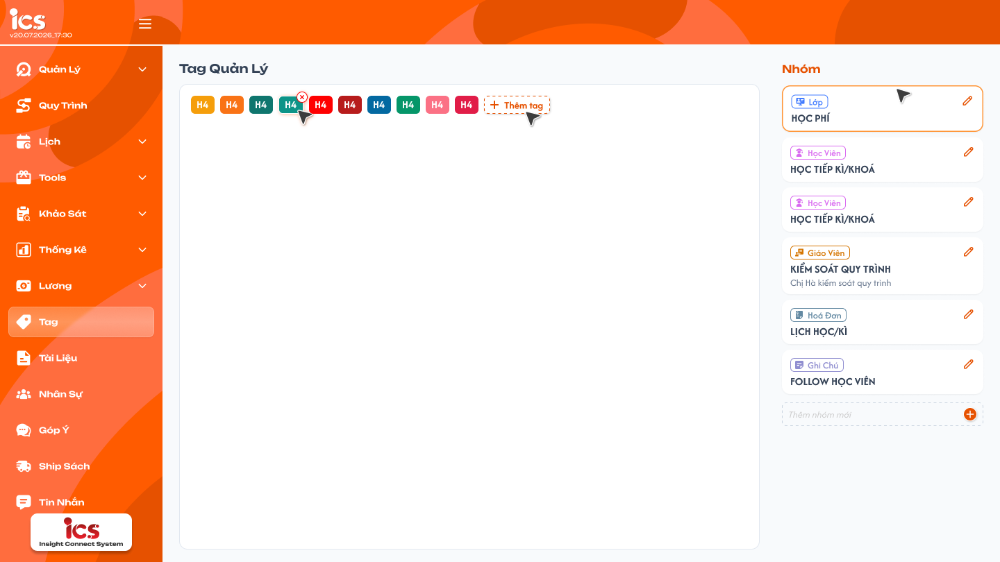
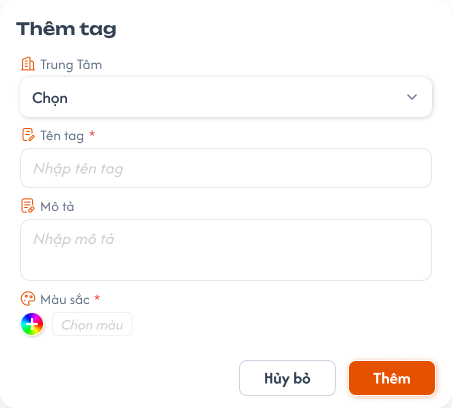
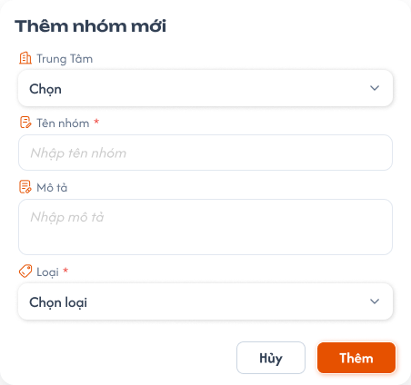

# Define Tag — Quản lý nhóm và tag

## 1. UI

### Trang 1: ADM-TAG-010000 — Tag / Quản lý tag



**Mô tả:**
- Màn Define Tag quản lý tag theo nhóm: `Tag quản lý` bên trái, `Nhóm` bên phải. Admin, Class Handler và Support được xem, thêm, sửa, xoá nhóm và tag. Nhóm và tag dùng chung cho toàn hệ thống, không phân theo center; tag dùng chung bản ghi với ComGao.
- Pre-coding / Definition of Done: [Tag Management — Pre-Coding](../../pre_coding/features/tag_management/tag-management-generic.md); kết quả đối chiếu code: [Tag Management — Code audit](./tag_definition_code_audit.md).

**Điểm cần lưu ý:**
- **Loại** dùng chung một bộ giá trị: `Học viên`, `Giáo viên`, `Lớp`, `Hoá đơn`, `Ghi chú`. Loại hiển thị trên nhóm là loại đã chọn khi tạo nhóm; tag thêm trong nhóm dùng cùng loại đó.
- Các tên nhóm / tag trong ảnh chỉ là dữ liệu mẫu, không phải danh sách cố định.
- Nút `Thêm tag` mở popup tạo tag trong nhóm đang chọn (Trang 2). Phải có nhóm rồi mới thêm được tag.
- Chọn một nhóm để xem / thêm tag trong nhóm đó; chọn nhóm chỉ hiện tag thuộc nhóm đó.
- Popup Thêm nhóm mới (Trang 3) có các field sau:
- `A02.01` Tên nhóm: nhập tên nhóm.
- `A02.02` Mô tả: nhập mô tả nhóm nếu có.
- `A02.03` Loại: chọn một trong đúng năm giá trị `Học viên`, `Giáo viên`, `Lớp`, `Hoá đơn`, `Ghi chú`. Loại được lưu ở cấp nhóm để tag tạo bên trong kế thừa. Không dùng các mục `CSKH`, `Sale`, `Quản lý` còn thấy trong ảnh popup cũ.
- `A02.04` Thêm / Hủy: `Thêm` lưu nhóm cùng loại đã chọn; `Hủy` đóng popup và không lưu.
- Không áp đặt giá trị mặc định hoặc giới hạn nhập liệu cho các field; dữ liệu mẫu trong ảnh không phải mặc định bắt buộc. Không kiểm tra trùng Tên nhóm / Tên tag, cho phép trùng tên.
- `A04.01`–`A04.04` Toast phản hồi CRUD sau khi dữ liệu được xử lý; `Hủy` và chỉ xem không có Toast CRUD. Mỗi thao tác chỉ một Toast kết quả, không báo thành công trước khi lưu xong:
- `A04.01` `Thành Công`: thêm / sửa / xoá nhóm hoặc tag thành công.
- `A04.02` `Cảnh Báo`: thao tác không đúng quyền hoặc Loại của nhóm (không cảnh báo chỉ vì trùng tên).
- `A04.03` `Có Lỗi Xảy Ra`: không thể hoàn tất thao tác lưu.
- `A04.04` `Thông Báo`: chỉ dùng nếu hệ thống tiếp nhận thao tác nhưng còn chờ đồng bộ.

### Trang 2: ADM-TAG-010010 — Tag / Popup thêm tag



**Mô tả:**
- Popup `Thêm tag`. Tag bắt buộc thuộc một nhóm; phải có nhóm rồi mới thêm được tag, không có tag nằm ngoài nhóm. Form thêm tag không hiển thị trường Loại; tag kế thừa Loại của nhóm.

**Điểm cần lưu ý:**
- `A03.01` Tên tag, Mô tả: `Tên tag` bắt buộc, `Mô tả` không bắt buộc (được để trống). Không có giới hạn nghiệp vụ bổ sung.
- `A03.02` Nhóm: **bắt buộc**, tag được tạo trong nhóm đang chọn.
- `A03.03` Loại: không có trường này trên form; tag tự nhận Loại của nhóm. Backend cũng dùng Loại của nhóm; request tự gửi Loại khác với nhóm không được ghi đè Loại nhóm. Việc chọn Loại ở popup Thêm nhóm chỉ thực hiện một lần ở cấp nhóm.
- `A03.04` Màu sắc: bắt buộc; thiếu `Tên tag` hoặc `Màu sắc` thì không lưu và báo lỗi tại field thiếu. Không áp đặt mặc định từ dữ liệu mẫu UI.
- `A03.05` Thêm / Hủy bỏ: `Thêm` lưu tag vào nhóm với Loại của nhóm; `Hủy bỏ` không lưu.
- Tag không có field `Ngày thống kê` và `Riêng tư`; nếu ảnh popup còn các field này thì không áp dụng.

### Trang 3: ADM-TAG-010020 — Tag / Popup thêm nhóm tag



**Mô tả:**
- Popup `Thêm nhóm mới` (Tên nhóm, Mô tả, Loại): mở bằng nút `+` Thêm nhóm mới ở danh sách Nhóm; chọn loại áp dụng cho cả nhóm. Các field của popup xem nhóm `A02` ở Trang 1.

**Điểm cần lưu ý:**
- `A01.01` Tag quản lý: hiển thị các tag đã tạo; nút `Thêm tag` mở popup tạo tag trong nhóm đang chọn.
- `A01.02` Nhóm: hiển thị tên nhóm, mô tả nếu có và nhãn Loại.
- `A01.03` Thêm nhóm mới: nút `+` mở popup Thêm nhóm này.
- `A01.04` Chỉnh sửa / Xóa: sửa thông tin nhóm / tag hoặc xoá bản ghi theo quyền CRUD. Sửa tag được đổi nhóm của tag. Xoá nhóm không xoá các tag thuộc nhóm.

---

## 2. Yêu cầu

### 2.1. Flow chính

**Flow 1: Xem nhóm và tag**

```
Mở Define Tag → Xem danh sách nhóm và tag
      → Chọn nhóm → Hiển thị tag thuộc nhóm và Loại đã lưu
```

**Flow 2: Tạo nhóm**

```
Nhấn Thêm nhóm mới → Nhập Tên nhóm, Mô tả và chọn một trong năm Loại
      → Nhấn Thêm → Lưu nhóm cùng Loại đã chọn
      → Tag thêm về sau trong nhóm tự nhận Loại đó
```

**Flow 3: Tạo tag**

```
Chưa có nhóm → Không thêm được tag
Thêm tag trong nhóm → Không hiển thị trường Loại → Lưu tag với Loại của nhóm
```

**Flow 4: Sửa và xóa**

```
Admin/Class Handler/Support chọn nhóm hoặc tag
      → Sửa và lưu / Xóa → Cập nhật cùng bản ghi dùng chung với ComGao
      → Sửa tag: được đổi nhóm của tag
      → Xóa nhóm: chỉ xóa nhóm, các tag thuộc nhóm được giữ lại
```

### 2.2. Ngoại lệ

- **EX01:** Tag tạo trong nhóm có Loại khác Loại nhóm → không tạo tag sai loại, không thay đổi nhóm.
- **EX02:** Hủy hoặc lưu lỗi → không tạo nhóm / tag dở dang.
- **EX03:** Không có quyền CRUD → từ chối thao tác.
- **EX04:** Tạo tag không có nhóm hoặc nhóm không tồn tại → không tạo tag.

### 2.3. Yêu cầu khác

| Mã | Tên yêu cầu | Mô tả |
|---|---|---|
| REQ01 | Hiển thị | Define Tag hiển thị nhóm và tag cùng tên, mô tả, Loại đã lưu; chọn nhóm chỉ xem tag thuộc nhóm đó. |
| REQ02 | Loại nhóm | Popup Thêm nhóm có Tên nhóm, Mô tả, Loại; Loại chỉ gồm Học viên / Giáo viên / Lớp / Hoá đơn / Ghi chú và được lưu ở cấp nhóm. |
| REQ03 | Nhóm và Loại của tag | Tag bắt buộc thuộc một nhóm; phải có nhóm rồi mới thêm được tag. Form thêm tag không có trường Loại và tag kế thừa Loại của nhóm; không cho lưu tag khác loại với nhóm. |
| REQ04 | Phản hồi | Thêm / sửa / xóa chỉ báo thành công sau khi xử lý xong; Hủy hoặc lỗi xử lý không làm thay đổi dữ liệu. |
| REQ05 | Nhập liệu | Khi thêm tag, Tên tag và Màu sắc là bắt buộc; Mô tả không bắt buộc. Không kiểm tra trùng tên và không có giới hạn nghiệp vụ khác cho Tên nhóm, Tên tag, Mô tả, Màu sắc. Tag không có field Ngày thống kê và Riêng tư. Không áp đặt mặc định từ dữ liệu mẫu UI. |
| REQ06 | CRUD | Admin, Class Handler và Support được xem, thêm, sửa, xóa nhóm và tag. Sửa tag được đổi nhóm của tag. Xóa nhóm không xóa các tag thuộc nhóm. |
| REQ07 | ComGao | Tag ICS dùng chung bảng và bản ghi với ComGao; thao tác không tạo bản sao riêng. Nhóm / tag dùng chung cho toàn hệ thống, không phân theo center. |

### 2.4. Ràng buộc

#### Quyền

| Role | Xem Define Tag | Thêm | Sửa | Xóa |
|---|:---:|:---:|:---:|:---:|
| Admin | ✅ | ✅ | ✅ | ✅ |
| Class Handler | ✅ | ✅ | ✅ | ✅ |
| Support | ✅ | ✅ | ✅ | ✅ |
| Role khác | ❌ | ❌ | ❌ | ❌ |

#### Ràng buộc khác

- Nhóm / tag không gắn với center; mọi center dùng chung một bộ nhóm / tag. Quyền xem / sửa / xóa kiểm tra cả UI và API.
- Nhóm và tag lưu bằng định danh nội bộ; việc ẩn trường Loại trên UI không thay thế kiểm tra Loại nhóm khi lưu.
- Tag dùng ở các màn Học viên / Giáo viên / Lớp / Hoá đơn / Ghi chú phải khớp Loại đã định nghĩa.


---

## 3. Testcase

### Feature: Define Tag — Quản lý nhóm và tag

| Tên testcase | Priority | Scenario | Role | Pre-condition | Given/When/Then | Expected Result |
|---|---|---|---|---|---|---|
| Case 1: Xem nhóm và tag | High | Flow 1 / REQ01 | Admin, Class Handler, Support | Có nhóm và tag đã tạo | **Given:** mở Define Tag<br>**When:** chọn một nhóm<br>**Then:** hiển thị tag của nhóm và nhãn Loại đã lưu | - Chỉ hiển thị tag thuộc nhóm đã chọn<br>- Danh sách nhóm / tag giống nhau khi đổi center<br>- Loại nhóm không đổi khi chỉ xem |
| Case 2: Danh sách Loại và tạo nhóm | High | Flow 2 / REQ02 | Admin, Class Handler, Support | Popup Thêm nhóm đang mở | **Given:** người dùng mở trường Loại, nhập thông tin nhóm và chọn Loại = Lớp<br>**When:** bấm Thêm và lưu thành công; làm lại và bấm Hủy<br>**Then:** thấy đúng năm loại, nhóm xuất hiện với nhãn Lớp | - Có Học viên / Giáo viên / Lớp / Hoá đơn / Ghi chú; không có CSKH / Sale / Quản lý<br>- Loại nhóm được lưu để các tag trong nhóm kế thừa<br>- Hủy không tạo nhóm |
| Case 3: Thêm tag trong nhóm, không cần chọn Loại | High | Flow 3 / REQ03 / EX04 | Admin, Class Handler, Support | Nhóm A đã lưu loại Giáo viên; một trường hợp chưa có nhóm nào | **Given:** đang thêm tag trong nhóm A; hoặc chưa có nhóm / gửi request tạo tag không có nhóm<br>**When:** mở form và lưu tag<br>**Then:** tag nhận loại Giáo viên; không có nhóm thì không tạo được | - Form không có trường Loại; tag thuộc đúng nhóm A và loại Giáo viên<br>- UI không cho thêm tag khi chưa có nhóm<br>- Request không có nhóm hoặc nhóm không tồn tại bị từ chối, không tồn tại tag nằm ngoài nhóm |
| Case 4: Không ghi đè Loại nhóm | High | EX01 / REQ03 | Admin, Class Handler, Support | Nhóm A có loại Giáo viên | **Given:** request tạo tag trong nhóm A gửi thêm loại Lớp<br>**When:** hệ thống kiểm tra dữ liệu<br>**Then:** từ chối request sai Loại | - Không tạo tag loại Lớp trong nhóm A<br>- Loại nhóm không đổi<br>- Toast `Cảnh Báo` |
| Case 5: Field bắt buộc và trùng tên | High | REQ05 | Admin, Class Handler, Support | Có nhóm / tag đã tạo | **Given:** popup Thêm tag đang mở<br>**When:** bỏ trống Tên tag rồi lưu; sau đó nhập Tên tag đã tồn tại, để trống Mô tả và lưu<br>**Then:** thiếu Tên tag thì bị chặn; trống Mô tả và trùng tên vẫn lưu được | - Thiếu Tên tag: không tạo tag, báo lỗi tại field<br>- Mô tả trống: vẫn tạo tag thành công<br>- Luôn có một Màu sắc được chọn; thiếu Màu sắc thì không lưu<br>- Trùng tên vẫn tạo được, không cảnh báo<br>- Không áp đặt giá trị mặc định từ ảnh mẫu |
| Case 6: Quyền CRUD | High | Flow 4 / REQ06 / EX03 | Admin, Class Handler, Support; role khác | Có nhóm / tag đã tạo | **Given:** người dùng thao tác thêm / sửa / xóa<br>**When:** kiểm tra quyền<br>**Then:** ba role được thực hiện; role khác không được quản lý | - Kiểm tra quyền cả UI và API<br>- Sửa / xóa cập nhật đúng bản ghi |
| Case 7: Dùng chung bản ghi với ComGao, không theo center | High | REQ07 | Admin, Class Handler, Support | ComGao có sẵn nhóm / tag; hệ thống có ít nhất 2 center | **Given:** mở ICS ở center A<br>**When:** xem, chỉnh sửa tag rồi chuyển sang center B<br>**Then:** cập nhật cùng bản ghi ComGao và center B thấy cùng dữ liệu | - Không sao chép thành bản ghi riêng cho ICS<br>- Nhóm / tag hiển thị giống nhau ở center A và B<br>- Thay đổi ở center A có hiệu lực ở center B |
| Case 8: Xóa nhóm không xóa tag con | High | Flow 4 / REQ06 | Admin, Class Handler, Support | Nhóm A có ít nhất 1 tag; tag đó đang gắn vào một đối tượng | **Given:** mở Define Tag<br>**When:** xóa nhóm A<br>**Then:** chỉ nhóm A bị xóa | - Các tag thuộc nhóm A không bị xóa<br>- Đối tượng đang gắn tag vẫn giữ tag<br>- Một Toast Thành Công |
| Case 9: Đổi nhóm của tag | High | Flow 4 / REQ06 | Admin, Class Handler, Support | Có nhóm A và nhóm B; tag T thuộc nhóm A | **Given:** mở sửa tag T<br>**When:** đổi nhóm sang B và lưu<br>**Then:** tag T thuộc nhóm B | - Tag T hiển thị trong nhóm B, không còn trong nhóm A<br>- Cập nhật đúng bản ghi, không tạo tag mới<br>- Đối tượng đang gắn tag T vẫn giữ tag |
| Case 10: Toast, Hủy và lỗi lưu | High | REQ04 / EX02 | Admin, Class Handler, Support | Popup đang mở; một lần giả lập hệ thống không lưu được; một lần chờ đồng bộ | **Given:** người dùng bấm Thêm với dữ liệu hợp lệ; request không đúng quyền / Loại nhóm; bấm Hủy<br>**When:** hệ thống lưu thành công, lưu thất bại hoặc đang đồng bộ<br>**Then:** hiển thị đúng một Toast theo kết quả | - Thành công: chỉ một Toast `Thành Công` sau khi lưu<br>- Không đúng quyền / Loại: `Cảnh Báo`, không lưu sai dữ liệu, không cảnh báo chỉ vì trùng tên<br>- Lưu thất bại: `Có Lỗi Xảy Ra`, không tạo nhóm / tag dở dang, không báo thành công giả<br>- Hủy không có Toast; chờ đồng bộ chỉ hiện `Thông Báo` nếu thực sự có, không nhân đôi Toast |
