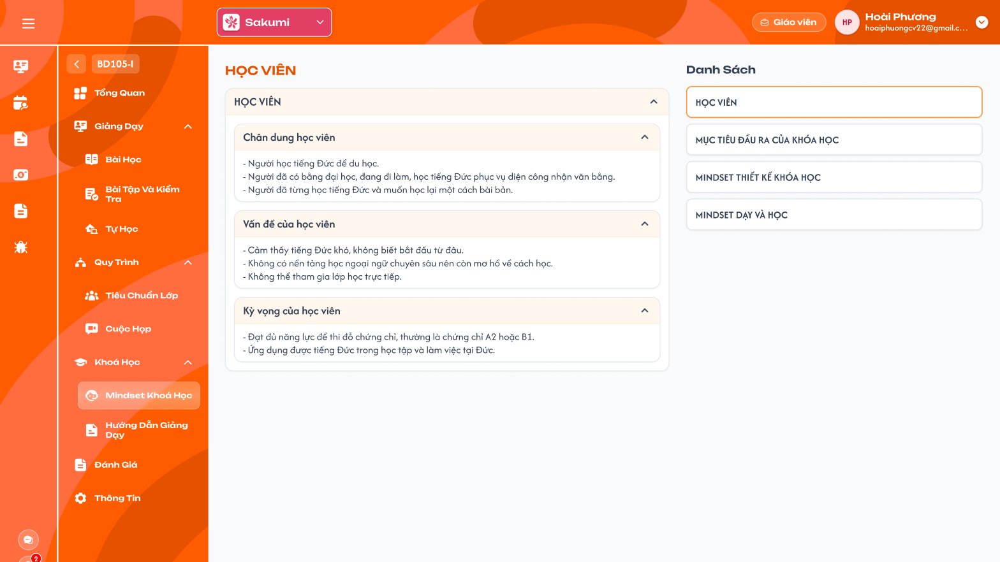
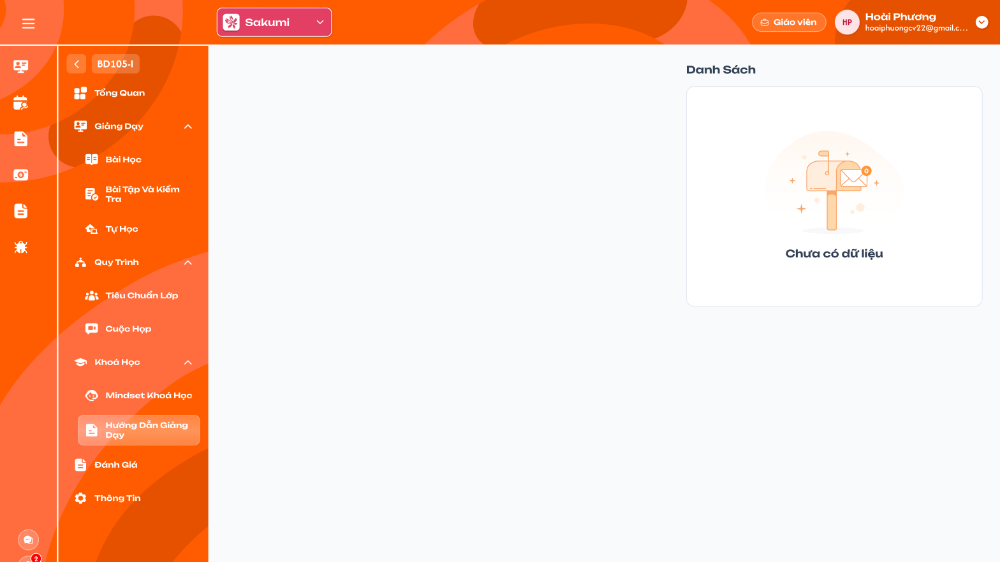

# [Giáo viên] Chi tiết lớp — Khoá học

Tài liệu đặc tả nhóm menu **Khoá học** trong Chi tiết lớp của role Giáo viên: Mindset khoá học và Hướng dẫn giảng dạy. Cả hai chỉ xem, dữ liệu do Curriculum Development Handler (CD) nhập cho khoá học gắn với lớp. UI tham chiếu: Figma `GV-LOP-080100` và `GV-LOP-090100`; nội dung trong ảnh là dữ liệu mẫu.

## 1. UI

### Trang 1: GV-LOP-080100 — Mindset khoá học


*Mindset khoá học: Danh sách mục bên phải, nội dung mục đang chọn bên trái (Figma GV-LOP-080100) — nhấn để xem ảnh gốc*

**Mô tả:**

- Giáo viên của lớp xem Mindset của khoá học gắn với lớp để nắm chân dung học viên, mục tiêu và tư duy thiết kế, dạy học của khoá. Chỉ đọc.

**Điểm cần lưu ý:**

- `A01.01` **`Danh Sách` (bên phải)**: Các mục Mindset của khoá học theo thứ tự CD đã lưu, ví dụ `HỌC VIÊN`, `MỤC TIÊU ĐẦU RA CỦA KHÓA HỌC`, `MINDSET THIẾT KẾ KHÓA HỌC`, `MINDSET DẠY VÀ HỌC`. Số mục và tên theo dữ liệu, không cố định 4 mục. Bấm mục để xem; mục đang chọn viền cam; mặc định chọn mục đầu tiên.
- `A01.02` **Tiêu đề bên trái**: Tên mục đang chọn.
- `A01.03` **Khối nội dung**: Mục đang chọn gồm các nhóm nội dung (ví dụ `Chân dung học viên`, `Vấn đề của học viên`, `Kỳ vọng của học viên`), mỗi nhóm có icon `⌃` thu gọn/mở, mặc định mở; nội dung là văn bản nhiều dòng giữ xuống dòng.
- `A01.04` **Nguồn**: Mindset của **khoá học gắn với lớp** do CD nhập ở màn Mindset thiết kế khoá học; lớp đổi khoá học thì hiển thị theo khoá mới.
- `A01.05` **Không có dữ liệu**: Khoá học chưa có Mindset: `Danh Sách` hiển thị `Chưa có dữ liệu`, vùng trái trống.

- Không có nút thêm, sửa, xoá, kéo thả; không có file đính kèm trong UI hiện tại.
- Văn bản hiển thị thuần, không thực thi HTML/script.

### Trang 2: GV-LOP-090100 — Hướng dẫn giảng dạy


*Hướng dẫn giảng dạy: hiện chỉ có trạng thái trống (Figma GV-LOP-090100) — nhấn để xem ảnh gốc*

**Mô tả:**

- Menu `Hướng dẫn giảng dạy` hiển thị hướng dẫn giảng dạy của khoá học gắn với lớp do CD nhập, chỉ đọc. Hiện CD chưa có màn nhập nên giáo viên thấy trạng thái trống.

**Điểm cần lưu ý:**

- `A02.01` **`Danh Sách`**: Khối bên phải; chưa có dữ liệu hiển thị hộp thư trống và `Chưa có dữ liệu`.
- `A02.02` **Vùng trái**: Trống khi chưa có dữ liệu.
- `A02.03` **Khi có dữ liệu**: Dự kiến bố cục giống Mindset khoá học (danh sách mục bên phải, nội dung bên trái); chốt khi CD có màn nhập.

---

## 2. Yêu cầu

### 2.1. Flow chính

**Flow 1 / REQ01 / REQ02: Xem Mindset khoá học, Hướng dẫn giảng dạy**

```text
Giáo viên vào Chi tiết lớp → Khoá học → Mindset khoá học (hoặc Hướng dẫn giảng dạy)
      → Hệ thống lấy khoá học gắn với lớp, tải nội dung CD đã nhập
      → Có dữ liệu: danh sách mục bên phải, chọn mục đầu, nội dung bên trái
      → Không có: "Chưa có dữ liệu"
```

### 2.2. Ngoại lệ

- **EX01:** Khoá học chưa có Mindset / Hướng dẫn giảng dạy → `Chưa có dữ liệu`; không lỗi.
- **EX02:** Request sửa nội dung từ role Giáo viên → backend từ chối.

### 2.3. Yêu cầu khác

| Mã | Tên yêu cầu | Mô tả |
|---|---|---|
| REQ01 | Mindset khoá học | Hiển thị theo khoá học gắn với lớp, các mục và nhóm theo thứ tự CD lưu; chỉ đọc; mục đầu chọn sẵn; nhóm thu gọn/mở. |
| REQ02 | Hướng dẫn giảng dạy | Cùng nguồn và cách hiển thị với Mindset khi CD có dữ liệu; hiện là trạng thái trống. |

### 2.4. Ràng buộc

#### Quyền

| Role | Xem | Thêm / sửa / xoá |
|---|:---:|:---:|
| Giáo viên của lớp | ✅ | ❌ |
| Curriculum Development Handler | Theo requirement CD | Theo requirement CD |
| Các role khác | Theo requirement Admin Chi tiết lớp | ❌ |

#### Ràng buộc khác

**Phạm vi dữ liệu**

- Chỉ Mindset / Hướng dẫn giảng dạy của khoá học gắn với lớp mà giáo viên được thêm vào; backend kiểm tra.

---

---

## 3. Testcase

### Feature: [Giáo viên] Chi tiết lớp — Khoá học

| Tên testcase | Priority | Scenario | Role | Pre-condition | Given/When/Then | Expected Result |
|---|---|---|---|---|---|---|
| Case 1: Xem Mindset | High · Smoke | Flow 1 / REQ01 | Giáo viên | Khoá học của lớp có 4 mục Mindset | **Given** mở Khoá học → Mindset khoá học<br>**When** tải xong<br>**Then** danh sách 4 mục, chọn sẵn mục đầu, nội dung nhóm mở | - Bấm mục khác đổi nội dung<br>- Không có control sửa |
| Case 2: Thu gọn nhóm | Low | REQ01 | Giáo viên | Mục có 3 nhóm | **Given** bấm `⌃` của một nhóm<br>**When** thu gọn<br>**Then** chỉ nhóm đó ẩn nội dung | - Không đổi dữ liệu |
| Case 3: Khoá chưa có Mindset | Medium | EX01 | Giáo viên | Khoá học chưa nhập Mindset | **Given** mở menu<br>**When** tải xong<br>**Then** `Chưa có dữ liệu` | - Không lỗi |
| Case 4: Đúng khoá của lớp | High | REQ01 | Giáo viên | Hai lớp gắn hai khoá khác nhau | **Given** mở Mindset ở từng lớp<br>**When** so sánh<br>**Then** mỗi lớp hiện Mindset của khoá mình | - Không trộn |
| Case 5: Trạng thái trống | Medium | Flow 1 / EX01 | Giáo viên | Khoá chưa có hướng dẫn giảng dạy | **Given** mở Khoá học → Hướng dẫn giảng dạy<br>**When** tải xong<br>**Then** `Chưa có dữ liệu` | - Không lỗi, không control sửa |

---

---

## 4. Câu hỏi cần xác nhận

- **Q01:** Màn nhập Hướng dẫn giảng dạy bên CD chưa có; bố cục hiển thị khi có dữ liệu chờ chốt.
- **Q02:** Mindset có hỗ trợ file đính kèm hay định dạng văn bản (đậm, danh sách) không; UI hiện tại chỉ có văn bản thuần.
