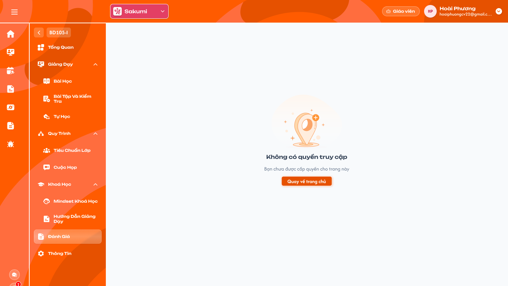

# [Giáo viên] Chi tiết lớp — Đánh giá

## 1. UI

### Trang 1: GV-LOP-100100 — Chi tiết lớp / Đánh giá / Không có quyền truy cập



**Mô tả:**
- Giáo viên không có quyền xem đánh giá lớp; menu `Đánh giá` trong Chi tiết lớp vẫn hiển thị và dẫn tới màn `Không có quyền truy cập`. Khi bấm menu, vùng nội dung hiển thị màn này.

**Điểm cần lưu ý:**
- `A01.01` Menu `Đánh giá` vẫn hiển thị trong menu trái của Chi tiết lớp, bấm được.
- `A01.02` Hình minh hoạ: hình chung của hệ thống cho màn không có quyền.
- `A01.03` Tiêu đề `Không có quyền truy cập`.
- `A01.04` Mô tả `Bạn chưa được cấp quyền cho trang này`.
- `A01.05` Nút `Quay về trang chủ` về menu Lớp (Thống kê tổng quan) của role Giáo viên, không về Chi tiết lớp.
- Không tải dữ liệu đánh giá; backend từ chối request đánh giá từ role Giáo viên kể cả gọi trực tiếp. Mở bằng URL của menu Đánh giá cũng hiển thị màn này.

---

## 2. Yêu cầu

### 2.1. Flow chính

**Flow 1: Bấm menu Đánh giá**

```
Giáo viên ở Chi tiết lớp → bấm "Đánh giá"
      → Hiển thị màn "Không có quyền truy cập" (không tải dữ liệu)
      → Bấm "Quay về trang chủ" → menu Lớp — Thống kê tổng quan
```

### 2.2. Ngoại lệ

- **EX01:** Mở URL menu Đánh giá hoặc gọi API đánh giá bằng role Giáo viên → màn `Không có quyền truy cập`; API trả lỗi quyền, không trả dữ liệu.

### 2.3. Yêu cầu khác

| Mã | Tên yêu cầu | Mô tả |
|---|---|---|
| REQ01 | Không có quyền | Role Giáo viên luôn thấy màn `Không có quyền truy cập` ở menu Đánh giá; menu vẫn hiển thị; nút `Quay về trang chủ` về menu Lớp. Backend chặn mọi request đánh giá của role này. |

### 2.4. Ràng buộc

#### Quyền

| Role | Thấy menu Đánh giá | Xem nội dung đánh giá |
|---|:---:|:---:|
| Giáo viên | ✅ (màn Không có quyền) | ❌ |
| Các role khác | Theo requirement Admin Chi tiết lớp | — |

#### Ràng buộc khác

- Backend từ chối mọi request đánh giá của role Giáo viên, kể cả khi gọi trực tiếp bằng URL hoặc API; không dựa vào việc màn chỉ hiển thị thông báo.

---

## 3. Testcase

### Feature: [Giáo viên] Chi tiết lớp — Đánh giá

| Tên testcase | Priority | Scenario | Role | Pre-condition | Given/When/Then | Expected Result |
|---|---|---|---|---|---|---|
| Case 1: Bấm menu Đánh giá | High | Flow 1 / REQ01 | Giáo viên | Đang ở Chi tiết lớp | **Given:** bấm menu `Đánh giá`<br>**When:** màn tải<br>**Then:** hiện `Không có quyền truy cập` với mô tả và nút | - Menu `Đánh giá` vẫn hiển thị và bấm được<br>- Không gọi API đánh giá |
| Case 2: Quay về trang chủ | Medium | Flow 1 / REQ01 | Giáo viên | Đang ở màn Không có quyền | **Given:** bấm `Quay về trang chủ`<br>**When:** điều hướng<br>**Then:** về menu Lớp — Thống kê tổng quan | - Không về Chi tiết lớp |
| Case 3: Truy cập bằng URL / request | High | EX01 / REQ01 | Giáo viên | Biết URL hoặc API đánh giá | **Given:** mở URL hoặc gọi API<br>**When:** backend kiểm tra<br>**Then:** màn Không có quyền; API từ chối | - Không lộ dữ liệu đánh giá |

---

## 4. Câu hỏi cần xác nhận

- **Q01:** Có cần ẩn hẳn menu Đánh giá với Giáo viên thay vì hiển thị màn Không có quyền không (hiện giữ theo Figma).
- **Q02:** Khi Giáo viên được cấp quyền đánh giá trong tương lai thì màn hiển thị ra sao; chưa có thiết kế.
