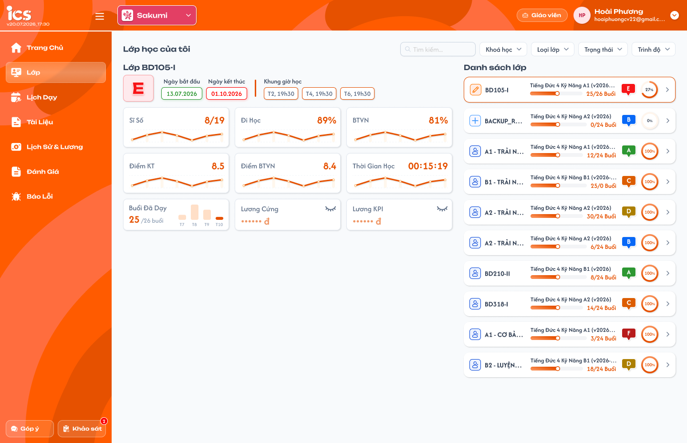
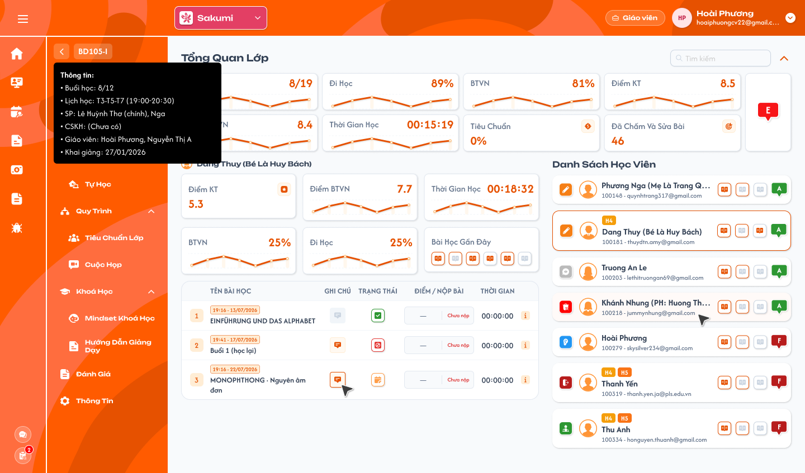
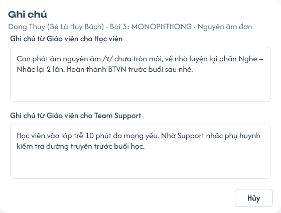
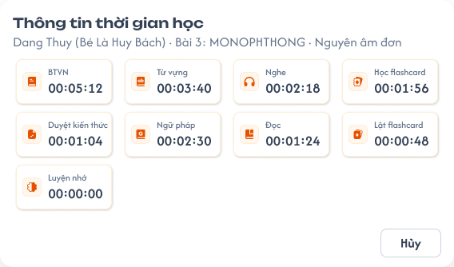

# [Giáo viên] Chi tiết lớp — Tổng quan

## 1. UI

### Trang 1: GV-LOP-010000 — Lớp / Thống kê tổng quan



**Mô tả:**
- Menu `Lớp` của Giáo viên (Lớp học của tôi). Là màn Giáo viên quay về khi bấm nút Back / mã lớp trong Chi tiết lớp; hover nút Back hiện tooltip thông tin lớp.

**Điểm cần lưu ý:**
- `A02.01` Nút Back / mã lớp ở đầu menu Chi tiết lớp gồm mũi tên và mã lớp. Hover vùng mũi tên + mã lớp xem tooltip, hover không điều hướng; click đóng tooltip và quay về menu `Lớp` (GV-LOP-010000).
- `A02.02` Tooltip nền tối, chữ sáng, hiển thị ngay dưới nút; tiêu đề `Thông tin:`; thứ tự Buổi học, Lịch học, SP, CSKH, Giáo viên, Khai giảng. Tooltip chỉ đọc; rời vùng nút / tooltip thì ẩn. Dữ liệu tải lỗi không được hiển thị thành `(Chưa có)`. Đổi lớp thì tooltip theo lớp mới, response của lớp cũ không ghi đè.
- `A02.03` Buổi học: `đã thực hiện/tổng số buổi`, cùng nguồn tiến độ lớp ở Danh sách lớp (vd `8/12`); không lấy sĩ số thay số buổi.
- `A02.04` Lịch học: đầy đủ lịch theo thứ và giờ `HH:mm-HH:mm`; nhóm các thứ cùng khung giờ (vd `T3-T5-T7 (09:00-09:10)`), lịch khác xuống dòng; không cắt còn lịch đầu tiên.
- `A02.05` SP: tên Support được gán cho lớp; người phụ trách chính có nhãn `(chính)`; nhiều Support thì hiển thị đủ.
- `A02.06` CSKH: nhân sự CSKH của lớp; chưa gán thì `(Chưa có)`.
- `A02.07` Giáo viên: tên các giáo viên được gán cho lớp, hiển thị đủ danh sách.
- `A02.08` Khai giảng: ngày khai giảng `DD/MM/YYYY`, không dùng ngày tạo lớp.
- `A02.09` / `A02.10` Component tooltip và header / vai trò dùng chung; nội dung tooltip không phụ thuộc học viên đang chọn.

### Trang 2: GV-LOP-020000 — Chi tiết lớp / Tổng quan



**Mô tả:**
- Menu đầu tiên trong Chi tiết lớp (màn `Tổng Quan Lớp`). Mọi giáo viên của lớp xem tình hình học tập của lớp và từng học viên: thống kê lớp phía trên, học viên đang chọn bên trái, `Danh Sách Học Viên` bên phải. Màn chỉ để xem; không chấm điểm, không điểm danh, không sửa ghi chú.
- Màn dùng cùng dữ liệu và công thức với requirement Admin [Chi tiết lớp học — Menu Tổng quan](../../management_requirement/class_management/class_detail_overview_requirements.md); khác ở phần dành riêng cho Giáo viên: không có công tắc ON/OFF, học phí, ghi chú cài đặt, nút `Hiện ghi chú`, dấu `>` vào chi tiết học viên và chấm đỏ lịch hẹn. Tên học viên, điểm, số liệu trong ảnh là dữ liệu mẫu.

**Điểm cần lưu ý:**
- `A01.01` Tiêu đề `Tổng Quan Lớp` hiển thị dữ liệu của đúng lớp đang mở. Trong Chi tiết lớp chỉ có một menu `Tổng Quan`, không có menu `Tổng Quan Lớp` riêng.
- `A01.02` Nút Back / mã lớp: xem Trang 1.
- `A01.03` Thống kê phía trên: 8 thẻ chỉ số toàn lớp và badge đánh giá lớp; không đổi theo học viên đang chọn.
- `A01.04` Vùng bên trái: tên, chỉ số, Bài học gần đây và bảng bài học của học viên đang chọn.
- `A01.05` `Danh Sách Học Viên` bên phải: toàn bộ học viên của lớp, mỗi thẻ có icon trạng thái quan hệ lớp, tag, tên, mã, email, 3 bài gần nhất, badge đánh giá.
- `A01.06` Ô `Tìm kiếm` tìm theo tên học viên trong toàn bộ học viên của lớp.
- `A01.07` Icon `⌃` cạnh ô tìm kiếm chỉ thu gọn / mở lại vùng thống kê toàn lớp phía trên; không thu gọn danh sách hay vùng trái.
- Giáo viên không có công tắc ON/OFF; API Tổng quan không trả học phí, ghi chú cài đặt lớp và ghi chú cài đặt học viên cho Giáo viên (không chỉ ẩn trên giao diện). Không có nút `Hiện ghi chú`, dấu `>` trên thẻ học viên, icon ghi chú cạnh tên học viên đang chọn và chấm đỏ lịch hẹn (chấm đỏ chỉ Admin, Support, Class Handler thấy; API danh sách học viên không trả số lịch hẹn cho Giáo viên).
- `A03.01` Sĩ số: tử số = số học viên `Đang học` + `Dự thính`; mẫu số = tất cả học viên của lớp thuộc đủ 7 trạng thái `Đang học`, `Dự thính`, `Hoàn thành`, `Nghỉ học`, `Rời lớp`, `Chỉ xem`, `Xóa`. Hiển thị `tử/mẫu`, không đổi sang %.
- `A03.02` Đi học: trung bình cộng tỷ lệ đi học của học viên có dữ liệu trong lớp, cùng công thức mức lớp của Danh sách lớp; không có dữ liệu thì để trống.
- `A03.03` BTVN: trung bình cộng tỷ lệ làm BTVN của học viên có dữ liệu, cùng công thức mức lớp của Danh sách lớp; không có dữ liệu thì để trống.
- `A03.04` Điểm KT: cộng điểm các bài kiểm tra đã chấm của học viên trong lớp rồi chia số bài đã chấm; giữ bài của học viên đã `Rời lớp` / `Xóa`; làm tròn kết quả cuối 1 chữ số thập phân.
- `A03.05` Điểm BTVN: cộng điểm các BTVN đã chấm rồi chia số BTVN đã chấm, kể cả bài của học viên đã `Rời lớp` / `Xóa`; tính riêng với KT; làm tròn 1 chữ số thập phân.
- `A03.06` Thời gian học: trung bình tổng thời gian app của từng cặp học viên–bài (cộng các tổng thời gian học viên–bài rồi chia số bản ghi học viên–bài), hiển thị `HH:mm:ss`. Không lấy trung bình các trung bình học viên, không dùng giờ lịch dạy. Bản ghi tổng thời gian 0 là dữ liệu 0; bản ghi thiếu dữ liệu không tự thành 0.
- `A03.07` Tiêu chuẩn: % hoàn thành tiêu chuẩn lớp–giáo viên từ function Tiêu chuẩn; một số chung của lớp, giống mọi role; không tự suy từ Đi học / BTVN / điểm. Click không điều hướng.
- `A03.08` Đã chấm và sửa bài: số bài **BTVN và Kiểm tra** của lớp đã có ít nhất một lần bấm `Đã Chấm và Sửa Bài Trên Lớp` (xem [Giảng dạy](./class_teaching_requirements.md)). Đếm theo bài, mỗi bài một lần, bấm lại không tăng (hệ thống chỉ lưu lần bấm gần nhất của mỗi bài). Click không điều hướng.
- `A03.09` Đánh giá lớp: badge theo giá trị nguồn cung cấp, chưa có công thức tự tính; không điều hướng.
- Tách tập học viên hiện tại (sĩ số, danh sách) với dữ liệu kết quả học tập lịch sử: học viên rời lớp / xóa không làm mất bài đã làm, điểm đã chấm. Chưa nộp / Chưa chấm không tham gia tử hoặc mẫu của điểm trung bình; bài đã chấm điểm 0 vẫn tính; không có bài đã chấm thì để trống, không hiển thị 0 giả. Tính trung bình trực tiếp trên các bài đã chấm, không trung bình hai cấp qua từng học viên; chỉ làm tròn kết quả cuối. Tìm kiếm, chọn học viên không làm đổi thống kê toàn lớp.
- `A04.01` Biểu đồ đường màu cam theo bài học: biểu đồ lớp ở thống kê phía trên, biểu đồ học viên ở vùng trái. Trục bài học theo thứ tự bài học của lớp, không theo ngày / tuần.
- `A04.02` Mỗi điểm là dữ liệu của bài tương ứng, không lũy kế qua các bài trước. Mỗi thẻ và mỗi học viên một chuỗi dữ liệu riêng.
- `A04.03` Chart học viên chỉ tới bài học viên đang chọn đã học (xác định từ tiến độ học viên–bài, không dùng bài mới nhất giáo viên mở cho cả lớp); không vẽ bài phía sau.
- `A04.04` Đường / vùng cam theo dữ liệu thực; thiếu dữ liệu không dựng thành đường 0, không vẽ đường trang trí.
- `A04.05` Tooltip biểu đồ: nội dung / khả năng hover chưa chốt (xem mục 4).
- `A05.01` Thẻ học viên: icon trạng thái quan hệ lớp, tag, tên, mã, email, 3 bài gần nhất, badge đánh giá; không có dấu `>`.
- `A05.02` Thẻ đang chọn có viền cam; chỉ một học viên được chọn; mặc định chọn học viên đầu tiên.
- `A05.03` Bấm thẻ: chọn học viên theo học viên và lớp, tải chỉ số, Bài học gần đây, biểu đồ và bảng bài của học viên đó; không mở chi tiết học viên.
- `A05.04` Tìm kiếm theo tên trên toàn bộ học viên của lớp, không chỉ phần đã tải; không lọc lại thống kê lớp phía trên.
- `A05.05` Phạm vi danh sách đủ 7 trạng thái (`Đang học`, `Dự thính`, `Hoàn thành`, `Nghỉ học`, `Rời lớp`, `Chỉ xem`, `Xóa`); không phân trang, không load-more. Học viên `Rời lớp` / `Xóa` vẫn có thẻ, bấm xem dữ liệu học tập lịch sử; hiển thị ở Tổng quan không khôi phục quan hệ lớp.
- `A05.06` Vùng trái: Điểm KT, Điểm BTVN, Thời gian học, BTVN, Đi học, Bài học gần đây và bảng bài học của học viên đang chọn.
- `A06.01` Badge đánh giá: `F` đỏ, `D` nâu, `E` cam; `A` xanh lá và `B` xanh dương theo UI tham chiếu; `C` chưa có quy tắc màu. Giá trị lấy từ nguồn, không tự tính; badge không điều hướng; có chữ, không chỉ dựa màu.
- `A06.02` Số bài hiển thị: thẻ học viên ở `Danh Sách Học Viên` 3 bài gần nhất; khối `Bài Học Gần Đây` vùng trái 6 bài gần nhất. Chỉ tính bài **đã được điểm danh** của học viên (bài còn `Chưa điểm danh` không tính); ít hơn số quy định thì chỉ hiện số bài có dữ liệu; sắp từ bài mới nhất.
- `A06.03` Đi học: `Có mặt`, `Vào trễ`, `Ra sớm`, `Vào trễ & Ra sớm`. Vắng: `Nghỉ CP`, `Nghỉ KP`.
- `A06.04` Đã nộp BTVN: học viên đã nộp BTVN của bài (nộp chưa chấm hoặc điểm 0 vẫn là đã nộp).
- `A06.05` Icon bài (bộ `Class Session Status`): viền cam = đi học, viền xám = vắng; sách cam = đã nộp BTVN, sách xám = chưa nộp. Bốn tổ hợp: `Đi học + đã nộp BTVN`, `Đi học + chưa nộp BTVN`, `Vắng + đã nộp BTVN`, `Vắng + chưa nộp BTVN`. Bộ icon này khác bộ icon điểm danh của cột Trạng thái ở bảng bài học. Click không điều hướng.
- `A06.06` Hover icon bài hiển thị tên tổ hợp của bài.
- Bảng bài học (vùng trái) gồm `TÊN BÀI HỌC`, `GHI CHÚ`, `TRẠNG THÁI`, `ĐIỂM / NỘP BÀI`, `THỜI GIAN` của học viên đang chọn; chỉ xem, không sửa điểm, điểm danh hoặc ghi chú tại bảng (điểm danh và ghi chú nằm trong luồng buổi học của menu Bài học; chấm điểm ở màn chấm bài). Hiển thị toàn bộ bài, sắp theo số thứ tự tăng dần, không phân trang.
- `A07.01` Tên bài học: số thứ tự; tag thời điểm giáo viên mở bài dạng `HH:mm - dd/MM/yyyy` (vd `19:18 - 13/07/2026`) đặt **phía trên** tên bài; cùng bài thì mốc giống nhau ở mọi học viên (không lấy giờ học / nộp của từng học viên); bài chưa mở không có tag.
- `A07.02` Ghi chú giáo viên theo học viên–bài. Có nội dung: icon đỏ, bấm mở popup Ghi chú (Trang 3). Không có nội dung: icon xám, không bấm được, không gửi request.
- `A07.03` Trạng thái: icon điểm danh của học viên ở bài theo bảng ghép ở [Giảng dạy — Icon trạng thái điểm danh](./class_teaching_requirements.md); hover hiển thị tên trạng thái; không nhầm với trạng thái quan hệ lớp.
- `A07.04` Điểm / Nộp bài: điểm BTVN của học viên ở bài (điểm cụ thể, `Chưa nộp` hoặc `Chưa chấm`); không dùng điểm kiểm tra. Điểm 0 là điểm hợp lệ, khác `Chưa nộp` / `Chưa chấm`.
- `A07.05` Thời gian: thời gian học trên app của học viên cho bài, `HH:mm:ss`; icon `i` mở popup Thời gian (Trang 4).
- Bảy trạng thái điểm danh hiển thị: `A07.06` Có mặt; `A07.07` Vào trễ; `A07.08` Ra sớm; `A07.09` Vào trễ & ra sớm; `A07.10` Nghỉ có phép (cp); `A07.11` Nghỉ không phép (kp); `A07.12` Chưa điểm danh.
- `A10.01` Loading hiển thị tại vùng đang tải; không giữ dữ liệu học viên cũ dưới tên học viên mới.
- `A10.02` Rỗng tuỳ vùng: Chưa có học viên, Không tìm thấy học viên, Chưa có bài học.
- `A10.03` Lỗi: thông báo và `Thử lại` tại vùng lỗi; không biến lỗi thành chỉ số 0.
- `A10.04` Toast: xem, tìm, chọn học viên, mở / đóng popup không có Toast CRUD.
- Ghi chú hiển thị dạng text an toàn, không thực thi HTML / script. Request / response xác định đúng lớp, học viên, bài và quyền hiện tại.

### Trang 3: GV-LOP-020020 — Chi tiết lớp / Tổng quan / Popup Ghi chú theo bài



**Mô tả:**
- Bấm icon ghi chú đỏ ở bảng bài mở popup `Ghi chú` (tên học viên, tên bài) gồm hai vùng chỉ đọc của học viên–bài đó.

**Điểm cần lưu ý:**
- `A08.01` `Ghi chú từ Giáo viên cho Học viên`: ghi chú gửi học viên do giáo viên của buổi nhập ở Bước 2 của menu Bài học; chỉ đọc.
- `A08.02` `Ghi chú từ Giáo viên cho Team Support`: ghi chú gửi Support do giáo viên của buổi nhập ở Bước 2; chỉ đọc.
- `A08.03` Phạm vi xem: mọi giáo viên của lớp xem **cả hai vùng**, kể cả ghi chú do giáo viên khác của lớp viết. Một vùng trống thì hiển thị trống riêng vùng đó, không nối hai vùng thành một. Dữ liệu theo lớp, học viên và bài.
- `A08.04` `Hủy` đóng popup, không lưu, không đổi dữ liệu.
- Không sửa ghi chú tại Tổng quan; ghi chú được nhập trong luồng buổi học trước khi buổi `Hoàn thành`.

### Trang 4: GV-LOP-020030 — Chi tiết lớp / Tổng quan / Popup Thời gian từng phần



**Mô tả:**
- Bấm icon `i` ở cột Thời gian mở popup `Thông tin thời gian học` của đúng học viên và bài, theo từng phần trên app.

**Điểm cần lưu ý:**
- `A09.01` Chín phần: BTVN, Từ vựng, Nghe, Học flashcard, Duyệt kiến thức, Ngữ pháp, Đọc, Lật flashcard, Luyện nhớ. Học flashcard và Lật flashcard là hai phần riêng, không gộp.
- `A09.02` Mỗi ô có icon đúng loại hoạt động, thời gian `HH:mm:ss`, nhãn / tooltip phân biệt.
- `A09.03` `00:00:00` là thời gian ghi nhận thực tế bằng 0, không dùng để che lỗi tải; API lỗi thì có `Thử lại`, không dựng chín số 0.
- `A09.04` `Hủy` đóng popup, không đổi dữ liệu, giữ học viên đang chọn. Popup không hiển thị thời gian toàn lớp hoặc tổng nhiều bài.

---

## 2. Yêu cầu

### 2.1. Flow chính

**Flow 1: Mở Tổng quan**

```
Giáo viên vào Chi tiết lớp → Tổng Quan
      → Hệ thống kiểm tra giáo viên thuộc lớp
      → Tải 8 thẻ thống kê lớp, badge đánh giá lớp và toàn bộ danh sách học viên (đủ 7 trạng thái)
      → Chọn học viên đầu tiên → tải chỉ số, Bài học gần đây, biểu đồ và bảng bài của học viên
```

**Flow 2: Tìm và chọn học viên**

```
Giáo viên nhập tên ở ô Tìm kiếm hoặc bấm thẻ học viên
      → Danh sách lọc theo tên (thống kê lớp giữ nguyên)
      → Bấm thẻ: viền cam, vùng trái tải dữ liệu của học viên được chọn
```

**Flow 3: Thu gọn thống kê**

```
Giáo viên bấm icon ⌃ → vùng thống kê lớp thu gọn
      → Bấm lại → vùng thống kê mở lại; danh sách và vùng trái giữ nguyên
```

**Flow 4: Xem ghi chú theo bài**

```
Giáo viên bấm icon ghi chú đỏ ở bảng bài
      → Hệ thống kiểm tra giáo viên thuộc lớp
      → Popup "Ghi chú" hai vùng: cho Học viên, cho Team Support (chỉ đọc)
      → Hủy: đóng popup
```

**Flow 5: Xem thời gian từng phần**

```
Giáo viên bấm icon i ở cột Thời gian
      → Popup chín phần thời gian của học viên–bài
      → Hủy: đóng popup, giữ học viên đang chọn
```

**Flow 6: Nút Back và tooltip**

```
Giáo viên hover mũi tên / mã lớp → tooltip "Thông tin:" của lớp
      → Rời hover: tooltip ẩn
      → Click: đóng tooltip, về menu Lớp (Thống kê tổng quan)
```

### 2.2. Ngoại lệ

- **EX01:** Giáo viên không thuộc lớp mở URL hoặc gọi API Tổng quan / popup → backend từ chối, không trả dữ liệu.
- **EX02:** Thiếu điểm hoặc enum khác giá trị đã chốt → không tự đổi thành 0, đánh giá hoặc điểm danh khác.
- **EX03:** Response của học viên, từ khoá tìm kiếm hoặc lớp cũ về muộn → bỏ qua, không ghi đè ngữ cảnh hiện tại.
- **EX04:** Danh sách, kết quả tìm kiếm hoặc bảng bài rỗng → trạng thái rỗng đúng vùng, không dữ liệu giả.
- **EX05:** Lỗi tải → giữ phần đã tải thành công, vùng lỗi có `Thử lại`; không coi là 0 hoặc `(Chưa có)`.
- **EX06:** Học viên `Rời lớp` / `Xóa` → giữ bài đã làm, điểm BTVN / KT trong thống kê lịch sử.

### 2.3. Yêu cầu khác

| Mã | Tên yêu cầu | Mô tả |
|---|---|---|
| REQ01 | Quyền và phạm vi | Trong Chi tiết lớp chỉ có một menu `Tổng Quan` (màn `Tổng Quan Lớp`). Mọi giáo viên của lớp được xem; chỉ đọc. Không có công tắc ON/OFF, nút `Hiện ghi chú`, dấu `>`, icon ghi chú cạnh tên học viên, chấm đỏ lịch hẹn; API không trả học phí, ghi chú cài đặt lớp / học viên cho Giáo viên. |
| REQ02 | Thẻ thống kê lớp | Sĩ số = (`Đang học` + `Dự thính`) / tất cả 7 trạng thái kể cả `Xóa`; Đi học, BTVN = trung bình tỷ lệ của học viên có dữ liệu; Thời gian học = trung bình tổng thời gian học viên–bài; Tiêu chuẩn = số chung của lớp từ function Tiêu chuẩn; Đã chấm và sửa bài = số bài BTVN + Kiểm tra đã có ít nhất một lần bấm nút, mỗi bài tính một lần. Các thẻ không điều hướng. |
| REQ03 | Điểm trung bình | Điểm KT, Điểm BTVN tính riêng, trung bình trực tiếp trên bài đã chấm (điểm 0 vẫn tính, Chưa nộp / Chưa chấm loại khỏi tử và mẫu), giữ bài của học viên rời lớp / xóa, làm tròn kết quả cuối 1 chữ số thập phân; không có bài đã chấm thì để trống. |
| REQ04 | Biểu đồ | Mỗi điểm là dữ liệu của một bài theo thứ tự bài, không lũy kế; chart học viên chỉ tới bài học viên đã học. |
| REQ05 | Danh sách học viên | Toàn bộ học viên đủ 7 trạng thái, không phân trang; mặc định chọn học viên đầu tiên; bấm thẻ chỉ đổi học viên ở vùng trái; không có chấm đỏ số lịch hẹn; tìm theo tên trên toàn bộ học viên của lớp, không lọc thống kê lớp. |
| REQ06 | Không có ghi chú cài đặt | Giáo viên không xem ghi chú cài đặt lớp, ghi chú cài đặt học viên và lịch sử của chúng tại Tổng quan. |
| REQ07 | Đánh giá và bài gần đây | Badge đánh giá theo giá trị nguồn (F đỏ, D nâu, E cam), không tự tính, không điều hướng; bài gần nhất đã được điểm danh (bỏ bài `Chưa điểm danh`): thẻ học viên tối đa 3 bài, khối Bài Học Gần Đây vùng trái tối đa 6 bài; bốn icon `Class Session Status` theo đi học (Có mặt, Vào trễ, Ra sớm, Vào trễ & Ra sớm) / vắng (Nghỉ CP, Nghỉ KP) và đã nộp / chưa nộp BTVN; hover hiện tên tổ hợp. |
| REQ08 | Bảng bài học | Toàn bộ bài theo số thứ tự tăng dần; tag thời điểm mở bài `HH:mm - dd/MM/yyyy` phía trên tên bài, giống nhau ở mọi học viên, bài chưa mở không có tag; 7 trạng thái điểm danh hiển thị bằng bộ icon `Trạng thái đi học`; cột điểm là điểm BTVN; icon ghi chú đỏ mở popup, xám không bấm; thời gian `HH:mm:ss` có icon `i`; chỉ đọc. |
| REQ09 | Ghi chú theo bài | Popup hai vùng `Cho Học viên` và `Cho Team Support`; mọi giáo viên của lớp xem cả hai vùng, kể cả ghi chú của giáo viên khác; chỉ đọc, không sửa tại Tổng quan. |
| REQ10 | Thời gian từng phần | Icon `i` mở chín phần thời gian của học viên–bài, `HH:mm:ss`, không gộp hai flashcard, không dùng 0 thay lỗi. |
| REQ11 | Trạng thái và an toàn | Loading / rỗng / lỗi rõ từng vùng; bỏ qua response cũ; text ghi chú an toàn; không Toast CRUD cho thao tác đọc; icon `⌃` chỉ thu gọn / mở vùng thống kê lớp. |
| REQ12 | Nút Back và tooltip | Hover hiển thị Buổi học, Lịch học, SP (nhãn chính), CSKH, Giáo viên, Khai giảng `DD/MM/YYYY` của đúng lớp; chưa phân công hiển thị `(Chưa có)`; click về menu Lớp của Giáo viên. |

### 2.4. Ràng buộc

#### Quyền

| Role | Xem Tổng quan | Xem popup ghi chú theo bài (2 vùng) | Xem popup Thời gian | Xem học phí / ghi chú cài đặt | Xem chấm đỏ lịch hẹn | Sửa điểm, điểm danh, ghi chú tại màn này |
|---|:---:|:---:|:---:|:---:|:---:|:---:|
| Giáo viên của lớp (mọi giáo viên) | ✅ | ✅ | ✅ | ❌ | ❌ | ❌ |
| Giáo viên không thuộc lớp | ❌ | ❌ | ❌ | ❌ | ❌ | ❌ |

#### Ràng buộc khác

- Các role quản lý xem Tổng quan theo requirement Admin [Chi tiết lớp học — Menu Tổng quan](../../management_requirement/class_management/class_detail_overview_requirements.md).
- Dữ liệu xác định theo lớp, học viên và bài; không dùng tên, email hoặc vị trí dòng làm khoá.
- Tập dữ liệu tính trung bình không giới hạn ở số thẻ / bài đã tải trên giao diện; dữ liệu lịch sử giữ liên kết nguồn khi học viên rời lớp / xóa.
- Ghi chú cài đặt lớp, ghi chú cài đặt học viên, ghi chú giáo viên cho học viên và cho Team Support là bốn nguồn khác nhau; Giáo viên chỉ xem hai nguồn ghi chú giáo viên.
- Không cho phép truy cập hoặc thực hiện hành động bị đánh dấu `❌`, kể cả khi gọi trực tiếp bằng URL hoặc request.

---

## 3. Testcase

### Feature: [Giáo viên] Chi tiết lớp — Tổng quan

| Tên testcase | Priority | Scenario | Role | Pre-condition | Given/When/Then | Expected Result |
|---|---|---|---|---|---|---|
| Case 1: Mở Tổng quan và phân quyền | High | Flow 1 / REQ01 / REQ06 / EX01 | Giáo viên; Giáo viên không thuộc lớp | Giáo viên thuộc lớp A có học viên, học phí và ghi chú cài đặt; không thuộc lớp B | **Given:** vào Chi tiết lớp A; truy cập URL / API Tổng quan của lớp B; sửa request yêu cầu dữ liệu ON<br>**When:** chọn menu Tổng Quan<br>**Then:** hiển thị thống kê, vùng trái, danh sách học viên của A; lớp B bị từ chối | - Chọn sẵn học viên đầu tiên, không trộn dữ liệu lớp khác; menu không có mục `Tổng Quan Lớp` riêng<br>- Không có công tắc ON/OFF, nút `Hiện ghi chú`, icon ghi chú cạnh tên; API không trả học phí / ghi chú cài đặt<br>- Lớp B không lộ học tập hoặc ghi chú |
| Case 2: Nút Back và tooltip | High | Flow 6 / REQ12 / EX05 | Giáo viên | Lớp tiến độ 8/12, lịch T3-T5-T7 và hai lịch T4/T6, nhiều Support / giáo viên, CSKH chưa gán, ngày tạo khác ngày khai giảng 27/01/2026 | **Given:** đang xem Tổng quan A<br>**When:** hover mũi tên hoặc mã lớp, rồi click Back<br>**Then:** tooltip đủ sáu nhóm; click về menu Lớp | - Hover không điều hướng, không phụ thuộc học viên đang chọn<br>- Đủ lịch (khung giờ khác xuống dòng) và nhân sự, Support chính có `(chính)`; CSKH `(Chưa có)`, Khai giảng 27/01/2026<br>- Lỗi tải không hiển thị thành `(Chưa có)`; click đóng tooltip, không Toast |
| Case 3: Thống kê lớp | High | REQ02 / REQ03 / EX02 / EX06 | Giáo viên | Lớp có 7 trạng thái học viên, mỗi trạng thái một người; bài đã chấm 8 và 0, một Chưa nộp, một Chưa chấm; học viên Rời lớp có bài đã chấm; Tiêu chuẩn lớp–giáo viên 40%; 3 BTVN + 2 KT đã bấm nút (một BTVN bấm 4 lần) | **Given:** tải thống kê<br>**When:** tính các thẻ<br>**Then:** hiển thị đúng công thức | - Sĩ số 2/7 (Xóa, Chỉ xem vào mẫu; Hoàn thành không vào tử)<br>- Đi học / BTVN = trung bình tỷ lệ học viên có dữ liệu (80% và 100% thành 90%), không có dữ liệu thì trống<br>- Điểm = (8 + 0) / 2 = 4.0, bài của học viên rời lớp vẫn tính (26 / 3 thành 8.7), không trung bình hai cấp<br>- Thời gian học 00:30:00 khi ba bản ghi 10, 30, 50 phút<br>- Tiêu chuẩn 40% với mọi giáo viên, click không điều hướng; Đã chấm và sửa bài = 5 |
| Case 4: Biểu đồ theo bài | High | REQ04 | Giáo viên | Lớp 10 bài mở ở ngày khác nhau; A học tới bài 4, B tới bài 7 | **Given:** tải biểu đồ, chọn A rồi B<br>**When:** render chart lớp và chart vùng trái<br>**Then:** sắp theo thứ tự bài; A dừng bài 4, B dừng bài 7 | - Không chia theo ngày / tuần, không lũy kế<br>- Không thêm điểm 0 cho bài chưa học; biểu đồ lớp không đổi |
| Case 5: Danh sách, tìm kiếm, chọn học viên | High | Flow 1 / Flow 2 / REQ05 / EX04 | Giáo viên | Lớp có học viên đủ 7 trạng thái (gồm A trạng thái Xóa); A có 2 lịch hẹn `Mới` | **Given:** mở Tổng quan; nhập tên A; nhập tên không khớp<br>**When:** danh sách tải xong, bấm thẻ B<br>**Then:** học viên đầu tiên viền cam, bấm thẻ B đổi vùng trái sang B | - Thống kê lớp không đổi khi chọn hoặc tìm; không mở chi tiết học viên; không dấu `>` và không chấm đỏ lịch hẹn, API không trả số lịch hẹn<br>- Tìm ra cả học viên Xóa / Rời lớp / Nghỉ học<br>- Không kết quả: trạng thái rỗng, không dựng học viên giả |
| Case 6: Đánh giá và bài học gần đây | High | REQ07 | Giáo viên | Học viên F, D, E; A có 8 bài đã điểm danh, B có 2 bài; 4 bài gần nhất của A: Vào trễ + đã nộp, Có mặt + chưa nộp, Nghỉ CP + đã nộp, Nghỉ KP + chưa nộp; bài 5 của A Chưa điểm danh | **Given:** xem thẻ A, B và chọn A để xem khối Bài Học Gần Đây<br>**When:** render và hover icon<br>**Then:** thẻ tối đa 3 icon, vùng trái tối đa 6 icon, đúng tổ hợp | - F đỏ, D nâu, E cam, có chữ; không tự tính đánh giá<br>- Thẻ A 3 icon, B 2 icon; vùng trái A 6 icon (bài 8 → 3)<br>- Vào trễ tính đi học, Nghỉ CP / KP tính vắng; hover hiện tên tổ hợp; click không điều hướng<br>- Bỏ bài Chưa điểm danh, không dựng icon giả |
| Case 7: Bảng bài học và điểm danh | High | Flow 2 / REQ08 | Giáo viên | A và B có dữ liệu bài khác nhau; đủ 7 trạng thái điểm danh; BTVN có 9.7, 0, Chưa nộp, Chưa chấm, KT có điểm khác; bài 1 mở 19:18 ngày 13/07/2026, bài 4 chưa mở | **Given:** chọn B rồi A<br>**When:** tải bảng, hover cột Trạng thái, xem cột Điểm và Tên bài học<br>**Then:** ghi chú, điểm danh, điểm, thời gian đúng học viên đang chọn | - Đủ toàn bộ bài, đúng icon và tên 7 trạng thái, không nhầm với trạng thái quan hệ lớp<br>- Cột điểm là điểm BTVN, 0 vẫn là điểm, không dùng điểm KT<br>- Tag `19:18 - 13/07/2026` phía trên tên bài 1, bài 4 không có tag, mốc giống nhau ở mọi học viên |
| Case 8: Popup Ghi chú theo bài | High | Flow 4 / REQ09 / REQ08 | Giáo viên (giáo viên khác của lớp) | Bài 2 của B có ghi chú gửi học viên và gửi Support do giáo viên X viết; Y là giáo viên khác; bài không có ghi chú | **Given:** Y bấm icon ghi chú đỏ ở bài 2 của B; bấm icon xám<br>**When:** popup tải<br>**Then:** thấy cả hai vùng đúng B và bài 2 | - Chỉ đọc, không trộn ghi chú cài đặt; Y không sửa được<br>- Icon xám không mở popup rỗng, không gửi request<br>- Hủy đóng popup |
| Case 9: Popup Thời gian từng phần | High | Flow 5 / REQ10 / EX05 | Giáo viên | Nhiều học viên và bài; một phần bằng 0 hoặc API lỗi | **Given:** bấm `i` ở bài 3 của B<br>**When:** popup mở hoặc API lỗi<br>**Then:** đủ chín phần của B ở bài 3 | - Không gộp hai flashcard; chỉ đọc<br>- Giá trị 0 hiển thị `00:00:00`; lỗi có `Thử lại`, không dựng chín số 0<br>- Hủy giữ học viên đang chọn |
| Case 10: Thu gọn thống kê và thao tác đọc | Medium | Flow 3 / REQ11 | Giáo viên | Thống kê đang mở, đã chọn học viên | **Given:** bấm `⌃` thu gọn rồi mở lại; tìm, chọn học viên, hover, mở và đóng popup<br>**When:** thao tác xong<br>**Then:** chỉ vùng thống kê lớp ẩn / hiện | - Danh sách, vùng trái, ô tìm kiếm giữ nguyên<br>- Dữ liệu không đổi, không Toast CRUD |
| Case 11: Loading, rỗng, lỗi từng vùng | High | EX03 / EX04 / EX05 / REQ11 | Giáo viên | Response của A về muộn sau khi chọn B; API bảng bài lỗi | **Given:** chọn A rồi B; tải Tổng quan khi bảng bài lỗi<br>**When:** response A về sau<br>**Then:** bỏ qua response của A; vùng bảng báo lỗi | - Vùng trái đúng B, không giữ dữ liệu học viên cũ<br>- Vùng bảng có lỗi và `Thử lại`; thống kê lớp và danh sách vẫn hiển thị, không hiện 0 giả |

---

## 4. Câu hỏi cần xác nhận

- **Q01:** Tooltip của biểu đồ (nội dung, khả năng hover) chưa chốt; chờ cùng Admin.
- **Q02:** Thứ tự học viên trong danh sách và hành vi khi tìm kiếm làm học viên đang chọn không còn khớp danh sách chưa chốt; chờ cùng Admin.
- **Q03:** Công thức và màu badge đánh giá `C` chưa có; chờ cùng Admin.
- **Q04:** Cách chống trùng thời gian giữa chín hoạt động app (popup Thời gian) chưa chốt; chờ cùng Admin.
