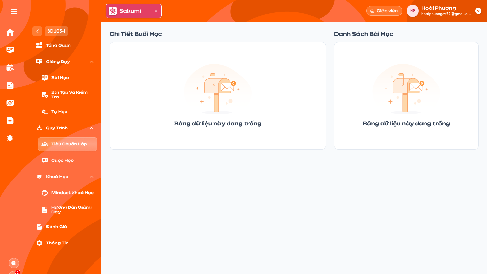
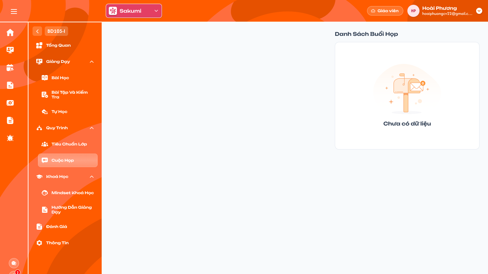

# [Giáo viên] Chi tiết lớp — Quy trình

## 1. UI

### Trang 1: GV-LOP-060100 — Chi tiết lớp / Tiêu chuẩn lớp / Trống



**Mô tả:**
- Giáo viên của lớp vào Chi tiết lớp → Quy trình → **Tiêu chuẩn lớp** để xem toàn bộ tiêu chuẩn (quy trình loại `Lớp - Giáo viên`) đã được Class Handler/Support thêm vào lớp, cùng Result và tiến độ. Thao tác ghi duy nhất là **tick xác nhận** Action loại Xác thực (`verify`) mà giáo viên được gán.
- Frame hiện là trạng thái chưa có nội dung (`Bảng dữ liệu này đang trống`); bố cục cây tiêu chuẩn bên dưới đặc tả theo nghiệp vụ dùng chung với requirement Admin [Tiêu chuẩn lớp - giáo viên, CSKH và Quy trình lớp](../../management_requirement/class_management/class_detail_processes_requirements.md).

**Điểm cần lưu ý:**
- `A01.01` Tiến độ tổng: thanh tiến độ của lớp theo quy tắc Action Board (từ Action `Kiểm tra`, `Đánh giá`, `Task tiến trình`); chỉ hiển thị. Cùng giá trị với thẻ `Tiêu chuẩn` ở Tổng quan lớp. Lớp chưa có tiêu chuẩn thì trống hoặc 0%.
- `A01.02` Cây Package → Category → Action Item: toàn bộ nội dung đã thêm vào lớp, theo thứ tự đã lưu; mỗi Category có badge `x/y` số item hoàn thành. Không lọc theo người được gán. Không kéo thả.
- `A01.03` Mở rộng item: icon `⌃`/`⌄` xem mô tả, ghi chú, file hướng dẫn (bấm tải), Result. Chỉ đọc với mọi loại trừ `verify` được gán.
- `A01.04` Action Xác thực (`verify`) được gán: assignee chứa giáo viên đang đăng nhập thì ô tick cam bấm được; bấm thì lưu Result `đã xác nhận` (người, thời điểm), không bỏ tick; tiến độ Category/tổng tính lại. Result lưu theo lớp–item. Tick không Toast thành công; lỗi lưu hiển thị Toast `Có Lỗi Xảy Ra`. Nguồn quy trình `Vô hiệu`: vẫn hiển thị nội dung và Result cũ, tick bị chặn. Backend kiểm tra: giáo viên thuộc lớp, item thuộc tab Tiêu chuẩn lớp của lớp, loại `verify`, giáo viên trong assignee, nguồn còn Công khai.
- `A01.05` Action Xác thực (`verify`) không gán, loại khác: chỉ xem; control Result (ô check, đánh giá, tiến độ, deadline, log, ghi chú) hiển thị mờ hoặc chỉ đọc.
- `A01.06` Nút `Thêm tiêu chuẩn`: không hiển thị với giáo viên.
- `A01.07` Không có nội dung: hiển thị `Bảng dữ liệu này đang trống`.
- Khác requirement Admin ở một điểm: Admin ghi thành viên role khác chỉ xem; role Giáo viên được tick Xác thực (`verify`) khi được gán.

### Trang 2: GV-LOP-070100 — Chi tiết lớp / Cuộc họp / Trống



**Mô tả:**
- Giáo viên của lớp vào Chi tiết lớp → Quy trình → **Cuộc họp** để xem các buổi họp của lớp mà mình **được mời tham gia**. Vùng trái là `Nội dung buổi họp` của buổi đang chọn; vùng phải là `Danh sách buổi họp`. Frame hiện là trạng thái chưa có buổi (`Chưa có dữ liệu`).
- Giáo viên không tạo, sửa, xoá buổi họp; thao tác ghi duy nhất là **tick xác nhận** Action loại Xác thực (`verify`) mà giáo viên được gán.

**Điểm cần lưu ý:**
- `A02.01` Danh sách buổi họp: chỉ các buổi họp của lớp hiện tại có giáo viên trong danh sách người tham gia và **không ở trạng thái `Mới tạo`**. Buổi không mời giáo viên không hiển thị, không đếm, không mở được bằng URL. Lọc quyền ở backend trước khi trả danh sách, gom nhóm và đếm.
- `A02.02` Card buổi họp: số thứ tự; `N người tham gia` (bấm mở popup Danh sách người tham gia); tiêu đề; ngày `dd/MM/yyyy` và giờ `HH:mm` (chưa có lịch hiển thị `Chưa có lịch`); trạng thái (`Đang tham gia`, `Hoàn thành`, `Đang chờ`). Mọi thành phần chỉ đọc: không có ô `Thêm buổi họp mới`, nút `+` thêm người, dropdown đổi trạng thái, sửa tiêu đề, nút xoá `×`.
- `A02.03` Chọn buổi: bấm card để chọn, viền cam, vùng trái đổi theo buổi. Mặc định chọn buổi đầu tiên của danh sách. Chọn buổi không đổi trạng thái buổi.
- `A02.04` Số người tham gia: số user duy nhất trong danh sách người tham gia đã lưu của buổi; không phải sĩ số lớp.
- `A02.05` Badge cùng thời gian: các buổi giáo viên được xem có cùng ngày và giờ:phút bắt đầu gom thành nhóm; từ hai buổi hiển thị số lượng, bấm mở popup liệt kê từng buổi (số người tham gia, ngày giờ, trạng thái, tiêu đề). Chỉ đếm buổi giáo viên được xem.
- `A02.06` Không có buổi: hiển thị `Chưa có dữ liệu`; vùng trái trống, không lỗi.
- `A02.07` Loading/lỗi: loading riêng vùng danh sách; lỗi có `Thử lại`, không dựng danh sách rỗng giả.
- `A03.01` Tiêu đề vùng `Nội dung buổi họp`; không có nút `Thêm nội dung buổi họp`.
- `A03.02` Mô tả của buổi đang chọn, định dạng văn bản, chỉ đọc; không có mô tả thì ẩn khối.
- `A03.03` Package / Category / Action Item: hiển thị theo thứ tự đã lưu của buổi; mỗi Category có badge tiến độ `x/y` theo quy tắc Action Board của buổi. Giáo viên không kéo thả, không thêm/xoá/nhân bản item. Result của cùng một Action Item ở hai buổi họp là hai Result độc lập.
- `A03.04` Mở rộng item: icon `⌃`/`⌄` mở/thu gọn chi tiết item (mô tả, ghi chú, file hướng dẫn, Result). Chỉ đọc với mọi loại trừ `verify` được gán.
- `A03.05` Action Xác thực (`verify`) được gán: item có danh sách người xác nhận (assignee) chứa giáo viên đang đăng nhập hiển thị ô tick cam bấm được. Bấm thì lưu Result `đã xác nhận` của **buổi này** cho giáo viên, ghi thời điểm; sau khi tick **không bỏ tick được** (bấm lại không gửi request). Tiến độ Category/buổi tính lại. Backend kiểm tra: giáo viên trong danh sách tham gia của buổi, item thuộc buổi, loại `verify`, giáo viên trong assignee. Tick không Toast thành công; lỗi lưu: Toast `Có Lỗi Xảy Ra`, ô giữ chưa tick.
- `A03.06` Action Xác thực (`verify`) không gán giáo viên: ô tick hiển thị mờ, không bấm được.
- `A03.07` Action Item loại khác (`check`, `progress`, `evaluate`, `task`, `deadline`, `log`, `instruct`): chỉ xem Result, ghi chú, file; không có control sửa. Mọi loại Result khác vẫn chỉ người tạo cuộc họp cập nhật.
- `A03.08` Biên bản cuộc họp: khối phía dưới, có `⌃` mở/thu gọn (mặc định thu gọn); chỉ hiển thị khi có nội dung; chỉ đọc, không có trình soạn thảo.
- `A04.01` Toast `Thành Công`: không dùng; tick thành công thể hiện bằng ô đổi trạng thái.
- `A04.02` Toast `Thông Báo`: không dùng.
- `A04.03` Toast `Cảnh Báo`: không dùng.
- `A04.04` Toast `Có Lỗi Xảy Ra`: lưu tick xác nhận thất bại. Chọn buổi, mở popup, mở rộng item, mở biên bản là thao tác chỉ đọc, không Toast; Toast không lộ thông tin kỹ thuật.


- Khác ICS cũ: ICS cũ cho giáo viên thấy mọi buổi họp của lớp (trừ `Mới tạo`) và hiện nút xoá `×` với mọi role; requirement mới chỉ hiển thị buổi được mời và không có nút xoá.

---

## 2. Yêu cầu

### 2.1. Flow chính

**Flow 1: Xem Tiêu chuẩn lớp**

```
Giáo viên vào Chi tiết lớp → Quy trình → Tiêu chuẩn lớp
      → Hệ thống tải toàn bộ Package → Category → Action Item đã thêm vào lớp, Result và tiến độ
      → Không có: hiển thị "Bảng dữ liệu này đang trống"
      → Giáo viên mở rộng item để xem mô tả, ghi chú, file, Result
```

**Flow 2: Tick xác nhận Action Xác thực ở Tiêu chuẩn lớp**

```
Giáo viên mở rộng Action loại Xác thực có mình trong assignee
      → Bấm ô tick
      → Backend kiểm tra: giáo viên thuộc lớp, item thuộc Tiêu chuẩn lớp của lớp, loại Xác thực, giáo viên trong assignee, nguồn Công khai
      → Hợp lệ: lưu Result đã xác nhận (người, thời điểm); ô chuyển đã tick; tiến độ Category và tổng tính lại
      → Không hợp lệ hoặc lỗi: từ chối; ô giữ chưa tick; lỗi hệ thống hiển thị Toast "Có Lỗi Xảy Ra"
```

**Flow 3: Xem buổi họp được mời**

```
Giáo viên vào Chi tiết lớp → Quy trình → Cuộc họp
      → Hệ thống tải các buổi họp của lớp có giáo viên trong người tham gia và trạng thái khác Mới tạo
      → Không có: hiển thị "Chưa có dữ liệu"
      → Có: chọn buổi đầu tiên; vùng trái hiển thị mô tả, Package → Category → Action Item, Result của buổi, Biên bản (thu gọn)
      → Giáo viên bấm card khác / bấm "N người tham gia" / bấm badge cùng thời gian để xem
```

**Flow 4: Tick xác nhận Action Xác thực trong buổi họp**

```
Giáo viên mở rộng Action loại Xác thực có mình trong danh sách người xác nhận
      → Bấm ô tick
      → Backend kiểm tra: giáo viên được mời buổi này, item thuộc buổi, loại Xác thực, giáo viên trong assignee
      → Hợp lệ: lưu Result đã xác nhận (người, thời điểm) cho buổi này; ô chuyển đã tick; tiến độ Category tính lại
      → Không hợp lệ hoặc lỗi: từ chối; ô giữ chưa tick; lỗi hệ thống hiển thị Toast "Có Lỗi Xảy Ra"
```

### 2.2. Ngoại lệ

- **EX01:** Giáo viên gửi request thêm tiêu chuẩn, sửa Result item không phải `verify` được gán, sửa ghi chú hoặc định nghĩa → backend từ chối.
- **EX02:** Nguồn quy trình của item chuyển `Vô hiệu` → tick Xác thực (`verify`) bị chặn; nội dung và Result cũ vẫn hiển thị.
- **EX03:** Lớp chưa được thêm tiêu chuẩn → hiển thị `Bảng dữ liệu này đang trống`.
- **EX04:** Giáo viên không có trong danh sách người tham gia của buổi, hoặc buổi ở trạng thái `Mới tạo` → không hiển thị trong danh sách, không đếm vào nhóm cùng thời gian; mở bằng URL hoặc request trực tiếp bị từ chối.
- **EX05:** Giáo viên không được mời buổi nào của lớp → danh sách hiển thị `Chưa có dữ liệu`, vùng trái trống.
- **EX06:** Giáo viên gửi request tạo/sửa/xoá buổi họp, đổi trạng thái, sửa người tham gia, sửa nội dung Action Board, sửa biên bản, hoặc cập nhật Result của item không phải `verify` được gán → backend từ chối, dữ liệu giữ nguyên.
- **EX07:** Lưu tick xác nhận thất bại do backend/network → Toast `Có Lỗi Xảy Ra`; ô về trạng thái chưa tick.
- **EX08:** Giáo viên bị gỡ khỏi danh sách người tham gia sau khi đang mở buổi → request tiếp theo bị từ chối; tải lại thì buổi biến mất khỏi danh sách.

### 2.3. Yêu cầu khác

| Mã | Tên yêu cầu | Mô tả |
|---|---|---|
| REQ01 | Phạm vi xem Tiêu chuẩn lớp | Mọi giáo viên của lớp xem toàn bộ nội dung Tiêu chuẩn lớp (loại `Lớp - Giáo viên`) đã thêm vào lớp, không lọc theo người được gán; tiến độ tổng và badge Category theo quy tắc Action Board, cùng nguồn thẻ `Tiêu chuẩn` ở Tổng quan lớp. |
| REQ02 | Chỉ đọc | Không có nút `Thêm tiêu chuẩn`; không kéo thả, không sửa định nghĩa, ghi chú, file; control Result các loại khác `verify` được gán chỉ đọc. |
| REQ03 | Tick xác nhận Xác thực ở Tiêu chuẩn lớp | Action Xác thực (`verify`) có giáo viên trong assignee: tick một lần, không bỏ tick, chỉ khi nguồn còn Công khai; Result lưu theo lớp–item; tiến độ tính lại ngay. |
| REQ04 | Phạm vi xem buổi họp | Giáo viên chỉ thấy buổi họp của lớp mà mình nằm trong danh sách người tham gia và trạng thái khác `Mới tạo`. Lọc quyền ở backend trước khi trả danh sách, gom nhóm và đếm; không tải toàn bộ rồi ẩn ở client. |
| REQ05 | Card chỉ đọc | Card hiển thị số thứ tự, `N người tham gia` (popup danh sách người tham gia), tiêu đề, ngày giờ (`Chưa có lịch` nếu trống), trạng thái. Không có nút thêm buổi, thêm người, đổi trạng thái, sửa tiêu đề, xoá. |
| REQ06 | Nhóm cùng thời gian | Gom buổi cùng ngày và giờ:phút bắt đầu trong tập buổi giáo viên được xem; từ hai buổi hiển thị số lượng và popup liệt kê (số người tham gia, ngày giờ, trạng thái, tiêu đề). Cách gom giống requirement Admin Tab Cuộc họp REQ09. |
| REQ07 | Nội dung buổi họp | Hiển thị mô tả, Package → Category → Action Item theo thứ tự đã lưu, badge tiến độ theo quy tắc Action Board của buổi, chi tiết item (mô tả, ghi chú, file, Result), Biên bản cuộc họp (thu gọn, chỉ khi có nội dung). Tất cả chỉ đọc, trừ REQ08. |
| REQ08 | Tick xác nhận Xác thực trong buổi họp | Action loại Xác thực (`verify`) có giáo viên trong assignee: giáo viên bấm tick một lần để lưu Result đã xác nhận của buổi (kèm người, thời điểm); không bỏ tick. Item verify không gán giáo viên và mọi loại item khác: chỉ xem. Backend kiểm tra đủ bốn điều kiện ở Flow 4 mỗi lần lưu. |
| REQ09 | Đồng bộ | Sau khi tick, badge tiến độ Category và tiến độ buổi cập nhật ngay; Result của buổi khác và Action Board lớp không đổi. Đổi buổi không dùng dữ liệu buổi cũ. |

### 2.4. Ràng buộc

#### Quyền

**Tiêu chuẩn lớp**

| Role | Xem cây tiêu chuẩn, Result, tiến độ | Tick Xác thực được gán | Thêm tiêu chuẩn, sửa Result khác, ghi chú, định nghĩa |
|---|:---:|:---:|:---:|
| Giáo viên của lớp | ✅ | ✅ | ❌ |
| Các role khác | Theo requirement Admin Tiêu chuẩn lớp - giáo viên | — | — |

**Cuộc họp**

| Role | Xem buổi được mời, người tham gia, nội dung, biên bản | Tick Xác thực được gán | Tạo / sửa / xoá buổi, người tham gia, ngày giờ, trạng thái | Sửa nội dung Action Board, Result khác, biên bản |
|---|:---:|:---:|:---:|:---:|
| Giáo viên của lớp được mời vào buổi | ✅ | ✅ | ❌ | ❌ |
| Giáo viên của lớp không được mời | ❌ | ❌ | ❌ | ❌ |
| Các role khác | Theo requirement Admin Tab Cuộc họp | — | — | — |

#### Ràng buộc khác

- Quyền CRUD buổi họp, đổi trạng thái và cập nhật các Result khác thuộc Admin, Class Handler, Support theo requirement Admin; tài liệu này không mở thêm quyền cho giáo viên ngoài tick Xác thực (`verify`) được gán.
- Dùng định danh lớp, buổi, Action Item, user để kiểm tra quyền; tên, mã, số thứ tự chỉ để hiển thị.
- Quyền xem buổi được mời không mở quyền đọc buổi khác hoặc phần khác của lớp.
- Không cho phép truy cập hoặc thực hiện hành động bị đánh dấu `❌`, kể cả khi gọi trực tiếp bằng URL hoặc request.
- Mỗi thao tác chỉ một Toast kết quả; tick thành công không có Toast.

---

## 3. Testcase

### Feature: [Giáo viên] Chi tiết lớp — Quy trình

| Tên testcase | Priority | Scenario | Role | Pre-condition | Given/When/Then | Expected Result |
|---|---|---|---|---|---|---|
| Case 1: Xem Tiêu chuẩn lớp và tiến độ | High | Flow 1 / REQ01 / REQ02 / EX03 | Giáo viên | Lớp đã thêm 2 Package, tiến độ 40%; một lớp chưa có nội dung | **Given:** mở Tiêu chuẩn lớp<br>**When:** tải xong (cũng mở lớp chưa có tiêu chuẩn)<br>**Then:** hiện tiến độ 40%, cây đủ 2 Package với badge Category | - Không có nút Thêm tiêu chuẩn, không kéo thả<br>- Lớp chưa có nội dung: `Bảng dữ liệu này đang trống`, tiến độ tổng trống hoặc 0% |
| Case 2: Tick Xác thực được gán ở Tiêu chuẩn lớp | High | Flow 2 / REQ03 | Giáo viên | Item V loại Xác thực, assignee có G | **Given:** mở rộng V<br>**When:** bấm ô tick, rồi bấm lại<br>**Then:** Result V của lớp thành đã xác nhận | - Ô đổi trạng thái ngay<br>- Badge Category và tiến độ tổng tính lại<br>- Bấm lại không bỏ tick |
| Case 3: Item khác chỉ xem, nguồn Vô hiệu | High | EX01 / EX02 / REQ02 / REQ03 | Giáo viên | Có item check, evaluate, task, Xác thực không gán G; Package nguồn chuyển Vô hiệu, có Xác thực gán G | **Given:** mở rộng từng item; thử đổi Result hoặc ghi chú; bấm tick khi nguồn Vô hiệu<br>**When:** gửi thao tác hoặc request trực tiếp<br>**Then:** không có control sửa; tick bị chặn | - Request trực tiếp bị từ chối<br>- Nội dung và Result cũ vẫn hiển thị |
| Case 4: Chỉ thấy buổi họp được mời | High | Flow 3 / REQ04 / EX04 / EX05 / EX08 | Giáo viên | Lớp có M1 (mời G, Đang chờ), M2 (không mời G), M3 (mời G, Mới tạo); một giáo viên không được mời buổi nào | **Given:** G mở menu Cuộc họp; mở URL M2<br>**When:** danh sách tải xong<br>**Then:** chỉ có M1, mặc định chọn M1 | - M2, M3 không hiển thị; mở URL M2 bị từ chối<br>- Không được mời buổi nào: `Chưa có dữ liệu`, vùng trái trống<br>- Bị gỡ khỏi danh sách khi đang mở: request tiếp theo từ chối, tải lại buổi biến mất |
| Case 5: Card chỉ đọc và popup người tham gia | High | REQ05 | Giáo viên | M1 có 3 người tham gia | **Given:** xem card, thử sửa tiêu đề, ngày giờ, trạng thái, người tham gia; bấm `3 người tham gia`<br>**When:** popup mở<br>**Then:** liệt kê đúng 3 người của M1 | - Không có nút `+`, dropdown trạng thái, ô Thêm buổi họp mới, nút `×`<br>- Popup chỉ xem, đóng không đổi dữ liệu |
| Case 6: Nhóm cùng thời gian theo quyền | High | REQ06 | Giáo viên | M1, M2 cùng ngày giờ; G chỉ được mời M1 | **Given:** G xem danh sách<br>**When:** gom nhóm<br>**Then:** badge của M1 là `1`, không hiện `2` | - Admin quản lý lớp thấy `2`<br>- Không lộ M2 cho G |
| Case 7: Xem nội dung buổi họp và biên bản | High | Flow 3 / REQ07 | Giáo viên | M1 có mô tả, 1 Package, 2 Category, 5 Action Item, có biên bản; M khác không có biên bản | **Given:** chọn M1, mở rộng từng item, bấm `⌃` Biên bản<br>**When:** vùng trái tải<br>**Then:** hiện mô tả, cây Package/Category/Item, badge tiến độ và biên bản | - Không có nút Thêm nội dung buổi họp, không kéo thả, không trình soạn thảo<br>- Item loại check, evaluate, task, progress chỉ xem Result, ghi chú, file; request sửa bị từ chối<br>- Buổi không có biên bản thì ẩn khối |
| Case 8: Tick Xác thực được gán trong buổi họp | High | Flow 4 / REQ08 / REQ09 | Giáo viên | Item V loại Xác thực, assignee có G, chưa tick; cùng Action Item ở buổi M2 | **Given:** G mở rộng V ở M1<br>**When:** bấm ô tick, rồi bấm lại<br>**Then:** Result V của M1 thành đã xác nhận | - Ô đổi trạng thái ngay; badge tiến độ Category tăng<br>- Result V ở buổi M2 không đổi<br>- Bấm lại giữ đã xác nhận, không gửi request |
| Case 9: Xác thực không gán và request ngoài quyền | High | EX06 / REQ08 | Giáo viên | Item V2 loại Xác thực, assignee không có G | **Given:** xem V2; gửi request tạo/sửa/xoá buổi, đổi trạng thái, sửa Action Board, biên bản<br>**When:** bấm ô tick hoặc gọi request<br>**Then:** không thao tác được, backend từ chối | - Ô mờ<br>- Dữ liệu giữ nguyên |
| Case 10: Lỗi lưu tick và không Toast khi chỉ đọc | Medium | EX07 / Ràng buộc Toast | Giáo viên | Mất kết nối khi tick; có buổi được mời | **Given:** bấm ô tick khi lưu thất bại; chọn buổi, mở popup, mở rộng item, mở biên bản<br>**When:** thao tác<br>**Then:** lỗi hiện một Toast `Có Lỗi Xảy Ra`; thao tác chỉ đọc không Toast | - Ô về chưa tick, tải lại không có Result mới, không lộ thông tin kỹ thuật<br>- Tick thành công cũng không Toast |

---

## 4. Câu hỏi cần xác nhận

- **Q01:** Figma role Giáo viên chưa có UI Tiêu chuẩn lớp (GV-LOP-060100 đang là màn trống) và Cuộc họp (GV-LOP-070100 màn trống). Cần thiết kế cây tiêu chuẩn với tiến độ, card buổi họp, popup người tham gia, popup cùng thời gian, cây Action Item và khối biên bản theo mô tả trên.
- **Q02:** Requirement Admin Tiêu chuẩn lớp - giáo viên ghi thành viên role khác chỉ xem; cần bổ sung ngoại lệ tick Xác thực (`verify`) được gán cho Giáo viên (Admin Tab Cuộc họp đã bổ sung).
- **Q03:** Quyền Giáo viên xem Log cuộc họp (requirement Admin còn chờ chốt); bản này không có nút Log cho giáo viên.
- **Q04:** Thông báo quá hạn và thông báo mời họp cho giáo viên (mốc, kênh) chờ chốt chung với Admin.
