# [Giáo viên] Chi tiết lớp — Giảng dạy

## 1. UI

### Trang 1: GV-LOP-030100 — Chi tiết lớp / Bài học / Buổi học

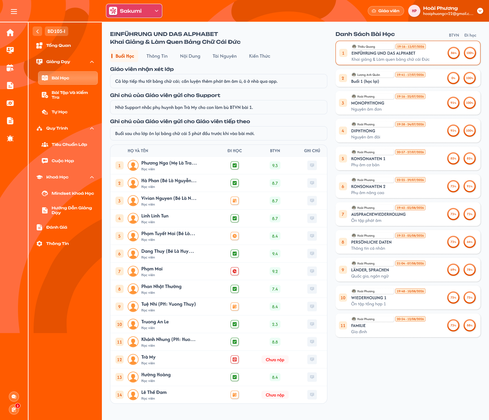

**Mô tả:**
- Giáo viên của lớp dạy và xem từng bài học của lớp. Vùng trái là bài đang chọn với 5 tab `Buổi học`, `Thông tin`, `Nội dung`, `Tài nguyên`, `Kiến thức`; vùng phải là `Danh sách bài học`. Frame này là tab `Buổi học` của bài đã `Hoàn thành`, chỉ xem.

**Điểm cần lưu ý:**
- `A01.01` Tiêu đề bài: tên bài và mô tả ngắn của bài đang chọn.
- `A01.02` Card bài đã mở: số thứ tự; avatar và tên **giáo viên của buổi** (người bấm Bắt đầu buổi học); mốc mở bài `HH:mm - dd/MM/yyyy`; tên và mô tả bài; vòng `BTVN` và `Đi học`.
- `A01.04` Bấm card để chọn: viền cam, tiêu đề và các tab đổi theo bài. Mặc định chọn bài đầu tiên. Chọn bài hoặc đổi tab không tự bắt đầu buổi.
- `A01.05` Thứ tự theo thứ tự bài của lớp, gồm cả bài học bổ sung; tải toàn bộ, không phân trang.
- Trạng thái buổi của bài: `Chưa mở` (chưa ai bắt đầu), `Đang dạy` (đã bắt đầu, chưa kết thúc), `Chờ hoàn thành` (đã kết thúc buổi, chưa hoàn thành ghi chú), `Hoàn thành`. Giáo viên không có nút Thêm bài học, Sửa hoặc Xoá bài học.
- `A07.01` `Giáo viên nhận xét lớp`: ghi chú cho lớp học đã nhập ở Bước 1, chỉ đọc.
- `A07.02` `Ghi chú của Giáo viên gửi cho Support`: chỉ đọc.
- `A07.03` `Ghi chú của Giáo viên gửi cho Giáo viên tiếp theo`: chỉ đọc. Ba khối nhận xét/ghi chú chỉ hiển thị ở bài đã hoàn thành của chính bài này, không hiển thị ở Dặn dò trước buổi học của bài kế tiếp.
- `A07.04` Bảng học viên: `Số thứ tự`, `Họ và tên`, `Đi học` (icon trạng thái điểm danh, hover hiện tên trạng thái), `BTVN` (`Chưa nộp` / `Chưa chấm` / điểm đã chấm), `Ghi chú` (icon). Giáo viên không sửa điểm danh, BTVN hoặc ghi chú tại đây (sửa điểm danh thuộc Admin, Class Handler, Support); bấm BTVN hoặc điểm không mở màn chấm.
- `A07.05` Icon `Ghi chú` mở popup `Ghi chú` hai vùng chỉ đọc `Ghi chú từ Giáo viên cho Học viên` và `Ghi chú từ Giáo viên cho Team Support` của đúng học viên ở bài; icon mờ khi không có ghi chú.
- `A08.01` `Có mặt`: ô viền xanh lá, dấu tick trắng nền xanh lá.
- `A08.02` `Vào trễ`: ô viền cam, lịch có dấu `!` màu cam.
- `A08.03` `Ra sớm`: ô viền cam, đồng hồ màu cam.
- `A08.04` `Vào trễ & Ra sớm`: ô viền đỏ, đồng hồ có dấu `!` màu đỏ.
- `A08.05` `Nghỉ CP` (Nghỉ có phép): ô viền cam, lịch có bút màu cam.
- `A08.06` `Nghỉ KP` (Nghỉ không phép): ô viền đỏ, biểu tượng cấm màu đỏ.
- `A08.07` `Chưa điểm danh`: ô viền đỏ, lịch có dấu `x` màu đỏ. Bộ icon dùng chung cho cột `Đi học` ở tab Buổi học và cột `Trạng thái` ở bảng bài học của Tổng quan; mỗi học viên ở một bài chỉ có một icon, icon chỉ để xem (bấm không mở menu sửa điểm danh với role Giáo viên). Dropdown điểm danh ở Bước 1 chỉ hiển thị chữ, không dùng icon.
- `A11.01` Tập tính hai vòng `BTVN` / `Đi học`: học viên `Đang học` hoặc `Dự thính` tại thời điểm của bài; đổi trạng thái ở bài sau không loại học viên khỏi bài trước.
- `A11.02` % BTVN = `Số học viên đã nộp BTVN của bài / Số học viên trong tập × 100`. Nộp chưa chấm hoặc điểm 0 vẫn tính đã nộp; một học viên nộp nhiều lần tính một người.
- `A11.03` % Đi học = `Số học viên Có mặt, Vào trễ, Ra sớm, Vào trễ & Ra sớm / Số học viên trong tập đã được điểm danh × 100`. Nghỉ CP/KP vẫn ở mẫu số; Chưa điểm danh bị loại khỏi cả tử và mẫu.
- `A11.04` Làm tròn: chỉ làm tròn kết quả cuối; vòng hiển thị số nguyên `%`.
- `A11.05` Mẫu số bằng 0: để trống, không chia 0; tử số 0 với mẫu số > 0 là `0%`.

### Trang 2: GV-LOP-030110 — Chi tiết lớp / Bài học / Buổi học / Dặn dò trước buổi học

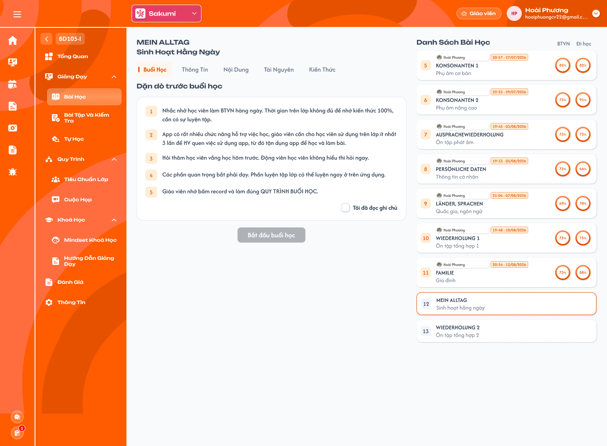

**Mô tả:**
- Chọn bài `Chưa mở`, tab `Buổi học` hiển thị `Dặn dò trước buổi học` và nút `Bắt đầu buổi học`. Giáo viên phải xác nhận đã đọc dặn dò mới bắt đầu được.

**Điểm cần lưu ý:**
- `A01.03` Card bài chưa mở: số thứ tự nền xám, tên bài và mô tả chi tiết (các dòng nội dung bài); không có giáo viên, mốc mở và vòng tỷ lệ.
- `A02.01` Dặn dò trước buổi học: 5 dòng đánh số cố định: (1) Nhắc nhở học viên làm BTVN hàng ngày. Thời gian trên lớp không đủ để nhớ kiến thức 100%, cần có sự luyện tập. (2) App có rất nhiều chức năng hỗ trợ việc học, giáo viên cần cho học viên sử dụng trên lớp ít nhất 3 lần để HV quen việc sử dụng app, từ đó tận dụng app để học và làm bài. (3) Hỏi thăm học viên vắng học hôm trước. Động viên học viên không hiểu thì hỏi ngay. (4) Các phần quan trọng bắt phải dạy. Phần luyện tập lớp có thể luyện ngay ở trên ứng dụng. (5) Giáo viên nhớ bấm record và làm đúng QUY TRÌNH BUỔI HỌC. Không hiển thị ghi chú hay nhận xét của bài trước.
- `A02.02` Checkbox `Tôi đã đọc ghi chú`: bắt buộc tick; trạng thái không lưu, rời tab rồi quay lại phải tick lại.
- `A02.03` Nút `Bắt đầu buổi học`: khoá cho đến khi tick `Tôi đã đọc ghi chú`; bấm thì chạy luồng Chọn lịch dạy và Bắt đầu. Mọi giáo viên của lớp được bắt đầu **bất kỳ bài chưa mở**, không bắt buộc theo thứ tự. Chỉ bắt đầu khi lớp ở trạng thái `Đang học`, hoặc lớp không chính thức (Lớp demo); ngược lại hiển thị Toast `Cảnh Báo` `Lớp chưa bắt đầu!`.

### Trang 3: GV-LOP-030120 — Chi tiết lớp / Bài học / Popup chọn lịch dạy

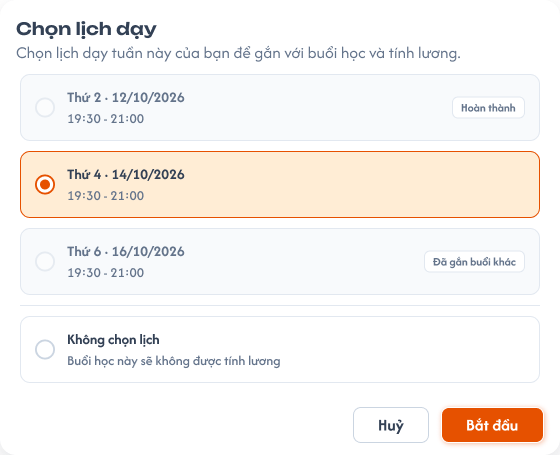

**Mô tả:**
- Khi bắt đầu, giáo viên chọn lịch dạy tuần này để gắn buổi với lịch và tính lương; có thể không chọn lịch, khi đó buổi không được tính lương.

**Điểm cần lưu ý:**
- `A03.01` Lớp không có lịch tuần này: không hiện popup Chọn lịch dạy; hiện popup `Bắt đầu buổi học` (`Nhấn 'Xác nhận' để bắt đầu buổi học!`). Bắt đầu xong hiển thị Toast `Thông Báo` `Lớp không có lịch để tính lương buổi này`.
- `A03.02` Popup `Chọn lịch dạy` liệt kê lịch tuần hiện tại của lớp do **chính giáo viên** dạy (lịch cố định và linh hoạt): thứ, ngày, giờ. Lịch đã hoàn thành hoặc đã gắn với buổi khác hiển thị nhưng không chọn được; lịch huỷ không hiển thị. Không có lịch của giáo viên thì hiện `Không có lịch dạy tuần này`.
- `A03.03` Lựa chọn `Không chọn lịch` có dòng phụ `Buổi học này sẽ không được tính lương`.
- `A03.04` Nút `Huỷ` / `Bắt đầu`: `Huỷ` đóng popup, không bắt đầu; `Bắt đầu` cần đã chọn một lịch hoặc `Không chọn lịch`.

### Trang 4: GV-LOP-030121 — Chi tiết lớp / Bài học / Popup bắt đầu buổi học


**Mô tả:**
- Popup `Bắt đầu buổi học`: `Nhấn 'Xác nhận' để bắt đầu buổi học!`, nút `Huỷ` / `Xác nhận`.

**Điểm cần lưu ý:**
- `A03.05` Popup `Bắt đầu buổi học` hiện sau khi chọn lịch (hoặc ngay khi lớp không có lịch tuần này).
- `A03.06` Bắt đầu với lịch: tạo buổi của bài (giáo viên của buổi, mốc mở = thời điểm máy chủ, trạng thái `Đang dạy`); **gắn** lịch được chọn với buổi và giáo viên, lịch **giữ trạng thái `Đang đợi`** (chưa Hoàn thành, chưa phát sinh lương). Lịch cố định chưa có bản ghi ngày đó thì tạo bản ghi lịch `Đang đợi` theo giờ của lịch cố định. Chuyển sang Bước 1 — Điểm danh.
- `A03.07` Bắt đầu không chọn lịch: tạo buổi như trên, không đổi lịch, không phát sinh lương; Toast `Thông Báo` `Bạn đã bỏ qua chọn lịch, buổi học này sẽ không được tính lương`. Chuyển sang Bước 1.
- Mỗi bài chỉ có một buổi; hai giáo viên bấm bắt đầu cùng lúc thì chỉ tạo một buổi, người sau vào tiếp tục buổi đã có. Lịch đã gắn chỉ chuyển `Hoàn thành` và **phát sinh lương buổi dạy** khi bấm `Hoàn thành buổi học` ở Bước 2; lương tính theo lương/giờ của giáo viên ở lớp. **Ngày tính lương là ngày của lịch đã chọn**, không phải ngày bấm Hoàn thành (chọn lịch ngày 15, ngày 20 mới hoàn thành thì lương thuộc ngày 15).

### Trang 5: GV-LOP-030170 — Chi tiết lớp / Bài học / Buổi học / Bài chờ hoàn thành


**Mô tả:**
- Bài đã bắt đầu nhưng chưa hoàn thành: tab `Buổi học` hiển thị `Bài học đã mở` (trạng thái buổi, giáo viên của buổi, giờ bắt đầu, lịch dạy đã gắn) và nút tiếp tục. Từ đây vào Bước 1 — Điểm danh và Bước 2 — Ghi chú buổi học.

**Điểm cần lưu ý:**
- `A06.01` Bài `Đang dạy`: nút `Vào điểm danh`; bấm mở popup `Tiếp tục buổi học` (`Nhấn 'Xác nhận' để tiếp tục buổi học!`), xác nhận vào Bước 1 với nháp hiện có.
- `A06.02` Bài `Chờ hoàn thành`: nút `Hoàn thành buổi học`; bấm vào Bước 2 với nháp hiện có.
- `A06.03` Người tiếp tục: mọi giáo viên của lớp; giáo viên của buổi vẫn là người đã bấm Bắt đầu.
- `A04.01` Bước 1 — tiêu đề gồm icon `<` và tên bài. Bấm `<` quay về menu Bài học; dữ liệu đã nhập vẫn giữ trong nháp.
- `A04.02` Danh sách học viên: `Số thứ tự`, `Tên học viên`, `Trạng thái`; gồm học viên trạng thái `Đang học`, `Dự thính`, `Hoàn thành` của lớp.
- `A04.03` `Trạng thái`: dropdown, mặc định `Chưa điểm danh`; chọn một trong `Có mặt`, `Vào trễ`, `Ra sớm`, `Vào trễ & Ra sớm`, `Nghỉ CP`, `Nghỉ KP`. Lựa chọn và giá trị đã chọn chỉ hiển thị chữ, không có icon.
- `A04.04` `Ghi chú cho lớp học`: ô nhiều dòng, placeholder `Điền ghi chú của giáo viên dành cho học viên ( Gửi cho tất cả học viên )`; lưu thành `Giáo viên nhận xét lớp` của buổi.
- `A04.05` Checkbox `Không có dặn dò cho học viên`: tick khi không có ghi chú cho lớp.
- `A04.06` Nút `Kết thúc buổi học`: khoá cho đến khi **mọi học viên đã được điểm danh** (không còn `Chưa điểm danh`) **và** có `Ghi chú cho lớp học` hoặc đã tick `Không có dặn dò cho học viên`.
- `A04.07` Popup `Kết thúc buổi học`: `Giáo viên vui lòng tắt record Google Meet trước khi kết thúc buổi học`, nút `Huỷ` / `Xác nhận`.
- `A04.08` Xác nhận: lưu điểm danh từng học viên và nhận xét lớp; buổi chuyển `Chờ hoàn thành`; cập nhật tỷ lệ Đi học; chuyển sang Bước 2. Mỗi thay đổi lưu nháp lên server ngay (đổi máy hoặc giáo viên khác bấm tiếp tục sẽ thấy đúng phần đã nhập); sau khi Kết thúc buổi học, giáo viên không sửa điểm danh nữa.
- `A05.01` Bước 2 — bảng học viên: `Số thứ tự`, `Tên học viên`, `Ghi chú cho học viên (Gửi Support)`, `Ghi chú cho học viên (Gửi học viên)`. Hai ô nhập không bắt buộc, placeholder `Nhập ghi chú mô tả vào đây`.
- `A05.02` `Ghi chú của Giáo viên gửi cho Support`: ô nhiều dòng, placeholder `Điền ghi chú cho Team Support...`; checkbox `Không có dặn dò cho Team Support`.
- `A05.03` `Ghi chú của Giáo viên gửi cho Giáo viên tiếp theo`: ô nhiều dòng, placeholder `Điền ghi chú cho giáo viên tiếp theo...`; checkbox `Không có dặn dò cho giáo viên`.
- `A05.04` Nút `Hoàn thành buổi học`: khoá cho đến khi mỗi khối ghi chú Support và giáo viên tiếp theo có nội dung hoặc đã tick checkbox tương ứng.
- `A05.05` Popup `Hoàn thành buổi học`: `Giáo viên vui lòng kiểm tra các ghi chú và tắt record Google Meet trước khi hoàn thành buổi học`, nút `Huỷ` / `Xác nhận`.
- `A05.06` Xác nhận: lưu ghi chú từng học viên, ghi chú gửi Support, ghi chú gửi giáo viên tiếp theo; buổi chuyển `Hoàn thành`; **lịch đã gắn lúc bắt đầu (nếu có) chuyển `Hoàn thành` và phát sinh lương buổi dạy cho giáo viên của buổi, ngày tính lương là ngày của lịch**; xoá nháp; màn hiển thị `Buổi học đã kết thúc`. Sau khi Hoàn thành, giáo viên chỉ xem; mỗi thay đổi lưu nháp lên server như Bước 1.

### Trang 6: GV-LOP-030200 — Chi tiết lớp / Bài học / Thông tin

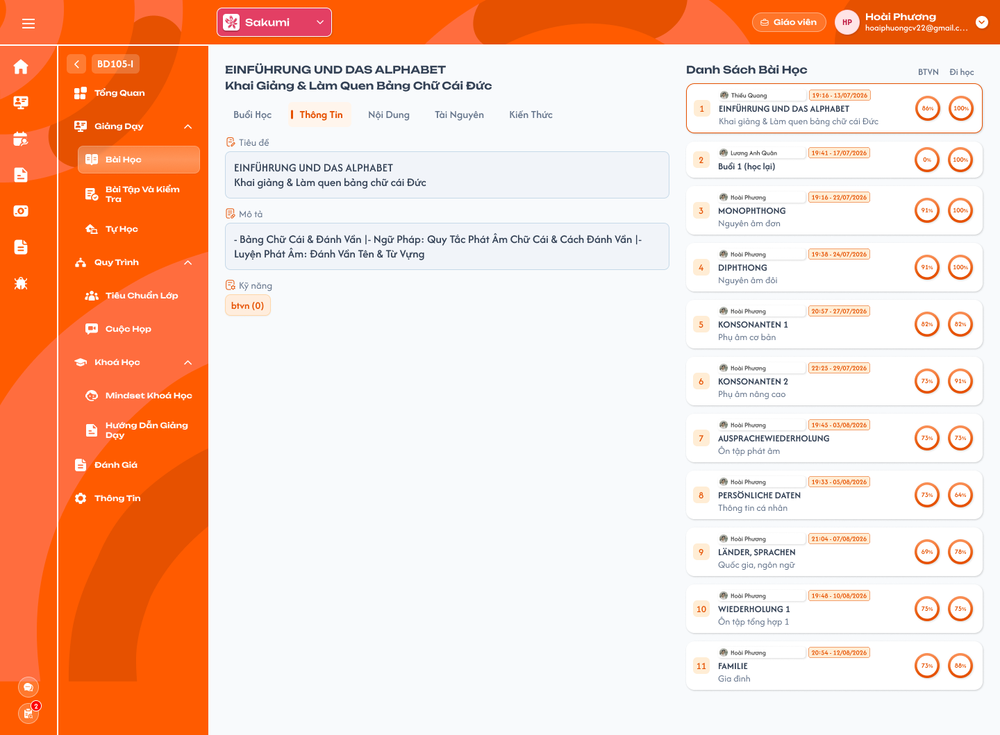

**Mô tả:**
- Tab `Thông tin` hiển thị dữ liệu định nghĩa bài học, chỉ đọc, giống Admin.

**Điểm cần lưu ý:**
- `A09.01` `Thông tin`: `Tiêu đề`, `Mô tả` (giữ xuống dòng), `Kỹ năng` (tag và số trong ngoặc do Curriculum Development Handler thiết lập). Ô xám chỉ đọc; không thêm/gỡ kỹ năng. Không có dữ liệu thì để trống theo dữ liệu thật.

### Trang 7: GV-LOP-030300 — Chi tiết lớp / Bài học / Nội dung

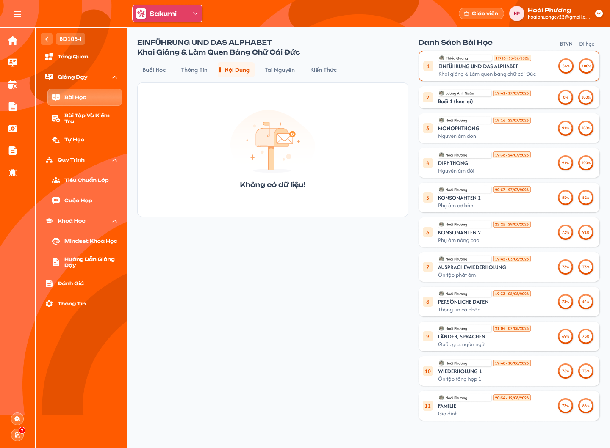

**Mô tả:**
- Tab `Nội dung` hiển thị trạng thái `Không có dữ liệu!` khi bài không có nội dung.

**Điểm cần lưu ý:**
- `A09.02` `Nội dung`: các khối nội dung/kế hoạch bài theo thứ tự đã lưu ở nguồn (vd 5p Sửa BTVN, Học từ mới, Ngữ pháp...), chỉ đọc. Không có dữ liệu thì hiện `Không có dữ liệu!`.

### Trang 8: GV-LOP-030400 — Chi tiết lớp / Bài học / Tài nguyên

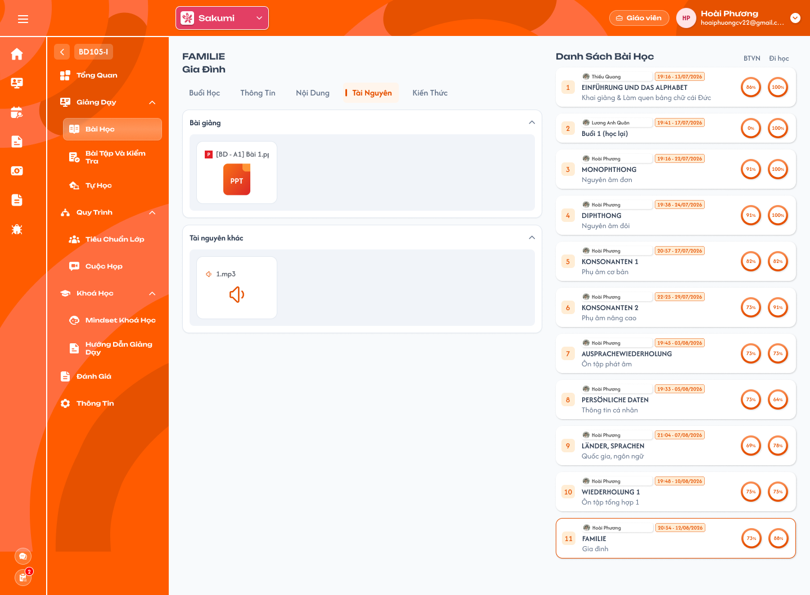

**Mô tả:**
- Hai nhóm `Bài giảng` và `Tài nguyên khác`; bấm file để tải ngay. Giáo viên **chỉ tải được tài nguyên của 3 bài đã mở có số thứ tự lớn nhất**.

**Điểm cần lưu ý:**
- `A10.01` Nhóm `Bài giảng` / `Tài nguyên khác`: header có icon `⌃` thu gọn/mở; card file có tên và icon theo loại (video, PPT, Docs, Excel, âm thanh).
- `A10.02` Bài được tải: trong các bài đã mở (Đang dạy, Chờ hoàn thành, Hoàn thành), lấy 3 bài có số thứ tự lớn nhất. Bấm card tải ngay file gốc, không mở xem trước. Ví dụ lớp đã mở bài 1–6: tải được bài 4, 5, 6; mở thêm bài 7 thì bài 4 bị khoá. Backend kiểm tra khoá khi tải bằng URL/request trực tiếp.

### Trang 9: GV-LOP-030401 — Chi tiết lớp / Bài học / Tài nguyên · Bị khoá

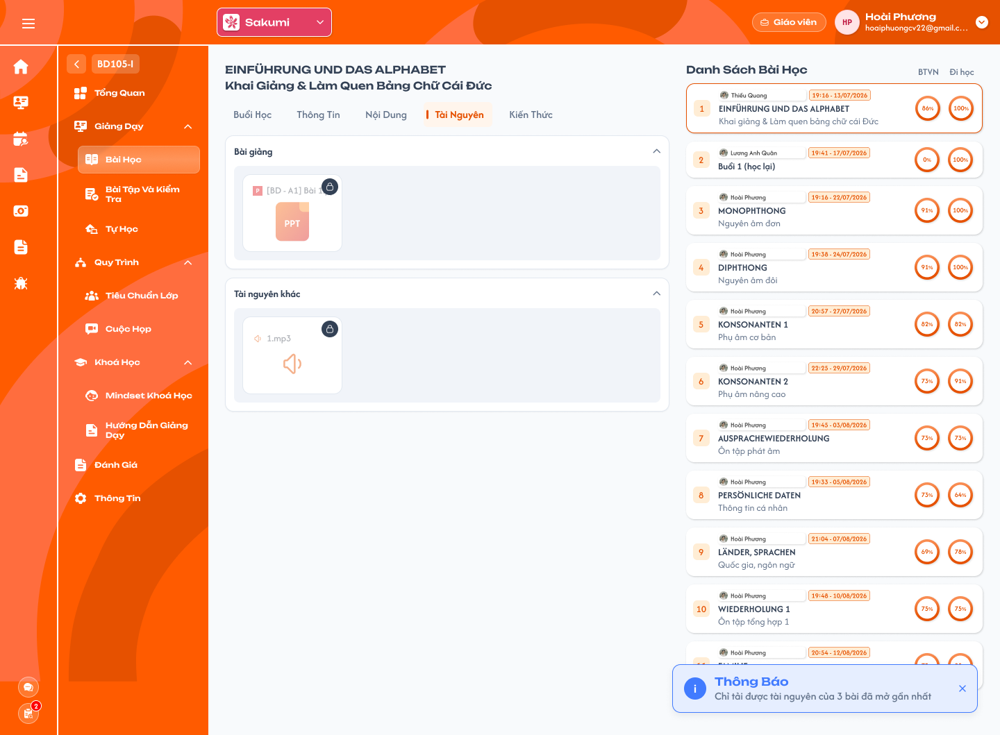

**Mô tả:**
- Tab `Tài nguyên` của bài bị khoá: vẫn thấy danh sách file nhưng không tải được.

**Điểm cần lưu ý:**
- `A10.03` Bài bị khoá: bài đã mở trước 3 bài trên, hoặc bài chưa mở; mỗi card có icon khoá, áp dụng cả hai nhóm. Bấm không tải, hiện Toast `Thông Báo` `Chỉ tải được tài nguyên của 3 bài đã mở gần nhất`.

### Trang 10: GV-LOP-030500 — Chi tiết lớp / Bài học / Kiến thức

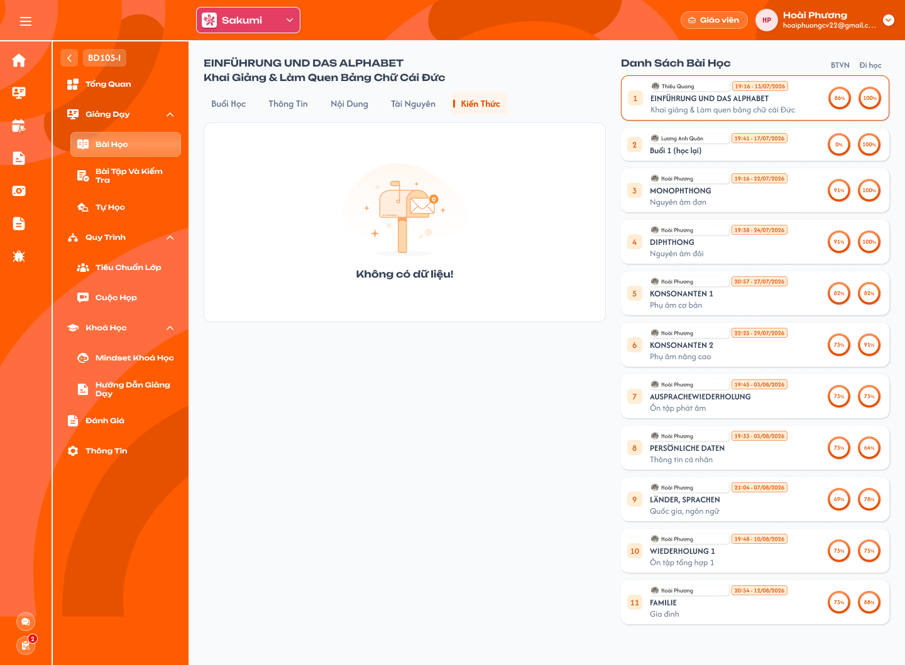

**Mô tả:**
- Tab `Kiến thức` hiển thị trạng thái `Không có dữ liệu!`.

**Điểm cần lưu ý:**
- `A09.03` `Kiến thức`: để trống, hiện `Không có dữ liệu!`.

### Trang 11: GV-LOP-040100 — Chi tiết lớp / Bài tập và Kiểm tra / BTVN

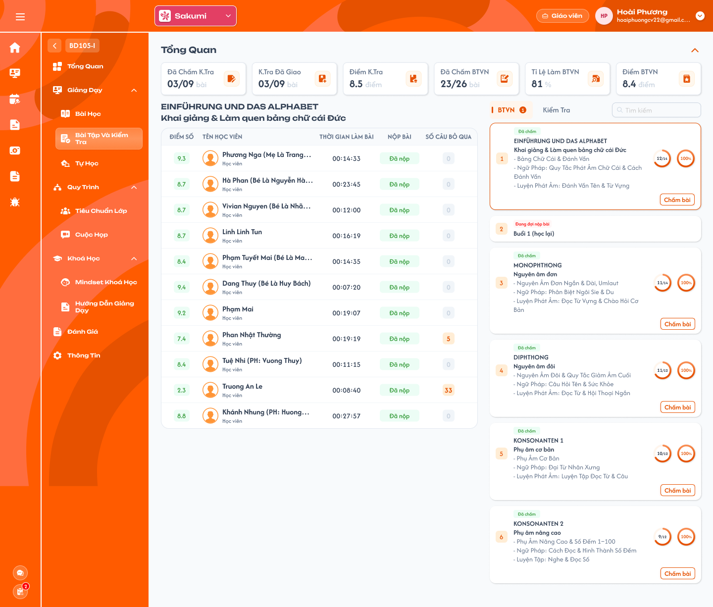

**Mô tả:**
- Giáo viên của lớp xem kết quả BTVN và Kiểm tra của học viên. `Giáo viên phụ trách chính` còn được giao/thu hồi bài kiểm tra và vào màn chấm bài.
- Phía trên là khối `Tổng Quan`; vùng trái là tên bài đang chọn và bảng kết quả học viên; vùng phải là tab `BTVN` / `Kiểm Tra`, ô `Tìm kiếm` và danh sách card bài.

**Điểm cần lưu ý:**
- `A12.01` Tab `BTVN` / `Kiểm Tra`: hai danh sách riêng, mỗi tab có badge riêng; chuyển tab hiển thị đúng loại bài, không trộn điểm hoặc bài nộp giữa hai loại. Mặc định mở tab `BTVN` và chọn card đầu tiên.
- `A12.02` Ô `Tìm kiếm`: tìm theo tên bài trong danh sách card của tab đang mở; không tìm theo tên học viên; không đổi số liệu khối Tổng Quan.
- `A12.03` Card bài: bấm để chọn bài (viền cam, tên bài ở vùng trái và bảng kết quả đổi theo bài). Bấm card không mở màn chấm.
- `A12.04` Nút điều hướng chấm bài: trên card bài đã giao có học viên nộp; chỉ hiển thị với `Giáo viên phụ trách chính`; mở màn chấm bài.
- `A12.05` Danh sách BTVN: mỗi bài học của lớp có một BTVN (liên kết 1–1), gồm cả bài học bổ sung; không gồm bài Tự học. BTVN tự giao cho học viên khi bài học mở; **không có nút `Giao bài` / `Thu hồi`** ở tab BTVN.
- `A12.06` Danh sách Kiểm tra: bài kiểm tra của khoá học gắn với lớp và bài kiểm tra bổ sung do Admin thêm cho lớp. Giáo viên **không có** nút Thêm bài kiểm tra. Sắp theo ngày giao tăng dần; bài chưa giao xếp sau, theo thứ tự bài.
- `A12.07` Tải dữ liệu: tải toàn bộ bài và học viên hợp lệ, không phân trang. Loading/rỗng/lỗi hiển thị riêng từng vùng, lỗi có `Thử lại`.
- `A12.08` Thẻ chỉ số: sáu thẻ `Tổng Quan` tính trên toàn lớp, không đổi theo card đang chọn hoặc ô tìm kiếm; sau khi chấm, giao hoặc thu hồi bài, các thẻ liên quan cập nhật theo dữ liệu mới.
- `A12.09` Trạng thái nộp bài và điểm: `Đã nộp` và có điểm là hai mức khác nhau; đã nộp chưa chấm thì cột điểm trống.
- `A12.10` Number Badge cạnh tab: số bài của tab có trạng thái `Chưa chấm`; mỗi bài đếm một lần dù có nhiều bài nộp chưa chấm; bằng 0 thì ẩn.
- `A12.11` Ô định danh học viên: avatar, tên, dòng `Học viên`. Danh sách là tập học viên hợp lệ của bài.
- `A12.12` Side Tab: chuyển giữa `BTVN` và `Kiểm Tra`.
- `A12.13` Badge trạng thái: `Đã nộp` (xanh) hoặc `Chưa nộp` (đỏ) ở cột `NỘP BÀI`.
- `A12.14` Vòng `PERCENT %` trên card: vòng tỷ lệ chấm.
- `A12.15` Nút `Chấm bài` trên card: chỉ `Giáo viên phụ trách chính`; giáo viên khác của lớp chỉ xem, bấm dòng học viên không điều hướng. Giáo viên không có nút reset bài làm của học viên (thuộc Admin, Class Handler, Support).
- `A12.17` Ô `Tìm kiếm` dạng Input: thao tác tìm theo tên bài như `A12.02`.
- `A13.01` `Đã Chấm K.Tra`: dạng `A/B bài`, số có 2 chữ số (vd `03/09`): A = số bài kiểm tra có trạng thái `Đã chấm`; B = tổng số bài kiểm tra của lớp.
- `A13.02` `K.Tra Đã Giao`: dạng `A/B bài`, số có 2 chữ số: A = số bài kiểm tra đã giao; B = tổng số bài kiểm tra của lớp. Trạng thái giao lấy theo việc giáo viên đã bấm Giao bài, không suy từ việc có người nộp.
- `A13.03` `Điểm K.Tra`: cộng điểm các bài kiểm tra học viên đã được chấm rồi chia số bài đã chấm; giữ kết quả của học viên đã Rời lớp/Xóa; làm tròn kết quả cuối 1 chữ số thập phân. Chưa nộp/chưa chấm không tham gia; điểm 0 đã chấm vẫn tính. Không có bài đã chấm thì để trống.
- `A13.04` `Đã Chấm BTVN`: dạng `A/B bài`, số có 2 chữ số: A = số BTVN có trạng thái `Đã chấm`; B = tổng số BTVN của lớp. Không cộng Tự học hoặc Kiểm tra.
- `A13.05` `Tỉ Lệ Làm BTVN`: chỉ tính trên các bài học đã mở (đang chờ hoặc đã hoàn thành). Trung bình cộng tỷ lệ nộp BTVN của các học viên hợp lệ có dữ liệu, hiển thị `%`; không có dữ liệu thì để trống. Không dùng tỷ lệ chấm của card thay thế.
- `A13.06` `Điểm BTVN`: chỉ tính trên các bài học đã mở. Cộng điểm các BTVN học viên đã được chấm rồi chia số bài đã chấm; làm tròn 1 chữ số thập phân; điểm 0 đã chấm vẫn tính; không có bài đã chấm thì để trống.
- `A13.07` Icon `⌃`: chỉ thu gọn/mở khối Tổng Quan, không đổi dữ liệu.
- `A15.01` `ĐIỂM SỐ`: điểm bài đã chấm, hiển thị 1 chữ số thập phân; điểm 0 hiển thị `0`. Đã nộp chưa chấm hoặc chưa nộp thì để trống, không hiển thị 0.
- `A15.02` `TÊN HỌC VIÊN`: avatar, tên, dòng `Học viên`. Kết quả của học viên đã Rời lớp/Xóa vẫn được giữ trong thống kê điểm; dòng của học viên chỉ hiển thị khi học viên thuộc tập hợp lệ của bài.
- `A15.03` `THỜI GIAN LÀM BÀI`: thời gian làm bài trên app dạng `HH:mm:ss`; vượt 24 giờ hiển thị tối đa `23:59:59`. Chưa nộp để trống.
- `A15.04` `NỘP BÀI`: badge `Đã nộp` (xanh) hoặc `Chưa nộp` (đỏ).
- `A15.05` `SỐ CÂU BỎ QUA`: số câu học viên bỏ qua trong bài nộp; 0 hiển thị xám, lớn hơn 0 hiển thị cam. Chưa nộp để trống.
- `A15.06` Bấm dòng: dòng `Đã nộp`, `Giáo viên phụ trách chính` mở màn chấm bài, lọc sẵn học viên đó. Dòng `Chưa nộp`: Toast `Thông Báo` `Học viên chưa nộp bài này!`, không điều hướng. Giáo viên khác: không điều hướng.
- `A15.07` Thiết lập lại nộp bài: không có icon làm mới trên dòng học viên; chỉ Admin, Class Handler, Support thiết lập lại bài nộp theo requirement Admin. Giáo viên cần học viên làm lại thì báo Admin, Class Handler hoặc Support.

### Trang 12: GV-LOP-040110 — Chi tiết lớp / Bài tập và Kiểm tra / BTVN · Bài học chưa mở

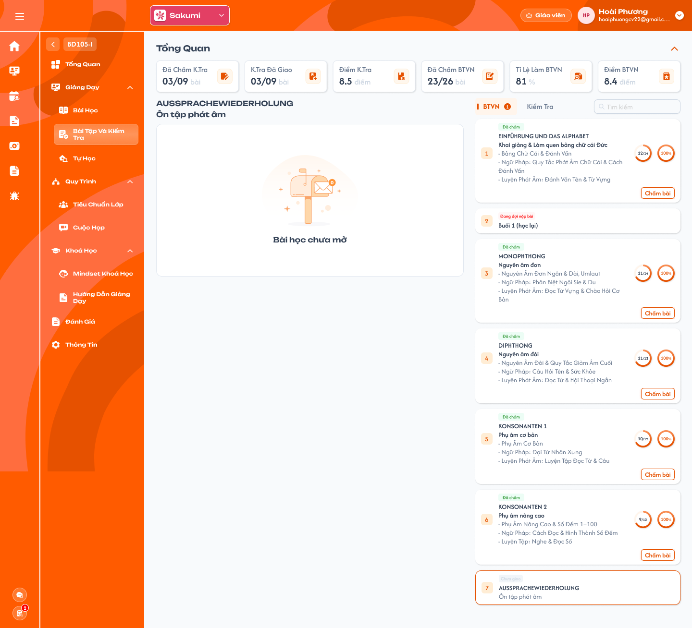

**Mô tả:**
- Card BTVN của bài học chưa mở được chọn: vùng trái hiển thị `Bài học chưa mở` thay cho bảng kết quả.

**Điểm cần lưu ý:**
- Card BTVN của bài học chưa mở có nhãn trạng thái `Chưa giao`; không hiển thị bảng `Chưa nộp` giả.

### Trang 13: GV-LOP-040200 — Chi tiết lớp / Bài tập và Kiểm tra / Kiểm tra

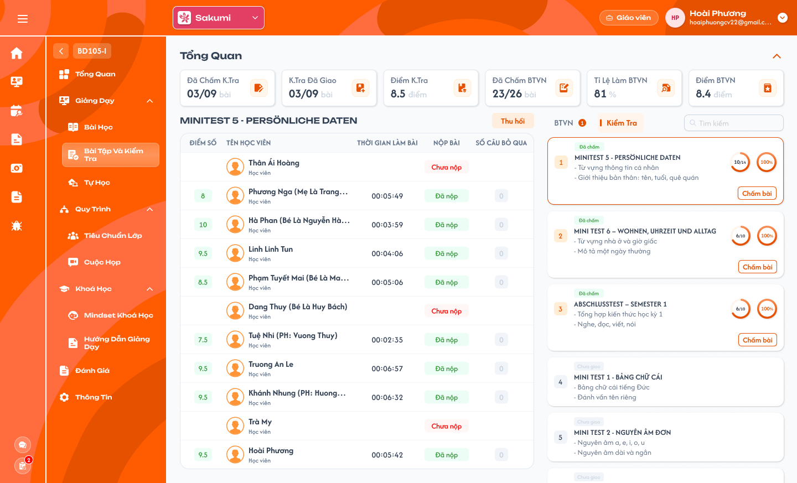

**Mô tả:**
- Tab `Kiểm Tra`: bài kiểm tra đã giao có nút `Thu hồi` cạnh tên bài (chỉ `Giáo viên phụ trách chính`), bảng kết quả học viên và các card `Đã chấm` / `Chưa giao`.

**Điểm cần lưu ý:**
- `A14.01` Badge tab: số bài của tab có trạng thái `Chưa chấm`; mỗi bài đếm một lần.
- `A14.02` Nhãn trạng thái BTVN: `Chưa giao`: bài học chưa mở. `Đang đợi nộp bài`: bài đã mở, chưa học viên hợp lệ nào nộp. `Chưa chấm`: còn bài nộp của học viên hợp lệ chưa có điểm. `Đã chấm`: mọi bài đã nộp đều có điểm.
- `A14.03` Nhãn trạng thái Kiểm tra: `Chưa giao`: giáo viên chưa giao. `Đang đợi nộp bài`: đã giao, chưa có bài nộp. `Chưa chấm`: còn bài nộp chưa có điểm. `Đã chấm`: mọi bài đã nộp đều có điểm. Có học viên chưa nộp không ngăn trạng thái `Đã chấm` khi mọi bài đã nộp đều có điểm.
- `A14.04` Vòng số đã nộp dạng `S/N`: S = số học viên hợp lệ đã nộp; N = tổng học viên hợp lệ của bài. Vòng tô theo tỷ lệ S/N; rê chuột hiện tooltip `Số bài đã nộp`. Bài chưa giao không hiển thị.
- `A14.05` Vòng tỷ lệ chấm `C / S × 100`, làm tròn số nguyên `%`: C = số bài đã nộp có điểm, S = số bài đã nộp. S = 0 hiển thị `0%`. Điểm 0 vẫn tính là đã chấm. Rê chuột hiện tooltip `Đã chấm`. 100% chỉ nghĩa là mọi bài đã nộp đã chấm, không nghĩa là mọi học viên đã nộp.
- `A14.06` Mô tả: mô tả bài nguồn (nhiều dòng), không thay bằng nội dung bài làm.
- `A12.16` Nút `Thu hồi` cạnh tên bài đã giao, chỉ hiển thị với `Giáo viên phụ trách chính`.
- `A17.01` Nút `Thu hồi` bấm mở popup `Thu hồi`. Sau khi thu hồi, các thẻ `Đã Chấm K.Tra`, `K.Tra Đã Giao`, `Điểm K.Tra` và badge tab cập nhật lại.

### Trang 14: GV-LOP-040210 — Chi tiết lớp / Bài tập và Kiểm tra / Kiểm tra · Chưa giao (xem trước đề)

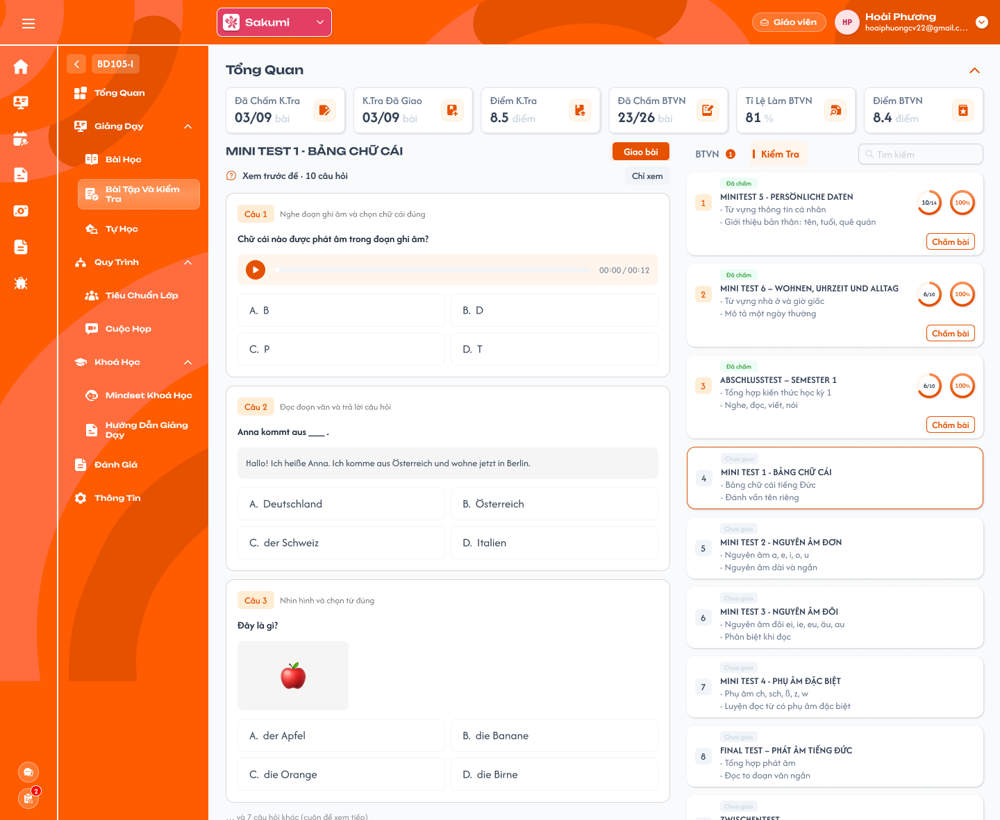

**Mô tả:**
- Chọn card Kiểm tra `Chưa giao`: vùng trái hiển thị **xem trước toàn bộ câu hỏi của đề** để giáo viên xem đề trước khi giao; `Giáo viên phụ trách chính` có nút `Giao bài` cạnh tên bài (vị trí nút `Thu hồi`).

**Điểm cần lưu ý:**
- `A16.01` Xem trước đề: liệt kê lần lượt các câu: hướng dẫn, đề, đoạn văn, âm thanh (phát được), hình, đáp án `A`–`D`. Chỉ xem, không chọn đáp án. Đề không có câu thì hiển thị `Không có dữ liệu`. Giáo viên khác của lớp vẫn xem trước đề.
- `A16.02` Nút `Giao bài`: chỉ `Giáo viên phụ trách chính`; bấm mở popup `Giao bài`. Giáo viên khác của lớp không có nút.

### Trang 15: GV-LOP-040211 — Chi tiết lớp / Bài tập và Kiểm tra / Popup Giao bài


**Mô tả:**
- Popup `Giao bài` với nội dung `Nhấn 'Xác nhận' để giao bài kiểm tra này`, nút `Huỷ` / `Xác nhận`.

**Điểm cần lưu ý:**
- `A16.03` Điều kiện giao: lớp ở trạng thái `Đang học`, hoặc lớp không chính thức (Lớp demo). Không đạt thì không giao, hiển thị Toast `Cảnh Báo` `Lớp chưa bắt đầu!`. `Huỷ` đóng popup, bài vẫn `Chưa giao`, không Toast.

### Trang 16: GV-LOP-040205 — Chi tiết lớp / Bài tập và Kiểm tra / Kiểm tra · Vừa giao

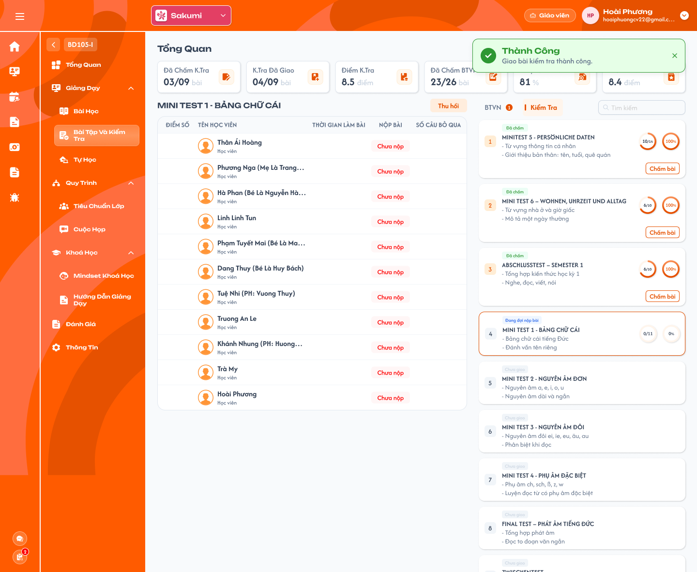

**Mô tả:**
- Trạng thái ngay sau khi giao bài kiểm tra thành công: thẻ `K.Tra Đã Giao` tăng, nút đổi thành `Thu hồi`.

**Điểm cần lưu ý:**
- `A16.04` Giao thành công: lưu lượt giao (lớp, bài kiểm tra, giáo viên giao, ngày giao). Card chuyển `Đang đợi nộp bài`; nút đổi thành `Thu hồi`; vùng trái chuyển sang bảng kết quả. Học viên hợp lệ thấy bài trên app. Tập học viên hợp lệ của bài kiểm tra xác định theo ngày giao.

### Trang 17: GV-LOP-040221 — Chi tiết lớp / Bài tập và Kiểm tra / Popup Thu hồi


**Mô tả:**
- Popup `Thu hồi`: `Bạn muốn thu hồi bài kiểm tra này? Toàn bộ bài làm và điểm của học viên sẽ bị xoá.`, nút `Huỷ` / `Xác nhận`.

**Điểm cần lưu ý:**
- `A17.02` Thu hồi thành công: xoá lượt giao và **toàn bộ bài làm, điểm, nhận xét chấm** của học viên ở bài này; bài về `Chưa giao`; nút đổi thành `Giao bài`; vùng trái về xem trước đề. Học viên không còn thấy bài trên app. Thu hồi không xoá đề và không ảnh hưởng bài kiểm tra khác; giao lại sau thu hồi là lượt giao mới, học viên làm lại từ đầu. `Huỷ` đóng popup, dữ liệu giữ nguyên, không Toast.

### Trang 18: GV-LOP-040201 — Chi tiết lớp / Bài tập và Kiểm tra / Kiểm tra · Giáo viên không phụ trách chính (chỉ xem)

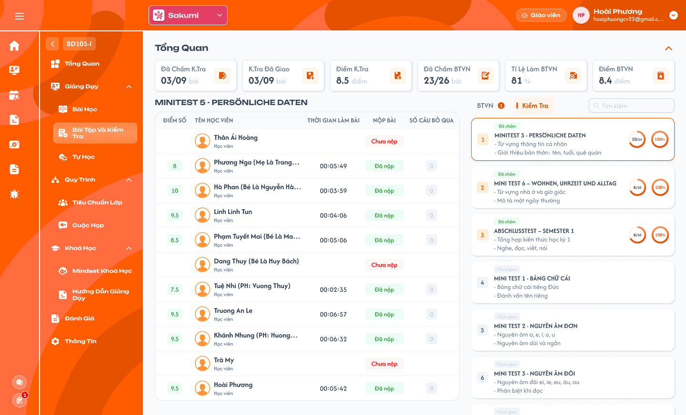

**Mô tả:**
- Cùng bảng kết quả của bài kiểm tra đã giao nhưng dưới góc nhìn giáo viên khác của lớp (không phải phụ trách chính): không có nút `Thu hồi`, không có nút điều hướng chấm.

**Điểm cần lưu ý:**
- Giáo viên khác của lớp xem đủ điểm và trạng thái nộp; bấm dòng học viên không điều hướng.

### Trang 19: GV-LOP-040204 — Chi tiết lớp / Bài tập và Kiểm tra / Kiểm tra · Chưa giao · Giáo viên không phụ trách chính (xem trước đề)

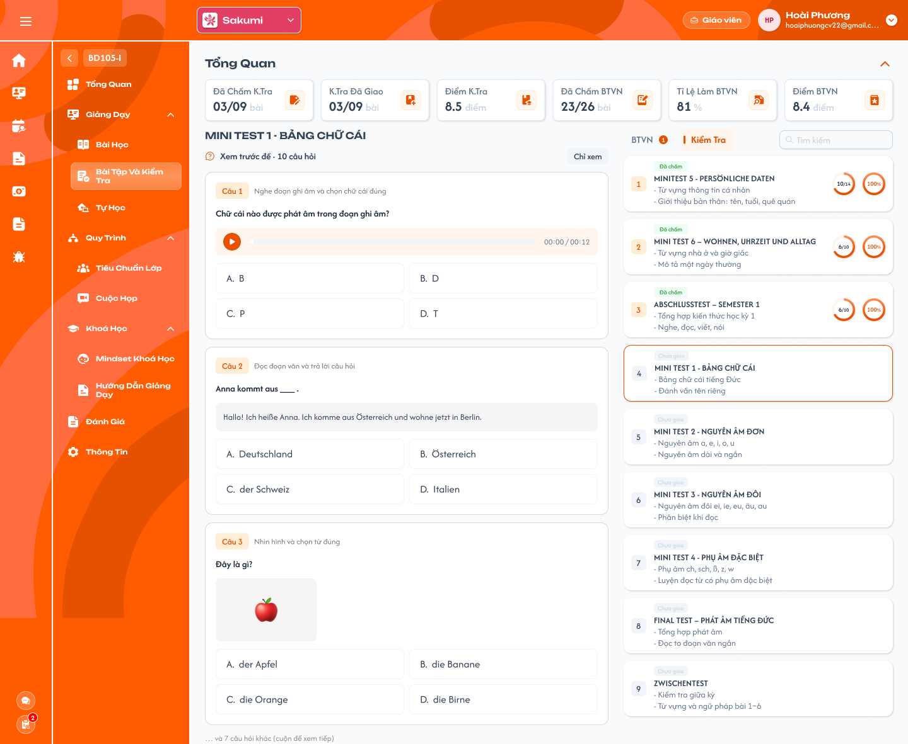

**Mô tả:**
- Xem trước đề của bài kiểm tra chưa giao, dưới góc nhìn giáo viên khác của lớp: có nhãn `Chỉ xem`, không có nút `Giao bài`.

**Điểm cần lưu ý:**
- Giáo viên khác của lớp vẫn xem trước đề (10 câu hỏi trong dữ liệu mẫu) nhưng không giao được.

### Trang 20: GV-LOP-040320 — Chi tiết lớp / Bài tập và Kiểm tra / Màn chấm bài · Tổng quan chấm bài

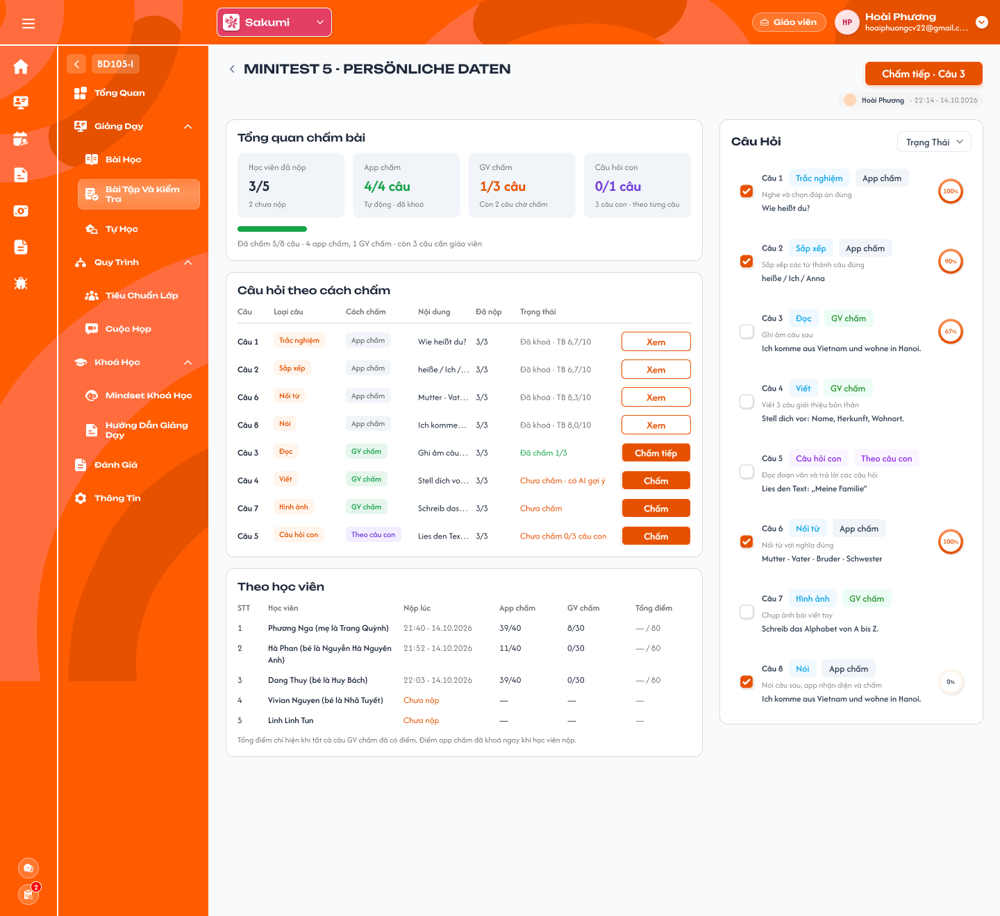

**Mô tả:**
- `Giáo viên phụ trách chính` của lớp dùng màn này để chấm điểm và nhận xét bài BTVN hoặc bài Kiểm tra mà học viên đã nộp. Màn chấm theo **một bài** cho **mọi học viên hợp lệ**, chấm lần lượt **từng câu hỏi**.
- Vùng trái là chi tiết câu đang chọn và danh sách thẻ học viên; vùng phải là danh sách `Câu hỏi` của bài. Frame hiển thị khối `Tổng quan chấm bài` (học viên đã nộp, câu App chấm / GV chấm / Câu hỏi con) và nút `Chấm tiếp`.

**Điểm cần lưu ý:**
- `A18.01` Điểm vào từ card bài: nút điều hướng trên card BTVN/Kiểm tra, chỉ hiển thị với `Giáo viên phụ trách chính`.
- `A18.02` Điểm vào từ dòng học viên: bấm dòng học viên **đã nộp** mở cùng màn chấm của bài, bộ lọc `Học Viên` chọn sẵn học viên đó. Dòng học viên chưa nộp không điều hướng.
- `A18.03` Bài bổ sung nhiều bài nguồn: BTVN của bài học bổ sung gồm nhiều bài nguồn; trước khi vào màn chấm hiển thị popup chọn một bài nguồn, màn chấm mở đúng bài nguồn được chọn.
- `A18.04` Tiêu đề: icon `<` và tên bài (BTVN dùng tên bài học, Kiểm tra dùng tên bài kiểm tra). Bấm `<` quay về menu Bài tập và Kiểm tra; nếu có thay đổi điểm thì tải lại dữ liệu bài, bảng học viên, các thẻ Tổng Quan và badge liên quan. Mặc định chọn câu đầu tiên của danh sách `Câu hỏi`.
- `A18.05` Nút cam `Đã Chấm và Sửa Bài Trên Lớp` ở góc phải.
- `A18.06` Vùng trái: chi tiết câu đang chọn, bộ lọc học viên, `Nhận xét chung` và danh sách thẻ học viên.
- `A18.07` Vùng phải: danh sách `Câu hỏi` của bài với trạng thái chấm, nhãn loại câu và tỷ lệ điểm. Giáo viên khác của lớp không mở được màn chấm, kể cả bằng URL.
- `A19.01` Icon trạng thái: `Đã chấm` ô tick nền cam nhạt, dấu tick cam; `Đang chấm` câu đang chọn, viền cam; `Chưa chấm` ô tick xám. Hover hiển thị tên trạng thái. Câu `Đã chấm` khi mọi câu trả lời của học viên đã nộp trong câu đó đều có điểm (0–10). Trạng thái và tỷ lệ cập nhật ngay sau mỗi lần chấm, không cần tải lại màn.
- `A19.02` Nhãn loại câu: một trong `Trắc nghiệm`, `Hình ảnh`, `Viết`, `Đọc`, `Sắp xếp`, `Nối từ`, `Nói`, `Câu hỏi con` theo bảng Loại câu ở REQ05.
- `A19.03` Đề bài: hướng dẫn của câu và nội dung câu hỏi, tối đa 2 dòng mỗi phần.
- `A19.04` Vòng tỷ lệ điểm = `Tổng điểm các câu trả lời đã chấm / (số câu trả lời đã chấm × 10)`, hiển thị `%` làm tròn số nguyên; chỉ hiển thị khi câu `Đã chấm` hoặc đang được chọn. Điểm 0 đã chấm vẫn tính; câu trả lời chưa chấm không tham gia. Câu không có câu trả lời nào nhưng bài có học viên đã nộp được coi là `Đã chấm`, tỷ lệ `100%`, vùng trái hiển thị `Bạn không cần chấm câu hỏi này!`.
- `A19.05` Bộ lọc `Trạng Thái`: chọn một hoặc nhiều giá trị `Chưa chấm`, `Đã chấm`; không chọn thì hiển thị mọi câu.
- `A20.01` `Câu N`: chip số thứ tự câu trong bài, kèm hướng dẫn của câu.
- `A20.02` Nội dung câu: đề bài, đoạn văn (nếu có), trình phát âm thanh `00:00 / 00:00` (nếu có), hình ảnh (nếu có) và các đáp án `A`–`D` (chữ hoặc hình).
- `A20.03` Checkbox `Chưa Chấm`: bật thì chỉ hiển thị học viên chưa có điểm ở câu này; học viên vừa được chấm trong lúc lọc vẫn hiển thị đến khi đổi câu. Mặc định tắt.
- `A20.04` Checkbox `Hiện Tên` mặc định bật; tắt thì ẩn tên học viên trên thẻ, chỉ giữ số thứ tự, để chấm khách quan.
- `A20.05` Dropdown `Học Viên`: chọn một hoặc nhiều học viên có câu trả lời ở câu này; không chọn thì hiển thị mọi học viên. Ba bộ lọc chỉ áp dụng cho thẻ học viên của câu đang chọn; đổi câu thì được áp dụng lại cho câu mới.
- `A20.06` Thẻ học viên: thứ tự thẻ đánh số từ 1 theo danh sách sau lọc. Không có học viên nộp bài: vùng thẻ hiển thị `Chưa có học sinh nộp bài`. Không hiển thị tài khoản không phải học viên.
- `A21.01` Số thứ tự thẻ trong danh sách sau lọc.
- `A21.02` Tên học viên hiển thị khi `Hiện Tên` bật, tối đa 2 dòng.
- `A21.03` Nhãn `Chỉ xem`: trên thẻ của học viên có câu trả lời nhưng **chưa nộp bài**; thẻ không bấm điểm, không nhận xét được.
- `A21.04` Dãy điểm `0`–`10`: 11 nút số nguyên; điểm đã lưu được viền và chữ cam; câu trả lời chưa chấm không có nút nào được chọn. Bấm một số để lưu ngay. Không hiển thị với câu có câu con (điểm chấm ở từng câu con). Câu do app tự chấm đã có điểm sẵn khi học viên nộp, giáo viên vẫn bấm điểm khác để sửa đè. Mỗi lần bấm chỉ cập nhật đúng học viên–câu–bài–lớp; khi mọi câu của học viên đã có điểm, hệ thống tính lại điểm bài.
- `A21.05` Icon `⌃` thu gọn hoặc mở thẻ; mặc định mở.
- `A21.06` `Đáp án của học viên` hiển thị theo loại câu như các dòng dưới.
- `A21.07` Trắc nghiệm từ vựng (1), Trắc nghiệm câu (5), Văn bản (6): ô chữ chứa đáp án học viên chọn hoặc nhập.
- `A21.08` Sắp xếp (7): ô chữ chứa các từ học viên sắp xếp, nối bằng dấu cách.
- `A21.09` Nối cột (8): ô chữ, mỗi cặp nối một dòng dạng `vế trái-vế phải`.
- `A21.10` Nói (22), Viết dạng chữ (44): ô chữ chứa nội dung học viên nói (nhận diện lời nói) hoặc viết.
- `A21.11` Vẽ (4), Chọn ảnh (2), Trắc nghiệm hình ảnh (11): ảnh bài làm hoặc ảnh đáp án học viên chọn.
- `A21.12` Ghi âm (3), Nhập vai (10): danh sách chip `File ghi âm N`; bấm chip để nghe.
- `A21.13` Học viên bỏ qua câu: ô chữ `Học viên đã bỏ qua câu này!`; vẫn chấm được.
- `A22.01` Ô `Nhận xét của giáo viên`: nhập nhiều dòng; lưu khi giáo viên xác nhận nhập (rời ô hoặc Enter theo component nhập chung). Rỗng là chưa có nhận xét. Nhận xét gắn đúng học viên–câu–bài–lớp, độc lập với điểm, hiển thị dạng văn bản thuần, không thực thi HTML/script.
- `A22.02` Icon micro: mở popup ghi âm. Ghi xong thì tải file lên (tối đa 25MB mỗi file), trong lúc tải hiển thị chip `Đang tải...`; tải xong thêm chip `File ghi âm N` vào nhận xét.
- `A22.03` Icon tài liệu: mở popup tải ảnh lên, chỉ nhận định dạng ảnh, tối đa 25MB mỗi file. Tải xong thêm chip `File ảnh N`.
- `A22.04` Chip `File ghi âm N` / `File ảnh N`: bấm để nghe hoặc xem ảnh; `×` xoá file khỏi nhận xét. Đánh số theo thứ tự thêm. Thêm hoặc xoá file lưu ngay; lỗi tải file không thêm chip. File vượt 25MB bị từ chối trước khi tải, Toast `Cảnh Báo` `File vượt quá dung lượng cho phép (25MB).`
- `A22.05` Icon sao chép: sao chép nhận xét của thẻ (chữ, ảnh, ghi âm) vào bộ nhớ tạm; Toast `Thông Báo` `Đã sao chép`.
- `A22.06` Icon dán: dán nhận xét đã sao chép vào thẻ hiện tại, thay nội dung chữ, ảnh và ghi âm hiện có của thẻ. Dữ liệu bộ nhớ tạm không đúng định dạng thì Toast `Thông Báo` `Dữ liệu không hợp lệ`.
- `A23.01` Ô `Nhận xét chung` phía trên danh sách thẻ: nhập nhiều dòng; chỉ hiển thị khi câu có ít nhất một học viên có câu trả lời; mặc định trống mỗi lần mở câu. Dùng để áp **một nhận xét chữ cho mọi học viên** có câu trả lời ở câu đang chọn.
- `A23.02` Xác nhận nhập mở popup xác nhận trước khi áp dụng.
- `A23.03` Popup xác nhận: tiêu đề `Áp dụng nhận xét chung`; nội dung `Nhận xét này sẽ thay thế nhận xét của giáo viên cho tất cả học viên trong câu này. Bạn có muốn tiếp tục?`; nút `Huỷ` / `Xác nhận`. `Huỷ` đóng popup, không đổi nhận xét nào, không Toast.
- `A23.04` Xác nhận: ghi đè nội dung chữ `Nhận xét của giáo viên` của mọi học viên có câu trả lời ở câu này (không phụ thuộc bộ lọc đang bật), hiển thị tiến độ cập nhật cho đến khi xong; file ghi âm và ảnh đã có giữ nguyên. Sau đó vẫn sửa riêng từng học viên được.
- `A24.01` Tab `Câu hỏi N`: mỗi câu con một tab trong thẻ học viên, đánh số từ 1.
- `A24.02` Nội dung câu con: đề, đáp án `A`–`D` (nếu có) và phần giải thích (nếu có).
- `A24.03` Đáp án của học viên theo loại của câu con (bảng hiển thị đáp án). Câu con ghép đáp án theo mã câu con; dữ liệu cũ không có mã thì ghép theo thứ tự câu con.
- `A24.04` Dãy điểm `0`–`10` chấm từng câu con; câu con thuộc loại app chấm đã có điểm sẵn, giáo viên được sửa đè. Điểm câu cha = trung bình cộng điểm các câu con, chỉ tính khi mọi câu con đã có điểm; trước đó câu cha giữ trạng thái chưa chấm.
- `A25.01` Nút `Đã Chấm và Sửa Bài Trên Lớp`: luôn hiển thị khi bài tải xong. Chỉ ghi nhận khi **mọi câu** có **mọi câu trả lời của học viên đã nộp** đều có điểm. Bấm bao nhiêu lần cũng được; ghi nhận không khoá chấm. Bản ghi tách riêng BTVN và Kiểm tra, theo bài và lớp; thẻ `Đã chấm và sửa bài` ở Tổng quan lớp đếm số bài BTVN + Kiểm tra đã có bản ghi, bấm lại cùng bài không tăng thẻ.
- `A25.02` Chưa chấm hết: không ghi nhận; Toast `Thông Báo` `Vui lòng chấm hết bài cho học viên!`.
- `A25.03` Ghi nhận: mỗi lần bấm hợp lệ **ghi đè** bản ghi của bài bằng người bấm và thời điểm máy chủ của lần bấm đó; chỉ lưu lần bấm gần nhất.
- `A25.04` Chip người bấm dưới nút: avatar, tên và thời điểm cập nhật dạng `HH:mm - dd/MM/yyyy` của giáo viên bấm gần nhất. Chưa ai bấm thì không hiển thị.
- `A27.01` Toast `Thành Công`: `Giao bài kiểm tra thành công.`; `Thu hồi bài kiểm tra thành công.`; `Đã cập nhật nhận xét chung.`; `Đã ghi nhận chấm và sửa bài trên lớp.`
- `A27.02` Toast `Thông Báo`: `Lớp không có lịch để tính lương buổi này`; `Bạn đã bỏ qua chọn lịch, buổi học này sẽ không được tính lương`; `Chỉ tải được tài nguyên của 3 bài đã mở gần nhất`; `Đã sao chép`; `Dữ liệu không hợp lệ`; `Vui lòng chấm hết bài cho học viên!`
- `A27.03` Toast `Cảnh Báo`: `Lớp chưa bắt đầu!` khi bắt đầu buổi học hoặc giao bài kiểm tra lúc lớp chưa `Đang học`; `File vượt quá dung lượng cho phép (25MB).`
- `A27.04` Toast `Có Lỗi Xảy Ra`: bắt đầu, kết thúc, hoàn thành buổi học; lưu điểm, nhận xét, tải file, nhận xét chung hoặc ghi nhận nút thất bại. Bấm điểm và lưu nhận xét từng thẻ lưu ngay, không có Toast thành công; Bắt đầu, Kết thúc, Hoàn thành buổi học thành công cũng không có Toast thành công. Mỗi thao tác logic một Toast; `Huỷ` và thao tác chỉ đọc không có Toast CRUD. Toast không chứa thông tin kỹ thuật, token hoặc stack trace.


### Trang 21: GV-LOP-050100 — Chi tiết lớp / Tự học / Trống

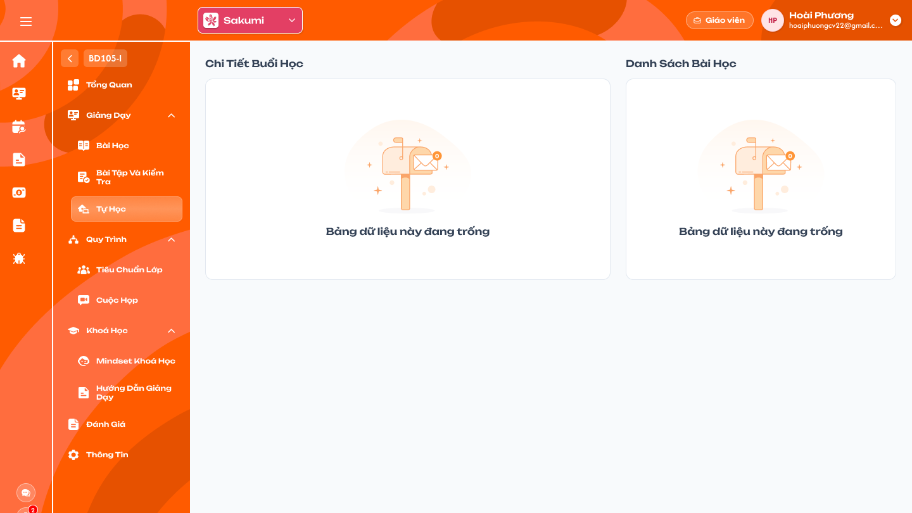

**Mô tả:**
- Mọi giáo viên của lớp xem khóa tự học của lớp do Admin, Class Handler hoặc Support gán. Vùng trái `Chi Tiết Buổi Học` là bảng thời gian học trên app của từng học viên ở bài đang chọn; vùng phải `Danh Sách Bài Học` là các bài tự học. Màn chỉ để xem. Frame này là trạng thái lớp chưa có khóa tự học.

**Điểm cần lưu ý:**
- `A26.01` Chưa có khóa tự học: cả hai vùng hiển thị icon rỗng và `Bảng dữ liệu này đang trống`; không có nút `Thêm khóa tự học`, `Thêm bài học mới`.
- `A26.02` Card bài: số thứ tự và tên bài theo danh sách tự học của lớp (bài của khóa tự học và bài bổ sung), giữ thứ tự đã lưu. Bấm card để chọn: viền cam, bảng thời gian đổi theo bài.
- `A26.03` Tải dữ liệu: tải toàn bộ bài và học viên, không phân trang; có dữ liệu thì mặc định chọn bài 1.
- `A26.04` Bảng thời gian: cột `Số thứ tự`, `Tên học viên` và 8 cột `Học Flashcard`, `Bài tập`, `Từ vựng`, `Ngữ pháp`, `Đọc`, `Kanji`, `Nghe`, `Bảng chữ`. Mỗi ô là tổng thời gian app ghi nhận của đúng học viên–bài–phần, `HH:mm:ss`. Không sửa thời gian, không bấm ô để mở popup.
- `A26.05` Học viên trong bảng: toàn bộ học viên của lớp ở đủ 7 trạng thái `Đang học`, `Dự thính`, `Hoàn thành`, `Nghỉ học`, `Rời lớp`, `Chỉ xem`, `Xóa`; học viên rời lớp vẫn giữ thời gian cũ.
- `A26.06` Vượt 24 giờ: ô có tổng thời gian vượt 24 giờ hiển thị tối đa `23:59:59`; dữ liệu gốc giữ nguyên.
- `A26.07` `00:00:00`: chưa có thời gian học hoặc tổng bằng 0. Tải lỗi không hiển thị thành `00:00:00`; vùng lỗi có `Thử lại`.
- Tự học tách khỏi bài học chính: không có buổi học, điểm danh, BTVN; không đổi % BTVN/Đi học của menu Bài học và không vào danh sách BTVN. Mở bảng hoặc bấm card không tạo thời gian học cho học viên. Trạng thái có dữ liệu theo UI của requirement Admin [Chi tiết lớp học — Menu Tự học](../../management_requirement/class_management/class_detail_self_study_requirements.md), bỏ các nút thêm.

---

## 2. Yêu cầu

### 2.1. Flow chính

**Flow 1: Xem bài học**

```
Giáo viên vào Chi tiết lớp → Giảng dạy → Bài học
      → Hệ thống tải Danh sách bài học (giáo viên của buổi, mốc mở, vòng BTVN/Đi học), chọn bài đầu tiên
      → Giáo viên chọn bài / tab: Buổi học, Thông tin, Nội dung, Tài nguyên, Kiến thức
      → Tab Buổi học hiển thị theo trạng thái buổi: Chưa mở (Dặn dò), Đang dạy / Chờ hoàn thành (tiếp tục), Hoàn thành (kết quả)
```

**Flow 2: Bắt đầu buổi học**

```
Giáo viên chọn bài Chưa mở → tab Buổi học hiển thị Dặn dò trước buổi học
      → Tick "Tôi đã đọc ghi chú" → nút "Bắt đầu buổi học" mở
      → Lớp không Đang học và không phải lớp demo: Toast "Lớp chưa bắt đầu!", dừng
      → Lớp không có lịch tuần này: popup "Bắt đầu buổi học" → Xác nhận → tạo buổi Đang dạy; Toast "Lớp không có lịch để tính lương buổi này"
      → Có lịch: popup "Chọn lịch dạy" (lịch tuần này của chính giáo viên)
            → Chọn lịch → popup "Bắt đầu buổi học" → Xác nhận → tạo buổi Đang dạy; gắn lịch (lịch vẫn Đang đợi)
            → "Không chọn lịch" → Xác nhận → tạo buổi Đang dạy; Toast "Bạn đã bỏ qua chọn lịch, buổi học này sẽ không được tính lương"
      → Chuyển sang Bước 1 — Điểm danh
```

**Flow 3: Điểm danh và Kết thúc buổi học**

```
Giáo viên ở Bước 1 (hoặc bấm "Vào điểm danh" ở bài Đang dạy → popup Tiếp tục buổi học → Xác nhận)
      → Chọn trạng thái điểm danh cho từng học viên; nhập Ghi chú cho lớp học hoặc tick "Không có dặn dò cho học viên"
      → Mỗi thay đổi lưu nháp lên server
      → Đủ điều kiện: bấm "Kết thúc buổi học" → popup nhắc tắt record → Xác nhận
      → Lưu điểm danh và nhận xét lớp; buổi Chờ hoàn thành; chuyển Bước 2
```

**Flow 4: Ghi chú và Hoàn thành buổi học**

```
Giáo viên ở Bước 2 (hoặc bấm "Hoàn thành buổi học" ở bài Chờ hoàn thành)
      → Nhập ghi chú từng học viên (không bắt buộc), ghi chú gửi Support và gửi giáo viên tiếp theo (hoặc tick "Không có dặn dò")
      → Bấm "Hoàn thành buổi học" → popup nhắc kiểm tra ghi chú và tắt record → Xác nhận
      → Lưu ghi chú; buổi Hoàn thành; lịch đã gắn chuyển Hoàn thành và phát sinh lương; xoá nháp; hiển thị "Buổi học đã kết thúc"
```

**Flow 5: Mở màn chấm bài**

```
Giáo viên phụ trách chính vào Chi tiết lớp → Bài tập và Kiểm tra, chọn tab BTVN hoặc Kiểm tra
      → Bấm nút điều hướng trên card bài, hoặc bấm dòng học viên đã nộp trong bảng của bài
      → Bài bổ sung nhiều bài nguồn: hiển thị popup chọn bài nguồn
      → Hệ thống kiểm tra quyền chấm của giáo viên với lớp
      → Mở màn chấm của bài; chọn câu đầu tiên; nếu vào từ dòng học viên thì lọc sẵn học viên đó
```

**Flow 6: Chấm điểm một câu cho một học viên**

```
Giáo viên chọn câu trong danh sách Câu hỏi
      → Hệ thống tải câu trả lời của học viên hợp lệ cho câu đó
      → Giáo viên bấm điểm 0–10 trên thẻ học viên đã nộp
      → Hệ thống lưu điểm cho đúng học viên–câu–bài–lớp
      → Thành công: thẻ, trạng thái và tỷ lệ của câu cập nhật; kiểm tra điều kiện tính điểm bài (Flow 7)
      → Thất bại: giữ điểm cũ; Toast "Có Lỗi Xảy Ra"
```

**Flow 7: Tính điểm bài của học viên**

```
Sau mỗi lần lưu điểm câu của học viên A
      → Hệ thống lấy điểm mọi câu A có câu trả lời trong bài
      → Nếu mọi câu đó đã có điểm (0–10): điểm bài = trung bình cộng điểm các câu
      → Lưu điểm bài vào điểm BTVN (bài chính hoặc đúng bài nguồn của bài bổ sung) hoặc điểm Kiểm tra của A
      → Nếu còn câu chưa chấm: chưa tính điểm bài, bài của A giữ trạng thái chưa chấm
```

**Flow 8: Nhận xét học viên**

```
Giáo viên nhập chữ, ghi âm (micro) hoặc tải ảnh (icon tài liệu) trên thẻ học viên
      → Hệ thống lưu nhận xét cho đúng học viên–câu–bài–lớp
      → Sao chép: lưu chữ + ảnh + ghi âm vào bộ nhớ tạm; Toast "Đã sao chép"
      → Dán: thay nhận xét của thẻ đích bằng dữ liệu đã sao chép; dữ liệu sai định dạng thì Toast "Dữ liệu không hợp lệ"
```

**Flow 9: Nhận xét chung**

```
Giáo viên nhập Nhận xét chung của câu và xác nhận
      → Popup "Áp dụng nhận xét chung"
      → Huỷ: đóng popup, không đổi dữ liệu
      → Xác nhận: ghi đè phần chữ nhận xét của mọi học viên có câu trả lời ở câu, hiển thị tiến độ
      → Thành công: Toast "Đã cập nhật nhận xét chung."; thất bại: Toast "Có Lỗi Xảy Ra"
```

**Flow 10: Chấm câu hỏi con**

```
Giáo viên mở tab Câu hỏi N trong thẻ học viên của câu cha
      → Bấm điểm 0–10 cho câu con
      → Khi mọi câu con đã có điểm: điểm câu cha = trung bình câu con, lưu cho câu cha
      → Tiếp tục Flow 7
```

**Flow 11: Ghi nhận Đã chấm và sửa bài trên lớp**

```
Giáo viên bấm "Đã Chấm và Sửa Bài Trên Lớp"
      → Hệ thống kiểm tra mọi câu trả lời của học viên đã nộp đều có điểm
      → Chưa đủ: Toast "Vui lòng chấm hết bài cho học viên!", không lưu
      → Đủ: ghi đè bản ghi của bài bằng người bấm và thời điểm máy chủ của lần bấm này
      → Chip hiển thị avatar, tên và thời điểm của người bấm gần nhất; Toast "Đã ghi nhận chấm và sửa bài trên lớp."
```

**Flow 12: Xem kết quả Bài tập và Kiểm tra**

```
Giáo viên vào Chi tiết lớp → Giảng dạy → Bài tập và Kiểm tra
      → Hệ thống tải khối Tổng Quan, danh sách BTVN, danh sách Kiểm tra và học viên hợp lệ
      → Mặc định tab BTVN, chọn card đầu tiên
      → Giáo viên đổi tab / tìm theo tên bài / bấm card
      → Vùng trái hiển thị bảng kết quả của bài (BTVN chưa mở: "Bài học chưa mở"; Kiểm tra chưa giao: xem trước đề)
      → Bấm dòng Đã nộp (Giáo viên phụ trách chính) → màn chấm bài lọc sẵn học viên
      → Bấm dòng Chưa nộp → Toast "Học viên chưa nộp bài này!"
```

**Flow 13: Giao bài kiểm tra**

```
Giáo viên phụ trách chính chọn card Kiểm tra "Chưa giao" → xem trước đề
      → Bấm "Giao bài" → popup "Nhấn 'Xác nhận' để giao bài kiểm tra này"
      → Huỷ: đóng popup, không đổi dữ liệu
      → Xác nhận: kiểm tra lớp Đang học hoặc lớp không chính thức
      → Không đạt: Toast "Lớp chưa bắt đầu!", bài vẫn Chưa giao
      → Đạt: lưu lượt giao (lớp, bài, giáo viên, ngày giao); card "Đang đợi nộp bài"; nút đổi thành "Thu hồi"; Toast "Giao bài kiểm tra thành công."
```

**Flow 14: Thu hồi bài kiểm tra**

```
Giáo viên phụ trách chính chọn card Kiểm tra đã giao → bấm "Thu hồi"
      → Popup "Bạn muốn thu hồi bài kiểm tra này? Toàn bộ bài làm và điểm của học viên sẽ bị xoá."
      → Huỷ: đóng popup, không đổi dữ liệu
      → Xác nhận: xoá lượt giao và toàn bộ bài làm, điểm, nhận xét chấm của bài
      → Bài về "Chưa giao", vùng trái về xem trước đề; Toast "Thu hồi bài kiểm tra thành công."
```

**Flow 15: Xem Tự học**

```
Giáo viên vào Chi tiết lớp → Giảng dạy → Tự học
      → Hệ thống kiểm tra giáo viên thuộc lớp
      → Lớp chưa có khóa tự học: hai vùng "Bảng dữ liệu này đang trống", không có nút thêm
      → Có bài: tải toàn bộ bài và học viên (đủ 7 trạng thái), mặc định chọn bài 1
      → Bấm card bài: bảng thời gian 8 phần của bài đó (HH:mm:ss, tối đa hiển thị 23:59:59); chỉ đọc
```

### 2.2. Ngoại lệ

- **EX01:** Giáo viên không phải `Giáo viên phụ trách chính` của lớp → không có nút điều hướng chấm, `Giao bài`, `Thu hồi`; mở URL hoặc gửi request chấm/giao/thu hồi bị backend từ chối, không lưu dữ liệu. Giáo viên không thuộc lớp không xem được menu.
- **EX02:** Bấm `Đã Chấm và Sửa Bài Trên Lớp` khi còn câu trả lời chưa chấm → Toast `Thông Báo` `Vui lòng chấm hết bài cho học viên!`; không ghi nhận, chip giữ nguyên.
- **EX03:** Dán nhận xét với dữ liệu bộ nhớ tạm sai định dạng → Toast `Thông Báo` `Dữ liệu không hợp lệ`; nhận xét giữ nguyên.
- **EX04:** Lưu điểm, nhận xét hoặc nhận xét chung thất bại → Toast `Có Lỗi Xảy Ra`; không tính lại điểm bài từ dữ liệu chưa lưu.
- **EX05:** Tải file ghi âm hoặc ảnh thất bại → bỏ chip `Đang tải...`, không thêm file; Toast `Có Lỗi Xảy Ra`.
- **EX06:** Bài Kiểm tra bị `Thu hồi` trong lúc đang chấm → request chấm tiếp theo bị từ chối vì bài làm đã bị xoá; giáo viên quay lại menu Bài tập và Kiểm tra để tải dữ liệu mới.
- **EX07:** Học viên có câu trả lời nhưng chưa nộp bài → thẻ `Chỉ xem`; backend từ chối request chấm/nhận xét cho học viên đó.
- **EX08:** Bài chưa có học viên nộp → vùng thẻ hiển thị `Chưa có học sinh nộp bài`; không có thẻ để chấm.
- **EX09:** File ghi âm hoặc ảnh nhận xét lớn hơn 25MB → không tải lên, không thêm chip; Toast `Cảnh Báo` `File vượt quá dung lượng cho phép (25MB).`
- **EX10:** Giao bài kiểm tra khi lớp chính thức chưa ở trạng thái `Đang học` → Toast `Cảnh Báo` `Lớp chưa bắt đầu!`; bài vẫn `Chưa giao`.
- **EX11:** Giao hoặc thu hồi thất bại do backend/network → Toast `Có Lỗi Xảy Ra`; trạng thái bài và dữ liệu bài làm giữ nguyên.
- **EX12:** Bắt đầu buổi học khi lớp chính thức chưa ở trạng thái `Đang học` → Toast `Cảnh Báo` `Lớp chưa bắt đầu!`; không tạo buổi, không đổi lịch.
- **EX13:** Sửa điểm danh hoặc ghi chú sau khi buổi đã `Hoàn thành`, hoặc sửa điểm danh khi buổi đã `Chờ hoàn thành` → backend từ chối; dữ liệu giữ nguyên.
- **EX14:** Tải tài nguyên của bài bị khoá → không tải; Toast `Thông Báo` `Chỉ tải được tài nguyên của 3 bài đã mở gần nhất`; request trực tiếp bị từ chối.
- **EX15:** Hai giáo viên cùng bắt đầu một bài → chỉ tạo một buổi; người sau vào tiếp tục buổi đã có, không chọn lịch lần hai; mỗi buổi phát sinh lương tối đa một lần khi Hoàn thành.
- **EX16:** Bắt đầu, Kết thúc hoặc Hoàn thành buổi thất bại do backend/network → Toast `Có Lỗi Xảy Ra`; trạng thái buổi giữ nguyên, nháp không mất.
- **EX17:** Giáo viên gửi request thêm khóa tự học hoặc thêm bài tự học → backend từ chối; danh sách Tự học giữ nguyên.
- **EX18:** Tải danh sách bài hoặc bảng thời gian Tự học lỗi → vùng lỗi có `Thử lại`; không hiển thị rỗng hoặc `00:00:00` giả.
- **EX19:** Bấm dòng học viên `Chưa nộp` ở bảng kết quả → Toast `Thông Báo` `Học viên chưa nộp bài này!`; không mở màn chấm.
- **EX20:** Giáo viên gửi request thiết lập lại bài nộp của học viên → backend từ chối; bài nộp giữ nguyên.

### 2.3. Yêu cầu khác

| Mã | Tên yêu cầu | Mô tả |
|---|---|---|
| REQ01 | Quyền và điểm vào | Chỉ `Giáo viên phụ trách chính` của lớp được mở màn chấm và chấm điểm/nhận xét BTVN, Kiểm tra. Điểm vào là nút điều hướng trên card bài và dòng học viên đã nộp (lọc sẵn học viên). Bài bổ sung nhiều bài nguồn chọn bài nguồn qua popup trước khi vào. |
| REQ02 | Tập học viên hợp lệ | Chỉ tài khoản role học viên của lớp. BTVN: học viên đã được điểm danh (khác `Chưa điểm danh`) ở buổi của bài đã mở, và **thời điểm mở bài không nằm trong khoảng học viên ở trạng thái `Nghỉ học`, `Rời lớp` hoặc `Xóa`**. Khoảng tính từ lúc học viên chuyển sang một trong ba trạng thái này đến lúc chuyển sang trạng thái khác (chưa chuyển thì đến hiện tại). Bài mở trước hoặc sau khoảng đó vẫn được chấm; `Chỉ xem`, `Dự thính`, `Đang học`, `Hoàn thành` không bị loại. Kiểm tra: học viên hợp lệ theo lượt giao bài kiểm tra. Trong tập này, học viên **đã nộp** được chấm; học viên có câu trả lời nhưng chưa nộp hiển thị `Chỉ xem`. |
| REQ03 | Danh sách câu và trạng thái | Liệt kê mọi câu của bài theo thứ tự đề. Câu `Đã chấm` khi mọi câu trả lời của học viên đã nộp có điểm, hoặc câu không có câu trả lời nhưng bài có học viên đã nộp (`Bạn không cần chấm câu hỏi này!`, tỷ lệ 100%). Câu đang chọn là `Đang chấm`. Tỷ lệ điểm = tổng điểm câu trả lời đã chấm / (số câu trả lời đã chấm × 10), làm tròn số nguyên phần trăm. Bộ lọc `Trạng Thái` gồm `Chưa chấm`, `Đã chấm`. |
| REQ04 | Bộ lọc học viên | `Chưa Chấm` (mặc định tắt) giữ lại học viên chưa có điểm ở câu và học viên vừa chấm trong lúc lọc cho đến khi đổi câu; `Hiện Tên` (mặc định bật) ẩn/hiện tên; `Học Viên` chọn nhiều học viên có câu trả lời. Bộ lọc chỉ áp dụng cho câu đang chọn. |
| REQ05 | Loại câu và người chấm | Trắc nghiệm (mã 1 từ vựng, 5 câu, 11 hình ảnh), Sắp xếp (7), Nối từ (8 nối cột), Nói (22 nhận diện lời nói): App tự chấm. Đọc (3 ghi âm, 10 nhập vai), Viết (4, 44 vẽ/viết, 6 văn bản), Hình ảnh (2 tải/chụp ảnh): Giáo viên chấm. Câu hỏi con (câu có danh sách câu con): theo loại từng câu con. Câu app tự chấm có điểm sẵn khi học viên nộp; `Giáo viên phụ trách chính` được sửa đè. Câu giáo viên chấm ở trạng thái chưa chấm đến khi giáo viên bấm điểm. |
| REQ06 | Lưu điểm câu | Điểm câu là số nguyên 0–10, lưu ngay khi bấm cho đúng học viên–câu–bài–lớp; được đổi điểm và nhận xét bất kỳ lúc nào, **không có mốc khoá** (kể cả sau khi đã ghi nhận `Đã Chấm và Sửa Bài Trên Lớp` hoặc lớp đã Hoàn thành). |
| REQ07 | Điểm bài | Điểm BTVN/Kiểm tra của học viên = trung bình cộng điểm các câu học viên có câu trả lời trong bài, chỉ tính khi mọi câu đó đã có điểm; lưu giá trị gốc, hiển thị làm tròn 1 chữ số thập phân theo menu Bài tập và Kiểm tra. BTVN của bài bổ sung lưu điểm theo từng bài nguồn; điểm BTVN của bài = trung bình các bài nguồn, chỉ khi mọi bài nguồn đã chấm. |
| REQ08 | Nhận xét học viên | Gồm chữ, danh sách file ghi âm, danh sách file ảnh (mỗi file tối đa 25MB), gắn đúng học viên–câu–bài–lớp; thêm/xoá file lưu ngay. Sao chép/dán chuyển cả ba phần; dán thay nội dung hiện có của thẻ đích. |
| REQ09 | Nhận xét chung | Xác nhận qua popup; ghi đè phần chữ nhận xét của mọi học viên có câu trả lời ở câu, không phụ thuộc bộ lọc, giữ nguyên file ghi âm/ảnh. |
| REQ10 | Câu hỏi con | Chấm từng câu con; điểm câu cha = trung bình câu con khi mọi câu con có điểm. Đáp án câu con ghép theo mã câu con, thiếu mã thì theo thứ tự. |
| REQ11 | Đã chấm và sửa bài trên lớp | Chỉ ghi nhận khi mọi câu trả lời của học viên đã nộp có điểm. Bấm không giới hạn số lần; mỗi lần ghi đè người bấm và thời điểm máy chủ, chỉ lưu lần bấm gần nhất. Chip hiển thị avatar, tên và thời điểm của người bấm gần nhất. Bản ghi tách BTVN/Kiểm tra theo bài và lớp. Thẻ `Đã chấm và sửa bài` ở Tổng quan lớp = số bài BTVN + Kiểm tra đã có bản ghi, mỗi bài tính một lần dù bấm nhiều lần. |
| REQ12 | Đồng bộ dữ liệu | Thay đổi điểm/nhận xét được phản ánh ở bảng học viên, card bài, khối Tổng Quan của menu Bài tập và Kiểm tra và các chỉ số Điểm BTVN, Điểm KT, Đã chấm và sửa bài ở Tổng quan lớp sau khi quay lại hoặc tải lại. |
| REQ13 | Danh sách bài | Tab `BTVN` gồm một BTVN cho mỗi bài học của lớp (kể cả bài bổ sung, không gồm Tự học); tab `Kiểm Tra` gồm bài kiểm tra của khoá học và bài kiểm tra bổ sung do Admin thêm, sắp theo ngày giao tăng dần, bài chưa giao xếp sau. Giáo viên không thêm bài kiểm tra. BTVN tự giao khi bài học mở, giáo viên không giao/thu hồi BTVN; chỉ bài kiểm tra có Giao bài/Thu hồi. Tìm theo tên bài; tải toàn bộ, không phân trang; mặc định tab BTVN và card đầu tiên. |
| REQ14 | Khối Tổng Quan | `Đã Chấm K.Tra` = bài kiểm tra Đã chấm / tổng bài kiểm tra; `K.Tra Đã Giao` = bài đã giao / tổng bài kiểm tra; `Đã Chấm BTVN` = BTVN Đã chấm / tổng BTVN; `Điểm K.Tra`, `Điểm BTVN` = trung bình điểm các bài đã chấm (điểm 0 vẫn tính), làm tròn 1 chữ số thập phân, không có thì trống; `Tỉ Lệ Làm BTVN` = trung bình tỷ lệ nộp BTVN của học viên hợp lệ trên các bài đã mở. Tính toàn lớp, không đổi theo card hoặc tìm kiếm. |
| REQ15 | Badge và card | Badge = số bài Chưa chấm của tab. Bốn nhãn `Chưa giao`, `Đang đợi nộp bài`, `Chưa chấm`, `Đã chấm` theo dữ liệu giao/nộp/chấm (BTVN Chưa giao = bài học chưa mở). Vòng số đã nộp `S/N` = học viên hợp lệ đã nộp / tổng học viên hợp lệ. Vòng tỷ lệ chấm = C/S × 100, S = 0 là 0%. |
| REQ16 | Bảng kết quả học viên | Gồm tập học viên hợp lệ (REQ02) với Điểm số (trống khi chưa chấm, 0 hợp lệ), tên, thời gian làm bài (tối đa hiển thị 23:59:59), trạng thái nộp và số câu bỏ qua. Bấm dòng Đã nộp mở màn chấm (chỉ Giáo viên phụ trách chính); bấm dòng Chưa nộp hiện Toast `Học viên chưa nộp bài này!`. Vòng trên card có tooltip `Số bài đã nộp` và `Đã chấm`. Giáo viên không có Thiết lập lại nộp bài. |
| REQ17 | Giao bài kiểm tra | Chỉ `Giáo viên phụ trách chính`, qua popup xác nhận; lớp phải `Đang học` hoặc là lớp không chính thức. Thành công lưu lượt giao với ngày giao; bài chưa giao hiển thị xem trước đề. |
| REQ18 | Thu hồi bài kiểm tra | Chỉ `Giáo viên phụ trách chính`, qua popup có cảnh báo xoá dữ liệu. Thành công xoá lượt giao và toàn bộ bài làm, điểm, nhận xét chấm của bài; bài về Chưa giao; giao lại là lượt mới. |
| REQ19 | Danh sách bài học | Toàn bộ bài của lớp theo thứ tự (gồm bài bổ sung), mặc định chọn bài đầu. Card bài đã mở có giáo viên của buổi (người bắt đầu), mốc mở `HH:mm - dd/MM/yyyy`, vòng BTVN/Đi học; card chưa mở chỉ có số thứ tự xám, tên, mô tả. Giáo viên không thêm/sửa/xoá bài. |
| REQ20 | Dặn dò trước buổi học | Bài Chưa mở hiển thị 5 dòng dặn dò cố định và checkbox `Tôi đã đọc ghi chú`; phải tick mới bắt đầu được. Không hiển thị ghi chú hay nhận xét của bài trước (chỉ xem ở bài đã hoàn thành). Mọi giáo viên của lớp được bắt đầu bất kỳ bài chưa mở; lớp phải `Đang học` hoặc là lớp không chính thức. |
| REQ21 | Chọn lịch và lương buổi | Lớp có lịch tuần này thì hiện popup `Chọn lịch dạy` gồm lịch tuần này của chính giáo viên (lịch Hoàn thành không chọn được, lịch huỷ ẩn) và `Không chọn lịch`. Chọn lịch: gắn lịch với buổi và giáo viên, lịch giữ `Đang đợi` (lịch cố định chưa có bản ghi thì tạo bản ghi Đang đợi); lịch đã gắn không chọn được cho buổi khác. Lịch chỉ chuyển `Hoàn thành` và phát sinh lương buổi dạy (một lần) khi bấm `Hoàn thành buổi học`; ngày tính lương là ngày của lịch, không phải ngày hoàn thành. Không chọn lịch hoặc lớp không có lịch tuần này: không phát sinh lương, có Toast `Thông Báo` tương ứng. Mỗi bài một buổi. |
| REQ22 | Điểm danh | Danh sách gồm học viên `Đang học`, `Dự thính`, `Hoàn thành`. Mỗi học viên một trạng thái trong `Có mặt`, `Vào trễ`, `Ra sớm`, `Vào trễ & Ra sớm`, `Nghỉ CP`, `Nghỉ KP` (mặc định `Chưa điểm danh`). Kết thúc buổi học khi điểm danh đủ và có ghi chú lớp hoặc tick `Không có dặn dò cho học viên`; lưu điểm danh và `Giáo viên nhận xét lớp`, buổi chuyển `Chờ hoàn thành`. |
| REQ23 | Hoàn thành buổi học | Ghi chú từng học viên (gửi Support, gửi học viên) không bắt buộc. Ghi chú gửi Support và gửi giáo viên tiếp theo phải có nội dung hoặc tick checkbox `Không có dặn dò` tương ứng. Hoàn thành lưu ghi chú, buổi chuyển `Hoàn thành`, lịch đã gắn chuyển `Hoàn thành` và phát sinh lương, xoá nháp. |
| REQ24 | Nháp và tiếp tục | Dữ liệu Bước 1/Bước 2 lưu nháp trên server sau mỗi thay đổi, theo lớp–bài. Mọi giáo viên của lớp tiếp tục được buổi `Đang dạy` (`Vào điểm danh`) hoặc `Chờ hoàn thành` (`Hoàn thành buổi học`) và thấy đúng nháp; giáo viên của buổi giữ nguyên là người bắt đầu. |
| REQ25 | Bài đã hoàn thành | Hiển thị `Giáo viên nhận xét lớp`, ghi chú gửi Support, ghi chú gửi giáo viên tiếp theo và bảng học viên (Đi học, BTVN, Ghi chú) chỉ đọc. Giáo viên không sửa sau khi hoàn thành. |
| REQ26 | Thông tin, Nội dung, Kiến thức | Dữ liệu định nghĩa bài học chỉ đọc giống Admin; Kiến thức để trống. |
| REQ27 | Tài nguyên | Bấm file tải ngay. Chỉ tải được tài nguyên của 3 bài đã mở có số thứ tự lớn nhất; bài khác (đã mở trước đó hoặc chưa mở) hiển thị file kèm icon khoá, bấm không tải; áp dụng cả Bài giảng và Tài nguyên khác; backend kiểm tra khi tải. |
| REQ28 | % BTVN và Đi học theo bài | Tính theo số học viên `Đang học`/`Dự thính` của đúng bài: % BTVN = đã nộp / tập; % Đi học = đi học (Có mặt, Vào trễ, Ra sớm, Vào trễ & Ra sớm) / số đã điểm danh trong tập (Nghỉ CP/KP trong mẫu, Chưa điểm danh loại khỏi tử và mẫu). Mẫu số 0 để trống. |
| REQ29 | Tự học | Mọi giáo viên của lớp xem danh sách bài tự học (giữ thứ tự đã lưu, tải toàn bộ, mặc định bài 1) và bảng thời gian app của toàn bộ học viên đủ 7 trạng thái theo 8 phần `Học Flashcard`, `Bài tập`, `Từ vựng`, `Ngữ pháp`, `Đọc`, `Kanji`, `Nghe`, `Bảng chữ`; `HH:mm:ss`, ô vượt 24 giờ hiển thị `23:59:59`. Chỉ đọc: không thêm khóa/bài, không sửa thời gian; xem bảng không tạo thời gian học; Tự học không ảnh hưởng điểm danh, BTVN của bài học chính. |
| REQ30 | Icon trạng thái điểm danh | Bảng hiển thị điểm danh (cột Đi học ở tab Buổi học, cột Trạng thái ở Tổng quan) dùng bộ icon `Trạng thái đi học` theo bảng ghép 7 trạng thái; hover hiện tên trạng thái. Dropdown điểm danh ở Bước 1 chỉ hiển thị chữ. |

### 2.4. Ràng buộc

#### Quyền

**Bài học**

| Role | Xem bài, tab, kết quả buổi | Bắt đầu / tiếp tục buổi, điểm danh, ghi chú buổi | Tải tài nguyên 3 bài đã mở gần nhất | Sửa sau khi Hoàn thành |
|---|:---:|:---:|:---:|:---:|
| Giáo viên của lớp (mọi giáo viên) | ✅ | ✅ | ✅ | ❌ |
| Các role khác | ❌ | ❌ | ❌ | ❌ |

**Bài tập và Kiểm tra, màn chấm bài**

| Role | Xem danh sách, kết quả, xem trước đề | Giao / Thu hồi bài kiểm tra | Mở màn chấm | Chấm điểm / sửa đè điểm app | Nhận xét / Nhận xét chung | Đã Chấm và Sửa Bài Trên Lớp |
|---|:---:|:---:|:---:|:---:|:---:|:---:|
| Giáo viên phụ trách chính của lớp | ✅ | ✅ | ✅ | ✅ | ✅ | ✅ |
| Giáo viên khác của lớp | ✅ | ❌ | ❌ | ❌ | ❌ | ❌ |
| Các role khác | ❌ | ❌ | ❌ | ❌ | ❌ | ❌ |

**Tự học**

| Role | Xem danh sách bài và bảng thời gian | Thêm khóa tự học / Thêm bài | Sửa thời gian |
|---|:---:|:---:|:---:|
| Giáo viên của lớp (mọi giáo viên) | ✅ | ❌ | ❌ |
| Các role khác | ❌ | ❌ | ❌ |

#### Ràng buộc khác

- Giáo viên khác của lớp xem kết quả chấm (điểm, trạng thái nộp) ở bảng học viên của menu Bài tập và Kiểm tra, không vào màn chấm, không giao/thu hồi.
- Thiết lập lại nộp bài (xoá bài làm để học viên làm lại) chỉ Admin, Class Handler, Support thực hiện theo requirement Admin; giáo viên không có.
- Không role nào có nút Thêm bài kiểm tra trong menu này; bài kiểm tra bổ sung do Admin thêm ở chức năng riêng.
- Các role quản lý (Admin, Class Handler, Support) thao tác BTVN/Kiểm tra theo requirement Admin [Chi tiết lớp học — Menu Bài tập và kiểm tra](../../management_requirement/class_management/class_detail_homework_tests_requirements.md); tài liệu này không cấp thêm quyền chấm cho các role đó. Admin, Class Handler, Support xem và thêm khóa/bài Tự học theo requirement Admin [Chi tiết lớp học — Menu Tự học](../../management_requirement/class_management/class_detail_self_study_requirements.md).
- Giáo viên chỉ chấm bài của lớp mà mình là `Giáo viên phụ trách chính` tại thời điểm thao tác; đổi phụ trách chính thì giáo viên cũ mất quyền ngay.
- Mọi request chấm/nhận xét được backend kiểm tra quyền, lớp, bài, học viên và trạng thái nộp; không dựa vào việc ẩn nút trên giao diện. Không cho phép truy cập hoặc thực hiện hành động bị đánh dấu `❌`, kể cả khi gọi trực tiếp bằng URL hoặc request.
- Mỗi thao tác logic chỉ hiển thị một Toast kết quả; `Huỷ` và thao tác chỉ đọc không hiển thị Toast CRUD; Toast không chứa thông tin kỹ thuật.

---

## 3. Testcase

### Feature: [Giáo viên] Chi tiết lớp — Giảng dạy

| Tên testcase | Priority | Scenario | Role | Pre-condition | Given/When/Then | Expected Result |
|---|---|---|---|---|---|---|
| Case 1: Xem danh sách bài học và chọn bài | High | Flow 1 / REQ19 / REQ28 | Giáo viên | Lớp có bài đã mở và chưa mở; 10 học viên, 7 đã nộp BTVN, 8 đi học, 1 Nghỉ CP, 1 Nghỉ KP | **Given:** mở menu Bài học<br>**When:** danh sách tải xong, bấm card bài chưa mở và đổi tab<br>**Then:** mặc định chọn bài đầu, tab Buổi học | - Card bài đã mở có giáo viên, mốc mở, vòng BTVN 70% / Đi học 80%<br>- Card bài chưa mở không có vòng tỷ lệ<br>- Chọn bài, đổi tab không tạo buổi, không tạo điểm danh |
| Case 2: Dặn dò, khoá nút và lớp chưa bắt đầu | High | Flow 2 / REQ20 / EX12 | Giáo viên | Bài chưa mở; bài trước đã hoàn thành có ghi chú; một lớp chính thức ở trạng thái Khai giảng | **Given:** chọn bài chưa mở, chưa tick `Tôi đã đọc ghi chú`<br>**When:** xem nút, tick, rồi bấm Bắt đầu buổi học (lớp Khai giảng)<br>**Then:** nút mở sau khi tick; lớp Khai giảng bị chặn | - Chỉ có 5 dòng dặn dò, không có ghi chú bài trước<br>- Toast `Lớp chưa bắt đầu!`, bài vẫn Chưa mở<br>- Bắt đầu được bài bất kỳ không theo thứ tự |
| Case 3: Bắt đầu buổi với lịch / không chọn lịch / lớp không có lịch | High | Flow 2 / REQ21 / EX15 | Giáo viên | Lớp Đang học; giáo viên có lịch Thứ 4 chưa hoàn thành, lịch Thứ 2 đã Hoàn thành; một lớp không có lịch tuần này | **Given:** mở popup Chọn lịch dạy<br>**When:** chọn Thứ 4 + Xác nhận; hoặc `Không chọn lịch`; hoặc bắt đầu ở lớp không có lịch; hai giáo viên bấm cùng lúc<br>**Then:** buổi Đang dạy, mở Bước 1 | - Lịch Thứ 4 gắn buổi, vẫn Đang đợi, chưa phát sinh lương; Thứ 2 không chọn được<br>- Toast `Bạn đã bỏ qua chọn lịch, buổi học này sẽ không được tính lương` / `Lớp không có lịch để tính lương buổi này` (không popup Chọn lịch)<br>- `Huỷ` không bắt đầu<br>- Chỉ một buổi được tạo |
| Case 4: Điểm danh và Kết thúc buổi học | High | Flow 3 / REQ22 / REQ24 / REQ30 | Giáo viên | Buổi Đang dạy; lớp có học viên Đang học, Dự thính, Hoàn thành, Nghỉ học, Rời lớp, Chỉ xem, Xóa | **Given:** mở Bước 1, còn 1 học viên Chưa điểm danh, chưa có ghi chú lớp<br>**When:** điểm danh đủ, nhập ghi chú lớp (hoặc tick `Không có dặn dò cho học viên`), `Kết thúc buổi học` → `Xác nhận`; giáo viên B bấm `Vào điểm danh`<br>**Then:** buổi Chờ hoàn thành, mở Bước 2 | - Danh sách chỉ có Đang học, Dự thính, Hoàn thành<br>- Nút khoá khi còn Chưa điểm danh hoặc thiếu ghi chú<br>- Dropdown chỉ hiển thị chữ<br>- B thấy đúng nháp; giáo viên của buổi vẫn là A |
| Case 5: Hoàn thành buổi học và tính lương | High | Flow 4 / REQ23 / REQ21 | Giáo viên | Buổi Chờ hoàn thành, đã gắn lịch ngày 15; hoàn thành ngày 20 | **Given:** nhập ghi chú Support, chưa nhập khối giáo viên tiếp theo<br>**When:** tick `Không có dặn dò cho giáo viên`, `Hoàn thành buổi học` → `Xác nhận`<br>**Then:** buổi Hoàn thành, hiện `Buổi học đã kết thúc` | - Nút khoá khi thiếu khối ghi chú; ghi chú từng học viên không bắt buộc<br>- Lịch chuyển Hoàn thành, phát sinh lương một lần, ngày lương = ngày 15<br>- Nháp bị xoá |
| Case 6: Xem bài đã hoàn thành, Thông tin, Nội dung, Kiến thức | Medium | REQ25 / REQ26 / EX13 | Giáo viên | Bài Hoàn thành có ghi chú, điểm danh đủ 7 trạng thái | **Given:** chọn bài, lần lượt các tab; gửi request sửa điểm danh/ghi chú<br>**When:** tab tải xong<br>**Then:** 3 khối ghi chú và bảng học viên chỉ đọc | - Icon đúng trạng thái, hover hiện tên; popup Ghi chú đúng học viên<br>- Thông tin/Nội dung đúng nguồn, Nội dung/Kiến thức rỗng hiện `Không có dữ liệu!`<br>- Backend từ chối sửa, dữ liệu giữ nguyên<br>- Ghi chú bài này không hiện ở Dặn dò bài kế |
| Case 7: Tài nguyên 3 bài đã mở gần nhất | High | REQ27 / EX14 | Giáo viên | Đã mở bài 1–6 | **Given:** chọn bài 5, bài 2, bài 7; bắt đầu bài 7<br>**When:** bấm file PPT<br>**Then:** bài 5 tải ngay; bài 2, bài 7 chưa mở khoá | - Không mở xem trước<br>- Card bài khoá có icon khoá; Toast `Chỉ tải được tài nguyên của 3 bài đã mở gần nhất`; request trực tiếp bị từ chối<br>- Sau khi mở bài 7, bài 4 bị khoá |
| Case 8: Menu Bài tập và Kiểm tra: danh sách, bảng và Tổng Quan | High | Flow 12 / REQ13 / REQ14 / REQ15 / REQ16 / EX19 / EX20 | Giáo viên | Lớp 8 bài học (1 bài bổ sung), 20 bài Tự học, khoá 6 bài kiểm tra + 1 bổ sung; kiểm tra đã chấm điểm 8 và 0, 1 Chưa nộp, 1 Chưa chấm; bài có 14 học viên hợp lệ, 12 đã nộp | **Given:** mở hai tab, tìm theo tên bài, chọn nhiều card, bấm dòng Chưa nộp, mất kết nối khi tải<br>**When:** danh sách tải xong<br>**Then:** BTVN 8 card, Kiểm tra 7 card | - Không cộng Tự học; không có nút Thêm bài kiểm tra; tab BTVN không có Giao/Thu hồi<br>- Vòng `12/14`; tỷ lệ chấm chia cho bài đã nộp; badge đếm bài Chưa chấm<br>- Ba trạng thái dòng, thời gian 25:30:00 hiện 23:59:59; BTVN chưa mở hiện `Bài học chưa mở`<br>- Sáu thẻ Tổng Quan không đổi theo card/tìm kiếm; `Điểm K.Tra` 4.0<br>- Toast `Học viên chưa nộp bài này!`; không có icon thiết lập lại nộp bài; lỗi tải hiện `Thử lại` |
| Case 9: Xem trước đề, Giao bài kiểm tra | High | Flow 13 / REQ17 / EX10 | Giáo viên phụ trách chính | Bài kiểm tra Chưa giao có 10 câu; lớp Đang học (và một lớp Khai giảng) | **Given:** chọn card Chưa giao, bấm `Giao bài`<br>**When:** `Huỷ`, rồi `Xác nhận` (lớp Đang học và lớp Khai giảng)<br>**Then:** lớp Đang học: bài chuyển Đang đợi nộp bài | - Xem trước đủ 10 câu, phát được âm thanh<br>- Toast `Giao bài kiểm tra thành công.`, nút đổi thành Thu hồi, `K.Tra Đã Giao` tăng 1<br>- Lớp Khai giảng: Toast `Lớp chưa bắt đầu!`, bài vẫn Chưa giao<br>- `Huỷ` không Toast |
| Case 10: Thu hồi và giao lại | High | Flow 14 / REQ18 / EX06 / EX11 | Giáo viên phụ trách chính | Bài đã giao, 5 học viên đã nộp, 3 đã chấm | **Given:** bấm `Thu hồi`<br>**When:** `Xác nhận`; giao lại; hoặc `Huỷ`<br>**Then:** bài về Chưa giao | - Xoá bài làm/điểm/nhận xét của 5 học viên; Toast `Thu hồi bài kiểm tra thành công.`; Tổng Quan cập nhật<br>- Giao lại là lượt mới, học viên làm lại từ đầu<br>- Thu hồi trong lúc đang chấm: request chấm tiếp theo bị từ chối |
| Case 11: Mở màn chấm bài và quyền phụ trách chính | High | Flow 5 / REQ01 / EX01 | Giáo viên phụ trách chính; Giáo viên khác | Bài BTVN có học viên A đã nộp, B chưa nộp; BTVN bài bổ sung có 2 bài nguồn | **Given:** bấm nút điều hướng trên card, hoặc bấm dòng A/B, hoặc chọn bài nguồn thứ hai; giáo viên khác mở URL màn chấm<br>**When:** hệ thống kiểm tra quyền<br>**Then:** mở màn chấm đúng bài, chọn câu đầu | - Từ dòng A lọc sẵn A; dòng B không điều hướng<br>- Popup chọn bài nguồn, không trộn câu bài nguồn khác<br>- Giáo viên khác không có nút, URL/request bị backend từ chối<br>- Quay về bằng `<` tải lại dữ liệu và Tổng Quan |
| Case 12: Danh sách câu, bộ lọc và thẻ học viên | High | REQ02 / REQ03 / REQ04 / EX07 / EX08 | Giáo viên phụ trách chính | Bài có Trắc nghiệm, Đọc, Nối từ, Câu hỏi con; câu có A đã chấm, B và C chưa chấm; B' có câu trả lời nhưng chưa nộp; A từng Nghỉ học ngày 10–20 | **Given:** mở màn chấm; bật `Chưa Chấm`, tắt `Hiện Tên`, chọn `Học Viên`, lọc `Trạng Thái`<br>**When:** chấm B, đổi câu, xem câu không có câu trả lời, bài chưa có ai nộp<br>**Then:** danh sách và thẻ hiển thị đúng | - Nhãn loại đúng REQ05; trạng thái Đã chấm/Chưa chấm; tỷ lệ 60% với điểm 10, 8, 0<br>- B vẫn hiển thị đến khi đổi câu; tên ẩn chỉ còn số thứ tự<br>- `Bạn không cần chấm câu hỏi này!`, tỷ lệ 100%; `Chưa có học sinh nộp bài`<br>- Thẻ B' có nhãn `Chỉ xem`, backend từ chối chấm<br>- A không có ở bài mở trong khoảng Nghỉ học, có ở bài mở sau |
| Case 13: Chấm điểm, câu hỏi con, điểm bài, đáp án theo loại | High | Flow 6 / Flow 7 / Flow 10 / REQ05 / REQ06 / REQ07 / REQ10 / EX04 | Giáo viên phụ trách chính | Câu Đọc A chưa chấm; câu Trắc nghiệm app đã chấm A 10 điểm; câu cha có 3 câu con; bài có câu Ghi âm, Nối cột, Vẽ, Sắp xếp; A bỏ trống một câu | **Given:** bấm `8` ở câu Đọc; bấm `5` đè điểm app; chấm câu con 10, 8, 6; mất kết nối khi bấm `7`<br>**When:** lưu điểm<br>**Then:** điểm lưu đúng học viên–câu–bài–lớp | - Nút điểm tô cam, không đổi điểm học viên khác, không Toast thành công<br>- Điểm câu cha = 8 chỉ khi đủ câu con; điểm bài = trung bình các câu, khi đủ điểm<br>- Đáp án hiển thị đúng dạng theo loại; bỏ qua hiện `Học viên đã bỏ qua câu này!`<br>- Lỗi: Toast `Có Lỗi Xảy Ra`, giữ điểm cũ, không tính lại điểm bài |
| Case 14: Nhận xét học viên và Nhận xét chung | High | Flow 8 / Flow 9 / REQ08 / REQ09 / EX03 / EX05 / EX09 | Giáo viên phụ trách chính | Thẻ A có chữ và 1 ghi âm; B trống; file ghi âm 30MB; bộ nhớ tạm chứa chữ thường | **Given:** nhập nhận xét chữ, ghi âm, tải ảnh, sao chép A dán B, dán dữ liệu sai, tải file 30MB, mất kết nối khi tải; nhập Nhận xét chung<br>**When:** xác nhận hoặc `Huỷ` popup `Áp dụng nhận xét chung`<br>**Then:** nhận xét lưu đúng học viên–câu | - Chip `Đang tải...` rồi `File ghi âm 1` / `File ảnh 1`, `×` xoá đúng file<br>- Toast `Đã sao chép`, `Dữ liệu không hợp lệ`, `File vượt quá dung lượng cho phép (25MB).`, `Có Lỗi Xảy Ra` (tải lỗi không thêm chip)<br>- Nhận xét chung ghi đè chữ của mọi học viên có câu trả lời kể cả khi đang lọc, giữ ghi âm/ảnh; Toast `Đã cập nhật nhận xét chung.`; Huỷ không đổi, không Toast |
| Case 15: Đã Chấm và Sửa Bài Trên Lớp | High | Flow 11 / REQ11 / REQ12 / EX02 | Giáo viên phụ trách chính | Bài có 1 câu trả lời chưa chấm; học viên B chưa nộp có câu trả lời chưa chấm; giáo viên X đã ghi nhận lúc 22:14 | **Given:** bấm nút khi chưa chấm hết; chấm hết rồi bấm; Y bấm lúc 22:30<br>**When:** hệ thống kiểm tra<br>**Then:** chưa chấm hết thì không ghi nhận | - Toast `Vui lòng chấm hết bài cho học viên!`, chip giữ nguyên<br>- Chấm hết: Toast `Đã ghi nhận chấm và sửa bài trên lớp.`, chip avatar + tên + thời điểm lần bấm mới nhất (Y, 22:30), không còn X<br>- Câu trả lời của B không tính vào điều kiện; thẻ Đã chấm và sửa bài ở Tổng quan lớp tăng đúng 1 bài, bấm lại không tăng |
| Case 16: Tự học chỉ xem | Medium | Flow 15 / REQ29 / EX17 / EX18 | Giáo viên | Lớp có khóa tự học 35 bài, 25 học viên đủ 7 trạng thái; A Nghe 25:30:00, Đọc 00:00:00; một lớp chưa có khóa tự học | **Given:** mở menu Tự học (lớp có và chưa có khóa); gửi request thêm khóa/bài; API lỗi<br>**When:** tải xong, bấm card bài 3<br>**Then:** bài 1 chọn mặc định, bảng đổi sang bài 3 | - Đủ 35 bài, 25 học viên, 8 cột thời gian, không phân trang; Nghe `23:59:59`, Đọc `00:00:00`<br>- Lớp chưa có khóa: `Bảng dữ liệu này đang trống`, không có nút thêm<br>- Backend từ chối thêm; lỗi hiện `Thử lại`, không `00:00:00` giả |
| Case 17: Role khác không có quyền | High | Ràng buộc quyền / EX01 / EX16 | Giáo viên không thuộc lớp; Admin/Class Handler/Support (ở menu giáo viên) | Có lớp bất kỳ | **Given:** mở URL các menu Giảng dạy; gửi request bắt đầu buổi, chấm, giao bài; Bắt đầu/Kết thúc/Hoàn thành buổi gặp lỗi backend<br>**When:** hệ thống xử lý<br>**Then:** bị từ chối | - Không xem được menu, dữ liệu không đổi<br>- Lỗi backend/network: Toast `Có Lỗi Xảy Ra`, trạng thái buổi giữ nguyên, nháp không mất |
