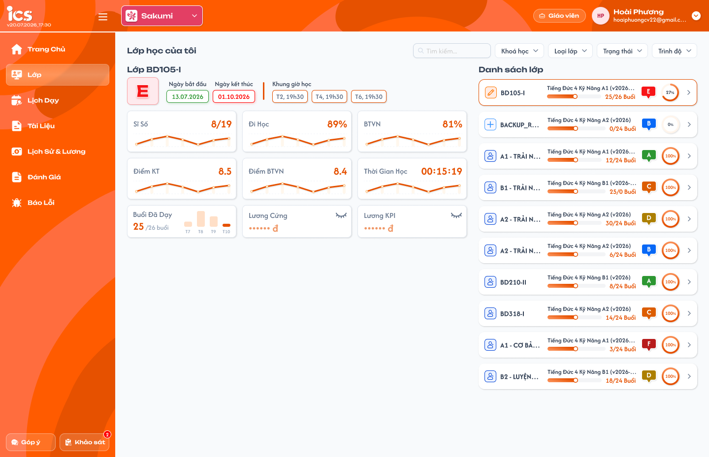

# [Giáo viên] Lớp — Thống kê tổng quan

## 1. UI

### Trang 1: GV-LOP-010000 — Lớp / Thống kê tổng quan



**Mô tả:**
- Giáo viên đăng nhập xem thống kê các lớp mình được phân công tại trung tâm đang chọn ở header, chọn một lớp để xem nhanh chỉ số lớp đó và bấm `>` để vào Chi tiết lớp.
- Trang gồm: tiêu đề `Thống kê tổng quan`, ô `Tìm kiếm` và 3 bộ lọc; hàng 5 thẻ chỉ số và badge hạng; khối `Lớp <mã lớp>` bên trái; `Danh sách lớp` bên phải.

**Điểm cần lưu ý:**
- `A01.01` Trung tâm: lấy theo trung tâm giáo viên đang chọn ở header; chỉ lớp của trung tâm đó.
- `A01.02` Tìm kiếm: tìm theo mã lớp hoặc tên khoá học, không phân biệt hoa thường; áp dụng cho cả hàng thẻ chỉ số và Danh sách lớp.
- `A01.03` Loại lớp: chọn một hoặc nhiều `Lớp 1-1`, `Lớp chung`, `Lớp demo`. Mặc định tất cả.
- `A01.04` Trạng thái: chọn một hoặc nhiều trong 7 trạng thái lớp `Mới tạo`, `Trải nghiệm`, `Khai giảng`, `Đang học`, `Tạm ngưng`, `Hoàn thành`, `Huỷ bỏ`. **Mặc định `Đang học`**.
- `A01.05` Trình độ: chọn một hoặc nhiều trình độ từ dữ liệu định nghĩa. Mặc định tất cả.
- `A01.06` Tập lớp thỏa bộ lọc: lớp giáo viên được thêm vào (mọi trạng thái), thuộc trung tâm, khớp tìm kiếm và cả 3 bộ lọc. Hàng thẻ và Danh sách lớp cùng dùng tập này.
- Không có kỳ thống kê: thống kê tính trên toàn bộ dữ liệu của các lớp thỏa bộ lọc.
- Đổi bộ lọc hoặc tìm kiếm thì tính lại hàng thẻ, tải lại Danh sách lớp và chọn lại lớp đầu tiên.
- Không có lớp thỏa bộ lọc: hàng thẻ hiển thị `0/0`, `0%`, badge hạng trống; ẩn khối lớp bên trái; Danh sách lớp hiển thị `Bảng dữ liệu này đang trống`.
- `A02.01` `Số lớp`: `x/y`; x = số lớp ở trạng thái `Đang học`; y = tổng lớp trong tập thỏa bộ lọc.
- `A02.02` `Lên kỳ`: Lên kỳ mỗi học viên = `(Tỷ lệ đi học + Tỷ lệ BTVN) / 2`; thẻ = trung bình cộng Lên kỳ của mọi học viên trong các lớp của tập. Làm tròn kết quả cuối 1 chữ số thập phân, hiển thị `%`.
- `A02.03` `Đi học`: tỷ lệ đi học mỗi học viên = số lượt `Có mặt`, `Vào trễ`, `Ra sớm`, `Vào trễ & Ra sớm` / tổng lượt phải tham gia × 100; thẻ = trung bình cộng của mọi học viên trong tập. 1 chữ số thập phân.
- `A02.04` `BTVN`: tỷ lệ BTVN mỗi học viên = số BTVN đã nộp / số BTVN được giao × 100; thẻ = trung bình cộng của mọi học viên trong tập. 1 chữ số thập phân.
- `A02.05` `Đạt KPI`: KPI lớp = trung bình cộng Lên kỳ của học viên **trong lớp đó**; thẻ = trung bình cộng KPI lớp của các lớp trong tập, mỗi lớp trọng số bằng nhau. 1 chữ số thập phân.
- `A02.06` Badge hạng: hạng `A`–`F` tổng hợp của giáo viên theo nguồn dữ liệu đánh giá; chưa có công thức, hiển thị giá trị có sẵn, không có thì trống.
- Học viên không có mẫu số hợp lệ (chưa có buổi phải tham gia / chưa được giao BTVN) không tham gia trung bình của chỉ số đó; 0% hợp lệ vẫn tính. Lớp không có học viên hợp lệ thì KPI lớp không tham gia thẻ `Đạt KPI`. Không làm tròn từng học viên/lớp trước khi lấy trung bình; không chia 0, tập rỗng hiển thị `0%`.
- Khối `Lớp <mã lớp>` bên trái hiển thị nhanh thông tin và 6 chỉ số của lớp đang chọn trong Danh sách lớp; mặc định chọn lớp đầu tiên, bấm card khác để đổi; không có lớp trong danh sách thì ẩn toàn bộ khối. Sáu chỉ số dùng đúng công thức mục `Thống kê học tập trung bình của lớp` của Tổng quan lớp, không tính lại khác.
- `A03.01` `Kết quả`: badge hạng `A`–`F` của lớp theo nguồn đánh giá lớp; chưa có công thức.
- `A03.02` `Ngày bắt đầu` / `Ngày kết thúc`: `dd.MM.yyyy` theo Thông tin lớp.
- `A03.03` `Khung giờ học`: các khung lịch cố định của lớp dạng `T2, 19h30`; không có thì ẩn.
- `A03.04` `Sĩ số`: `x/y`; x = học viên Đang học + Dự thính; y = tất cả học viên của lớp đủ 7 trạng thái (Đang học, Dự thính, Hoàn thành, Nghỉ học, Rời lớp, Chỉ xem, Xóa).
- `A03.05` `Đi học`, `BTVN`: trung bình cộng tỷ lệ của học viên có dữ liệu trong lớp, hiển thị `%` số nguyên; không có dữ liệu thì trống.
- `A03.06` `Điểm KT`, `Điểm BTVN`: cộng điểm các bài đã chấm chia số bài đã chấm (giữ bài của học viên đã Rời lớp/Xóa), 1 chữ số thập phân; không có bài đã chấm thì trống.
- `A03.07` `Thời gian học`: trung bình tổng thời gian học viên–bài trên app, hiển thị `HH:mm:ss`.
- `A03.08` Biểu đồ nhỏ: đường xu hướng chỉ số theo bài học của lớp, chỉ hiển thị.
- `A04.01` Icon trạng thái lớp: theo bộ 7 trạng thái lớp; hover hiện tên trạng thái.
- `A04.02` Mã lớp: cắt `…` khi dài; hover hiện đủ.
- `A04.03` Tên khoá học: tên khoá học gắn với lớp.
- `A04.04` Thanh tiến độ `x/y Buổi`: x = số buổi của lớp đã học (lịch Hoàn thành); y = tổng số buổi của khoá học. Thanh tô theo x/y; x > y thì tô đầy, số vẫn hiện nguyên.
- `A04.05` Badge hạng: hạng `A`–`F` của lớp theo nguồn đánh giá; không có thì trống.
- `A04.06` Vòng `%`: KPI lớp = trung bình cộng Lên kỳ của học viên trong lớp, số nguyên `%`; không có học viên hợp lệ thì trống.
- `A04.07` `>`: vào Chi tiết lớp của đúng lớp (menu Tổng quan).
- `A04.08` Card đang chọn: viền cam.
- `A04.09` Sắp xếp: theo mã lớp tăng dần; tải toàn bộ, không phân trang.

---

## 2. Yêu cầu

### 2.1. Flow chính

**Flow 1: Mở Thống kê tổng quan**

```
Giáo viên đăng nhập → chọn trung tâm ở header → menu Lớp
      → Hệ thống tải lớp giáo viên được thêm vào tại trung tâm, bộ lọc mặc định Trạng thái = Đang học
      → Tính hàng thẻ chỉ số trên tập lớp thỏa bộ lọc; hiển thị Danh sách lớp; chọn lớp đầu tiên → khối lớp bên trái
      → Không có lớp: thẻ 0/0, 0%; ẩn khối lớp; danh sách "Bảng dữ liệu này đang trống"
```

**Flow 2: Tìm kiếm và lọc**

```
Giáo viên nhập Tìm kiếm hoặc đổi Loại lớp / Trạng thái / Trình độ
      → Hệ thống tính lại tập lớp thỏa bộ lọc
      → Tính lại hàng thẻ; tải lại Danh sách lớp; chọn lại lớp đầu tiên
```

**Flow 3: Vào Chi tiết lớp**

```
Giáo viên bấm card → khối lớp bên trái đổi theo lớp đó
      → Bấm ">" → mở Chi tiết lớp (menu Tổng quan) của đúng lớp
```

### 2.2. Ngoại lệ

- **EX01:** Không có lớp thỏa bộ lọc → thẻ `0/0`, `0%`, badge trống; ẩn khối lớp; danh sách `Bảng dữ liệu này đang trống`; không lỗi.
- **EX02:** Tải dữ liệu thất bại → vùng lỗi có `Thử lại`; không hiển thị số 0 giả.
- **EX03:** Giáo viên không được thêm vào lớp nào tại trung tâm → như EX01.

### 2.3. Yêu cầu khác

| Mã | Tên yêu cầu | Mô tả |
|---|---|---|
| REQ01 | Phạm vi và bộ lọc | Lớp giáo viên được thêm vào tại trung tâm đang chọn. Tìm theo mã lớp/tên khoá; Loại lớp (`Lớp 1-1`, `Lớp chung`, `Lớp demo`), Trạng thái (7 trạng thái, mặc định `Đang học`), Trình độ; chọn nhiều, trong cùng bộ lọc là OR. Hàng thẻ và Danh sách lớp dùng cùng tập lớp thỏa bộ lọc. Không có kỳ thống kê. |
| REQ02 | Hàng thẻ | `Số lớp` = lớp Đang học / tổng lớp tập; `Đi học`, `BTVN` = trung bình tỷ lệ của mọi học viên trong tập; `Lên kỳ` = trung bình `(Đi học + BTVN)/2` của mọi học viên; `Đạt KPI` = trung bình KPI lớp (KPI lớp = trung bình Lên kỳ của học viên trong lớp), mỗi lớp trọng số bằng nhau; badge hạng theo nguồn. Làm tròn kết quả cuối 1 chữ số thập phân; học viên/lớp thiếu mẫu số không tham gia; tập rỗng `0%`. |
| REQ03 | Khối lớp đang chọn | Mặc định lớp đầu tiên; `Kết quả`, ngày bắt đầu/kết thúc, khung giờ học, 6 chỉ số theo công thức Tổng quan lớp; ẩn khi không có lớp. |
| REQ04 | Danh sách lớp | Card có icon trạng thái, mã lớp, tên khoá, tiến độ `x/y Buổi` (buổi Hoàn thành / tổng buổi khoá), badge hạng, vòng KPI lớp, `>` vào Chi tiết lớp; sắp theo mã lớp; không phân trang. |
| REQ05 | Đồng bộ | Số liệu lấy từ cùng nguồn với Tổng quan lớp và Danh sách giáo viên của Admin; đổi trung tâm thì bộ lọc về mặc định và tải lại. |

### 2.4. Ràng buộc

#### Quyền

| Role | Xem thống kê và danh sách lớp của mình | Vào Chi tiết lớp | Sửa dữ liệu |
|---|:---:|:---:|:---:|
| Giáo viên | ✅ | ✅ | ❌ |
| Các role khác | ❌ (dùng menu riêng) | ❌ | ❌ |

#### Ràng buộc khác

- Chỉ lớp giáo viên đang đăng nhập được thêm vào, tại trung tâm đang chọn; backend kiểm tra, không dựa vào ẩn ở client.
- Không cho phép truy cập Chi tiết lớp không được phân công, kể cả bằng URL.

---

## 3. Testcase

### Feature: [Giáo viên] Lớp — Thống kê tổng quan

| Tên testcase | Priority | Scenario | Role | Pre-condition | Given/When/Then | Expected Result |
|---|---|---|---|---|---|---|
| Case 1: Mở menu Lớp | High | Flow 1 / REQ01 | Giáo viên | Giáo viên có 6 lớp ở trung tâm, 4 lớp Đang học | **Given:** đăng nhập, chọn trung tâm<br>**When:** mở menu Lớp<br>**Then:** bộ lọc Trạng thái = Đang học, hàng thẻ và danh sách tính trên 4 lớp | - Chọn sẵn lớp đầu tiên<br>- Không có kỳ thống kê |
| Case 2: Đổi bộ lọc tính lại thẻ | High | Flow 2 / REQ01 / REQ02 | Giáo viên | Có lớp Đang học và Hoàn thành | **Given:** thêm `Hoàn thành` vào bộ lọc Trạng thái<br>**When:** áp dụng<br>**Then:** hàng thẻ và danh sách tính lại trên cả hai nhóm | - Chọn lại lớp đầu tiên<br>- Lớp Huỷ bỏ không vào |
| Case 3: Tìm theo mã lớp và tên khoá | Medium | Flow 2 / REQ01 | Giáo viên | Có lớp BD105-I khoá Tiếng Đức A1 | **Given:** nhập `a1`<br>**When:** tìm<br>**Then:** chỉ lớp có mã hoặc tên khoá chứa `a1` | - Hàng thẻ tính trên kết quả tìm |
| Case 4: Không có lớp | Medium | Flow 1 / EX01 / EX03 | Giáo viên | Bộ lọc không ra lớp hoặc giáo viên chưa được thêm vào lớp nào | **Given:** áp dụng bộ lọc<br>**When:** kết quả rỗng<br>**Then:** thẻ `0/0`, `0%`, ẩn khối lớp, danh sách `Bảng dữ liệu này đang trống` | - Không lỗi, không NaN |
| Case 5: Tải dữ liệu thất bại | Medium | EX02 | Giáo viên | Backend lỗi | **Given:** mở menu Lớp<br>**When:** tải thất bại<br>**Then:** vùng lỗi có `Thử lại` | - Không hiển thị số 0 giả |
| Case 6: Đổi trung tâm ở header | Medium | REQ01 / REQ05 | Giáo viên | Giáo viên dạy ở 2 trung tâm | **Given:** đổi trung tâm<br>**When:** trang tải lại<br>**Then:** chỉ lớp của trung tâm mới | - Bộ lọc về mặc định |
| Case 7: Thẻ Số lớp và Lên kỳ | High | REQ02 | Giáo viên | Tập 6 lớp, 4 Đang học; học viên A Đi học 80%, BTVN 90%; B 60%, 50% | **Given:** xem thẻ Số lớp và Lên kỳ<br>**When:** tính<br>**Then:** Số lớp `4/6`; Lên kỳ A 85%, B 55%, thẻ 70.0% | - Đổi bộ lọc Trạng thái = Đang học thì `4/4`<br>- Không làm tròn từng học viên |
| Case 8: Đạt KPI theo lớp | High | REQ02 | Giáo viên | Lớp X KPI 70% (10 học viên), lớp Y KPI 50% (3 học viên) | **Given:** tính thẻ Đạt KPI<br>**When:** trung bình theo lớp<br>**Then:** 60.0% | - Mỗi lớp trọng số bằng nhau |
| Case 9: Học viên thiếu mẫu số | Medium | REQ02 | Giáo viên | Học viên C chưa được giao BTVN | **Given:** tính BTVN<br>**When:** lấy trung bình<br>**Then:** C không tham gia | - Đi học của C vẫn tính nếu có buổi |
| Case 10: Khối lớp đang chọn | High | Flow 1 / Flow 3 / REQ03 | Giáo viên | Danh sách có 6 lớp; lớp có mỗi trạng thái học viên 1 người; KT đã chấm 8, 0 (học viên 0 điểm đã Rời lớp), 1 chưa chấm | **Given:** mở menu, sau đó bấm card khác<br>**When:** tải xong và đổi lớp<br>**Then:** khối hiển thị lớp đầu tiên rồi đổi theo card; Sĩ số `2/7`; Điểm KT 4.0 | - Card đầu viền cam<br>- Chưa chấm không vào mẫu điểm |
| Case 11: Card lớp và vào Chi tiết lớp | High | Flow 3 / REQ04 | Giáo viên | Lớp BD105-I có 25 buổi Hoàn thành, khoá 26 buổi; lớp khác 30/24; lớp có học viên Lên kỳ 80%, 60% | **Given:** xem card, bấm `>` của BD105-I<br>**When:** tính và điều hướng<br>**Then:** `25/26 Buổi`, vòng `70%`, mở Chi tiết lớp BD105-I menu Tổng quan | - Lớp 30/24 thanh tô đầy, số vẫn `30/24`<br>- Không vào lớp khác |
| Case 12: Ràng buộc quyền và phạm vi | High | Ràng buộc quyền | Role khác Giáo viên; Giáo viên không được phân công | - | **Given:** role khác mở menu Lớp của Giáo viên; hoặc Giáo viên mở URL Chi tiết lớp không được phân công<br>**When:** hệ thống xử lý<br>**Then:** bị từ chối | - Dữ liệu không đổi, không lộ dữ liệu lớp khác |

---

## 4. Câu hỏi cần xác nhận

- **Q01:** Công thức và nguồn của badge hạng `A`–`F` (thẻ tổng của giáo viên, `Kết quả` của lớp, badge trên card); hiện chỉ hiển thị giá trị có sẵn.
- **Q02:** Nội dung biểu đồ nhỏ trong 6 thẻ của khối lớp (trục, số điểm dữ liệu) chưa được đặc tả.
