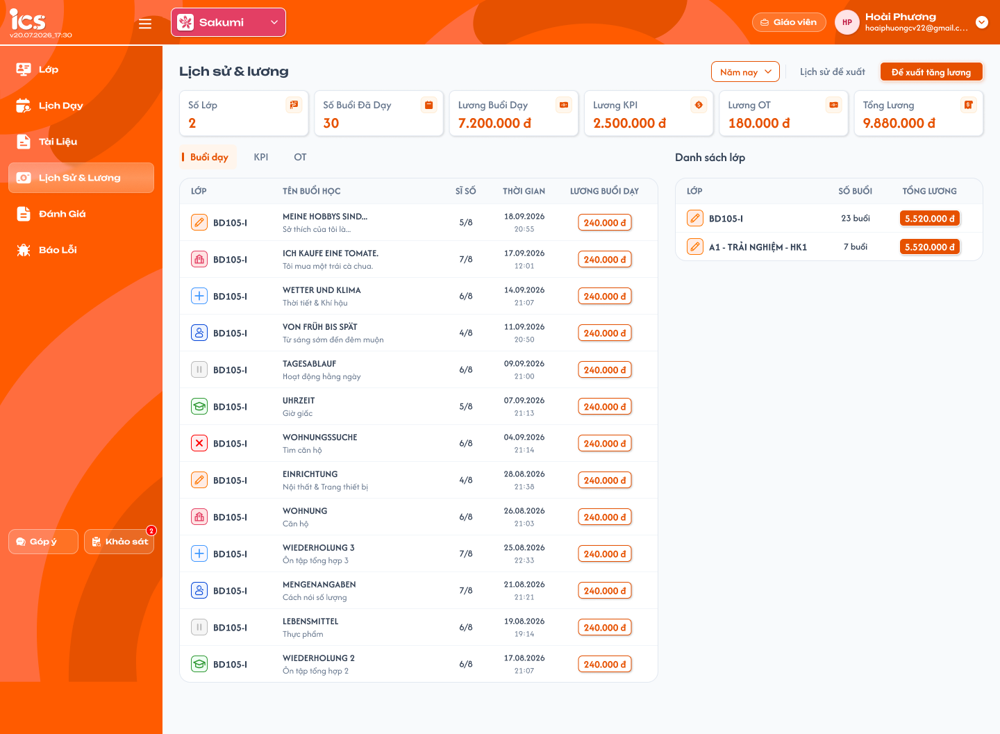
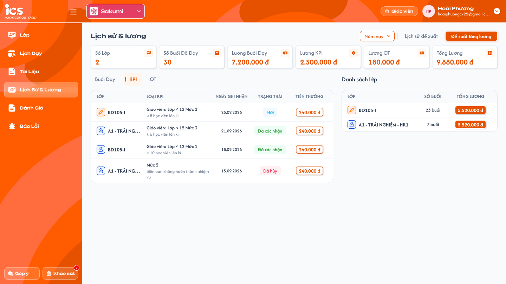
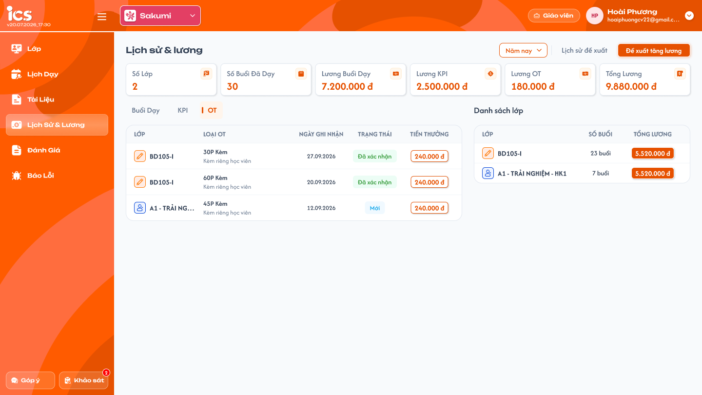
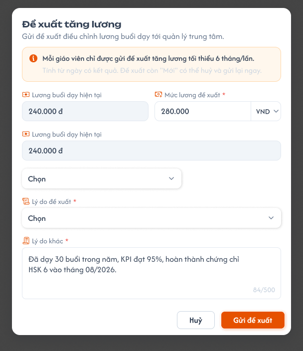
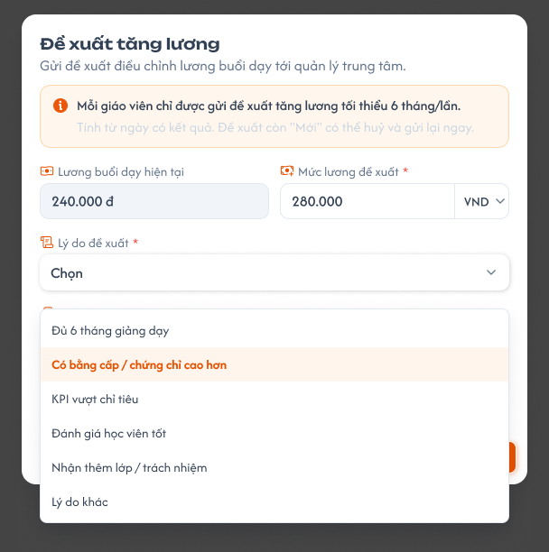
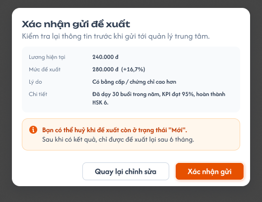
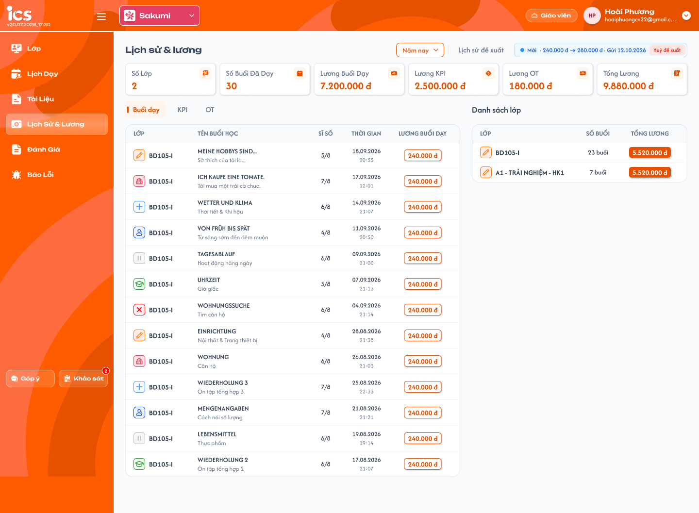
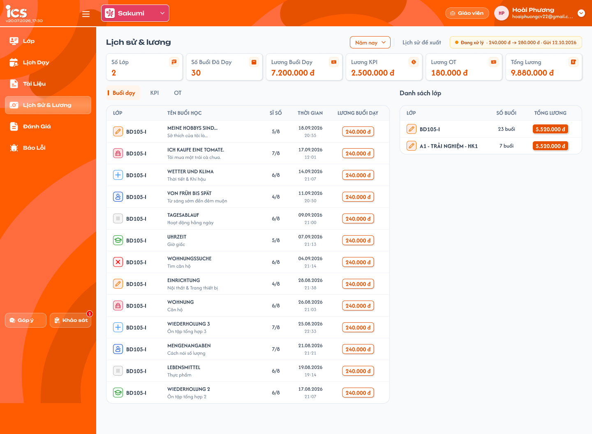
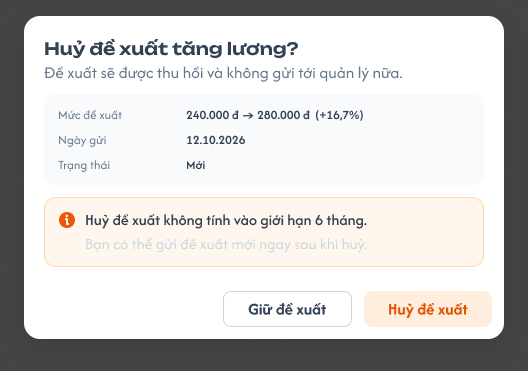
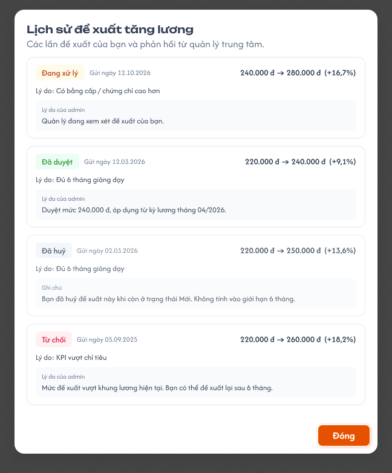

# [Giáo viên] Lịch sử & lương

**Trạng thái: Đã chốt các điểm nghiệp vụ còn mở ngày 2026-10-20.** Tài liệu đặc tả menu Lịch sử & lương trên toàn bộ lớp của Giáo viên, gồm Buổi dạy, KPI, OT và luồng Đề xuất tăng lương. UI đọc trực tiếp qua MCP Figma; nghiệp vụ theo requirement dùng chung và các quyết định ghi ở mục 3. Source cũ người dùng xác định là `pls_repository_api`.

Quy tắc đã chốt dùng chung với [Thông tin lớp — Lịch sử & lương](../class/class_information_requirements.md) và [Bài học — chọn lịch, hoàn thành buổi](../class/class_teaching_requirements.md). Đây là lịch sử của chính giáo viên trên toàn bộ lớp, không phải tab Thông tin của một lớp và không phải màn quản lý lương của Admin.

## 1. UI

### Trang 1: GV-LS-010000 — Tổng quan và tab Buổi dạy




*Figma GV-LS-010000 — sáu thẻ tổng hợp, bảng Buổi dạy và Danh sách lớp; số liệu là dữ liệu mẫu*

**Mô tả:**

- Giáo viên xem buổi đã dạy và các khoản lương của chính mình trên toàn bộ lớp trong khoảng thời gian được chọn.
- Dữ liệu lương chỉ đọc. Không sửa mức lương, trạng thái buổi, số tiền KPI/OT hoặc xác nhận khoản tại menu này. Gửi/hủy Đề xuất tăng lương là chức năng riêng, không phải sửa trực tiếp lương đang áp dụng.
- Bố cục gồm bộ lọc thời gian, `Lịch sử đề xuất`, vùng `Đề xuất tăng lương`/trạng thái đề xuất, sáu thẻ tổng hợp, ba tab bên trái và `Danh sách lớp` bên phải.

**Giải thích field/thành phần:**

- `A01.01` **Bộ lọc thời gian**: Yêu cầu / căn cứ: Dùng chung 10 lựa chọn với Thông tin lớp: Tuần này, Tuần trước, Tháng này, Tháng trước, Tháng trước nữa, 3 tháng gần đây, 6 tháng gần đây, Năm nay, Năm trước, Tùy chọn. Mặc định Tháng này theo quy tắc dùng chung; Figma đang minh họa Năm nay. **Đã chốt:** cách tính các khoảng, gồm 3/6 tháng gần đây, timezone và ngày biên dùng đúng quy ước bộ lọc chung của các trang khác; không xây cách tính riêng tại menu này.
- `A01.02` **Tùy chọn**: Yêu cầu / căn cứ: Chọn từ ngày–đến ngày, từ ngày không sau đến ngày; bao gồm dữ liệu ở hai ngày biên theo timezone nghiệp vụ.
- `A01.03` **`Số lớp`**: Yêu cầu / căn cứ: **Đã chốt theo điều kiện truy vấn source cũ:** đếm class_id không trùng từ quan hệ user_class của giáo viên đang đăng nhập, đúng role giáo viên và status khác Remove; lấy lớp tương ứng có status khác Deleted. Không giới hạn chỉ InProgress/Completed. Dùng cùng tập lớp với Danh sách lớp bên phải; không lấy số dòng đã tải làm tổng. Khoảng thời gian lọc số buổi/tiền, không loại lớp chỉ vì kỳ đó không phát sinh.
- `A01.04` **`Số buổi đã dạy`**: Yêu cầu / căn cứ: Số buổi Hoàn thành do giáo viên đang đăng nhập dạy trong khoảng; kể cả buổi không gắn lịch. Buổi có lịch lọc theo ngày tính lương của lịch; không lịch dùng thời điểm hoàn thành.
- `A01.05` **`Lương buổi dạy`**: Yêu cầu / căn cứ: Tổng tiền đã ghi nhận của các buổi Hoàn thành có lịch gắn trong khoảng. Mỗi buổi giữ mức đã ghi nhận khi hoàn thành; không tính lại buổi cũ khi mức lương thay đổi. Buổi không lịch bằng 0.
- `A01.06` **`Lương KPI`**: Yêu cầu / căn cứ: Tổng số tiền thực tế đã lưu của KPI Đã xác nhận, thuộc giáo viên, Ngày ghi nhận trong khoảng. Không lấy khoản đầu tiên; không cộng khoản Mới, Đã hủy, Đã xóa.
- `A01.07` **`Lương OT`**: Yêu cầu / căn cứ: **Đã chốt:** tổng value thực tế đã lưu của các khoản OT Đã xác nhận thuộc giáo viên, có Ngày ghi nhận trong khoảng lọc. Không cộng Mới, Đã hủy, Đã xóa; không tự nhân thời lượng–đơn giá hoặc số phút trong tên loại.
- `A01.08` **`Tổng lương`**: Yêu cầu / căn cứ: Lương buổi dạy + Lương KPI + Lương OT. Không cộng lại số tiền của bảng Danh sách lớp như một nguồn riêng.
- `A01.09` **Ba tab**: Yêu cầu / căn cứ: Buổi dạy / KPI / OT. Đổi tab giữ khoảng thời gian; chỉ thay bảng chi tiết, không đổi bộ lọc hoặc tự nhân các khoản tổng.
- `A01.10` **Định dạng tiền**: Yêu cầu / căn cứ: Dấu phân cách hàng nghìn kèm `đ` theo Figma, ví dụ `240.000 đ`; giá trị tính toán giữ dạng số.

**Bảng Buổi dạy:**

- `A01.11` **`LỚP`**: Icon trạng thái lớp và mã lớp của đúng buổi; hover có tên trạng thái.
- `A01.12` **`TÊN BUỔI HỌC`**: Tên bài học và mô tả ngắn nếu có; nội dung mẫu tiếng Đức trên Figma không phải dữ liệu cố định.
- `A01.13` **`SĨ SỐ`**: x/y, cùng công thức đã chốt ở Thông tin lớp: x là học viên đi học, y là học viên hợp lệ của lớp. Có mặt, Vào trễ, Ra sớm, Vào trễ & Ra sớm tính vào x; Nghỉ học, Rời lớp, Chỉ xem, Xóa bị loại khỏi tập hợp lệ y theo requirement dùng chung.
- `A01.14` **`THỜI GIAN`**: Ngày tính lương của lịch đã gắn, không phải ngày bấm Hoàn thành; buổi không lịch dùng thời điểm hoàn thành. Hiển thị `dd.MM.yyyy` và `HH:mm` hai dòng theo Figma.
- `A01.15` **`LƯƠNG BUỔI DẠY`**: Tiền đã ghi nhận của buổi, chỉ đọc. Buổi không gắn lịch: `0 đ` và icon cảnh báo `Buổi dạy hoàn thành nhưng chưa có lịch thanh toán`.
- `A01.16` **Sắp xếp**: Thời gian giảm dần như lịch sử trong Thông tin lớp.
- `A01.17` **Không có buổi**: Hiển thị `Không có buổi dạy nào`; không suy ra KPI/OT cũng bằng 0 nếu vẫn có khoản của chúng.

**Danh sách lớp bên phải:**

- `A01.18` **`LỚP`**: Yêu cầu / điểm còn đối chiếu: Icon trạng thái và mã lớp; mỗi class_id một dòng. Cùng tập lớp với thẻ Số lớp: quan hệ đúng giáo viên/role, khác Remove; lớp khác Deleted. Giữ các trạng thái khác được truy vấn cũ trả về, không thêm bộ lọc chỉ Đang học/Hoàn thành.
- `A01.19` **`SỐ BUỔI`**: Yêu cầu / điểm còn đối chiếu: Số buổi Hoàn thành của chính giáo viên tại lớp trong khoảng đang lọc, không đếm buổi của giáo viên khác. Lớp không có buổi trong kỳ vẫn có dòng với 0 buổi và 0 đ lương buổi dạy.
- `A01.20` **`TỔNG LƯƠNG`**: Yêu cầu / điểm còn đối chiếu: **Đã chốt:** chỉ tổng tiền lương buổi dạy đã ghi nhận của giáo viên tại lớp trong khoảng đang lọc; không cộng KPI hoặc OT. Đối chiếu với cột Số buổi. Thẻ Tổng lương toàn màn vẫn cộng lương buổi dạy + KPI + OT.
- `A01.21` **Tương tác dòng lớp**: Yêu cầu / điểm còn đối chiếu: **Đã chốt:** bấm dòng lớp mở Chi tiết lớp tương ứng trong role Giáo viên, theo class_id và kiểm tra quyền truy cập. Đây là điều hướng sang lớp, không lọc bảng lương tại chỗ.
- `A01.22` **Phân trang**: Yêu cầu / điểm còn đối chiếu: **Đã chốt:** dùng quy ước chung của các trang danh sách: tối đa 50 dòng/trang, hiển thị khoảng đang xem/tổng kết quả, trang hiện tại, Trước/Sau và số trang; vô hiệu hóa nút ở biên. Áp dụng cho các bảng Buổi dạy/KPI/OT và Danh sách lớp; đổi bộ lọc về trang đầu, chuyển trang giữ bộ lọc. Thẻ tổng tính toàn bộ kết quả hợp lệ, không chỉ trang đang xem. Popup lịch sử đề xuất giữ hành vi riêng theo thiết kế, không tự thêm phân trang vào popup.

**Điểm cần lưu ý:**

- Scope toàn màn là giáo viên đang đăng nhập. Backend không trả dữ liệu của giáo viên khác chỉ vì client truyền owner_id khác hoặc hai giáo viên cùng lớp.
- Lọc theo ngày tính lương đã chốt: buổi chọn lịch 30/9, hoàn thành 2/10 thuộc kỳ tháng 9. Khoản KPI/OT dùng Ngày ghi nhận tương ứng, không tự lấy Ngày cập nhật hoặc ngày xác nhận.
- Buổi Hoàn thành không lịch vẫn tăng số buổi nhưng không tăng lương buổi; buổi do người khác dạy không tính.
- Đổi lương không hồi tố: buổi cũ 240.000 giữ 240.000; buổi hoàn thành sau thay đổi mới dùng mức mới.
- Không tự coi lương phát sinh/Đã xác nhận là đã thanh toán. Menu này không có thao tác chi trả.
- Chỉ hiển thị tổng khi đã có dữ liệu hợp lệ; tải lỗi không được giả thành 0. Bảng và thẻ phải cùng owner/khoảng lọc/phiên bản dữ liệu.
- Số liệu mẫu trong Figma chưa nhất quán: cả hai dòng Danh sách lớp đều ghi 5.520.000 đ dù số buổi khác nhau, không khớp thẻ Lương buổi dạy 7.200.000 đ. Không dùng các số mẫu này để quyết định công thức.

### Trang 2: GV-LS-010003 — Tab KPI




*Figma GV-LS-010003 — KPI của giáo viên trên toàn bộ lớp*

**Mô tả:** Giáo viên xem KPI của mình trong khoảng Ngày ghi nhận đang chọn, trên toàn bộ lớp; chỉ đọc. Khác KPI trong Thông tin lớp ở phạm vi toàn bộ lớp thay vì một lớp.

- `A02.01` **`LỚP`**: Icon trạng thái và mã lớp của khoản.
- `A02.02` **`LOẠI KPI`**: Tên từ `title` của cấu hình KPI mà khoản tham chiếu qua `typeKpi`; dòng phụ từ `description` nếu có. Không lấy `sp_note` hoặc chuỗi phân loại `kpi` làm tên.
- `A02.03` **`NGÀY GHI NHẬN`**: Ngày ghi nhận của khoản, hiển thị `dd.MM.yyyy`; là mốc dùng để lọc KPI.
- `A02.04` **`TRẠNG THÁI`**: Mới / Đã xác nhận / Đã hủy. Đã xóa không hiển thị. Chip trạng thái chỉ xem, không phải dropdown xác nhận.
- `A02.05` **`TIỀN THƯỞNG`**: Số tiền thực tế đã lưu của khoản, không thay bằng giá trị gốc của cấu hình. Không tự chặn/loại số tiền chỉ vì khác giá trị mẫu.
- `A02.06` **Sắp xếp**: Ngày ghi nhận giảm dần. Mỗi khoản một dòng, không gộp theo tên hoặc lớp.
- `A02.07` **Trạng thái rỗng**: `Bảng dữ liệu này đang trống`; không dùng thông báo rỗng khi API thất bại.

**Điểm cần lưu ý:**

- Chỉ khoản của giáo viên đang đăng nhập có loại KPI, không lẫn OT hoặc khoản KPI của Phụ trách lớp.
- Danh sách vẫn có khoản Mới/Đã hủy nhưng thẻ Lương KPI chỉ cộng Đã xác nhận; tổng tất cả khoản xác nhận, không lấy khoản đầu tiên.
- Không có thêm, sửa, xóa, đổi trạng thái hoặc xác nhận KPI. Không sao chép quyền Admin/Class Handler từ tab KPI quản lý lớp sang menu này.

### Trang 3: GV-LS-010004 — Tab OT




*Figma GV-LS-010004 — OT của giáo viên; không phải OT của Phụ trách lớp*

**Mô tả:** Giáo viên xem OT của chính mình trên toàn bộ lớp trong khoảng đang lọc. OT chỉ có ở menu Lịch sử & lương này, không đưa vào tab Thông tin lớp.

- `A03.01` **`LỚP`**: Yêu cầu / căn cứ: Icon trạng thái và mã lớp của khoản OT.
- `A03.02` **`LOẠI OT`**: Yêu cầu / căn cứ: Tên và mô tả cấu hình OT được tham chiếu; model cũ dùng cùng ClassKpiModel, phân biệt bằng type=ot. Tên mẫu 30P/45P/60P không đủ để kết luận có công thức tự nhân phút.
- `A03.03` **`NGÀY GHI NHẬN`**: Yêu cầu / căn cứ: Ngày ghi nhận khoản OT, `dd.MM.yyyy`; không thay bằng ngày cập nhật.
- `A03.04` **`TRẠNG THÁI`**: Yêu cầu / căn cứ: UI có Mới và Đã xác nhận; enum cũ còn Đã hủy/Đã xóa. Truy vấn getOTResultByOwnerIds loại Đã xóa, còn trả Mới/Đã xác nhận/Đã hủy. Bảng chỉ đọc giữ các trạng thái này; **chỉ Đã xác nhận được cộng vào Lương OT**, các khoản Mới/Đã hủy vẫn hiện nhưng không tham gia tổng.
- `A03.05` **`TIỀN THƯỞNG`**: Yêu cầu / căn cứ: Hiển thị value thực tế đã lưu của khoản; chỉ cộng khoản Đã xác nhận vào thẻ Lương OT. Không thay bằng giá trị gốc cấu hình, không tự tính theo tên loại hoặc số phút trong tên.
- `A03.06` **Quyền**: Yêu cầu / căn cứ: Chỉ đọc, không thêm/sửa/xóa/xác nhận khoản OT tại menu Giáo viên.
- `A03.07` **Rỗng/lỗi**: Yêu cầu / căn cứ: Phân biệt trạng thái chưa có dữ liệu và tải thất bại; tải lại được khi lỗi.

**Phân biệt phạm vi:** Requirement [OT của Phụ trách lớp](../../management_requirement/class_management/class_detail_ot_requirements.md) chỉ cho Admin/Class Handler quản lý khoản nhận bởi Handler. Không áp dụng quyền truy cập/người nhận của requirement đó cho OT cá nhân Giáo viên ở đây. Cùng tên OT không có nghĩa dùng chung dữ liệu người nhận.

### Trang 4: GV-LS-010010, GV-LS-010012, ADM-LGV-020010 — Popup Đề xuất tăng lương




*Figma GV-LS-010010 — bản xuất hiện tại có khối Lương buổi dạy hiện tại trùng và dropdown chưa nhãn; đã chốt bỏ hai thành phần này, Figma cần sửa — nhấn để xem ảnh gốc*



*Figma GV-LS-010012 — danh sách lý do đề xuất*

**Phân định giao diện theo role (đã đối chiếu trực tiếp Figma):**

- `A04.01` **Giáo viên — FLOW giáo viên đề xuất tăng lương, page `3772:93114`**: Giao diện và thao tác: Nhập mức mong muốn, chọn lý do/chi tiết, xác nhận gửi; hủy khi Mới; xem trạng thái và lịch sử/phản hồi. Không có thao tác nhập mức duyệt, duyệt, từ chối hoặc đánh dấu đang xử lý.
- `A04.02` **Admin — FLOW admin duyệt đề xuất tăng lương, page `4895:105908`**: Giao diện và thao tác: Xem danh sách và popup Duyệt đề xuất tăng lương (`ADM-LGV-020010`); nhập Mức lương duyệt, Lý do của admin; duyệt/từ chối/đánh dấu đang xử lý theo quyền. Đây là chức năng Admin riêng, không phải field hoặc hành động trong form gửi của Giáo viên.
- `A04.03` **Kết quả trả về Giáo viên**: Giao diện và thao tác: Giáo viên chỉ đọc mức được duyệt và phản hồi quản lý đã lưu. Duyệt không tự cập nhật lương thực tế; quản lý chỉnh thủ công ở chức năng riêng.

Các testcase nhắc đến Admin trong tài liệu này chỉ kiểm tra kết quả liên thông hiển thị cho Giáo viên và việc không tự đổi lương; không đặc tả quyền nhập/validation form duyệt của Admin.

**Mô tả:** Giáo viên gửi **đề xuất tăng lương chung cho chính mình**, không chọn lớp để đề xuất. **Admin quyết định có cập nhật `Lương/giờ` trong hồ sơ giáo viên hay không** khi xử lý theo chức năng quản lý. Gửi hoặc duyệt đề xuất không tự đổi `Lương/giờ`; giáo viên không tự cập nhật lương.

- `A04.04` **Tiêu đề**: Yêu cầu / điểm còn đối chiếu: Đề xuất tăng lương; mô tả gửi đề xuất điều chỉnh lương buổi dạy tới quản lý trung tâm.
- `A04.05` **Thông báo chu kỳ**: Yêu cầu / điểm còn đối chiếu: **Đã chốt:** tối thiểu 6 tháng/lần, tính từ thời điểm quản lý duyệt hoặc từ chối gần nhất. Không tính từ ngày gửi, ngày chuyển Đang xử lý hoặc ngày chỉnh lương thủ công. Đề xuất Mới đã hủy không tạo mốc chờ mới; không xóa mốc duyệt/từ chối cũ.
- `A04.06` **Phạm vi đề xuất**: Yêu cầu / điểm còn đối chiếu: Đề xuất chung của giáo viên; **không có field Chọn lớp**, không yêu cầu class_id để gửi. Owner do backend xác định từ giáo viên đang đăng nhập. Lớp được áp dụng do Admin lựa chọn ở chức năng quản lý riêng.
- `A04.07` **`Lương buổi dạy hiện tại`**: Yêu cầu / điểm còn đối chiếu: **Đã chốt:** ô **giáo viên tự nhập**, bắt buộc, số nguyên không âm, đơn vị **VNĐ/giờ**; là mức tham chiếu để quản lý xem xét, hệ thống không tự điền từ `Lương/giờ` trong hồ sơ. Không chọn lớp.
- `A04.08` **`Mức lương đề xuất`**: Yêu cầu / điểm còn đối chiếu: **Đã chốt:** bắt buộc, số nguyên **VNĐ/giờ**, giáo viên nhập số nào lưu đúng số đó (không làm tròn, không trần); phải lớn hơn mức hiện tại đã nhập. Từ chối số âm, số lẻ, không phải số hoặc mức thấp hơn/bằng hiện tại. Mức hiện tại bằng 0 thì tỷ lệ tăng hiển thị `—`.
- `A04.09` **`Lý do đề xuất`**: Yêu cầu / điểm còn đối chiếu: Bắt buộc theo dấu * trên ảnh; chọn một lý do theo danh sách Figma.
- `A04.10` **Các lý do**: Yêu cầu / điểm còn đối chiếu: Đủ 6 tháng giảng dạy; Có bằng cấp / chứng chỉ cao hơn; KPI vượt chỉ tiêu; Đánh giá học viên tốt; Nhận thêm lớp / trách nhiệm; Lý do khác.
- `A04.11` **`Lý do khác` / chi tiết**: Yêu cầu / điểm còn đối chiếu: **Đã chốt:** ô nhiều dòng, có đếm ký tự /500; chỉ bắt buộc khi chọn Lý do khác, các lý do còn lại được để trống. Không chấp nhận nội dung chỉ có khoảng trắng khi bắt buộc; tối đa 500 ký tự. Không tự kiểm tra đạt KPI/chứng chỉ chỉ vì tên lý do.
- `A04.12` **Dropdown tiền tệ**: Yêu cầu / điểm còn đối chiếu: Chỉ `VND`, không có lựa chọn khác; không quy đổi ngoại tệ.
- `A04.13` **Khối trùng / dropdown không nhãn**: Yêu cầu / điểm còn đối chiếu: **Đã chốt:** bỏ khối Lương buổi dạy hiện tại thứ hai và dropdown `Chọn` không nhãn trên GV-LS-010010; form chỉ gồm mức hiện tại (tự nhập), mức đề xuất, lý do, chi tiết. Không có field chọn lớp. Figma cần sửa theo.
- `A04.14` **`Huỷ`**: Yêu cầu / điểm còn đối chiếu: Đóng form, không tạo đề xuất và không tiêu thụ chu kỳ 6 tháng.
- `A04.15` **`Gửi đề xuất`**: Yêu cầu / điểm còn đối chiếu: Kiểm tra draft; nếu hợp lệ mở popup Xác nhận gửi, chưa tạo đề xuất chỉ vì bấm nút ở bước nhập.

**Điểm cần lưu ý:**

- Đây là chức năng phát sinh yêu cầu xét duyệt, không phải tự chỉnh lương. Gửi/hủy đề xuất không thay `Lương/giờ` trong hồ sơ hoặc tính lại lương lịch sử.
- Không tự suy ra giáo viên phải dạy đủ 6 tháng mới được gửi lần đầu từ lựa chọn lý do Đủ 6 tháng giảng dạy.
- Chỉ dùng mức lương/đề xuất của chính giáo viên. Backend xác định owner từ phiên đăng nhập, không tin owner/actor do client truyền.
- Dữ liệu form là draft cho tới Xác nhận gửi cuối cùng; quay lại chỉnh sửa giữ nội dung.

### Trang 5: GV-LS-010015 — Popup Xác nhận gửi đề xuất




*Figma GV-LS-010015 — bước xác nhận trước khi gửi*

- `A05.01` **Nội dung**: Yêu cầu theo Figma: Lương tham chiếu hiện tại của giáo viên, mức đề xuất, tỷ lệ tăng, lý do và chi tiết đúng draft đang xác nhận. Không có lớp được giáo viên chọn và không bổ sung xác nhận lớp áp dụng vào bước này.
- `A05.02` **Tỷ lệ tăng**: Yêu cầu theo Figma: Khi mức hiện tại lớn hơn 0: (mức đề xuất − mức hiện tại) / mức hiện tại × 100%, hiển thị một chữ số thập phân (làm tròn nửa lên; chỉ làm tròn tỷ lệ hiển thị, không làm tròn số tiền). **Đã chốt:** mức hiện tại bằng 0 thì hiển thị `—`; không hiển thị NaN/Infinity.
- `A05.03` **Thông báo**: Yêu cầu theo Figma: Có thể hủy khi đề xuất Mới; sau khi có kết quả chỉ được đề xuất lại sau 6 tháng theo quy tắc Figma.
- `A05.04` **`Quay lại chỉnh sửa`**: Yêu cầu theo Figma: Quay về form, giữ mức đề xuất, lý do và nội dung chi tiết; chưa gửi.
- `A05.05` **`Xác nhận gửi`**: Yêu cầu theo Figma: Kiểm tra quyền, trạng thái/điều kiện hiện tại và dữ liệu; thành công tạo một đề xuất Mới, cập nhật banner.

**Điểm cần lưu ý:**

- Chặn gửi lặp trong khi đang xử lý; retry cùng thao tác không được tạo nhiều đề xuất.
- Nếu mức lương nền/điều kiện đã thay đổi sau khi mở form, không âm thầm gửi với dữ liệu cũ; yêu cầu kiểm tra lại bản mới.
- Lỗi giữ draft để thử lại, không hiển thị banner Mới giả hoặc thông báo thành công trước backend.

### Trang 6: GV-LS-010014, GV-LS-010011, GV-LS-010016 — Trạng thái đề xuất và hủy đề xuất




*Figma GV-LS-010014 — Mới, có thể hủy*



*Figma GV-LS-010011 — Đang xử lý, không hủy được*

- `A06.01` **Chưa có đề xuất đang chờ**: Yêu cầu theo Figma: Hiển thị nút Đề xuất tăng lương theo điều kiện được phép gửi.
- `A06.02` **`Mới`**: Yêu cầu theo Figma: Banner xanh dương: trạng thái, mức cũ → đề xuất, ngày gửi và nút Huỷ đề xuất. Không tự sửa draft đã gửi bằng cách đổi trực tiếp banner.
- `A06.03` **`Đang xử lý`**: Yêu cầu theo Figma: Banner vàng/cam với mức và ngày gửi; không có nút hủy. Gọi request hủy trực tiếp vẫn phải bị từ chối.
- `A06.04` **`Đã duyệt` / `Từ chối`**: Yêu cầu theo Figma: Kết quả do quản lý xử lý, giáo viên chỉ xem; thời điểm có kết quả là mốc cho quy tắc 6 tháng theo Figma. Mức được duyệt có thể khác mức đề xuất, có phản hồi/ghi chú nếu quản lý cung cấp. Đã duyệt chỉ xác nhận kết quả xét đề xuất; không tự cập nhật lương thực tế.
- `A06.05` **`Đã huỷ`**: Yêu cầu theo Figma: Hủy bởi giáo viên khi còn Mới; vẫn giữ lịch sử; không tính vào giới hạn 6 tháng theo Figma.
- `A06.06` **Đề xuất đang chờ**: Yêu cầu theo Figma: Request thuộc giáo viên, không tách theo lớp; mỗi giáo viên chỉ có một đề xuất Mới/Đang xử lý tại một thời điểm theo flow Figma. Backend kiểm tra điều kiện trên giáo viên, không dùng class_id để gửi thêm đề xuất hoặc né chu kỳ chờ. Banner không yêu cầu mã lớp.



*Figma GV-LS-010016 — xác nhận hủy một đề xuất Mới*

- `A06.07` **Dữ liệu xác nhận**: Mức hiện tại → mức đề xuất, tỷ lệ tăng, ngày gửi và trạng thái của đúng request thuộc giáo viên; không yêu cầu mã lớp.
- `A06.08` **`Giữ đề xuất`**: Đóng popup, giữ trạng thái hiện tại; không gửi request hủy.
- `A06.09` **`Huỷ đề xuất`**: Kiểm tra vẫn là Mới và đúng owner; thành công chuyển Đã huỷ, cập nhật banner và lịch sử.
- `A06.10` **Hủy và gửi lại**: Theo Figma, đề xuất Mới đã hủy không tiêu thụ chu kỳ; có thể gửi lại ngay nếu không có điều kiện chặn khác đang áp dụng. Hủy không xóa các kết quả cũ hoặc bỏ thời hạn chờ của một kết quả cũ.

### Trang 7: GV-LS-010013 — Popup Lịch sử đề xuất tăng lương




*Figma GV-LS-010013 — lịch sử Mới/Đang xử lý/Đã duyệt/Đã huỷ/Từ chối theo dữ liệu thực tế*

- `A07.01` **Tiêu đề**: Yêu cầu theo Figma: Lịch sử đề xuất tăng lương; các lần đề xuất và phản hồi từ quản lý trung tâm.
- `A07.02` **Mỗi mục lịch sử**: Yêu cầu theo Figma: Một đề xuất của giáo viên: trạng thái, ngày gửi, mức hiện tại tham chiếu → mức đề xuất, tỷ lệ, lý do, chi tiết và phản hồi/ghi chú quản lý nếu có. Với Đã duyệt, hiển thị riêng mức được duyệt do quản lý ghi nhận; không lấy mức đề xuất thay thế. Không phân loại theo lớp hoặc loại lớp.
- `A07.03` **Sắp xếp**: Yêu cầu theo Figma: Ngày gửi giảm dần, không gộp hai request cùng mức tiền thành một mục.
- `A07.04` **Phản hồi**: Yêu cầu theo Figma: Lý do của admin/ghi chú theo dữ liệu đã lưu; ví dụ chấp nhận/từ chối trong ảnh không phải câu trả lời mặc định.
- `A07.05` **`Đóng`**: Yêu cầu theo Figma: Đóng popup, không đổi request hoặc chu kỳ.
- `A07.06` **Rỗng/lỗi**: Yêu cầu theo Figma: Chưa có đề xuất thì trạng thái rỗng; tải thất bại có lỗi và Thử lại. Không giả dữ liệu mẫu.

**Điểm cần lưu ý:**

- Lịch sử thuộc chính giáo viên. Chưa có filter riêng trong popup Figma; không tự áp khoảng thống kê lương lên lịch sử request.
- Mức lương nền, mức đề xuất, ngày gửi và phản hồi của request cũ không bị thay bằng lương hiện tại mới.
- Đề xuất là thông tin tham khảo ở cấp quản lý, không phân loại theo lớp hoặc loại lớp. Mức được duyệt được lưu riêng với mức đề xuất, có thể khác nhau; ghi chú/phản hồi giữ đúng dữ liệu quản lý cung cấp. Ví dụ mức tham chiếu 180.000 đ, xin 220.000 đ, được duyệt 190.000 đ: lịch sử giữ đủ ba mức, không ghi đè 220.000 đ thành 190.000 đ.
- Sau khi duyệt, Admin vẫn phải chỉnh `Lương/giờ` thủ công trong hồ sơ giáo viên (Chi tiết giáo viên → Thông tin cá nhân). Thao tác duyệt không tự cập nhật `Lương/giờ` và không mặc định đã áp dụng từ ngày duyệt; mức mới chỉ áp dụng cho các buổi chưa hoàn thành từ lúc Admin cập nhật.
- Việc áp dụng mức mới vẫn phải giữ lương buổi đã hoàn thành, không hồi tố theo quy tắc đã chốt.

---

## 2. Yêu cầu

### 2.1. Flow chính

**Flow 1 / REQ01–REQ03: Xem lịch sử và tổng lương**

```text
Giáo viên → Lịch sử & lương → kiểm tra danh tính/phạm vi
  → Tải bộ lọc, tổng và bảng Buổi dạy của chính giáo viên
  → Chọn khoảng khác → tính theo ngày tính lương/Ngày ghi nhận tương ứng
  → Chỉ hiển thị dữ liệu của lựa chọn mới nhất
```

**Flow 2 / REQ04–REQ05: Xem KPI và OT**

```text
Chọn KPI hoặc OT → giữ bộ lọc thời gian và owner
  → Tải đúng loại khoản, hiển thị cột tương ứng ở chế độ chỉ đọc
  → Không tự đổi số tiền/trạng thái hoặc áp quyền quản lý khoản
```

**Flow 3 / REQ06–REQ07: Nhập và gửi đề xuất**

```text
Đề xuất tăng lương → kiểm tra điều kiện của giáo viên → mở form trống
  → Nhập mức hiện tại (VNĐ/giờ), mức đề xuất (VNĐ/giờ), lý do, chi tiết; không chọn lớp
  → Gửi đề xuất → validate → popup Xác nhận gửi
  → Quay lại chỉnh sửa: giữ draft, chưa tạo request
  → Xác nhận gửi: backend kiểm tra lại → tạo một request Mới → banner đồng bộ
```

**Flow 4 / REQ08: Hủy đề xuất Mới**

```text
Request Mới → Hủy đề xuất → popup xác nhận đúng request
  → Giữ đề xuất: đóng, không ghi
  → Hủy đề xuất: kiểm tra owner + trạng thái mới nhất → Đã huỷ
  → Đang xử lý: không cho hủy, kể cả API trực tiếp
```

**Flow 5 / REQ09: Xem lịch sử đề xuất**

```text
Lịch sử đề xuất → tải request của chính giáo viên, ngày gửi giảm dần
  → Xem mức cũ/đề xuất, trạng thái và phản hồi đã lưu
  → Đóng: không thay đổi dữ liệu
```

### 2.2. Ngoại lệ

- **EX01:** Sai owner/role, sửa số tiền KPI/OT, tự duyệt/từ chối hoặc hủy đề xuất người khác → backend từ chối; không tiết lộ hoặc thay đổi dữ liệu ngoài phạm vi.
- **EX02:** Chưa có buổi/khoản/request → trạng thái rỗng tương ứng; không làm mất tổng của loại dữ liệu khác còn tồn tại.
- **EX03:** Tải/gửi/hủy lỗi → không báo thành công giả, không đổi dữ liệu chính thức; giữ draft khi gửi lỗi và có Thử lại.
- **EX04:** Request lặp/xung đột/mức lương nền thay đổi → không tạo trùng, không âm thầm dùng dữ liệu cũ hoặc ghi đè trạng thái mới.
- **EX05:** Request đã Đang xử lý/có kết quả → không hủy bằng request trực tiếp; đồng bộ trạng thái thực tế.
- **EX06:** Form thiếu/sai dữ liệu bắt buộc theo quy tắc được chốt → báo đúng field, giữ draft; không tạo request một phần.

### 2.3. Yêu cầu khác

| Mã | Tên yêu cầu | Mô tả |
|---|---|---|
| REQ01 | Phạm vi | Chỉ dữ liệu của giáo viên đang đăng nhập; không dùng owner client tự truyền để bypass quyền. Thẻ Số lớp và Danh sách lớp dùng chung tập class_id không trùng theo truy vấn cũ: user_class đúng user_id/role, status khác Remove; lớp tương ứng khác Deleted. Không giới hạn InProgress/Completed hoặc bắt buộc có buổi trong kỳ; khoảng lọc áp cho số buổi và tiền của mỗi dòng. |
| REQ02 | Thời gian | Bộ lọc dùng chung; buổi theo ngày tính lương của lịch, không lịch theo hoàn thành; khoản theo Ngày ghi nhận. Mặc định `Tháng này`; `Tùy chọn` lấy cả hai ngày biên theo timezone nghiệp vụ. |
| REQ03 | Buổi và lương | Tổng lương từng lớp chỉ gồm lương buổi dạy của chính giáo viên trong khoảng, không gồm KPI/OT.  Buổi Hoàn thành của chính giáo viên; không lịch vẫn đếm nhưng tiền 0; buổi có lịch giữ tiền đã ghi nhận. Không hồi tố khi đổi mức lương. Chỉ đọc và không tự coi phát sinh lương là đã thanh toán. |
| REQ04 | KPI | Khoản của giáo viên, type KPI, tên từ cấu hình được tham chiếu, tiền từ khoản thực tế; Mới/Đã xác nhận/Đã hủy được xem, Đã xóa ẩn; chỉ Đã xác nhận tham gia tổng KPI. |
| REQ05 | OT | OT của chính giáo viên, tách khỏi KPI/OT của Handler; chỉ đọc. Bảng giữ Mới/Đã xác nhận/Đã hủy và loại Đã xóa; tổng chỉ cộng value thực tế của OT Đã xác nhận có Ngày ghi nhận trong khoảng. Không nhân thời lượng trong tên, không thay bằng tiền gốc cấu hình. |
| REQ06 | Form đề xuất | Giáo viên gửi đề xuất tăng lương chung của mình, không chọn lớp và không bắt buộc class_id. Admin tự cập nhật `Lương/giờ` trong hồ sơ giáo viên nếu đồng ý. Không thêm chọn lớp/mã lớp vào form, xác nhận, banner, hủy hoặc lịch sử. Draft/gửi đề xuất không tự đổi lương; lý do theo danh sách, nội dung tối đa 500 ký tự. Mức hiện tại do giáo viên tự nhập và mức đề xuất đều là số nguyên VNĐ/giờ, lưu đúng như nhập (không làm tròn, không trần); đề xuất phải lớn hơn mức hiện tại; hiện tại bằng 0 thì tỷ lệ `—`. Chi tiết chỉ bắt buộc khi chọn Lý do khác, tối đa 500 ký tự. Hệ thống không tự điền mức hiện tại từ hồ sơ. |
| REQ07 | Xác nhận gửi | Hai bước nhập và xác nhận; quay lại giữ draft; backend kiểm tra lại owner/điều kiện/trạng thái, chống lặp, thành công tạo Mới; gửi đề xuất không trực tiếp tăng lương. |
| REQ08 | Trạng thái và hủy | Theo flow Figma, Mới được hủy có xác nhận; Đang xử lý không hủy; Đã duyệt/Từ chối do quản lý. Chu kỳ 6 tháng tính từ thời điểm duyệt hoặc từ chối gần nhất, không từ ngày gửi/ngày chỉnh lương; lần hủy Mới không tạo mốc chờ mới. Backend kiểm tra mốc này cùng trạng thái đề xuất đang chờ khi gửi. |
| REQ09 | Lịch sử | Chỉ request của chính mình; lưu riêng mức hiện tại tham chiếu, mức đề xuất và mức được duyệt, kèm ngày gửi/kết quả, lý do và phản hồi/ghi chú. Mức duyệt có thể khác mức xin. Duyệt không tự đổi lương thực tế; quản lý chỉnh thủ công riêng. Không lấy lương hiện tại mới thay dữ liệu của lần đề xuất cũ. |
| REQ10 | Đồng bộ và phân trang | Thẻ/bảng cùng owner và khoảng lọc, chỉ response mới nhất hiển thị; loading/rỗng/lỗi phân biệt; không báo thành công trước backend, không tạo trùng khi retry. Bộ lọc thời gian và phân trang dùng quy ước chung: tối đa 50 dòng/trang, đổi lọc về trang đầu, chuyển trang giữ bộ lọc; tổng không phụ thuộc trang hiện tại. Bấm dòng Danh sách lớp điều hướng tới Chi tiết lớp đúng class_id theo quyền Giáo viên. |
| REQ11 | Audit và quyền | Backend xác định actor, thời điểm gửi/hủy/kết quả và kiểm tra trạng thái mới nhất; giáo viên không tự duyệt, không sửa khoản lương/KPI/OT hoặc request người khác. |

### 2.4. Ràng buộc

#### Quyền

| Role / thao tác | Xem lương, KPI, OT của mình | Gửi đề xuất của mình | Hủy đề xuất Mới của mình | Hủy Đang xử lý / tự duyệt / sửa khoản lương |
|---|:---:|:---:|:---:|:---:|
| Giáo viên | ✅ | Theo điều kiện gửi được chốt | ✅, backend kiểm tra lại trạng thái | ❌ |
| Role quản lý | Theo màn quản lý được cấp quyền | Không giả mạo owner tại menu Giáo viên | Theo quy trình quản lý riêng | Không suy ra quyền từ menu cá nhân này |

#### Ràng buộc khác

- Dùng ID giáo viên, lớp, buổi, khoản và request; không cập nhật theo tên hiển thị hoặc vị trí dòng.
- Backend lưu/đọc cùng nguồn nghiệp vụ với Thông tin lớp; không xây một công thức lương thứ hai chỉ cho menu tổng hợp.
- Ngày tính lương, Ngày ghi nhận, ngày gửi request và ngày có kết quả là các mốc riêng; không thay thế lẫn nhau.
- Không thay đổi lương lịch sử khi chỉ thay bộ lọc, mở popup, gửi/hủy đề xuất hoặc xem phản hồi.

---

## 3. Testcase

### Feature: [Giáo viên] Lịch sử & lương

| Tên testcase | Priority | Scenario | Role | Pre-condition | Given/When/Then | Expected Result |
|---|---|---|---|---|---|---|
| Case 1: Chỉ xem lương của chính mình | High · Smoke | Flow 1 / REQ01 | Giáo viên | G và H cùng dạy một lớp, G còn dạy lớp khác | **Given** G mở Lịch sử & lương<br>**When** tải xong<br>**Then** chỉ tổng hợp buổi/khoản của G trên các lớp thuộc phạm vi | - Không cộng dữ liệu H<br>- Thay owner_id trong request không xem được lương H |
| Case 2: Ngày tính lương khác ngày hoàn thành | High | REQ02–REQ03 | Giáo viên | Buổi của G chọn lịch 30/9, hoàn thành 2/10 | **Given** chọn kỳ tháng 9 rồi tháng 10<br>**When** lọc<br>**Then** buổi thuộc tháng 9 | - Không cộng hai kỳ<br>- Header/bảng/thẻ cùng bộ lọc |
| Case 3: Buổi không gắn lịch | High | REQ03 | Giáo viên | 2 buổi Hoàn thành, một có lịch 240.000 và một không lịch | **Given** chọn khoảng chứa cả hai<br>**When** tải<br>**Then** số buổi 2, lương buổi 240.000 | - Buổi không lịch hiện 0 đ và cảnh báo<br>- Không tự lấy đơn giá hiện tại cho buổi không lịch |
| Case 4: Không hồi tố đơn giá | High | REQ03 | Giáo viên | Buổi A có lịch đã chốt 240.000; sau đổi mức, buổi B có lịch hoàn thành chốt 280.000 | **Given** xem kỳ có cả A và B<br>**When** tính lương<br>**Then** tổng buổi 520.000 | - A không đổi thành 280.000<br>- Tải lại lịch sử vẫn giữ mức đã ghi nhận |
| Case 5: Sĩ số và dữ liệu đúng buổi | Medium | REQ03 | Giáo viên | Buổi có 8 đi học trong 12 học viên hợp lệ | **Given** xem dòng buổi<br>**When** render<br>**Then** sĩ số 8/12 và lớp/bài/giờ/tiền cùng một buổi | - Không lấy sĩ số của buổi hoặc lớp khác |
| Case 6: Đổi tab và khoảng thời gian | High | Flow 1 / REQ02 / REQ10 | Giáo viên | Có dữ liệu ở nhiều kỳ, request có thể về sai thứ tự | **Given** đổi khoảng và đổi tab<br>**When** nhận response<br>**Then** chỉ dữ liệu của lựa chọn mới nhất được hiển thị | - Đổi tab giữ khoảng ngày<br>- Không trộn bảng cũ với tổng mới |
| Case 7: Không có buổi nhưng có KPI | High | EX02 / REQ03–REQ04 | Giáo viên | Kỳ không có buổi, có KPI Đã xác nhận 500.000, không OT | **Given** xem kỳ đó<br>**When** tải thành công<br>**Then** buổi 0, lương buổi 0, KPI 500.000, tổng 500.000 | - Bảng buổi trống đúng thông báo<br>- Không xóa tổng KPI khi bảng buổi trống |
| Case 7a: Tổng lương lớp không cộng KPI/OT | High | REQ03–REQ05 | Giáo viên | Trong kỳ, G có 2 buổi có lịch tại A tổng 480.000; 1 buổi tại B 280.000; KPI xác nhận tại A 500.000; OT xác nhận tại A 100.000 | **Given** xem các thẻ và Danh sách lớp<br>**When** tải xong<br>**Then** A có 2 buổi, Tổng lương 480.000; B có 1 buổi, Tổng lương 280.000 | - Lương buổi dạy 760.000, KPI 500.000, OT 100.000<br>- Tổng toàn màn 1.360.000<br>- Không cộng lại bảng lớp vào tổng toàn màn |
| Case 7b: Tập lớp theo truy vấn cũ | High | REQ01–REQ03 | Giáo viên | G có quan hệ đúng role khác Remove với lớp A InProgress, B Completed, C trạng thái khác chưa Deleted; lớp D Deleted; quan hệ E Remove; A có quan hệ trùng; C không có buổi trong kỳ | **Given** G mở màn và đổi khoảng thời gian<br>**When** tải dữ liệu<br>**Then** Số lớp bằng 3, bảng có A/B/C mỗi lớp một dòng; loại D/E | - Không giới hạn chỉ InProgress/Completed<br>- C vẫn hiện 0 buổi / 0 đ trong kỳ không phát sinh<br>- Đổi kỳ cập nhật số buổi/tiền, không tự loại lớp không phát sinh<br>- Không lấy số buổi Hoàn thành làm điều kiện chọn lớp |
| Case 7c: Bấm dòng lớp mở chi tiết | High · Smoke | REQ10 | Giáo viên | G có quyền xem lớp A trong bảng bên phải | **Given** đang xem Lịch sử & lương<br>**When** bấm dòng lớp A<br>**Then** mở Chi tiết lớp A của role Giáo viên theo class_id | - Không mở lớp khác do đổi thứ tự dòng<br>- Không biến thao tác thành lọc lương tại chỗ<br>- Kiểm tra quyền tại màn đích |
| Case 7d: Bộ lọc và phân trang dùng chung | High | REQ02 / REQ10 | Giáo viên | Bảng có hơn 50 kết quả hợp lệ | **Given** xem trang 2 rồi đổi kỳ<br>**When** tải xong<br>**Then** tối đa 50 dòng/trang và đổi kỳ về trang 1; chọn 3/6 tháng dùng đúng khoảng của bộ lọc chung | - Chuyển trang giữ kỳ lọc<br>- Trước/Sau bị vô hiệu hóa đúng biên<br>- Thẻ tổng không chỉ cộng các dòng trên trang hiện tại |
| Case 8: Đúng phạm vi và tên KPI | High · Smoke | Flow 2 / REQ04 | Giáo viên | G có KPI ở A/B, H có KPI cùng lớp; cấu hình có title khác ghi chú khoản | **Given** G mở KPI<br>**When** tải<br>**Then** chỉ KPI của G, tên từ title cấu hình | - Dữ liệu hai lớp đều trong phạm vi<br>- Không dùng ghi chú làm tên<br>- Không lẫn OT |
| Case 9: Tổng các khoản Đã xác nhận | High | REQ04 | Giáo viên | G có KPI xác nhận 200.000 và 300.000; Mới 100.000; Hủy 50.000; Xóa 70.000 | **Given** chọn kỳ chứa các khoản<br>**When** tính tổng<br>**Then** Lương KPI 500.000 | - Bảng giữ Mới/Đã hủy, ẩn Đã xóa<br>- Không lấy 200.000 là toàn bộ tổng |
| Case 10: Lọc theo Ngày ghi nhận | High | REQ02 / REQ04 | Giáo viên | KPI ghi nhận tháng 9, cập nhật/xác nhận tháng 10 | **Given** xem tháng 9 rồi tháng 10<br>**When** lọc<br>**Then** khoản thuộc tháng 9 | - Không lọc theo Ngày cập nhật |
| Case 11: Không có quyền ghi KPI | High | EX01 / REQ04 | Giáo viên | Có khoản Mới của G | **Given** xem UI hoặc gọi request sửa/xóa/xác nhận<br>**When** kiểm tra quyền<br>**Then** bị từ chối | - Bảng/chip/tiền chỉ đọc<br>- Không đổi dữ liệu và tổng lương |
| Case 12: Chỉ OT của đúng giáo viên | High · Smoke | Flow 2 / REQ05 | Giáo viên | G, H và Handler có khoản OT ở cùng lớp | **Given** G mở OT<br>**When** tải<br>**Then** chỉ các khoản OT thuộc G trong khoảng | - Không lẫn KPI hoặc OT của Handler/H<br>- Không có nút ghi |
| Case 13: Ngày và tên OT đúng dữ liệu | Medium | REQ02 / REQ05 | Giáo viên | Tên cấu hình OT và ghi chú khoản khác nhau; ngày ghi nhận khác ngày cập nhật | **Given** xem dòng OT<br>**When** render/lọc<br>**Then** tên đúng cấu hình, lọc theo ngày ghi nhận | - Không tự nhân số phút trong tên để thay số tiền hiển thị |
| Case 14: Chặn thao tác ghi OT | High | EX01 / REQ05 | Giáo viên | Có khoản OT của G | **Given** gửi request sửa/xóa/đổi trạng thái/xác nhận OT<br>**When** backend kiểm tra<br>**Then** từ chối | - Không đổi số tiền/trạng thái/lương |
| Case 14a: Chỉ cộng OT Đã xác nhận theo ngày ghi nhận | High | REQ02 / REQ05 | Giáo viên | Trong kỳ G có OT xác nhận 100.000 và 150.000, Mới 80.000, Hủy 70.000, Xóa 60.000; H có OT 90.000; G có một OT ngoài kỳ | **Given** mở OT và xem Lương OT<br>**When** tổng hợp<br>**Then** Lương OT là 250.000 | - Bảng giữ khoản Mới/Đã hủy của G trong kỳ, ẩn Đã xóa<br>- Không cộng tiền của H/ngoài kỳ<br>- Mốc lọc là Ngày ghi nhận, không phải Ngày cập nhật/xác nhận |
| Case 15: Mở form không đổi lương | High · Smoke | Flow 3 / REQ06 | Giáo viên | G được phép mở form theo điều kiện đã chốt | **Given** mở Đề xuất tăng lương<br>**When** form tải<br>**Then** form trống: ô mức hiện tại (VNĐ/giờ) và mức đề xuất để giáo viên nhập, lý do, chi tiết | - Chưa tạo đề xuất<br>- Không tự điền mức hiện tại từ lương lớp<br>- Không tự đổi Lương/giờ |
| Case 15a: Đề xuất chung không chọn lớp | High | Flow 3 / REQ06–REQ07 | Giáo viên | G được phân công A/B với mức lương khác nhau | **Given** G mở form và gửi đề xuất hợp lệ<br>**When** qua xác nhận gửi<br>**Then** không có field chọn lớp và không bắt buộc class_id, tạo request thuộc G | - Không chọn ngầm A/B<br>- Banner/xác nhận/hủy/lịch sử không yêu cầu mã lớp<br>- Gửi đề xuất không thay đổi lương A hoặc B |
| Case 15b: Admin quyết định lớp áp dụng | High | REQ06 / REQ09 / REQ11 | Giáo viên / Admin ở chức năng quản lý riêng | G dạy A/B; có đề xuất chung; lương buổi đã hoàn thành được lưu | **Given** Admin xử lý và chỉ gắn mức lương mới cho lớp A<br>**When** tải lại dữ liệu lương<br>**Then** lớp B không tự đổi theo đề xuất; lương các buổi đã hoàn thành giữ nguyên | - Giáo viên không tự chọn/cập nhật lớp áp dụng từ form đề xuất<br>- Không tự tăng toàn bộ lớp<br>- Ngày hiệu lực theo requirement Admin riêng, không suy ra từ ngày duyệt |
| Case 16: Lý do và giới hạn chi tiết | Medium | REQ06 | Giáo viên | Form đang mở | **Given** chọn lý do và nhập chi tiết<br>**When** nhập tới giới hạn 500 ký tự<br>**Then** đếm ký tự đúng và không chấp nhận vượt giới hạn khi gửi | - Danh sách lý do theo Figma<br>- Lý do khác thiếu nội dung/chỉ khoảng trắng: chặn gửi; lý do khác còn lại được để trống chi tiết<br>- Không tự kiểm tra chứng chỉ/KPI từ nhãn lý do |
| Case 16a: Validation mức hiện tại và mức đề xuất | High | REQ06–REQ07 | Giáo viên | Form đang mở | **Given** nhập mức hiện tại 180.000, đề xuất lần lượt −1, 200.000,5, `abc`, 180.000, 220.000<br>**When** gửi<br>**Then** bốn giá trị đầu bị chặn và báo lỗi tại field; 220.000 hợp lệ, lưu đúng 220.000, tỷ lệ 22,2% | - Mức hiện tại 0 và đề xuất 1 hợp lệ, tỷ lệ `—`<br>- Mức hiện tại trống chặn gửi<br>- Không làm tròn, không trần số tiền |
| Case 17: Hủy form nhập | Medium | Flow 3 / REQ06 | Giáo viên | Có draft chưa gửi | **Given** chọn Huỷ<br>**When** đóng form<br>**Then** không tạo request chính thức | - Không đổi lương<br>- Không bắt đầu thời hạn chờ 6 tháng |
| Case 18: Quay lại chỉnh sửa | High | Flow 3 / REQ07 | Giáo viên | Draft đã qua bước form | **Given** popup xác nhận đang hiển thị<br>**When** Quay lại chỉnh sửa<br>**Then** giữ draft, chưa tạo đề xuất | - Mức/lý do/chi tiết đúng dữ liệu đã nhập |
| Case 19: Gửi thành công đúng một lần | High · Smoke | Flow 3 / REQ07 | Giáo viên | Điều kiện gửi hợp lệ | **Given** Xác nhận gửi<br>**When** backend thành công, kể cả bấm lặp/retry cùng thao tác<br>**Then** tạo một đề xuất Mới của G | - Một bản ghi và ngày gửi do server ghi<br>- Banner khớp request<br>- Không đổi lương hiện hành |
| Case 20: Gửi lỗi hoặc dữ liệu nền đã đổi | High | EX03–EX04 / REQ07 | Giáo viên | Backend lỗi hoặc quản lý đã đổi lương trong lúc G nhập form | **Given** xác nhận<br>**When** kiểm tra<br>**Then** không báo thành công giả hoặc âm thầm dùng lương nền cũ | - Giữ draft để xử lý/thử lại<br>- Không tạo trùng request |
| Case 21: Banner đề xuất Mới | High | REQ08 | Giáo viên | G có request Mới | **Given** mở/tải lại màn<br>**When** nhận trạng thái<br>**Then** đúng banner Mới, mức và ngày gửi; có Hủy đề xuất | - Không tạo request mới khi chỉ tải màn |
| Case 22: Giữ đề xuất khi đóng xác nhận hủy | Medium | Flow 4 / REQ08 | Giáo viên | Popup hủy request Mới đang mở | **Given** chọn Giữ đề xuất<br>**When** popup đóng<br>**Then** request vẫn Mới | - Không ghi trạng thái hủy |
| Case 23: Hủy đề xuất Mới | High · Smoke | Flow 4 / REQ08 | Giáo viên | Request vẫn Mới và thuộc G | **Given** Xác nhận hủy<br>**When** thành công<br>**Then** request Đã huỷ, xuất hiện trong lịch sử | - Không đổi đơn giá/lương lịch sử<br>- Không tính lần hủy vào chu kỳ 6 tháng |
| Case 24: Không hủy Đang xử lý | High | EX05 / REQ08 | Giáo viên | Request đã Đang xử lý | **Given** xem banner hoặc gọi trực tiếp request hủy<br>**When** backend kiểm tra<br>**Then** không cho hủy | - UI không có nút hủy<br>- Trạng thái request giữ nguyên |
| Case 25: Xung đột hủy và tiếp nhận | High | EX04–EX05 / REQ08 | Giáo viên | G mở popup khi Mới; quản lý đã chuyển Đang xử lý trước khi G xác nhận | **Given** G gửi hủy<br>**When** kiểm tra trạng thái mới nhất<br>**Then** từ chối hủy, đồng bộ trạng thái hiện tại | - Không ghi đè Đang xử lý thành Đã huỷ |
| Case 26: Chặn hủy/duyệt thay người khác | High | EX01 / REQ08 / REQ11 | Giáo viên | Biết ID request của H | **Given** G gửi request hủy của H hoặc tự chuyển Đã duyệt/Từ chối<br>**When** kiểm tra quyền<br>**Then** từ chối | - Không giả mạo owner/actor<br>- G không tự duyệt request của mình |
| Case 26a: Chu kỳ từ lúc duyệt hoặc từ chối | High | REQ08 | Giáo viên | Có request đã duyệt hoặc bị từ chối, có thời điểm kết quả do server ghi | **Given** giáo viên gửi đề xuất tiếp theo<br>**When** backend kiểm tra điều kiện chu kỳ<br>**Then** chưa đủ 6 tháng từ kết quả gần nhất thì chặn; đủ kỳ thì cho qua điều kiện chu kỳ nếu các điều kiện khác hợp lệ | - Kiểm tra cả Đã duyệt và Từ chối<br>- Không dùng ngày gửi, ngày Đang xử lý hoặc ngày chỉnh lương thủ công<br>- Hủy Mới không xóa mốc kết quả cũ |
| Case 27: Đúng lịch sử của giáo viên | High · Smoke | Flow 5 / REQ09 | Giáo viên | G/H có nhiều request với mức và trạng thái khác nhau | **Given** G mở Lịch sử đề xuất<br>**When** tải xong<br>**Then** chỉ request của G, mới nhất trước, đúng dữ liệu từng mục | - Không gộp request trùng mức tiền<br>- Không trộn lịch sử H |
| Case 28: Giữ dữ liệu lịch sử sau đổi lương | High | REQ09 | Giáo viên | Request cũ gửi từ 220.000 → 240.000; mức hiện tại đã là 280.000 | **Given** xem request cũ<br>**When** render<br>**Then** vẫn 220.000 → 240.000 và phản hồi đã lưu | - Không thay mức nền bằng 280.000<br>- Không đổi ngày gửi |
| Case 28a: Mức duyệt khác mức đề xuất, cập nhật lương thủ công | High | REQ08–REQ09 | Giáo viên / Quản lý ở chức năng riêng | Mức tham chiếu 180000, đề xuất 220000; hồ sơ đang có Lương/giờ riêng | **Given** quản lý duyệt 190000 và ghi chú<br>**When** giáo viên xem kết quả/lịch sử trước khi quản lý chỉnh lương thủ công<br>**Then** hiện rõ mức tham chiếu 180000, đề xuất 220000, được duyệt 190000 và ghi chú; Lương/giờ trong hồ sơ giữ nguyên | - Không thay mức xin bằng mức duyệt<br>- Duyệt không tự cập nhật lương hoặc coi là đã áp dụng<br>- Sau thao tác chỉnh lương riêng vẫn giữ nguyên dữ liệu đề xuất và lương buổi đã hoàn thành |
| Case 29: Đóng, rỗng và lỗi lịch sử | Medium | EX02–EX03 / REQ09–REQ10 | Giáo viên | Có các tình huống rỗng và tải lỗi | **Given** mở lịch sử<br>**When** rỗng/lỗi hoặc bấm Đóng<br>**Then** phân biệt đúng trạng thái, đóng không ghi dữ liệu | - Lỗi thử lại được<br>- Không đổi trạng thái/chu kỳ request |

---

## 4. Câu hỏi cần xác nhận

### Phạm vi đối chiếu

- **Q01:** Người dùng xác định source cũ là `pls_repository_api`. Đã đọc các model, service Teacher, truy vấn buổi, KPI/OT và rà lịch sử file trong các ref local của repo này.
- **Q02:** Repo này cung cấp dữ liệu; chưa có widget hiển thị menu, hàm cộng tổng Danh sách lớp hoặc model/service Đề xuất tăng lương trong phần đã rà. Vì vậy UI lấy từ Figma; không mô tả quyết định nghiệp vụ mới dưới đây là hành vi đã có của giao diện cũ.

### Quyết định nghiệp vụ đã chốt

- **Q03:** **Chu kỳ đề xuất:** 6 tháng từ thời điểm duyệt hoặc từ chối gần nhất; gửi/Đang xử lý/hủy Mới/chỉnh lương thủ công không tạo mốc kết quả mới.
- **Q04:** **Bộ lọc / phân trang:** theo quy ước chung các trang khác, gồm các khoảng 3/6 tháng; danh sách tối đa 50 dòng/trang. Tổng tính toàn bộ kết quả, không chỉ trang hiện tại.
- **Q05:** **Điều hướng lớp:** bấm dòng Danh sách lớp bên phải mở Chi tiết lớp tương ứng của role Giáo viên, không lọc bảng chi tiết lương tại chỗ.
- **Q06:** **Validation đề xuất (chốt 2026-10-20):** mức hiện tại do giáo viên tự nhập, mức đề xuất số nguyên, đều là **VNĐ/giờ**; đề xuất lớn hơn hiện tại; số tiền lưu đúng như nhập, không làm tròn, không trần. Mức hiện tại bằng 0 thì tỷ lệ `—`; tỷ lệ chỉ làm tròn khi hiển thị (1 chữ số thập phân). Chi tiết chỉ bắt buộc khi chọn Lý do khác và tối đa 500 ký tự. Bỏ khối trùng và dropdown không nhãn trên GV-LS-010010.
- **Q07:** **Số lớp / Danh sách lớp:** người dùng chốt giữ điều kiện truy vấn source cũ: quan hệ đúng giáo viên/role, status khác Remove; lớp khác Deleted. Hai khối dùng chung tập lớp không trùng, không thêm giới hạn chỉ Đang học/Hoàn thành hoặc điều kiện phải phát sinh trong kỳ. Lớp không phát sinh vẫn hiển thị 0 buổi / 0 đ. Đây là quyết định áp dụng điều kiện dữ liệu cũ cho UI mới, không khẳng định đã đọc được bộ lọc widget cũ.
- **Q08:** **Tổng lương từng lớp:** người dùng chốt chỉ lương buổi dạy để đối chiếu Số buổi, không cộng KPI/OT. Thẻ Tổng lương toàn màn vẫn gồm ba nguồn, không cộng lại bảng lớp.
- **Q09:** **Lương OT:** người dùng chốt cộng tiền thực tế đã lưu của các khoản Đã xác nhận trong khoảng Ngày ghi nhận. Khoản Mới/Đã hủy vẫn được xem nhưng không cộng, Đã xóa ẩn; không nhân phút trong tên loại.
- **Q10:** **Đề xuất tăng lương:** theo trao đổi quản lý do người dùng cung cấp, đây là thông tin tham khảo ở cấp quản lý, không cần phân loại theo lớp/loại lớp. Giáo viên gửi đề xuất chung. Mức duyệt có thể khác mức xin (ví dụ 180 → xin 220 → duyệt 190); lưu và hiển thị riêng mức được duyệt cùng ghi chú/phản hồi. Duyệt xong quản lý vẫn chỉnh lương thủ công ở chức năng quản lý riêng; không tự áp dụng mức tiền vào lớp hoặc hồi tố buổi đã hoàn thành.

### Các điểm nghiệp vụ khác

- **Q11:** **Lịch sử dữ liệu (chốt 2026-10-20):** mọi buổi giáo viên đã dạy và khoản KPI/OT đã ghi nhận đều được lưu và vẫn xem được tại menu này, kể cả khi quan hệ giáo viên–lớp đã Remove hoặc lớp đã Deleted; tập lớp của thẻ Số lớp / Danh sách lớp vẫn theo điều kiện truy vấn cũ, nhưng bảng Buổi dạy, KPI, OT và tổng không loại dữ liệu lịch sử của lớp ngoài tập đó.
- **Q12:** **Hiệu lực khi Admin chỉnh lương thủ công (chốt 2026-10-20):** mức mới áp dụng từ lúc Admin lưu; buổi hoàn thành sau thời điểm đó dùng mức mới, buổi đã hoàn thành giữ mức cũ; không chọn ngày hiệu lực, không lấy thời điểm duyệt đề xuất thay thời điểm áp dụng. Quy tắc này cần ghi vào requirement Admin Chi tiết giáo viên (popup Chỉnh sửa lương).
- **Q13:** Không còn điểm nghiệp vụ chờ chốt.

---

## 5. Nguồn đối chiếu

- Đối chiếu trực tiếp Figma desktop ngày 16/10/2026 khi MCP hết lượt: page Giáo viên `3772:93114`, section FLOW giáo viên đề xuất tăng lương `4760:157911`; page Admin `4895:105908`, FLOW admin duyệt đề xuất tăng lương, popup `ADM-LGV-020010`. Giáo viên gửi; Admin nhập mức duyệt và xử lý; Giáo viên chỉ xem kết quả.
- Ảnh trao đổi quản lý do người dùng cung cấp ngày 16/10/2026: các con số trên đề xuất là tham khảo, không cần phân loại; mức duyệt có thể khác mức xin; chấp nhận xong vẫn chỉnh lương thủ công. Đây là nguồn làm rõ nghiệp vụ, không phải logic đã tìm thấy trong package cũ.
- Figma `PLS-ICS T8/2026`, key `rRVs5HX0kIHffbS0V40djG`, page `3772:93114`, đọc qua MCP. Ba tab: `3868:96982`, `3868:102081`, `3868:102573`; form `4760:16671`, chọn lý do `4814:159271`, Mới `4899:105950`, Đang xử lý `4760:16739`, xác nhận gửi `4899:106613`, xác nhận hủy `4899:106646`, lịch sử `4895:105828`. Ảnh lưu cục bộ, không dùng URL export tạm thời trong tài liệu.
- Requirement Thông tin lớp và Bài học: các quy tắc người dùng đã chốt về scope giáo viên, ngày tính lương, buổi không lịch, tổng KPI, giữ tiền buổi đã hoàn thành và OT chỉ tại menu tổng hợp.
- Package ICS cũ `pls_repository_api`: `lib/model/admin/class_kpi_result_model.dart` (ownerId, classId, typeKpi, type, value, status, time); `class_kpi_model.dart` (id, title, description, value, type); enum `kpi_type_enum.dart` / `kpi_status.dart`; `lib/repositories/firebase/class_kpi_result_repository.dart` (truy vấn theo owner/loại và ánh xạ cấu hình).
- `UserClassModel.rate` là dữ liệu theo quan hệ người–lớp. `LessonResultModel` có giáo viên/lớp/trạng thái/thời gian nhưng model đã đọc chưa có trường snapshot tiền lương; requirement giữ tiền lịch sử là nghiệp vụ cần triển khai, không tuyên bố model cũ đã hỗ trợ.

### Kết quả đối chiếu code cũ

| Nguồn trong pls_repository_api | Kết quả đọc được | Ý nghĩa với requirement |
|---|---|---|
| `lib/model/admin/class_kpi_result_model.dart:5` | KpiResultModel có ownerId, classId, value, status, time, updatedTime, typeKpi và type | Khoản độc lập theo người nhận/lớp/loại; giá trị thực tế và Ngày ghi nhận riêng. Không có thời lượng/đơn giá OT trong model. |
| `lib/repositories/firebase/class_kpi_result_repository.dart:124` | getOTResultByOwnerIds lọc ownerId, type=ot và status khác removed | Bảng có thể trả Mới/Đã xác nhận/Đã hủy. Truy vấn không tự chỉ lấy confirmed, không lọc khoảng ngày và không tính tổng; phải áp đúng điều kiện nghiệp vụ ở tầng tổng hợp. |
| `lib/repositories/firebase/class_kpi_result_repository.dart:147` | getKpiResultByOwnerIdsAndClassIdAndType lọc owner, classId, type và loại removed | Có nguồn để lấy đúng loại khoản theo lớp; chưa xác định cột Tổng lương của Figma phải cộng những loại nào. |
| `lib/repositories/firebase/class_kpi_result_repository.dart:209` | getClassKpisResultFilterDate lọc time từ start đến end, gồm hai biên | Ngày ghi nhận khác ngày cập nhật; hàm này không lọc owner/type/status, không được dùng kết quả nguyên trạng để trả tổng cá nhân. |
| `lib/repositories/firebase/class_kpi_result_repository.dart:227` | getKpiResultByOwnerAndClassId không lọc type | Không mặc định hàm mang tên KPI chỉ trả KPI: cần phân biệt KPI/OT ở caller hoặc chọn hàm lọc loại. |
| `lib/repositories/firebase/lesson_repository.dart:170` | getLessonResultCompletedFilterDate lọc status=Completed và date_time; không có owner filter ở query | Đây là nguồn buổi Hoàn thành, không phải công thức bảng lương. Requirement mới cần đúng giáo viên và ngày tính lương của lịch đã chốt, không bê nguyên date_time làm ngày trả lương. |
| `lib/model/user/user_class_model.dart:11` | rate được lưu cùng userId/classId | Mức lương theo quan hệ lớp không đồng nghĩa mức lương chung trong hồ sơ. |
| `lib/model/user/user_model.dart:38`, `lib/model/admin/teacher_rate_model.dart:3` | Có salary trong UserModel; TeacherRateModel có rate (comment VND/hour), effectiveFrom/effectiveTo | Có nhiều trường/khái niệm lương. Rà repo chưa thấy caller của TeacherRateModel; không khẳng định model này đang điều khiển popup hoặc dùng để ghi đè rule lương/buổi đã chốt. |
| `lib/services/teacher/teacher_read.dart:120`, `lib/repositories/firebase/class_repository.dart:77` | getUserClassByUserIdAndRole gọi truy vấn user_class theo user_id, type và status khác Remove | Chưa giới hạn quan hệ vào đúng hai trạng thái đang dạy/hoàn thành; không nhầm trạng thái quan hệ user_class với trạng thái lớp. |
| `lib/services/teacher/teacher_read.dart:135`, `lib/repositories/firebase/class_repository.dart:89` | getClassByIds lấy lớp theo id và chỉ loại status=Deleted | Không có điều kiện chỉ InProgress/Completed trong hàm này; chưa chứng minh thẻ Số lớp hoặc bảng bên phải dùng đúng hai trạng thái đó. |
| `lib/repositories/firebase/class_repository.dart:48`, `:498` | getAllClassInProgress chỉ lấy InProgress; filterByStatuses nhận danh sách trạng thái từ caller | Hàm thứ nhất không gồm Completed; hàm thứ hai phụ thuộc caller. Package chưa có code màn Lịch sử & lương để xác định caller, bộ lọc hoặc cách đếm thực tế của hai khối UI. |
| Service Teacher và danh sách file trong các ref local | Chưa thấy flow gửi/hủy/duyệt đề xuất tăng lương | Luồng đề xuất dựa theo Figma mới; các quyết định chưa có nguồn code được hỏi chốt, không mô tả là hành vi cũ. |
