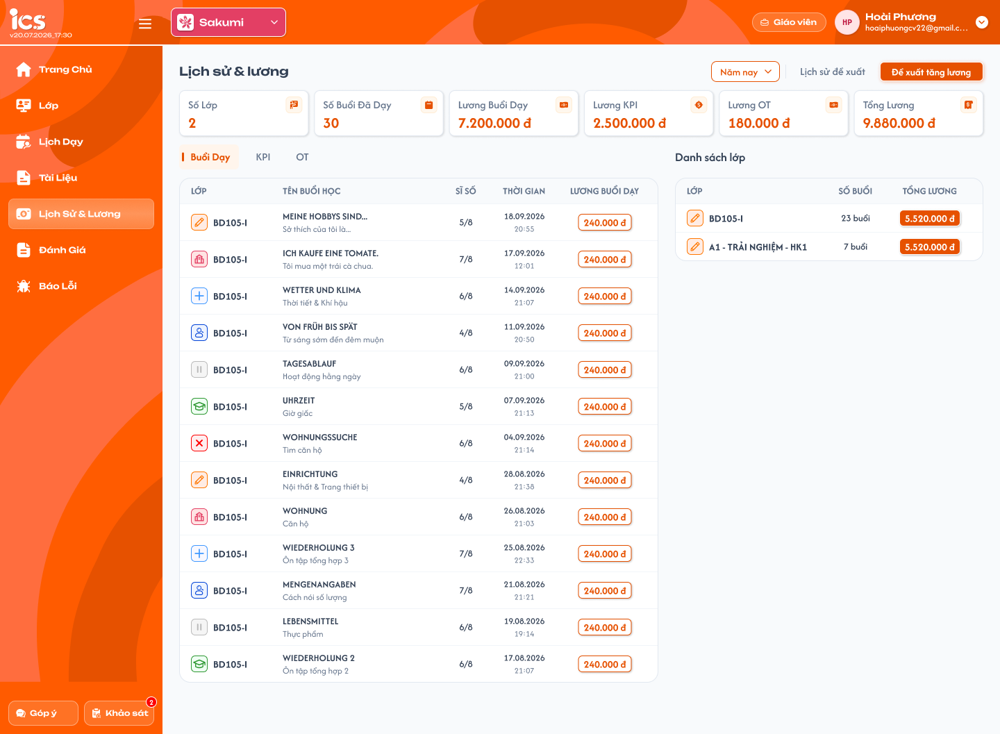
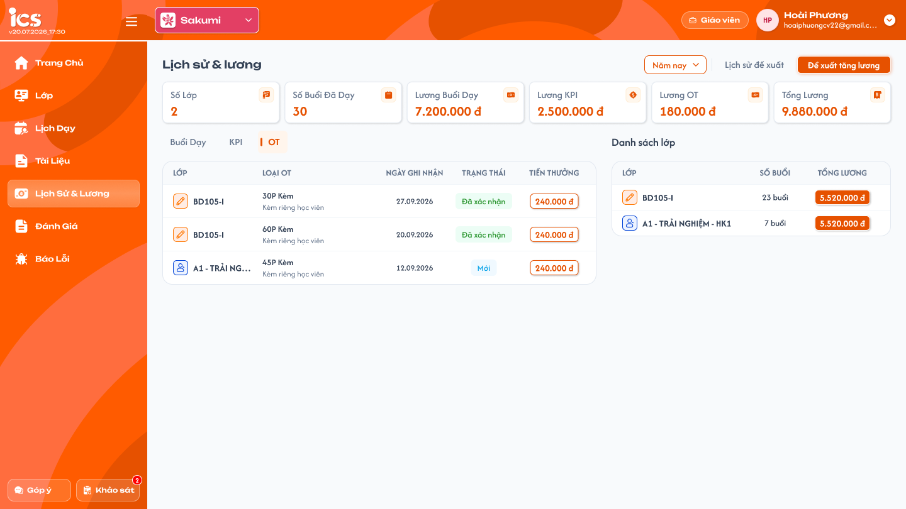
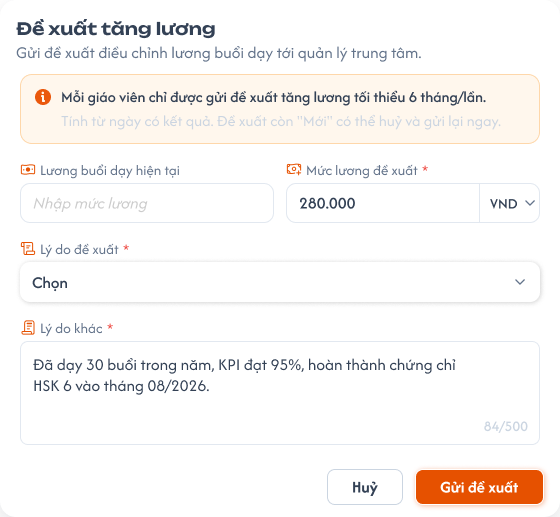
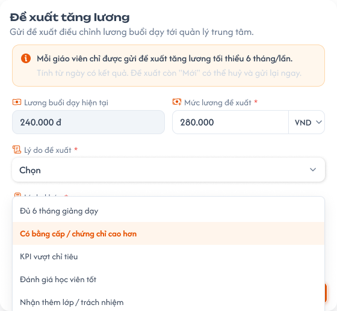
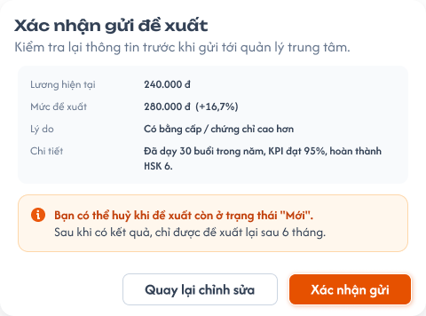
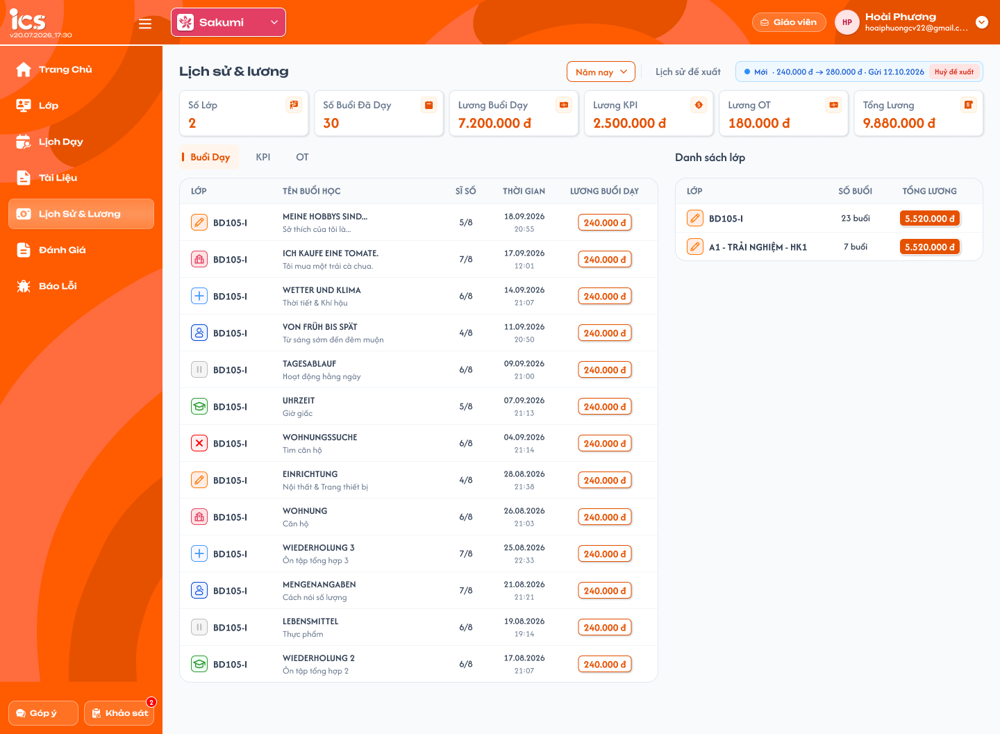
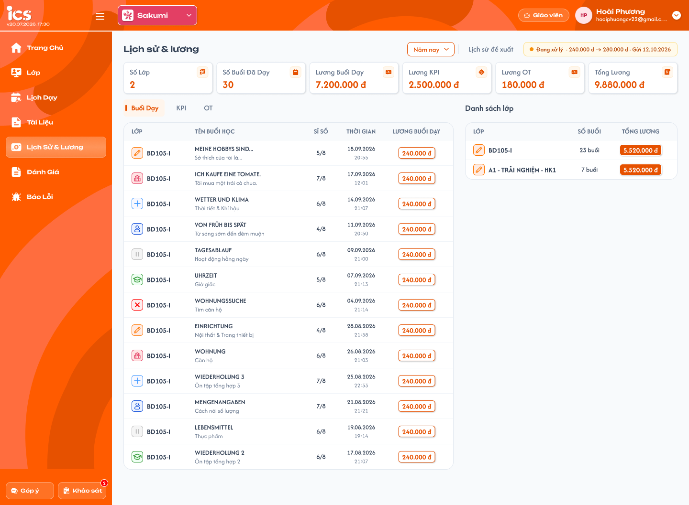
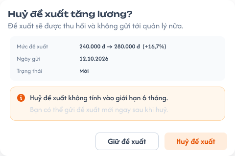
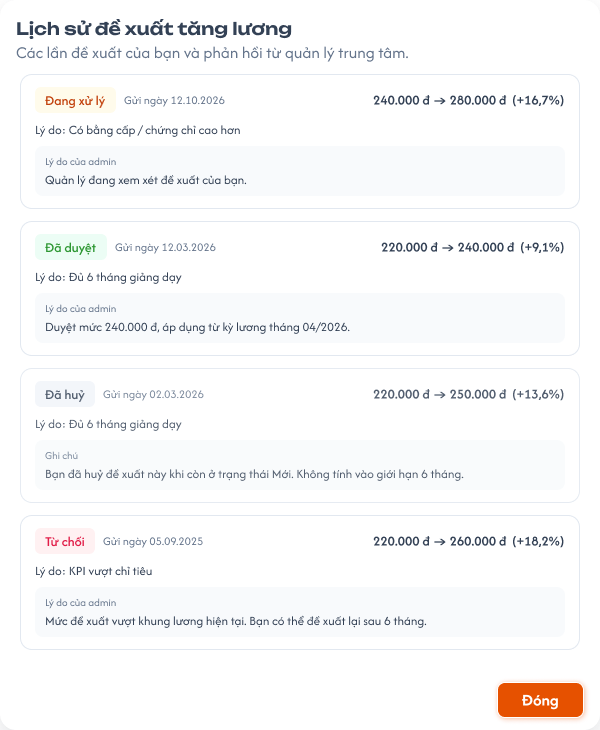
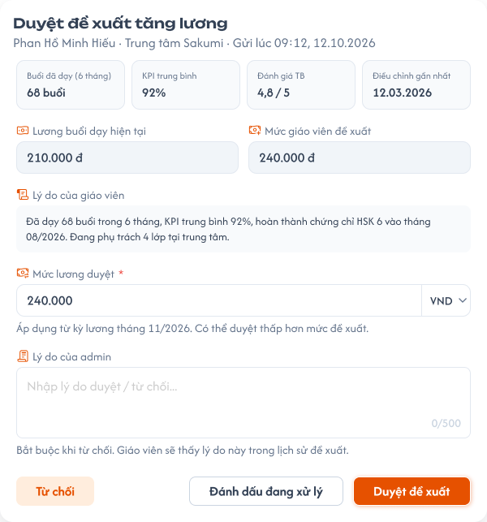

# [Giáo viên] Lịch sử & lương

## 1. UI

### Trang 1: GV-LS-010000 — Lịch sử & lương / Buổi dạy



**Mô tả:**
- Giáo viên xem buổi đã dạy và các khoản lương của chính mình trên toàn bộ lớp trong khoảng thời gian được chọn. Đây là lịch sử của chính giáo viên, không phải tab Thông tin của một lớp và không phải màn quản lý lương của Admin.
- Dữ liệu lương chỉ đọc: không sửa mức lương, trạng thái buổi, số tiền KPI / OT hoặc xác nhận khoản tại menu này. Gửi / hủy Đề xuất tăng lương là chức năng riêng, không phải sửa trực tiếp lương đang áp dụng.
- Bố cục: bộ lọc thời gian, `Lịch sử đề xuất`, vùng `Đề xuất tăng lương` / trạng thái đề xuất, sáu thẻ tổng hợp, ba tab bên trái và `Danh sách lớp` bên phải. Quy tắc dùng chung với [Thông tin lớp — Lịch sử & lương](../class/class_information_requirements.md) và [Bài học — chọn lịch, hoàn thành buổi](../class/class_teaching_requirements.md).

**Điểm cần lưu ý:**
- Scope toàn màn là giáo viên đang đăng nhập; backend không trả dữ liệu của giáo viên khác chỉ vì client truyền owner_id khác hoặc hai giáo viên cùng lớp.
- `A01.01` Bộ lọc thời gian dùng chung 10 lựa chọn với Thông tin lớp: Tuần này, Tuần trước, Tháng này, Tháng trước, Tháng trước nữa, 3 tháng gần đây, 6 tháng gần đây, Năm nay, Năm trước, Tùy chọn. Mặc định `Tháng này`. Cách tính các khoảng (gồm 3/6 tháng gần đây), timezone và ngày biên dùng đúng quy ước bộ lọc chung của các trang khác, không xây cách tính riêng.
- `A01.02` `Tùy chọn`: chọn từ ngày–đến ngày, từ ngày không sau đến ngày; bao gồm dữ liệu ở hai ngày biên theo timezone nghiệp vụ.
- `A01.03` `Số lớp`: đếm class_id không trùng từ quan hệ user_class của giáo viên đang đăng nhập, đúng role giáo viên và status khác Remove; lấy lớp tương ứng có status khác Deleted. Không giới hạn chỉ InProgress / Completed. Dùng cùng tập lớp với Danh sách lớp; không lấy số dòng đã tải làm tổng. Khoảng thời gian chỉ lọc số buổi / tiền, không loại lớp chỉ vì kỳ đó không phát sinh.
- `A01.04` `Số buổi đã dạy`: số buổi Hoàn thành do giáo viên đang đăng nhập dạy trong khoảng, kể cả buổi không gắn lịch. Buổi có lịch lọc theo ngày tính lương của lịch; không lịch dùng thời điểm hoàn thành.
- `A01.05` `Lương buổi dạy`: tổng tiền đã ghi nhận của các buổi Hoàn thành có lịch gắn trong khoảng. Mỗi buổi giữ mức đã ghi nhận khi hoàn thành, không tính lại buổi cũ khi mức lương thay đổi; buổi không lịch bằng 0.
- `A01.06` `Lương KPI`: tổng số tiền thực tế đã lưu của KPI Đã xác nhận, thuộc giáo viên, Ngày ghi nhận trong khoảng. Không lấy khoản đầu tiên; không cộng khoản Mới, Đã hủy, Đã xóa.
- `A01.07` `Lương OT`: tổng value thực tế đã lưu của các khoản OT Đã xác nhận thuộc giáo viên, có Ngày ghi nhận trong khoảng. Không cộng Mới, Đã hủy, Đã xóa; không tự nhân thời lượng–đơn giá hoặc số phút trong tên loại.
- `A01.08` `Tổng lương` = Lương buổi dạy + Lương KPI + Lương OT; không cộng lại số tiền của bảng Danh sách lớp như một nguồn riêng.
- `A01.09` Ba tab Buổi dạy / KPI / OT: đổi tab giữ khoảng thời gian, chỉ thay bảng chi tiết, không đổi bộ lọc.
- `A01.10` Định dạng tiền: dấu phân cách hàng nghìn kèm `đ`, ví dụ `240.000 đ`; giá trị tính toán giữ dạng số.
- `A01.11` `LỚP`: icon trạng thái lớp và mã lớp của đúng buổi; hover có tên trạng thái.
- `A01.12` `TÊN BUỔI HỌC`: tên bài học và mô tả ngắn nếu có.
- `A01.13` `SĨ SỐ` x/y, cùng công thức với Thông tin lớp: x là học viên đi học, y là học viên hợp lệ của lớp. Có mặt, Vào trễ, Ra sớm, Vào trễ & Ra sớm tính vào x; Nghỉ học, Rời lớp, Chỉ xem, Xóa bị loại khỏi tập hợp lệ y.
- `A01.14` `THỜI GIAN`: ngày tính lương của lịch đã gắn, không phải ngày bấm Hoàn thành; buổi không lịch dùng thời điểm hoàn thành. Hiển thị `dd.MM.yyyy` và `HH:mm` hai dòng.
- `A01.15` `LƯƠNG BUỔI DẠY`: tiền đã ghi nhận của buổi, chỉ đọc. Buổi không gắn lịch: `0 đ` và icon cảnh báo `Buổi dạy hoàn thành nhưng chưa có lịch thanh toán`.
- `A01.16` Sắp xếp theo thời gian giảm dần như lịch sử trong Thông tin lớp.
- `A01.17` Không có buổi: hiển thị `Không có buổi dạy nào`; không suy ra KPI / OT cũng bằng 0 nếu vẫn có khoản của chúng.
- `A01.18` Danh sách lớp — `LỚP`: icon trạng thái và mã lớp; mỗi class_id một dòng, cùng tập lớp với thẻ Số lớp. Giữ các trạng thái khác mà truy vấn cũ trả về, không thêm bộ lọc chỉ Đang học / Hoàn thành.
- `A01.19` Danh sách lớp — `SỐ BUỔI`: số buổi Hoàn thành của chính giáo viên tại lớp trong khoảng đang lọc, không đếm buổi của giáo viên khác. Lớp không có buổi trong kỳ vẫn có dòng với 0 buổi và 0 đ.
- `A01.20` Danh sách lớp — `TỔNG LƯƠNG`: chỉ tổng tiền lương buổi dạy đã ghi nhận của giáo viên tại lớp trong khoảng đang lọc; không cộng KPI hoặc OT. Thẻ Tổng lương toàn màn vẫn cộng lương buổi dạy + KPI + OT.
- `A01.21` Bấm dòng lớp mở Chi tiết lớp tương ứng trong role Giáo viên theo class_id và kiểm tra quyền truy cập; đây là điều hướng sang lớp, không lọc bảng lương tại chỗ.
- `A01.22` Phân trang dùng quy ước chung: tối đa 50 dòng / trang, hiển thị khoảng đang xem / tổng kết quả, trang hiện tại, Trước / Sau và số trang; vô hiệu hóa nút ở biên. Áp dụng cho các bảng Buổi dạy / KPI / OT và Danh sách lớp; đổi bộ lọc về trang đầu, chuyển trang giữ bộ lọc. Thẻ tổng tính toàn bộ kết quả hợp lệ, không chỉ trang đang xem. Popup lịch sử đề xuất giữ hành vi riêng, không có phân trang.
- `A01.23` Sidebar `MENU - TEACHER` là menu role Giáo viên; mục `Lịch sử & lương` đang được chọn.
- Lọc theo ngày tính lương: buổi chọn lịch 30/9, hoàn thành 2/10 thuộc kỳ tháng 9. Khoản KPI / OT dùng Ngày ghi nhận, không lấy Ngày cập nhật hoặc ngày xác nhận.
- Buổi Hoàn thành không lịch vẫn tăng số buổi nhưng không tăng lương buổi; buổi do người khác dạy không tính. Đổi lương không hồi tố: buổi cũ giữ mức đã ghi nhận, buổi hoàn thành sau thay đổi mới dùng mức mới.
- Không tự coi lương phát sinh / Đã xác nhận là đã thanh toán; menu này không có thao tác chi trả. Chỉ hiển thị tổng khi đã có dữ liệu hợp lệ, tải lỗi không được giả thành 0. Bảng và thẻ phải cùng owner / khoảng lọc / phiên bản dữ liệu.
- Mọi buổi giáo viên đã dạy và khoản KPI / OT đã ghi nhận đều được lưu và vẫn xem được, kể cả khi quan hệ giáo viên–lớp đã Remove hoặc lớp đã Deleted; tập lớp của Số lớp / Danh sách lớp vẫn theo điều kiện truy vấn cũ, nhưng bảng Buổi dạy, KPI, OT và tổng không loại dữ liệu lịch sử của lớp ngoài tập đó.

### Trang 2: GV-LS-010003 — Lịch sử & lương / KPI


**Mô tả:**
- Giáo viên xem KPI của mình trong khoảng Ngày ghi nhận đang chọn, trên toàn bộ lớp; chỉ đọc. Khác KPI trong Thông tin lớp ở phạm vi toàn bộ lớp thay vì một lớp.

**Điểm cần lưu ý:**
- `A02.01` `LỚP`: icon trạng thái và mã lớp của khoản.
- `A02.02` `LOẠI KPI`: tên từ `title` của cấu hình KPI mà khoản tham chiếu qua `typeKpi`; dòng phụ từ `description` nếu có. Không lấy `sp_note` hoặc chuỗi phân loại `kpi` làm tên.
- `A02.03` `NGÀY GHI NHẬN`: hiển thị `dd.MM.yyyy`; là mốc dùng để lọc KPI.
- `A02.04` `TRẠNG THÁI`: Mới / Đã xác nhận / Đã hủy; Đã xóa không hiển thị. Chip chỉ xem, không phải dropdown xác nhận.
- `A02.05` `TIỀN THƯỞNG`: số tiền thực tế đã lưu của khoản, không thay bằng giá trị gốc của cấu hình; không tự chặn / loại số tiền chỉ vì khác giá trị mẫu.
- `A02.06` Sắp xếp theo Ngày ghi nhận giảm dần; mỗi khoản một dòng, không gộp theo tên hoặc lớp.
- `A02.07` Trạng thái rỗng `Bảng dữ liệu này đang trống`; không dùng thông báo rỗng khi API thất bại.
- Chỉ khoản của giáo viên đang đăng nhập có loại KPI, không lẫn OT hoặc khoản KPI của Phụ trách lớp. Danh sách vẫn có khoản Mới / Đã hủy nhưng thẻ Lương KPI chỉ cộng Đã xác nhận (tổng tất cả khoản xác nhận).
- Không có thêm, sửa, xóa, đổi trạng thái hoặc xác nhận KPI; không sao chép quyền Admin / Class Handler từ tab KPI quản lý lớp sang menu này.

### Trang 3: GV-LS-010004 — Lịch sử & lương / OT



**Mô tả:**
- Giáo viên xem OT của chính mình trên toàn bộ lớp trong khoảng đang lọc. OT chỉ có ở menu Lịch sử & lương này, không đưa vào tab Thông tin lớp.

**Điểm cần lưu ý:**
- `A03.01` `LỚP`: icon trạng thái và mã lớp của khoản OT.
- `A03.02` `LOẠI OT`: tên và mô tả cấu hình OT được tham chiếu (model cũ dùng cùng ClassKpiModel, phân biệt bằng type=ot). Tên mẫu 30P / 45P / 60P không đủ để kết luận có công thức tự nhân phút.
- `A03.03` `NGÀY GHI NHẬN`: `dd.MM.yyyy`; không thay bằng ngày cập nhật.
- `A03.04` `TRẠNG THÁI`: bảng chỉ đọc giữ Mới / Đã xác nhận / Đã hủy, loại Đã xóa; **chỉ Đã xác nhận được cộng vào Lương OT**, khoản Mới / Đã hủy vẫn hiện nhưng không tham gia tổng.
- `A03.05` `TIỀN THƯỞNG`: value thực tế đã lưu của khoản; không thay bằng giá trị gốc cấu hình, không tự tính theo tên loại hoặc số phút trong tên.
- `A03.06` Quyền: chỉ đọc, không thêm / sửa / xóa / xác nhận khoản OT tại menu Giáo viên.
- `A03.07` Rỗng / lỗi: phân biệt trạng thái chưa có dữ liệu và tải thất bại; tải lại được khi lỗi.
- Không áp dụng quyền truy cập / người nhận của requirement [OT của Phụ trách lớp](../../management_requirement/class_management/class_detail_ot_requirements.md) (chỉ Admin / Class Handler quản lý khoản nhận bởi Handler) cho OT cá nhân của Giáo viên ở đây; cùng tên OT không có nghĩa dùng chung dữ liệu người nhận.

### Trang 4: GV-LS-010010 — Lịch sử & lương / Popup đề xuất tăng lương



**Mô tả:**
- Giáo viên gửi **đề xuất tăng lương chung cho chính mình**, không chọn lớp. Admin quyết định áp dụng / gắn mức lương vào lớp nào khi xử lý theo chức năng quản lý riêng. Gửi hoặc duyệt đề xuất không mặc định tăng lương cho tất cả lớp; giáo viên không tự cập nhật lương lớp.

**Điểm cần lưu ý:**
- `A04.01` FLOW giáo viên đề xuất tăng lương: nhập mức mong muốn, chọn lý do / chi tiết, xác nhận gửi; hủy khi Mới; xem trạng thái và lịch sử / phản hồi. Không có thao tác nhập mức duyệt, duyệt, từ chối hoặc đánh dấu đang xử lý.
- `A04.03` Kết quả trả về Giáo viên: giáo viên chỉ đọc mức được duyệt và phản hồi quản lý đã lưu. Duyệt không tự cập nhật lương thực tế; quản lý chỉnh thủ công ở chức năng riêng.
- `A04.04` Tiêu đề `Đề xuất tăng lương` + mô tả gửi đề xuất điều chỉnh lương buổi dạy tới quản lý trung tâm.
- `A04.05` Thông báo chu kỳ: tối thiểu 6 tháng / lần, tính từ thời điểm quản lý duyệt hoặc từ chối gần nhất. Không tính từ ngày gửi, ngày chuyển Đang xử lý hoặc ngày chỉnh lương thủ công. Đề xuất Mới đã hủy không tạo mốc chờ mới; không xóa mốc duyệt / từ chối cũ.
- `A04.06` Phạm vi đề xuất: chung của giáo viên, **không có field Chọn lớp**, không yêu cầu class_id. Owner do backend xác định từ giáo viên đang đăng nhập.
- `A04.07` `Lương buổi dạy hiện tại`: ô **giáo viên tự nhập**, bắt buộc, số nguyên không âm, đơn vị **VNĐ/giờ**; là mức tham chiếu để quản lý xem xét, hệ thống không tự lấy từ lương các lớp (đơn giá khác nhau giữa lớp 1–1 và lớp chung); không chọn lớp, không lấy trung bình, không chọn lớp đại diện.
- `A04.08` `Mức lương đề xuất`: bắt buộc, số nguyên **VNĐ/giờ**, lưu đúng số giáo viên nhập (không làm tròn, không trần); phải lớn hơn mức hiện tại đã nhập. Từ chối số âm, số lẻ, không phải số hoặc mức thấp hơn / bằng hiện tại. Mức hiện tại bằng 0 thì tỷ lệ tăng hiển thị `—`.
- `A04.09` `Lý do đề xuất` * : bắt buộc, chọn một lý do theo danh sách.
- `A04.11` Ô `Lý do khác` / chi tiết: nhiều dòng, đếm ký tự /500; chỉ bắt buộc khi chọn Lý do khác (các lý do còn lại được để trống); không chấp nhận nội dung chỉ có khoảng trắng khi bắt buộc; tối đa 500 ký tự. Không tự kiểm tra đạt KPI / chứng chỉ chỉ vì tên lý do.
- `A04.12` Dropdown tiền tệ: chỉ `VND`, không có lựa chọn khác; không quy đổi ngoại tệ.
- `A04.13` Form chỉ gồm mức hiện tại (tự nhập), mức đề xuất, lý do, chi tiết; không có khối Lương buổi dạy hiện tại thứ hai, không dropdown không nhãn, không field chọn lớp.
- `A04.14` `Huỷ`: đóng form, không tạo đề xuất và không tiêu thụ chu kỳ 6 tháng.
- `A04.15` `Gửi đề xuất`: kiểm tra draft; nếu hợp lệ mở popup Xác nhận gửi (Trang 6), chưa tạo đề xuất chỉ vì bấm nút ở bước nhập.
- Đây là chức năng phát sinh yêu cầu xét duyệt, không phải tự chỉnh lương: gửi / hủy không thay đơn giá của bất kỳ lớp nào hoặc tính lại lương lịch sử. Không tự suy ra giáo viên phải dạy đủ 6 tháng mới được gửi lần đầu từ lựa chọn lý do `Đủ 6 tháng giảng dạy`.
- Dữ liệu form là draft cho tới Xác nhận gửi cuối cùng; quay lại chỉnh sửa giữ nội dung.

### Trang 5: GV-LS-010012 — Lịch sử & lương / Popup đề xuất tăng lương / Chọn lý do



**Mô tả:**
- Trạng thái popup đề xuất khi mở danh sách lý do.

**Điểm cần lưu ý:**
- `A04.10` Các lý do: `Đủ 6 tháng giảng dạy`; `Có bằng cấp / chứng chỉ cao hơn`; `KPI vượt chỉ tiêu`; `Đánh giá học viên tốt`; `Nhận thêm lớp / trách nhiệm`; `Lý do khác`.

### Trang 6: GV-LS-010015 — Lịch sử & lương / Popup xác nhận gửi đề xuất



**Mô tả:**
- Bước xác nhận trước khi gửi, hiện lương tham chiếu hiện tại, mức đề xuất, tỷ lệ tăng, lý do và chi tiết đúng draft đang xác nhận.

**Điểm cần lưu ý:**
- `A05.01` Nội dung: không có lớp được giáo viên chọn và không bổ sung xác nhận lớp áp dụng vào bước này.
- `A05.02` Tỷ lệ tăng: khi mức hiện tại > 0 là (mức đề xuất − mức hiện tại) / mức hiện tại × 100%, hiển thị một chữ số thập phân (làm tròn nửa lên; chỉ làm tròn tỷ lệ hiển thị, không làm tròn số tiền). Mức hiện tại bằng 0 thì hiển thị `—`; không hiển thị NaN / Infinity.
- `A05.03` Thông báo: có thể hủy khi đề xuất Mới; sau khi có kết quả chỉ được đề xuất lại sau 6 tháng.
- `A05.04` `Quay lại chỉnh sửa`: về form, giữ mức đề xuất, lý do và nội dung chi tiết; chưa gửi.
- `A05.05` `Xác nhận gửi`: kiểm tra quyền, trạng thái / điều kiện hiện tại và dữ liệu; thành công tạo một đề xuất Mới, cập nhật banner.
- Chặn gửi lặp trong khi đang xử lý; retry cùng thao tác không tạo nhiều đề xuất. Nếu mức lương nền / điều kiện đã thay đổi sau khi mở form, không âm thầm gửi với dữ liệu cũ, yêu cầu kiểm tra lại bản mới. Lỗi giữ draft để thử lại, không hiện banner Mới giả hoặc thông báo thành công trước backend.

### Trang 7: GV-LS-010014 — Lịch sử & lương / Đề xuất mới (có thể huỷ)



**Mô tả:**
- Banner đề xuất ở trạng thái `Mới`: có thể huỷ.

**Điểm cần lưu ý:**
- `A06.01` Chưa có đề xuất đang chờ: hiển thị nút `Đề xuất tăng lương` theo điều kiện được phép gửi.
- `A06.02` `Mới`: banner xanh dương gồm trạng thái, mức cũ → đề xuất, ngày gửi và nút `Huỷ đề xuất`. Không tự sửa draft đã gửi bằng cách đổi trực tiếp banner.
- `A06.09` `Huỷ đề xuất` mở popup xác nhận huỷ (Trang 9).
- `A06.10` Huỷ và gửi lại: đề xuất Mới đã huỷ không tiêu thụ chu kỳ, có thể gửi lại ngay nếu không có điều kiện chặn khác; huỷ không xóa kết quả cũ hoặc bỏ thời hạn chờ của một kết quả cũ.

### Trang 8: GV-LS-010011 — Lịch sử & lương / Đề xuất đang xử lý (không huỷ được)



**Mô tả:**
- Banner đề xuất ở trạng thái `Đang xử lý`: không huỷ được.

**Điểm cần lưu ý:**
- `A06.03` `Đang xử lý`: banner vàng / cam với mức và ngày gửi; không có nút huỷ. Gọi request huỷ trực tiếp vẫn phải bị từ chối.
- `A06.04` `Đã duyệt` / `Từ chối`: kết quả do quản lý xử lý, giáo viên chỉ xem; thời điểm có kết quả là mốc cho quy tắc 6 tháng. Mức được duyệt có thể khác mức đề xuất, kèm phản hồi / ghi chú nếu quản lý cung cấp. Đã duyệt chỉ xác nhận kết quả xét đề xuất, không tự cập nhật lương thực tế.
- `A06.06` Đề xuất đang chờ thuộc giáo viên, không tách theo lớp; mỗi giáo viên chỉ có một đề xuất Mới / Đang xử lý tại một thời điểm. Backend kiểm tra điều kiện trên giáo viên, không dùng class_id để gửi thêm đề xuất hoặc né chu kỳ chờ. Banner không yêu cầu mã lớp.

### Trang 9: GV-LS-010016 — Lịch sử & lương / Popup xác nhận huỷ đề xuất



**Mô tả:**
- Xác nhận huỷ một đề xuất Mới (`Huỷ đề xuất tăng lương?`).

**Điểm cần lưu ý:**
- `A06.05` `Đã huỷ`: huỷ bởi giáo viên khi còn Mới; vẫn giữ lịch sử; không tính vào giới hạn 6 tháng.
- `A06.07` Dữ liệu xác nhận: mức hiện tại → mức đề xuất, tỷ lệ tăng, ngày gửi và trạng thái của đúng request thuộc giáo viên; không yêu cầu mã lớp.
- `A06.08` `Giữ đề xuất`: đóng popup, giữ trạng thái hiện tại; không gửi request huỷ.
- `A06.09` `Huỷ đề xuất`: kiểm tra vẫn là Mới và đúng owner; thành công chuyển Đã huỷ, cập nhật banner và lịch sử.

### Trang 10: GV-LS-010013 — Lịch sử & lương / Popup lịch sử đề xuất



**Mô tả:**
- Popup `Lịch sử đề xuất tăng lương`: các lần đề xuất của giáo viên và phản hồi từ quản lý trung tâm.

**Điểm cần lưu ý:**
- `A07.01` Tiêu đề `Lịch sử đề xuất tăng lương`; các lần đề xuất và phản hồi từ quản lý trung tâm.
- `A07.02` Mỗi mục là một đề xuất của giáo viên: trạng thái, ngày gửi, mức hiện tại tham chiếu → mức đề xuất, tỷ lệ, lý do, chi tiết và phản hồi / ghi chú quản lý nếu có. Với Đã duyệt, hiển thị riêng mức được duyệt do quản lý ghi nhận, không lấy mức đề xuất thay thế (vd tham chiếu 180.000 đ, xin 220.000 đ, duyệt 190.000 đ: giữ đủ ba mức). Không phân loại theo lớp hoặc loại lớp.
- `A07.03` Sắp xếp theo ngày gửi giảm dần, không gộp hai request cùng mức tiền thành một mục.
- `A07.04` Phản hồi: lý do của admin / ghi chú theo dữ liệu đã lưu, không có câu trả lời mặc định.
- `A07.05` `Đóng`: đóng popup, không đổi request hoặc chu kỳ.
- `A07.06` Rỗng / lỗi: chưa có đề xuất thì trạng thái rỗng; tải thất bại có lỗi và `Thử lại`. Không giả dữ liệu mẫu.
- Lịch sử thuộc chính giáo viên; chưa có filter riêng trong popup, không tự áp khoảng thống kê lương lên lịch sử request. Mức nền, mức đề xuất, ngày gửi và phản hồi của request cũ không bị thay bằng lương hiện tại mới.
- Sau khi duyệt, quản lý vẫn chỉnh lương thủ công ở chức năng quản lý giáo viên / lương lớp tương ứng; duyệt không cập nhật đơn giá, không tự gắn mức duyệt vào lớp nào, không mặc định đã áp dụng từ ngày duyệt. Việc áp dụng mức mới vẫn giữ lương buổi đã hoàn thành, không hồi tố. Mức mới áp dụng từ lúc Admin lưu; buổi hoàn thành sau thời điểm đó dùng mức mới; không chọn ngày hiệu lực.

### Trang 11: ADM-LGV-020010 — Lương / Đề xuất tăng lương / Popup duyệt đề xuất (Admin)



**Mô tả:**
- Popup `Duyệt đề xuất tăng lương` của Admin, hiện thông tin giáo viên, buổi đã dạy (6 tháng), KPI trung bình, đánh giá trung bình. Đây là chức năng Admin riêng, không phải field hoặc hành động trong form gửi của Giáo viên.

**Điểm cần lưu ý:**
- `A04.02` FLOW admin duyệt đề xuất tăng lương: Admin xem danh sách và popup duyệt, nhập Mức lương duyệt, Lý do của admin; duyệt / từ chối / đánh dấu đang xử lý theo quyền. Giáo viên gửi, Admin nhập mức duyệt và xử lý, Giáo viên chỉ xem kết quả.
- Các testcase nhắc đến Admin trong tài liệu này chỉ kiểm tra kết quả liên thông hiển thị cho Giáo viên và việc không tự đổi lương; không đặc tả quyền nhập / validation form duyệt của Admin.

---

## 2. Yêu cầu

### 2.1. Flow chính

**Flow 1: Xem lịch sử và tổng lương**

```
Giáo viên → Lịch sử & lương → kiểm tra danh tính/phạm vi
  → Tải bộ lọc, tổng và bảng Buổi dạy của chính giáo viên (Trang 1)
  → Chọn khoảng khác → tính theo ngày tính lương/Ngày ghi nhận tương ứng
  → Chỉ hiển thị dữ liệu của lựa chọn mới nhất
```

**Flow 2: Xem KPI và OT**

```
Chọn KPI hoặc OT (Trang 2 / Trang 3) → giữ bộ lọc thời gian và owner
  → Tải đúng loại khoản, hiển thị cột tương ứng ở chế độ chỉ đọc
  → Không tự đổi số tiền/trạng thái hoặc áp quyền quản lý khoản
```

**Flow 3: Nhập và gửi đề xuất**

```
Đề xuất tăng lương → kiểm tra điều kiện của giáo viên → mở form trống (Trang 4)
  → Nhập mức hiện tại (VNĐ/giờ), mức đề xuất (VNĐ/giờ), lý do, chi tiết; không chọn lớp
  → Gửi đề xuất → validate → popup Xác nhận gửi (Trang 6)
  → Quay lại chỉnh sửa: giữ draft, chưa tạo request
  → Xác nhận gửi: backend kiểm tra lại → tạo một request Mới → banner đồng bộ (Trang 7)
```

**Flow 4: Hủy đề xuất Mới**

```
Request Mới → Hủy đề xuất → popup xác nhận đúng request (Trang 9)
  → Giữ đề xuất: đóng, không ghi
  → Hủy đề xuất: kiểm tra owner + trạng thái mới nhất → Đã huỷ
  → Đang xử lý (Trang 8): không cho hủy, kể cả API trực tiếp
```

**Flow 5: Xem lịch sử đề xuất**

```
Lịch sử đề xuất (Trang 10) → tải request của chính giáo viên, ngày gửi giảm dần
  → Xem mức cũ/đề xuất, trạng thái và phản hồi đã lưu
  → Đóng: không thay đổi dữ liệu
```

### 2.2. Ngoại lệ

- **EX01:** Sai owner/role, sửa số tiền KPI/OT, tự duyệt/từ chối hoặc hủy đề xuất người khác → backend từ chối; không tiết lộ hoặc thay đổi dữ liệu ngoài phạm vi.
- **EX02:** Chưa có buổi/khoản/request → trạng thái rỗng tương ứng; không làm mất tổng của loại dữ liệu khác còn tồn tại.
- **EX03:** Tải/gửi/hủy lỗi → không báo thành công giả, không đổi dữ liệu chính thức; giữ draft khi gửi lỗi và có Thử lại.
- **EX04:** Request lặp/xung đột/mức lương nền thay đổi → không tạo trùng, không âm thầm dùng dữ liệu cũ hoặc ghi đè trạng thái mới.
- **EX05:** Request đã Đang xử lý/có kết quả → không hủy bằng request trực tiếp; đồng bộ trạng thái thực tế.
- **EX06:** Form thiếu/sai dữ liệu bắt buộc theo quy tắc được chốt → báo đúng field, giữ draft; không tạo request một phần.

### 2.3. Yêu cầu khác

| Mã | Tên yêu cầu | Mô tả |
|---|---|---|
| REQ01 | Phạm vi | Chỉ dữ liệu của giáo viên đang đăng nhập; không dùng owner client tự truyền để bypass quyền. Thẻ Số lớp và Danh sách lớp dùng chung tập class_id không trùng theo truy vấn cũ: user_class đúng user_id/role, status khác Remove; lớp tương ứng khác Deleted. Không giới hạn InProgress/Completed hoặc bắt buộc có buổi trong kỳ; khoảng lọc áp cho số buổi và tiền của mỗi dòng. |
| REQ02 | Thời gian | Bộ lọc dùng chung; buổi theo ngày tính lương của lịch, không lịch theo hoàn thành; khoản theo Ngày ghi nhận. Mặc định `Tháng này`; `Tùy chọn` lấy cả hai ngày biên theo timezone nghiệp vụ. |
| REQ03 | Buổi và lương | Tổng lương từng lớp chỉ gồm lương buổi dạy của chính giáo viên trong khoảng, không gồm KPI/OT. Buổi Hoàn thành của chính giáo viên; không lịch vẫn đếm nhưng tiền 0; buổi có lịch giữ tiền đã ghi nhận. Không hồi tố khi đổi mức lương. Chỉ đọc và không tự coi phát sinh lương là đã thanh toán. |
| REQ04 | KPI | Khoản của giáo viên, type KPI, tên từ cấu hình được tham chiếu, tiền từ khoản thực tế; Mới/Đã xác nhận/Đã hủy được xem, Đã xóa ẩn; chỉ Đã xác nhận tham gia tổng KPI. |
| REQ05 | OT | OT của chính giáo viên, tách khỏi KPI/OT của Handler; chỉ đọc. Bảng giữ Mới/Đã xác nhận/Đã hủy và loại Đã xóa; tổng chỉ cộng value thực tế của OT Đã xác nhận có Ngày ghi nhận trong khoảng. Không nhân thời lượng trong tên, không thay bằng tiền gốc cấu hình. |
| REQ06 | Form đề xuất | Giáo viên gửi đề xuất tăng lương chung của mình, không chọn lớp và không bắt buộc class_id. Admin quyết định gắn mức lương vào lớp nào trong chức năng quản lý riêng. Không thêm chọn lớp/mã lớp vào form, xác nhận, banner, hủy hoặc lịch sử. Draft/gửi đề xuất không tự đổi lương; lý do theo danh sách, nội dung tối đa 500 ký tự. Mức hiện tại do giáo viên tự nhập và mức đề xuất đều là số nguyên VNĐ/giờ, lưu đúng như nhập (không làm tròn, không trần); đề xuất phải lớn hơn mức hiện tại; hiện tại bằng 0 thì tỷ lệ `—`. Chi tiết chỉ bắt buộc khi chọn Lý do khác, tối đa 500 ký tự. Hệ thống không tự lấy mức hiện tại từ lương lớp. |
| REQ07 | Xác nhận gửi | Hai bước nhập và xác nhận; quay lại giữ draft; backend kiểm tra lại owner/điều kiện/trạng thái, chống lặp, thành công tạo Mới; gửi đề xuất không trực tiếp tăng lương. |
| REQ08 | Trạng thái và hủy | Mới được hủy có xác nhận; Đang xử lý không hủy; Đã duyệt/Từ chối do quản lý. Chu kỳ 6 tháng tính từ thời điểm duyệt hoặc từ chối gần nhất, không từ ngày gửi/ngày chỉnh lương; lần hủy Mới không tạo mốc chờ mới. Backend kiểm tra mốc này cùng trạng thái đề xuất đang chờ khi gửi. |
| REQ09 | Lịch sử | Chỉ request của chính mình; lưu riêng mức hiện tại tham chiếu, mức đề xuất và mức được duyệt, kèm ngày gửi/kết quả, lý do và phản hồi/ghi chú. Mức duyệt có thể khác mức xin. Duyệt không tự đổi lương thực tế; quản lý chỉnh thủ công riêng. Không lấy lương hiện tại mới thay dữ liệu của lần đề xuất cũ. |
| REQ10 | Đồng bộ và phân trang | Thẻ/bảng cùng owner và khoảng lọc, chỉ response mới nhất hiển thị; loading/rỗng/lỗi phân biệt; không báo thành công trước backend, không tạo trùng khi retry. Bộ lọc thời gian và phân trang dùng quy ước chung: tối đa 50 dòng/trang, đổi lọc về trang đầu, chuyển trang giữ bộ lọc; tổng không phụ thuộc trang hiện tại. Bấm dòng Danh sách lớp điều hướng tới Chi tiết lớp đúng class_id theo quyền Giáo viên. |
| REQ11 | Audit và quyền | Backend xác định actor, thời điểm gửi/hủy/kết quả và kiểm tra trạng thái mới nhất; giáo viên không tự duyệt, không sửa khoản lương/KPI/OT hoặc request người khác. |

### 2.4. Ràng buộc

#### Quyền

| Role | Xem lương, KPI, OT của mình | Gửi đề xuất của mình | Hủy đề xuất Mới của mình | Hủy Đang xử lý / tự duyệt / sửa khoản lương |
|---|:---:|:---:|:---:|:---:|
| Giáo viên | ✅ | ✅ (theo điều kiện gửi) | ✅ (backend kiểm tra lại trạng thái) | ❌ |
| Role quản lý | Theo màn quản lý được cấp quyền | ❌ (không giả mạo owner tại menu Giáo viên) | Theo quy trình quản lý riêng | Không suy ra quyền từ menu cá nhân này |

#### Ràng buộc khác

- Dùng ID giáo viên, lớp, buổi, khoản và request; không cập nhật theo tên hiển thị hoặc vị trí dòng.
- Backend lưu/đọc cùng nguồn nghiệp vụ với Thông tin lớp; không xây một công thức lương thứ hai chỉ cho menu tổng hợp.
- Ngày tính lương, Ngày ghi nhận, ngày gửi request và ngày có kết quả là các mốc riêng; không thay thế lẫn nhau.
- Không thay đổi lương lịch sử khi chỉ thay bộ lọc, mở popup, gửi/hủy đề xuất hoặc xem phản hồi.

---

## 3. Testcase

### Feature: [Giáo viên] Lịch sử & lương

| Tên testcase | Priority | Scenario | Role | Pre-condition | Given/When/Then | Expected Result |
|---|---|---|---|---|---|---|
| Case 1: Chỉ xem dữ liệu của chính mình, đúng tập lớp | High | Flow 1 / REQ01 / EX01 | Giáo viên | G và H cùng dạy một lớp, G còn dạy lớp khác; G có quan hệ đúng role khác Remove với lớp A InProgress, B Completed, C trạng thái khác chưa Deleted; lớp D Deleted; quan hệ E Remove; C không có buổi trong kỳ | **Given:** G mở Lịch sử & lương, sau đó thử đổi owner_id trong request<br>**When:** tải xong và đổi khoảng thời gian<br>**Then:** chỉ tổng hợp buổi/khoản của G; Số lớp bằng 3, Danh sách lớp có A/B/C mỗi lớp một dòng, loại D/E | - Không cộng dữ liệu H, đổi owner_id không xem được lương H<br>- Không giới hạn chỉ InProgress/Completed<br>- C vẫn hiện 0 buổi / 0 đ<br>- Đổi kỳ không tự loại lớp không phát sinh |
| Case 2: Bộ lọc thời gian, ngày tính lương, đổi tab | High | Flow 1 / REQ02 / REQ10 | Giáo viên | Buổi của G chọn lịch 30/9, hoàn thành 2/10; có dữ liệu ở nhiều kỳ, response có thể về sai thứ tự | **Given:** chọn kỳ tháng 9 rồi tháng 10; đổi khoảng và đổi tab liên tục<br>**When:** lọc và nhận response<br>**Then:** buổi thuộc tháng 9; chỉ dữ liệu của lựa chọn mới nhất được hiển thị | - Không cộng hai kỳ, header/bảng/thẻ cùng bộ lọc<br>- Đổi tab giữ khoảng ngày, không trộn bảng cũ với tổng mới<br>- Mặc định `Tháng này`; `Tùy chọn` gồm cả hai ngày biên |
| Case 3: Buổi dạy — không lịch, không hồi tố, sĩ số | High | REQ03 | Giáo viên | 2 buổi Hoàn thành, một có lịch chốt 240.000 và một không lịch; sau đó đổi mức, buổi B có lịch chốt 280.000; một buổi có 8 đi học trong 12 học viên hợp lệ | **Given:** chọn khoảng chứa các buổi<br>**When:** tải và tính lương<br>**Then:** số buổi tính cả buổi không lịch, lương buổi chỉ cộng buổi có lịch, buổi A giữ 240.000 | - Buổi không lịch hiện `0 đ` và cảnh báo, không tự lấy đơn giá hiện tại<br>- Tổng buổi A + B = 520.000, tải lại vẫn giữ mức đã ghi nhận<br>- Sĩ số 8/12, lớp/bài/giờ/tiền cùng một buổi |
| Case 4: Tổng lương thẻ và Danh sách lớp | High | REQ03 | Giáo viên | Trong kỳ, G có 2 buổi có lịch tại A tổng 480.000; 1 buổi tại B 280.000; KPI xác nhận tại A 500.000; OT xác nhận tại A 100.000 | **Given:** xem các thẻ và Danh sách lớp<br>**When:** tải xong<br>**Then:** A có 2 buổi, Tổng lương 480.000; B có 1 buổi, Tổng lương 280.000 | - Lương buổi dạy 760.000, KPI 500.000, OT 100.000<br>- Tổng toàn màn 1.360.000<br>- Không cộng lại bảng lớp vào tổng toàn màn |
| Case 5: Trạng thái rỗng và lỗi tải | High | EX02 / EX03 / REQ03 / REQ10 | Giáo viên | Kỳ không có buổi, có KPI Đã xác nhận 500.000, không OT; sau đó giả lập API lỗi | **Given:** xem kỳ đó; sau đó API lỗi<br>**When:** tải thành công / thất bại<br>**Then:** buổi 0, lương buổi 0, KPI 500.000, tổng 500.000; lỗi hiện thông báo lỗi riêng, tải lại được | - Bảng buổi trống `Không có buổi dạy nào`, không xóa tổng KPI<br>- Không giả tổng thành 0 khi lỗi<br>- Rỗng khác lỗi |
| Case 6: Phân trang và bấm dòng lớp | High | REQ10 | Giáo viên | Bảng có hơn 50 kết quả hợp lệ; G có quyền xem lớp A | **Given:** xem trang 2 rồi đổi kỳ; bấm dòng lớp A<br>**When:** tải xong<br>**Then:** tối đa 50 dòng/trang, đổi kỳ về trang 1; bấm dòng mở Chi tiết lớp A của role Giáo viên | - Chuyển trang giữ kỳ lọc, Trước/Sau vô hiệu hóa đúng biên<br>- Thẻ tổng không chỉ cộng dòng trên trang<br>- Điều hướng theo class_id, không lọc lương tại chỗ, kiểm tra quyền ở màn đích |
| Case 7: Tab KPI | High | Flow 2 / REQ04 / EX01 | Giáo viên | G có KPI ở A/B: xác nhận 200.000 và 300.000, Mới 100.000, Hủy 50.000, Xóa 70.000; H có KPI cùng lớp; KPI ghi nhận tháng 9, xác nhận tháng 10 | **Given:** G mở KPI, chọn tháng 9 rồi tháng 10, gọi request sửa/xóa/xác nhận<br>**When:** tải và kiểm tra quyền<br>**Then:** chỉ KPI của G, tên từ title cấu hình; Lương KPI 500.000; request ghi bị từ chối | - Bảng giữ Mới/Đã hủy, ẩn Đã xóa; không lấy khoản đầu tiên làm tổng<br>- Lọc theo Ngày ghi nhận, không theo ngày cập nhật<br>- Không lẫn OT; UI chỉ đọc |
| Case 8: Tab OT | High | Flow 2 / REQ05 / EX01 | Giáo viên | Trong kỳ G có OT xác nhận 100.000 và 150.000, Mới 80.000, Hủy 70.000, Xóa 60.000; H và Handler có OT cùng lớp; G có một OT ngoài kỳ | **Given:** G mở OT, xem Lương OT, gửi request sửa/xóa/đổi trạng thái OT<br>**When:** tổng hợp và kiểm tra quyền<br>**Then:** Lương OT là 250.000; request ghi bị từ chối | - Bảng giữ Mới/Đã hủy của G trong kỳ, ẩn Đã xóa<br>- Không cộng tiền của H/Handler/ngoài kỳ<br>- Không tự nhân số phút trong tên loại<br>- Không có nút ghi |
| Case 9: Validation form đề xuất | High | Flow 3 / REQ06 / EX06 | Giáo viên | Form đang mở | **Given:** nhập mức hiện tại 180.000, đề xuất lần lượt −1, 200.000,5, `abc`, 180.000, 220.000; thử Lý do khác chỉ khoảng trắng; nhập chi tiết tới 500 ký tự; bấm Huỷ<br>**When:** gửi<br>**Then:** bốn giá trị đầu bị chặn và báo lỗi tại field; 220.000 hợp lệ, lưu đúng 220.000, tỷ lệ 22,2% | - Mức hiện tại 0 và đề xuất 1 hợp lệ, tỷ lệ `—`; mức hiện tại trống chặn gửi<br>- Lý do khác thiếu nội dung chặn gửi, lý do khác để trống chi tiết được<br>- Đếm ký tự đúng, không vượt 500<br>- Huỷ không tạo request, không tiêu thụ chu kỳ 6 tháng |
| Case 10: Đề xuất chung, không chọn lớp | High | Flow 3 / REQ06 / REQ09 / REQ11 | Giáo viên / Admin ở chức năng quản lý riêng | G dạy A/B với mức lương khác nhau | **Given:** G mở form trống, gửi đề xuất hợp lệ; Admin chỉ gắn mức mới cho lớp A<br>**When:** qua xác nhận gửi, tải lại dữ liệu lương<br>**Then:** không có field chọn lớp, không bắt buộc class_id, request thuộc G; lớp B không tự đổi, lương buổi đã hoàn thành giữ nguyên | - Form không tự điền mức hiện tại từ lương lớp<br>- Gửi đề xuất không thay lương A hoặc B<br>- Không tự tăng toàn bộ lớp |
| Case 11: Xác nhận gửi | High | Flow 3 / REQ07 / EX03 / EX04 | Giáo viên | Draft đã qua bước form; sau đó backend lỗi hoặc quản lý đã đổi lương trong lúc nhập | **Given:** popup xác nhận hiển thị, chọn Quay lại chỉnh sửa, rồi Xác nhận gửi (kể cả bấm lặp/retry)<br>**When:** backend xử lý<br>**Then:** quay lại giữ draft; gửi thành công tạo đúng một đề xuất Mới của G | - Một bản ghi, ngày gửi do server ghi, banner khớp request, không đổi lương hiện hành<br>- Lỗi hoặc dữ liệu nền đổi: không báo thành công giả, giữ draft để thử lại, không tạo trùng |
| Case 12: Banner trạng thái và hủy đề xuất | High | Flow 4 / REQ08 / EX05 | Giáo viên | G có request Mới; một request khác Đang xử lý; quản lý chuyển Đang xử lý trước khi G xác nhận hủy | **Given:** mở màn thấy banner Mới; chọn Giữ đề xuất; Xác nhận hủy; gọi hủy request Đang xử lý<br>**When:** backend kiểm tra trạng thái mới nhất<br>**Then:** Giữ đề xuất không ghi; hủy Mới thành công chuyển Đã huỷ; Đang xử lý và xung đột bị từ chối | - Banner Mới đúng mức/ngày gửi, có Huỷ đề xuất; Đang xử lý không có nút hủy<br>- Đã huỷ xuất hiện trong lịch sử, không đổi lương<br>- Không ghi đè Đang xử lý thành Đã huỷ |
| Case 13: Chu kỳ 6 tháng | High | REQ08 | Giáo viên | Có request đã duyệt hoặc bị từ chối, thời điểm kết quả do server ghi; một request Mới đã hủy | **Given:** giáo viên gửi đề xuất tiếp theo<br>**When:** backend kiểm tra chu kỳ<br>**Then:** chưa đủ 6 tháng từ kết quả gần nhất thì chặn; đủ kỳ thì qua điều kiện chu kỳ nếu các điều kiện khác hợp lệ | - Kiểm tra cả Đã duyệt và Từ chối<br>- Không dùng ngày gửi, ngày Đang xử lý hoặc ngày chỉnh lương thủ công<br>- Hủy Mới không tạo mốc mới, không xóa mốc kết quả cũ |
| Case 14: Chặn hủy/duyệt thay người khác | High | EX01 / REQ11 | Giáo viên | Biết ID request của H | **Given:** G gửi request hủy của H hoặc tự chuyển Đã duyệt/Từ chối<br>**When:** kiểm tra quyền<br>**Then:** từ chối | - Không giả mạo owner/actor<br>- G không tự duyệt request của mình |
| Case 15: Lịch sử đề xuất | High | Flow 5 / REQ09 / EX02 / EX03 | Giáo viên | G/H có nhiều request; request cũ gửi 220.000 → 240.000, mức hiện tại nay là 280.000; mức tham chiếu 180000, đề xuất 220000, duyệt 190000 kèm ghi chú | **Given:** G mở Lịch sử đề xuất, xem trường hợp rỗng/lỗi, bấm Đóng<br>**When:** tải xong<br>**Then:** chỉ request của G, mới nhất trước, đúng dữ liệu từng mục; hiện đủ ba mức và ghi chú | - Không gộp request trùng mức tiền, không trộn lịch sử H<br>- Request cũ không đổi sang mức hiện tại mới, không đổi ngày gửi<br>- Duyệt không tự cập nhật lương, đơn giá lớp giữ nguyên<br>- Lỗi thử lại được, Đóng không ghi dữ liệu |
