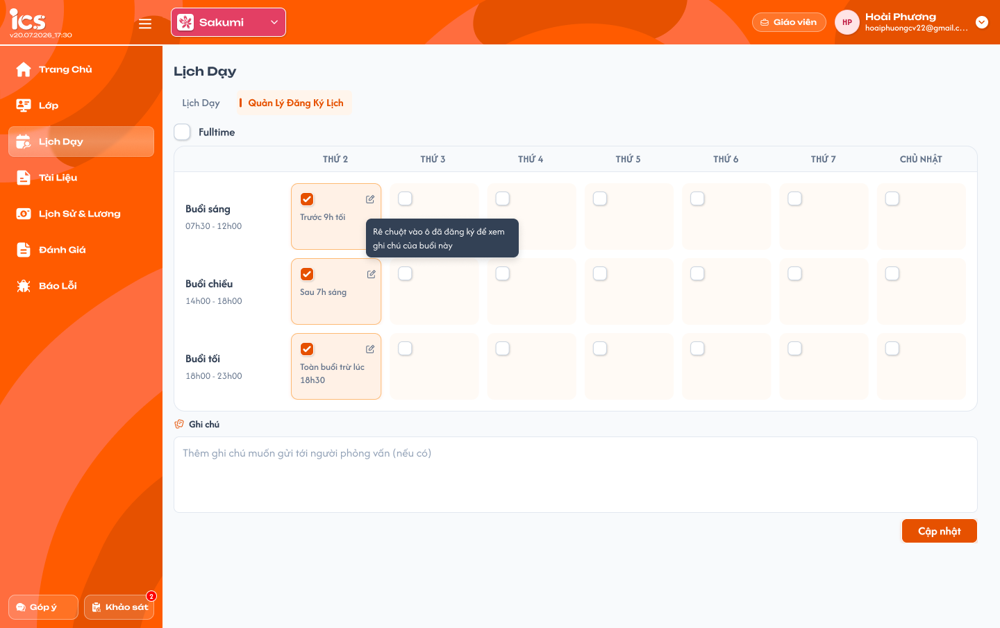
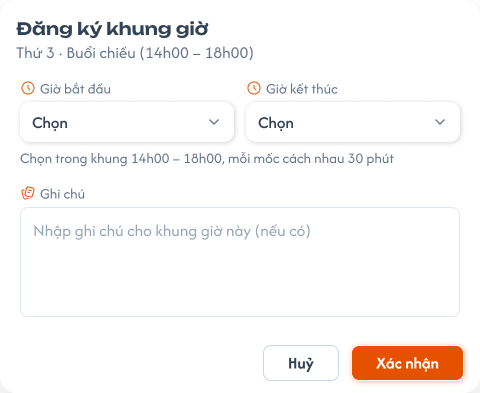
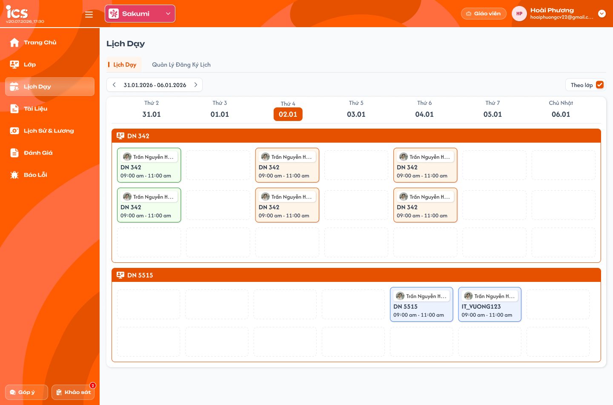

# [Giáo viên] Lịch dạy

## 1. UI

### Trang 1: GV-LD-020000 — Lịch dạy / Quản lý đăng ký lịch



**Mô tả:**
- Tab `Quản lý đăng ký lịch`: giáo viên xem và cập nhật lịch đăng ký khung giờ rảnh **của chính mình**, dùng để người quản lý tham khảo khi xếp lịch dạy.
- Đây là cấu hình theo thứ và buổi, không phải danh sách buổi học thực tế trong tuần đang xem. Tick ô rảnh không tạo lịch dạy, không hoàn thành buổi và không phát sinh lương.
- Cùng dữ liệu với tab Quản lý đăng ký lịch ở Chi tiết giáo viên; không tạo hai lịch riêng cho màn quản lý và màn giáo viên.

**Điểm cần lưu ý:**
- `A02.01` Cột thứ: Thứ 2 … Thứ 7, Chủ nhật; tổng 7 cột.
- `A02.02` Hàng buổi: Sáng `07h30 - 12h00`, Chiều `14h00 - 18h00`, Tối `18h00 - 23h00`. Mỗi cặp thứ–buổi là một ô, tối đa 21 ô.
- `A02.03` Ô chưa đăng ký: checkbox trống. Tick mở popup `Đăng ký khung giờ` (Trang 2) cho đúng thứ/buổi; chưa chọn hợp lệ và xác nhận thì chưa thêm ô vào nháp.
- `A02.04` Ô đã đăng ký: checkbox tick, nền cam, ghi chú ngắn nếu có và icon bút. Hover hiện ghi chú đầy đủ.
- `A02.05` Icon bút: mở popup với giờ/ghi chú hiện hành của đúng ô để chỉnh sửa nháp.
- `A02.06` Bỏ tick một ô: gỡ ô khỏi nháp; backend chưa thay đổi trước khi bấm `Cập nhật`.
- `A02.07` Bật `Fulltime`: chọn các ô còn trống với khung giờ trọn buổi; giữ nguyên giờ và ghi chú của ô đã đăng ký, không ghi đè bằng trọn buổi.
- `A02.08` Bỏ tick `Fulltime`: bỏ chọn tất cả ô đang được chọn trong nháp. Chỉ lưu chính thức khi bấm `Cập nhật`; không tự sửa lịch dạy đã xếp.
- `A02.09` Trạng thái `Fulltime`: tick khi đủ 21 ô được chọn, kể cả có ô được chỉnh giờ riêng; bỏ chọn một ô thì tự bỏ tick (chỉ gỡ ô đó, không gỡ toàn bộ). Fulltime tại đây là chọn đủ ô, không dùng để thay thế dữ liệu giờ cụ thể từng ô.
- `A02.10` Ghi chú chung: trường văn bản dưới lưới, không bắt buộc, độc lập với ghi chú từng ô.
- `A02.11` `Cập nhật`: lưu toàn bộ nháp gồm tập ô, giờ, ghi chú từng ô và ghi chú chung. Chỉ sau lưu thành công dữ liệu mới thành lịch đăng ký chính thức.
- `A02.14` Textarea · Ghi chú của lưới: chính là ô Ghi chú chung ở trên.
- Một ô đã đăng ký được tính là 1 ca, dù chỉ chọn một phần buổi. Số ngày = số thứ có ít nhất một ca; số ca = số ô đã chọn, tối đa 21. Mỗi ô có một khung liên tục theo popup hiện tại.
- Ví dụ ô T2–Chiều đã có `14:30–17:00` và ghi chú riêng: bật Fulltime giữ nguyên ô đó, thêm những ô trống bằng khung trọn buổi tương ứng. Không reset ghi chú hoặc giờ của ô T2–Chiều.
- Xác nhận popup, tick/gỡ ô, Fulltime và nhập ghi chú chỉ sửa nháp. Không tự lưu từng ô lên backend.
- Rời tab/menu khi có thay đổi chưa lưu phải cảnh báo để người dùng giữ lại hoặc bỏ thay đổi. Không tự làm mất nháp nếu request cập nhật thất bại.
- Trong khi lưu, chặn gửi lặp và chỉnh sửa gây không nhất quán; một request lưu toàn bộ lịch, không lưu thành công một phần số ô.
- Thành công: phản ánh lịch chính thức mới, trạng thái nháp sạch; màn Chi tiết giáo viên và Danh sách giáo viên đọc cùng dữ liệu khi tải lại. Hiển thị một thông báo kết quả.
- Thất bại: dữ liệu chính thức giữ nguyên, giữ nháp để thử lại, báo lỗi; không cho màn khác thấy nháp như dữ liệu đã lưu.
- Nếu người quản lý/giáo viên đã cập nhật phiên bản mới trong lúc đang chỉnh, không âm thầm ghi đè. Giữ nháp, thông báo xung đột và cho tải dữ liệu mới theo cơ chế dùng chung.
- Backend tự xác định owner/actor từ phiên đăng nhập khi giáo viên tự cập nhật; không cho sửa lịch đăng ký của người khác bằng request trực tiếp.
- Không tự xóa, dời hoặc đổi giáo viên của lịch dạy đã được xếp chỉ vì đổi lịch rảnh. Ví dụ giáo viên đã đăng ký rảnh T3–Chiều và được xếp buổi 15:00–16:00 vào T3: bỏ tick ô T3–Chiều chỉ là đổi đăng ký rảnh. **Đã chốt:** vẫn cho lưu lịch đăng ký bình thường khi bấm `Cập nhật`; không cảnh báo/chặn chỉ vì còn lịch đã phân công. Buổi 15:00–16:00 giữ nguyên, không phải thao tác hủy buổi dạy.

### Trang 2: GV-LD-020010 — Lịch dạy / Quản lý đăng ký lịch / Popup đăng ký khung giờ



**Mô tả:**
- Popup `Đăng ký khung giờ` mở từ ô trong lưới đăng ký (Trang 1) để chọn giờ bắt đầu – kết thúc và ghi chú cho đúng thứ/buổi.

**Điểm cần lưu ý:**
- `A03.01` Tiêu đề: `Đăng ký khung giờ`.
- `A03.02` Dòng phụ: đúng thứ, buổi và khung tương ứng ô đã bấm, ví dụ `Thứ 3 · Buổi chiều (14h00 – 18h00)`.
- `A03.03` `Giờ bắt đầu` / `Giờ kết thúc`: bắt buộc. Chọn các mốc cách nhau 30 phút, nằm trong khung của buổi. Buổi sáng gồm các mốc 07:30–12:00, chiều 14:00–18:00, tối 18:00–23:00. Giờ kết thúc phải lớn hơn giờ bắt đầu. Danh sách thực tế phải sinh từ đúng khung buổi.
- `A03.04` Ghi chú: không bắt buộc, chỉ thuộc ô đang sửa; không ghi đè ghi chú chung.
- `A03.05` `Huỷ`: đóng popup, không thay đổi nháp của ô; ô mới vẫn trống, ô đang sửa giữ giờ/ghi chú trước khi mở.
- `A03.06` `Xác nhận`: validate và lưu vào nháp lưới; chưa ghi backend. Nếu thiếu giờ hoặc khoảng không hợp lệ, báo lỗi tại field và giữ popup để sửa.
- Không dùng ghi chú tự do thay cho khoảng giờ chính thức (ví dụ ghi chú `Trước 9h tối`); các giờ đã chọn vẫn là nguồn xác định lịch rảnh.
- Một ô hiện chỉ có một cặp bắt đầu–kết thúc. Popup chưa hỗ trợ nhiều đoạn rời nhau trong cùng ca; chưa coi câu `Toàn buổi trừ lúc 18h30` là cấu hình chặn riêng một khoảng phút.

### Trang 3: GV-LD-010000 — Lịch dạy / Xem theo lớp



**Mô tả:**
- Tab `Lịch dạy`: giáo viên xem **chỉ các lịch được phân công cho chính mình**, ở các lớp và trong tuần đang chọn. Đây là phạm vi đã được người dùng xác nhận; không liệt kê lịch của giáo viên khác dù cùng lớp.
- Tab này chỉ hiển thị; thẻ lịch không có hành động khi bấm, không mở popup hoặc điều hướng. Không thêm, sửa, kéo thả đổi giờ, xóa, hủy, hoàn thành hoặc mở lại lịch tại đây. Lịch dạy do người có quyền quản lý xếp; đăng ký khung giờ rảnh được thực hiện ở tab riêng (Trang 1).

**Điểm cần lưu ý:**
- `A01.01` Tiêu đề / tab: tiêu đề `Lịch Dạy`; tab `Lịch dạy` và `Quản lý đăng ký lịch`. Mặc định mở tab Lịch dạy.
- `A01.02` Tuần đang xem: mặc định tuần chứa ngày hiện tại, Thứ 2 đến Chủ Nhật, theo quy tắc chung của tab Lịch dạy trong Chi tiết giáo viên. Khoảng ngày dạng `dd.MM.yyyy - dd.MM.yyyy`, ngày đầu không sau ngày cuối; ứng dụng tính tuần thật.
- `A01.03` Mũi tên trái / phải: lùi / tiến đúng một tuần; tải lịch tương ứng và cập nhật cả khoảng ngày, cột ngày và thẻ lịch.
- `A01.04` Cột ngày: Thứ 2 … Thứ 7, Chủ Nhật; mỗi cột có ngày `dd.MM`. Làm nổi bật ngày hiện tại nếu nằm trong tuần đang xem.
- `A01.05` `Theo lớp`: bật thì nhóm lịch theo lớp, mỗi nhóm có thanh tiêu đề mã lớp; tắt thì gom theo ngày, không chia nhóm lớp. Mặc định bật. Tập lịch trước và sau khi bật/tắt phải giống nhau.
- `A01.06` Thanh nhóm lớp: mã lớp của đúng nhóm. Chỉ nhóm các lịch trong phạm vi của giáo viên đang đăng nhập; không vì cùng lớp mà tải thêm lịch của giáo viên khác.
- `A01.07` Thẻ lịch: avatar và tên giáo viên được phân công (chính giáo viên đang đăng nhập), mã lớp, giờ bắt đầu–kết thúc. Giờ theo timezone nghiệp vụ; trình bày `hh:mm am/pm`. Chỉ hiển thị; bấm thẻ không mở popup, không điều hướng và không thực hiện thao tác dữ liệu.
- `A01.08` Sắp xếp thẻ: trong cùng ngày và cùng nhóm, giờ bắt đầu tăng dần. Chế độ không nhóm lớp vẫn giữ thứ tự thời gian.
- `A01.09` Ô không có lịch: ô trống viền nét đứt, không có nút `+`. Cả tuần không có lịch thì giữ lưới tuần trống; vẫn chuyển tuần/đổi chế độ được.
- `A01.10` Nhiều lịch trong ngày: mở rộng hoặc cuộn để xem đủ; số hàng trong ảnh không phải giới hạn số buổi. Không chồng thẻ che nội dung.
- `A01.11` Viền thẻ tại menu này: dùng quy ước thời gian của tab Lịch dạy trong Chi tiết giáo viên; với lịch không hủy: ngày đã qua xanh lá, ngày hiện tại cam, ngày tương lai xanh dương. Lịch Hủy bỏ luôn màu xám, ưu tiên hơn màu theo ngày. Có thông tin ngày giờ và tên trạng thái để không chỉ dựa vào màu.
- `A01.12` Lịch Hủy bỏ: vẫn hiển thị thẻ màu xám, kể cả lịch đã qua, hôm nay hoặc tương lai, trong đúng tuần và phạm vi phân công của giáo viên. Nhãn/tooltip trạng thái là `Hủy bỏ`; không tạo hành động trên thẻ. Lịch bị xóa không hiển thị.
- `A01.13` Trạng thái lịch: là dữ liệu nghiệp vụ riêng Đang đợi / Hoàn thành / Hủy bỏ. Không đổi trạng thái chỉ vì đã qua ngày/giờ.
- `A01.14` Lương: viền xanh lá không chứng minh đã Hoàn thành hay đã được tính lương. Hoàn thành qua luồng Bài học và lịch được gắn mới làm phát sinh lương theo requirement đã chốt.
- `A01.15` Khác màn quản lý lịch lớp: tab Lịch dạy ở Chi tiết lớp dùng màu loại/trạng thái lịch (Cố định, Linh hoạt, Hoàn thành, Hủy bỏ); không lấy màu theo thời gian tại menu này để thay đổi dữ liệu của tab đó.
- Backend kiểm tra danh tính giáo viên và phân công trên lịch, không chỉ kiểm tra giáo viên có trong lớp. Không tin `teacher_id` do client tự thay để xem lịch người khác.
- Cùng một lịch chỉ hiển thị một lần. Khi lịch cố định đã có bản ghi lịch thực tế/điều chỉnh tương ứng, không render cả bản cố định và bản ghi thay thế thành hai buổi.
- Chuyển tuần/chuyển chế độ không tạo lịch, không đổi trạng thái buổi, không phát sinh lương.
- Chỉ response của request mới nhất được hiển thị; không trộn thẻ tuần cũ vào header tuần mới.
- Phạm vi đã chốt: chỉ lịch phân công cho người đang đăng nhập.

---

## 2. Yêu cầu

### 2.1. Flow chính

**Flow 1: Xem lịch dạy theo tuần**

```
Giáo viên → Lịch dạy → tab Lịch dạy
  → Tải tuần hiện tại và lịch được phân công cho chính mình
  → Hiển thị lịch theo lớp, đủ 7 cột ngày
  → Bấm tuần trước/sau → tải đúng tuần mới, chỉ giữ response mới nhất
```

**Flow 2: Chuyển cách nhóm lịch**

```
Bật Theo lớp → mỗi lớp một nhóm
Tắt Theo lớp → toàn bộ lịch cùng ngày xếp theo giờ
  → Giữ tuần và tập lịch của giáo viên; không cập nhật dữ liệu lịch
```

**Flow 3: Chỉnh nháp lịch đăng ký**

```
Quản lý đăng ký lịch → tải lịch đăng ký cá nhân mới nhất
  → Tick ô trống / bấm bút ô đã có → popup đúng thứ–buổi
  → Chọn giờ hợp lệ, nhập ghi chú nếu có
  → Xác nhận: cập nhật nháp ô / Huỷ: không đổi ô
  → Có thể bỏ tick để gỡ ô khỏi nháp
```

**Flow 4: Chọn Fulltime**

```
Lưới có thể đã có ô với giờ/ghi chú riêng → tick Fulltime
  → Giữ nguyên ô đã đăng ký, thêm các ô trống bằng giờ trọn buổi
  → Đủ 21 ô trong nháp; backend chưa đổi
  → Chủ động bỏ tick Fulltime → bỏ chọn toàn bộ ô đang chọn trong nháp
  → Hoặc bỏ chọn một ô riêng → Fulltime tự bỏ tick, chỉ gỡ ô đó và giữ các ô còn lại
  → Bấm Cập nhật mới ghi thay đổi chính thức
```

**Flow 5: Lưu lịch đăng ký**

```
Giáo viên bấm Cập nhật → validate toàn bộ nháp và quyền
  → Kiểm tra phiên bản dữ liệu hiện hành
  → Hợp lệ: lưu toàn bộ, ghi đúng owner/actor → thông báo thành công
  → Lỗi: dữ liệu chính thức không đổi, giữ nháp, báo lỗi
  → Xung đột: không âm thầm ghi đè, giữ nháp để xử lý với dữ liệu mới
```

### 2.2. Ngoại lệ

- **EX01:** Truy cập lịch người khác, thay owner/actor hoặc cập nhật lịch dạy trái quyền → backend từ chối; không tiết lộ/cập nhật dữ liệu ngoài phạm vi.
- **EX02:** Tuần không có lịch dạy → lưới trống; chưa đăng ký ca nào → lưới đăng ký trống. Không coi trạng thái chưa có dữ liệu là lỗi.
- **EX03:** Tải lịch hoặc đăng ký thất bại → lỗi có Thử lại, không dùng dữ liệu mẫu hoặc dữ liệu người/tuần khác thay thế.
- **EX04:** Thiếu giờ, ngoài khung buổi, sai mốc 30 phút hoặc kết thúc không lớn hơn bắt đầu → không nhận nháp ô/lưu backend, chỉ rõ lỗi để sửa.
- **EX05:** Lưu thất bại hoặc bấm lặp → không lưu một phần, giữ nháp; chặn gửi lặp trong khi đang xử lý.
- **EX06:** Phiên bản lịch đăng ký đã thay đổi → báo xung đột, không âm thầm ghi đè.
- **EX07:** Rời màn khi có nháp chưa lưu → cảnh báo; ở lại giữ nháp, bỏ thay đổi thì không tự lưu.

### 2.3. Yêu cầu khác

| Mã | Tên yêu cầu | Mô tả |
|---|---|---|
| REQ01 | Phạm vi lịch dạy | Chỉ lịch có giáo viên được phân công là người đang đăng nhập; không lấy toàn bộ lịch của lớp chỉ vì người đó tham gia lớp. Backend kiểm tra phạm vi. |
| REQ02 | Tuần | Mặc định tuần hiện tại, Thứ 2–Chủ Nhật, mũi tên dịch một tuần; header và thẻ cùng khoảng theo timezone nghiệp vụ. |
| REQ03 | Cách trình bày | Theo lớp hoặc theo ngày, cùng tập lịch; mỗi lịch một thẻ, sắp tăng theo giờ trong ngày; đủ chỗ xem mọi lịch. |
| REQ04 | Màu và nghiệp vụ | Lịch Hủy bỏ vẫn hiển thị màu xám, ưu tiên hơn màu thời gian và không phát sinh lương. Lịch không hủy dùng màu theo ngày. Màu thời gian không tự thay trạng thái hoặc ghi nhận lương; không đánh đồng lịch đã qua với buổi đã hoàn thành. |
| REQ05 | Lịch dạy chỉ đọc | Thẻ chỉ hiển thị, không có hành động khi bấm, không mở popup và không điều hướng. Không CRUD/hủy/hoàn thành/mở lại trực tiếp tại tab này. Giáo viên hoàn thành qua luồng Bài học được cấp quyền theo requirement riêng. |
| REQ06 | Lịch đăng ký | Lưới 3 buổi × 7 thứ của chính giáo viên; một ô một khung giờ và ghi chú riêng; một ô là một ca, tối đa 21. Ghi chú chung độc lập. Không tạo buổi dạy/lương từ lịch đăng ký. |
| REQ07 | Popup | Giờ bắt đầu/kết thúc bắt buộc, đúng khung buổi và mốc 30 phút, kết thúc sau bắt đầu; xác nhận chỉ cập nhật nháp, hủy không đổi ô. Backend validate lại khi lưu. |
| REQ08 | Fulltime | Bật chọn thêm ô trống với giờ trọn buổi, không đổi giờ/ghi chú ô cũ. Tick khi đủ 21 ô; gỡ một ô tự bỏ tick. Chủ động bỏ Fulltime sẽ bỏ chọn toàn bộ ô đang chọn trong nháp; chỉ bấm Cập nhật mới ghi backend. Fulltime tự bỏ tick do gỡ một ô riêng không kích hoạt gỡ toàn bộ. |
| REQ09 | Nháp và lưu | Chỉ Cập nhật mới ghi toàn bộ lịch đăng ký chính thức; không lưu từng ô. Chặn gửi lặp, lưu toàn bộ hoặc không lưu; lỗi giữ nháp, rời màn cảnh báo khi chưa lưu. |
| REQ10 | Đồng bộ và xung đột | Dùng cùng nguồn với màn quản lý; chỉ response mới nhất cập nhật UI; phát hiện sửa đồng thời thay vì âm thầm ghi đè. Bỏ khung giờ rảnh vẫn cho lưu bình thường dù có lịch dạy đã phân công trong khung đó; không cảnh báo/chặn vì lý do này và không tự sửa/hủy/xóa lịch dạy đã xếp. |
| REQ11 | Quyền và audit | Giáo viên chỉ xem/cập nhật đăng ký của mình; server kiểm tra phiên đăng nhập, trạng thái tài khoản và phạm vi. Cập nhật bởi giáo viên ghi đúng owner/actor; quản lý cập nhật thay theo requirement Chi tiết giáo viên. |

### 2.4. Ràng buộc

#### Quyền

| Role / ngữ cảnh | Xem lịch được phân công cho mình | Xem/sửa đăng ký của mình | CRUD lịch dạy trực tiếp tại menu này | Sửa đăng ký giáo viên khác từ menu này |
|---|:---:|:---:|:---:|:---:|
| Giáo viên đang được phép truy cập hệ thống | ✅ | ✅ | ❌ | ❌ |
| Admin / Class Handler / Support | Theo màn quản lý được cấp quyền | Cập nhật thay tại Chi tiết giáo viên theo requirement riêng | Theo màn quản lý được cấp quyền, không dùng quyền Giáo viên để bypass | Theo phạm vi quản lý, không qua menu cá nhân này |

#### Ràng buộc khác

- Khóa nhận diện lịch là ID lịch/buổi và giáo viên; không dùng tên, mã lớp hiển thị hoặc vị trí ô làm khóa cập nhật.
- Khóa ô đăng ký là giáo viên + thứ + buổi. Dữ liệu từng ô và ghi chú chung phải thuộc cùng một phiên bản lịch đăng ký.
- Không cho phép thực hiện hành động đánh dấu `❌`, kể cả qua URL hoặc request trực tiếp.
- Lịch đăng ký không ghi đè cấu hình lịch cố định/linh hoạt của lớp, không đảo lương và không hồi tố lương buổi đã hoàn thành.

---

## 3. Testcase

### Feature: [Giáo viên] Lịch dạy

| Tên testcase | Priority | Scenario | Role | Pre-condition | Given/When/Then | Expected Result |
|---|---|---|---|---|---|---|
| Case 1: Mở lịch tuần và chuyển tuần | High | Flow 1 / REQ01 / REQ02 | Giáo viên | Có lịch của G ở tuần hiện tại và tuần khác; tuần đang xem đi qua cuối tháng hoặc cuối năm | **Given:** G mở menu Lịch dạy<br>**When:** tải thành công rồi bấm mũi tên trái/phải<br>**Then:** hiển thị tuần hiện tại đúng 7 ngày và lịch được phân công cho G; chuyển tuần dịch đúng 7 ngày, header khớp thẻ | - Không trộn tuần khác<br>- Ngày hiện tại được đánh dấu đúng<br>- Ngày đầu không sau ngày cuối |
| Case 2: Chặn lịch giáo viên khác cùng lớp | High | REQ01 / EX01 | Giáo viên | Lớp A có lịch của G và H; G tham gia A | **Given:** G mở lịch<br>**When:** xem nhóm A và thử thay teacher_id trong request<br>**Then:** chỉ được xem lịch phân công cho G | - Không trả lịch H<br>- Không chỉ lọc theo quan hệ giáo viên–lớp |
| Case 3: Bật/tắt Theo lớp và nhiều lịch | High | Flow 2 / REQ03 | Giáo viên | G có lịch ở hai lớp cùng tuần; một ngày có trên 3 lịch; một lịch cố định đã có bản ghi thực tế | **Given:** chuyển giữa hai chế độ Theo lớp<br>**When:** render lại<br>**Then:** tập lịch không thay đổi, chỉ khác cách nhóm; xem được mọi lịch trong ngày | - Giữ tuần đang chọn<br>- Không mất/nhân đôi lịch, không cắt lịch thứ tư trở đi<br>- Cùng ngày sắp theo giờ tăng dần |
| Case 4: Tuần không có lịch, tải lỗi, response cũ | High | EX02 / EX03 / REQ02 / REQ10 | Giáo viên | Tuần chọn không có lịch của G; hoặc request tuần trước trả sau tuần mới; hoặc API lỗi | **Given:** chuyển tới tuần trống, đổi tuần nhanh hoặc gặp lỗi<br>**When:** nhận response<br>**Then:** lưới trống đúng tuần; chỉ hiển thị dữ liệu đúng lựa chọn mới nhất hoặc lỗi có Thử lại | - Không giữ thẻ tuần trước, không gán lịch cũ vào header mới<br>- Không coi tuần trống là lỗi, không có nút thêm lịch<br>- Không hiển thị lỗi như tuần không có lịch |
| Case 5: Màu thời gian và lịch hủy | High | REQ04 | Giáo viên | Lịch Đang đợi đã qua ngày; có lịch hôm nay và tương lai; G có lịch Hủy bỏ ở ngày đã qua, hôm nay và tương lai; H có lịch hủy cùng lớp | **Given:** xem thẻ ở từng tuần và hai chế độ nhóm<br>**When:** tính màu<br>**Then:** màu theo ngày, lịch Hủy bỏ màu xám với tên trạng thái đúng; trạng thái/lương không thay đổi | - Lịch đã qua vẫn Đang đợi, không tự tạo khoản lương<br>- Màu xám ưu tiên hơn xanh lá/cam/xanh dương<br>- Không hiện lịch H; không phát sinh lương từ lịch hủy |
| Case 6: Lịch dạy chỉ đọc | High | REQ05 / EX01 | Giáo viên | Có lịch đã phân công | **Given:** bấm thẻ lịch, mã lớp, tên giáo viên trên thẻ; gọi request sửa/xóa/hủy/hoàn thành/mở lại lịch trực tiếp<br>**When:** tương tác và backend kiểm tra quyền<br>**Then:** không mở popup, không điều hướng; backend từ chối thao tác ngoài luồng dạy được cấp quyền | - Không có nút CRUD hay kéo thả chỉnh giờ<br>- Giữ nguyên tuần/chế độ đang xem<br>- Lịch và lương không đổi |
| Case 7: Tải đúng lịch đăng ký, thêm/sửa/gỡ ô nháp | High | Flow 3 / REQ06 / REQ07 | Giáo viên | G đã đăng ký 3 ô T2 với giờ và ghi chú riêng; ô T3–Chiều trống | **Given:** G mở tab Quản lý đăng ký lịch; tick ô T3–Chiều chọn 14:30–17:00, Xác nhận; mở icon bút sửa một ô; bỏ tick một ô<br>**When:** xem nháp<br>**Then:** đúng 3 ô ban đầu được tick kèm ghi chú; ô mới vào nháp, ô sửa/gỡ đúng ô | - Backend chưa lưu, dữ liệu chính thức chưa đổi<br>- Không trộn lịch H; ghi chú chung độc lập ghi chú từng ô<br>- Hover hiện ghi chú của chính ô đó; ô khác giữ nguyên |
| Case 8: Popup khung giờ: đúng khung, validate, huỷ | High | EX04 / REQ07 / REQ06 | Giáo viên | Bấm ô T3–Chiều hoặc popup Sáng đang mở | **Given:** xem dòng phụ và dropdown; để trống giờ, hai giờ bằng nhau, kết thúc trước bắt đầu; truyền 07:00–12:30 hoặc 07:45–09:00 bằng request; nhập khác rồi bấm Huỷ<br>**When:** Xác nhận / Cập nhật / Huỷ<br>**Then:** đúng T3, 14:00–18:00, mốc 30 phút; dữ liệu không hợp lệ không vào nháp; Huỷ không đổi nháp | - Lỗi đúng field, giữ popup để sửa<br>- Backend kiểm tra lại khi Cập nhật, không chỉ giới hạn dropdown ở FE<br>- Một ô tính là 1 ca, ghi chú chung không đổi<br>- Không tick ô mới / không ghi đè ô cũ khi Huỷ |
| Case 9: Fulltime bật, bỏ tick và tự bỏ tick | High | Flow 4 / REQ08 | Giáo viên | T2–Chiều có 14:30–17:00 và ghi chú, còn ô trống; đủ 21 ô có ô dùng giờ riêng | **Given:** bật Fulltime; sau đó bỏ chọn một ô; rồi chủ động bỏ tick Fulltime khi đủ 21 ô<br>**When:** xem nháp<br>**Then:** bật đủ 21 ô, ô T2–Chiều giữ nguyên giờ/ghi chú, ô mới nhận trọn buổi; bỏ một ô thì Fulltime tự bỏ tick; chủ động bỏ tick thì toàn bộ ô bị bỏ chọn | - Không reset nội dung cũ, giờ riêng không tự đổi<br>- Gỡ một ô không xóa cả lưới<br>- Chưa ghi backend trước khi bấm Cập nhật; không xóa/dời lịch dạy đã xếp |
| Case 10: Cập nhật và đồng bộ dữ liệu | High | Flow 5 / REQ06 / REQ09 | Giáo viên | Nháp hợp lệ có 2 ô cùng ngày và ghi chú chung; chưa có lịch dạy thực tế ở ca chọn | **Given:** bấm Cập nhật<br>**When:** lưu thành công rồi tải lại, xem lịch dạy và lương<br>**Then:** giữ đúng 2 ô, giờ và ghi chú; không tự xuất hiện buổi dạy hoặc khoản lương | - Danh sách giáo viên là 1 ngày (2 ca)<br>- Màn quản lý đọc cùng dữ liệu<br>- Ghi owner/actor là G; lịch đăng ký không thay thế lịch đã xếp |
| Case 11: Lưu lỗi hoặc bấm lặp | High | EX05 / REQ09 | Giáo viên | Có nháp, request lưu chậm/lỗi | **Given:** bấm Cập nhật nhiều lần<br>**When:** đang xử lý hoặc trả lỗi<br>**Then:** không gửi lặp, không lưu một phần | - Giữ dữ liệu chính thức khi thất bại<br>- Nháp không mất, thử lại được |
| Case 12: Cập nhật đồng thời | High | EX06 / REQ10 | Giáo viên | G và người quản lý cùng mở phiên bản cũ; người quản lý đã lưu trước | **Given:** G gửi nháp cũ<br>**When:** backend kiểm tra phiên bản<br>**Then:** phát hiện xung đột, không âm thầm ghi đè | - Giữ nháp để đối chiếu/tải lại<br>- Không báo thành công giả |
| Case 13: Rời màn khi còn nháp | Medium | EX07 / REQ09 | Giáo viên | Có thay đổi chưa Cập nhật | **Given:** rời tab/menu<br>**When:** hệ thống cảnh báo<br>**Then:** người dùng chọn ở lại hoặc bỏ thay đổi | - Ở lại giữ nháp<br>- Bỏ thay đổi không gửi request lưu |
| Case 14: Không sửa đăng ký của giáo viên khác | High | EX01 / REQ11 / Ràng buộc quyền | Giáo viên | Có ID của H | **Given:** G thay owner/teacher_id trong request<br>**When:** backend xử lý<br>**Then:** không cập nhật lịch H | - Không giả mạo actor<br>- Dữ liệu H giữ nguyên |
| Case 15: Bỏ ca rảnh đang có lịch dạy vẫn lưu được | High | Flow 5 / REQ09 / REQ10 | Giáo viên | G đăng ký T3–Chiều, đã được phân công buổi T3 15:00–16:00 | **Given:** G bỏ tick T3–Chiều trong lịch đăng ký<br>**When:** bấm Cập nhật với dữ liệu còn lại hợp lệ<br>**Then:** lưu đăng ký bình thường, không cảnh báo/chặn do buổi đã xếp | - Ô T3–Chiều không còn trong đăng ký chính thức<br>- Buổi T3 15:00–16:00 giữ nguyên ID, giờ, giáo viên, trạng thái<br>- Không hủy/xóa/dời buổi và không đổi lương đã ghi nhận |

---

## 4. Câu hỏi cần xác nhận

- **Q01:** Có cho lưu lịch đăng ký rỗng không.
- **Q02:** Cách biểu diễn lịch dời/thay giáo viên trên tab Lịch dạy.
- **Q03:** Có hỗ trợ chọn tuần bằng danh sách khi bấm khoảng ngày như màn quản lý không; giới hạn xem quá khứ/tương lai, ghi nhớ tuần và lựa chọn Theo lớp khi mở lại.
- **Q04:** Timezone nghiệp vụ và khung ba buổi là cố định toàn hệ thống hay theo trung tâm; lịch đăng ký có ngày hiệu lực hay chỉ mẫu lặp theo thứ.
- **Q05:** Giới hạn ký tự ghi chú riêng/chung; nhãn gợi ý (placeholder) của ghi chú chung; nội dung thông báo kết quả và cách xử lý xung đột cụ thể. Mỗi ô hiện chỉ hỗ trợ một khoảng liên tục theo popup.
