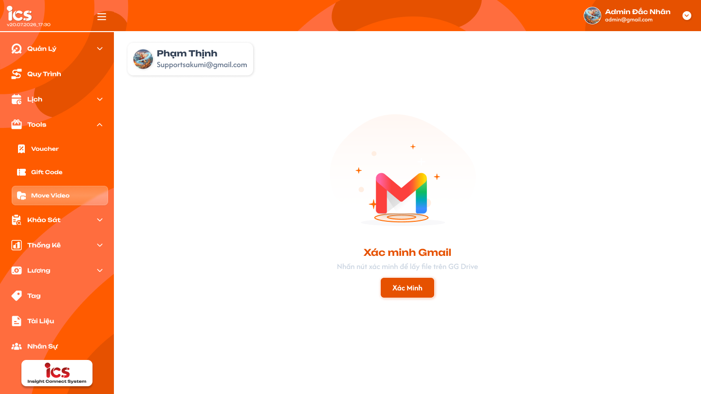
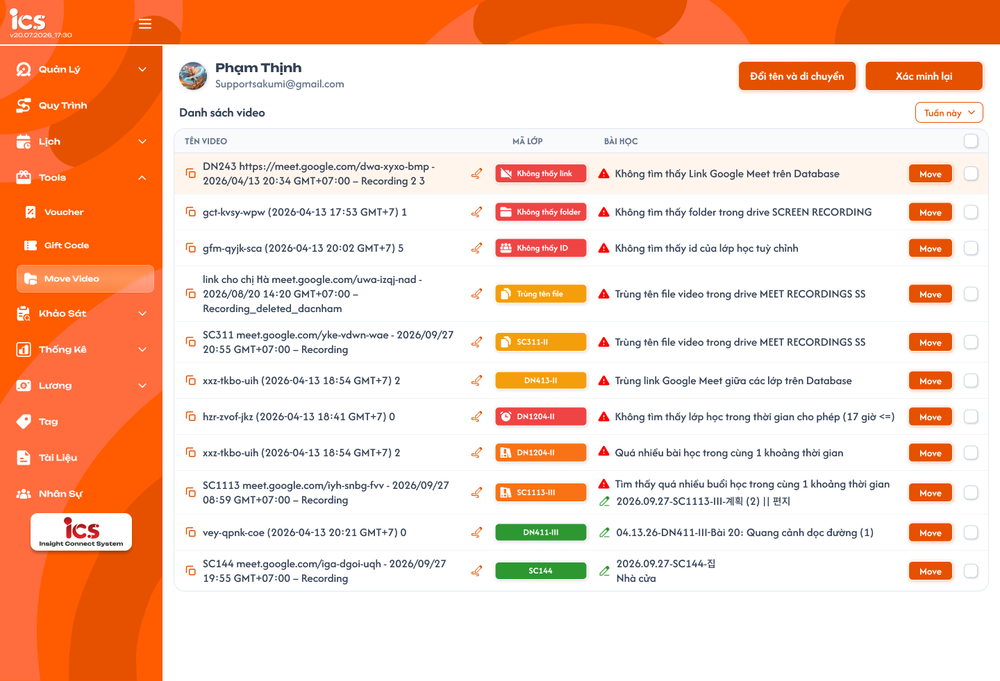

# Move Video

## 1. UI

### Trang 1: ADM-MV-010000 — Move video / Xác minh Gmail



**Mô tả:**
- Bước xác minh tài khoản Google (có Google Drive chứa các file record) trước khi vào danh sách video. Vào từ menu **Tool > Move Video**.

**Điểm cần lưu ý:**
- Trước màn này, user tự đăng nhập Google bằng giao diện đăng nhập của Google. Reload trang là mất liên kết, phải đăng nhập lại.
- Card tài khoản ở góc trái trên hiển thị tài khoản Gmail vừa đăng nhập (avatar, tên, email).
- Nút **Xác Minh**: xác minh account Google và lấy file record từ Google Drive về. Xác minh thành công mới vào được Trang 2.

### Trang 2: ADM-MV-020000 — Move video / Danh sách video



**Mô tả:**
- Hiển thị các file record Google Meet nằm trong folder tổng `MEET RECORDINGS SS` (giáo viên dạy xong record thì file tự vào folder này). Người dùng đổi tên và di chuyển file sang folder của lớp trong drive `SCREEN RECORDING`.

**Điểm cần lưu ý:**
- Nút `Đổi tên và di chuyển`: chạy giống nút Move nhưng áp dụng cho **tất cả** file có trạng thái mã lớp màu **xanh**; bấm là move luôn, **không hiện popup**.
- Nút `Xác minh lại`: xác minh lại tài khoản Google và lấy lại danh sách file từ Drive.
- Filter theo **ngày tạo trên Drive** đặt cạnh nút `Xác minh lại`, chọn **1 ngày hoặc khoảng ngày**, mặc định là tất cả.
- Cột Tên video: tên gốc dạng `DN1134 meet.google.com/ort-xvvd-ebo - 2026/09/28 19:02 GMT+07:00 – Recording`; ở folder tổng file chưa biết thuộc lớp và bài học nào. Icon **copy** (bên trái) copy tên video; icon **bút** (bên phải) mở popup Đổi tên video (Trang 3) để đổi tên file ở **folder tổng**.
- Cột Mã lớp dạng badge màu: tìm được lớp thì hiển thị mã lớp, không tìm được thì hiển thị nhãn lỗi. Màu **xanh** là hợp lệ, sẵn sàng đổi tên và move; màu **cam / đỏ** là có lỗi; icon trong badge theo từng loại lỗi (bảng ở mục 2.3).
- Cột Bài học: dòng xanh hiển thị **tên video đề xuất** (icon bút xanh); dòng không xanh hiển thị icon cảnh báo đỏ + thông báo lỗi. Một file dính nhiều lỗi thì hiển thị đủ các lỗi trong cột Bài học; màu badge mặc định **cam**, có lỗi loại đỏ thì badge **đỏ**.
- Nút **Move** hiển thị ở **mọi** dòng (cả xanh và không xanh), bấm mở popup đổi tên & move (Trang 4).
- Cột cuối: checkbox chọn nhiều để xoá; checkbox ở header chọn tất cả. Nút **Xoá** chỉ hiển thị khi đã tick ít nhất 1 dòng, nằm ở hàng tiêu đề (cùng hàng với TÊN VIDEO, MÃ LỚP, BÀI HỌC); bấm Xoá hiện popup xác nhận (Trang 5).

### Trang 3: ADM-MV-020010 — Move video / Danh sách video / Popup đổi tên video


**Mô tả:**
- Popup đổi tên file ở **folder tổng**, mở từ icon bút cạnh tên video; nút `Huỷ` / `Xác nhận`.

**Điểm cần lưu ý:**
- Popup mở cho cả dòng xanh và không xanh. Ô `Tên video` điền sẵn tên đề xuất (mặc định `ngày_tên lesson`); dòng chưa có tên đề xuất thì điền sẵn tên hiện tại. **Tên rỗng thì không cho Xác nhận.**
- Dòng ghi chú đỏ cố định: `* Vui lòng kiểm tra lại để chắc chắn bài học đã được mở`.
- `Huỷ` đóng popup, không thay đổi gì. `Xác nhận` từ icon bút: chỉ đổi tên file ở **folder tổng**, không move.

### Trang 4: ADM-MV-020030 — Move video / Danh sách video / Popup đổi tên & move video


**Mô tả:**
- Popup xác nhận / chỉnh tên file trước khi đổi tên và move sang folder của lớp, mở từ nút Move; nút `Huỷ` / `Đổi tên & move`.

**Điểm cần lưu ý:**
- Dùng chung ô `Tên video` và ghi chú đỏ với Trang 3, mở cho cả dòng xanh và không xanh; tên rỗng không cho xác nhận.
- Từ Move: đổi tên file ở **folder của lớp** rồi move.

### Trang 5: ADM-MV-020020 — Move video / Danh sách video / Popup xác nhận xoá


**Mô tả:**
- Popup `Xác nhận xoá` hiện khi bấm Xoá các dòng đã tick, nút `Huỷ` / `Xoá`.

**Điểm cần lưu ý:**
- `Huỷ` không xoá, các dòng vẫn giữ trạng thái tick. Xoá là xoá mềm (REQ12).

---

## 2. Yêu cầu

### 2.1. Flow chính

**Flow 1: Đăng nhập, xác minh Gmail và vào danh sách**

```
User mở Tool > Move Video → chưa liên kết Google (lần đầu hoặc sau reload)
  → User đăng nhập Google (giao diện đăng nhập của Google)
  → FE hiển thị Trang 1 (card tài khoản + nút Xác Minh)
  → User bấm Xác Minh → BE xác minh account, lấy file từ MEET RECORDINGS SS
  → FE hiển thị Trang 2 (Danh sách video)
```

**Flow 2: Xác định lớp, buổi học và tên đề xuất cho từng file**

```
Tên video (chứa link cuộc họp) → tìm trong DB → class → class.id → course_id
  → các lesson có cùng course_id, lesson mới nhất được mở → tên buổi học
  → tên đề xuất mặc định "ngày_tên lesson"; class code = tên folder trong drive SCREEN RECORDING
        ↓ (nếu bước nào không thoả)
   gán lỗi tương ứng (bảng 2.3), badge cam/đỏ và thông báo ở cột Bài học
        ↓ (nếu thoả toàn bộ)
   badge xanh + tên đề xuất
```

Điều kiện: chỉ class có status **In progress** mới được sử dụng.

**Flow 3: Move 1 file (nút Move)**

```
Bấm Move ở 1 dòng → popup đổi tên & move (Trang 4, điền sẵn tên đề xuất / tên hiện tại)
  → sửa tên nếu cần → Xác nhận → FE gọi API → BE xử lý:
       ├─ Dòng xanh: đổi tên file → move sang folder lớp → thành công
       └─ Dòng không xanh: BE kiểm tra lại với tên đã nhập
              ├─ Được: đổi tên, move sang folder lớp → thành công
              └─ Không: trả lỗi tương ứng
  → FE: thành công → toast "Đổi tên và di chuyển video thành công", cập nhật danh sách
        thất bại → hiển thị lỗi tương ứng ngay trong danh sách (cột Bài học), giữ nguyên dòng
```

**Flow 4: Đổi tên file ở folder tổng (icon bút)**

```
Bấm icon bút cạnh tên video → popup Đổi tên video (Trang 3) → nhập tên mới → Xác nhận
  → BE đổi tên file ở folder tổng MEET RECORDINGS SS
  → FE cập nhật tên video và tính lại trạng thái dòng
```

**Flow 5: Đổi tên và di chuyển hàng loạt**

```
Bấm "Đổi tên và di chuyển" (không popup) → FE gọi API cho tất cả dòng xanh (dùng tên đề xuất)
  → BE đổi tên + move từng file → FE cập nhật danh sách
        ↓ (có dòng xanh move thất bại)                          ↓ (tất cả dòng xanh thành công)
  dòng đó hiển thị lỗi + toast                               toast "Đổi tên và di chuyển video thành công"
  "Vẫn còn một số link video bị lỗi, vui lòng kiểm tra lại"
```

**Flow 6: Xoá nhiều file (xoá mềm)**

```
Tick checkbox (nhiều dòng hoặc chọn tất cả) → nút Xoá xuất hiện ở hàng tiêu đề → bấm Xoá
  → popup xác nhận (Trang 5) → xác nhận (Huỷ thì không xoá)
  → BE xoá mềm trên hệ thống + đổi tên file trên Drive thêm hậu tố _deleted_{account người xoá}
  → FE ẩn các dòng đã xoá khỏi danh sách
```

**Flow 7: Xác minh lại**

```
Bấm "Xác minh lại" → BE xác minh lại tài khoản Google → lấy lại file từ Drive → FE cập nhật danh sách
```

### 2.2. Ngoại lệ

- **EX01:** Chưa xác thực tài khoản Google khi thao tác (chưa liên kết hoặc hết phiên) → hiển thị `Bạn chưa xác thực tài khoản google` (`txtNotLoggedIn`), yêu cầu xác minh lại.
- **EX02:** Reload trang → mất liên kết Google, quay lại bước đăng nhập Google.
- **EX03:** Move dòng không xanh mà BE kiểm tra vẫn không hợp lệ → hiển thị đúng lỗi tương ứng (bảng 2.3) trong danh sách, file không bị đổi tên / move, dòng giữ nguyên.
- **EX04:** File không còn trong `MEET RECORDINGS SS` khi move → lỗi `Không tìm thấy file video trong drive MEET RECORDINGS SS` (`txtErrorInvalidFile`) trong danh sách.
- **EX05:** Trùng tên file video trong `MEET RECORDINGS SS` → `Trùng tên file video trong drive MEET RECORDINGS SS` (`txtErrorDuplicateVideo`).
- **EX06:** Trùng link meet hoặc trùng video khi move → `Trùng link meet hoặc trùng video, vui lòng kiểm tra lại` (`txtDuplicateLinkOrVideo`) trong danh sách.
- **EX07:** Đổi tên và di chuyển hàng loạt mà có dòng xanh move thất bại → `Vẫn còn một số link video bị lỗi, vui lòng kiểm tra lại` (`txtStillSomeErrorVideo`).
- **EX08:** Bấm Huỷ ở popup → đóng popup, không gọi API, không thay đổi gì.
- **EX09:** Tên rỗng ở popup → nút xác nhận không cho bấm.
- **EX10:** Huỷ ở popup xác nhận xoá → không xoá, các dòng vẫn giữ trạng thái tick.

### 2.3. Yêu cầu khác

| Mã | Tên yêu cầu | Mô tả |
|---|---|---|
| REQ01 | Nguồn danh sách | Danh sách = các file record trong folder tổng `MEET RECORDINGS SS` trên Drive của tài khoản Gmail đã xác minh, chưa bị xoá mềm. |
| REQ02 | Quy tắc xác định buổi học | Link cuộc họp → DB → class → id → course_id → các lesson cùng course_id mới nhất được mở → tên buổi học. |
| REQ03 | Điều kiện lớp | Chỉ class có status **In progress** mới được sử dụng. |
| REQ04 | Folder và tên file đích | Class code = tên folder trong drive `SCREEN RECORDING`. Tên file đích mặc định `ngày_tên lesson` do hệ thống đặt khi move; user có thể sửa ở popup. |
| REQ05 | Phân loại trạng thái | Mỗi dòng được gán trạng thái theo bảng bên dưới; quyết định màu badge, icon và thông báo. Chỉ dùng các thông báo trong bảng này. |
| REQ06 | Hiển thị lỗi | Mọi lỗi hiển thị ngay trong danh sách (cột Bài học), không dùng popup lỗi. |
| REQ07 | Filter | Lọc theo **ngày tạo file trên Drive**, chọn 1 ngày hoặc khoảng ngày, đặt cạnh nút Xác minh lại, mặc định là tất cả. |
| REQ08 | Popup Đổi tên video | Dùng cho cả dòng xanh và không xanh; tên rỗng không cho xác nhận. |
| REQ09 | Đổi tên hai nơi | Cả icon bút và nút Move đều mở popup đổi tên. Icon bút: đổi tên file ở folder tổng. Move: đổi tên file ở folder của lớp rồi move. |
| REQ10 | Copy tên video | Icon copy bên trái tên video copy tên video. |
| REQ11 | Đổi tên và di chuyển hàng loạt | Chỉ áp dụng cho các dòng xanh; không xử lý dòng cam / đỏ. Bấm là move luôn, không popup. |
| REQ12 | Xoá mềm | Bấm Xoá hiện popup xác nhận. Dòng đã xoá không hiển thị trong danh sách nữa. Trên Drive, tên file được thêm hậu tố `_deleted_{account người xoá}` (ví dụ `..._deleted_dacnham`). |
| REQ13 | Sau khi move thành công | File không còn trong folder tổng nên dòng biến mất khỏi danh sách. |
| REQ14 | Xác minh lại | Nút `Xác minh lại` lấy lại danh sách file mới nhất từ Drive. |
| REQ15 | Màu badge khi nhiều lỗi | Mặc định cam; nếu có lỗi loại đỏ thì badge đỏ. Các lỗi đều hiển thị trong cột Bài học. |

**Bảng lỗi hiển thị trong danh sách:**

| Nhãn / badge | Màu | Icon | Thông báo cột Bài học | Hằng số |
|---|---|---|---|---|
| Mã lớp (hợp lệ) | Xanh | - | Tên video đề xuất | - |
| Không thấy link | Đỏ | Link gạch chéo | Không tìm thấy Link Google Meet trên Database | `txtErrorNotFoundLinkGGMeetOnDB` |
| Không thấy folder | Đỏ | Folder | Không tìm thấy folder trong drive SCREEN RECORDING | `txtErrorNotFoundFolderOnDrive` |
| Không thấy ID | Đỏ | Nhóm người | Không tìm thấy id của lớp học tuỳ chỉnh | `txtErrorNotFoundCustomLessonId` |
| Mã lớp | Đỏ | Đồng hồ | Không tìm thấy lớp học trong thời gian cho phép (17 giờ <=) | `txtErrorNotFoundClassInLimitTime` |
| Trùng tên file, hoặc mã lớp | Cam | File | Trùng tên file video trong drive MEET RECORDINGS SS | `txtErrorDuplicateVideo` |
| Mã lớp | Cam | - | Trùng link Google Meet giữa các lớp trên Database | `txtDuplicateLinkBetweenClasses` |
| Mã lớp | Cam | Sách | Tìm thấy quá nhiều buổi học trong cùng 1 khoảng thời gian | `txtErrorFoundTooLessonsInSamePeriod` |
| Mã lớp (nếu có) | Đỏ | Cảnh báo | Không tìm thấy file video trong drive MEET RECORDINGS SS | `txtErrorInvalidFile` |
| Mã lớp (nếu có) | Đỏ | Cảnh báo | Trùng link meet hoặc trùng video, vui lòng kiểm tra lại | `txtDuplicateLinkOrVideo` |

**Thông báo khác:**

| Khi nào | Thông báo | Hằng số |
|---|---|---|
| Move thành công (từng file, hoặc hàng loạt không còn dòng xanh lỗi) | Đổi tên và di chuyển video thành công | `txtSuccessfullyUpdateVideo` |
| Hàng loạt xong mà có dòng xanh move thất bại | Vẫn còn một số link video bị lỗi, vui lòng kiểm tra lại | `txtStillSomeErrorVideo` |
| Chưa xác thực Google | Bạn chưa xác thực tài khoản google | `txtNotLoggedIn` |

### 2.4. Ràng buộc

#### Quyền

| Role | Truy cập Tool > Move Video | Move | Đổi tên và di chuyển hàng loạt | Xoá |
|---|:---:|:---:|:---:|:---:|
| CD | ✅ | ✅ | ✅ | ✅ |
| Các role khác | ❌ | ❌ | ❌ | ❌ |

#### Ràng buộc khác

- Chỉ vào được danh sách video sau khi user tự đăng nhập Google và xác minh; tài khoản Gmail phải có quyền truy cập Drive chứa file record. Reload trang là mất liên kết.
- Chỉ class **In progress** mới dùng được để xác định lớp.
- Đổi tên và di chuyển hàng loạt chỉ áp dụng dòng xanh.
- Move từng file: dòng không xanh chỉ move được khi BE kiểm tra lại hợp lệ, nếu không trả về lỗi ở bảng 2.3.
- Xoá là xoá mềm, không xoá file thật trên Drive; phải qua popup xác nhận.

---

## 3. Testcase

### Feature: Move Video

| Tên testcase | Priority | Scenario | Role | Pre-condition | Given/When/Then | Expected Result |
|---|---|---|---|---|---|---|
| Case 1: Đăng nhập Google và xác minh | High | Flow 1 / EX02 | CD | Chưa liên kết Google | **Given:** mở Tool > Move Video<br>**When:** đăng nhập Google, bấm Xác Minh; sau đó reload trang<br>**Then:** xem màn hình | - Sau đăng nhập hiển thị Trang 1 với card tài khoản và nút Xác Minh<br>- Xác minh thành công thì vào Trang 2, danh sách lấy từ MEET RECORDINGS SS<br>- Reload thì mất liên kết, quay lại đăng nhập Google |
| Case 2: Hiển thị và phân loại danh sách | High | Flow 2 / REQ02 / REQ03 / REQ05 | CD | Folder tổng có file: link khớp lớp In progress hợp lệ; link không có trên DB; lớp không có folder; link trùng giữa các lớp; nhiều buổi trong cùng khoảng thời gian | **Given:** đã xác minh Google<br>**When:** vào Trang 2<br>**Then:** xem cột Mã lớp và Bài học từng dòng | - Dòng hợp lệ: badge xanh, hiển thị tên đề xuất<br>- Các dòng còn lại: badge đúng màu / icon và đúng thông báo theo bảng 2.3<br>- Lớp không In progress không được dùng để xác định lớp |
| Case 3: Filter theo ngày tạo | Medium | REQ07 | CD | Folder tổng có file tạo ở nhiều ngày | **Given:** đang ở Trang 2 (mặc định tất cả)<br>**When:** chọn 1 ngày; sau đó chọn khoảng ngày; sau đó bỏ filter<br>**Then:** xem danh sách | - Chọn 1 ngày hoặc khoảng ngày: chỉ hiển thị file có ngày tạo trên Drive khớp<br>- Bỏ filter thì hiển thị tất cả |
| Case 4: Move dòng xanh, huỷ popup, tên rỗng | High | Flow 3 / EX08 / EX09 / REQ08 | CD | Có dòng xanh (ví dụ DN411-III) | **Given:** dòng xanh<br>**When:** (a) bấm Move, bấm Huỷ; (b) bấm Move, xoá trống tên; (c) bấm Move, giữ hoặc sửa tên, xác nhận<br>**Then:** xem popup, danh sách và folder lớp trên Drive | - Popup điền sẵn tên đề xuất `ngày_tên lesson`<br>- (a) không gọi API, dòng giữ nguyên<br>- (b) không xác nhận được<br>- (c) file đổi tên theo tên trong popup, nằm trong folder DN411-III của SCREEN RECORDING, toast `Đổi tên và di chuyển video thành công`, dòng biến mất |
| Case 5: Move dòng không xanh thành công | High | Flow 3 / REQ13 | CD | Có dòng cam "Tìm thấy quá nhiều buổi học..." xác định được lớp | **Given:** dòng cam<br>**When:** bấm Move, nhập tên hợp lệ, xác nhận<br>**Then:** xem kết quả | - Popup điền sẵn tên hiện tại của file<br>- BE kiểm tra lại đạt, file đổi tên và move sang folder lớp<br>- Toast thành công, dòng biến mất |
| Case 6: Move bị lỗi | High | EX03 / EX04 / EX05 / EX06 / REQ06 | CD | Có các dòng: Không thấy link, Không thấy folder, Không thấy ID, Không thấy lớp trong thời gian cho phép, Trùng tên file, Trùng link giữa các lớp; 1 file đã bị move khỏi folder tổng nhưng chưa refresh | **Given:** từng dòng lỗi<br>**When:** bấm Move, nhập tên, xác nhận<br>**Then:** xem danh sách | - Đúng thông báo lỗi của từng dòng theo bảng 2.3, ngay trong danh sách (không popup lỗi)<br>- File đã khỏi folder tổng: `Không tìm thấy file video trong drive MEET RECORDINGS SS`<br>- Trùng link hoặc video: `Trùng link meet hoặc trùng video, vui lòng kiểm tra lại`<br>- Không file nào bị move, dòng giữ nguyên<br>- Dòng dính nhiều lỗi: hiển thị đủ các lỗi, badge cam, có lỗi loại đỏ thì badge đỏ (REQ15) |
| Case 7: Icon bút và icon copy | Medium | Flow 4 / REQ09 / REQ10 | CD | Có ít nhất 1 dòng | **Given:** đang ở Trang 2<br>**When:** bấm icon copy; bấm icon bút, nhập tên mới, xác nhận<br>**Then:** xem kết quả | - Icon copy: copy tên video vào clipboard<br>- Icon bút: hiện popup đổi tên; xác nhận thì file ở folder tổng MEET RECORDINGS SS được đổi tên, tên video và trạng thái dòng cập nhật; tên rỗng không xác nhận được<br>- Không di chuyển file |
| Case 8: Đổi tên và di chuyển hàng loạt | High | Flow 5 / EX07 / REQ11 | CD | Danh sách có 3 dòng xanh và 2 dòng không xanh | **Given:** đang ở Trang 2<br>**When:** bấm "Đổi tên và di chuyển"<br>**Then:** xem danh sách và thông báo | - Không hiện popup, move luôn<br>- Chỉ 3 dòng xanh được đổi tên và move, 2 dòng không xanh không bị ảnh hưởng<br>- Tất cả dòng xanh thành công: `Đổi tên và di chuyển video thành công`<br>- Có dòng xanh thất bại: dòng đó hiển thị lỗi trong danh sách và toast `Vẫn còn một số link video bị lỗi, vui lòng kiểm tra lại` |
| Case 9: Xoá mềm nhiều file | High | Flow 6 / EX10 / REQ12 | CD | Danh sách có nhiều dòng | **Given:** chưa tick dòng nào<br>**When:** tick 2 dòng (kiểm tra nút Xoá), tick checkbox header, bấm Xoá rồi Huỷ; bấm Xoá lần nữa rồi xác nhận<br>**Then:** xem danh sách và Drive | - Nút Xoá chỉ hiển thị khi có dòng được tick, nằm ở hàng tiêu đề<br>- Tick header chọn tất cả dòng<br>- Bấm Xoá hiện popup xác nhận; Huỷ thì không xoá gì, dòng vẫn tick<br>- Sau khi xác nhận, dòng đã xoá không hiện trong danh sách nữa<br>- Trên Drive, tên file có hậu tố `_deleted_{account người xoá}`, file vẫn còn |
| Case 10: Xác minh lại và hết phiên Google | High | Flow 7 / EX01 / REQ14 | CD | Đã vào Trang 2; folder tổng vừa có file mới | **Given:** đang ở Trang 2<br>**When:** (a) bấm Xác minh lại; (b) phiên Google hết hạn rồi bấm Move<br>**Then:** xem kết quả | - (a) danh sách cập nhật gồm file mới<br>- (b) hiển thị `Bạn chưa xác thực tài khoản google`, yêu cầu xác minh lại |
| Case 11: Role khác bị chặn | High | Ràng buộc quyền | Các role khác | Đã đăng nhập, không phải CD | **Given:** user không phải CD<br>**When:** mở Tool > Move Video hoặc gọi trực tiếp API move / xoá<br>**Then:** hệ thống từ chối | - Không truy cập được màn hình, không move, không xoá<br>- Dữ liệu và file Drive không đổi |

---

## 4. Câu hỏi cần xác nhận

- **Q01:** Cột checkbox chọn nhiều và nút `Xoá` ở hàng tiêu đề (hiện khi tick dòng) chưa thấy trên frame danh sách video `ADM-MV-020000`; cần bổ sung thiết kế.
